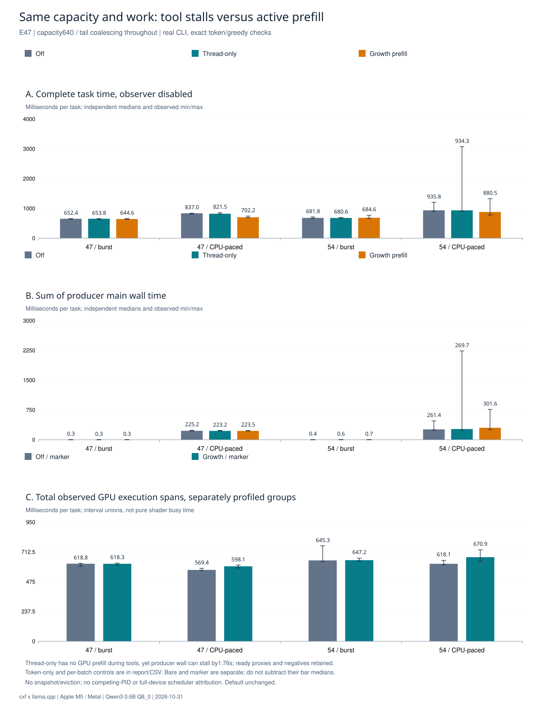

# cxf agent

[简体中文](README.zh-CN.md) · [Results](docs/benchmarks/README.md) · [Design contracts](docs/design/README.md)

A lightweight C agent runtime exploring closer coordination with **llama.cpp**: share canonical token prefixes, submit explicit context changes, and overlap local prefill with tool output.

**Research prototype.** The tool execution loop and optional native backend work. Streaming prefill helps some sustained-output workloads; general end-to-end speedups, lower whole-process memory and autonomous coding quality have not been demonstrated. Experimental scheduling remains opt-in.

## What is implemented

| Component | Current scope |
| --- | --- |
| Agent tool loop | File listing, reading, search, diff and optional writes; a deployment-fixed test command; bounded receipts and multi-round execution |
| Native context | One libllama context owns KV; shared canonical token blocks, explicit revisions, append/replace, prefix forks, rollback and budgeted prefill |
| Chat bridge | Tested Qwen3 template/tool parsing, incremental suffix tokenization and cached template preparation |
| Tool-output prefill | Optional bounded speculative prefill during `test.run`; final full token validation before generation; resident KV |
| Research adapters | Explicit KV save/restore, semantic-unit streaming, cost estimation and timing diagnostics |

The adapters call upstream llama.cpp APIs; inference kernels are unchanged. Shared token storage does **not** mean every text representation disappears or physical KV allocation shrinks. Snapshot/eviction is an explicit experiment, not required for normal tool use. See the [adaptation inventory](docs/adaptation-status.md) for integration levels and pending work.

## Start with the tool loop

Requirements: a POSIX environment, a C11 compiler, Make and Python 3.10+. The validated host is macOS / Apple M5; native Windows and Windows/CUDA acceptance remain pending.

```sh
make test
make build/agentctl
```

The tests use local deterministic endpoints and need no model, cloud account or API key. Generated C registries are included; normal builds do not run the generator.

For an already running local OpenAI-compatible HTTP service:

```sh
cp agentctl.example.json agentctl.json
# Edit agentctl.json with your own endpoint and model; key is empty by default.
./cxf.sh --root /path/to/workspace
```

The example URL is generic loopback. The current built-in HTTP transport accepts `http://` only; HTTPS services require a separate transport/proxy. Local `agentctl.json` overrides environment settings and reloads before each task; it is excluded from publication.

Enable writes and a fixed test command explicitly:

```sh
./cxf.sh --root /path/to/workspace --write /path/to/workspace \
  --test-command 'make test' --rounds 16
```

`test.run` executes the launcher's command with the process's permissions and environment. It is not an OS sandbox. File tools have their own path constraints. REPL inputs currently create independent tasks; finite request/tool buffers suit small files and short tasks.

## Use native llama.cpp

The tested combination is **llama.cpp b10938**, commit `f1e44dcc11d8802d107bd7331a3d3fd3e6f57b93`, and **Qwen3-0.6B-Q8_0**, on Metal. The small model tests compatibility and scheduling; it is not a coding-capability claim. Other templates/models need their own acceptance.

Supply matching SDK headers, built runtime libraries (including `llama-common`) and a local GGUF. Nothing is downloaded automatically:

```sh
mkdir -p build
python3 tools/build_agent_native.py \
  --sdk /path/to/llama.cpp-b10938 \
  --runtime /path/to/llama-runtime \
  --model /path/to/Qwen3-0.6B-Q8_0.gguf \
  --out build/native-local --test

./build/native-local/agentctl-native --repl --root /path/to/workspace \
  --llama-model /path/to/Qwen3-0.6B-Q8_0.gguf \
  --llama-backend /path/to/llama-runtime
```

Use a fresh `--out` for each run. Generic defaults live under `build/llama.cpp-b10938` and `local-model/`; explicit flags override them. Default native batch capacity remains **512**. Tool-output prefill is disabled unless selected with `--tool-output-prefill on`; diagnostic policies and capacities in the reports are not recommended defaults.

## What the measurements show

These are historical measured revisions, not a rerun of every current file. Single machine: Apple M5 / 16 GiB, Metal, Qwen3 0.6B, pinned llama.cpp. Matched task results below use seven evaluation pairs per workload.

| Question | Measured result | Limit |
| --- | --- | --- |
| Can sustained tool output hide prefill? | E49's existing growth policy saves **104 / 67 ms** in paired whole-task medians vs disabled; 7/7 faster in both fixtures | Three real tool calls with scripted model choices; workload-dependent overlap |
| Does a larger publication quantum help? | E49's 1536-byte trial loses **55 / 3 ms** vs the existing 512-byte growth policy on paced fixtures | Failed optimization retained; not promoted |
| Are tails resolved? | E47's thread-only control has a **1.87 s** worst task regression without tool-window GPU work | System/tool variation remains; no tail-latency guarantee |
| Is memory lower? | E09 temporary frontend heap **512 → 141 KiB**; shared-prefix fixture stores **6,000 IDs** for 48,000 logical tokens | Temporary heap/token payload; not RSS or physical KV savings |
| Is batch 640 preferable? | E46 compute reservation **597.50 → 373.44 MiB** vs capacity 1024 | Default 512 reserves 298.75 MiB; physical KV stays **896 MiB** and timing can regress |



The archive contains **50 evidence files, 35,520 main raw records and 37 figures**. Raw counts include warmups, metadata, correctness and prediction records; they are not independent latency samples. Reports separate functional acceptance, model failures, performance, historical observations and unvalidated claims. Gains from different experiments must not be added together.

[English results](docs/benchmarks/README.md) · [中文成果汇总](docs/benchmarks/README.zh-CN.md) · [Methodology](docs/benchmarks/METHODOLOGY.md) · [Validation matrix](docs/benchmarks/data/validation.csv)

## Project map and next steps

`include/cxf/` and `src/` contain the C runtime and optional libllama adapter. `tests/` currently also hosts the CLI, tool implementations and native chat bridge; these have not been extracted into a separate application layer. `tools/` contains builders, acceptance runners and report generators. `docs/evidence/` holds immutable measured evidence.

Near-term priorities are long-context memory accounting, fewer retained representations, stable task-level gains and larger-model validation on the target Windows machine. General multi-session scheduling, cloud SSE routing, broader model templates and Windows/CUDA support remain unfinished. Scope and implemented subsets are tracked in the [design registry](docs/design/README.md).

## Verify and prepare publication

```sh
python3 tools/build_benchmark_report.py --check
python3 tools/prepare_github_release.py --check
```

See the [source release guide](docs/RELEASING.md) for the clean source export and the [results package guide](docs/benchmarks/PUBLISHING.md) for the separate offline data bundle. Models, runtime binaries, credentials, local request traces, KV snapshots, session history and sibling projects are excluded. Preparation scripts do not stage, commit or push.

MIT License — see [LICENSE](LICENSE).
