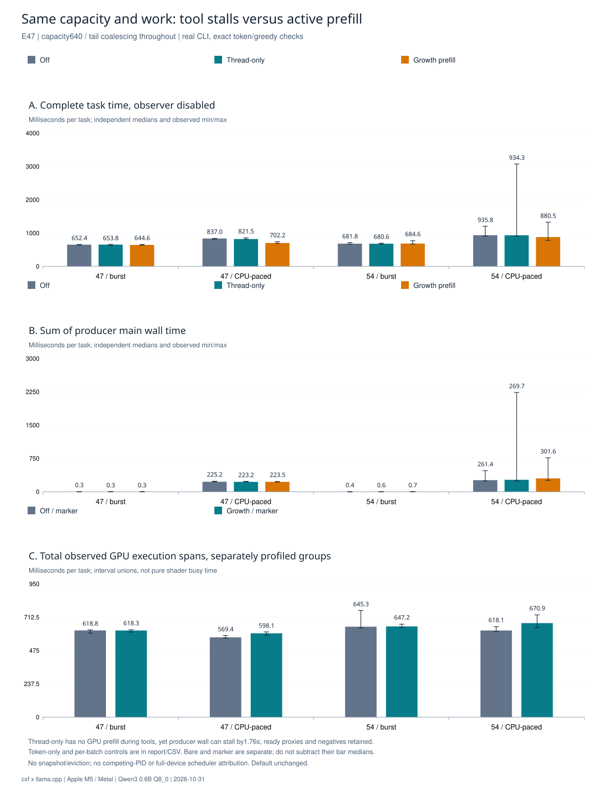

# cxf agent

[English](README.md) · [测试成果](docs/benchmarks/README.zh-CN.md) · [设计契约](docs/design/README.md)

一个用 C 实现的轻量 Agent 运行时，探索与 **llama.cpp** 更紧密的协调：共享规范 token 前缀、显式传递上下文变化，在工具输出过程中提前预填充。

**当前是研究原型。** 工具执行闭环与可选原生后端已跑通；持续输出场景有局部收益，但尚未证明通用任务稳定提速、整体内存下降或可靠自主编程。调度实验保持显式可选。

另一台 Windows 机器测试只读自预测时，先看[异机交接步骤](docs/self-speculation-handoff.md)：使用 WSL2/CUDA，先做功能验收，再跑开启／关闭对照；原生 Windows 和目标 GPU 尚待验收。

## 已经实现什么

| 组件 | 当前范围 |
| --- | --- |
| 工具闭环 | 文件列表、读取、搜索、差异、版本化多行编辑、单行编辑及可选写入；部署者固定测试命令；有界收据与多轮执行 |
| 原生上下文 | 一个 libllama context 管理 KV；共享规范 token 块、revision、追加／替换、前缀分支、回退与预算预填充 |
| 聊天桥接 | 已验收的 Qwen3 模板／工具解析、后缀增量分词与模板准备缓存 |
| 工具输出预填充 | `test.run` 输出时可选有界推测；生成前完整 token 校验；KV 常驻 |
| 只读自预测实验 | 同模型 KV 分叉探针、提前 fs.read、精确匹配／版本校验后采纳或回退；独立宿主，默认 CLI 未接入 |
| 本地文本辅助 | 可选 `llm.local`：部署绑定回环端点、独立认证、每任务两次请求，结果仅为数据 |
| 实验适配 | 显式 KV 保存／恢复、语义块流式输入、耗时估算及分阶段诊断 |

调用上游 llama.cpp 接口，没有修改推理 kernel。共享 token 存储不等于原文、模板和全部中间表示只占一份，也不代表物理 KV 缩小。普通工具流程不需要快照／逐出；它们属于显式资源策略实验。详细接线程度见[当前适配清单](docs/adaptation-status.md)。

## 云端请求观测（E62/E63）

只读默认提示已移除写入说明，可信测试relay改为紧凑UTF-8。使用`deepseek-v4-flash-0731`（DeepSeek Flash）的20个真实任务／50轮请求通过，每轮输入少18token、字节下降，但8评价对4个回退，没有稳定提速或缓存提高。逐轮usage／缓存／字节／API等待与真实工具／转发成本[分开展示](docs/benchmarks/README.zh-CN.md#e62e63--云请求utf-8逐轮usage与等待分层)，序列化墙钟略增也保留。[契约与复现](docs/design/hybrid-v1.md#e62-cloud-reproduction)。

## 版本化多行编辑（E59–E61）

用 `fs.read` 取得版本，再用仅随 `--write` 提供的 `fs.edit` 替换一个唯一多行块；冲突先重读，失败不截断原文件。参数仍限1KiB、文件64KiB，详细格式与并发边界见[契约](docs/design/versioned-edit-v1.md)。34项安全／失败与4组CLI、完整回归及Native兼容通过。

用户指定真实云DeepSeek Flash的正常修改、并发冲突恢复、只读三例通过最终源码核对。工具并非零开销：64KiB成功编辑相对旧工具多约5.6–5.8ms，主要与完整正文安全扫描量级一致；全部负对保留，不混入云端延迟或历史推理收益。见[成果](docs/benchmarks/README.zh-CN.md)。

## 先运行基本工具流程

需要 POSIX 环境、C11 编译器、Make 与 Python 3.10+；无模型自预测测试另用 C++17。已验收主机是 macOS / Apple M5；原生 Windows 及 Windows/CUDA 尚未验收。

```sh
make test
make build/agentctl
```

测试使用本地确定性端点，不需要模型、云账户或 API key。生成的 C 注册表已随源码提供，正常构建不需要运行生成器。

已有本地 OpenAI 兼容 HTTP 服务时：

```sh
cp agentctl.example.json agentctl.json
# 在 agentctl.json 中填写自己的端点与模型；示例 key 为空。
./cxf.sh --model-scope local --root /path/to/workspace
```

示例 URL 只是通用回环地址。内置 HTTP 传输目前只接受 `http://`；HTTPS 服务需要另行提供传输／代理。本地 `agentctl.json` 优先于环境变量、每次任务前重载，并排除在发布范围之外。

需要修改文件和运行测试时显式启用：

```sh
./cxf.sh --model-scope local --root /path/to/workspace --write /path/to/workspace \
  --test-write /path/to/workspace --test-command 'DEVELOPER_DIR=/Library/Developer/CommandLineTools make test' --rounds 16
```

`test.run` 执行启动者选定的固定命令，CLI 默认使用最小子进程环境，`--test-env inherit` 才显式继承环境；当前macOS默认有独立OS隔离：工作区只读、私有临时写、禁网；其他平台无后端时失败关闭。test.run的写目录授权独立于文件工具--write。REPL 每条输入目前创建独立任务，请求和工具缓冲区有上限，适合小文件、短任务。

## 启用可选本地文本辅助

```sh
./cxf.sh --model-scope local --root /path/to/workspace --local-config /path/to/agentctl.local.json
```

独立配置只接受 `api.url`、`api.model`、可选 `api.key` 和 `api.timeout_ms`，端点必须是精确 IPv4 回环。主模型可调用 `llm.local` 提交有界文本任务，辅助结果通过原工具循环返回；辅助没有工具权限，不做自动路由或共享 Native KV。主提供者在云端时，必须明确授权 workspace 外发，辅助／工具文本才能回流。配置模板与边界见[协同契约](docs/design/hybrid-v1.md)。

E50 用两个独立 HTTP 桩在 sanitizer CLI 上通过8组协作／权限测试，并验收真实读—改—测闭环及原生兼容。尚无真实端云质量或新性能结果。

## 文件和云端数据策略

所有文件工具统一拒绝 `.env` 变体、密钥文件、常见凭据目录和本地配置名；实际主／辅助配置及活动 trace 即使采用任意文件名也受保护。拒绝符号链接组件、普通文件硬链接，list／grep 跳过保护项；普通源码与 `agentctl.example.json` 可正常读取。

HTTP 默认 UNKNOWN，云端外发默认 **deny**。回环也可能是云代理：可信本地服务显式用 `--model-scope local`。可信云代理用 `--model-scope cloud --cloud-egress task` 只发任务文本；需要工具上下文时由启动者明确选择 `workspace`。`http.post` 独立设置 `--net-scope`。启动环境变量为 `CXF_MODEL_SCOPE`、`CXF_NET_SCOPE`、`CXF_CLOUD_EGRESS`，命令行优先。当前 HTTP 只连接回环，直接 HTTPS 待做；Native 推理明确属于本地。

请求、响应和工具结果检查已配置凭据、常见 token／私钥模式及已知 base64／hex 表示；被拦截结果不进入下一轮上下文、trace 或预览。E51 的445项策略检查、12组HTTP安全套件在ASan/UBSan下通过，正常工具闭环及Native／14K／Stream／输出回归通过。请求／结果策略不是通用DLP；E52另补了进程OS权限层，见下节。详见[策略契约](docs/design/data-policy-v1.md)和[功能证据](docs/evidence/agent-data-policy-20261101.json)。E51当时不新增性能结论；E53最终开销见下节。

## 隔离测试命令

`test.run`当前默认用macOS Seatbelt：工作区正文只读、独立临时目录可写、命令及后代禁网，并关闭已有fd。敏感名称和真实配置／trace仍拒绝。启动者用`--test-read DIR`／`--test-write DIR`扩展目录，`--test-net allow`独立授权联网；`--test-isolation off`才整体取消OS限制。后端或准备失败不自动降级，Linux／Windows后端仍待做；它不是VM或资源耗尽防护。框架自身的嵌套沙箱／网络测试在宿主直接运行，工具命令不自动获得这些权限。

E53的542项C检查、12组OS安全套件以及原12组策略／8组基础套件在SAN下通过，Native14K／Stream／输出回归通过。候选localhost过滤放行本机非回环监听服务，已撤下，仅发布deny/allow。

E52事后发现父环境可见，E53在启用命令前验证cxf自身启动环境确实被省略；不改系统SIP。其他同UID进程环境及argv仍不在保证内，不能把key放命令行。无有效后端即拒绝执行。230条计时记录含93组评价配对，完整CLI开启−关闭的逐对中位开销：空工具 **15.724ms**，显式CLT编译 **3.565ms**，标准Xcode cc **2467.548ms**（最差 **2534.841ms**）。大退化主要在命令内部，具体缓存／IPC原因未分离；CLT是另一条明确指定的负载，不自动替换生产编译器。见[契约](docs/design/test-sandbox-v1.md)、[完整结果](docs/benchmarks/README.zh-CN.md)及[E53证据](docs/evidence/test-sandbox-host-20261101.json)，不和历史推理收益跨阶段累加。

## 同一Xcode工具链的显式绑定

标准`/usr/bin/cc`在私有缓存为空时会通过xcrun启动xcodebuild，沙箱内发现流程有秒级回退。可由启动者明确绑定同一Xcode的工具链与SDK，保持默认权限：

```sh
./cxf.sh --model-scope local --root /path/to/workspace \
  --test-toolchain /Applications/Xcode.app/Contents/Developer/Toolchains/XcodeDefault.xctoolchain/usr/bin \
  --test-sdk /Applications/Xcode.app/Contents/Developer/Platforms/MacOSX.platform/Developer/SDKs/MacOSX.sdk \
  --test-command 'cc -mmacosx-version-min=26.0 unit.c -o "$TMPDIR/unit" && "$TMPDIR/unit"'
```

两参数必须同时有效，只设置PATH／SDKROOT，不增加目录或网络授权；不自动选择CLT，也不改写绝对`/usr/bin/cc`或显式xcrun调用。E55三组新任务（C／静态库／C++）相对原隔离完整CLI逐对中位节省**2.37／3.45／2.38秒**，均7/7；绑定后隔离额外中位仍**21／15／59ms**，C++波动较大，负对保留。零配置标准shim仍有旧回退；这属于构建命令优化，与推理／KV收益分开。[诊断与全部数据](docs/benchmarks/README.zh-CN.md)、[绑定契约](docs/design/test-sandbox-v1.md)。561项C／15组OS及原策略、基础和Native回归通过。

E56后验发现：E55绑定off／on的默认部署target为26.0／10.4，仅同编译器／SDK与输出不足以保证同编译语义。上面的历史数值和图不改，新比较显式固定目标，见下节。

## 可选的任务私有C++预编译头

保持既有沙箱权限，用相同公共前缀头的多文件任务可显式选择[私有PCH配方](tools/run_cpp_batch.sh)：

```sh
# 在test.run固定命令中执行；先绑定工具链／SDK，并选择工程需要的部署版本。
/bin/sh tools/run_cpp_batch.sh pch 26.0 common.hpp "$TMPDIR/program" main.cpp extra.cpp
# plain模式使用同一头和编译参数，可做公平对照。
```

配方固定Clang C++17／O2，PCH每任务新建、保留编译器校验、成功失败均清理，不跨任务复用或隐含授权。E57新3／5翻译单元任务计入全部冷准备后中位节省**330／794ms**（均7/7）；单文件反慢**159／118ms**，不自动启用。短期PCH逻辑文件约14.56–15.51MB，未测RSS或KV改善。规则分组候选性能失败，默认规则／日志未改。[全部阶段数据与负结果](docs/benchmarks/README.zh-CN.md)、[契约](docs/design/test-sandbox-v1.md)。

## 使用原生 llama.cpp

已测组合是 **llama.cpp b10938**，commit `f1e44dcc11d8802d107bd7331a3d3fd3e6f57b93`，配 **Qwen3-0.6B-Q8_0**，运行在 Metal。小模型用于兼容性与调度验证；自主修复失败单独保留。其他模型／模板需要重新验收。

自行准备匹配 SDK 头文件、构建好的运行时库（包括 `llama-common`）及 GGUF；脚本不会自动下载：

```sh
mkdir -p build
python3 tools/build_agent_native.py \
  --sdk /path/to/llama.cpp-b10938 \
  --runtime /path/to/llama-runtime \
  --model /path/to/Qwen3-0.6B-Q8_0.gguf \
  --out build/native-local --test

./build/native-local/agentctl-native --repl --root /path/to/workspace \
  --llama-model /path/to/Qwen3-0.6B-Q8_0.gguf \
  --llama-backend /path/to/llama-runtime
```

每次验收使用新的 `--out`，避免覆盖旧结果。依赖默认位置改为仓库内通用的 `build/llama.cpp-b10938` 与 `local-model/`，显式参数可覆盖。默认 Native batch 容量仍为 **512**，工具输出预填充默认关闭，`--tool-output-prefill on` 才启用。报告中的诊断策略／容量不是推荐默认值。

## 实测到了什么

以下是对应源码版本的历史实测，不表示本轮重新跑过全部性能。单机配置：Apple M5 / 16 GiB、Metal、Qwen3 0.6B、固定 llama.cpp；任务对照每种负载 7 对评价样本。

| 问题 | 观测结果 | 边界 |
| --- | --- | --- |
| 持续工具输出能隐藏预填充吗？ | E49 中原 growth 策略对关闭，完整任务配对中位节省 **104 / 67 ms**，两组均 7/7 更快 | 三次真实工具调用，模型选择由脚本固定；依赖输出节奏 |
| 增大发布量子更好吗？ | E49 的 1536 字节试验对原 512 字节策略，持续任务反慢 **55 / 3 ms** | 失败优化保留，没有升为默认 |
| 尾部回退解决了吗？ | E47 仅线程控制最差任务反慢 **1.87 s**，工具期间没有 GPU 工作 | 工具／系统波动仍在，没有尾延迟保证 |
| 内存下降了吗？ | E09 临时前端堆 **512 → 141 KiB**；共享前缀场景 48,000 逻辑 token 只存 **6,000 个 ID** | 属于临时堆和 token payload，不是 RSS 或物理 KV 收益 |
| batch 640 更划算吗？ | E46 计算预留对 1024 容量从 **597.50 → 373.44 MiB** | 默认 512 为 298.75 MiB；物理 KV 均 **896 MiB**，耗时可能回退 |



目前归档 **64 份证据、37,290 条主记录、43 张图**。E62/E63新增50云轮次和60序列化block，20任务／30工具附表另列；E59／E61保留工具诊断，E60的3个早期真实云任务单列；推理性能仍对应历史版本。[异机交接步骤](docs/self-speculation-handoff.md)用于后续目标机器验证。主记录包括预热、元数据、正确性与预测样本，不能当成同等数量的独立性能样本。功能验收、模型失败、性能、历史读数与未验证项分开记录，不跨阶段累加收益。

[中文完整报告](docs/benchmarks/README.zh-CN.md) · [English results](docs/benchmarks/README.md) · [测试方法](docs/benchmarks/METHODOLOGY.md) · [验收矩阵](docs/benchmarks/data/validation.csv)

## 代码位置与下一步

`include/cxf/`、`src/` 是 C 运行时与可选 libllama 适配。`tests/` 当前也承载 CLI、工具实现与 Native 聊天桥，尚未抽成独立应用层。`tools/` 包含构建、验收和报告脚本；`docs/evidence/` 保存不可变的实测证据。

下一步重点是长上下文的真实内存核算、减少保留表示、稳定的完整任务收益，以及目标 Windows 机器上的较大模型验证。通用多会话调度、自动端云路由、云端 SSE 接线、更多模板和 Windows/CUDA 仍未完成；设计范围和已实现切片见[设计入口](docs/design/README.md)。

## 校验与发布准备

```sh
python3 tools/build_benchmark_report.py --check
python3 tools/prepare_github_release.py --check
```

源码干净导出见[发布指南](docs/RELEASING.md)，离线成果包见[成果发布说明](docs/benchmarks/PUBLISHING.md)。模型、运行时二进制、凭据、本地请求日志、KV 快照、会话历史与同目录独立项目不发布。准备脚本不执行暂存、提交或推送。

采用 MIT 许可证，见 [LICENSE](LICENSE)。
