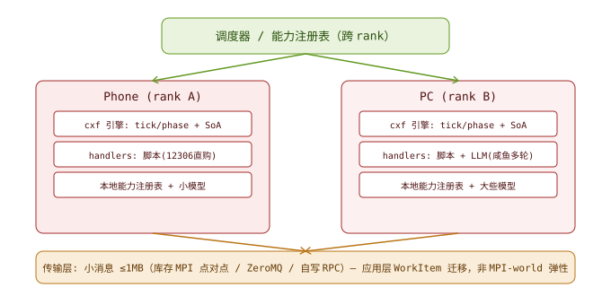

# cxf Agent 运行时：分布式小模型协调织物（设计文档）

> **历史设计与阶段读数**：现行边界以[设计入口](design/README.md)为准。2026-11-01 公开准备已移除私人服务地址与凭据来源；历史设想不等于当前实现，原始请求日志不发布。
>
> **2026-10-30 原生推理增补入口**：[llama-context-v1.md](llama-context-v1.md)
> 是当前 libllama 上下文后端的实现契约；[实验报告](llama-context-experiment.md) 保留依据。
> §4.10/§4.11 的 HTTP 协议路径继续有效；直接库后端作为可选能力实现，不在协议层堆分支。
> 本文历史版本号与旧决策保留，当前完成状态以 STATUS.md 和该增补文档为准。
> 原生聊天／工具的后继接入见 [llama-chat-v1.md](llama-chat-v1.md)：可选 C++ 桥复用
> 上游 Jinja／输出解析，核心仍为 C；已验收 Qwen3，通用增量模板尚未完成。

> 状态：v1.14.25。§0~§3 + 架构图已立；§4 执行模型 / §5 分发层 / §6 第一刀切片；
> §7 能力自举（小模型写工具 + 仓库管理）为 v0.3 新增；
> **v0.4 新增 §4.8 多轮闭环（已落码）与 §4.9 字节账（实测 + 下一刀方案）。**
> **v0.5 观测层三件落码**（停滞观测器 / 审计器 / 终值改 blob，见 §2.1 末尾与 §10.7）。
> **v0.6 协议层落码并接进能力层**（`agent_http` + `agent_llm`；`CapImpl` 加 `ctx` / `out_hint`，
> 见 §4.10）—— 链条 `协议 → CDC → 上下文管理 → 推理引擎适配` 的第一格通了；
> 同版补 §4.11「本地推理的适配下沉到哪三处」与 §1 的协议边界（只认归一后的那一个形状）。
> **v0.7 §4.12 分块与 PIC 研究线**：切块方式决定成败（EPIC 实证）· 我们与 PIC 的分歧
> （它们修地址、我们排版避免地址问题）· **块内不用结构化格式**（闭合标签放大前缀断裂代价）·
> CDC 的产出是排版决策而非块对齐。
> **v0.8 §4.13 修正 §4.12 的前提**：上面那套只在**云端**成立；**本地**缓存是自己的资源，
> 命中率是资源管理问题（KVFlow 2.19× · Canopy 树即调度抽象 · Claude Code 前缀事故 90% ·
> llama.cpp `seq_rm`/`seq_cp`/`state_seq_*` 原语）· 树操作与引擎原语一一对应 ·
> **线性化改两段式**（稳定区 DFS + 活跃区近期，避开 Lost in the Middle 中段死区）。
> **v0.9 §4.14 从行为长出公理**：读 DialogMesh 原文后定位缺口 —— 它的"收敛"是 **LLM 审 LLM**
> （同族采样，只压概率不排错）；公理的判据是**保守扩张 + 可重放**，不是"对不对"；
> 判定强度三档（L3 可判定 / L2 半判定 / L1 不可判定）· 复用机制 = **编译进结构（不占上下文）** ·
> 升格判据 `m > C_a/C_s` · cxf 的优势在**可判定的表示层**，缺的是候选通道。
> **v1.0 §4.15 注意力分差 + 闭环优先**：砍掉"多树通信"（在 C 里 = 位置重对齐 ⇒ KV 全失效；
> 已退化成"只交换终值"，§4.8 已解决）· context rot 的硬数字（18/18 全退化、10K→100K 掉 20–50%、
> 32K 即悬崖、**语义邻近的无关内容比为短的上下文更差**）⇒ **多给可能是负收益，两难同向化** ·
> **先测拐点 `b*` 再建树**（一个字段 + 一个任务集 + 一行 CSV 就能测）。
> **v1.1 §4.15.1 第一版闭环取 Pi 的只读档**（`fs.read` / `fs.grep` / `fs.ls`）：
> Pi 极简有实测支撑（Terminal-Bench #2）⇒ 起点对；但**只取功能面不取机械面**，
> 且**不取它的 compaction 路线**（人在场 vs 无人值守）· 能力的**返回粒度**决定上下文默认质量。
> **v1.2 第一版对比台落码**（`tests/bench_budget.c` + `make budget`）：三个候选实现并排
> 量 `b*` 与噪声 —— `ls` 0/8、`read_all` 48~8192 噪声 7、`grep_hits` 96 噪声 0
> （**最坏预算 85×、噪声归零**）· **候选不进目录**（目录是结论不是实验场）·
> 副产品：`b*min` 与 `b*max` 的裂口证明"平均预算"是错指标，只能按最坏给。
> 同版补**三段拆解（找 / 装 / 用）**：本台只测"装"，`recall` 是信息到达率不是答对率；
> **`b*` 是区分"没找到"与"找到了没用上"的归因分母**。单位是字节不是 token，跨论文对照需换算。
> **v1.3 §7.3 索引层**：分工判据 = **输出能否被机械校验**（不是贵/便宜）· 小模型的真定位是
> **可无限次调用的整理工**（可重复取交集 + 可异步 ⇒ **允许过度整理**）· 多颗粒度 =
> **四条正交轴**（文档/符号/交互/时序，逐一映射 `blob`/`namemap`/`csr`/`ring`，零新结构）·
> **git 给 delta 不给 impact**，符号级索引是加速的前提锚点 · **测试记录是最硬的索引**。
> **v1.4 §7.5 小模型的可靠性**：**可靠度 = 记录 × 证据 × 穷举（乘不是加，任一为 0 则整体为 0）**；
> 大模型三条全无（不可复现 / 证据不绑定 / 不许穷举）⇒ **"小模型更不可靠"是错觉** ·
> **对抗性 = 要求它交出"我什么情况下是错的"**（`falsify` 那一格是全部价值）·
> **"等得起"消掉了幻觉的一大来源**（时间压力下的补全）· 整理应**常驻轮转**而非事件触发
> （冲突检测需全库扫描，delta 发现不了历史矛盾）。
> **v1.5 §4.15.2 胜者转正（已落码）**：`fs.grep` 成为目录里**第一个真实能力** ——
> 根目录在 `ctx` 而非 `args`（payload 不能选路径）· 截断写 `#truncated` 而非借 `FULL`
> （语义边界不该烧扩容重试）· `alphasort` 定死遍历序 · `lstat` + 深度防环。
> **重跑幂等第一次被实测**（`2 call / 1 exec / 同 30B`）；**零新增结构**。
> 顺带被注册期不变式拦住一次：契约与实现必须在同一次 sync 之前到齐。
> **v1.6 §4.16 工具调用落码（清单走协议、动作走文本）**：`AgentLlmCfg` 加 `tools`/`tools_len`，
> 请求体插入 `tools` + `tool_choice`（无 tools 时**逐字节不变**）· 目录侧新增
> `AgentRegistry.tools`（判据同 `render`、形状不同）· `agent_llm_parse_tool_call` 解出
> `name` + `arguments.args`（**字符串里套 JSON**，两层转义）· `agent_llm_action_from_response`
> 把 `tool_calls` 译回 `CALL|cap\nargs` ⇒ **下游零改动、解码器仍只有一份**。
> 抓包尺度：tools 定义 54–84 KB，是固定前缀的**最大单项**（比 system 还大）；
> 我们 4 个能力 1162 B。**零新增结构**。仍缺：工具结果没有回流路径（下一刀）。
> **v1.7 §4.16.1 缺口 ⑤ 补上了**：续跑节点 `S'` **就是发起调用的那一行本身**（就地重置，
> 于是"args 转移"这个动作根本不存在）· **只有"工具不派生"才续跑** —— 判据是注册期事实
> `cap_acts[cid]`，对 `agent.step` 一类建 `S'` 会得到分叉而非回路 ·
> args 加显式上限 `AGENT_ARGS_MAX`（超限失败 + 计数，**不静默截断**：界该由产出方声明）·
> 实测 `2 次调用 / 续跑 1 / 第 2 轮 args 43B 且含工具输出`。**零新增结构**（两个计数器）。
> （上一条"超限失败"**已被 v1.8 改掉** —— 那个选择会让 `b*` 永远测不出来，见 §4.16.2。）
> **v1.8 §4.16.2 装配预算（已落码，并撤回一条自己写下的提议）**：把"预算"拆成
> **产出预算**（能力 ctx，注册期）与**装配预算**（`AgentStore.args_budget`，运行期）——
> 上一版想把预算塞进 `AgentLlmCfg` 再驱动 `max_hits`，是层错 / 方向错 / 可变性错三条。
> 超预算时**尾部整条丢**（不截半条 / 不判失败 / 不丢头部），并往 args 写
> `#budget: dropped <N>B` —— 三条各有硬理由，其中"丢尾不丢头"是
> **prefix-stable append log 的直接推论**，不是缓存优化。计数 `stat_args_lost` + `bytes_lost`。
> 同版把 `wire_loop` 的 tools 接到**真实目录渲染**（`tools 1477B` / 6 能力）。
> **零新增结构**（一个字段 + 一个计数器）。
> **v1.9 §1 措辞修正：不预设 LLM 的角色。** 原文"LLM 不是 agent 大脑"把**可选项写成了禁令** ——
> LLM 当规划者 / 裁判 / 算子都合法，那是部署选择。框架只按一条结构判据划线：
> **决策必须落成数据，不能藏在控制流里**；被拒绝的不是"高级决策"，是"决策状态住在
> 模型自己的对话历史里"（不可观测 / 不可复现 / 不可裁剪，与它多聪明无关）。
> 同版同步 §2「脚本优先」的定性（**降级链的起点**，不是对 LLM 能级的限制）与 §4.1 / §4.4 / §4.6
> 三处引用，以及 `dialogmesh-review-v2.md` 的对应结论。**零代码改动。**
> **v1.10 §4.16.3 可执行回路：从"机制全绿"到"一次真跑"（已落码，真 key 实测）。**
> 缺口不在机制里，在**测试里我们自己写死的那三格**：入口没有载荷（`InjectMsg` 只有类别）、
> 轮数上限是编译期常量、模型的"我说完了"是一句人话（不是 `DONE` 前缀）。三处补齐后
> `tests/agentctl.c` 成为第一个可执行回路，同一份代码接真实 endpoint 跑通。
> 第一条真实轨迹随后暴露四件事：**接头缺分隔符**（问题与第一份结果粘成一句）、
> **transcript 不自描述**（只记结果、不记录模型发过什么 ⇒ 加 `#result` 头）、
> **同一调用被重复执行 1~4 次**、**撞上限后 `failed` 与"工具坏了"同数**（拆出 `stat_capped`）。
> 关键判断：**模型停不下来不归框架管** —— 三条实验（加头 / 用真 messages 结构直连 /
> 换更强的模型）都否掉了"是装配方式的问题"，于是框架只守三件事：
> **可观测 / 有界 / 可归因**。去重与强制作答**明确不做**，各写触发条件。
> 同版补两件（都由"端点上出现大量相同请求"这个问题逼出来）：**诊断头**
> `X-CXF-Ctx: run=… call=…`（`AgentLlmCfg.hdr`，不进 body ⇒ 不动前缀缓存键），
> 以及 **`CXF_LLM_TIMEOUT_MS`**（写死 30 s 的代价实测到了：让模型输出 3000 行时
> 撞超时 ⇒ `CXF_ERR_IO` ⇒ 整条失败，**长输出原本是死路**）。
> **v1.11 §4.17 EXECUTE 是同步 RPC（已实测，含新仪器 `make probe`）。**
> `[time] wait 100.0%` —— 回路的全部墙钟都花在 `recv()` 里。但实测把"并发能救回路"
> 这个隐含假设**劈成两半**：K=32 时吞吐 13.19 rps（串行的 20 倍）、p50 只涨 40%，
> 而**单任务墙钟一分不救**（轮间是数据依赖，只有轮内 fan-out 能并发）。
> 于是定序：**fan-out 是异步的前提，异步是 fan-out 的放大器** ——
> 先把"一轮多个在飞"打通（今天解码器只取 `tool_calls[0]`，第二个静默丢弃），
> 再谈 submit/poll ABI；而异步把"超时"变成"可以再 submit"，于是 **A1 `CapRerun`
> 从可选优化升格为异步 ABI 的前置条件**。
> **§4.17.7 撤回"按云 / 本地分两档"的说法**：并发度 = `min(demand, quota)` ——
> 需求由图给、供给由部署给；真正的判据是**过载是硬的还是软的**、**你在优化吞吐还是延迟**。
> 云端只能 AIMD（反馈滞后且试探要钱），本地可以直接读水位（反馈前置且探测免费），
> 差异收进**一个 `quota_source` 槽**（`FIXED` / `WATERMARK` / `AIMD`），不是 if-else 分叉。
> **v1.12 §4.17.8 配额落码：两个正交闸门（`conc_max` × `rpm`）。** 只给 `rpm` 是
> "限了总量、没限形状"（60 个 ready 会在 t=0 一口气打完整分钟额度，然后 59 秒发不出去），
> 只给 `conc_max` 是速率无上限 ⇒ **必须两个**。`rpm` 是**买来的契约不是可观测事实**，
> 所以 AIMD 只能在它下面往下调、不能顶。实现是**毫令牌桶**（`rpm < 60` 时整数令牌会永不补充
> ⇒ 那种部署一条都发不出去）、`burst = conc_max`、补充惰性、天花板防"暂停后猛发"绕过限速。
> **默认 0 = 不限**（新约束的默认值必须是"没有约束"）。挡回去**不是失败**：
> 留在 `WI_RUNNING` + `stat_quota_wait`（不进 `failed`）+ 闸门在 `tries[r]++` 之前
> （否则用配额烧掉重试额度）。`AgentStore.clock` 可注入 —— 速率策略是内核第一个依赖墙钟的
> 东西，不注入就只能真等 30 秒，CI 上表现为超时而不是失败。**已知代价：tick 忙循环，
> 等令牌那段空转** ⇒ `stat_quota_wait / stat_executed` 是 A5 的需求计数器，不是诊断计数器。
> 验证：`test_quota`（桶算术六格）+ `test_quota_gate`（真实 world，冻住时间挡回 3 次不判失败、
> 解冻后收敛）· 四处变异全部被捕获。
> **v1.13 §4.17.9 轮内 fan-out 落码（`A4`）。** 根因不在并发设施，在解码器：只解
> `tool_calls[0]`，`[1..]` 静默丢弃（实测模型一次返回 2 个）。形状是**拼接**：
> 一份产出 = N 个动作块首尾相接，前提是每块自定界 ⇒ 头加显式 `args_len`（5 → 9 字节），
> A1 从 `HDR+cap <= len` 变 `HDR+cap+args <= len`。**不选"外面套总长前缀"**：那让长度
> 信息出现两处，多一条静默可违约的不变式。**本轮动作 = 一次事务**（先解完全部再派第一条 +
> `intent_ok` 预检 + `pending` 只数 RESUME 子项）；`chain_reachable` 与 `chain_pick` 拆开，
> 否则同一件事记两次 `stat_denied`。**文本通道恒为一条**（体是"第一个换行之后的全部"，
> 第二条头不可区分 ⇒ 要转义，而那正是 §4.8 拒绝文本的理由）；反过来**fan-out 活在字节层**，
> 任何能力都能用。顺带修掉一个落点：文本→编码从**每个调用方**收回协议层，那一步消失
> （`agentctl` 第一版正是忘写它 ⇒ "executed +1 但工具没跑过"）。上界
> `AGENT_FANOUT_MAX = 8`（超限整条失败，不截断）。最关键的一格是 `test_fanout_gated`：
> **fan-out × 配额闸门**把两个子项拆到不同 tick —— 同步执行时 `pending = 1` 的错实现能侥幸得到
> "两份结果都在"，只有拆到不同 tick 才逼得出来（变异：终值那次入参 127B → 69B、`final` 归零）。
> 全项目现在在哪、还剩什么、下一步做什么 —— 看 `STATUS.md`（一页纸索引）。
> **v1.13.1 补上一个一直存在的静默洞（§4.16.1）。** 一条子项落地时有**三种**结局，
> 而改动前的条件 `res != NULL && res_len > 0` 让后两种**都不写任何字节**：
> `#result … 31B`（成功有产出）/ `#result … 0B`（成功但空）/ `#fail …`（没成）。
> "成功但空"与"失败"在 args 里完全不可区分 ⇒ 模型只能再发一次同样的调用。
> 这是 `#budget`（丢条目要留标记）那条原则的**第二次**应用：**上下文悄悄不长，
> 和悄悄变短一样，必须留标记。** 两处变异（恢复旧条件 / 失败也写 `#result`）
> 都被 `test_fanout_note` 捕获，后者靠一条**负断言**（失败不许冒充 `#result`）。
> **v1.14 §4.18 能力边界与安全：四层，只有两层该写在这份代码里。**
> 把 Codex 的安全拆开看（OS 强制 / 薄策略 / 人审 / git 可逆），**该抄三件**：
> 两轴独立（与 `conc × rpm` 同形）、`--log-denials`（拒绝可归因的最便宜形态）、
> 默认值站在"不可逆"一侧（与"配额默认不限"不冲突 —— 方向跟着**违约代价**走）。
> **必须反着抄一处**：它的边界是进程边界（能力是 shell），我们的边界是能力边界
> （窄接口，`fs.grep` 连 path 参数都没有）⇒ **先能力边界、后 OS 沙箱**，
> 否则 `fs.read → http.post` 这条信息流对进程级沙箱是瞎的。
> 两个同构风险：① **契约的来源必须比契约本身更可信**（CVE-2025-61260：
> `trust is resolved at the config location, not at the config contents`）⇒
> 契约来源必须在 workspace 可写根之外；② **`ctx` 是隐式入参**（不经 args、不进 `#result`、
> 不受预算约束）⇒ 只装部署事实，不装机密。两条都零代码，触发条件相同：
> 第一个需要凭据的出网能力。
> **§4.18.0 是这节真正的核心**：**分层不是优点，除非每一层的违约能在这一层被判出来** ——
> 一个"层"的全部内容就是一行只用到本层信息的谓词（`realpath(target) ⊂ root` 这类）。
> 三条推论：不能自己判定违约的"层"只是注释；多层挡同一类只算最内层（各挡一类才是纵深）；
> 层的边界 = 谁负责的边界。**实用价值：判据可以先于实现存在**（现在没有写能力，
> 但 L2/L3 的谓词已经能写下来，因为它们只描述"什么算违约"）。
> **§4.18.4 目录形状：条数 × 每条自由度，不是"少而精 vs 多而全"。**
> Unix 的位置是"**很多窄接口**"（正交 = 语义不重叠，不是数量少）；PowerShell 的 verb-noun
> 反而是正交的显式编码。⇒ **加新能力的正当理由不是"能做新事"，是"引入新的自由度维度"**
> —— `fs.grep_todo` 是 alias 不是能力。第二笔预算：条数线性推高固定前缀
> （4 个能力 1477 B，真实抓包 54–84 KB，且在 KV cache 救不了的头部）。
> **两种味道在一起的方式：在同一个能力内部，不在目录里** —— **实现可以复杂，契约必须窄**。
> 蓝图是窄接口的**后果**（窄 ⇒ 组合必然 ⇒ 需要声明），不是它的替代。
> **§4.18.5 两条设计逻辑的真名：语义在"组合"里还是在"接口"里。**
> Unix 系语义在组合、正确性靠**约定**、代价是"每段很笨段数多"；Windows 系语义在接口、
> 正确性靠**接口完整性**。**cxf 早就选边了 —— 不是我们说的，是 ABI 定的**
> （一个 `args` 进、一段字节出，能力不知道自己在被谁用）。
> 于是之前四条看似无关的决定全成了同一条选择的**必要条件**：段数多 ⇒ fan-out；
> 接缝自描述 ⇒ `#result` 三结局；接缝类型化 ⇒ 三个 id 空间 + `plan_search`（零代码）；
> 组合被声明 ⇒ 蓝图（零代码）。**"层要先搭"在 Unix 系下 = 先立接缝，不是先立安全层。**
> 该保留的 Windows 那一半只有一处：**类型端口**（把"接不上"变成注册期错误）。
> **v1.14.1 §4.18.6 / §4.18.7 两刀落码：写与 dry-run 各自成能力，框架仍零改动。**
> `fs.write_new`（`O_CREAT|O_EXCL`）是目录里第一个**会改变外部世界**的能力，
> 它把三件事一次性买断：**天然可逆**（逆操作是 `unlink`，"这路径是我建的"由 `O_EXCL` 保证，
> 不靠调用方记住）· **天然幂等**（`EEXIST ⇒ DONE`，不需要框架配合）· **永不 `FULL`**
> （收据长度有上界）⇒ 「这个能力会不会被重跑」从此可以**静态回答**。
> 落码时撞出五条设计时没看见的（其中"**先判容量，再动世界**"升格成规则：写能力的 `FULL`
> 若在副作用之后才判，就只剩"撤销一次成功"或"说一次谎"两个坏选择）。
> 第二刀是 `fs.diff`：**dry-run 是能力不是开关**（方言承载不下第三段 + 部署侧要能分别
> 声明"能看"与"能覆盖"，于是它的 `trust` 是 `IO` 而不是 `WRITE`）。LCS 行对齐 +
> `same` / `absent` / `diff` 三种结局 + `#eol` / `#coarse` / `#omitted` 三个标记 ——
> 其中最重要的一条是**"没写全"的三种形态第一次分开报**：容量不够走 `FULL`（扩容有用）、
> 界到了走标记（扩容没用）、**未知写成 `-?` 而不是 `0`**（"旧文件是空的"与"旧文件太大"
> 是相反的下一步动作）。顺带把"原子"拆成**存储层不可再分**与**语义闭合**两层 ——
> 组合（`diff` 然后 `apply`）不原子，而组合风险没有代码解（那是 L5），只能被声明。
> **v1.14.2 §4.18.8 `fs.write_apply` 落码：覆盖，以及为什么 `O_TRUNC` 是错的。**
> 先纠正 v1.14.1 末尾那句"`write_apply` 是 A1 的第一个真读者"——**不成立**：
> 收据有上界 ⇒ 先判容量再动世界 ⇒ 永不 `FULL` ⇒ 框架的重跑碰不到它；而"模型把同一
> 个调用发两次"由内容幂等答成 `same`。~~`CapRerun` 的读者是 `fs.append` / `fs.move` /
> `http.post`~~ —— 这句也在 v1.14.3 被推翻（见 §4.18.8 末），原因同一把刀还差一层：
> **`CapRerun` 挡的是框架发起的重跑，而框架只在 `FULL` 后重跑**；fs 族整族收据定长 ⇒
> 永不 `FULL` ⇒ 这个字段对 fs 族一个字都不生效。第一个真读者必须在"输出不可预测 +
> 有副作用"的交集里，那是 `http.post`，不是 `fs.append`。
> 这一刀的核心是**失败必须停在"旧内容还在"那一侧**：`O_TRUNC` 在写之前就毁了旧内容，
> 于是 `write` 失败留下"半截新文件 + 旧内容已不存在"，而 `write_new` 的逃生路线
> （`unlink`）在这里关闭了 —— 所以替换走"同目录临时文件 + `rename`"。
> 一个动词覆盖 `diff` 的三种结局（same 不动 / absent 创建 / diff 覆盖）；`same` 是
> **能力**不是优化（inode 可区分"没动"与"写了相同内容"）；覆盖**保留权限位**
> （否则 0755 的脚本会静默变成不可执行）。部署矩阵因此从 3 格变 4 格
> （实测 1872 / 2360 / 2360 / 2848 / 2803 B），`--create` 与 `--write` 互斥。
> **v1.14.3 只做一件事：把 `CapRerun` 的"读者是谁"再纠正一次（零代码）。**
> v1.14.2 说"下一个读者是 `fs.append` / `fs.move`"—— 仍然错，错在同一把刀切错了层：
> `CapRerun` 挡的是**框架发起的重跑**，而框架的重跑只有一处、且只在 `FULL` 之后
> （`tests/agent.c:1829-1843`，并且是**把 `exec` 从头再调一次**）。fs 族收据全是定长小串、
> 实现又一律先判容量再动世界 ⇒ **整族永不 `FULL`** ⇒ 这个字段对 fs 族一个字都不生效。
> ⇒ 判据第二次收紧：不是"重跑会不会二次生效"，而是"**谁会发起那次重跑**"。
> 框架发起的归 `CapRerun`（第一个真读者 = `http.post`：响应体不可预测 + 真出网花钱）；
> 模型发起的（重复 tool call）框架看不见，只能归**能力契约** —— 当时这里写的是
> "乐观前置条件（调用方报出当前长度）"，**v1.14.4 落码时否掉了它**：首次调用不知道该填
> 什么，只能给哨兵，而哨兵路径没有保护就是幂等破洞。实现改成**尾部比较**（见 §4.18.9）。
> 同批把 `fs.move` 从这一格移出：它重跑时世界不变，要修的只是收据分档 ——
> **"报不清"不是"多做了"**，并列写会让人误以为同一种风险。
> **v1.14.4 §4.18.9 `fs.append` 落码（第四刀）：追加，以及"重跑凭什么说我没做"。**
> 它是目录里第一个**重复调用会真的多写一份**的能力，而它不靠框架字段自证：追加前读
> 文件最后 `blen` 字节比，相同即 `same` 且一个字节不写。因此**判据第一次落在"位置"上** ——
> 内容在文件开头/中间出现过不构成"已经追加过了"。两个边界必须一起读：挡不住并发写者
> （TOCTOU，要 `flock`），连续两次追加完全相同内容会被判 `same`。
> 文件不存在报 `absent` 且**不创建**（创建是 `write_apply` 的 `absent` 那一格，两能力咬合）。
> 部署矩阵 4 格 → 5 格（`--append` 与 create/write 正交，实测 1872 / 2360 / 2360 /
> 2803 / 2392 / 2880 / 3323 / 3368 B）。**框架侧第四次零改动。**
> **v1.14.5 §4.18.10 `http.post` 落码（第五刀）：第一次让副作用发生在我们的世界之外。**
> 它本该是 `CapRerun` 的第一个真读者（"输出不可预测 + 有副作用"只有这一格），落下来却是
> **第一个主动拒绝 `FULL` 的能力** —— 于是 `CapRerun` 至今仍是零读者，A1 的处境比上一版更糟：
> `FULL` 的框架语义是"再给一倍、把 exec 从头再调一次"，
> 对出网就是**再发一次请求**（对方收两次）⇒ 响应超限改报 `#truncated` + `CXF_OK`，
> 只有输出缓冲本身太小才报 `RANGE`（把重跑许可收回去）。同批修掉一个既有静默缺陷：
> `agent_http_post` 在 cap 满时停止读、却按正常路径解析 ⇒ 调用方拿到"看起来完整"的短响应；
> 现在由传输层标记 `truncated`（**"是否读全"只能在产生处判定**）。
> 凭据的三个"不"靠结构而非检查：只给 path 不给 URL、不回显收据、不进输出缓冲。
> SSRF 靠收窄自由度挡（host/port 来自 `ctx`，与 `fs.*` 的"根来自部署"同构），不靠黑名单。
> 部署矩阵加 `--net HOST:PORT`（`CXF_NET_AUTH` 取凭据），实测 2312 / 2832 / 3763 / 3808 B。
> **框架侧第五次零改动。**
> **v1.14.6 A3 落码：`stat_cost` 的口径统一成"按实际调用"**（§4.9 那个"待定的语义决定"）。
> 一行改动 + 五条断言：钱/出网/重试三个计数器从此同口径，`stat_exec_calls − stat_executed`
> 的差值就是浪费量。实测同用例 cost 445（旧口径 205）—— 差 240 正是扩容重跑三次的钱，
> 旧口径下"这个回路很便宜"是个看起来成立的错结论。同批核对出一个事实：**`CapRerun`
> 零行代码**（只活在文档里），它唯一的候选读者已在上一刀拒绝 `FULL` ⇒ A1 的半数从
> "待落码"改判为"确定不做，除非出现必须重跑的实现"。**框架第六次零改动。**
> **v1.14.7 第二条真实轨迹（云端服务，`deepseek-v4-flash-0731`）抓到一个真 bug 并修掉。**
> `fs.grep` 的 `fgets` 在 `FS_GREP_LINE_MAX-1` 处**按字节**硬切，多字节字符被劈成半个 ⇒
> 进上下文的是非法字节，进请求体 JSON，严格的服务端直接 400，而能力层报 `rc=OK` 无标记。
> 这是"有界可以，静默不行"的第三个实例，且比前两个毒：**坏的不是数量，是字节本身**。
> 修法 `utf8_clip`（切口退到最后一个完整字符边界，不猜不修坏字节）；
> 测试 6 条断言（3 长度 + 3 整串 UTF-8 合法性），变异（去掉 clip）恰好 6 红、不多不少。
> 同条轨迹还回答了被追问的"为什么请求体只有 system + user 两条消息"——**是设计，不是 bug**，
> 三条理由（无状态 args blob / 确定性契约 / 零新增结构）+ 一条代价，见 §4.16.4。
> `#truncated` 报行数而超长行按字节切，口径不一致，**已定位未决**（见 §4.16.4 表）。
> **框架第七次零改动。**
> **v1.14.8（同日，零代码）：§4.16.4「没有 assistant 是设计」的辩护被质疑后部分承认。**
> 「模型分不清」与「上下文操作少标识」两条**都成立**：调用不在 transcript 里（只有 24 B
> 参数摘要）、配对靠顺序、mid-loop prose 全丢；而**顺序今天就已经是倒序/完成序**
> （`recycle_tick` 倒序回收 + 配额闸门把 fan-out 的 kid 摊到不同 tick），没有测试钉它。
> 原辩护第 2 条（确定性契约）**当时说重了**。处置未定：候选 `#call`/`#result` 同 id
> 配对（约 +20 B/轮，框架零新结构）vs verbatim assistant 回合（贵）。见 §4.16.4 末。
> **v1.14.10（同日，零代码）：§4.18.2 补上"写入面 → 执行面"这条边，并纠正一处判据。**
> 上一版把 L4 写成"挡整个进程越界"，顺着一读成了"逻辑不自破就不用接"。漏的是：
> **表达空间是闭包，不是各能力表达空间的和** —— `fs.write_apply` 单独看只是改文件，
> 配上「`make` 读 `Makefile` / `git commit` 跑 `.git/hooks/*` / `npm ci` 跑 `postinstall`」
> 就变成写代码，而**执行者不是我们**。契约层准入看不见（只答"在不在 root 内"），
> L4 也挡不住（写入合法）⇒ L4 的作用是**压爆炸半径**，从"可选加固"变成某些部署的准入条件。
> 两条新判据（未落码）：默认拒绝改带执行位的文件；可写面由部署声明（可写子树，默认空），
> 不用黑名单。**"沙箱强度匹配表达空间宽度"要按闭包算，不能逐能力算。**
> **v1.14.11（同日，零代码）：新增 §4.18.11「表达能力表 + 分层准入 + 怀疑索引」。**
> 把 11 个实现的 trust/tier/cost 与"模型能挑什么 / 碰到哪条边界"填成一张表，读出三件事：
> ① **读面宽度由 `root` 决定，不由能力决定** —— `fs.diff` 给空 content 时输出即整文件内容
> （`agent_fs.c:697`），所以"只读部署"不等于"小权限"；② 三档把"可逆"与"不可逆"压成
> 一档（`write_new` 可删掉重来 vs `write_apply` 保留 0755 且旧内容不可恢复）；
> ③ 逼出上一条闭包判据的**对称边**：**读 × 出网 = 外泄**（`fs.diff` 读全文 + `http.post` 发出，
> 两个能力、零脚本）。⇒ 准入不能逐能力判，要判"这一对是否同时授予"。
> 另立两条判据：**准入是逐层合取，不是跨层取 `min`**（`min` 会让"可回溯缺失"关掉只读，
> 而只读没有副作用、不需要回溯）；**怀疑索引必须可复现 ⇒ LLM 不能进准入路径**
> （LLM 的产出是证据不是判据）。`CapImpl.tier` 今天不参与准入（只在工具卡与 `stat_llm_calls`），
> 所以"按模型档限权"需要**部署级新字段**，不是复用它。
> **v1.14.12（同日，零代码，待裁决）：新增 §4.18.12「意图粒度 vs 机制粒度」。**
> 回应"不收功能面、给最高权限、越权就降级往复"的提案。方向上同意**机制知识不该进提示词**，
> 但三处落点要挪：① **不需要往复** —— `chain_pick`（`agent.c:278`）在分解期就按 `trust_max`
> 取了第一个够得着的实现，是**同一轮内**完成，往复只会花一整轮 LLM 调用去买框架免费做的事；
> ② 省的是**卡片数**不是权限，而 `cat_count` 与 `cap_count` 共用一个 `CAP_MAX = 16`
> （`:215` / `:256`），**实现槽更紧（只剩 5）**，且 `fallback` 是单指针 ⇒ 一个弱档只能服务
> 一条链 ⇒ 合并上限只有 1 张卡（`fs.write` = `diff`→`apply`）；
> ③ **徽标 `script|llm,io` 只对强模型有信息量**，对弱模型是噪音 ⇒ `trust` 过滤不能取消。
> 硬判据：**条目可以合并，收据不能合并**（落在 diff 档报 `diff …`、apply 档报 `wrote n`，
> 否则模型以为写了其实只给了差异）。另记一条**待实测猜想**：给小模型写权限的真实理由是
> "能把中间状态卸载到磁盘"，从而绕开量化在长上下文上的弱项（附可测形式）。
> **v1.14.13（同日，零代码，待裁决）：新增 §4.18.13「折叠与展开」。**
> 用户澄清"不是省，是折叠 + 展开：工具不都被调用，多余的是开销；需要调用就展开，否则使用面不足"。
> 这条改的是**复杂度的阶**不是常数：`轮数 × 能力数 × 卡字节` → `1 次展开 + 轮数 × 展开数 × 卡字节`
> （4 轮任务 21.6 KB → 4~8 KB）。三条硬约束：
> ① **展开必须 append-only** —— 目录每变一次前缀就变一次，KV cache 全数失效
> （`agent_llm.c:493-499` 已把这条写死）；② **前缀缓存边界是第一个要裁决的** —— tools 今天在进程
> 启动时渲染一次（`agentctl.c:517`，static ⇒ 天然稳定），折叠要求每轮重渲 ⇒ 稳定区只能放**固定域名
> 入口**，展开出的叶子必须进缓存边界之后；③ **猜错工具名就是免费的展开请求** ⇒ 那次"往复"不是
> 浪费，是折叠方案唯一必要的一次往返，且由模型真实意图驱动，比框架预测准。
> 连带结论：**折叠不解除 `CAP_MAX = 16`，但它是扩容的前置条件** —— 上下文成本不再随能力数线性
> 增长后，cat 放到 64 才有意义。与 §4.18.12 的合并**正交**（一个减"注册了多少"，一个减"这轮用几个"）。
> **v1.14.14（同日，零代码）：新增 §4.18.14「可变内容只能追加在最新处」，并修正 §4.18.13 一条表述。**
> 用户纠正：「不是放在最前破坏前缀的，我们是放在最新的地方，这个是要考虑清楚的，
> 否则我们省下那点缓存就白费了。」这条把 §4.18.13 的"待裁决 1"降级为已定，同时精确化一件
> 被混为一谈的事：**折叠省下来的从来不是缓存，是每轮的窗口占用与计费 input token**；
> 缓存是折叠**新增**的一次性成本（`O(展开次数)` 的 KV 重算）。
> 三个资源必须分开：prefill 计算量（缓存命中决定）/ 窗口占用（每轮 token 数决定）/
> 计费 input token（token 数 × 单价，命中打折不免费）。
> ⇒ 判据：**展开次数 << 轮数 ⇒ 净赚**（典型 轮数 4~8、展开 1~3）。且失效点选得巧 ——
> 展开发生时正是模型还不确定要用什么的时候，那一刻前缀本来就没多大价值。
> 另一条已定的：**"放最新处"不能在 JSON 字段层解决**（`agent_llm.c:493-499` 已写明 token 顺序由
> chat template 定、不由字段序定），必须在内容层 —— 目录分两份：`tools` 追加式（给协议）+
> 叶子进最后一条 user 消息（给模型看），与 §4.16「清单走协议、动作走文本」同构。
> 三个候选中选 B：A（叶子只走文本调用）会推翻 v1.14.9 刚落码的标准 messages；C（每轮全量重渲）
> 把 append-only 丢了、失效退化成 O(轮数)。
> **v1.14.15（同日，零代码）：§4.18.14 增补第九节 —— KV 命中率是架构判据，但只守得住一半。**
> 用户点出"我们要考虑 kv 的缓存命中率，这是一开始就提到的 agent 设计问题"。核完代码：
> **六条不变式已经落地**（目录按名排序 `agent.c:891` / 渲染纯函数两次相同 `test_agent.c:389` /
> 同轨迹两次运行请求体逐字节相同 `test_agent.c:1554-1557` / blob prefix-stable `agent.c:2264` /
> 世代是真变才前进 `agent.c:514` / schema 前移），全在我们这边、可测可复现。
> **缺口在另一半**：`AgentHttpResp` 只有 `status/body/body_len/truncated`（`agent_http.h:43-62`）
> ⇒ 引擎报的 cached tokens 被当不透明正文递给模型，框架一个 bit 都没计量
> ⇒ **为一条判据落了六条不变式，却从不知道它有没有生效**。
> 判据与证据分开：**判据（我们守）= 请求体逐字节确定，已测**；
> **证据（引擎给）= cached tokens，口径不由我们定，只能做回归基线、不能做验收条件**。
> 最小接法 `stat_cache_hit_tokens`，触发条件 = 第一个真报该字段的引擎。
> **v1.14.16（同日，零代码）：§4.18.13 增补第十节 + 新建 `docs/pipe-plan-review.md` §8 —— 堆叠式生成。**
> 用户提出：「把内容交给 llm 去而非一轮轮调用，当然这个应该可以回退……做成那种堆叠类型，
> 只错后面，前面依旧可用……结合了轮次的可回退与整轮的少次数，类似 spark 那套。」
> 这条把 §4.18.13 的折叠展开补上**生成侧的前置条件**：段边界 = 上下文的可插入点。
> 两条硬判据：
> ① **前缀可判定性** —— 段的边界必须落在"不看后缀就能判定合法性"的位置。
> 代码已具备一半：`agent_action.h` A4「每块的结束位置由它自己的头决定」（v1.13 头 5→9 字节）
> ⇒ 任意前缀合法可解析 ⇒ 生成天然可按段切。反过来，**端口类型匹配不能当段边界判据**
> （要判第 k 步接不接得上必须先知道第 k+1 步是谁，天生非前缀可判定）。
> ② **回退拆两轴**：生成可回退（无条件，纯字节删除）/ 执行可回退（受可逆性限制）。
> 回退点不能越过最后一个不可逆副作用的段；`rewind` 必须带收据说清"哪些已经发生了"。
> **Spark 类比成立但有一个断点必须写明**：RDD↔段 / lineage↔派生 / checkpoint↔blob /
> 分区重算↔回退只重发 k..N 都对得上，但 Spark 的 recompute 是**确定性**的（同输入同输出），
> 我们的"重发"是**模型重新生成** ⇒ **不是 recompute 是 retry** ⇒ 只能保证
> 「不重复副作用 + 结果可对账」，**不能保证最终一致**。这正是 P4"不重跑 handler"的用处：
> 已执行的不重跑，retry 才只能落在未执行段上。
> **v1.14.17（同日，零代码）：新增 §4.18.15「失败回执：运行时给下界，模型给上界」。**
> 用户问"反馈给 llm 哪些成功了、得到了什么、哪里开始失效，反馈什么"。
> 核完代码得四条：① **"哪里第一次没成功"运行时可判，"哪里开始错"只有模型能判**
> （静默错误：第 3 段把路径写错，第 2 段"成功"但结果已错，第 4 段才失败）
> ⇒ **运行时给下界（第一次失败处），模型给上界（要不要往前挪）**；
> ② **反馈的格式在教模型怎么改** —— 前缀已是 `#result` ⇒ 模型自然只写后缀；散文式反馈 ⇒ 整篇重写；
> ③ **`#fail <cap>` 今天连"是哪一条"都不唯一**（`agent.c:2163` 倒序回收 ⇒ 记录是派出序的倒序，
> 同名能力两条动作一成一败时无法配对）⇒ 必须带 `seq`；`err` 也必须带
> （`FORMAT`/`RANGE`/`FULL`/`DENIED` 四种错的下一步动作**相反**，今天模型只能盲试）；
> ④ 新增只需三行共 **53 B**：`#fail <seq> <cap> <err>` 28 + `#notrun k..N` 12 + `#rewind_min k` 13，
> 而"报逐段成功清单"同样是 53 B 却信息更少。
> 两条判据：**反馈只描述已发生的事实（过去时），不描述计划**（总数/剩余/进度在重写后缀时立刻失真）；
> **位置归运行时，归因归模型**。另记 Spark 第二个断点：**它的 lineage 真实可信，我们的只是模型推测**
> ⇒ "重算失败分区"在我们这里只是**下界**，不是充分策略。
> **v1.14.18（同日，零代码）：新增 §4.18.16「`rewind` 的位置：控制流不是能力，且它必须是首块」。**
> 用户判断"这可能是第一个有别于这些 agent 的核心优化"，要求先讨论清楚再落。
> 三件事：① **`rewind` 是 `agent.action` 的第三个 `kind`**（`AGENT_ACT_REWIND 2u`），
> **不是能力** —— 判据是四条谓词（会被拒绝吗 / 会失败吗 / 有输出吗 / 占信任量纲吗），
> `rewind` 四条全否 ⇒ 它套不上 `CapDef` 也不需要套，且不占 `CAP_MAX` 那剩下的 5 个实现槽。
> 决定性论据：**CALL 与 DONE 本来就是控制流**，REWIND 只是同一枚举族的第三项。
> ② **必须是首块，且这条校验是前缀可判定的**（判第 k 块合法只需知道 k==1，不看后缀）；
> 落点现成（`inject_actions` 的「第一遍：只读，不改」，`agent.c:1436`）。
> **截断点不必记** —— 回执三行永远在 blob 尾部 ⇒ 截断点可由结构推出，不必退化成字段。
> ③ **收益是两笔账，我上一轮算错了**：prefill 次数从 **N 降到 2**（逐步式每段一次请求、
> 上下文递增 = `O(N²)` token），这笔**与"第几段失败"无关**；可回退那笔才与 k 相关。
> ⇒ 修正上一轮"最坏情形贵 2~3 倍"的悲观结论：贵的是输出 token（很少），
> 真正贵的是每轮重来的 prefill ⇒ **最坏情形也不亏**。
> 另记两条派生约束：`AGENT_ACT_BATCH = 4`（`agent.h:92`）**就是堆叠式的段数上限**（先不扩）；
> `#fail` 之后不许再追加任何东西，否则"截断点可由结构推出"就破了。
> **v1.14.19（同日，★ 本线第一次落码）：§4.18.16 增补第十一节「开测实录」—— 段化仪器上线。**
> 落的四件：`WorkItem.seq`（本轮第几条，1 基；**排在最后一列，既有列号不变**）/
> `inject_derive(..., seq)` 在**派生点**按遍历序赋值（执行是并发的，只有这里知道第几条）/
> `#fail <seq> <cap>`（一律写 seq，`0` = 单条派发，**一种格式不是两种方言**）/
> `stat_seg_hist[] + stat_fail_seq[]` 两个直方图 + `agentctl` 的 `[seg]` 读数行。
> **真实跑通**（stub 对端 → 真实 HTTP + 真实 `tool_calls` + 真实 `fs.grep`）：第 2 条空参数
> 触发 `FORMAT`，blob 里是 `#call fs.grep 0 / #fail 2 fs.grep` **排在**
> `#call fs.grep 11 … #result fs.grep 0B` **之前** ⇒ 倒序回收这条缺陷第一次有了真实字节证据。
> `[seg] 批大小 n: 2=1 | 失败位置 k: 2=1 | E[N]-E[k] 0.00`。
> **三处变异全红**（seq 恒为 1 / 不写 seq / 分母不记），外加本仓库**第一条顺序断言**
> （`pos_of`：`BOOM` 那对必须早于 `NOSUCHTOKEN` 那对）。
> ★ **明确没证的事**：k 的分布需要真实模型，本机无 endpoint、无历史轨迹 ⇒ **仪器已就位，结论未产生**；
> `err` / `#notrun` / `#rewind_min` 未落（各自卡在一个未验证的前提上，捆在一起红时分不清谁错）；
> 短路未落 ⇒ "第一次失败"还没有定义。
> ★ **顺带纠正上一版一句过强的话**：我写"`#fail` 无法指认是哪一条"——错了，`#call` 与结局
> 是紧挨着的一对，能指认哪一条；**丢的是"第几段"**。两个说法指向的修法不同：
> 前者会去改配对逻辑，后者才是加 `seq`。
> **v1.14.20（同日，零代码）：新增 §4.18.17「模型档位：段化的分界不是参数量，是守格式率」。**
> 用户提出：本地模型过小，和 27B 这种"现在很强"的不是一回事，段化要不要分档。
> 判断：**要分档，但分档的轴不是参数量。** 段化吃的是"一次产出 N 段且每段自洽"这条
> **格式能力**，不是推理能力。三件独立的事被"大小"混在一起：
> **窗口**（限 N，纯算术）/ **守格式率 p**（限 N，且 `p^N` 超线性）/ **前缀正确率 k**
> （只限回退，**不影响 N**）⇒ `N_max = min(窗口, 格式)`，回退开关由 k 定。
> 关键算术：`intent_ok` 是**原子**的 ⇒ p 从 0.95 掉到 0.80，N=4 的全批成功率从 81% 掉到 41%
> ⇒ 小模型不是"段化收益低"，是**段化根本起不来**（死在派发前，连 `#fail` 都没有）。
> 反直觉推论：**p 接近 1 之后，模型再大也不改善段化** —— 瓶颈从"能不能产出多段"
> 转到"前缀对不对"，后者取决于任务难度而非模型大小 ⇒ **27B 与更大可能没有可测差别**，
> 断崖在"守得住/守不住格式"之间。量化的伤害路径具体：**尾段漂移** ⇒ 该用 N=2 不是 N=4。
> 三个旋钮（`N_max` / `atomic_batch` / `rewind`）**默认位必须等于现状**；
> 它们应由测量的 `p̂` / `k̂` **算出来**，不是被人调出来。
> **测量顺序不能反：p → N → k**（p 低则根本产生不了批次，测 k 是测空集合）
> ⇒ 下一刀的仪器是 `stat_batch_rejected` / `stat_batch_ok` 两个计数器，不是 `#notrun`。
> **v1.14.21（同日，仪器齐了，仍未产生云端结论）：§4.18.18「开测仪器」。**
> 四件：`tools/seg_probe.py`（批量驱动 + 聚合）/ `tools/seg_stub.py`（协议层对端）/
> `[batch]` 行 / **`[llm]` 失败诊断行**。三处新增判据：
> ① **`E[N]-E[k]` 是两个不同分母的差**，不是 `E[N-k]`，且方向反（失败越少它越像"能省很多"）
> ⇒ 必须逐批配对；单批时才有精确值（`agentctl` 已按这个分两种印法）。
> ② **「进程崩了」与「模型一条都不发」都是零尝试，处置相反**（一个查端点、一个改提示词）。
> ③ **非 2xx 归成一个错误码是对的，把 `status` 也抹掉不是** ⇒ `AgentLlmCfg` 加
> `last_status` / `last_rc` 两个**观测量**（在判 2xx 之前写下），`chat_impl` 拆成
> "执行层 + 唯一写回点"，签名去掉 `const` 是刻意的。
> **实测**：`http 0/io` · `401` · `429` · `503` · `200+format` 五档各自打对提示
> （四个 `--scenario` + `--status` + `--garbage` 才把探针与映射的分支跑全）。
> ★ **明确没证的事**：探针的分支是用桩点亮的，桩不产生关于真实模型的任何结论；
> 云端真实读数仍缺凭据 ⇒ 本节交付**仪器与用法**，不是结论。
> **v1.14.22（同日，★ 第一次真实模型读数）：§4.18.19「云端模型实测」。**
> 从部署者指定的本地私有配置读取连接信息，公开记录仅保留模型标识。
> 三个模型 × 3 任务 × 1 rep：`p̂ = 1.00`，**N 分布 = 1 / 4 / 6**。
> ★★ **最值钱的一条：上一轮的 `N=2` 是我出题造成的**（题目里明写"一次给出两个查询"），
> 换成不指定数量的任务后同一个模型给 1/4/6 ⇒ **测分段意愿时题目里不能出现段数**。
> **四处诊断被真实端点当场证伪**（`0+FULL` 说成查 URL / `200+RANGE` 说成模型不守格式 /
> `200+OK` 说成没成 / `404` 说成路径错）⇒ 判据从 `status` 改成 **(status, rc) 二元组**：
> `rc` 是我们的结论，`status` 只是对端的态度。
> **`stat_batch_bad` 曾低报**：超 `AGENT_FANOUT_MAX` 的拒绝在 `agent_llm` 里就返回了，
> 不走 `intent_ok` ⇒ 三个计数器一个没动 ⇒ 印"没有任何产出尝试"（低报第三次实例）。
> **两个上限已成真实瓶颈**：`REQ_CAP` 16KB（4 段结果回填即爆）、`FANOUT_MAX` 8（9 段被拒）。
> 顺带纠正：`AGENT_ACT_BATCH=4` 只是每 tick 执行容量，实测 n=6 正常派发（分两 tick）。
> ★ **k 仍然没有样本，但不是采样不足**：只读能力族（幂等、零命中合法）几乎不产生
> 可定位的执行失败 ⇒ **在只读族上宣称段化省了多少段，是拿空集合算期望。**（同日即被兑现，见下）
> **v1.14.23（同日，★ `k` 第一次有样本 + TUI 契约评审）：§4.18.20「写族才有 `k`」。**
> 只读族三轮零样本，换**写族**（`fs.write_apply` 打到不存在的父目录）当天出 `k=1 / 1 / 2`，
> 单批那次 `N-k = 1` 精确 ⇒ 上一节那句"k 要有读者先得有写族"**当天被兑现**。
> **失败不短路被真实字节证实**：`#fail 1`（seq 1）之后 seq 2 照常执行并落盘
> ⇒ `#notrun` 要买的东西有了反证；而模型为搞清"为什么失败"花了 **3 次调用**
> （grep → grep → diff），这件事运行时**当场就知道** ⇒ `err` 的价值第一次有量级。
> **`N` 在同一个模型上不稳定**（同题三跑：2 / 2 / `E[N]=1.25`）⇒ `p̂` 高不等于给得宽，
> 分档要 reps。"读数前先读题目"再加一层：**读完题目还要问"重跑下这个数变不变"**。
> TUI 六条契约实测通过（`/context` 的"记录点在调用返回之后 + 存实际输入"是唯一新契约）；
> `docs/tui.md` 一处矛盾已修（**JSON 覆盖 env**，写反了会让排错指向"进程没重启"）。
> 发现未修：**`/tools` 里混着 4 个 demo 能力**（示例与部署没分开，`tools` 实测 2803B）。
> **v1.14.24（同日，`err` 落码）：§4.18.21「`err`：一个被读到却没改变行为的字段」。**
> `#fail <seq> <cap> <why>`（如 `#fail 1 fs.write_apply io`），`WorkItem.err` 追加在末尾，
> 写入口从 6 处收敛成 `item_fail()` 一个 —— `status`/`err`/`stat_failed` 是同一件事的三个投影。
> ★ **实测与预测不符，明写更正**：模型确实读了新字段（措辞从"写入失败"变成"**IO 错误**"），
> 但仍然 `fs.grep` + `fs.diff` 各探一次 ⇒ **省 1 次调用，不是上一轮预测的 3 次**。
> 原因：`io` 说的是"哪一侧出错"，"父目录不存在"只有 fs 实现知道（errno）⇒
> 要让它跳过探查就得动 `CapImpl.exec` 的签名。**先不建**（收益 1 次调用/失败 vs 12 个实现改 ABI），
> 触发条件写成可计数的一条：探查类调用占失败次数的比例持续 > 1。
> 三个变异全红，其中 **M2 是反断言**（`!fs_has("… ?")`）—— 它抓的才是"漏设原因"，
> 正向断言只能证明"对的那条写对了"。另：第一版把 `err` 放在 `status` 旁边，被
> `test_types` 的"既有列号不变"契约挡下 ⇒ 追加到末尾。
> **v1.14.25（次日，工具面加载策略）：§4.18.22「折叠、按需展开、何时准改 prefix」。**
> 判据被用户的一句反驳改对了：**改 `tools[]` 不是"命中率归零"，是"一次全量 prefill"**
> （改完新前缀照常缓存）⇒ 结论不是"不许改"，而是"值不值一次 prefill"。
> 数字：prefix ≈ 3.3 KB，一个工具 ≈ 250 B ⇒ 新增工具要在 **≈13 轮**里被用到才回本；
> 一次会话 4~8 轮 ⇒ **单会话内晋升几乎永不划算，常驻集只能按跨会话复用率定**。
> ★ **冷窗口只是必要条件**：它让"那一次 prefill"变便宜，不能让单会话内晋升变划算。
> **实测一（值钱）**：`tools` 只声明 `fs.grep`，`fs.write_apply` 只写在正文里 ⇒ 模型**直接发出了
> 一个未声明的 `tool_call`**，args 连 `\n` 都对 ⇒ **折叠可行**；但它走的是"幻觉 tool_calls"，
> 依赖对端不校验 name（严格实现 400）⇒ 只能当证据：**落码要把 `CALL|` 语法明示**。
> **实测二（劝退）**：让它写 `fs.mkdir` 的实现，三次尝试 = 180 s 超时 / 连接被拦 / 21 分钟未返回
> ⇒ 长输出在这条链路上**取不回来**。加上 `resolve_in_root` 等边界函数全是 `static`
> （模型写的新文件用不上它们，只能复制一份，而**安全边界最不该有两份**）⇒
> **"运行时自增长"只剩两层：组合（配方）与折叠（说明）；"写新能力"是提案，不是热加载。**
> 写作顺序遵循项目约定：从数据结构切入（§3 先行），再补执行 / 分发 / 切片。
> 前置阅读：`registry.md`（注册期三阶段）、`type-layout.md`（类型树 / SoA / 生成器）。

## 0. 一句话定位

cxf Agent 运行时 = **贴着推理引擎层的、C 原生的协调织物**：把很多专用小模型
（脚本化 handler 与 LLM handler 统一为能力 Capability）在异构设备（手机 / PC）上按空闲资源
调度派发，做"分解 → 派发 → 聚合 → 按偏好消解"的分工式编排。

它是**协调织物，不是计算织物**——不是 Spark 的科学计算，是轻量、小载荷
（单次跨节点 ≤1MB）的任务 / 状态分发。取 Spark / Flink 的*执行模型形状*
（分布式算子图 + 调度器），不取其*重机械*（shuffle 服务、分布式文件系统），
因为本场景跨节点传递的是协调消息 + 小状态 blob，网络快、分发易。

## 1. 我们不是在做什么（边界）

- **不是又一个 Python agent 框架**（LangGraph / AutoGen / CrewAI）：它们云端 / API 化，
  与 C 推理引擎隔着一层壳税（Python→binding→C 引擎），并在协调层把引擎省掉的 GC 重新引回。
- **不是 Spark / Flink 的重计算**：本场景跨节点只传协调消息 + 小状态（≤1MB），
  不需要 shuffle / DFS；简单传输即可。
- **不是二开 MPI**：弹性是"应用层 WorkItem / agent 在固定 rank 池间迁移 + 可选控制面"，
  不是动 MPI 的 comm world。
- **不预设 LLM 的角色**（**v1.9 修正**：原文写的是"LLM 不是 agent 大脑"，那是把
  **可选项当成了禁令**）。LLM 在本框架里就是一个 Capability 实现（字节进字节出）；
  它**可以**当规划者、当裁判、当算子，也可以什么都不当 —— 那是**部署选择**，
  框架不预设，也不该预设。

  框架不按"这个决策有多高级"划线，只按一条**结构判据**划：

  > **决策必须落成数据，不能藏在控制流里。**

  三档角色因此都合法，差别只在**输出类型**与**可重跑代价**：

  | 角色 | 输出什么 | 落成的 blob | 重跑一次要付多少 |
  |---|---|---|---|
  | 规划者（"当大脑"，L3 位置） | 一张计划图 | `plan` | **整棵子树** |
  | 裁判 / 路由（L1 位置） | 一个标签、一组候选 | `route` / `candidates` | 一条边 |
  | 算子（L0 位置） | 一段结果字节 | `result` | 一次调用 |

  被拒绝的**不是**"高级决策"，而是"决策状态住在模型自己的对话历史里"那种用法 ——
  它不可观测、不可复现、不可裁剪，**与它有多聪明无关**。所以"LLM 当大脑"不是禁区，
  禁区是"LLM 在 loop 里自己记着下一步干嘛，而外面看不见"。

  这条判据顺带解释了为什么 `CapRerun`（重跑代价）迟早要成为契约上的一个字节：
  三档角色的差别全部浓缩在"重跑一次要付多少"这一列里。
- **不自己写多厂商协议适配**：模型 API 只认**一个形状**（OpenAI 兼容 chat/completions）。
  注意措辞 —— 不是"我们用的那一个"，是"**已被别人归一过的那一个**"：归一化（N→1，单向无损）
  商品化已久（LiteLLM / OpenRouter / one-api / 各家网关，连 Anthropic 与 Gemini 也各自出了
  OpenAI 兼容层），自己再写一遍是纯重复劳动；而转换（A→B，双向且必然有损，`tool_use` 的
  content block ≠ `tool_calls` 的数组）明确不做。代价要认：**兼容层丢的是高级特性**
  （prompt caching / thinking / structured outputs 被忽略或降级），所以真实部署该指向
  **原生协议**的网关，而不是厂商的兼容层 —— 否则缓存命中率归零，正好打掉这条链的后半段。
- **不实现 MCP / A2A**（2026 年的两块事实标准，同在 Linux 基金会 AAIF 下）。
  理由不是"用不上"，而是**它们和我们已有的结构重叠了两层**：
  MCP（agent → 工具）对应我们的能力注册表（`CapDef` / `IfaceDef` / `CapImpl`）；
  A2A（agent → agent）对应 tick × WorkItem 派生（任务委派 = 派生一条 WorkItem，
  能力发现 = 查 `CapDef`，回执 = `result` blob）。接入的形态因此是**注册期转换器**
  （把 MCP 工具声明翻译成 `CapDef` + 一个 handler），一次、在边界，不进热路径。
  触发条件见 §8：MCP = 要用外部工具生态时；A2A = 跨 rank 时（那时才需要把
  "委派"变成可序列化的 wire 格式，现在的 handle + blob 只在一个进程内成立）。
  顺带记一个事实：MCP 的 Tier 1 SDK 是 TS / Python / Go / C#，**没有 C 客户端**（Rust 在 beta）
  —— 这一栏是空的，但空不等于现在就该填，判据仍是"有没有真实调用方"。

## 2. 设计原则（在框架宪法之上追加）

沿用框架宪法：内核只做 5 件事、白盒优先、热路径零分配、无回调（tick 阶段）、
无全局单例、HARD / SOFT 依赖边。本运行时追加几条：

- **脚本优先 / LLM-as-algorithm（这是一条默认起点，不是禁令）**：固定性强的任务走纯 C 算法
  handler；需泛化的才升级到 LLM handler。编排层只按能力派发，不知背后是脚本还是 LLM。
  **"优先"说的是降级链从哪一格起步**（便宜、确定、可复现），不是说 LLM 不许做高层决策 ——
  一个任务完全可以在高层用 LLM 规划、低层用脚本执行，那正是 §1 三档角色里前两档同时成立。
  同一条链的顺序判据：**能脚本化的不交给模型，能一次的不重跑。**
- **能力统一接口（Capability）**：所有可调度单元（含 LLM）都是 `CXF_SERVICE` 实现的
  同一 handler 接口；脚本与 LLM 对编排透明。
- **分工式 / 能力注册表**：设备（rank）暴露能力集合 + 空闲容量；调度器按能力 + 空闲派发。
- **小载荷分发**：跨节点只传 WorkItem 的小 args + 小状态 blob（≤1MB）；状态扁平可序列化，
  迁移 / 派发即拷 blob。
- **协调织物非计算织物**：价值在密度 / 开销 / 确定性 / 多实例协调，不在推理速度。
- **目录按需 / 放置集中**：能力元信息不全量复制到每个节点——节点只存自己的能力清单 +
  用过的目录缓存（世代校验）；"哪里有、闲不闲"的权威视图只在调度器（Spark driver 形状）。
  详见 §3 / §5.3。

### 2.1 数据结构化与三层检查

**命题：GC 让运行时发现活性；本运行时让活性成为结构性质 —— 没有东西需要被发现。**

这一节回答一个必然被问到的问题：**没有 GC，泄漏 / 环 / 悬空谁管？**
答案分两层：大部分问题在结构上**不可能发生**；剩下的小部分按
"判定信息住在哪"分给三层检查，每层有明确的检查时机与代价。

#### "什么时候释放"的三个答案

| 答案 | 谁决定 | 代价 |
|---|---|---|
| GC | 运行时**发现**活性（从根集扫可达性） | 扫描 + STW / 并发屏障；引用环必须被特殊处理 |
| 手动 free | 程序员在**每个调用点**决定 | 漏一处就泄漏或悬空；失败路径越多越漏 |
| **结构化（本框架）** | **活性是结构的性质，不是代码路径上的操作** | 设计期付，运行时零 |

结构化不是自造的路线，谱系清楚：region inference（Tofte-Talpin）、游戏引擎的
frame allocator、APR pool、Rust 的作用域 drop —— GC 研究界自己也承认这是回避
"何时释放"的正解。落到本框架的三种容器，生命周期各挂在不同的**结构性质**上：

- **arena 帧 = 栈语义的推广**：tick push → pop 整帧回收。释放不是一个操作，是一个作用域；
- **blob = 所有权交接（handoff）**：args/result 的所有权沿 inject → item → RECYCLE
  单向流动，归还集中在一处（失败可能发生在三个位置，逐处 free 必然漏掉一处）；
- **table 行 = swap-remove**：删除显式、O(1)，行删除即槽位复用。

在**状态形状**上这个命题近乎全对：关系模型早已证明一切状态可降解为"行 + 外键"
（table + handle + blob 正是它的 C 形态），DOD 学派给出同结论（**索引就是做安全的指针**）。
它的边界在**行为与语义**，见"三层检查"。

#### 环有三层，只有一层需要"检测"

| 层 | 是什么 | 怎么管 |
|---|---|---|
| **内存层环** | 所有权环（A 拥有 B、B 拥有 A ⇒ 引用计数永不到 0）—— **GC 存在的唯一理由** | **构造消掉**：所有权边单向（item 持 blob、blob 不持 item、parent 由创建时序定向）。所有权图是 DAG 是**设计**，不是纪律 |
| **逻辑层环** | 图数据里的合法环（类型图 TTN 可以有环）—— **是数据，不是危险** | 容器**不该**拒绝；遍历带 visited 集 |
| **执行层环** | 死循环（能力互 CALL）/ 等待停滞 | `rounds` 上限（沿 lineage 继承，§4.8）+ 进度观测器（下文观测层） |

执行层环的兜底**刻意不用**快慢指针 / 可达性扫描那类结构检测：**环检测是结构问题，
停滞检测是行为问题**。结构正确性已在前两层买断；运行期唯一可能的故障形态是
"前两层被 bug 打破"，它的表现不是"图有环"，是"**没进展**"。
所以观测器做**进度差分**（全局水位计数器，连续 K tick 不变且条目表非空 ⇒ 判 FAILED），
O(1) 判据、不加任何 WorkItem 字段 —— 而不是每 tick O(n) 扫等待图。

#### 指针的三病与残余

| 病 | 怎么消的 |
|---|---|
| **环** | 被类型图消掉（同上，构造保证 > 运行时检测 > 约定） |
| **悬空** | gen 世代把静默腐败变成响亮失败（H1/H2 奇偶判活 + `CXF_ERR_BAD_HANDLE`）；**跨表误用由 class 位确定性拒绝**（见下） |
| **越界** | blob 的 len/cap 显式；table 按列宽算偏移 |

**原来的残余，现已闭合（2026-10-19）**：旧 `handle.h` 的 H3 自认"handle 只在产生它的
那张表里有意义，跨表比较无定义"—— 把 A 表的 handle 喂给 B 表，只要 index 撞上、
世代数相同就**静默成功**，形态上等于裸指针的错误别名。修法已落地为 **typed handle**：
`gen` 拆成 `[class 8 位 | 计数器 24 位]`，表在装配期拿到 class 并把高位写进它产出的每张
handle。于是 **H3 改写成"不同 class 的 handle 永不相等"** —— 跨表从 UB 变成"有定义：
必不相等"，误用是确定性拒绝而不是巧合。计数器 32→24 位（1677 万次复用）是这次交易的
价格，仍远超热插拔回绕需求，且回绕点必然落在偶数（只表示"死"）。
**剩下的边界**：`class 0 = 未标注` 的表之间仍会碰撞（这是有意的，让尚未分型的表能继续
用）；typed handle 防的是"拿错表"，不防"按内部布局伪造"—— 伪造值与真 handle 逐位相同
时，它本来就是这个 handle。

它还解锁了一个**注册式**校验：生成器知道 WorkItem 的每个 handle 字段该指向哪张表
（现在 `cxf_handle` 带 class，生成器有了锚点），所有权白名单从生成器来、不从手写名单来
（名单式必然漂移，见蓝图评审 §5.1 的实证）。

#### 三层检查：判定信息住在哪

**核心判据：一个不变式"操作前可知" ⟺ 判定它所需的信息在操作前已经存在。**

| 层 | 信息住哪 | 检查方式 | 时机 |
|---|---|---|---|
| **构造层** | 形状本身（所有权单向、等待图的创建时序） | 不查询 —— **不可能违反** | 设计期 |
| **注册层** | 当前结构（已存在） | **门口查**：提交前的局部可达性查询，拒绝即响亮失败 | 注册期 |
| **观测层** | 运行产物（模型输出 / 到达顺序 / 多 tick 的序列性质） | **事后差分**：进度观测器 | 运行期 O(1) |

门口查的两个实例恰好对称，都是提交前的局部查询：
**增边查环**（插入 u→v 会成环 ⟺ v 已能到达 u）、**删边查孤岛**（删除后是否出现
从根不可达的节点）。能力卸载就是删边：它产出的类型还有没有人产 = 不变式 7（悬空入口）。
当前 `catalog_rebuild` 是全量批检 —— `CAP_MAX=16` 的规模下无所谓，
增量版（只查卸载的波及面）到目录大了才有意义，现在不做。

**一句话：门口查得动的进门口；门口没有的，交观测器。**
行为性不变式（何时停 / 进度 / 收敛）在门口**没有东西可查** —— 判定信息由操作本身产生，
这不是纪律缺陷，是**信息位置问题**。GC 的教训反过来说正合适：它把本可结构化提前知道的
信息散落到堆里，把检查义务推给了运行时。

#### 落地：数据结构地基（四件，先于 §10.7 第 7 项）

| # | 件 | 放哪 | 状态 |
|---|---|---|---|
| 1 | `cxf_str {p, len}` 切片视图 + split / eq / starts_with / u32 解析 | `include/cxf/str.h` | ✅ 已落地（三构建全绿） |
| 2 | `cxf_sb` 帧内 builder | `include/cxf/sb.h` | ✅ 已落地（两段式 counting + 截断可见） |
| 3 | action 编解码（`kind│cap│args` 的 parse / serialize） | `tests/agent_action.h` | ✅ 已落地（定长头 + 显式长度前缀，无转义） |
| 4 | **typed handle**（gen 高 8 位塞容器 id） | `handle.h` + `table` / `soa` | ✅ 已落地（H3 已改写） |

件 1 的硬约束：**非拥有、零分配、纯函数**，与 `handle` 同级的值类型；`CXF_STR_LIT`
让字面量长度在编译期算完，`cxf_str_from_cstr` 是全项目唯一的 `strlen` 入口。

件 2 的取舍：**两段式 counting 与 snprintf 式截断同时支持**。前者给"精确分配一次"，
后者给"单遍也能用"——写超时逻辑长度照常累加，于是截断可被发现（`cxf_sb_overflow`），
`len` 就是要重新申请的字节数。**不搞第二套 API**：两套必然漂移，而漂移处正是长度算错处。

件 4 的做法：`cxf_table_init_class` / `cxf_soa_init_class` 新增，**不破原签名**——
生成物不必为这一个字段重新生成，也不引入 clang 依赖。`class 0` 保留"未标注"语义。

**明确不做**：内联变长 string（同时打破 SoA 定宽与热路径零分配）；带 header 的 GC string；
C++ 式 string 类；**零终止串不进数据通路** —— `strlen` 只许出现在 rodata 字面量
进系统的边界处，进入数据通路后一律 `{p, len}`（现状 agent 层 8 处 `strlen` 收进件 1 后应消失）。

**"成熟"的判据不是用例通过，是任意操作顺序下不静默错。** 所以地基件带一个模型对照的
随机序列测试（`tests/test_stress.c`，确定性种子、失败可复现）：handle 判活必须**精确等于**
模型集合且值跟着 handle 走（同时兜住 swap-remove 搬行、槽位复用、世代翻转、容量增长）；
环形缓冲必须以字节流守恒；arena 帧内分配不得重叠、pop 精确回到入帧水位；
`split` 与 `sb` 必须互为逆运算。三构建（debug / NDEBUG / ASan+UBSan）都跑同一套序列。

件 3 的做法：**判别字段在 payload 内部，不在类型上**（`out_iface` 是静态声明的，
而模型输出天然动态）；字节布局是定长头 + 显式长度前缀，**不做转义** ——
转义规则一旦存在，读的一方就得实现一个与写的一方对称的解码器，两份不同步时的
表现是"某些参数被静默截断"。三条不变量（长度自洽 / kind 合法 / 不解释其余字节）
在**解码时**校验，因为产出方可能是一个模型，不是我们写的那份代码。
它**不是一个新数据结构**：`{p, len}` 切片 + 纯函数，零分配。

观测层三件 **已落地（2026-10-19）**：
- **进度观测器**（`agent_observe`）：判"这一 tick 有没有推进"（items 数 / executed / final
  三者任一变化），**不是**判"任务完没完" —— 以完成为判据会把所有长任务误判成卡住。
  连续 `AGENT_STALL_TICKS = (AGENT_MAX_ROUNDS+1)×2` 个 tick 不动记一次停滞（边沿计数），
  阈值跟着轮数上限走而不是写死，保证**任何合法回路都不可能触发**。
  三个字段分工：`stall_ticks`（现在卡多久）/ `stall_max`（历史最长）/ `stat_stalled`（卡过几次）。
- **审计器**（`agent_audit`）：A1 账目自洽（`blob_bytes == Σcap`）、A2 引用完整（args/result
  必须指向活 blob —— 这条把 handle.h H3 自认的"跨表只靠 gen 碰撞拦截"兜成确定性检查）、
  A3 交接完整、**A4 汇聚账（BLOCKED 的 pending 必须等于活子项数）**、A5 子表不变式。
  A4 抓的是**静默停住**：父节点在等一个永远不会来的子项 —— 不崩、不漏、没有一行日志。
  默认不自动跑（`AGENT_AUDIT=0`），测试主动调、排查时打开。
- **`final_text[512]` → blob**：这是**正确性**不是容量调优。旧实现在超过 512 字节时
  整行静默丢弃且**连计数都没有**，而回路每轮追加一行 ⇒ 一到三轮必然发生。
  现在终值是 blob 池里的一行，长度由 len 列给出，**不写 '\0'**（零终止串不进数据通路），
  上限仍在（`AGENT_FINAL_MAX`）但超限记 `stat_final_lost` —— 有界可以，静默不行。

**落码中揪出的一个真缺陷（不是新写的 bug，是一直在的）**：`cap_step_exec` 这份 mock
在"输出容量不足"返回 `FULL` 之前就 `g_script_i++`，于是扩容重试看到的是"剧本用尽"。
后果是**任何大于起始容量的结果都测不出来**，而失败信息指向剧本耗尽、不指向容量不足。
修法是"真的写出结果才推进剧本"—— 顺带这也是 §4.9 `CapRerun` 那条线的一个实例：
脚本档重跑代价为 0，所以它必须**不改变自身状态**。mock 也不例外。

#### 结构库 / 算法库现状（2026-10-19）

**目录、分类轴（形状 × 生命周期）与逐件规格的正本在 `docs/ds-lib.md`**，本节只留判据与边界。

底层按两类库组织，加一类契约；**库不做策略，策略在内核**：

| 类 | 判据：拿掉它，结构还自洽吗 | 现有 | 缺 |
|---|---|---|---|
| **结构** | 拿掉就不成立（它就是形状） | `arena` `table`(稀疏集) `ring`(SPSC) `str` `sb` `bitmap` `buf` `vec`(定宽增长数组) `blob`(所有权池) `namemap`(排序数组) `csr`(只读图) `pqueue`(二叉堆) `handle` | 多值名字索引（一名字多实现）、跨节点共享内存段 |
| **算法** | 拿掉仍自洽，只是缺一种变换 | `sort_u32`(插入/heap) `lower_bound` `topk`(O(n log k)) `hash`(FNV-1a) `toposort`(Kahn，确定性) `reach`(BFS+bitmap) | 去重与驻留、增边查环的增量版（`world.c` 的 Kahn 已下沉到 `csr`+`toposort`，全仓库只剩一份拓扑排序） |
| **契约** | 拿掉结构没事，用法失去保证 | `handle` 世代+class、`phase` 顺序、HARD/SOFT、`cxf_result`、allocator 接口 | —— |

三条边界：

1. **algo 只收"连续内存上的通用变换"**。swap-remove 属于 table、二分查名字属于 namemap——
   它们依赖各自布局，搬进 algo 只是换文件夹 + 多一层间接。
2. **结构不持有 world、不做分配策略**。`bitmap`/`str`/`sb` 是视图（调用方给内存或缓冲）；
   `buf`/`blob` 显式持 allocator；没有任何结构自带全局态。因此都能在 hot path 用。
3. **每个新结构必须有一个内核调用方**，只有应用层用的放上层 —— 否则库会膨胀成第二套标准库。

`namemap` 为什么是排序数组而不是哈希表：注册表是"装配期批量插入、运行期只读"，
哈希的冲突探测/重哈希/装填因子全是纯成本；二分的每一跳地址都能提前算出（连续数组，
预取友好），且 lower_bound 之后顺序扫天然支持前缀枚举。删除只有"重建"一种做法。

`blob` 是 §2.1"所有权交接"的落地：`new` → handle 随 WorkItem 转移 → `free` 一次
（集中回收）。单一所有者、无引用计数 ⇒ 所有权图是 DAG，环在图层面就不存在。

`pqueue` 落码时踩到一个可复用的判据：原打算让调用方维护 `id → pos` 镜像来做
decrease-key，但 pos 在每次 push/pop 后会变、**外部观察不到** ⇒ 镜像必然过期。
**凡是"调用方维护一份镜像"的设计，先问那份镜像能不能被观察地更新**；不能，就只能
退到 O(n) 搜索（`find_pos`）或让结构自持该列（代价是每次 swap 同步两个数组）。

`vec` 落码时抓到两个真实缺陷，都属同一类：`world.c` 的 `edges` 用容量申请、用元素数
释放；`order` 用 `(n+1)*4` 申请、用 `module_count*4` 释放。堆分配器忽略 size，所以
既不崩也不漏内存，只让 `bytes_live` 漂移（实测残留 124 字节）；换成在意 size 的
allocator 就是堆损坏。修法不是"小心一点"，是把 **p / len / cap 绑成一个对象**
（`cxf_vec`），于是"申请用 A、释放用 B"没有表达方式。
`test_world.test_release_accounting` 把这个不变量钉住了：释放后记账必须回到原点。
**判据：两个值必须一起变，就让它们住在同一个结构里。**

目录分层（`include/cxf/ds/`、`include/cxf/algo/`）**尚未做**：等目录补齐后一次性搬家，
避免"边加边搬"出现两套 include 路径。

## 3. 数据模型（先定结构）

状态全部为标量或 handle（无指针、无内嵌数组——`gen_registry.py` 拒绝数组），
因此天然扁平、可序列化、可跨节点搬运。变长数据（文本 / 任意 args）不放 `CXF_TYPE`，
存 **blob 池**——不是 arena，理由见 §3.1（内核审核发现的生存期错配）。

**§3.1 blob 池（内核审核修正，替代早先"进 arena"的表述）**：变长 args / result 的
生命周期是"跨 tick 但有限期"——写入于一个 tick，消费于其后的 tick，消费完即废。
这与内核两个 arena 都不匹配：`arena_frame` 帧结束整帧回收，`arena_state` 只增不回收
（喂进去等于永不释放，流量下内存单调增长）。落法：
- **blob 池 = 一张小 `cxf_table`**，行 `{ ptr, len }`，底层显式 `cxf_alloc` 分配；
  WorkItem 存 blob 的 handle（`args` / `result`），消费方在 RECYCLE 后显式 free 并 remove。
- 合宪性：宪法管的是"tick 内临时走 arena 帧"；跨 tick 的数据走显式 allocator 本来就是
  正路（table 列内存就是这么来的）。
- 白盒红利：`cxf_alloc_stat.bytes_live` 随时回答"活着的 blob 共多少字节"，配额与泄漏一屏可见。
- 跨节点：blob 池行 + 底层字节即序列化单元（见下"序列化"）。

- **CapabilityRegistry**（运行时结构，非 CXF_TYPE）：能力注册表。按**易变性**拆两个平面，
  不按位置拆（复制瞬态数据是负资产）：
  - **目录平面 catalog**（慢变）：`cap_id → { 元信息：schema / 成本档 / tier(脚本|LLM) }`。
    慢变、可缓存、带世代号；节点**按需拉取 + 世代校验**——类 MAC 表 lazy learn / DNS：
    只缓存"用过的"，未命中的 cap_id 付一次冷查询拉元信息并缓存，世代过期才重查。
    PC 可用能力再多，手机也只记"我用过的那几个"。
  - **放置平面 placement**（快变）：`cap_id → { 暴露该能力的 rank 集, 各 rank 负载 }`。
    瞬态数据，权威视图只在调度器；普通节点不持有它（见 §5.3）。
  两个平面都经 `CXF_SERVICE` 声明，脚本 handler 与 LLM handler 同接口。

  **目录平面自己再分三层**（这是"能力 ≠ 实现"，以及"可分解性"的落点）：
  - **接口类型 `IfaceDef`**：`{ name（点分）; desc; kind = EXT | INT }`。
    数据流的**端口类型**，第三个稠密 id 空间（`iface_id`），与 `cat_id` / `cap_id`
    并列而不混用。它是**可分解性的前提**：没有接口类型就判断不了"拆开之后能不能
    接上"，系统里只剩模型路由（详见 §4.6 与 `docs/l1-decomposer.md` §3.1）。
    - 为什么**不复用**框架的布局类型 `cxf_type`：那是"值的内存形状"，这是"数据流的
      端口"。三条理由，第三条是硬的——(1) 粒度不同（字段偏移 vs 语义单位）；(2) 语义
      角色不同（两个结构体字段恰好同名同型不代表语义兼容：`price` 在火车票是票价、
      在二手相机是卖家标价，布局类型分辨不了）；(3) **生命周期冲突**：宪法说"类型
      永不卸载"，而能力必须热插拔——若两者同一物，插件带来的新接口类型永远卸不掉，
      注册表随插拔单调膨胀，热插拔承诺反被类型系统吃掉。
    - `kind` 只有两档，分工就是"两张图互为对偶"的全部内容：`EXT` 只能被消费、不能被
      产出（外部喂进来的起点）；`INT` 只能被产出、且必须至少被一个能力产出（否则是
      悬空入口）。**能力不得产出 `EXT`**。
    - 等价是 **nominal 而非 structural**：名等价，不是结构等价。热插拔世界里结构等价
      会静默错连（两个恰好同形的类型互相顶上），nominal 的错误是响亮的（注册期报
      "没人产出 X"）。子类型要，但只在注册期解析、运行期不爬（与 `cap_fb[]` 同手法）。
  - **契约 `CapDef`**：`{ name（点分命名空间）; desc; in_schema; out_schema;
    in_iface[]; out_iface }`。目录里的一项。**L1 分解与 L0 渲染只看见这一层**——
    规划器不该知道谁在跑，也不该知道谁便宜、谁还没坏（那都是运行时事实）。
    - `in_schema` / `out_schema` 是给人看的散文契约，渲染进工具卡，**机器不校验它**；
      `in_iface` / `out_iface` 是给机器看的词表，注册期校验。两份并存不是冗余：
      散文说"这个能力干什么"，词表说"它能接到哪"。
    - `in_iface` 是**有序、可重复**列表（两个同名 = 两个输入端口），NULL 结尾。
      可重复 = 多端口，就是 Petri 网语义里那条 hyper-edge（多个输入 state → 一个
      输出 state），对应执行期 fan-in 的 `parent + pending`。第一版是定长语义
      （列几个就要几个）；变长（≥N 个）留到真有需求再表示。
    - `out_iface` 为 NULL 表示这个能力没有产出（纯副作用能力）。
  - **实现 `CapImpl`**：`{ capability; impl; tier; cost; trust; exec; fallback }`。
    `cap_id` 指向它，MATCH 在它之间做可用性判定与降级。

  **类型转移网络（TTN）**：类型是节点，**能力是边**（`cat_out` / `cat_in` / 反向边
  `prod_head`）。于是"任务 → 能力 DAG"退化为类型图上的可达性。两张图互为对偶
  （line graph）：**类型图**（节点=类型，边=能力）用于**分解期倒推**；**能力图**
  （节点=能力，边=类型）用于**执行期 fan-in**。必须在**类型图**上搜——因为分解期
  已知量是类型（目标类型来自检索、入参类型来自外部），只能从类型倒推能力，这就是
  反向邻接存在的实质理由。

  邻接建在 **cat_id**（契约）上，不建在 cap_id（实现）上：端口是契约声明的，一个
  能力有几个实现与"它能接到哪"无关。节点的**按端口编址**（每能力 `CAP_IN_MAX+1`
  个槽：0 号产出、1..n 输入）也是必须的——`cat_in` 允许同一类型填两次，按能力编址
  会让两个端口写同一个链接槽而自环（踩过）。

  不拆的代价很具体：把两者塞进一个名字（`quote.script` / `quote.llm`）会**逼着分解器
  替路由做决定**——它得先知道实现名才能写进计划，于是 L1 与"哪个实现能跑"耦合，
  热插拔换实现就要改计划。拆开之后计划里只有 `price.quote`，选谁是 MATCH 的事。
  同能力的多个实现由 `fallback` 串成一条**降级链**（见 §8），链头即首选。

- **WorkItem**（CXF_TYPE）：派发单位。
  `{ uint32 cap_id; uint8 status; handle args; handle result; handle parent;
  uint32 pending; uint32 origin_rank; uint32 owner_rank; uint8 trust_max; uint8 tries; }`。
  内核审核修正两条：**删 `id`**——handle 本身（index+gen）就是唯一 id，白盒且省 4 字节；
  `args` / `result` 是 **blob 池的 handle**（§3.1），不是 arena offset，长度存 blob 行内。
  `parent` + `pending` 是 fan-in 的全部机制（DAG 写在数据里，不在模块 state）。
  `trust_max` 是请求声明的**信任天花板**（§7）：权限门控在分解期做，但降级链会在派发期
  换实现，所以天花板必须随条目走到底，否则降级可以绕过门控。
  `tries` 只是观测（走了几个实现）——降级链的无环性由注册期保证（§8）。
  `race_id` 等将来需要时后补标量（§4.7）。

- **Worker / Device**（运行时或 CXF_TYPE）：`{ uint32 rank; uint64 spare_capacity;
   uint32 caps_mask; }`，表示某 rank 的能力位 + 空闲容量。
- **Message**（CXF_TYPE）：轨迹 / 对话消息占位。
  `{ handle agent; uint8 role; uint32 tag; }`（真实文本进 arena 用 offset；第一刀用 tag 标量占位）。

**序列化 / 跨节点**：因状态扁平（标量 + handle + blob 池引用），一个 WorkItem 的派发载荷 =
它的行 + 引用的 blob 字节，有界且小（KB 级，远小于 1MB）。跨节点引用统一为 `(rank, handle)`
二元组；到达目标 rank 后反序列化进本地 SoA。这就是"小载荷分发"的结构基础。



## 4. 执行模型

沿用框架宪法：内核只做 5 件事、白盒优先、热路径零分配、无回调（tick 阶段）、
无全局单例、HARD / SOFT 依赖边。agent 运行时是 cxf 之上的**调度模块 + 一份 WorkItem SoA**，
不是新的执行内核。

### 4.1 单 rank：tick × phase，按 index 批量走

一个 tick 内，scheduler 模块对就绪的 WorkItem SoA 按 index 递增遍历，依次走四个显式 phase
（无回调、无事件、零逐元素查找）：

- **INJECT（注入）**：从本 rank 的 inbox ring（或用户 / 上层）收集新 WorkItem，落 SoA，
  `status = READY`。第一刀单 rank 即直接 push 进 SoA。
- **MATCH（匹配）**：对每个 `READY` 的 WorkItem，按其 `cap_id` 查本地 `CapabilityRegistry`，
  得到该能力在本 rank 的处理器句柄（单 rank 时即本地 handler）。查表是 O(1) index 命中，
  不在热路径做字符串 / 线性扫描。
- **EXECUTE（执行）**：调用 handler（`CXF_SERVICE` 同一接口），handler 从 `args_off` 读 arena 里的
  args blob，把结果写回 `result_off`，`status = DONE`。scheduler 自身零分配；handler 若需临时
  内存走显式传入的 allocator / arena 帧栈（符合内核宪法）。
- **RECYCLE / ROUTE（回收 / 路由）**：`DONE` 的 WorkItem 若 DAG 有后继（fan-out 的汇聚点 /
  偏好消解节点），把 result 作为后继 WorkItem 的 args 重新注入；若已是叶子，回写 `owner_rank`
  等待取走。整轮 tick 结束，准备下一 tick。

> 早先"perceive→decide→act→reflect"的自主体循环，在分工式模型里被**降格**为
> WorkItem 的状态机（`READY→RUNNING→DONE`）+ 调度器的四个 phase。自主 agent 不再是长生命周期的
> "思考体"，而是"拥有若干能力、按需被派发的 worker"。这正契合 §2 的"脚本优先 /
> LLM-as-algorithm"——执行单元是能力 handler，而不是一个把状态装在对话里的长生命周期对象。
> **注意这里的判据不是"LLM 只能当低层"**：它只否掉"状态住在对话里"这种落地形式，
> 没否掉"由 LLM 出计划"——计划以 `plan` blob 出现就完全合法（§1）。

### 4.2 多 rank：能力 DAG（取 Spark / Flink 的*形状*）

- 一个用户任务 = 一张**能力 DAG**：每个节点是一个 `cap_id`（一项逻辑操作，如"查 12306"、
  "调研咸鱼"、"按偏好消解"），边是 WorkItem 的上下游依赖。
- 调度器（cxf 之上的模块，或控制面的一部分）对 DAG 拓扑排序，把每个 `READY` 的 WorkItem 按其
  `cap_id` 路由到**暴露该能力且有空闲容量**的 rank（见 §3 `Worker` 的 `caps_mask` + `spare_capacity`）。
- 节点间只传 WorkItem 的**小载荷**（行 + 引用的 arena blob，KB 级，≤1MB）；fan-in 汇聚点收集多路
  结果后再触发后继。**不**做 Spark 的 shuffle 服务、不挂分布式文件系统——本场景没有大块数据搬移，
  点对点小消息 + 反序列化进本地 SoA 即可。
- 偏好消解放在 DAG 的一个汇聚节点（最便宜 / 最容易 / 给选择），由规则或 LLM handler 实现，
  与"查 12306"这种脚本 handler 对编排透明（§2 能力统一接口）。

### 4.3 与 cxf 内核的边界

- WorkItem / Message 是 `CXF_TYPE`，铺 SoA；`CapabilityRegistry` / `Worker` 是运行时结构
  （非 CXF_TYPE，因为它含函数指针 / 动态集合，进不了生成器的纯数据结构约束）。
- scheduler 是挂在 `world *` 上的一个模块（`CXF_MODULE`），**无全局单例**；跨 rank 的一切引用
  走 `(rank, handle)` 二元组，绝不跨节点传 SoA index / 裸指针（见 §5）。
- 确定性：单线程 tick 内批量推进；并发 LLM / IO 归 SOFT 服务管（worker 池 / 异步），内核保持
  可复现 tick 顺序——这是多 agent 可观测、可调试的根基。

### 4.4 反模式（明确不做）

- 不做回调 / 事件总线：同步靠共享 SoA 表，异步靠 ring buffer，沿用宪法。
- 不做 shuffle / DFS：载荷小，点对点足够。
- 不做**隐式控制器**：LLM 完全可以决定下一步做什么，但那个决定必须作为 `plan` / 动作数据
  落进 DAG，而不是靠它在 loop 里自己记着。**判的是决策的落地形式，不是决策者的能级**（§1）。

### 4.5 动态的进入点：感知平面在 tick 边界注入

**核心是动态，前提是感知**——调度要"动"，必须先"看见"：能力集热插拔（cxf 服务运行时启停，
能力集按设计就会变；LLM 生成的工具也经此动态注册，见 §7）、节点上下线、负载涨落、
链路质量、任务侧需求、工具健康度（生成能力的失效率 / 上次成功时间，见 §7），
共六类被感测量。感知不到的动态等于不存在（不可观则不可控）；placement 数据只能来自感知——
感知就是 placement 数据的存在方式。

- **过期即构造**：感知数据是采样快照，永不假装是真相——带世代号、有界陈旧
  （心跳间隔即陈旧上界）。
- **同步机制**：感知平面（SOFT、异步、持续采样）在 **tick 边界**冻结为本 tick 的 placement
  快照；tick 内 MATCH 只读快照、零查找零事件；动态只在 tick 边界进入决策平面，
  绝不在 tick 中途以事件形式打断。与注册期三阶段**完全同构**：
  感知 = 装配，tick 开始冻结 = 固化，tick 内派发 = 调用。
  这是确定性宪法与动态环境的相容点——不要事件回调，不弃可复现性。
- **循环上浮**：§4.1 把个体 agent 循环降格了，但 perceive→decide→act→reflect 没有消失，
  而是**上浮为系统级循环**——调度器才是真正的感知主体：
  感知舰队（心跳/能力/负载）→ MATCH 路由（决策）→ 派发 WorkItem（行动）→
  聚合与偏好消解 + placement 反馈（反思）。分工式模型里，agent 是织物，
  不是节点里的一个个"人格"。

### 4.6 任务路由：三级模型（MoE 是哪一级的板子）

MoE 的门控（token → top-k 专家 → 加权合并）是天然的路由设计板子，但只对得上本系统路由的
**机械形状**，对不上**语义**。路由实为三级，MoE 在各级的对应比例不同：

- **L1 分解路由（任务 → 能力 DAG）**：拆出带 cap_id 的 WorkItem 图。泛化密集的一级——
  **结构由算法给（类型图上的可达性 + 组合搜索），LLM 是可选的一路召回器**；它回答的是
  "选哪个"而不是"怎么拆"。**MoE 无对应物**：MoE 从不分解，token 进 token 出，专家只是同构
  FFN 的克隆。形态与文献对应见 §4.6.2，**"让 LLM 出整图"这条路的定位与四道关见 §4.6.3**，
  路线调研见 `docs/l1-decomposer.md`。
- **L2 放置路由（cap_id → rank）**：查 placement 快照（§4.5）选有空的能力节点。
  机械上像门控（打分→选→派发），但目标**异构且动态**（手机/PC 能力不同、热插拔、上下线），
  且不靠梯度学平衡——靠感知喂的 spare_capacity 显式平衡。MoE 的对应物只在这一级，
  且只有形状。
- **L3 消解路由（多路结果 → 最终方案）**：top-k 结果 + 偏好加权选择（最便宜/最容易/给选择）。
  **最接近真 MoE 的一级**（top-k + 加权合并），但输出是离散选择 + 可解释理由，不可微、不训练。

#### 4.6.1 L1 与模型路由的关系（别把两者混成一个东西）

L2 放置是模型路由的**完全同构物**，L3 消解就是它的 top-k 选择——所以"这个系统里有两级
真的就是模型路由"。但 L1 不是路由，是**拆**。三条本质差异：

- **输出形态**：路由输出**一个选择**（分类，假设空间 = 候选池大小）；分解输出**一个结构**
  （规划，假设空间 = 所有合法的图，指数级）。
- **专家同构性**：模型之间同构（token 进 token 出，这正是 MoE 的前提），能力之间**异构**
  （in/out 类型不同）⇒ 路由只需比"谁更好"（一维排序），分解还要判"谁接得上谁"（类型匹配）。
  **类型系统在模型路由里没有对应物**。
- **可分解性的前提是接口存在**：模型路由里 chat request 是原子的，任务可分是因为能力有
  明确的数据接口。

一个漂亮翻转：模型路由里**世界知识是被选择的对象**；能力编排里**世界知识是做选择的工具**。

**学习视角收口**：让 LLM 学"生成 DAG"是**结构化预测**（样本需求高，Beyond ReAct 里
GPT-4o 的 DAG Exact Match 仅 0.098）。本系统把**结构交给算法（TTN）、把选择交给学习**，
学习任务退化成**分类**——与模型路由同一档。⇒ **"拆"的收益是把结构化预测降解成一组分类问题。**

#### 4.6.2 L1 的形态：神经符号（算法 + 疑点 + 消解）

**支点是三档输出，不是成功-失败两档**：唯一解 / **疑点** / 无解。**疑点 = 合法歧义
（legal ambiguity），不是失败**——它不表示"某处出错了"，表示"这里有两个以上都说得通的
选择，而符号层分辨不了"。

**疑点的本质**：该决策的正确性依赖于**符号层里不存在的信息**。判据载体三分：

| 判据在哪里 | 谁来解 | 何时消失 |
|---|---|---|
| 符号层（类型、成本、信任、拓扑） | 算法，**永不问模型** | 不消失 |
| 自然语言（意图、命名、世界知识） | LLM | 私有术语被收录后减少 |
| 自己的数据（历史案例） | 缓存 / 拟合出的小分类器 | 积累够了就被取代 |

**疑点由纯算法判定，不是模型说了算**（这一条消除了循环论证）：`margin = score(top1) −
score(top2)`，只用符号特征；`margin > τ` → 唯一解、零模型调用；`margin ≤ τ` → 疑点。
**τ 是唯一需要调的参数，语义 = "符号层能分辨到多细"**，于是模型调用量是一条连续的
cost/quality 曲线，不是二值开关。

**为什么用 LLM（本质，不是"它更聪明"）**：这是一个多分类问题——传统需 `(x,y)` 数据训练
`p(y|x)`；LLM 给的是 `p(y | x, 世界知识先验)`。它的价值是**消掉了"必须有数据才能用"这个
前提**。所以它是唯一"零数据启动、且长期可被自己的产物替换"的组件——**"可被自己淘汰"才是
它能安全放在关键路径上的理由**。三阶段跃迁：

| 阶段 | 判据载体 | 数据量 | 谁在决策 |
|---|---|---|---|
| 冷启动 | 世界知识先验 | 0 | LLM 零样本 |
| 积累期 | 先验 + 案例缓存 | 中 | LLM + 检索 |
| 成熟期 | 拟合的小分类器 / 规则表 | 大 | 纯符号特征 |

第三行就是"疑点数据攒够了会退化为传统分类机"——**它是路径终点，不是失败**。

**疑点必须结构化**，两个理由：短期让 LLM 的任务从开放式生成降到受限选择；**长期学的是
"表格分类器"而不是"NLP 分类器"**（离散、低维、可解释、样本需求低 1~2 个数量级）。
⇒ **"结构化不只为了让 LLM 好回答，更是为了让 LLM 自己被淘汰。"**
配套约束：`Ambiguity.cand[]` 必须带**渲染后的名称 + 描述**——模型的世界知识里没有你的
目录，§7.1 的渲染与这里的结构化必须同时存在，光有世界知识不够，目录知识要随疑点一起走。

疑点四种来源（`AMB_GOAL` / `AMB_IMPL` / `AMB_PATH` / `AMB_ARG`），**必配疑点预算**
（`AMB_MAX` + 排序 + 优先级 GOAL > IMPL > PATH > ARG）——护栏不是美化，是让机制**可终止**
的条件。

**"然后再选择" = L3 消解路由前移一层**：执行前选（便宜，依据声明的 cost/trust）与执行后选
（§4.7，依据实测）两级并不冲突。且**疑点消解是 flywheel 最自然的入口**：`(候选集合, 上下文)
→ 选择` 可结晶，而**疑点计数比 `stat_llm_calls` 更精确**——后者说"调了几次"，前者说
"为什么调"。

**诚实的反面**：LLM 的世界知识既是启动成本也是**偏差来源**——私有域术语与常识冲突时它会
主动误导。这是第三阶段跃迁的第二个动机。

#### 4.6.3 让 LLM 直接生成图的链路，再由算法提取——合理，但要分清它站在哪个位置

**先纠正一处容易混的表述**："LLM 不擅长生成 DAG"批评的是**把它当学习任务**（SFT / RL
训一个 `task → DAG` 的结构化预测器：样本需求高、Beyond ReAct 里 GPT-4o 的 Exact Match
只有 0.098——那是"把结构压进权重"的路线）。**推理期用现成 LLM 出草图、算法再提取校验，
是另一件事，而且合理。** 文献里这条路就是 **LLM-Modulo**（LLM 是 candidate generator，
符号层是 verifier）与 **TAMP**（task-and-motion planning，最贴切），二者都表明
"LLM 出草图 + 符号层校验补全"强于"LLM 端到端出计划"。

**但"合理"有一个必须写死的判据，不是程度问题：**

> **这张图的正确性，算法在拿到它之后能不能判掉？**
> 能判掉 → 让 LLM 出整图（一次调用换一张图，最划算）。
> 判不掉 → 退回只让它做"选哪条边"（假设空间 = 候选池大小）。

这条判据就是"谁承重"的分界线：**LLM 可以是图的候选来源，不能是图的权威。**
要避开的是 **LLM+P** 那种粗档（译成 PDDL 整体交给规划器，失败就整体回退重来）——
它的病不在"用了 LLM 出图"，而在**没把错误定位到具体某处**。

**"算法提取"这一步的本体是四道关，每道关都必须是响亮失败：**

| 关 | 做什么 | 失败时 |
|---|---|---|
| parse | 文本 → 结构（JSON / DSL） | 格式错、截断、多余字段 → 拒绝，不猜 |
| resolve | 名字 → `cat_id` / `iface_id` | 目录外引用 → `CAP_NONE`，报"闭包外引用" |
| close | 补 LLM 没写的中间边（TTN 可达性） | 不可达 → 无解（不是"凑一条"） |
| verify | 复用注册期不变式那一套 | 有环 / 端口不齐 / 越天花板 / 超预算 → 拒绝 |

第三条最要紧也最容易被做丢：**LLM 给的图不是 DAG 本身，而是 DAG 的一个约束集。**
真图由算法在类型图上补全（close）。把它当**查询**而不是当**答案**，"LLM 出图"就没有
任何正确性负担——它只是换了一种召回方式。

> **一旦提取器开始"宽容"（容错补全 LLM 的格式错误），它就在悄悄替 LLM 承担正确性。**
> 提取器必须**拒绝而不是猜**。猜错的结果是**静默错连**——热插拔世界里最贵的那类 bug，
> 而且它绕过了 §10.6 那一整套"把静默失败变响亮失败"的努力。

**更优的形状：让 LLM 输出"约束 + 显式缺口"，而不是完整图。**
把 `docs/l1-decomposer.md` §6.3 反过来用——**LLM 不只回答疑点，它也能提出疑点**。
差别是**构造式 vs 声明式**：

- **构造式**（"我给你一张图"）：算法必须全量验证，成本 O(图)；错了要逐边回查。
- **声明式**（"我要 X、Y 两个能力，谁接谁我不确定"）：算法只需逐项查证，近乎 O(1)；
  缺口由 TTN 补全；且它**天然可结构化**，直接落进 §6.3 那张表——也就直接落进
  "表格分类器取代 NLP 分类器"的第三阶段路径。

**统一视图（这一步最漂亮）**：**LLM 只是多一路召回器，不是特殊路径。**
BM25 召回目标类型 / TTN 可达性召回候选图 / LLM 草图召回一种连接方式——**多路召回，
同一套校验器，然后排序**。与检索系统的形状完全一样，也与 §1 那条结构判据同向：
**LLM 给的是候选，不是旁路** —— 它的输出必须汇进同一个盘子，而不是绕开校验器。
⇒ 上一节说的 `plan_search` 返回"候选集合 + 疑点列表"，正是为了
把这三路召回**倒在同一个盘子里**，而不是给 LLM 开一条旁路。

#### 4.6.3.1 "让 LLM 出约束、算法拿约束去出图"——两处必须钉死的口径

**第一处：这不是"改成不出图"，而是"图由谁出"。**
出整图和给约束**两条路都允许**，选哪条由那条判据（算法能不能判掉）决定。**义务不在
"LLM 别画图"，在"图不能是 LLM 的权威"。**

**第二处（更关键）：约束之后"出图"的那一步必须是算法，不能又是 LLM。**
若流程是"LLM 出约束 → 再让 LLM 拿约束出图"，那只是把一次调用变成两次，**没有换来
任何可验证性**，只是把自由度挪了个位置。正确形状是**只有一次 LLM 调用**：

```
LLM 出约束集 ──> 算法 TTN 构造（枚举可达路径并过滤）──> 校验 ──> 确定性图
```

图的**构造权**属于算法；LLM 只提供**对解的谓词**。

**"LLM 擅长写约束文档"——这句对，但有个陷阱。**
对的部分：结构化约束比整图更接近 LLM 被训练的形式（输出短、自由度低、每项独立）。
陷阱在这三个字上：**"文档"。**

> **约束的合格判据不是"写得好不好"，是"每一条能不能被机械判定真假"。**
> 可判定 ⇒ 好（算法拿它当真值用）。散文式（"价格要便宜"、"优先用本地能力"）⇒ 坏，
> 因为它需要**另一个 LLM 或人来理解**，等于换个地方藏自由度，退化回最坏情况。

所以约束必须是**结构化的、逐项可判定的谓词**，且谓词只能取自我们提供的词表/字段表
（`cat_id` / `iface_id` / `trust` / `cost` / `type`）——**假设空间因此是可枚举的**，
这一点决定了它的成本与可靠性。

**为什么约束比整图可靠：本质差别是"错误会不会级联"。**

| | 出整图（构造式） | 出约束（声明式） |
|---|---|---|
| 假设空间 | 所有**合法图**（指数级） | 所有**可判定谓词**（**可枚举**） |
| 输出长度 | O(节点数 + 边数) | O(约束条数) |
| 一处错 | **结构性错误，级联**到下游所有边 | **只砍掉一批解**，不级联 |
| 算法能说的 | "图不对" | **"是第 3 条约束把解砍没了"** |

三条现成的红利，都是 cxf 味的：

1. **不可满足性可定位**：无解时给出"**是这条导致无解**"。若约束编码成 SAT/SMT，
   这是求解器的**现成输出（`unsat core`）**，不必自己写逐条摘除；即便自己摘，
   摘除顺序也顺带给出**约束的重要性排序**（可解释）。对照 LLM+P 的整体回退——
   那边只能说"你给的 PDDL 解不出来"。
2. **确定性**：约束 + 算法 = 确定的图。于是**不确定性被锁在"产出约束"这一小段**，
   之后的每一步（构造、校验、派发）都是可复现的 —— 直接对上本项目的确定性宪法。
   整图做不到：LLM 直接产出的是图，温度或版本一变，图就变。
3. **可缓存且粒度对**：同一 task 家族的约束是同一份，命中就不调 LLM（接 §7.1 世代缓存）；
   而"一张具体图"的缓存粒度太细，几乎不命中。

**约束的三种形态，都过了同一套校验器**（表达力够，且都不引入新的正确性来源）：

- **谓词 / 必须满足**：如"结果按 price 升序取第一个"
- **锚点 / 必须出现**：如"必须含 `travel.train`"（半构造式，补救谓词表达不了的形状）
- **禁止 / 不能使用**：如"不得使用 `trust > IO` 的能力"

**诚实的代价**：谓词的表达能力有限，有些**时序形状**不好用约束表达（"先 A、再 B、再 A"）。
所以别把约束当万能 —— 这正是要保留"锚点"（必须出现哪条边）这种半构造式补充的原因，
也需要在无解时**把失败反馈给 LLM 让它改约束**（只改那一条，不是整体重来）。

**逐条摘约束那步不用自己写（§6.11）**：把约束编码成 SAT/SMT，**求解器直接返回 `unsat core`**
——"哪几条约束互相矛盾"是现成功能，顺带就是**约束的重要性排序**。
但**只在这一层用形式化**：结构仍由 TTN 的可达性枚举（多项式），**别把整张图编码成一次
SAT 求解**（那会把多项式问题升格成 NP-hard）。谓词的取值域**只用已有词表**
（`cat_id` / `iface_id` / `trust` / `cost` / `type`），不引入第二套形式系统。

"让 LLM 输出数学语言"这条路的**相关研究与层级判断**见 `docs/l1-decomposer.md` §6.11
（一阶逻辑 / PDDL / 优化建模 / 时序逻辑 / 依赖类型五层的可判定性与代表工作；
结论是**停在一阶逻辑这一层**）。**最值得抄的形状是 AlphaGeometry**：LLM 只在符号引擎
卡住时提供有限跳跃，其余全交演绎 —— 那正是 §4.6.2 的"疑点"的数学语言版本。

**再进一步：让 LLM 出了定义之后，带着定义再出路径 —— 行不行？**

这个设想比"自由出图"精细一档，方向对：**先形式化，再在形式化的结果上做选择**。

**两个轴 + 完整口径见 `docs/l1-decomposer.md` §6.10**（此处不复制 —— 同一张表在
两份文档里各存一份，改一处忘一处就会漂移）。只留结论那句：
**同一份约束，对 LLM 是提示，对算法是保证。** 所以约束必须由算法来执行；
LLM 的可靠位置是**形态 `F3`（档 2 `SELECT`）** —— 在已枚举的候选上做选择，
那才是分类，才是它可靠的档。用户设想里的"已有的条件下生成"，只要把"条件"
明确成"**已经枚举好的候选集合**"（而不只是"约束"），就正好落到 `F3`。

三条从 L1 回传到本层的硬约束：
- **档位是显式入参**（`RULE` / `TEMPLATE` / `SELECT` / `GENERATE`，按 LLM 参与度递增）：
  默认只取 `RULE` 或 `TEMPLATE`（**零 LLM**），`SELECT` 需"给不出唯一解"才升，
  `GENERATE` 更严且跑完必须回 `SELECT`（落地口径见 §10.7 第 1 项）。
- **「LLM 自由生成整图」没有对应档位 —— 不是不推荐，是不可表达。**
  同一条禁令在**调用点**上仍要再写一遍：绕过档位直接调 LLM 的代码路径不受枚举约束
  （`docs/l1-decomposer.md` §6.10 附一条真实反例）。
- ⚠ **跨文档引用档位一律带档名**，不带裸数字 —— 编排蓝图类文档各有一套命名策略
  （`RULE_BASED`/`TEMPLATE`/`HYBRID`/`LLM_DRIVEN`），名字相近但语义不等价。

**因此链条差的那一环是"算法枚举"，而它是承重的：**

```
① LLM 出约束 ──> ② 算法在类型图上枚举候选（多项式，保证满足约束）
                        ──> ③ 有多个合法解时，才问 LLM「选哪个」（分类，答索引）
                        ──> 无解时，回给 LLM 改约束（只改那一条）
```

**"带着定义再让 LLM 出路径"因此不是默认动作，而是有条件的**：
- 约束已唯一确定路径 → 算法直接算完，**不必第二次调用**；
- 约束下仍有多个合法解 → 这才需要第二次调用，且它回答的应是**索引**；
- 约束下无解 → 更不该让它出路径，该让它改约束。

**但有一类情形确实非它不可，值得单独说**：**约束不完整**（自然语言需求没能完全形式化，
autoformalization 是公认瓶颈）。这时算法枚举出来的候选可能空集或一堆无关的——
因为缺的约束算法根本不知道。此时"让 LLM 出路径"**有价值，但价值不在路径本身，
而在路径隐含地暴露了它补上的那些约束**。⇒ 所以要求它**把补的约束说出来**
（"我假设了 X"），然后回到 ①，让约束集变完整。**这条链是迭代的，不是线性的。**

**一个务实的变体：一次调用同时要两样。** 让 LLM 一次输出"约束集 + 它选的那条路径"，
然后**检查它选的路径是否满足它自己写的约束**——不满足 = **它的约束写漏了**。
这是一个**免费的自洽性诊断**，比把两件事分两次调用更有信息量（分开做则得不到这个交叉验证）。


#### 4.6.4 MoE 可搬的三条纪律（§4.6 剩余部分）

- **门控远便宜于专家**：MoE 路由是几次矩阵乘摊在巨大 FFN 上；本系统 L2 必须是 O(1) 查表
  （快照 + index）。路由开销若追平 handler 开销，密度论题即死。
- **批量门控**：MoE 按 batch 维门控；本系统按 tick 批量走 SoA 的 READY 行——摊销 + cache 友好
  是同一个理由，tick 模型自带 MoE 的 batch 维。
- **塌缩显式防**：MoE 不加辅助损失会塌缩到 favored 专家；调度器同理总挑同一节点 →
  过载 → 尾延迟爆炸。本系统的"辅助损失" = 感知喂的 spare_capacity + 显式容量会计（§4.5/§5.3）。

MoE 给不了而本系统必有的：**异构专家集**（能力不可互换）、**成员动态进出**（热插拔/掉线；
MoE 推理期专家集静态）、**失败与回退**（MoE 每 token 必有归宿且永不失败；本系统路由可
"无家可归"→ 排队 / FAILED / 回退链）、以及 L1 的分解本身。

**前瞻：L2 交给学习门控**（JEV 类快速决策小模型当路由 op = MoE 化的任务路由，
是 LLM-as-algorithm 在路由层的投影）。两条前置现在留口子：
1. **路由特征用目录元信息**（§3 catalog 的 schema / 成本档 / tier），绝不用 cap_id 整数当特征
   ——能力集会变、slot 会失效，这是 MoE（静态专家集）与本系统的最大差异；
   绑元信息还让学习门控天然免疫热插拔。
2. **门控本身做成可插拔 Capability**：规则表今天当门控，超小模型明天替换，接口不动。

### 4.7 投机作为路由的另一形态：赛跑 / 对冲（racing / hedging）

**先纠正名相**：严格的投机解码（draft→verify）自带**验证权威**（目标模型裁决，
输出分布不变、选择免费）；本节说的是**赛跑 / 对冲请求**（hedged requests，
《The Tail at Scale》那套）——多个执行者跑同一内容，先到 / 最好者胜，其余取消。
二者不可混：前者是"用便宜的猜加速贵的验"，后者是"用冗余执行换尾延迟与路由免智"。

**关键洞察：投机不消灭路由，它把路由从执行前挪到执行后。**
L2 从"预测谁最好"退化为启动策略，选择（L3 型判断）接管最终裁决——路由智能没有消失，
只是搬了家，且常更好做（看得见真实输出再选 > 只看输入猜）；代价是**判定本身成为新成本**
（谁判断异构输出的好坏——规则还是 judge 能力？）。

**k 的两种语义（别混）**：
- fan-out：k 个**不同**子任务并行（分工式本体）——结果全留、聚合。
- 赛跑：k 个执行者跑**同一个**子任务——留一弃余。
- MoE 的 top-k 加权合并是两者的中间态（跑 k 全保留、按权重混合）。

**执行政策是个旋钮，由目录成本档驱动（§3 catalog 成本档在此首次兑现）**：
- **STRICT**：只发 1 路（贵能力默认）。
- **HEDGE**：错峰启动——首发超时（阈值来自感知的该能力延迟分布，§4.5 又一个消费者）
  才发备份；期望冗余 = P(首发超时) × 备份成本，远小于全量赛跑。
- **RACE**：全量并发（只给近零成本能力用：脚本 handler µs 级，"乐观多路解析、先成者赢"）。

**交互机制（两层取消，各归其位）**：
- race 组是**扁平数据**：WorkItem 加 `race_id`（uint32 标量，进得了 CXF_TYPE），同组竞速、
  胜者标记。
- **核内取消 = 只翻状态**：`status = CANCELLED`，无抢占、无回调——协作式，
  phase 边界查"已被超越"标志即不启动 / 不续跑；胜者判定也在 tick 边界进入（§4.5 一致性）。
- **真取消在 SOFT 边界**：连接与计费归 LlmApi 服务所有——CANCELLED 翻译成连接中断
  （abort 停止生成）；SOFT 内部可自优化（首个响应落地即掐兄弟连接），核心照旧到
  tick 边界才知情，宪法无恙。
- **本地小模型**：停 decode 循环即还槽位——取消是真实的资源释放，不只是状态。
- 用户直连流式的场景赛跑受限（不能 k 路都流给用户）：胜者定了才流（加延迟），
  或错峰——先流首发、卡住才启备份。

**计费经济学（流式取消还扣钱吗）**：主流 API 按实际生成的 token 计费——
取消 = **停损不退款**：输入全价 + 已生成输出照付，未生成部分不再累积
（接入时按 provider 核对细则）。推论：
- 赛跑成本 = Σ(k 路输入) + Σ(取消前各路已生成输出)；早停 + 低 `max_tokens` 封顶爆炸半径。
- **HEDGE 是成本敏感场景的正解**：大多数时候只有一路在跑。
- **本地舰队结构性占优**：本地小模型无账单，浪费的只是算力时间，abort 即还槽——
  同一套投机政策，在云端 API 是挥霍，在本地密集舰队可负担。C / 边缘论题的又一佐证。

**收益判定（有，但不均匀——按形态拆开算）**：
"赛跑"实为两个目标相反的工具，成本结构相反，不可合并评估：
- **HEDGE（买尾延迟）**：额外成本 ≈ P(首发超时) × 备份成本；收益 ≈ 同概率 × 被避免的尾部等待。
  中位数场景零成本零收益，收益集中在 p95+ 尾部。**前提：慢是负载侧随机**（服务忙 / 网络抖）
  才有救；慢是任务侧内在（问题难）则备份一样慢——相关失败，白花备份钱。
- **Best-of-N（买质量）**：成本恒为 N ×，延迟 ≈ max(N)；"先到者胜"在质量维度有系统性偏差
  （快 ≠ 好，偏快 = 偏小偏便宜模型），要质量必须全跑完再 judge——judge 是新增成本。

按场景的收益排序：
1. **本地 Best-of-N：正收益最厚**——零账单，N × 只是算力时间；小模型高方差 → 择优提升可观。
   本地舰队独有红利（云端 N × 烧钱）；行业把赛跑当延迟工具，本舰队把它变成**质量放大器**。
2. **云端 HEDGE：温和正**——只在尾部兑现，依赖感知阈值与"慢不相关"前提。
3. **脚本 RACE：机会性白拿**——乐观多路解析，µs 级成本无所谓。
4. **云端 RACE：基本为负**——最贵资源乘 k + 偏快质量偏差，除非极端延迟敏感，不用。

**定位：优化层，不是承重墙**。机制成本低（翻状态 + SOFT abort + `race_id` 标量），
但 judge 与阈值标定是真实复杂度；非确定性从"到达顺序"进入（赛跑本质，根除不了），
但被 tick 边界圈在可检查的决策点，白盒性不破。**不进第一刀**：等 SOFT LlmApi 变真
（真连接、真取消）再激活；第一刀连 `race_id` 都不加，后补一个标量 + 重新生成即可。

### 4.8 多轮闭环：能力的第二种返回语义（已落地）

**问题**：能力现在只有一种返回语义 —— `exec(args) -> result`（**数据**）。
于是 INJECT 用静态计划表一次建完 DAG，整张图就是**一次性求值**。
这不是 agent loop，是一个 DAG 求值器。

**要加的是第二种语义**：能力可以返回**"下一步动作"**（调谁 + 什么参数），
运行时据此**派生新 WorkItem**，于是图在 tick 上自己长出来。

这就是 Pi 的 `tool_call` 在 tick 模型里的同构物。**刻意不抄"一个 while 循环 + 消息数组"** ——
那等于把"单 agent、单线程、交互式"的假设搬进一个批量 tick 的运行时。

#### 落点选择：动作是"调用约定"还是"数据类型"

| 方案 | 做法 | 代价 |
|---|---|---|
| A | result 字节里塞私有前缀（`\x01` + 自定格式） | 语义藏进 payload 且要自造格式；运行时得解析才知道是什么 —— 违反"机器契约"精神 |
| B | `exec` 多返回一个 `verdict`（`DONE` / `ACT`） | 判别在调用约定层，白盒；但改 `CapImpl` ABI，且**动作不是数据** ⇒ 类型图看不见它 |
| C | `CapImpl` 加可选 `exec_act` | 能力被迫知道"自己在第几步"，而它本该不知道图 |
| **D** | **动作是一个接口类型**（`agent.action`） | 复用既有的三层注册与端口契约，**零 ABI 改动**；判别读一个 `u32`（与 B 同价）；**L1 将来能在类型图上看见它** |

**选 D。** 关键理由：B 与 D 的运行时代价相同（都是读一个 `u32`），
但 D 把"这一步会派生"变成**数据流的类型事实**，于是它受既有注册期不变式管辖；
B 把它变成调用约定，**类型图对它一无所知**。

#### `agent.action` 的形状

```
agent.action := kind │ cap │ args
    kind = CALL   → 派发：cap 名 + args 字节 → 运行时派生新 WorkItem
    kind = DONE   → 终值：payload 即最终结果，回路终止
```

**判别字段放在 payload 内部，而不是拆成两个接口类型。**
理由是 LLM 能力的输出**天然是动态的**（有时决定调工具、有时给出终值），
而 `out_iface` 是静态声明的。⇒ `out_iface` 恒为 `agent.action`，
动态性收在 payload 内部 —— 接口类型约束的是**端口**，payload 内部允许有自己的判别字段。

**由此得到一条边界结论（也是 L1 该暂缓的第二个理由）**：
**类型系统的强约束只到工具边界为止。** 模型那一步天然弱类型（它输出动作或文本，
不是强类型数据）；类型图的强类型只约束**工具之间**的数据流。
⇒ L1 分解器在**纯脚本回路**上才严格成立；回路里一旦含模型，
"任务 → 能力 DAG"就只能约束到模型调用的入口为止。

**一个不对称，值得记下**：`agent.action` 的消费者是**运行时**（INJECT），不是某个能力。
不变式 7/8 只要求 `INT` 有人产出、没要求有人消费，所以这里用不上 ——
但它指出一类东西：**控制流类型天然只有"能力侧"的一个端点。**

#### 循环怎么收敛（HARD 约束，不是配置项）

- **正常终止**：`kind = DONE`。
- **硬上限**：`rounds` **沿 lineage 继承** —— 派生新条目时 `rounds = 父条目 rounds + 1`，
  判定在**派生点**而非执行点。**若不继承**（每个新条目从 0 数起），两个能力互相对 CALL
  就是无界循环，上限形同虚设。超过 `AGENT_MAX_ROUNDS` 时条目进 `FAILED`
  并计入 `stat_failed` —— 明确**不是"静默停住"**。
  这是"静默跳过"那个教训的直接应用：一个不收敛的回路必须**响亮地失败**，
  否则它的表现是"任务卡住"而无人知晓。

#### 派生发生在哪一 phase

**INJECT（INPUT phase）**，与"从 ring 读请求"同一处。

理由：result 在 EXECUTE（LATE）之后才产生、RECYCLE（LAST）回收，
所以派生只能落在**下一个 tick 的 INPUT**。这正好说明循环的迭代单位是 **tick**，
不需要 `while` —— 也就验证了"个体 agent 循环降格为 WorkItem 状态机"这条宪法：
**每一轮是一个 tick，循环的推进就是 tick 的推进。**

而且派生落在 INPUT 还有个正面的后果：派生出的条目在**同一 tick 内**就会被
UPDATE 匹配、LATE 执行 —— 所以不是"每个 tick 只能推进一轮"，而是"一轮的推进
入口在 tick 的开头"。

**但上面那条理由只说了"派生该在哪"，没说"payload 怎么活到那一步"** —— 这是
落码时才撞上的洞。RECYCLE 是 LAST，它会把 DONE 条目的 result blob 回收掉；
等下一个 tick 的 INJECT 去读，读到的是一个已释放的 handle。

补上的规则（现在是 §4.8 的一部分，不是实现细节）：

> **控制流条目不回收。** RECYCLE 遇到 `DONE` 且该实现产出 `agent.action` 时，
> 把条目的 handle 挂进 `store.acts[]`，**行与 result blob 都留着**，下一 tick 的
> INJECT 解完再回收。

两条硬性理由：

1. **交接物必须是"一行的所有权"，不能是抄出来的字段副本。** 把 `rounds` /
   `trust_max` / payload 抄进几个 store 字段，等于把一条 WorkItem 拆成两半存 ——
   两份口径迟早不同步（又一处"两个值必须一起变，就让它们同住一个结构里"）。
   行本来就在那里，让 INJECT 直接读它。
2. **"这一步会不会派生"的判据只能来自注册期，不能来自 payload。** 若靠解 result
   字节来判，任意数据都可能"看起来像动作"。所以它被固化成 `cap_acts[cap_id]`
   一个 bool —— 而它之所以能固化，是因为 `out_iface` 是契约里写死的类型事实。
   **这就是方案 D 相对方案 B 唯一实质多买到的东西，落地时兑现了。**

#### 落地（2026-10-19 完成）

| # | 位置 | 实际改动 |
|---|---|---|
| 1 | `tests/agent_action.h`（新） | `agent.action` 的线格式：定长头 + 显式长度前缀，编码/解码都是头文件内纯函数 |
| 2 | `tests/agent_caps.h` | `IFACENAME_ACTION`（第四个接口类型） |
| 3 | `tests/agent_types.h` | `WorkItem.rounds` → **已 `make gen`**（叶子 13 → 14） |
| 4 | `tests/agent.h` | `AGENT_MAX_ROUNDS` / `AGENT_ACT_BATCH` / `CAPNAME_STEP` / `AGENT_PLAN_LOOP`；`AgentStore` 加 `cap_acts[]` / `iface_action` / `acts[]` / `act_n`；`ItemLeaf` 加 `rounds` |
| 5 | `tests/agent.c` | `agent_cat_id_n`（切片版名字解析）/ `catalog_rebuild` 固化 `cap_acts` / `inject_actions` + `inject_derive` / `inject_plan` 的 `fanin` 分支 / `recycle_tick` 的控制流分支 |
| 6 | `tests/test_agent.c` | 线格式单测 + 剧本式 mock（`test_loop`）+ 断言 |

**断言（全部已钉）**：轮数 == 剧本长度；`DONE` 之后不再派生（`final_len` 只等于终值）；
`blob_bytes == 0`；超上限时 `stat_failed` 递增（**不是静默停住**）；
`stat_injected == stat_recycled`；`stat_max_tries == 1`；注册期不变式 6/7/8 全过。

**⚠ 注册期不变式的连带影响（验证有效）**：`agent.action` 是 `INT`，就**必须有人产出它**，
否则 `catalog_rebuild` 的悬空入口检查会响亮失败。所以测试把"类型 + 契约 + 实现"
**放在同一次 `registry_sync` 里**注册 —— 这不是为了测试过关而补的顺序，是设计本身要求的：
**一个没人能产出的接口类型，就是一条死的入口。**

顺带验证出一条**不对称**：`agent_iface_producers(action) == 1` 而
`agent_iface_consumers(action) == 0`。控制流类型的消费者是**运行时**（INJECT），
不是某个能力，所以它天然只有"能力侧"一个端点。不变式 7/8 只要求 INT 有人产出，
在这里正好落空 —— 这不是漏洞，它指出了一个类别。

**`rounds` 放在 `agent.h` 而不是原计划的 `agent_caps.h`**：它与 `AGENT_RESULT_TRIES`
同类（都是"硬上限"），属于运行时策略，不属于能力/接口词表。

#### 真实路径暴露的五个问题（"先做"的兑现）

这一轮是刻意"先落码、缺什么让实现暴露"的。结果是：**没有需要新增任何数据结构**，
但暴露了五处设计缺口，四处是文档里没写的：

1. **payload 活不过 RECYCLE**（上面已记）—— 最实质的一个，靠"控制流条目不回收"补上。
2. **`parent` 与 `rounds` 是两条不同的关系，必须两个字段。** `parent` 是同轮内的
   fan-in 汇聚（数据流，决定父节点何时 READY）；`rounds` 是跨轮的 lineage（控制流，
   决定回路还能不能继续）。把 lineage 塞进 `parent`，回收逻辑就会去等一个**已经消失
   的父节点**，于是每一轮都走"父节点不在 ⇒ 直接进最终结果"那条路 —— 表现是回路
   每一步的半成品都被当成最终答案。派生出的条目因此**没有 parent**。
3. **能力名在 payload 里是切片，不是 C 串。** "补一个 NUL 再 `strcmp`"要么有界
   （截断后的动作名**静默指向另一个能力**），要么溢出。所以有了 `agent_cat_id_n`：
   按长度精确比较，多一个字符就是不相等。
4. **回路的第一轮是一个没有汇聚点的条目 → 计划表需要 `fanin` 列。** 硬塞一个
   `plan.merge` 会让它的 `pending` 永远等不到（`agent.action` 不是它读得懂的类型），
   整条回路挂在 BLOCKED 上。这是**形状**问题，所以它必须是表里的一列，不是运行时特判。
5. **"读一列 + 加一行"交错时，列指针寿命只有一次调用。** `inject_actions` 每处理一个
   条目都会 `add_item`，SoA 扩容会让循环外缓存的列指针指向已释放的旧数组。
   所以它每个条目都重取列指针 —— 与 `recycle_tick`（只删不加，可以缓存）刚好相反。

**没有新增数据结构，这本身是结论**：交接表 `acts[4]` 是定长数组，没升格成 `vec`
（有界 + 无增长路径 ⇒ 进库只会多一份没人用的代码）；`cap_acts[16]` 是 `bool` 数组，
没动用 `cxf_bitmap`（位图的价值在压缩与批量运算，不在省 14 字节）。
**"没有真实调用方就不进库"这条边界，在真实路径上守住了。**

### 4.9 字节账：测量的第一刀（2026-10-19）

**问题从哪来**：一个很自然的判断是"agent 有大量 string 交互 ⇒ string 要高度优化"。
在动手之前先问一句：**这个判断里，"大量"到底是多少字节，"优化"要省多少纳秒。**
没有这两个数，任何关于 string 的讨论都是立场问题。

#### 四个计数器，缺一个就会得出相反结论

| 计数器 | 含义 | 为什么必须与别的分开 |
|---|---|---|
| `bytes_in` | 外部入参首次落地 | 它是"外部数据规模"，不是我们搬的 |
| `bytes_out` | handler 写出的字节 | **分母**：一切比值都相对它 |
| `bytes_copy` | 数据流被**再次**搬运（聚合 / 派生 / 终值累加） | 宪法强制，**改不掉**（见下） |
| `bytes_grow` | 扩容时重新搬运的字节 | 容量估准就不发生，**改得掉** |
| `copy_ops` | 搬运**次数** | 字节数看不出"小步多次"与"一次大块" |

把后两个混成一个"拷贝字节数"，"该改哪一个"就无法判断 —— 这正是先测量的全部意义。

#### 实测（`make test` 打印，`make bench` 给汇率）

```
dispatch   in 188   out 708   copy 717   grow 0   ops 9    (copy+grow)/out = 1.01
loop       in  36   out 122   copy  27   grow 0   ops 6    (copy+grow)/out = 0.22

memcpy   16B   ~1.5 ns/op   ~10 GB/s     ← 调用开销主导
memcpy   64B   ~1.1 ns/op   ~55 GB/s
memcpy  512B   ~4.6 ns/op  ~110 GB/s     ← 已贴内存带宽
memcpy 4096B    ~35 ns/op  ~115 GB/s
```

（汇率随机器负载有 10~15% 波动，复现命令 `make bench`；**别把某一轮的精确值当常数用**。）

换算：717 字节的聚合拷贝 ≈ **10 ns 量级**；同一次运行里 16 次 handler 调用（snprintf 量级）
≈ **2 µs 上下**。**搬运占 0.5% 量级，差 2~3 个数量级。**

⇒ **结论：字节搬运不是瓶颈，string 优化在这里无处生效。** 512B 以上 memcpy 已经贴着
内存带宽，没有任何"更快的 string"能改进它；16B 档的 ~1.5 ns 是调用开销，
就算 SSO 能省掉，省的是 1 ns 量级 —— 在 µs 级的 handler 面前没有意义。

**这也修正了本文档上一版的猜测**（"扩容搬运约 1.5× 载荷，比聚合拷贝还多"）：
`bytes_grow == 0`，因为**扩容路径根本不搬字节** —— `len` 在 handler 成功前不更新，
handler 每次都从偏移 0 重写，旧内容直接丢弃。猜测错了，测量抓到了。

#### 但代价没有消失，它转移了

扩容不搬字节，可它不是免费的：**它把代价变成了"重新执行 handler"**。

```
stat_exec_calls 17   stat_executed 9   stat_llm_calls 5
```

17 次调用换 9 个结果，差 8。**必须分两类，它们的性质完全相反**：

- **3 次是纯浪费**：`quote.llm` 的产出约 570 字节，result blob 从 `AGENT_RESULT_MIN`(128)
  翻倍 → 128/256/512/1024 共 4 次调用，前 3 次都在"写不完、丢掉、再来"。
- **5 次是设计如此**：`price.quote.parse` 未命中缓存交棒给 llm、空 args 的汇聚节点判失败 ——
  这是降级链与失败路径正常工作。

混在一起看会得出"浪费 89%"的错结论。分开看，第一类才是弹药。

**对 LLM 实现这一条是致命的**，不只是慢：一次逻辑调用被计费 4 次，
而且重跑可能返回**不同的字节**（模型非确定），代码却把它当成纯粹的缓冲区问题。

#### 顺带抓到的两个计数器缺陷

1. **`stat_llm_calls` 低报 2.5×**（记 2，实际 5）。它数的是"条目"，被放在扩容重试
   循环**外面**。一个低报的计数器比没有更坏 —— 它给出的是**看起来成立**的结论
   （"这次没出网"）。已移进循环内。
2. ~~**`stat_cost` 仍按条目计**（未改）。它与 `stat_llm_calls` 现在是两种口径：
   前者是"这条路由视角下的相对成本"，后者是"计费视角的实际调用"。
   **要么统一成按调用，要么改名说明它不计量级** —— 这是个待定的语义决定，
   不该在测量这一刀里顺手改掉。~~
   **已于 2026-10-21（v1.14.6，A3）定案并落码：统一成按实际调用。**
   两条候选里"改名说明它不计量级"是错的那条 —— `cost` 已经在路由与投机政策里
   （§4.7）被当作量级用，改名只会让同一个字段在两处有两种读法。
   落法是一行：`stat_cost += api->cost` 从派发处挪进重试循环，紧挨
   `stat_exec_calls++`。判据（**凡是钱/出网/重试一律按实际调用计**）由此三处同口径：
   `stat_llm_calls` / `stat_exec_calls` / `stat_cost`。
   实测同一用例（`test_agent` 的 caps 那节）：`cost 445`，比旧口径多 **240**
   —— 不多不少正是 `quote.llm` 被扩容逼着重跑的那 3 次 × 80。
   ⇒ 旧口径下"这个回路很便宜"是个**看起来成立的错结论**（同 `stat_llm_calls` 的老账）。
   钉住它的断言不是绝对值而是**差值**（`test_wire`：同一结果两次运行，
   `b.cost - a.cost == 3 × 90`）—— 换 handler、换 cost 都不失效。

#### 留给下一刀的问题：result 容量的策略（方案已定，未落码）

result blob 的起容量与产出量不匹配，三种修法（都不属于 string 问题）：

| 方案 | 做法 | 代价 |
|---|---|---|
| A | `CapDef` 加 `out_max`（契约声明输出上界） | 契约多一个字段；上界写错就是新的静默截断源 |
| B | `exec` 报告所需长度（snprintf 语义：不足时回填 need） | 改 handler ABI，但**一次扩容就够**，调用次数 4 → 2 |
| C | handler 对同一 args 幂等（真实 LLM handler 缓存响应） | 不在运行时，在 handler 契约里加一条"必须幂等" |

**方向已定：C。** 但 C 单独落地**不够**，推导链是硬的：

```
C 的目的：让重跑安全
  ↓ 但真正的修法不是"重跑安全"，是"根本不许重跑"（LLM 每次重跑多付一次往返）
不许重跑
  ↓ 就必须一次给够容量
一次给够容量
  ↓ 就必须有个声明
     ⇒ A 跑不掉
```

所以 C 单独上线时 `stat_exec_calls` 仍是 17、`stat_llm_calls` 仍是 5 ——
它只修钱与不确定性，**调用次数一动不动**。而"次数"才是这一轮测出来的那个数。

具体形态（**未落码**；触发条件见 §4.18.6：枚举与 `out_max` 是同一件东西，等 `fs.write`）：

```c
typedef enum CapRerun {
    CAP_RERUN_FREE   = 0,   /* 重跑免费：纯函数，或结果已在能力内部驻留 */
    CAP_RERUN_COSTLY = 1,   /* 重跑要付钱/付延迟 ⇒ 必须一次给够 */
} CapRerun;

/* CapImpl 追加两字段 */
uint8_t  rerun;    /* 由 tier 推导：LLM ⇒ COSTLY，注册期断言 */
uint32_t out_max;  /* 仅 COSTLY 时必需。0 = 用运行时默认起容量 */
```

注册期不变式（接在 §6.3 的 1~8 之后）：

```
9.  tier == CAP_TIER_LLM      ⇒ rerun == CAP_RERUN_COSTLY   模型重跑必付钱
10. rerun == CAP_RERUN_COSTLY ⇒ out_max > 0                 不许"一次给够"却不说给多少
11. out_max <= AGENT_RESULT_MAX                             上界上界，否则一个实现能要无限内存
```

运行时：`res_cap = api->out_max ? api->out_max : AGENT_RESULT_MIN`；
`COSTLY` 且 `rc == CXF_ERR_FULL` ⇒ 直接 `FAILED` + `stat_truncated++`，不进重试循环。

**为什么这不是"A 的精确上界"而是弹性的**：要求精确字节数等于让契约作者猜谜。
真正的弹性在于**这个要求只对"重跑昂贵"的实现生效** —— 脚本实现全部 `FREE + 0`，
一行都不用改，现状完全不动。弹性不在上界上浮动，在**谁需要上界**上分岔。

**C 的可检查形式（一个必须点破的地方）**：幂等本身**不可机械验证**（等价于停机问题）。
所以能进门口的**不是**"证明它幂等"，而是把不可判定的性质换成可枚举的集合：

> **不检查"是否幂等"，只检查"是否在白名单里"。**

`rerun` 就是这个白名单 —— 一个字节，注册期由 `tier` 推导并断言，运行时只读它一次。
与"门口查得动就进门口，查不动的交观测器"同一条：幂等的保证在 handler（它缓存），
**框架只负责把重跑限制在允许重跑的集合里**。

预期结果正好落在本轮注释里留下的两个数上：`stat_exec_calls 17 → 14`、`stat_llm_calls 5 → 2`。

> **v1.14.6 更正（A3 落码时才发现，2026-10-21）**：这一节设计的 `rerun` 字段
> **至今零行代码** —— `CapImpl` 里只有 `out_hint`，`CapRerun` 这个 typedef 只活在本文档里
> （`grep -rn CapRerun tests/` 只命中注释）。所以"不变式 9/10"不是"待实现"，
> 是**为一个不存在的读者设计的**。而它唯一的候选读者（`http.post`，§4.18.10）
> 在落码时**主动拒绝了 `FULL`** ⇒ 框架那条重跑路径上只剩下 `fs.grep` 一个会 `FULL`
> 的实现，而它是只读的、重跑代价本来就是 0。
> ⇒ 判据跟着改：**不再"等第二个样本"，先问"这条路该不该被打开"**。
> `out_hint` 那一半仍然有效且已在用（§4.10）；本节的 `out_max` + `FAILED` 分支
> 保持"未落码"记录，将来若真出现"输出不可预测**且**必须重跑"的实现再回来取。
> **A3 不是让 A1 更近，是让 A1 的半数变成"确定不做"** —— 少建一个字段也是进展。

**顺带排除的一条路：分批（chunked / streaming）在这个设计里结构性不可行。**
DAG 的数据流节点必须是**完整值** —— 半个值进不了 fan-in（`plan.merge` 的两个端口
要的是"两项报价"，不是"第一项的前半段"）。流式只能发生在 handler 内部（SSE chunk
在它自己的缓冲里攒成完整响应）。若要把分批抬到 blob ABI 上，handler 就必须记住
"上次返回到哪了" = 有状态 handler，且**分批与幂等直接对立**。

### 4.10 协议 → 能力：第一格接通（2026-10-19）

上一节算的是**库里**的账；这一节接的是**外面**的那一端。

链条是 `协议 → CDC → 上下文管理 → 推理引擎适配`（用户给的分期）。第一格落地内容：
`agent_http`（传输，237 行）+ `agent_llm`（协议，459 行）+ 一节端到端测试，
把真实字节流接成一条 WorkItem 的结果并走完汇聚。**内核零改动，库零新增件** ——
第三次实证"先做能挡掉新件"。

**只加两个字段，都不是新结构**（`CapImpl`，不是 `CXF_TYPE`，不用 `make gen`）：

| 字段 | 解决什么 | 边界 |
|---|---|---|
| `ctx` | handler 拿不到 world（宪法 5）、也不许读文件级全局 ⇒ 端点/密钥/超时唯一的合法来源是描述符本身。于是"这个实现连了哪里"是**注册期事实**，运行期不查表也不猜 | 一个进程一个端点（cxf 只认一个 OpenAI 兼容端点）；要多端点就构造两份描述符，机制已允许 |
| `out_hint` | 输出起始容量提示。**这是 A1 便宜的那一半**：真实模型输出长度不可预测，起始容量不足会触发扩容重跑 | 贵的另一半（`CapRerun` + `out_max` + 不变式 9~11）仍未做；现在只有"重跑"一种行为。`CapRerun` 与 `out_max` 不可拆分（§4.18.6），**等的是 `http.post` 那类"输出不可预测 + 有副作用"的实现**（§4.18.8 末已把 `fs.append` 从这一格里移出） |

`out_hint` 为什么不是性能优化：重跑会把"一次逻辑调用"变成"若干次"，而**重跑的返回字节
不保证与第一次相同**（采样随机性 / MoE 路由 / 批处理顺序）⇒ 同一任务经 fan-in 汇聚的
结果不再唯一。那已经从成本问题变成**正确性问题**。所以凡输出长度不可预测的实现，
都该在注册期把起始容量一次给够 —— 而不是让执行层在 128 字节上试探。

**实测（`make test` 两条断言钉住，同一份 700 字节响应、同一份终值）**：

```
out_hint 8192 → 请求 1 次  handler 调用 2 次  grow 1   （grow=1 是 INJECT 的汇聚缓冲，与 result 无关）
out_hint 0    → 请求 4 次  handler 调用 5 次  grow 4   （多出的 3 次调用 = 128/256/512 三跳）
终值逐字节相同：plan|cheapest|wire|7
```

四跳还差一点就够不到 `AGENT_RESULT_TRIES = 5` —— **起始容量不足不只是慢，它可以把一次
本可以成功的调用变成 FAILED**。这也解释了为什么 `out_hint` 该在注册期声明而不是运行时猜。

测试里还有一条容易被跳过的断言：**线上请求字节 == `agent_llm_build_request` 算出的那串**。
一条断言同时钉住"能力层原样交出 args（没篡改、没补 NUL、没重排）"与"请求体确定" ——
后者是 CDC 的输入、也是 prefix cache 的键。

**刻意的三处不做**（越界即预警：三个月后 `agent_llm.c` 还在长，说明它从"件"变成"路线"）：

1. **不接静态 bundle**。`price.quote/llm` 仍是 mock —— 那 560 字节填充是**故意**留着压扩容
   路径的，换真实调用会把那条路径测没了。真实实现走 `demo.late` 这个运行时槽位：
   "哪个实现出网"因此是装配期事实，而不是写死在静态描述里。
2. **不做流式**。多轮闭环按 tick 推进，本身就是"一次调用一个完整响应"的形状；而
   `tool_calls[].function.arguments` 按 index 分片重组是这个成熟领域里最容易写错的子问题。
3. **不做 `json_schema` 约束**。`agent.action` 是定长头 + 长度前缀的二进制格式，不是 JSON ⇒
   "provider 支持不支持结构化输出"这个问题在我们这里不存在。

下一格是 **CDC**。它现在才有意义：在此之前没有确定的字节流可切。
判据也已经有了 —— 请求体确定性（两次逐字节相同）已经是一条断言，于是"分块稳定 ⇒
前缀稳定 ⇒ KV cache 命中"第一次成为可测的推论，而不是一句愿景。

### 4.11 本地推理：协议层不加一行，适配下沉到"三处配置 + 一处代码 + 一处契约"

本地引擎并不需要另一套协议 —— **它们也说 OpenAI 形状**（`llama-server`、vLLM、SGLang、
Ollama 的 `/v1`、LM Studio、LMDeploy、`trtllm-serve`）。这不是巧合：没人愿意为每个引擎重写客户端。
所以"本地推理也要做"是对的，但**做的不在协议层**。

"每个小模型的后训练不一样"这句话也完全对，只是差异的落点很具体，而且**大部分已经被引擎吃掉了**：

| 差异 | 谁在管 | 我们做什么 |
|---|---|---|
| chat template（每模型一套，含 system/tool 段的拼法） | 模型自带的 `chat_template`（GGUF / `tokenizer_config.json`）；llama.cpp `--jinja` 才用得上，个别模型要 `--chat-template-file` | **零代码**，只是部署配置 |
| tool-call 方言（Hermes XML / Llama3 JSON / Mistral `[TOOL_CALLS]` / Qwen XML / GLM …） | vLLM `--tool-call-parser {hermes\|llama3_json\|llama4_pythonic\|mistral\|glm45\|qwen3_xml\|deepseek_v3\|…}`；Ollama 内置解析后直接给 `message.tool_calls[]` | **零代码**，选对 parser |
| 结构化输出 | vLLM `structured_outputs`、llama.cpp `--grammar`、XGrammar | **零代码**，但要用 |

**唯一必须写代码的那一处**：这些都归一成 OpenAI 的 `tool_calls` **JSON**，而我们的动作格式
`agent.action` 是二进制定长头 + 长度前缀。中间差一跳：`tool_calls`（或裸文本）→ `agent.action`。
做法是给 `agent_act_decode` 配一个**只认一种形状**的文本解析器（约 80 行，不写通用 JSON 解析器），
而**不是**把二进制当成模型的目标格式 —— 模型永远只会吐文本，二进制只活在进程内。

**必须补的那一处契约**：`cap_acts[]` 现在只表达"这个能力**会不会派生**"（由 `out_iface` 算出），
它表达不了"这个模型**守不守格式**"。而后者是本地小模型最真实的失败面 ——
引擎 parser 与模型不匹配时**静默失败**（模型吐了一个完全合法的调用，引擎没解析出来，
客户端只看到一段文本，症状是"agent 谈论调用工具但从不调用"）。所以接第一个真实小模型时，
`CapImpl` 要加一维"格式可靠性"，并配一个 `stat_act_bad` 计数器 —— 同 §10.7 的口径：
**有界可以，静默不行**。

**三条部署约束（都是"省下的资源花在别处"的典型）**：

1. **parser 必须与模型匹配** —— 不匹配不报错，只退化。这是唯一会把"能力"伪装成"模型笨"的故障。
2. **KV cache 量化会明显损害 tool calling**（llama.cpp 文档明写 `-ctk q4_0` 之类）。
   省显存的选择恰好打掉第四节要保的那条链（前缀稳定性 → 命中率 → 上下文管理），必须写进部署约束。
3. **`temperature: 0` 只在 grammar 钉住格式之后才该放开**。次序不能反：先让"格式不可能错"，
   再用采样换内容质量。反过来的结果是把格式错误与内容质量混成一个无法归因的指标。

**已落地（2026-10-19）** —— 三件，都不进运行时：

1. **文本动作语法**（`agent_action.h` 的 `agent_act_from_text`）。最终选的形状是
   **"头一行 + 体原样"**，不是 JSON：

   ```
   CALL|<能力名>\n<args 原样…>
   DONE\n<终值 原样…>
   ```

   为什么不是 JSON：JSON 要为 args 里的引号/换行定义转义，而转义一旦存在，读的一方
   就得实现一个与写的一方**对称**的解码器 —— 两份逻辑迟早不同步，而不同步的表现是
   "某些参数被静默截断"。这正是 §4.8 拒绝文本线格式的那条理由。把"头"缩到一行之后，
   体是纯载荷 ⇒ **转义的必要性被消掉了**，那条理由不再成立。
   只做两个归一化（头行尾 `\r\n`、体尾一个换行），其余一个字不动：不 trim、不折叠空白、
   不补 NUL、不折叠大小写。
   实现上**不自己拼头**，而是走 `agent_act_encode` → 调用方再走 `agent_act_decode`：
   布局只有一个正本，于是"文本解析器引入一个编码器产不出的状态"在结构上不可能发生。

2. **`AgentLlmCfg.system`**（协议层）。小模型守格式几乎一定需要 system 里的一段说明；
   没有它，说明只能塞进 user —— 于是每次业务输入变化都会改变格式说明所在的上下文位置，
   前缀缓存与行为稳定性一起变差。空串 = 不出现那一条，**旧请求体逐字节不变**。
   超长如实报 `RANGE`，不截断（一段被截断的格式说明的表现是"有时守格式有时不守"，
   那是归因成本最高的失败）。

3. **转换落在 handler 里，不落在运行时**。上一版这里写"`CapImpl` 要加一维格式可靠性 +
   `stat_act_bad`"——**落码时发现那是把两件事混成了一件**：

   - 转换的位置由"谁知道背后的东西"决定。运行时只知道端口产出 `agent.action`（`out_iface`
     已声明）；"我的模型只会说文本"是实现的内部细节，与"我用 HTTP"同一类，留在实现里。
   - 于是 `CapImpl` **一个字段都不加**，RECYCLE 一行不改。
   - 失败也确实**不静默**：模型不守语法 ⇒ handler 返回 `FORMAT` ⇒ 条目 FAILED + `stat_failed++`，
     响亮。缺的是**归因**（"格式错"与"handler 报错"在计数器上分不开），而归因属于
     每实现健康度（§5.3，未做），不属于动作编码器。

   顺带定下三种错必须分开报：`FORMAT`（重试没用）/ `RANGE`（设计边界，重试也一样）/
   `FULL`（唯一该扩容重试的一种）。混成一种会让调用方无法选择"重试 / 扩容 / 放弃"。

**端到端实测**（`test_wire` 第二段）：模型返回 `DONE\nwire-final` → handler 翻成动作
→ RECYCLE → 终值 `wire-final\n`。`stat_exec_calls 1 / stat_executed 1 / stat_failed 0`，
线上请求体与 `agent_llm_build_request` 逐字节相同（含 system 那一条），且 system 在 user 之前。
这就是"本地小模型"的最小可运行形态。

### 4.12 分块与"推理块"：PIC 研究线，以及块内为什么不该用结构化格式

"按推理引擎的块来切、块级修改/裁剪/压缩、块内用结构化格式"这个方向**有完整研究线**，
但它解决的是一个我们不该有的问题；而"块内用结构化格式"这一条是**反的**，会放大代价。

**研究线（2024 → 现在）**：

| 工作 | 切入 | 块怎么切 | 关键结论 |
|---|---|---|---|
| CacheGen (SIGCOMM'24) | KV cache 压缩 + 流式传输 | 固定块 | 3.5–4.3× 压缩；确立"块是最小传输单位" |
| CacheBlend (EuroSys'25 best paper) | PIC 起点：复用**非前缀位置**的块 | 固定 512 token | 选择性重算 <15% token，TTFT 2.2–3.3×；**明写固定切块破坏语义连贯** |
| EPIC (AttnLink/LegoLink) | 治每块的 attention sink | 语义切块 vs 固定切块 | 每块只重算前 k≤32 token，TTFT 8×/吞吐 7×；**明写切块方法显著影响准确率**，语义切块在 Pareto 前沿 |
| COMB | 重训 encoder | — | TTFT −51~94%，但改模型 |
| **Irminsul** | **content-defined chunks + 内容哈希做键** + MLA rotary delta-rotation | **内容定义分块** | agentic 流量 **83% token 超出 exact-prefix 可恢复范围**，63% prefill 能耗节省 |
| MiniPIC (IBM) | 应用声明可复用 span | 应用声明 | <100 行引擎改动，prefill +49% |
| MEPIC | 省 HBM | — | — |

这条线上**没有一篇把结构化格式用作块的内部布局**。不是遗漏，见下。

**分歧点：它们修地址，我们要避免地址问题发生。**

PIC 的前提是"块在 prompt 里换了位置"——位置一变，记住位置的那部分 attention 就错了，
纯复用掉质量，所以必须事后重算少量 token 去修（CacheBlend 重算 ~15%、EPIC 重算每块前 k 个、
COMB 干脆重训）。**我们的块从不换位置，因为请求体是我们自己拼的**：`agent_llm_build_request`
是确定性纯函数，字段顺序固定、system 在 user 之前、`temperature` 固定。
于是同一会话相邻两轮的前缀天然稳定，**PIC 要修的那个损伤在我们这里不会被制造出来**。

所以能拿的是它的**结论**，不是它的**机制**：

1. **切块方式决定成败**（EPIC 用准确率证明的，不是工程偏好）。
2. **attention sink**：每块开头 k 个 token 的 attention 分配异常集中 ⇒ 判据是
   "别让块边界把 system 说明和它约束的输出切开"。
3. 内容定义分块优于固定切块（Irminsul）——但它的理由是"块能换位置"，我们的块不需要换位置，
   所以这条对我们只有**一半**价值（见末段）。

**块内用 XML 是反的。** prefix cache 命中的是 **token 序列的最长公共前缀**，不是语法结构：
它只从头比 token，比到第一处不同就停，之后全不算命中。而 XML 的闭合标签让"改一个字段的值"
必须动两处字节（长度一变，闭标签位置就漂），字段值本身还夹在中间。

```
把 desc 改写（变长）：
  <body>            ← 没变
    <name>Alice</name>   ← 没变
    <desc>一句很长的描述……</desc>   ← 从这里起 </desc> 与 </body> 全是新 token
  </body>
```

长度前缀（`agent.action` 已有的形状：1B kind + 4B len + body）不消除平移，但**变更影响的
字节范围**是"前缀 4B + 字段体"，而不是"字段体 + 包裹符号 + 之后的一切"。
**结构化格式优化的是解析，prefix cache 优化的是字节相同 —— 方向不同，包裹符号在 cache 看来
只是额外可断裂的字节。** 正确的两条：

1. 块内用**定长头 + 长度前缀**，不用闭合标签；
2. **可变字段集中到最末尾**（变量后置）。这一条比第 1 条重要：全部可变内容在尾部时，
   闭合标签也在尾部，它后面没有东西可失效。

**字节切 ≠ token 切，别指望对齐。** 引擎只认 token 边界（vLLM 固定 16 token 一块 +
链式哈希 `hash(prefix_hash, tokens)`；SGLang RadixAttention 是 token 粒度基数树）。
CDC 在字节上切，切点会落在 UTF-8 多字节字符或 token 中间。吸附到 token 边界要 tokenizer
（零依赖不做），让引擎按字节块建缓存要改引擎（不可能）。正解是**两层各管各的**：
字节层判"这段稳不稳"，token 层判"这段前缀命中没"，并且**不假设切点一致**——
我们需要的只是"稳定区恰好覆盖引擎的若干完整块"，那由排版给出，不由切点对齐给出。

**于是 CDC 在本框架里的正确用途不是块对齐，也不是块级压缩（我们不解码 KV）**，
而是**在请求体拼接之前算出"这一轮与上一轮的公共前缀有多长"**——这是排版决策，不是事后测量。
三个直接用处：① 上下文管理（公共前缀长度 = 可省的 prefill 量，裁剪判据是"会不会让前缀断得更早"）；
② 迁移决策（换厂商/换实例的代价 = 前缀归零 = 全量 prefill）；③ 健康指标（某轮前缀骤短 ⇒
有人改了稳定部分，是回归不是流量变化）。Irminsul 的 83% 正说明为什么必须自己算：
agentic 流量的新内容**插在中间**（工具返回值、检索结果），exact-prefix 恢复率天然低，
而引擎的命中率计数器是事后结果，我们要的是事前依据。

### 4.13 本地命中率：agent 自己管一池 KV（§4.12 的前提在本地不成立）

**显式修正**：§4.12 与上一版 §4.11 末尾把"序由结构给出、经济因此不进决策回路"当成结论。
那**只在云端成立**——云端缓存是厂商的（vLLM APC / SGLang RadixAttention 跑在服务端），
你只能通过请求体形状影响它，命中、驱逐、容量都不是你的。**本地不是**：显存是你的、进程是你的、
调度是你的，"命中率"不再是求别人给的东西，而是**你自己管的一池资源**。这一格不进决策回路，
就等于放弃了这个场景里最大的一项杠杆。

**1. 这不是主张，是已被一次生产事故证明的事实。** 2026-03 Unsloth 发现 Claude Code
在每条消息前加了一段**每轮都变**的 attribution header（session id / turn counter / timestamp）。
它出现在上下文最开头 ⇒ 每轮前缀全废。5000 token 的会话到第 20 轮：本该每轮重算 ~250 token，
实际每轮重算 5000 ⇒ 总计算量 O(N²)，**端到端慢 90%**（3090 上 90 tok/s 掉到 <10）。
修法只是把这段字节稳定住。**厂商的缓存一直是对的，是 agent 自己把命中率毁了。**
"agent 应该对上下文做命中率调整"因此不是设计偏好，而是这条链上唯一有效的着力点。

**2. 两族研究都已经存在。**

| 族 | 工作 | 关键结论 | 与我们的关系 |
|---|---|---|---|
| 结构侧 | RAPTOR (ICLR'24) | 自底向上聚类 + 递归摘要成树，查询跨层 top-k（collapsed tree） | 层级是**语义抽象度**，不是变化频率；建一次不更新；上层是 lossy 摘要（HippoRAG 2 评测平均 F1 48.8） |
| | MemWalker (2023) | 树记忆 + 交互式导航（triage/leaf/revert），只走成功路径的 59–64% token | 需要 70B 才走通，13B 挣扎 ⇒ **导航本身很贵** |
| | MemGPT / Letta | 按**温度**分三层（core 常驻 / recall 可搜 / archival 冷存），OS 虚存类比 | 分层轴是**访问频率**，不是变化频率 |
| | Hierarchical Memory 理论 (2603.21564) | 给出 (α, C, τ) 框架：coarsening 策略与 traversal 策略必须**耦合**；四种遍历模式 | **明写：现有分层系统几乎都是静态的（建一次、搜多次），动态演化是下一步** |
| 调度侧 | CachedAttention / AttentionStore (ATC'24) | 多轮对话的分层 KV 存储（GPU→DRAM→SSD），layer-wise 预取 + **scheduler-aware fetch/evict** + 解耦位置编码使截断后仍有效。TTFT −87%，prefill 7.8×，成本 −70% | 证明**命中率由调度器决定** |
| | KVFlow (2025) | **LRU 对多 agent 工作流是次优的**（agent 执行日程已知）⇒ workflow-aware 驱逐，比 LRU 快 2.19× | 证明**结构信息优于通用替换策略** |
| | Canopy (NeurIPS'26) | 把 **rollout 树做成一等 serving 抽象**；前缀保持的部分抢占（压力下把共享前缀 KV 与私有后缀 KV 分开）；2.11×，共享前缀失效减少 51.1% 均值 / 94.1% 最大 | **"树 = 调度对象"的最直接对应物** |
| | Helium (2603.16104) | Templated Radix Tree，template 粒度索引（metadata 552 KiB vs SGLang 14.8 MiB）；nested-sequence schedule **同时优化 inner（单查询上下文前缀）与 outer（静态 system 前缀）两层 locality** | 分层 locality 已被形式化 |
| | LMCache / ICaRus / CacheBlend / EPIC / Irminsul / COMB | 跨请求 / 跨实例 / 跨模型的 KV 复用与压缩 | 见 §4.12 |

**3. 能从这三条结论里拿什么。** ① **结构信息优于通用替换策略**（KVFlow 用 2.19× 证明），
所以"树的深度/子树大小"可以当驱逐判据，不必上 LRU；② **树可以作为一等抽象交给运行时**
（Canopy），这正是本框架"tick 按 SoA index 批量走"的等价物，只是它做在训练侧、我们做在推理侧；
③ **分层系统几乎都是静态的**（2603.21564 自己承认），而我们的树是每轮生长的 ——
这一格是空的，不是我们绕过了别人，是这条路还没人走完。

**4. 本地能写什么：引擎把 KV 暴露成可操作原语，云端不暴露。**

| | 云端（HTTP） | 本地（llama.cpp C API） |
|---|---|---|
| 影响命中 | 只能靠请求体形状；Anthropic 有 `cache_control` 显式断点，OpenAI 自动（1024 token 起、128 增量），Google 命名缓存对象 | 同上，另加：**块/区间级直接操作** |
| 驱逐 | 不可控 | `llama_memory_seq_rm(mem, seq, p0, p1)` 删任意位置区间 |
| 分支 | 不可控 | `llama_memory_seq_cp` 复制子序列（fork） |
| 只留部分 | 不可控 | `llama_memory_seq_keep` 只保留指定 token |
| 换出/换回 | 不可控 | `llama_state_seq_get_data` / `set_data`（整序列序列化，可落盘） |
| 位置平移 | 不可控 | `llama_memory_seq_add` / `seq_div`（RoPE 扩展用） |

**树操作与引擎原语是一一对应的**，这是"本地适配度"的实质 —— 不是把协议换成本地端点，
而是**把树的语义直接落到 KV 区间上**：

| 树操作 | 引擎原语 | 代价 |
|---|---|---|
| 生长一个叶子（新一轮） | decode 新 token | 该叶子的 token 数 |
| 丢掉一棵子树 | `seq_rm(p0, p1)` | 0（省下的是未来 prefill） |
| 分支（派生一个子 agent） | `seq_cp` | 复制区间（或 COW） |
| 换出一个稳定子树 | `state_seq_get_data` → DRAM | 拷贝字节 |
| 换回 | `state_seq_set_data` | 拷贝字节 + 校验 |
| 改一个中层节点 | 该子树之后全 `seq_rm` + 重新 prefill | **由深度决定**（§4.13 前一轮的成本模型） |

所以本地要写的**不是提示词技巧，是一层 KV 区间管理器**：分配、引用计数、换页、驱逐。
它的判据全部来自树结构（深度 = 共享度，子树大小 = 价值，帧归属 = 剩余寿命），
不需要学习、不需要预测 —— **结构消除的是"预测"，不是"管理"**。上一版把这两件事混成了一件。

**5. 一处必须修正的设计：线性化不能是单次 DFS。**

- 经济性要求**稳定内容在前**（前缀共享）；
- 注意力要求**重要内容不在中段**（Lost in the Middle：middle 是死区，agent 场景里
  file B/C/D 被推入 middle 正好落在死区，见 2502.05167 等）。

单次 DFS 会把某些分支的叶子推进中段 ⇒ 省了钱但读不到。正确的是**两段式线性化**：

```
[ 稳定区：DFS 序，可共享 ] [ 中段：只放稳定且非关键 ] [ 活跃区：近期优先，排末尾 ]
```

于是两难被压缩成一个**可计量的局部决策**：某个节点既需要被频繁读、又需要被共享时，
用"复制一份到活跃区"解决 —— 花两份 KV 买同时满足。**这是唯一需要权衡的地方，
而且权衡的代价（复制 vs 命中损失）双方都可估。**

**判据（本轮新增）**：**本地 agent 的命中率是资源管理问题，不是排版问题。**
排版是它的一个子问题（决定谁共享谁），驱逐是另一个（决定谁留下）。
把它当排版问题会让实现停在"请求体排得好看"，而显存照样会满。

### 4.14 从行为长出公理：审查推理是唯一的升格通道

**读了什么**：`DialogMesh-main.zip`（08-22 快照，2831 文件）解压后读
`docs/blog/chapter3_second_order_abstraction.md`（827 行全文）、
`core/agent/engineering/constraint_engine.py`（66 行）、
`core/agent/blueprint/heuristic_distiller.py`（381 行）。下面是读到的事实，不是印象。

**1. 里面三件确实先进，该拿。**

- **掩盖 / 暴露**：同一套权重、同一个模型，只切换"它看到多少证据"，
  就分别得到发散器（无上下文 + `temp 0.8`，K=3–5 个候选）与收敛器（全上下文 + `temp 0.1`，筛选）。
  **这是用信息状态控制先验/后验，不是用 prompt 分工。** 比"两个模型互审"省，也更诚实 ——
  它承认两个角色是同一个统计过程。
- **双向覆盖率判据**：把启发集反推回历史决策，量覆盖。**60–80% = 学到；100% = 过拟合（背诵）；
  0% = 幻觉（编的）。** 这是全文最硬的东西：它把"抽象质量"变成了可测的数，而且两个极端分别对应两种病。
- **变化驱动触发**：失败 / 用户纠正 / **公理冲突** / 启发过时 / 缺公理感 → 再抽象。
  **冲突本身就是重新抽象的信号** —— 这是自举的正确触发器（定时只是兜底）。

**2. 缺的那一层，可以精确定位：收敛是 LLM 审 LLM。**

原文参数写得很明白：`暴露上下文 → LLM(temperature=0.1, full_context) → 筛选 + 排序`。
这不是判定，是**换了一次采样**：温度低一点、证据多一点，概率上更保守，
但**错误空间没有被排除，只是被压小**。用同族分布的两个样本互审，幻觉不会被消掉，只会被稀释。

代码侧更直接：`constraint_engine.py` 的 `check_anti_patterns` 是"查表 + 类型匹配"，
`get_impact()` 自己标着 `# placeholder`。**文档里的"公理"在代码里还停在查询接口，判定器不存在。**

所以缺的不是"一层"，具体是：**与生成器异构的判定器（heterogeneous verifier）**。

**3. 判定强度三档，混用就是自欺。**

```
L3 可判定：类型 / 语法 / 引用完整性 / 环检测 / 覆盖率 / 回归重放
          → 产物才可以叫公理
L2 半判定：测试 / 反例搜索（能证伪，不能证明）
          → 产物是经验规律，必须标强度
L1 不可判定：LLM 判 LLM
          → 只提高概率，不产生公理
```

三条禁令：**L1 不能升 L3**（无论审几遍）；**L2 的产物不能当公理用**（它只在被证伪前成立）；
**L3 必须能对历史重放**（否则结构一变就静默失效）。

**4. "公理"的正确判据不是"对不对"，是保守扩张。**

问"这条约束是否成立"是不可判定的（归纳问题）。可判定的是：
**加进去之后，已有结论会不会失效**（conservative extension）。落地形式两条：

1. 新约束与既有约束集的合取**可满足**（求解器 / 类型检查 / 环检测）；
2. **历史用例重放不倒退**。

这就是那个覆盖率机制的真正价值：那 1000 条决策不是训练集，是**回归集**。
但它的测量停在"覆盖率是否够 60–80%"，没升格成**加约束前后的差分**。
更硬的判据是：**加了这条，覆盖率降了没有**（降了 = 它与既有公理冲突，不是它错）。

**5. 复用的机制是"编译进结构"，不是"存起来查"。**

| | 摘要 | 公理 |
|---|---|---|
| 形态 | materialized view | schema / base table |
| 占上下文 | **是**（每次都要读，还要占注意力位置、可能落进中段死区） | **否**（编译进类型/不变式后，运行期不出现） |
| 复用方式 | 检索出来才能用 | 所有路径免费使用 |
| 成本 | `C_s`，每次付 | `C_a`（K 次候选 + 判定，判定可能最贵），一次付 |

**"比摘要好"的量化解释就是：公理不占注意力预算，摘要占。** 而"比摘要慢"的正确算法是摊销：

```
升格判据：m > C_a / C_s        （m = 预计复用次数）
```

判定器要跑测试/反例搜索时 `C_a` 可能是 `C_s` 的 10–100 倍 ⇒ 需要 10–100 次复用才回本。
**"什么时候值得把猜想升成公理"因此是一道可算的题，不该拍脑袋。** 与 relay-gateway 的
optimal stopping 同源：在"再查一次的成本"与"不查的期望损失"之间停。

**6. 幻觉是采样的必然，不是缺陷。**

要求 LLM 不幻觉等于要求它不采样。所以正确的解法不是"让它少猜错"，是
**让猜错不影响系统** —— 把猜想隔离在候选层，永不直接进确定层。
这是架构解决统计问题，不是提示词解决；与 `IFACE_DRAFT` 隔离态同构：
**不变式的目的不是禁止状态，是禁止"没人知道的"状态**，升级的唯一途径是"被消费 + 判定通过"。

**7. 落到 cxf：这条线已经在项目里，缺的是候选通道。**

"公理"在本框架的落点就是**注册期不变式 + `cxf_*_check()`**：装配期验一次、运行期零成本。
`cxf_type_check` Y3、typed handle 的 H3、`IfaceDef` 不变式 6/7/8 —— 全是这个形状。
缺的是**另一侧**：现在的不变式是手写的，没有"从行为长出候选约束 → 判定 → 升格"的通道。通道要三件：

1. **候选表示必须可判定** —— LLM 输出的不是"道理"，是约束表达式。
   **这是 cxf 相对 DialogMesh 的结构性优势**：它有可判定的表示层（类型/接口/不变式），
   DialogMesh 的"公理"是自然语言 + Python 字典，所以它只能 LLM 审。
   **它的瓶颈不是模型强度，是表示。**
2. **判定器异构**（L3/L2），且必须报出强度。
3. **回归集可重放**：历史 trace 不是训练集，是"加约束前后的差分"的依据。

**判据（本轮）**：**一条约束能被称作公理，当且仅当它在可判定的表示里，且能被重放。**
不是"它听起来对"。这也解释了为什么"抽象约束"比摘要更值得做 —— 它一旦成立就**不占上下文**，
而摘要无论多好，每次都要再读一遍。

### 4.15 注意力分差：不建树，先测预算曲线（闭环优先）

**先说清不学什么。** DialogMesh 里"在树分叉之上做多树通信"这一层，**在 C 里做代价极高，而且我们不需要**：

- **多树通信的真实代价不是发消息，是位置重对齐。** 每棵树有自己的位置空间；把一棵树的片段插进
  另一棵树的中间，位置全变 ⇒ 双方已有的 KV 全部失效（这正是 §4.12 那一族 PIC 工作在修的东西）。
  Python 里不痛（重新 prefill 慢一点、对象引用直接传），C 里要么重新算、要么实现 delta-rotation
  （Irminsul 那类）、要么接受失效。
- **它已经退化成一个已解决的问题。** 树与树之间**只交换终值**，不共享上下文 ——
  `parent + pending` + result blob（§4.8）就是这件事的正解。判据：**能交换终值就别交换上下文**；
  共享上下文 = 位置对齐问题，共享终值 = 一次 memcpy。
- 所以"多树通信"**不需要新设计，只需要不越界**（不在树间共享节点）。这条把它从待办里删掉。

**该学的是另一半：注意力分差（attention budget / differentiation）。**
它不是"上下文越多越好"，而是**派发任务时决定给多少上下文** —— 因为长上下文会腐烂：

| 事实 | 数字 | 出处 |
|---|---|---|
| 18 个旗舰模型（GPT-4.1 / Claude Opus 4 / Gemini 2.5）**每一次长度增量都在退化，无例外** | 10K → 100K 准确率掉 **20–50%** | Chroma《Context Rot》2025-07-14 |
| 中段内容系统性欠注意 | 精度掉 **>30%** | 同上（延续 Lost in the Middle） |
| 32K 就已经到悬崖 | 13 个模型里 **11 个**掉到短上下文精度的一半 | NoLiMa (ICML'25, Adobe)；Databricks 同结论 |
| **语义邻近但无关的内容，比更短的上下文更差**；且**连贯的干草堆比打乱的更差（18/18）** | — | Chroma |
| context rot 是 **attention 的架构性质**，不是训练能补的能力缺口 | — | Chroma 结论 |

**这最后两行是本轮最重要的事实。** 它把注意力从"多给才有信息"改成"**多给可能是负收益**"：

```
必需信息         ：不给就做不对        → 边际效用陡增
有用但非必需     ：不给也做得对        → 边际效用≈0，成本正
无关但语义邻近   ：给了更差            → 边际效用为负
```

于是**两难被同向化了**：§4.13 说命中率要"少给"（省 prefill），Chroma 说注意力要"少给"（防腐烂）。
**同一侧。** 两难只存在于"有用但非必需"这一段 —— 而这一段该不该给，取决于**派发者是否说得清"这个子任务必需什么"**。
**这就是为什么"注意力分差"是派发（inject）的职责，不是执行者的职责：只有派发者知道下游需要什么。**

**★ 所以不先建树，先建闭环。** 上面每一行都是"按任务变化的曲线"，而我们一条都没有。
现在的实现能跑完整回路（§4.8 多轮闭环已落地），但**没有一次测量记录过"给多少上下文 → 质量如何"**。
在拿到拐点之前设计树、预算策略、驱逐判据，都是拿想象喂结构 —— 这是 L1 分解器被误推那一轮的同一种错。

**闭环的最小形状（不建树、不建公理、不加结构）：**

```
输入：任务集 T（n 条，每条有可判定的通过判据）
     预算阶梯 B = {b0, 2·b0, 4·b0, …}（b 只控制"给多少上下文"）
跑：  对每个 (t, b) 跑一遍完整 tick 回路（INJECT → … → RECYCLE）
记：  (task, budget, tokens_in, success, steps, llm_calls)
出：  每条任务的拐点 b* = "success 开始不掉的最小 b"
```

改动面（**全在已有代码上**）：`AgentLlmCfg` 加一个预算字段（或 prompt 组装时按预算裁）——
**一个字段**；任务集 —— 一个测试文件；记录 —— 观测器已有计数，加一行 CSV。

**拐点有三个直接用途**：

1. `b*` 就是"必需集"的**经验值** —— 它把"该给多少上下文"从设计争论变成一个可测的数。
2. `b*` 就是**稳定前缀的长度**（§4.13）⇒ 预算策略直接给出排版策略，不需要另立一套。
3. **公理越多，`b*` 越低**（§4.14：公理编译进结构、不占上下文）⇒ 这给"公理值不值得做"提供了
   一个**可测的回报**：它压低 `b*` 多少。§4.14 的升格判据 `m > C_a/C_s` 因此有了第二个观测量。

**判据（本轮）**：**每个派发点都要给出一个 `b`，且 `b` 应落在该任务的拐点附近。**
不是"给全部"，也不是"尽量少"——**拐点之前多给是负收益，拐点之后少给是正损失**。
在测出拐点之前，任何"上下文管理策略"都只是把猜测写进了代码。

#### 4.15.1 第一版闭环取哪几个能力：用 Pi 的只读档

Pi（§9）是 agent 圈极简主义的代表，这个判断站得住：四工具 + 不到 1k token 的 system，
刻意不内置 MCP / 子 agent / plan mode / 权限弹窗，却在 Terminal-Bench 82 题上排到 **#2**
（Claude Opus）。**"极简不是弱"因此有实测支撑，不是审美偏好。** 所以"先实现 Pi 的基本功能"
作为**起点**是对的 —— 而且它正好是 §4.15 那个闭环的载体：**mock 能力不读上下文，
没有真能力时 `b*` 曲线测的是空气。**

但"实现 Pi 的基本功能"要**只取功能面，不取机械面**。§9 已列过四条不照搬
（无权限系统 / TS 热加载 / QuickJS 同进程沙箱 / 单 agent 循环）。
这里再补一条**机械面之外**的分歧，它比那四条更要紧：

> **Pi 的极简把上下文成本推给了 compaction 与 session tree 分叉 —— 那是摘要路线。**
> Pi 可以这么干，因为它是**人在场的交互式 CLI**：压错了人会发现、会话完了就不管了。
> 本框架是**无人值守的运行时**：压错了没人发现，成本是持续的。
> 所以 §4.14 那条判断照旧成立 —— **摘要每次都要付，公理/结构只付一次。**
> Pi 的基本功能是起点，不是目标。

**取舍：第一版只取只读档。** Pi 自己给了依据 —— 它的 `--tools read,grep,find,ls` 就是为
"read-only analysis"准备的窄档。只读档**足以测 `b*`**，因为 `b*` 问的是"给多少上下文"，
不是"能不能改文件"；而 write / edit / bash 带真实副作用，必须配沙箱与信任级（§7），
那会把第一刀拉长一倍以上，且与"先测曲线"无关。

```
第一版三个**候选实现**（不进目录，只在对比台里跑）：
  ls          列目录（零查询感知）
  read_all    整文段段塞满（零查询感知）
  grep_hits   只给命中行（查询感知）
任务集：8 条，每条一个唯一标记，判据 = 该标记是否出现在上下文里
预算阶梯：b ∈ {48, 96, …, 12288}，一次只变 b
```

**★ 候选不进目录（这一条是落码时改的）。** 把三个变体同时注册成能力会污染类型图
（三个能力都吃 `task.text`、都产同一接口类型），而且 `test_agent` 里有精确计数断言
（`cat_count == 4` / `cap_count == 5` / `iface_count == 3`）—— 目录里出现"待测方案"
是要付结构代价的。正确顺序：**对比台选型 → 胜者才写进 `CapDef`**。
目录是**结论**，不是实验场。

**第一次实测（`make budget`，2026-10-20）**：语料 12 文件 / 10136 字节。

```
variant     b*min   b*max   命中 噪声 说明
ls          -       -       0/8    -    任何预算都不命中 —— 只给名字不够
read_all    48      8192    8/8    7    零感知：整文段段塞满
grep_hits   96      96      8/8    0    查询感知：只给命中行

同一语料同一任务：最坏预算 8192 → 96（85×），拐点噪声 7 → 0
```

**先说清这个台测的是哪一段。** "找内容的开销与准确率"是三个量，混起来就测不准：

| 段 | 量 | 本台 |
|---|---|---|
| 1 **找** retrieval | 工具调用几次、几轮才找到 | **固定 1 次，没测** |
| 2 **装** context | 塞进 prompt 的字节 + 噪声 | **✅ 测这一段** |
| 3 **用** inference | 模型能否答对、多贵 | 没测（要真模型） |

所以 `recall` 是**"信息到达率"，不是"答对率"**：判据是目标标记在不在上下文里，与模型理解无关。
这个区分不是抠字眼，它决定失败怎么归因：

```
预算 < b*  而失败  ⇒ 信息没进去        （检索的锅）
预算 ≥ b*  仍失败  ⇒ 进去了但没用上    （腐烂 / 注意力 / 干扰的锅）
```

**`b*` 就是区分这两种失败的分母。** 没有它，"模型变长上下文后变差"无法归因 ——
你分不清是模型退化了，还是信息根本没送到。这也是先测第 2 段而不是直接接模型的原因：
它是第 3 段的**必要条件**（信息没到，再强的模型也只能编），而且**不需要模型、不需要网络**
就能落码出数。

**口径诚实**：单位是**字节**不是 token（不引 tokenizer，零依赖）。同一语料同一任务比的是**比值**，
所以"85×"和"噪声 7→0"与单位无关；但若要与"32K token 就掉一半精度"那类数字对照，
必须乘本语料自己的 bytes/token 比，**不能直接比**。

三个读数各有各的用处，**必须分开看**（合起来就成了"查询感知更好"这种废话）：

- **`b*min` vs `b*max` 的裂口**（48 vs 8192）说明零感知的代价**不由平均决定，由最坏决定**：
  目标恰好落在语料开头时 48 字节就够，落在末尾时要整个语料。所以 `b` 只能按最坏值给
  —— 这一条直接反驳"平均预算"这类指标。
- **噪声 7 → 0** 是比字节更狠的一列：`read_all` 在命中目标时，上下文里同时躺着 7 个
  同形同域的其他标记（正是 Chroma 说的"语义邻近但无关"），而 `grep_hits` 一个都不带。
  **省下的不只是字节，是干扰。**
- **`ls` 全空**：它最省（144 字节封顶），但拿不到任何任务。**省字节从来不是目的**，
  这一列就是"只优化成本"那条路的反例，摆在那里当分母。

**能力的返回粒度因此是设计项，不是实现细节**：同一份语料、同一个任务，`grep` 与 `read`
的差别是 85 倍预算和 7 个噪声源。

**同一个道理在 Pi 身上也发生过**：它的四工具后来实际扩到七个（补了 `grep` / `find` / `ls`），
原因是 `bash` 是通配符 —— 万能工具的参数空间大、意图要额外用 token 描述、返回不可预测。
**极简不是"工具越少越好"，是"每个工具的词表要窄"**：词表窄，返回才能窄，预算才压得下来。
这条与 §2 "组件按需取用、粒度随意"同源，只是从反面给的证据。

#### 4.15.2 胜者转正：`fs.grep` 成为目录里第一个真实能力（2026-10-20 已落码）

对比台选出 `grep_hits`（最坏预算 96 B、噪声 0）之后，它必须从"一个不链内核的量尺上的
候选"变成"目录里的一项"。这一步不增加任何设计，只兑现一条早就写下的判据：

> **对比台可以有很多候选，目录只能有结论。** 候选进对比台，胜者才进 `CapDef`。

在此之前目录里 6 个实现（`travel.train` / `market.secondhand` / `price.quote`×2 / `plan.merge`）
**全部走 `cap_mock_price`** —— 把 args 哈希成一个价格。于是"回路跑通了"这句话里的每一段
字节都是假的：能证明形状对，证明不了任何与载荷有关的事。§4.12 的命中率、§4.13 的树排版、
§4.15 的 `b*`、§7.3 的索引收益，量的**对象**都是真实上下文，而在 mock 上那个对象不存在。

`tests/agent_fs.c`（244 行）+ `tests/test_agent.c::test_fs` 补上了这一格。它不是"再加一个
mock"，是第一个真的 `open/readdir/lstat`、真的经 tick × 四 phase、真的按 blob 交接的实现。

**四条设计决定，都是能力 ABI 逼出来的，不是偏好：**

| 决定 | 理由 | 反向做法为什么错 |
|---|---|---|
| **根目录在 `ctx` 里，不在 `args` 里** | payload 可以来自模型。若 handler 接受 payload 里的路径，一个幻觉出的 `../../etc/passwd` 就是越权读，而运行时无法判定 —— 它只看见一串字节 | 把 root 放进 args ⇒ "这个实现能看哪片盘"退化成运行时数据，与 §4.10 的 ctx 纪律直接冲突 |
| **命中行数硬上限，超了在输出里写 `#truncated <shown>/<total>`** | 这是"有界可以，静默不行"在**输出侧**的形态；界写进数据，模型与测试都看得见 | 借 `CXF_ERR_FULL` 报截断 ⇒ 执行层会为一个**语义边界**白烧 `AGENT_RESULT_TRIES` 5 次翻倍重跑 |
| **遍历顺序用 `alphasort` 定死** | 同一次运行内 `readdir` 顺序都可能变，照抄它 ⇒ 同一棵树产出不同字节，"重跑幂等"不可验证 | 依赖 readdir 顺序 ⇒ 请求体确定性（§4.10 硬契约）在这条路径上失效 |
| **`lstat` + 只认 REG/DIR，`max_depth` 兜底** | 跟链接会把"遍历一棵树"变成"遍历一张可能有环的图"，而环在文件系统里合法（`a -> b -> a`） | 用 `stat` ⇒ 一个自指链接就能让一次 tick 永不返回 |

**首次实测（`make test` 打印）：**

```
fs: fs.grep  roomy 1 call/1 exec out 30B  |  tight(16B) 2 call/1 exec out 30B  (真实读盘，非 mock)
```

两段读数分别回答两件事：

- **`out 30B`** = `<path>:<line>:<content>\n` 的精确长度 —— 回路层不断言内容（内容属于
  handler 层），只断言"路由到了、跑了一次、产出了 N 字节"，三个问题各用一个计数器答（§4.9）。
- **`tight(16B) 2 call/1 exec`** 是**重跑幂等的第一个真实证据**：16 字节装不下 30 字节 ⇒
  翻倍到 32 再跑；handler 被调两次，条目只执行一次，**产出的字节与一次成功完全相同**。
  这正是"重跑代价为 0 的实现必须不改变自身状态"的正面样本 —— 反例在同仓库
  （§4.10 附录：那个 mock 在返回 FULL 之前就推进剧本，于是任何大于起始容量的结果都测不出来）。

**顺带被拦下的一次设计错误**（值得记，因为它是纪律生效而不是纪律失灵）：
最初把 `impl` 放在 `cxf_world_start` **之后**注册（照抄 §4.10 `wire_loop` 的热插写法），
`store_init` 内部的 `registry_sync` 直接返回 `RANGE`。原因是此刻 `cap/fs.grep` 已经存在、
实现还没到 ⇒ 目录项悬空。这就是 §10.6 "类型 + 契约 + 实现必须在同一次 sync 里到达"在起作用，
它同时也给出了正确形状：

> **契约随 bundle 来（`iface` + `capdef`），ctx 随部署来（运行时填 `impl`），
> 但两者都必须在 sync 之前到齐。**

于是 `fs_capimpl_grep` 在库里是**模板**（`ctx = NULL`），使用方拷一份、填 `root`、再注册。
同一个进程想挂两片根，就挂两份描述符 —— 不需要 `static` 配置，也就不违反"能力实现不许读
文件级全局"（§3 第 17 条）。

**这一刀没有新增任何数据结构**：没有树、没有缓存、没有索引。`fs.grep` 用 `scandir` 做一次
顺序遍历就够，因为它的规模判据是"一次 tick 里扫完一棵工作区"。**"没有真实调用方不进库"
在真实路径上又守住了**（与 §4.8 同一条）。

### 4.16 工具调用：清单走协议、动作走文本（已落码）

§4.10 那格最致命的缺口被补上了：`agent_llm_build_request` 原来只有
`{model, messages, temperature}` —— **模型根本看不见工具清单**，"能调用工具"从第一条就不成立
（`wire_loop` 能 CALL，靠的是 system 里手写两种格式 + 剧本写死）。

抓包数据（2026-10-20，Hermes / Codex / Claude Code 三份）先给了尺度：

| Agent | 请求字节 | system | **tools 定义** | 实际对话 | 固定占比 |
|---|---|---|---|---|---|
| Hermes 轮 1 | 75,479 | 21,923 | **54,463** | ~0 | 99.6% |
| Codex | 111,831 | 21,057 | **83,810** | ~0 | 93.8% |
| Claude Code | 78,221 | 6,389 | **64,865** | ~0 | 91.1% |

三个反直觉：① **tools 是最大单项，比 system 还大**；② 因此真正值得缓存的前缀是
`tools + system`，而 §4.13 一直把 system 当主角；③ 我们原来的请求体只有 ~300 B ——
**那个尺度是玩具**，加上 tools 才进入真实量级（我们 4 个能力实测 1162 B，
按 `CAP_MAX=16` 外推约 4.6 KB）。

**四条决定，每条的反向做法都更省事，但都是错的：**

| 决定 | 理由 | 反向做法为什么错 |
|---|---|---|
| **清单走协议（`tools` 字段），动作走文本（`CALL\|cap\nargs`）** | 两件事的**消费者**不同：清单是模型每轮都要读的固定前缀，动作是我们要解码的一次事件 | 清单也塞进 system ⇒ 每轮重抄一遍工具定义，比 `tools` 字段**更贵**、更容易与注册表漂移，且把"业务输入变化"和"格式说明"挤进同一段字节（§4.11 同一条） |
| **每个工具只有一个字符串参数 `args`** | 我们的能力 ABI 就是字节进字节出。钉成一个字符串，模型自由度只剩"这串字节写什么"，而它进去的东西与文本通道**同一个解码器** | 给每个工具编一份结构化 JSON Schema ⇒ 模型产出 per-tool 结构化 arguments ⇒ **解码器数量随工具数线性增长**，每个都要防幻觉字段，正是 §3 第 19 条要避免的局面 |
| **`tools` 追加在 messages 之后；`tools_len==0` 时整段消失** | 没有 tools 的请求体与旧版本**逐字节相同** —— 请求字节是 CDC 输入与前缀缓存键 | 总是发（哪怕空数组 `[]`）⇒ 悄悄改一次缓存键，所有历史分块作废 |
| **`tool_calls` 译回 `CALL\|cap\nargs`，下游零改动** | `inject_actions` 仍只认一种字节形状 ⇒ 解码器数量保持 1 | 让下游直接吃 `tool_calls` ⇒ 多一个解码器、多一套错误码、多一处"两个通道行为不一致" |

最后一条是整个改动的枢纽，值得单独说：**协议通道只换掉了上游的表达方式，没有在下游多长出一个解码器。**
`agent_llm_action_from_response` 做的事就是这一句翻译，而 `cap_step_llm_exec` 在拿到翻译结果之后
**仍然经过 `agent_act_from_text`** —— 看起来绕了一圈，其实不是：两个通道最终必须变成同一份文本再校验，
于是"模型说话不合语法"只有一处判定（三个错误码也只有一个出处）。少这一圈就等于给协议通道开一条免检通道。

**两个容易写错的地方：**

- **`arguments` 是字符串里套 JSON**（模型把 `{"args":"..."}` 编码成字符串，再嵌进外层 JSON）⇒ 解两层。
  第二层**只认一个固定形状**，不做通用解析：通用解析会让"模型发明了一个新字段"变成静默忽略，
  而那正是幻觉字段最爱的落点。
- **`present` 出参不是可有可无**：只返回 `FORMAT` 会让"响应里没有这个通道"与"这个通道坏了"
  变成同一种结果，而它们处理相反（前者回落文本，后者报警）。与 `agent_act_decode` 同一条原则：
  产出方可能是模型，不是我们那份代码。

**分层：协议层只收字节，目录侧负责过滤与排序。**

`AgentRegistry` 因此有两个渲染入口，判据相同、形状不同：

| | 消费者 | 承载语法 | 描述怎么处理 |
|---|---|---|---|
| `render` | 人/模型的**树文本**（按行组织） | 换行分条 | `desc_safe`：换行/控制字符压成空格，防"用换行伪造一整行目录项" |
| `tools` | 模型的**结构化清单**（按 JSON 解析） | JSON 语法 | `agent_llm_json_esc`：按 JSON 规则转义 |

一份喂不了两个消费者：把树文本塞进 `tools` 字段，模型收到的是一坨字符串；把 JSON 塞进目录，
人就再也读不出命名空间的形状。而**过滤必须共用**（同一个 `trust_max`、同一份 `cat_tag` 判据），
否则会出现"目录里看得见、清单里没有"这类最难查的错位。排序落在目录侧，因为**顺序就是字节顺序** ——
`agent_llm_render_tools` 自己不排序，那是它的边界，不是它的遗漏。

**这一刀同样没有新增任何数据结构。** 新增的全部是函数与两个字段（`cfg.tools` / `cfg.tools_len`）——
`AgentToolSpec` 是协议层视角的投影，不是第二个 `CapDef`。

**仍然缺的一格（下一刀）：工具结果没有回流路径。** 派生出来的条目刻意没有 `parent`
（§4.8：控制流不能塞进 lineage），于是它的结果直接进终值槽，而不是回到"下一个该派活的节点"。
修复形状是零新机制：派生时生成**两个**条目 —— 工具 `T` 与同能力的 `S'`
（`BLOCKED` / `pending=1` / `rounds+1`），令 `T.parent = S'`。语义是"**谁派生的，结果就回到谁**"。
唯一待定的是 `S'.args` 装什么，以及它的字节上限 —— 而那个上限正是 §4.15 要找的 `b*`。

### 4.16.1 这一格已补：`S'` 就是**那一行本身**（≤ 2026-10-20）

上一段留的问题被一个更省的做法解决了：**不新建 `S'`，而是把发起调用的那一行就地改成 `S'`。**

理由不是省一次 `add_item`，是**所有权**：`S'.args` 要装"原 args"（选中方案 b），
而原 args 就在这一行里 —— 复用之后"转移"这个动作根本不存在，于是"谁 free、失败时怎么退回"
这一整类问题也一起消失。新加一行反而要把 args 搬过去，那才是容易写错的地方。

重置这一行只做五件事，每件挡一个具体的错：

| 重置 | 防什么 |
|---|---|
| `status = BLOCKED` / `pending = 1` | T 完成前不参与匹配；A4 要求 `pending == 活子项数`，恰好 1 |
| `rounds = rounds+1` | 下一轮派生命中同一个计数器 —— 不增长则 `AGENT_MAX_ROUNDS` 失效 |
| `result = null` | 动作载荷已 free，留着就是悬空引用（A2 当场抓） |
| `parent = null` | 它仍是无父节点的一轮起点 |
| `tries = 0` | 新一轮从零开始，上一轮的重试额度不继承 |

**★ 但只有"工具不派生"时才该续跑。** 这是本轮最要紧的一条，而它不需要任何新字段：

```
工具自己会不会继续派生  ==  cap_acts[cid]
```

`cap_acts[]` 是注册期算好的（`out_iface == agent.action`），RECYCLE 判"这一步会不会派生"
用的就是它。于是派生点只需要读同一个 bool 分成两条路：

| | 条件 | 后续 |
|---|---|---|
| **CHAIN** | `cap_acts[cid]` 为真（工具本身是控制流生产者，如 `agent.step`） | 它**接管续跑**，原条目照旧回收。§4.8 第一刀就是这个形状，所以那时不需要 `S'` |
| **RESUME** | 为假（终态工具，如 `fs.grep`） | 原条目就地变成 `S'`，等工具结果 append 进自己的 args |

反证很清楚：若对 `agent.step` 也建 `S'`，会得到**分叉**而不是回路 —— T 和 S' 各自往下走，
而且 T 作为控制流条目永不回收 ⇒ S' 的 `pending` 永不归零（A4 恰好通过，因为它确实有 1 个活子项），
于是靠停滞观测器才发现。这是"结构性停顿优先于行为性停顿"（§3 第 16 条）抓不到的一类：
结构账是平的，行为是死的。

**实测（`make test` 打印）：**

```
tool:   2 次模型调用 | 续跑 1 | executed 3 failed 0 |  第 2 轮 args 43B 且含工具输出
budget: 默认 丢0(0B) | 32B 丢1(30B) | 1KiB 丢1(4461B)  | failed 0  标记与账一致
```

第一行是缺口 ⑤ 的正面证据，三个数各答一件事：**2 次调用**（工具一次、拿到结果再问一次）、
**续跑 1**（否则 `stat_resumed` 停在 0 而其它断言照样过）、**args 43B 且含工具输出**
（12 字节原始提问 + 30 字节命中 + 1 字节换行 = 43，逐字节对得上）。
断言里最要紧的是第二项和第三项一起看：只有"工具跑了"时前两项都不会变，问题会以全部测试通过的方式存在。

**`args` 有显式装配预算**（默认 `AGENT_ARGS_MAX` = 64 KiB，运行期可下调）。args 不再是
"一轮的输入"，而是**跨轮累积的上下文**：没有预算它就是一条随轮数线性增长的隐式量，
而"给多少上下文"正是 §4.15 要测的 `b*`。**超预算怎么办见 §4.16.2**（第一版是"判失败"，
后来证明那个选择会让 b\* 永远测不出来，已改）。唯一没变的一条判据：

> 截断一截工具输出，模型会拿着半截去编一个看起来合理的结论，而没人知道它少了一半。
> **界该由产出方声明（`fs.grep` 自己的 `max_hits` + `#truncated`），不由搬运方代劳。**

**踩到的一个生命周期坑（值得记）**：`CapImpl` / `ctx` 必须活得比 world 长。
第一版把描述符放在栈上，`tool_world_up` 一返回指针就悬空 ⇒ 注册成功、条目却在 MATCH 里被判 FAILED
（读到的是栈残值）。**注册表存的是指针，不是副本** —— 这与 §4.10 的 `ctx` 纪律是同一件事的另一面。
同一坑在 `wire_loop` 里以另一种形式出现：`cfg.tools` 是**指针**，指向的缓冲必须是 static。

---

### 4.16.2 装配预算：两个预算各归其位（2026-10-20 已落码）

**这一节先撤回一条自己写下的提议。** §5 里曾写"让 `AgentLlmCfg` 的预算字段驱动 `fs.grep`
的 `max_hits`"—— 那是个**层错**的方案，落码前被否掉了，理由三条，任一条都足够：

| # | 为什么错 | 具体后果 |
|---|---|---|
| 1 | **层不同** | `AgentLlmCfg` 是传输配置（host/port/path/model/key/system/tools）。传输层不决定"给多少"，它只把已决定的字节送出去。让只会搬运的件对内容有意见，与 §4.10「协议层只做协议」直接相反 |
| 2 | **方向不同** | `max_hits` 是**产出方**的上限（部署事实）；`b*` 是**装配方**的最优值。让装配方驱动产出方的上限，看似闭环，实则把两个正交的量绑成一个 ⇒ 再也回答不了"是产得太多，还是装得太多"，而那正是 b\* 唯一要区分的东西 |
| 3 | **可变性不同** | `FsCfg` 是 `CapImpl.ctx`：注册期固定、活得比 world 长、**全进程共享一份**。运行期改它 = 把部署事实变成运行时数据（撞统一原则），且多个 WorkItem 并发读同一份 ctx 就成了数据竞争的形状 |

**正确的拆法是把两个预算分开，中间没有谁驱动谁：**

| 预算 | 谁定 | 何时定 | 落在哪 | 语义 |
|---|---|---|---|---|
| **产出预算** | 产出方（能力） | 注册期 | `FsCfg.max_hits` / `CapImpl.out_hint` | "我最多产出多少" —— 界在能力自己的界内，超了写 `#truncated shown/total` |
| **装配预算** | 消费方（回路） | 运行期 | `AgentStore.args_budget`（`agent_args_budget_set`） | "我最多装进去多少" —— 超了整条丢 + 写 `#budget: dropped <N>B` |

`b*` 是**装配预算**的属性。产出预算是它的一个**项**，不是它的旋钮。

**超预算时做什么：三条一起否掉。**

| 不这么做 | 为什么 |
|---|---|
| **不截半条** | 半截工具输出比没有更难判断对错 —— 模型会基于它编一个看起来合理的结论，而没人知道它少了一半。**要么整条进上下文，要么整条不进** |
| **不判失败** | 判失败会把"上下文装不下"变成"任务失败"，于是预算永远降不到产出量以下 ⇒ **b\* 曲线测不出来**。预算是装配方的选择，不是任务的属性；记成失败等于让实验手段本身被当成故障 |
| **不丢头部** | args 是一条 **prefix-stable append log** —— 已发出的前缀字节永不改变，这是推理引擎 KV cache 命中的前提（§4.9）。丢尾部 ⇒ 下一轮 prompt 仍是"如果没丢"那串的**前缀**；丢头部 ⇒ 从第一个字节起全部失效，每轮全量 prefill |

第三条是本轮最值得记的一条：**"丢哪一头"不是缓存优化，是"这个结构是什么"的直接推论。**
把 args 当成一个 blob，丢头和丢尾等价；把它当成 prefix-stable append log，只有一种丢法合法。

**丢弃必须留痕。** 丢完整条之后往 args 尾部追加一行 `#budget: dropped <N>B`：

- 不给标记，模型看到的是一段**悄悄变短**的上下文，而它没有任何办法知道"我上一轮要的东西没到"。
  标记是这件事对**模型**与**日志**唯一同时可见的证据。
- 标记本身**不计入预算**（否则预算小到装不下标记时连标记也丢 —— 又回到静默）。
- 名字与能力侧的 `#truncated` 刻意相近但不同：`#truncated` 是产出方声明"我就产出了这么多"，
  `#budget` 是装配方声明"它产出了，我没装进去"。混成一个词，就再也分不清该调哪一边。

**两个计数器，口径不同，不能合并：**

- `stat_args_lost`（次）：被挡在上下文外的**条数**。
- `bytes_lost`（字节）：被挡住的**产出量**。与 `bytes_copy` 并列而不是从它里减：`bytes_copy`
  记"搬了几次"（数据流必需），`bytes_lost` 记"搬了但白搬"（付了读盘与 handler 的钱，
  产出被挡在模型外）。后者的唯一用途就是回答"预算调小要付多少代价"，而它是 b\* 曲线的纵轴之一。

> ⚠️ `bytes_out` **不能**拿来跟 `bytes_lost` 比：它是**所有** handler 产出之和（含 `agent.step`
> 自己吐的 `CALL|...` / `DONE|...`）。本仓库已经在这上面写错过一次断言 —— 这一条留着当提醒。

**实测（`make test`，`budget:` 那一行）：**

```
默认(64 KiB)  丢 0 条 / 0 B          failed 0      ← 对照：装得进去就一字节都不丢
32 B          丢 1 条 / 30 B         failed 0      ← 30B 命中整条丢，回路仍收敛，标记进上下文
1 KiB         丢 1 条 / 4461 B       failed 0      ← 单条产出远超预算，走的仍是"整条丢"
```

断言的关键不是"丢了"，是**标记里印的数 == 账上记的数**（`note_dropped()` 解析上下文再比对）：
两份视图不同步是这类机制最典型的 bug —— 模型被告知 "dropped 30B"、账上记着别的数，而两边都不报错。
两条变异验证：丢弃改判失败 ⇒ 7 条断言红；标记数字偏 1 ⇒ 3 条红。

**接入层同时补齐**：`wire_loop` 的 tools 不再由测试手写，而是 `registry->tools(store, …, CAP_TRUST_IO)`
渲染出来的那份（`tools 1477B`，6 个能力）。于是"模型看得见"与"MATCH 选得中"共用同一个
trust 判据 —— 不会出现清单里有、路由里没有这一类错位。顺序上必须晚于 `sync`：清单读的是目录表。

**这一节同样没有新增任何数据结构**：一个 `uint32_t` 字段 + 一个 `uint64_t` 计数器 + 一个
`snprintf` 到栈上一行，没有新容器、没有新索引。第 5 次实证"没有真实调用方不进库"。


### 4.16.3 可执行回路：从"机制全绿"到"一次真跑"（2026-10-20 已落码）

**先给结论：补上这一刀需要的不是新机制，而是三个"测试里我们自己写死、所以永远绿"的格子。**
缺口 ⑤（工具结果回流）在 mock 里 100% 通过，接上真实调用方后立刻暴露三处缺失，
三处都属于同一类 —— **接线的地方最容易假绿**：凡是测试里由我们自己填的那一格，
真实调用方一定会以另一种形状填它。

| # | 缺口 | 为什么测试看不见 | 补法 |
|---|---|---|---|
| 1 | **入口没有载荷** | 剧本里"问题"是我们写进 handler 的常量，`InjectMsg` 只有 `category` + `trust` | `InjectMsg.text_len` + 变长尾；reader **两步 peek**（先头后整帧），超限**整帧消费再拒**并计 `stat_input_lost` |
| 2 | **轮数上限是编译期常量** | 剧本 3 轮够，`AGENT_MAX_ROUNDS = 3` 就一直对 | `AgentStore.max_rounds` 运行期可调（`agent_set_max_rounds`），停滞阈值跟着它走 |
| 3 | **模型的"我说完了"是一句人话** | 剧本里我们直接吐 `DONE\n…` | `hoist_prose`：非 `CALL|` / 非 `DONE` 的内容包成 `DONE\n<content>`；**空内容刻意不包装**（空 = 它选择继续调工具，不是"答案是空"） |

三条里第 1 条的错法最值得记：只读头不读载荷，**载荷会永久留在 ring 里**，
下一次读就把头当载荷 —— 整条入口从此错位，比拒绝坏得多。所以两条一起：
（a）载荷未到齐就等下一个 tick，不算错误；（b）超限则把这一帧**吃干净**再拒。

**`tests/agentctl.c` 是第一个可执行回路**（`make live ROOT=docs Q="…"` 或直接跑）：

```
agentctl --root DIR [--budget B=不限] [--rounds N=8] [--trace FILE]  < 问题
```

它**不进 `make test`**（与 `make budget` 同类）：产出证据，不产出过/不过。
默认 8 轮是**部署选择，不是框架默认** —— 框架的 `AGENT_MAX_ROUNDS = 3` 是剧本算出来的
（工具一次 + 作答一次），而真实模型实测 2~5 轮都出现过，3 轮会把"模型还没收口"
直接变成"任务失败"。8 是留余量，不是调出来的最优值；真要定它得先有真实任务的 `capped` 率曲线。
配置全 static（`g_llm` / `g_fs` / 三个 impl / `g_tools`）—— **注册表存的是指针不是副本**，
这是第三次遇到同一个形状。顺序有一处硬约束：注册能力与实现必须在**同一次 `sync` 之前**到齐
（§4.15.2 被注册期不变式拦住过的那一次），而 tools 清单渲染必须**晚于** `sync`（它读目录表）。

首次真跑（`deepseek-v4-flash-0731`，`--root docs`，问 pqueue 的 decrease-key 为何只能 O(n)）：
模型自主发 `CALL|fs.grep\ndecrease-key`，工具真读盘，结果回流，4 次模型调用后给出与
`docs/ds-lib.md` 一致的答案。**电路通了。** 但"通了"只是起点 ——

#### 第一条真实轨迹读出来的四件事

这条轨迹（原 `build/trace1.txt`，44 行）比任何 mock 都硬，因为它带着我们自己想不到的形状。
（**原始文件已于 2026-10-21 丢失**：它被 `--trace` 写进 `build/`，而 `build/` 既是 gitignore 的
又是 `make clean` 的 `rm -rf` 对象 —— 一份花了钱的证据落在了"可重建"的目录里。
下面的发现是它的耐久记录；教训与处置见 §4.16.4 末。）
四件事按"危害从大到小"：

| # | 观察 | 判据 / 处置 |
|---|---|---|
| 1 | **接头缺分隔符**：首轮 args 是外部发来的问题、末尾无换行，于是第一份结果直接粘上去 —— prompt 里出现 `用一句话回答agent.md:332:` | 装配方**不能靠模型容错**来保证两个语义块可分。补 `sep`（前一段不以换行结尾就先补一个）。模型这次答对了纯属运气 |
| 2 | **transcript 不自描述**：args 是 `问题\n结果\n结果\n结果`，**没有任何一条记录模型自己发过什么** | 补 `#result <能力> <参数前 24B> <产出量>B` 头（装配方第二类元信息，与 `#budget` 同族）。代价 26 B/轮，买到"重复调用"对模型与日志同时可见 |
| 3 | **同一调用被重复执行**：同一问题连跑，grep 次数 1~4 次，`exec_calls` 里大半是重复 | 见下面"不做什么"。它先被当成框架缺陷，三轮实验后判定不是 |
| 4 | **撞上限 ⇒ 什么都不剩**：`stat_failed` 同时装"动作非法 / 派不出去 / 轮数用尽"，而 `final` 是 0 B | 拆出 `stat_capped`。两者处置相反：前者调大上限或换实现，后者修协议。**两个原因共用一个计数器，得到的不是"不够精确"，是"看起来成立"的错误结论**（同 `stat_llm_calls` 那次低报） |

第 2 条那个头长这样，`#` 起头保证它一眼不是内容：

```
问题一行
#result fs.grep decrease-key 272B
agent.md:332:decrease-key，但 pos 在每次 push/pop 后会变…
#result fs.grep decrease-key 272B
（同一段再来一次 —— 现在"我做了两次同样的事"是肉眼可见的）
```

参数里的换行/制表一律替成空格：**头必须是一行**，否则它会被读成内容，
而内容里的第一行之后就不再是元信息了。参数只留前 24 B —— 头是给"这是哪次调用"用的。

**三种结局各占一行（v1.13.1 补）。** 上面的例子只演示了"成功且有产出"，
而一条子项落地时有**三种互斥结局**，它们对模型的下一步是三条不同的指令：

| 行 | 含义 | 模型该做什么 |
|---|---|---|
| `#result fs.grep pat 31B` | 成功，产出 31 字节 | 读它 |
| `#result fs.grep pat 0B` | 成功，但什么都没有 | **这是结论**：换关键词 / 换目录 / 这个概念这里没有 |
| `#fail fs.grep pat` | 没成 | 换参数 / 换能力 / 放弃。重发同一条毫无意义 |

改动前只有第一种会落地（条件是 `res != NULL && res_len > 0`），后两种**合并成"不写任何字节"**
⇒ args 里看不到"我派出去的那条怎么了"，模型只能再发一次同样的调用。
这是 `#budget` 那条原则的第二次应用：**上下文悄悄不长，和悄悄变短一样，必须留标记。**

`#fail` **不走装配预算**：它的长度有界（参数已被 `AGENT_RESULT_IN_MAX` 截断），
而"因为预算紧张所以不告诉模型哪条失败了"正好退回到本节要修的那个洞。
代价是一个头的字节数可能超出预算 —— 有意的。fan-out 让这件事的概率放大 N 倍：
N 条里失败一条，模型只看到 N−1 份结果，且没有任何一行说第 N 条去哪了。

#### 同一条请求为什么会重复出现（三层，按 signature 判别）

看端点日志时会看到"大量相同的发送"，它有三个互不相干的来源，**必须分开数**，
否则会把"我在做重复测量"读成"框架在狂发"。判据只靠三样东西：**间隔、args 是否变大、run 标识**。

| 来源 | signature | 是什么 |
|---|---|---|
| **重复测量** | 首轮**逐字节相同**，成组出现，组间隔 = 一次跑完的时间（秒级），每组后面跟着一串**增长**的 args | 部署侧的人（跑 N 次看离散度）。本轮实测：21 次同一问题的首轮请求完全相同 |
| **回路轮次** | 同一次运行内，间隔极短（同一 tick 内，µs 级），args **逐次变大**（`#result` 头 + 结果追加） | 正常。**它不是"相同的发送"** —— 字节每轮都不同 |
| **扩容重跑** | 同一次 exec 内、**零间隔**、args **完全相同** | 唯一的框架级重复。`AGENT_RESULT_TRIES`：handler 返回 `FULL` ⇒ 立刻原样重发，最多 5 次 |

第三条不是假想，`test_wire` 钉着它：

```
out_hint 8192 → 1 次请求          out_hint 0 → 4 次请求（128/256/512 三跳）
断言：a.req_len == b.req_len && memcmp(a.req, b.req, ...) == 0   ← 四份请求字节完全相同
```

`agentctl` 把 `out_hint` 设成 8192，所以答案在 8 KB 以内不会重跑。**但这不是防线，是运气**：
一旦答案超过 8 KB，同一个请求会被再发一次，而模型是采样器，第二次可能返回不同字节 ——
这正是 A1（`CapRerun`）要变成契约的那件事。

> **实测顺带撞出一条新缺口**：想让答案超过 8 KB 去故意触发重跑，先撞的是 **30 s 超时**
> （`CXF_ERR_IO`，`failed 1 / retried 1`，**IO 不重试**）。也就是说：
> **长输出目前是一条死路**，而"多长算长"是部署事实（本地小模型与云端差一个数量级），
> 不该由协议层的常量决定。已加 `CXF_LLM_TIMEOUT_MS`（1 s ~ 600 s，非法值返回 `RANGE`）。
> **仍未做**：超时之后能不能续（现在只能整条失败）。

**于是给请求加一段诊断头**：`X-CXF-Ctx: run=<pid> call=<n>`（`AgentLlmCfg.hdr` → `AgentHttpReq.extra_hdr`）。
没有它，服务端日志里 N 条逐字节相同的请求**无法归属** —— （run, call）能直接和我们的 trace 对齐：
同 run 里 call 递增 ⇒ 回路在推进；跨 run 相同 ⇒ 是有人在重复跑。

它不违反 §4.9 的确定性契约，因为那条契约的对象是 **body**（CDC 输入 + 前缀缓存键），
header 两者都不是。这一条区分必须写在代码注释里，否则下一个人会按"确定性"顺手删掉它 ——
症状只是"缓存命中率变低"，没人会想到是加了个头。断言也钉住了：`cfg.hdr` 改变时
`agent_llm_build_request` 的输出**逐字节不变**。

#### 模型停不下来，不归框架管（三条实验）

观察 3（重复调用）看起来像"上下文里没有停止信号"，很自然要往"补信号"上走。
三轮实验把这个方向否掉了，每一轮都独立成立：

| 假设 | 实验 | 结果 |
|---|---|---|
| 扁平 blob 让它看不见自己在循环 | 加上 `#result` 头之后再跑 | **照旧重复**。头留下（可读性 + 可归因），但它不是停止信号 |
| 缺 turn 结构（没有 `assistant` / `tool` 角色） | 绕开我们的代码，直接用真 messages 结构 curl（`system` / `user` / `assistant.tool_calls` / `tool`），只给一条完整结果 | **仍返回 2 个新 `tool_calls`**，并且自己编了 grep 参数（`-n -C 5 pqueue`）⇒ **不是渲染问题** |
| 模型太弱 | 换 `deepseek-v4-pro` | 也常打转（2 / 3 / 4 / 5 次都有） |

于是框架的义务收缩成三条，与 §10.7 的观测层同源：
**可观测**（每一轮上下文可读、自描述）· **有界**（`max_rounds`，且失败响亮）· **可归因**（`stat_capped`）。
**收敛率是模型与部署的属性，必须被测量，不能被假设。**

实测（同一问题、`--rounds 4`、请求体逐字节相同、`temperature:0`）：

```
flash  5 calls  capped 1      ← 轮数用尽，final 0 B
flash  4 calls  capped 0
flash  3 calls  capped 0
pro    2 calls  capped 0
pro    4 calls  capped 0
pro    3 calls  capped 0
flash  --rounds 8   5 calls  capped 0
```

两句读法：
- 调用数在 **2..5** 之间散开。请求体的确定性我们守住了（§4.9 那条硬契约：
  同一组入参两次逐字节相同，`temperature:0`，无时间戳无随机 id），**服务端不保证同一条轨迹** ——
  这正好是"确定性是契约、可复现性不是"的实测注脚。
- `capped` 真的会发生（不是防御性代码），所以它必须能被单独看见。
  `agentctl` 因此在 `capped > 0` 时打一行诊断：**已拿到工具结果 N 份、模型被问 M 次 ——
  证据在上下文里，缺的是收口。** 这句话决定了下一步该调 `--rounds` 还是该修协议。

#### 于是明确不做什么（各带触发条件）

| 不做 | 理由 | 恢复/触发条件 |
|---|---|---|
| **重复调用去重** | 要按 lineage 记"做过的调用集" = 一个新结构；而它此刻唯一的依据是"模型不够聪明"。`#result` 头已经把重复变成可数的事实 | `#result` 头存在的前提下，重复率仍 > 50% 且 `capped` 成为常态 |
| **强制作答轮**（把 tools 清空再问一次，等价 `tool_choice:none`） | 这是"退出策略"，属回路的所有者（部署），不属框架。框架只负责把"没收敛"变成可见且可归因 | 出现第一个必须交付的真实任务，或 `capped` 率 > 20% |
| **补 `fs.ls` / `fs.read`** | 缺哪个工具应由真实轨迹回答，不该现在猜 | 已有一条真实轨迹：它要的是"一次看到更多上下文"，而不是"更多工具" —— 它自己编了 `-n -C 5` |

最后一行是这一节最省钱的收获：**如果按直觉先补 `ls` / `read`，会补错方向。**
模型的真实诉求是"grep 能带上下文行"，那是 `fs.grep` 的参数语义问题（子串 vs 模式），
不是目录里缺一件工具。

#### 方法论：接线的地方最容易假绿

> 机制全绿 ≠ 能跑。凡是测试里**由我们自己填**的那一格（问题文本、轮数、
> 模型怎么表达"我说完了"），真实调用方一定会以另一种形状填它，
> 于是那一格在测试里永远是绿的。

这条与 §4.9 的"低报的计数器比没有更坏"是同一族：**都不是"不够精确"，
而是"给出了一个看起来成立的结论"。** 判别手法也一致 —— 去找那个"两边都不报错"的接缝。

### 4.16.4 第二条真实轨迹：UTF-8 切字，与"为什么没有 assistant"（2026-10-21）

轨迹：`--root docs --write /tmp/cxf-scratch --append /tmp/cxf-scratch --rounds 4`，
模型 `deepseek-v4-flash-0731` @ 云端服务。读数：5 次模型调用 / 14 次 handler /
**cost 630** / `fanout_kids 8`（A4 第一次在野）/ 未收敛（`capped 1`）/ wall 31s /
`#truncated 32/76` 真实出现。**防护全部生效**：`docs/` 16 个文件 md5 一字节没动；
`/tmp/cxf-scratch` 全程为空（模型从未尝试写盘）。

**六个发现，按价值排序：**

| # | 发现 | 判据 / 处置 |
|---|---|---|
| 1 | `fs.grep` 把 UTF-8 字符劈成半个 | 真 bug，字节级复现，本轮修掉（见下） |
| 2 | 模型把 `fs.diff docs/ds-lib.md` 当"读差异"用 ⇒ `#fail` | 失败响亮可归因；但证明两段方言对模型不自然（设计讨论，未决） |
| 3 | 模型编造 `CALL agent.step read docs/ds-lib.md …` | 目录里真实存在、工具卡里没有的名字外溢；目前被 `FORMAT` 响亮拒绝 |
| 4 | `fs.grep update_at` 第 2、4 轮重复，结果逐字节相同 | 重复率 1/9 ≈ 11%，远低于去重的触发线 ⇒ 仍不做（§4.16.3 表） |
| 5 | 给了 write/append 也不用 | 模型偏好读；与 §4.15.1"取 Pi 只读档"的判断一致 |
| 6 | `#truncated` 报行数而超长行按字节切 | 与 ① 同源，已定位未决（见下） |

**① 的字节级复现与修法。** `STATUS.md:352` 那行 553 字节，`fgets` 在 511 处硬切，
切口正是 3 字节序列的引导字节 `0xe5`，后续两字节丢失 ⇒ trace 文件 `decode('utf-8')`
失败（invalid continuation byte at 9288）。进上下文的是**非法字节**：进请求体 JSON，
宽宏大量的服务端照收、严格的直接 400，而能力层报 `rc=OK`，一个标记都没有。

这是"有界可以，静默不行"（§3 第 15 条）的第三个实例。前两个（`#truncated` / `#fail`）
坏的**是数量**，这个坏的是**字节本身** —— 超长行只给首段是可接受的设计（§4.15.2），
但切口必须落在字符边界上。修法 `utf8_clip`（`tests/agent_fs.c`）把字节串末尾退到
最后一个完整字符边界，三条边界：不猜不修坏字节（引导字节非法按长度 1 放过）；
病态输入（连续 4+ 续字节）原样返回，不因"修不了"把整行吃掉；只动切口，
不动行号规则（余料仍整段跳过）。

测试（`test_agent.c::fs_unit` 第 7 例）是本仓库第一个"**断言字节本身合法**"的用例：
造三条 2/3/4 字节序列正好跨切口的超长行，断言落在两处 —— 整串输出是完整 UTF-8，
且行内容长度精确等于切口前的 ASCII 字节数。变异验证：注掉 clip 调用 ⇒
**恰好 6 条红**（3 长度 + 3 合法性），没有误伤任何格式断言。死 6 条且全在新格子里，
说明它们是专属的；若死一堆格式断言，那说明断言在验排版而不是验这条性质。

**⑥ 未决：`#truncated` 的口径。** 它报的是命中**行数**（`2/3`），而超长行按**字节**切 ——
同一行输出里两个量单位不同，且"被切了"这件事在输出里没有任何标记（模型看到一行
自然结束的话）。两个选项：

| 选项 | 形状 | 代价 |
|---|---|---|
| A. 行尾加 `#cut <kept>/<total>B` | 每一行自描述 | 改输出格式；`fs.diff` 不受影响（它整文件读入，不切字节） |
| B. 不动，写进文档当已知边界 | 零改动 | 模型无法区分"这行就这么长"与"这行被切了" |

倾向 A，但它是**输出格式决定**（影响模型对每一行的解读），按项目约定先问再落。

**"为什么请求体只有 system + user 两条消息"—— 是设计，不是 bug。** 抓包看到的现象：
模型自己的回复（含 `tool_calls`）从不存储、从不回传。`agent_llm_build_request` 每轮把
**整个对话重编码进一条 user**（原问题 + N 份 `#result` + 结果正文）。三条理由：

1. **回路无状态。** args blob 就是全部状态（§4.8）；存 assistant 原文 = 给回路加第二份
   事实来源，两份迟早不同步。
2. **确定性契约。** 请求字节是 CDC 输入与前缀缓存键（§4.10）；回放 assistant 原文
   要多存一份不可控数据，而它不改变任何派发决策。
3. **零新增结构。** `#result` 头 26 B/轮就做到"模型可见"。

代价是已度量并被接受的：模型看不见自己完整的 `tool_calls`（只看 24 B 摘要）与推理文本，
只能靠 `#result` 顺序隐式配对。v1.10 已用 curl 真 messages 结构验证过"缺 turn 结构"
不是打转的主因。真要回传 assistant，触发条件是出现"模型必须看见自己上一轮推理文本
才能做对决策"的实例 —— 现在零实例。

**本轮的工程事故（如实记）：两条真实轨迹的原始文件丢了。** 它们被 `--trace` 写进
`build/`，而 `build/` 既是 `.gitignore` 的对象（判据是"能被一条命令重建的，不进历史"），
又是 `make clean` 里 `rm -rf` 的对象。本轮按三构建纪律跑 `make clean` 时，
它们和 `.o` 一起被扫走了。**教训与 gitignore 的判据正好互补**：trace 花过钱、不可重建，
它属于"必须进历史"的那一类，却被放进了"可重建"的目录。处置：以后的 trace 写到
`build/` 之外（候选 `traces/`，由设计者定）；本轮六个发现的**分析全部落档**，
丢的只是原始字节 —— 而"分析落档、原始可丢"这件事本身也说明：**文档才是耐久层，
文件只是证据**。

**v1.14.8 更正（同日，设计被质疑后的部分承认）**：上面这段"是设计，不是 bug"的辩护
经受了两个追问，**两条都成立，而原辩护答不了它们**：

1. **模型侧分不清。** 调用本身不在 transcript 里 —— 只有 `#result` 头中的 24 B 参数摘要
   （`AGENT_RESULT_IN_MAX`，`agent.h:133`），配对完全靠顺序；mid-loop prose 被
   `hoist_prose` 全部丢弃（只保留终局）。症状已在轨迹里：第 2、4 轮重复同一次
   `fs.grep update_at`，结果逐字节相同。
2. **上下文操作侧少标识。** `#result` 块是自定界的（头里带产出量），CDC 与前缀稳定
   建立在这上面；但**调用不是一等单元** —— "蒸发某次调用连同它的结果"表达不出来，
   去重需要完整 args 而 transcript 只有 24 B 前缀，模型侧则一个单元都没有。

**顺序配对今天就已经不成立**（这不是 A5 的未来问题）：`recycle_tick` 倒序回收
（`agent.c:2158`）⇒ 同 tick 内 fan-out 的 result 块是**派出序的倒序**；配额闸门把
kid 摊到不同 tick 时变成完成序。全库没有一条测试钉这个顺序 —— 因为从来没钉过。

原三条理由重新审：第 1 条（回路无状态）与第 3 条（零新增结构）仍成立，但它们答的是
**实现侧**问题；**第 2 条（确定性契约）当时说重了** —— 要守的不变式只是"同一次运行内
同样历史 ⇒ 同样请求字节"，存模型原话不破坏它（存下即是确定的历史，与存工具结果无异），
跨运行不可复现对任何 LLM 产出早已成立。

**处置未定，等设计裁决。** 候选是把调用补成一等单元：`#call <n> <cap> <args前24B>` 与
`#result <n> …` 同 id 配对（id 用执行序号，每轮约 +20 B，框架零新结构），而不是把
verbatim assistant 回合加回来 —— 后者把最不值钱的 prose 按字节计费，与"小模型 +
按字节付费端点 + 紧上下文"的操作点相反。prose 的触发条件也从"已度量并被接受"
改成明确的：跨轮重复**计划级**错误，或丢失自己声明过的约束。

**v1.14.8 续（同日，用户裁决）：不走 id 方案，走标准形状。** 用户的判据比上面的
字节账更硬：**这是模型后训练过的结构，我们瞎改没好处** —— 每个自造约定都是每次请求
都要重缴的税（模型得在上下文里学会读我们的格式），而标准结构免费。更硬的一层：
OpenAI 兼容形状里 `tool` 消息**必须**挂在带 `tool_calls` 的 assistant 消息之后，
所以"调用回传"不是偏好，是协议本身的约束；而我们协议层早就在说标准话（发 `tools`、
解 `tool_calls`），唯一不标准的就是**把模型说过的话扔掉、永不回传** —— 异常在我们这边。
⇒ id 不死，换个形式活下来：渲染时按 blob 内出现次序编号，作 `tool_call_id`。
落地方向：args blob 保持 append log 不变（预算/尾部丢/blob 记账全部照旧），
每轮多存**完整调用记录**（`#call <cap> <args_len>\n<args>`），
`build_request` 把 blob 渲染成标准 messages（问题→user、调用→assistant(tool_calls)、
结果→tool(tool_call_id)）。prose 暂不存（理由与触发条件见裁决记录）。
> **v1.14.9 §4.16.4 续块落码：标准 tool-calling messages，框架第八次零改动。**
> 三件：① args blob 每轮多存**完整调用记录**（`#call`+入参、`#result`/`#fail`+正文），
> blob 仍是 prefix-stable append log，预算/记账/CDC 照旧；② `build_request` 把 blob
> 渲染成标准 messages（问题→user、调用→assistant(tool_calls)、结果→tool(tool_call_id)），
> `tool_call_id` 渲染期编号 `c1/c2/…` **不进 blob**（编号是渲染期局部事实，配对与顺序无关）；
> ③ `arguments` 双层转义与解码器**严格互逆**（测试从请求体抠出 arguments 原样拼响应喂回
> 解码器，还原逐字节相同入参）—— 互逆性是这条格式最关键的断言：写错时请求体看着仍是合法
> JSON，服务端不报错，只有模型对着乱码发呆。
> 同批修掉两个已披露问题：`#budget:` 标记是唯一不补分隔符的落点（粘在问句上，按行判别
> 标记的渲染器不认它）；丢弃口径从"半条"改**整条记录**（`bytes_lost += rec_len`，标记与账
> 同一个数）。11 个变异全红；其中"标记前多写换行"一度假绿（只在连丢第二条时显形），
> 补案例④后转红。三构建全绿，`make gen` 两次无漂移。工程教训：本机沙箱的写入/utime/remove
> 均延迟 ⇒ 变异验证必须**二进制 sha256 前后必变**证它真建进去了（详见 §4.16.4 末）。

**v1.14.9 落码（2026-10-22）：上面那条裁决的实现，框架第八次零改动。**

**① 记录格式（生产者侧，`tests/agent.c`）。** 每轮收尾各写**一对记录**：

```
#call <cap> <args_len>\n<args>\n#result <cap> <res_len>B\n<body>\n
#call <cap> <args_len>\n<args>\n#fail <cap>\n
```

记录全长 `rec_len = sep + chlen + in_len + 1 + rhlen + res_len + 1`（fail 无 body 项）。
三个头构造器（`note_call_head` / `note_result_head` / `note_fail_head`）只写定长部分，
载荷分段 append，不过任何定长缓冲。**注入安全靠长度前缀自定界**：args/body 区域
跳过精确字节数，内容里出现 `"#result"` 字样不误解析；唯一未定界区是开头问题段
（部署侧输入，与今天同信任级）。

**② 渲染规则（协议侧，`tests/agent_llm.c::convo_render`）。**

| blob 段 | 渲染成 |
|---|---|
| 第一个标记前的全部字节（**原样**，含尾部换行） | `user` |
| `#call` + 入参 | `assistant`（`content:""` + `tool_calls[{id,type:function,function{name,arguments}}]`） |
| `#result` / `#fail` | `tool`（`tool_call_id` + content） |
| `#budget:` | 独立 `user` 注记 |
| 孤儿 `#call`（完整调用无结局） | assistant + `tool("#lost")` |
| 未识别残余 | 归入相邻 user 段，**一段都不丢** |

`tool_call_id` 渲染期编号 `c1/c2/…`，**不进 blob** —— 编号是渲染期局部事实，
配对与顺序无关（顺序今天就是倒序/完成序，见上文）。孤儿补 `#lost` 不是偏好：
OpenAI 兼容形状里 `tool` 消息必须挂在带 `tool_calls` 的 assistant 消息之后，
少一个整个请求被服务端 400 拒。一轮 fan-out 的 N 条调用**不合并**成一个
assistant + N 个 tool_calls：blob 里没有"哪些调用属于同一轮"这个信息
（记录按回收序落盘），合并就是编造。

**③ `arguments` 双层转义（`wb_json2`）与解码器严格互逆。** 模型侧 `arguments`
本身是一段 JSON 文本（`{"args":"<args>"}`），编进外层 JSON 字符串要转两次。
逐字节映射：`"`→`\\\"`(4)、`\`→`\\\\`(4)、`\n`→`\\n`(3)、`<0x20`→`\\u00XX`(7)、
其余（含 UTF-8）原样。**互逆性是这条格式最关键的断言**：写错时请求体看着仍是
合法 JSON，服务端不报错，只有模型对着乱码发呆。测试从请求体抠出 `arguments`
原样拼一条响应喂回 `agent_llm_actions_from_response`，还原逐字节相同的入参。

**同批修掉两个已披露的问题：**

- `#budget:` 标记此前是唯一不补分隔符的落点 —— 首轮丢条目时标记粘在问句上，
  而渲染器按行判别标记，粘行的标记不被识别。sep 规则扩展到每一次追加。
- 预算丢弃从"半条"改成**整条记录**：`bytes_lost += rec_len`，`#budget:` 标记记
  同一个数，两个视图从此对齐。`#fail` 记录不走预算（args 是模型产出、上界
  1 KiB；丢失败记录是已被证明有害的静默）。

**验证。** 11 个变异全红（记录格式 / 编号 / 转义 / 孤儿 / 行首不变式各有专属断言）。
其中"`#budget:` 前总多写换行"一度**假绿** —— 它只在**连续第二次丢弃**（sep=0）时
显形，既有用例全是单丢弃。补案例④（fan-out 连丢两条）后转红，同时钉住
"标记之和 == 账"这个此前无断言的不变式。三构建（ASan+UBSan / `-O0 -g` / `-O2`）
全绿，`make gen` 两次逐字节一致。

**本机沙箱三条工程坑（教训，已进 STATUS §3 与 skill）。** 文件写入 /
`os.utime` / `os.remove` 都被 WorkBuddy 沙箱代理**延迟**：写完不代表落盘、
touch 不生效、删 `.o` 不生效。症状统一是**假绿** —— 变异写盘了、回读校验也过了，
但 make 不重建，跑旧二进制。解法：写后回读校验 + `make -B` 强制全建 +
**二进制 sha256 前后必须变**（没变 = 没建进去，重试）。

---

## 4.17 EXECUTE 是同步 RPC：多路 I/O 买的是吞吐，不是延迟

**先给结论，因为这一节最容易推错方向：**

> **延迟与吞吐是两个量，异步只能动第二个。** 多路 I/O 不会让任何一个问题更快 ——
> 它只提高"同时处理多少个问题"。把两件事混起来，就会做出"为了更快而加异步"的决定，
> 而那个决定在数据上永远是空转。

### 4.17.1 今天的形状：一次同步 RPC 卡住整个 tick

`agent_http_post` 是**阻塞**的：`connect → write_all → read_until_eof → 解析`，
超时靠 `SO_RCVTIMEO`（每次 `recv` 的，不是总 deadline）。`execute_tick` 在一个 tick 内
**串行**处理所有 READY 条目 ⇒ 墙钟 = **Σ 单次延迟**。实测（`make live`）：

```
[time] wall 18.64s | in 0ms match 0ms exec 18644ms recycle 0ms | wait 100.0%
```

`wait 100.0%` 不是修辞：整条回路除了等，什么也没干。三个直接后果：

| 后果 | 数 |
|---|---|
| 单任务墙钟 = 轮数 × 单次生成时长 | 实测单次 1.3 s（短答）/ 16.5–40.8 s（长答）⇒ 4~9 轮 = **6 s ~ 5 分钟** |
| 多任务没有并发 | 两个独立请求也得排队，吞吐锁死在 **1 / 延迟** |
| 超时与重试的形状都是错的 | 超时 = 整条失败（`IO` 不重试）；重试 = **零间隔原样重发** |

### 4.17.2 但先分清两件事：轮间是依赖，轮内才是并发

|  | 轮间（跨轮） | 轮内（fan-out） |
|---|---|---|
| 依赖 | **数据依赖**：第 N+1 轮的输入里有第 N 轮的结果 | 无依赖：多个工具各吃同一份输入 |
| 能否并发 | ❌ 不能（除非投机执行，§8 远期） | ✅ 能，**而且是多路 I/O 唯一兑现的地方** |
| 今天 | 串行 —— 正确 | **根本没发生** |

所以"多路 I/O 救不动单任务墙钟"是结构决定的，不是实现不够好。单任务想快，只有三条路：
**减少轮数 / 换更小更快的模型 / 缩短每次产出**（§4.9 的"重复执行 handler"就在这里收钱）。

**而今天连"一轮里多个在飞"都没有**：`agent_llm_parse_tool_call` 只解 `tool_calls[0]`，
后面的**静默丢弃**。这不是理论 —— 实测（真 messages 结构 curl）模型一次就返回了 2 个 `tool_calls`：

```
tool_calls: [{'name':'fs_grep','arguments':'{"args": "-n -C 5 pqueue"}'},
             {'name':'fs_grep','arguments':'{"args": "-n -C 8 update_at"}'}]
```

第二个我们连"存在过"都不知道。按"有界可以，静默不行"，这一格至少要**计数**；
但正确做法是把它变成 fan-out（`pending = N`），因为**没有多个在飞，多路 I/O 无从谈起**。
一句话定序：**fan-out 是异步的前提，异步是 fan-out 的放大器。**

> **v1.13 已落码**（§4.17.9）：解码器现在返回全部 `tool_calls`，一轮可以派生 N 条；
> `pending = N`，`stat_fanout_kids / 轮数` 就是真实的 fan-out 宽度。
> 上面这段保留原样，因为它是"为什么要做"的判断，而不是"现在是什么"的描述。

### 4.17.3 形状：submit / poll / drain 三段，不用回调

```
submit(ctx, args, len, &tok)      只做 connect + write，立刻返回
poll(tok, out, cap, &n, &state)   非阻塞；RUNNING / OK / FAIL
cancel(tok)                       deadline 到点由装配方调用
```

三条理由，每条都挡一个具体的错：

1. **不用回调**：回调是控制反转，与宪法"无回调、显式 tick phase"直接冲突。
   **tick 本身就是一个 poll** —— `poll(fds, n, 0)` 塞进 EXECUTE，完成的条目转 READY。
2. **等待变成状态**：in-flight 就是一张 `cxf_table`（键 = token），完成事件走 `ring`。
   若真做，**零新结构**（与 §4.16 系列同一条纪律）。
3. **deadline 检查放在 EXECUTE 入口**，与"载荷未到齐就等下一个 tick"同一个位置
   （§4.16.3 的 `inject_read_frame`）—— 同一类判断不该有两个落点。

### 4.17.4 它改的是能力 ABI，所以四件事必须先定

| # | 问题 | 判断 | 理由 |
|---|---|---|---|
| 1 | **deadline 归谁** | 装配方（`AgentStore`，运行期） | 与 `args_budget` 同一条：`ctx` 是注册期共享的一份，运行期改它 = 把部署事实变成运行时数据 |
| 2 | **并发上限归谁** | 装配方（运行期） | 它是**全局资源**（TPM / RPM / 429），不是每实现的属性。放 `ctx` 里 N 份实现各有各的上限 ⇒ 合计失控 |
| 3 | **超时之后怎么办** | 三档：幂等 → 退避重试；不幂等 → 整条失败；**两档都必须计数** | 超时重试 = **重跑** ⇒ 前提是幂等（A1 `CapRerun`）。这一条把 A1 从"可选优化"变成**异步 ABI 的前置条件** |
| 4 | **重试节奏** | 退避 + 抖动 | 今天的扩容重跑是**零间隔同步重发**，侥幸无害只因为"次数有界且在同一次调用内"。出网之后零间隔 = 自己打自己 |

第 3 条是这节最重要的推论：**异步与 `CapRerun` 不是两个独立议题。**
把 `exec` 拆成 submit/poll 之后，"超时"天然变成"可以再 submit 一次"——
而那一刻，"这个能力重跑一次要付多少"就从注释变成了必须回答的问题。

### 4.17.5 实测（`make probe`，2026-10-20）

仪器：`tools/probe_latency.py` + `make probe` —— K 档并发 × R 轮闭环，产出 `build/latency.csv`。
它用**线程**而不是 poll，因为量的是**服务端**容量：客户端必须是个"必定能并发"的参照物，
否则量到的永远是自己的形状。

> 注：`build/` 被 gitignore（判据是"能被一条命令重建的，不进历史"），所以 `make clean` 会把
> 这个 CSV 一起删掉，而**在没有 endpoint 的环境里它其实重建不了** —— 这条判据在这里有个缺口。
> 因此数字一律抄在下表里，文件只是过程产物：引用要引这张表，不要引那个路径。

```
 K   ok/n    wall    p50    p95    rps
 1    2/2   3.05s  1.34s  1.70s  0.657
 2    4/4   3.00s  1.44s  1.56s  1.332
 4   16/16  6.98s  1.43s  2.39s  2.292
 8   16/16  4.22s  1.45s  1.69s  3.793
16   32/32  4.59s  1.62s  2.49s  6.970
32   64/64  4.85s  1.88s  2.72s  13.191
```

三条读法：

1. **服务端远未到墙**：K=32 吞吐 13.19 rps，是串行的 **20 倍**，而 p50 只从 1.34 → 1.88 s（+40%）。
   ⇒ "并发会打爆对端"在这个量级上是**假设不是事实**；真正的墙要靠 `make probe` 往上加 K 找。
2. **串行是我们自己的选择，代价是 20 倍吞吐**。
3. **长答的墙钟不是并发问题**：同一台机器上把答案从 5 个 token 拉到 120 个汉字，
   p50 从 1.3 s 变成 16.5–40.8 s（抖动 2.5×）⇒ **延迟由产出长度决定**。
   所以 `timeout` 必须按**分位数**给（p99 而不是均值），否则要么误杀要么白等 ——
   30 s 写死的那次就是这么死的（§4.16.3）。

> ⚠️ 一个陷阱：把长答任务塞进高并发里量到的 `wall` 会被"排队"污染。
> 想量容量就用短答（本表），想量单次成本就 K=1（`rps` 的倒数）。

### 4.17.6 做什么、不做什么

**顺序（不可交换）：**

1. **fan-out：一轮里允许多个工具在飞**（`pending = N`，解码器不再丢第二个 `tool_calls`）。
   **不需要异步 ABI** —— 本地工具是微秒级，同步跑 N 个就行。它买到的是"一轮的墙钟从 N×L 变 L"。
2. **异步 ABI（submit/poll）**：只有当"一轮里有多个**出网**能力"时才必需。
   触发条件：出现第一个"一轮 fan-out ≥ 2 个出网能力"的任务。
3. **装配方的并发上限 + deadline + 退避**：与 2 同时，不提前 —— 没有 2 就没有多路。

> **v1.12 修正这个顺序里的一格。** 上面第 3 条把"并发上限"整体押在异步 ABI 后面，
> 它其实**混了两个东西**：**速率**（`rpm`）不依赖多路，同步也能打太快 —— EXECUTE
> 一个 tick 里连着跑 N 条就够撞 429；而**占用**（`conc_max`）依赖多路。
> 于是顺序该拆成：速率闸门可以**独立先落**（§4.17.8，已落码），占用闸门仍在 2 之后。
> 判据是那次改动有没有让"两次调用之间的间隔"变成可控量 —— 有，就与 fan-out 无关。
>
> **v1.13 落完第 1 步**（§4.17.9）。第 2 步的触发条件因此第一次变得**可测**而不是可猜：
> 看 `stat_fanout_kids / 轮数`。宽度恒为 1 ⇒ submit/poll 仍然无处可用；
> 宽度 > 1 且这些子项里有出网能力 ⇒ 那才是做异步 ABI 的时刻。

**不做什么**：不做跨轮投机执行（要先有 fan-out 的收益曲线）；不引线程（`poll` 就够，
线程只是把等待藏到另一个栈上，代价是数据竞争）；不现在改 `exec` 签名（ABI 变更要先过
4.17.4 那四问，而第 3 问的前置 `CapRerun` 还没落）。

**方法论（这一节真正该记的）**：
> 设计与实测的分工不是"设计拍脑袋、实测补数字"，而是**实测负责推翻设计的隐含假设**。
> 这一节的假设本来是"并发能救回路" —— 实测把它劈成两半：**吞吐能救 20 倍，延迟一分钱不救**。
> 如果先写码再测，会得到一个"支持并发但没什么变快"的实现，并且不知道为什么。

### 4.17.7 并发度由谁决定：`demand × quota`，不是"云 / 本地"

**先撤回一个说法**：把并发策略按"云端 / 本地"分成两档，是个**代理指标**，不是判据。
真正决定策略的是两个问题：**过载是硬的还是软的？你在优化吞吐还是延迟？**
云与本地的差别，恰好是这两个问题的答案不同，于是看起来像"云保守、本地激进"。

**并发不是一个被设定的数，是被算出来的：**

```
demand = 当前 READY 且不在飞的条目数      ← 来自 DAG 的形状（运行期）
quota  = 部署给的并发上限                 ← 来自承载（部署事实）
并发度 = min(demand, quota)
```

这句话把"IO 量取决于主会话所需，不是越多越好"变成了可计算形式：
**需求侧由图给（几个 ready 就有几个），供给侧由部署给（承载多少），谁小听谁的。**
今天的实现是 `quota ≡ 1`（串行），而 `demand` 根本没被算过 —— 因为 EXECUTE 一次只处理一条。

**两种承载的差别不是"强弱"，是三件事：**

| | 云（实测端点） | 本地推理 |
|---|---|---|
| **过载形态** | **硬**：429 / 5xx / 计费失败 | **软**：排队 —— 只是延迟变长 |
| **可观测性** | **滞后**：只有响应码与延迟，看不到队列深度 | **前置**：slot 占用 / KV block / 队列深度，读一个计数就有 |
| **探测成本** | 一次真实调用（**要钱**）⇒ 不能"试"，只能"记账" | **0**（读计数器）⇒ 每 tick 都可以读 |
| **自然策略** | AIMD：从 1 起，遇 429 乘性减半，成功加性 +1 | 直接读水位：发到 `min(ready, slots_free)`，不需要试探 |

于是**"本地可以激进"的真正理由不是本地更强，是本地的过载是软的、且可感知**：
填满 slot 的代价是延迟变长，不是失败；而云端填过头会**丢掉一次调用**（钱 + 一个轮次）。
一句话：**AIMD 之所以是云端的唯一正确形状，是因为它的反馈信号（429）只在犯错之后才出现。**

**但"激进"有一条反直觉的边界：填满 batch 对吞吐好，对单请求延迟坏。**
batch 越大，decode 的每 token 时间越长（权重读取被更多 token 摊薄，但单请求要多等）。
所以本地"激进"只在一种目标下成立：**批处理多任务**。
**交互式单任务（用户等着一句话）应该把本地并发压到 1~2**，把 GPU 用来降延迟而不是提吞吐。
⇒ 判据再精确一层：**你在优化吞吐还是延迟**，比"云还是本地"更能决定并发。

**"承载可感知" = 背压，而背压可以变成数据，不需要探测。**
这与宪法"凡是本可以提前知道的，别让它退化成运行时数据"是同一条：
- 本地：`slots` 是**注册期声明**的容量（部署事实），`inflight` 是**运行期**的水位（一个计数）
  ⇒ `quota = slots - inflight`，一次减法，没有试探、没有状态机。
- 云端：容量**不可知**（对方不告诉你队列），所以只能把**历史**变成数据：
  `stat_429` + 延迟 EWMA + AIMD 的当前值。它的本质是"用记账替代观测"。

**落到接口上只有一格差异**：`submit/poll/cancel` 是公共形状，两边共用；
差异被收进**一个配额策略槽**，而不是 if-else 分叉：

| `quota_source` | 读什么 | 用在哪 |
|---|---|---|
| `FIXED` | 部署给的常量 | 实验台、单机保守档 |
| `WATERMARK` | `slots - inflight`（本地水位） | 本地推理 —— 可读就直接读 |
| `AIMD` | `stat_429` + 延迟分位数 | 云端 —— 反馈滞后，只能记账 |

三条都是**同一个接口的三个预设**，可切换、可并存（一个 world 里既接本地又接云端时，
每个能力实现各带一个 `quota_source`，因为承载是**每个实现一份**的事实）。

**余量该留多少，用已有数据说话**（`build/latency.csv`，同一端点）：

```
K=1   p95/p50 = 1.70/1.34 = 1.27
K=4   p95/p50 = 2.39/1.43 = 1.67
K=16  p95/p50 = 2.49/1.62 = 1.54
K=32  p95/p50 = 2.72/1.88 = 1.45
```

**尾部只有中位数的 1.3~1.7 倍，且不随 K 恶化** ⇒ 按 p95 给 timeout 只是 1.5× 的代价，
"保守"在这个量级上很便宜。反过来也说明：**云端真正的墙不是延迟，是 429**，
而那一条要往上加 K 才看得见 —— 但那是**用真钱试探**，所以它属于部署方的决定，不该由测试去撞。

### 4.17.8 配额：两个正交闸门，可设置

**结论：并发上限与速率上限是两件事，都必须由部署方声明，框架不猜。**
`--conc N` × `--rpm N`（`agent_quota_set`），默认**两个都是 0 = 不限** —— 引入闸门不改变
任何既有部署的行为，这是硬要求：一个新约束的默认值必须是"没有约束"。

**为什么一个不够。** 假设只声明 `rpm = 60`：

```
conc = 不限, rpm = 60
t=0    60 个 ready 条目 → 一口气全发出去（恰好用完整分钟额度）
t=0+   接下来 59 秒一次也发不出去
```

这**限住了总量，没限住形状**。而云端 429 与计费按的是**瞬时并发 + 每秒速率**，
不是"这一分钟你总共出去了几次"。反过来只声明 `conc = 8` 也不行：8 个在飞、每个 1 秒返回，
一分钟就是 480 次 —— 速率无上限。

| 闸门 | 管什么 | 单位 | 打过头会怎样 |
|---|---|---|---|
| `conc_max` | **瞬时占用**（同时几个在飞） | 个 | 本地：排队（延迟涨）；云：429 |
| `rpm` | **区间总量**（一分钟几次） | 次/分 | 云：429 / 计费超支 |

两条正交，缺一条就有一种过载打不出来。

**RPM 是买来的契约，不是可观测事实。** 这一点决定了它**不该被探测**：
- 能声明就别试探 —— 试探的每一次都是一次真实调用（钱 + 一个轮次 + 一次 429 的记录）。
- 于是 AIMD **只能在这个数下面往下调**，不能往上顶：`AIMD ∩ [1, rpm]`。
  声明给的是天花板，AIMD 给的是"今天实际能吃多少"。两者是**约束叠加**，不是二选一。
- 本地反过来：`slots` 同样由部署声明，但 `inflight` 可读 ⇒ `quota = slots - inflight`
  是一次减法而不是一次试探（§4.17.7 的 `WATERMARK`）。

**实现形状：毫令牌桶，burst = `conc_max`。**

```
容量 cap    = conc_max × 1000            （毫令牌；conc_max = 0 时下限 1，见下）
补充 add    = dt × rpm × 1000 / 60s      （惰性：只在 take 里发生）
上限 tok    = min(tok + add, cap)
取一张券    = tok >= 1000 ? (tok -= 1000, yes) : no
```

四条各自有理由：
- **毫令牌而不是整数令牌**：`rpm < 60` 时每秒补充量不足 1 个。整数令牌会让
  `rpm = 1` 的部署**永远补不满**（每秒 +0，四舍五入到 0）—— 表现是"声明了 1rpm，
  实际一次都发不出去"，而且只在这种部署上复现。毫令牌把亚令牌粒度攒起来，比较仍是整数比较。
- **burst = `conc_max`**：两个闸门的交汇点在这里 —— "瞬时最多几个"就是"一秒内最多几张券"。
  `conc_max` 因此在两处生效：桶容量（能攒多少）+ **未来**在飞集合的大小。**不是巧合，是定义。**
- **天花板必须有**：没有它，"暂停一会儿再猛发"能绕过限速 —— 而暂停恰恰是限速**自己造成**的。
  实测这条只有在 `rpm` 高到"一秒攒够一整桶"时才可区分（`rpm = 600, conc = 2`：一秒按速率够 10 发，
  桶只给 2）；`rpm` 低时 `dt` 已被夹在 60 s，天花板够不着。**两档都要测**。
- **`dt` 夹在 60 s**：进程被挂起之后 `dt` 可以是几分钟，乘出来逼近 `uint64` 上界。
  夹住不改变结果（那时桶早就满了），只是让溢出不可能发生。

**`conc_max = 0` 时容量下限取 1**，不是 0：`--rpm 1 --conc 0` 是合法声明
（"一分钟一次，不管并发"），若容量也按 0 算，桶恒空 ⇒ 一条也发不出去。
**下限 1 是"至少能发出第一发"，不是"允许 1 个并发"。**

> **今天只有一半兑现，必须说清。** EXECUTE 仍是同步的（`quota ≡ 1`），没有"在飞集合"，
> 所以 `--conc 8` 现在**不会**给你 8 路并发 —— 它只把桶容量放大到 8，
> 表现为"允许一口气连发 8 次"，然后第 9 次开始等令牌。这是**故意的半步**：
> 速率约束不依赖异步 ABI 就能落地，而并发占用依赖它（A5）。
> 写在这里，是因为"配了 `--conc 8` 就以为有 8 路"正属于那种**看起来成立**的结论 ——
> 两个必须一起变的值（桶容量 / 在飞集合），今天只落了一个。

**挡回去不是失败。** 三道判断缺一不可：
1. 条目留在 `WI_RUNNING`（丢了 / 判失败都是错的）；
2. 计数进 `stat_quota_wait`，**不进 `stat_failed`** —— 排队与错误混在一个数里，
   读者只能猜（同 §4.16.3 里 `stat_capped` 被拆出来的理由）；
3. 闸门放在 `tries[r]++` **之前**。被速率推迟的条目**没有尝试过**，记上 `tries`
   等于用配额烧掉它的重试额度；表现是 `max_tries` 跟着 `quota_wait` 一起涨。
   这一条已用变异验证（把闸门挪到 `tries++` 之后 ⇒ `stat_max_tries` 断言立刻红）。

**时间必须可注入**（`AgentStore.clock`）。这是内核此前**完全没有**的东西 —— tick 是纯逻辑推进，
没有 `dt`。引入速率约束之后行为依赖墙钟，而墙钟破坏可复现性：不注入，就只能"真的等 30 秒"来测，
CI 上表现为**超时而不是失败**。手法与 allocator 相同（**只有一个点，且可替换**），
区别是它每 tick 只调一次，所以在"热路径不用函数指针多态"这条之外 —— 两者不冲突。

另外 `last_ns` **只向前推进**。时钟倒退时若照样写回，下一次校正会按"倒退前的时刻"算 `dt`，
白送出一段本来没过去的时间的额度。这个 bug 只在"倒退再回来"时才暴露，因此测试也必须这么写。

**已知代价：tick 是忙循环，"等令牌"那段是空转的。**

```
stat_quota_wait / stat_executed  ↑  ⇒  tick 需要"最早唤醒时刻"
```

这条不是缺陷暴露，是**下一个接口需求的直接证据**：同步的形状下 tick 只能空转，
而在 submit/poll 形状（A5）里它天然变成"最早 deadline"。所以 `stat_quota_wait`
不是诊断计数器，是 A5 的**需求计数器** —— 它在替一个还不存在的字段计数。

**落在哪一层也是判断，不是约定。** 两个数放在 `AgentStore`（§4.17.4 第 2 条）：
它们是**全局资源**，不是每实现的属性。若塞进 `CapImpl.ctx`，N 个实现各有各的桶 ——
每个都"守规矩"，合计正好等于**没有上限**（而且看不出来：每个桶都显示健康）。
这与 §4.17.4 第 1 条（`args_budget` 同理）是同一条纪律：**注册期共享的一份 ctx 不能装运行期上限。**

**落码与验证。** `quota_now` / `quota_cap_milli` / `agent_quota_set` / `agent_quota_take`
（`tests/agent.c`）+ EXECUTE 入口一道闸门；`test_quota` 验桶的算术（假时钟、六格），
`test_quota_gate` 验闸门在真实回路里的三个行为（冻住时间：挡回 3 次 / `failed` 不涨 /
条目还在；解冻后收敛 `executed 3 / final 1 / max_tries 1`）。四处变异全部被捕获
（令牌单位缩放、去掉天花板、`last_ns` 倒退写回、闸门挪到 `tries++` 之后）。
全套在 `-fsanitize=address,undefined` 下重跑一遍：**零报告 / 六二进制全绿**。
（切 CFLAGS 必须 `make clean` —— 否则新旧 `.o` 混链，报的是未定义符号而不是问题本身。）

### 4.17.9 轮内 fan-out：一次产出 N 条动作

**这把刀砍的是轮数，不是延迟。** §4.17.1 的那条式子没变：

```
单任务墙钟 = 轮数 × 单次生成时长
```

而轮间是数据依赖 ⇒ 只有**轮内**能并行。所以"模型一次给三件事、我们同时做三件"
把 3 轮压成 1 轮，是唯一同时改善墙钟与吞吐的杠杆（异步只改善吞吐）。

**根因不在并发设施，在解码器。** `agent_llm_parse_tool_call` 只解 `tool_calls[0]`，
`[1..]` **静默丢弃** —— 真 curl 实测模型一次返回 2 个。丢弃的后果不是"少做一件"这么轻：
模型基于半份证据编结论，而摘要里没有任何痕迹说明少了一件。

**形状：拼接，不是新格式。** 一份产出现在是 N 个动作块**首尾相接**：

```
[头|cap|args][头|cap|args]...[头|cap|args]
```

前提是每块**自定界**。原来头的布局是"args = 头之后的其余全部"，那是**拼接不出来的**
—— 第二条的字节会被算进第一条的 args。所以 v1.13 给头加了显式 `args_len`（5 → 9 字节）：

| | 老（5 字节头） | 新（9 字节头） |
|---|---|---|
| 单条解码 | args = 剩余全部 | args = 头里声明的长度 |
| N 条相接 | **不可能**（歧义） | 天然无歧义 |
| A1 不变式 | `HDR + cap_len <= len` | `HDR + cap_len + args_len <= len` |

**为什么不是"外面套一个总长前缀"**：那会让长度信息出现两处，多一条"前缀必须等于内容长度"
的不变式要守 —— 而这条不变式的违约是静默的。显式 `args_len` 是同一个信息只写一次的版本。
代价是每条动作 4 字节。

**本轮动作 = 一次事务。** 三件事一起做：

1. **先解完全部，再派第一条。** 最后一条坏掉要在派出任何一条之前就知道 —— 否则就是
   **部分应用**：模型要了 3 件、我们派了 2 件，第 3 件的输出永远不回上下文。
2. **`intent_ok` 预检**：每条 CALL 点的能力都存在、且在当前天花板下够得着。
   没有它，`inject_derive` 会在中途失败，前几条已经建出来了 —— 还是部分应用。
3. **`pending = 本轮真正挂上来的子项数`**，只数 `RESUME` 的那些。`CHAIN` 的子项没有
   parent（它们自己接着往下派），把它们的数量算进来会让 S' 永远等不到。

预检只查存在性、**不记账**：`chain_pick` 会累加 `stat_denied`，查一遍再取一遍就把
同一件事记两次 —— 低报的计数器坏，"口径对不上的计数器"更坏，它让 `denied` 与
`executed` 的对比失去意义。所以拆出 `chain_reachable`（纯判定）与 `chain_pick`（取用 + 记账）。

**文本通道恒为一条，这是设计而不是缺口。** 文本格式的体是"第一个换行之后的全部字节"，
第二条头与第一条的体不可区分 —— 要分开就得引入转义，而那正是 §4.8 拒绝文本线格式的理由。
协议通道（`tool_calls`）本来就是结构化的，所以 fan-out 只在那里存在。
反过来说：**fan-out 活在字节层，任何能力都能用它**，不必是 LLM。

**顺带修掉一个落点。** 原来"文本 → 编码"这一步在**每个调用方**手里（`agentctl` 一份、
测试桩一份），忘了写就是"`executed` +1 但工具没跑过"（`agentctl` 第一版正是这么错的）。
现在 `agent_llm_chat_action` 直接产出规范字节，那一步消失 —— 少一步的检查比多一步的注释值钱。
文本通道的转换收进协议层内部，靠 `AGENT_ACT_HEADROOM`（16 字节前置余量）就地完成，
不需要再开一块和 `out_cap` 一样大的缓冲。

**有界：一轮最多 `AGENT_FANOUT_MAX = 8` 条。** 超限**整条失败**，不截断 —— 截断等于替模型
决定"后两条不重要"。它与 `AGENT_LLM_MAX_CALLS = 8` 同值但**不是同一个事实**：那边是协议通道
的接受上限，这边是运行时的派生容量上限（产出方可以不是 LLM）。

**落码与验证。** 解码器 `agent_llm_actions_from_response`（N 条，两遍：先算总量再写）、
运行时 `inject_actions` 的两遍遍历、`intent_ok` / `chain_reachable`、`act_resume(pending)`、
`stat_fanout_kids`。四格测试：

| 用例 | 验什么 |
|---|---|
| `test_tool_calls_multi` | 两条都解出来且顺序/args 正确；截断 ⇒ FORMAT；超限 ⇒ RANGE 且一字节不写；第二条坏 ⇒ 整批 FORMAT（**不部分应用**）；单条入口对多路如实拒绝 |
| `test_fanout` | 1 轮派 2 条、两条都执行、整批只续跑 1 次、两份结果都在下一轮入参里 |
| `test_fanout_gated` | **fan-out × 配额闸门**：闸门把两个子项拆到不同 tick ⇒ 这是唯一能逼出 `pending` 写错的形状（见下） |
| `test_fanout_note` | **零命中 + 失败两种"什么都没有"各留一行**：`#result … 0B` / `#fail …`；并断言失败那条**不冒充** `#result` |
| `test_fanout_reject` | 9 条 ⇒ 失败不截断；`DONE` 后还挂 CALL ⇒ 失败不猜 |

`test_fanout_gated` 值得单说：同步执行时两个子项在同一 tick 里全部完成，`pending = 1` 的
错误实现也能侥幸得到"两份结果都在"（第一条放行 S'、第二条的 append 在同一 tick 照样发生）。
把闸门压到每 tick 只放一条，两个子项就落在**不同 tick** —— 那时 `pending = 1` 会让模型
只看到一份结果就作答。变异验证：`pending` 恒 1 ⇒ `stat_final == 0` 且终值那次入参从 127B
掉到 69B。另外三个变异（去掉条数上限、`DONE` 不要求独占、解码器只取第一条）同样全部被捕获。

**下一步（A5）的形状因此明确了**：`demand` 侧终于可测了 —— `stat_fanout_kids / 轮数`
就是真实的 fan-out 宽度。宽度恒为 1 时多路 I/O 无处可用；宽度 > 1 时才轮到 submit/poll。

#### 凭什么相信这 N 条可以并行

前文一直在讲"怎么把 N 条一起派下去"，但有一件事必须单独论证：并发的前提是
**我们相信了模型对"这几件事互不依赖"的判断** —— 而模型的判断凭什么可信？
它看不到 DAG，只看得到工具清单和一段 prompt。

**先把模型声明的东西说准。** 它给两条 `tool_calls`，声明的是"**我需要这两条信息**"，
**不是**"请把这两件事并发执行"。并发是我们做的推断。于是问题变成：这个推断的依据是什么？

三条，都不是"信任"，是结构：

| 依据 | 为什么成立 | 它挡住的错 |
|---|---|---|
| **参数依赖 ⇒ 不可能同时给出** | 它没法同时给"grep A"和"用 A 的结果去 grep B" —— 那一刻它还没看到 A 的结果 | 有顺序依赖的两条被误并发 |
| **兄弟即并行**是 DAG 事实 | 同一个 parent 下的 N 条子项，`pending` 只对父节点记账（本轮事务保证），谁先完成不影响谁 | 并发导致汇聚错序 |
| **参数依赖时它只能分轮** | 想要"看了 A 再去 B"，唯一表达方式就是这一轮只给 A | 强迫单条（那是另一种错） |

第二行值得展开：**并行不是我们额外赐予的性质，是"DAG 的兄弟节点"本来就有的性质**。
`pending` 只数挂上来的子项，兄弟之间没有任何边 —— 它们的执行先后在结构上**无定义，
也就无所谓对错**。所以"并发执行兄弟"不引入新语义，它只是不再假装它们有顺序。

**但那个危险是真的，只是它的名字不叫"并发错了"。**
模型确实会编造分解 —— 它会去查根本不需要的文件、会为一个小问题发三条 grep。
症状不是"并发把顺序搞错了"，而是**"查了不需要的东西"**（浪费一次调用）或
**"该查的没查"**（结论缺证据）。这两种病靠串行治不了：把 fan-out 关掉，
它照样会发三条，只是变成三轮、更慢。

#### 分发粒度归契约，不归模型

**这是"与其并发多个任务，不如按任务闭环分发"这句话该落成的判据。**

分发该由结构决定。而"结构"在 cxf 里是**能力契约的粒度**：一次 `fs.grep` 接受什么参数、
产出什么形状，是注册期的事实。如果模型必须发三条 `grep` 才能查三个文件，
那不是它想并发，是**我们的能力粒度太细，逼它来组装** —— 而它组装的方式只能是"猜"。

```
fanout_kids / 轮数 高  且  同一能力、不同参数  → 粒度问题，该沉进能力内部（一个 ctx 里扫）
fanout_kids / 轮数 高  且  不同能力            → 真的多路需求，fan-out 是对的
```

"同一能力还是不同能力"这一半**不新增计数器**：`--trace` 已经对每个块打
`CALL <cap> <args>`（`agentctl` 里那段解码后打印），看一眼就有。
一个新计数器要有真实调用方才进库 —— 而"人看一次 trace 就能回答"不构成调用方。

判据的价值在于它**可以指向"改契约"而不是"改模型"**：前者由我们负责且可验证，
后者只能靠 prompt 哄。反过来，把 fan-out 关掉等于把粒度问题藏起来 ——
模型仍然要查三处，只是慢三倍，而且我们再也看不到"它在替我们补契约"这个信号。

一句话：**fan-out 是给"模型表达信息需求"用的通道，不是给"我们省掉分解责任"用的捷径。**
凡是能提前写进契约的分解，都不该让它退化成模型的即兴发挥 —— 这正是宪法那一条
"凡是本可以提前知道的，别让它退化成运行时数据"在分发粒度上的形态。

**"分发单位应当是闭环"这句话要小心一个歧义**，因为 cxf 里**每个 row 都是闭环**
（有 parent、`pending` 归零、产出终值）—— 按"运行时记账闭合"来理解，这句话等于没约束。
有意义的是**语义闭合**：做完没做完，**不看后续单元就知道**。那三条判据、拆分的上下界
（写操作原子边界 / 能力能否整体承接），以及"为什么这个责任只能在分解期而不能在运行时兜底"
（运行时只有计数没有语义，分不清"失败一条但语义仍完整"与"失败一条导致语义残缺"），
正本在 `l1-decomposer.md` §2.5。这里只留一句：**运行时的 `pending` 会掩盖分解错误，不会暴露它。**

### 4.18 能力边界与安全：四层，只有两层该写在这份代码里

**结论先行**：要补的不是"安全模块"，是**两层边界**（进程内契约 / 进程内数据流）。
另外两层**本来就该外包**（OS 的强制访问控制 / 版本控制的可逆性）。四层混在一起做，
会得到一个"整个进程被关进笼子、笼子里的能力仍然互相乱来"的假安全。

#### 4.18.0 凭什么这么分层：**每一层要有自己的一行谓词**

"分层"本身不是优点 —— 多一层也可能只是多一道审批。它成立的条件只有一条：

> **每一层的违约，必须能在这一层被判出来，且判定只用到这一层的信息。**

按这条检验，一个"层"的全部内容就是一行谓词：

| 层 | 违约是什么意思 | 判据（一行） | 判定用到的信息 |
|---|---|---|---|
| L0 契约 | 模型**表达不出来** | 接口里根本没有那个自由度（`fs.grep` 没有 path 参数） | 契约声明 |
| L1 调用准入 | 表达出来了，但不许调 | `chain_reachable(cat, trust_max)` | 契约 + 天花板 |
| L2 参数准入 | 许调，但不许碰**这个**目标 | `realpath(target)` 落在 root 之下 | 参数 + 部署 ctx |
| L3 数据流 | 都合法，但**流向**非法 | `taint(src) ⊆ allow(dst)` | 数据来源标记 |
| L4 OS 强制 | 整个**进程**越界 | seatbelt profile / landlock ruleset | 部署 |
| L5 可逆性 | 已经发生了 | 有分支 / 快照可回 | 部署 |

三条推论，都是这条判据的直接后果：

1. **不能自己判定违约的"层"不是层，是一段注释。** "我们有安全意识"没有谓词；
   "prompt 里写了不要删文件"把谓词放进了模型，不可判定；"日志里审计"是事后，不是边界。
2. **多层挡同一类 = 只算最内层；各挡一类 = 才是纵深。** 同一类违约被两层重复挡，
   外层永远不会触发 —— 它的测试永远是绿的，而它给的安全感是假的。
3. **层的边界 = 谁负责的边界。** L0~L3 的主语是我们（形状），L4/L5 的主语是部署（机械）。
   所以"L4/L5 不进仓库"不是不重视，是**它们的主语不是我们**。

**这条判据的实用价值：判据可以先于实现存在。** 现在没有任何写能力，
但 L2/L3 的谓词已经能写下来 —— 因为它们只描述"什么算违约"，不描述"怎么实现"。
等第一个写能力落地，判据直接生效，不需要重新推演一遍。

#### 4.18.1 先把 Codex 的安全拆开看（拆完就不神了）

| 层 | 谁提供 | 是不是代码 |
|---|---|---|
| **强制**：macOS Seatbelt（`sandbox-exec -p`）/ Linux Landlock + seccomp（或 bwrap）/ Windows AppContainer | **操作系统** | 不是，是一份 profile |
| **策略**：可写根 = workspace；网络默认关；**`.git/` 与 `.codex/` 保持只读** | Codex，很薄 | 是，几十行 |
| **人审**：`sandbox_mode` × `approval_policy`（`untrusted` / `on-failure` / `on-request` / `never`） | Codex | 是 |
| **可逆性**：feature branch + 频繁 commit + `git diff` 审 | 部署习惯 | 不是 |

**值得抄的三件：**

1. **两轴独立**：`sandbox_mode`（OS 强制）× `approval_policy`（人审）是两个**正交**闸门 ——
   与 §4.17.8 的 `conc × rpm` 是同一个形状。**正交的东西不能合成一个刻度**：
   合成之后你回答不了"是被策略挡了，还是没人批"。
2. **`codex sandbox --log-denials`**：**干跑一遍并打印会被拒的项**。这是"拒绝可归因"
   最便宜的形态 —— 不执行就能看见策略会挡什么。我们的 `stat_denied` 只给次数，给不了这个。
3. **默认值站在"不可逆"的一侧**：默认 `read-only` + `untrusted`，`--full-auto` 是显式升级。
   注意这与宪法"新约束的默认值必须是'没有约束'"**不冲突**：那条约束的是**资源配额**
   （不设就是不限），这条约束的是**副作用**（不声明就是不许）。
   **默认值的方向跟着"违约的代价"走**：配额违约是多花钱，副作用违约是回不去。

**一处必须反着抄。** Codex 的边界是**进程边界**，因为它的能力主要是 shell ——
一个能力能干什么几乎无限，只能在进程外面拦。cxf 的能力是**窄接口**
（`fs.grep` 连 path 参数都没有）⇒ 边界可以画在**能力边界**上，而那里信息最多。

所以顺序是 **先能力边界、后 OS 沙箱**。反过来做会漏掉一整类：
`fs.read` 读出密钥、`http.post` 送出去 —— OS 只看得见"这个进程打开了 socket"，
看不见"发出去的是刚读到的那个密钥"。**进程级沙箱对进程内的信息流是瞎的。**

#### 4.18.2 四层归属

| 层 | 挡什么 | 归属 | 现在 |
|---|---|---|---|
| **L0 契约** | 模型根本表达不出来（`fs.grep` 没有 path 参数；`fs.write_new` 只有 path + content） | `CapDef` / 注册期 | ✅ 已有，且是**最便宜的一层** |
| **L1 调用准入** | 表达出来了但不许调（trust 天花板、`chain_reachable`） | 运行时 + `intent_ok` | ✅ 已有，粒度 = 整条能力；`fs.write_new` 是第一个**真的会被它挡住**的能力（`test_fs_write` 的天花板用例） |
| **L2 参数准入** | 许调但不许碰这个目标（路径规范化、root 约束、出网白名单） | **能力的实现 + 描述符** | ✅ `fs.write_new` 的 `realpath(父) ⊆ 写根`（§4.18.6）—— 一行谓词，**用符号链接实体考过** |
| **L3 数据流** | 都合法，但流向非法（LOCAL 读出的字节进 IO/WRITE 入参） | 污点标记 | ❌ 零代码，且**触发条件未到** |
| **L4 OS 强制** | 整个进程越界（Seatbelt / Landlock / seccomp）**＋ 写入面被外部命令执行时的爆炸半径** | **部署，不进这份代码** | 未接；**但某些部署下是准入条件**（root 内含可执行面 / 会被 `make`·`git`·CI 消费的文件时） |
| **L5 可逆性兜底** | 已经发生了（分支 / 快照 / diff） | **部署，不进这份代码** | 未接 |

**L4/L5 不进仓库是设计，不是偷懒**：它们是**机械**。宪法那条"管形状不管机械"在这里的用法 ——
沙箱和版本库换一个部署就换一套，而"能力能碰哪个路径"是形状，必须由我们自己守。

**v1.14.10 补：L4 的适用面比"进程越界"宽，宽在哪要说清（2026-10-22）。**
上一版把 L4 写成"挡整个进程越界"，顺着一读就成了"只要我们的逻辑不自破就不用接"。
**漏掉的一条边是：写入面会变成执行面，而执行者往往不是我们。** 三条边：

| 边 | 例子 | 今天存在吗 |
|---|---|---|
| ① 显式执行能力 | `shell.run` | 不存在（明确不做，见 §4.18 末） |
| ② **固定命令消费模型写的文件** | `make` 读 `Makefile`、`npm ci` 跑 `package.json` 的 `postinstall`、`pytest` 导入 `conftest.py`、`git commit` 跑 `.git/hooks/*` | **存在**（部署一挂 `build.run` / `test.run` 就成立；甚至根本不经过我们） |
| ③ 跨出我们的世界 | `http.post` 把字节送给一个会把它当代码的服务（webhook → CI） | **存在** |

⇒ 第一条判据要从"逐能力"改成**闭包**：**表达空间是闭包，不是各能力表达空间的和。**
`fs.write_apply` 单独看只是"改一个文件"，配上②就变成"写代码"。

②③ 的性质决定了：**契约层准入看不见它们**（谓词只回答"路径在不在 root 内"），
**L4 也挡不住写入**（写入本身合法）。L4 在这里的作用不是"防越权"，是**压爆炸半径** ——
让那个"别人"（git / make / CI）也在同一副受限身份与文件系统里跑。
⇒ **L4 从"可选加固"变成某些部署的准入条件**：当 root 内存在可执行面，或存在会被外部命令
消费的文件时，没有 L4 就是没有边界。

同一条推论落到写能力上，两条判据（未落码）：

1. **新文件恒 0644**（`O_EXCL` 已如此 ⇒ 新建的东西不可执行），**但 `write_apply` 保留旧权限位**——
   后者是"不把 0755 的脚本悄悄变成不可执行"的正确设计，代价是**它能把已存在的可执行文件
   换成模型写的代码**。判据：**默认拒绝改带执行位的文件**（RANGE），要改则单开一档。
2. **可写面由部署声明，不由实现猜**：黑名单（`.git/`、`node_modules/`、`hooks/`）永远漏，
   正确形状是与 `root` 同构的**可写子树声明**，默认空。

#### 4.18.3 两个同构风险（都是别人已经踩过的）

**① 契约的来源必须比契约本身更可信。**

Codex 的 CVE-2025-61260（CVSS 9.8）：一个仓库里的 `.env` 把 `CODEX_HOME` 重定向到项目内
`.codex/`，CLI 于是**自动加载并执行那个目录里的 MCP 条目，没有任何审批**。
根因一句话：**trust is resolved at the config location, not at the config contents.**

映射到 cxf：`registry_sync` 从哪儿读契约？现在是**编译期 bundle**
（`tests/agent_caps.gen.c`）⇒ 安全。但这是"恰好如此"，不是不变式。
一旦支持"从工作区加载插件"，模型写一个文件就能**给自己加能力** —— 同一个 CVE。
⇒ **判据（注册期，不是部署纪律）：契约的来源必须在 workspace 的可写根之外。**
"能力由谁定义"不能落进"能力能写的地方"。

**② 隐式入参必须有边界。**

`CapImpl.ctx` 是**隐式入参**：能力读它，但它不经过 `args`、不进 `#result` 头、
不受装配预算约束。如果 `ctx` 里装凭据，能力能把凭据写进 `out` ⇒ 进 args ⇒ 进下一轮
prompt ⇒ 进日志 ⇒ 进任何下游。Codex 的对策是 `shell_environment_policy`
（`inherit = none` + `*KEY*` / `*SECRET*` / `*TOKEN*` 排除）—— 它承认**环境变量就是隐式入参**。

⇒ ~~**判据：`ctx` 只装部署事实，不装机密。** 机密走独立通道，且能力不许把机密写进产出。
注册期可判（粗暴但有效）：`ctx` 类型里出现 `key` / `secret` / `token` 命名的字段就拒绝注册。
这比"运行时扫描产出找密钥"便宜得多，也更可信 —— 后者永远在追漏网的格式。~~
**（上面这条判据在 v1.14.5 被 `http.post` 落地时推翻，见本节末的更正 —— 触发条件先兑现了。）**

**两条都零代码，触发条件相同：第一个需要凭据的出网能力。** 在那之前它们没有观测对象 ——
`fs.grep` 的 `ctx` 只有一个 root 和两个上限，没有任何可泄露的东西。

#### 4.18.4 目录形状：**条数 × 每条的自由度**（不是"少而精 vs 多而全"）

"最小正交原语 + 堆叠"与"工具多样优先"常被当成二选一，**它们不在同一个轴上**：

```
                        每条能力自由度高            每条能力自由度低
能力条数少        ② 少数万能工具（一个 shell）    ① 不现实（少到没有表达力）
能力条数多        ④ 工具爆炸（每个操作一个）      ③ 大量窄接口  ← Unix 真正的位置
```

**Unix 的形状不是"少量原语"，是"很多窄接口"。** POSIX 有几十个工具，
"正交"说的是**语义不重叠**（`grep` 不做排序，`sort` 不做匹配），不是数量少。
Windows 那边反过来：少数大对象 + 一套 verb-noun。而 verb-noun（Get/Set/New/Remove × 宾语）
**恰恰是"正交"的显式编码** —— 它把"两个轴"写进了命名空间，所以 PowerShell 反而更接近 ③ 的形式化。

⇒ 真正的判据不是条数，是**每条的自由度**。但它直接用 L0 兑现：
**自由度越少，L0 挡得越多，安全越免费**（§4.18.0）。

**加一条新能力的正当理由（这是本节最实用的一句）：**

> **不是"它能做一件新事"，是"它引入了一个新的自由度维度"。**

按这条判 `fs` 系列：

| 能力 | 自由度 | 新增维度？ | 判定 |
|---|---|---|---|
| `fs.grep pattern` | 1（pattern） | — | 已有 |
| `fs.write path content` | 2 | **是**（path 第一次进 payload） | 该加 |
| `fs.patch path edits` | 3 | 是（edits 有结构） | 看需求 |
| `fs.grep_todo` / `fs.grep_import` | 1（preset 的 pattern） | **否** | **不该加** —— 那是 alias，沉进蓝图 |

把"预设参数"当成"新能力"，就是"工具越来越多"的病根：**目录膨胀，而模型能用错的地方一个没少。**
Unix 里的对应物是 shell alias / 脚本，不是 `/usr/bin` 里再放一个程序。

**条数还有第二笔预算：固定前缀。** 工具清单每轮都要读、且在 prefix 最前面
（KV cache 救不了头部）—— 实测 4 个能力的 `tools` 是 1477 B，真实端点抓包是 54–84 KB。
**条数线性推高每轮固定成本**，所以它和自由度一样，只该花在"新维度"上。

**"两种味道可以一起"怎么理解：在同一个能力内部一起，不在目录里一起。**

- **契约**必须窄（一个 `args`、语义清楚、自由度可数）；
- **实现**可以随便复杂 —— `fs.grep` 的实现 244 行（`scandir`/`alphasort`/`lstat`/超长行/截断标记），
  契约只有 pattern 一个自由度。

**一句话：实现可以复杂，契约必须窄。** 这也是 Unix 管道成立的原因 ——
`grep` 内部是正则引擎，接口只有 pattern + stdin。

**蓝图在哪个位置**：它是窄接口的**后果**，不是它的替代。契约窄 ⇒ 组合必然发生 ⇒
组合需要一个地方被声明、被检查、被复用 ⇒ 那才是蓝图。反过来说，自由度大的工具蓝图没用，
因为一个大工具内部不受声明约束。**所以顺序是 L0 纪律 → 组合 → 蓝图**，不是反过来。

#### 4.18.5 这两条设计逻辑的真名：**语义在组合里，还是在接口里**

"Linux 式 / Windows 式"这个类比抽象掉平台之后，对立的是**语义寄存在哪里**：

| | 语义在**组合**里（Unix 系） | 语义在**接口**里（Windows 系） |
|---|---|---|
| 单个工具 | 语义弱（`cat` 只知道复制字节） | 语义强（`CreateWindowEx` 知道你要建窗口） |
| 灵活性来自 | 拼接 | 覆盖 |
| 工具是否通用 | 是 —— **因为它不需要知道自己在做什么** | 否 —— 每个都要专门设计 |
| 正确性靠什么 | **约定**（文本流 / 输出格式惯例） | **接口完整性**（一个调用自己做完） |
| 代价 | **每段很笨，需要很多段** | 覆盖不全时无处可躲 |

**cxf 早就选边了 —— 而且不是我们说的，是 ABI 定的。** 能力的形状是"一个 `args` 字符串进、
一段字节出"，它**不知道自己在被谁用**。这是 Unix 系，明确无疑。

承认这个选择之后，之前四条看似无关的决定全成了**同一条选择的必要条件**：

| 必要条件 | 为什么由"语义在组合里"逼出来 | cxf 现状 |
|---|---|---|
| **每段很笨 ⇒ 段数多 ⇒ 需要 fan-out** | 窄接口下一件事要拆好几段，轮数天然高 | ✅ §4.17.9 |
| **接缝必须自描述** | 下一段的输入是上一段的字节，格式不对就是静默错 | ✅ `#result` 头；v1.13.1 补齐三种结局（`31B` / `0B` / `#fail`） |
| **接缝必须类型化** | "这两段能不能接"要在**注册期**判，不能在运行时试 | ✅ 三个稠密 id 空间（iface / cat / cap）+ 反向邻接已落地；**`plan_search` 零代码** |
| **组合必须被声明** | 段数一多，组合本身就是被复用的单位 | ❌ 蓝图零代码 |

⇒ **所以"层要先搭吗"在 Unix 系下的准确答案是：先立的是"接缝"，不是"安全层"。**
因为组合的正确性只能在接缝上判 —— 而接缝一旦类型化，判据（§4.18.0 那些一行谓词）
才有地方可写。这正是这批判据能"零代码成立"的原因：**接缝已经在了，只是还没人从上面走过去**。

**该保留的 Windows 那一半只有一处：类型端口。** 不是"把每个操作做成完整接口"
（那是④，目录爆炸），而是**只用类型把接缝钉住**（`in_iface` / `out_iface`）——
它让"这两段接不上"变成注册期错误，而不是运行时的静默错。

#### 4.18.6 第一刀写什么：`fs.write_new`，以及 `shell.run` 为什么不该存在

> **状态：已落码 2026-10-21** —— `tests/agent_fs.c` 的 `fs_write_new_exec` + 契约/实现模板，
> `tests/test_agent.c` 的 `test_fs_write`（单元 + 回路 + 天花板 + 半写），`agentctl --write DIR`。
> 框架侧**一行未改**。文末「落码后要记的五条」是设计时没想到的，其中第一条改了一条规则。

按 §4.18.4 的判据，下一个能力必须**引入新的自由度维度**。写系列里唯一同时满足下面三件的，
是"只在路径不存在时创建"：

```
fs.write_new path content     O_CREAT | O_EXCL
```

| 要满足的 | `write_new` | `write`（覆盖） | `append` |
|---|---|---|---|
| 新维度（path 第一次进 payload） | ✅ | ✅ | ✅ |
| **天然可逆** | ✅ 逆操作是 `unlink`，逆操作需要的信息（"这路径是我建的"）由 `O_EXCL` 保证 | ❌ 旧内容被破坏 | ⚠️ 需要调用方记住原长度 |
| **天然幂等** | ✅ 第二次调用得到 `EEXIST`，不覆盖 | ❌ 重跑 = 第二次写 | ⚠️ 重跑 = 多一份 |
| 把 `CapRerun` 的语义压到最小 | ✅ 只需表达"`EEXIST` 是**已经做过了**，不是失败" | ❌ 需要判"要不要重跑" | ⚠️ 需要原长度 |

⇒ **第一刀是 `write_new`，不是 `write`。** 上一版我把这条结论接着写成了"于是 A1 的最小一半
同一刀落"，**那句是错的，纠正如下**：`write_new` 需要的不是 A1 的**枚举**，是 A1 的**语义**
—— 而这个语义的调用方就住在 handler 里面（`open` 拿到 `EEXIST` 时返回 `DONE` 而不是
`FAILED`），框架侧一行代码都不用改。

枚举的读者只有一处，而且**它早就在那儿了**：

| 读者 | 位置 | 现状 |
|---|---|---|
| FULL 扩容重试循环 | `agent.c:1830` 的 `for (a < AGENT_RESULT_TRIES)`，对着**任何**能力无条件重跑 | **已在跑**：LLM 能力输出超容量就被重跑，实测"一次逻辑调用被计费 4 次" |
| A5 异步超时重试 | §4.17 第 3 问：超时 = 重跑 | 未落码 |

所以 A1 缺的从来不是调用方，是 **`out_max` 的值从哪来**：接上第一处，`tier == CAP_TIER_LLM`
立刻被不变式 9 判成 `COSTLY`，"容量不够就再给一倍"随之从可恢复扩容变成**硬失败** ——
那就必须有人声明"到底多大"，而"声明上界 + 超了硬失败"这条策略至今只有一个样本。
⇒ 卡住的是**策略定稿**，不是读者登记。

**写能力不是它的读者。** 写能力的输出永远是**收据**（`write_new` 出 0 字节，`write` 出
"写了多少字节"），没有内容要回传 ⇒ **永不 `FULL`** ⇒ 碰不到那行重跑。
上一版我写反了，说"`write` 会返回写了多少字节于是可能 `FULL`" —— 那个字节数是**收据的长度**，
不是内容的长度。顺带得到一条可复用判据：

```
FULL 只会发生在产出方，不会发生在接收方
⇒ "这个能力会不会被重跑"可以静态回答：看它是否把外部数据搬进 out
```

口径因此是：这一刀只落 `write_new` 和它内部那条语义，**框架侧一行不改**。
A1 继续等它真正的阻塞物（`out_max` 的策略），不拿这一刀当理由提前进库。

这一刀同时点亮五条零代码判据，这也是它值的原因（落码后前四条有用例、第五条只到"事件存在"，
见 `tests/test_agent.c` 的 `test_fs_write`）：

| 判据 | 第一次有观测对象 |
|---|---|
| L2 参数准入（`realpath(target) ⊂ root`） | 第一次有 path 要校验 |
| trust 按 root 声明（§3 第 24 条） | 第一次有写能力的信任级 |
| 拒绝可归因（§4.18.1 的 `--log-denials` 同构物） | 第一次有"路径被拒"这件事 —— **但只到"事件存在"**：拒绝以 `RANGE` 返回，没有计数器，所以事后回答不了"它试过越界吗"。要补得让能力把拒绝报出去，而 handler 拿不到 store（宪法 5）⇒ 这是观测层的活，不在这一刀 |
| 写原子性（§2.5 的下界） | 第一次有"半写"这个形状 |
| 幂等键挂闭环（§2.5 推论） | 第一次有"重跑**免费**"的能力 —— 免费的证明是 `O_EXCL` 给的，不是声明给的 |

**第二刀才是 `fs.write`（覆盖）**，而它必须带 dry-run：默认只产出 diff 不落盘，`--apply` 才写。
判据不是我谨慎，是 §2.6 那条：覆盖**不可逆**，逆操作需要的旧内容一旦被破坏就没了 ——
除非部署侧有 git / 快照（L5），而 L5 不在这份代码里。**代码能做的那一半就是"别直接写"。**

**`shell.run` 不该存在。** 它是"自由度最大"的能力 —— 一个参数，取值空间是全部命令，
等于把 Unix 系窄接口的优势一次性放弃，也把 L0（模型表达不出来）整个作废。
要执行命令就把它拆成**命令已经写在 `ctx` 里**的能力：`build.run` / `test.run` / `lint.run`，
模型只能给参数，不能给命令。**自由度归部署，不归模型** —— 和 `fs.grep` 的 root 是同一个手法。

**顺序因此是**：`write_new`（+它内部那条 `EEXIST` 语义）→ `fs.write`（+dry-run）→
出网读（`http.get`，第一次触发 L3 污点与凭据边界）→ 其它。
`shell.run` 放在最后，或者永不。

**落码后要记的五条 —— 都不是设计时想到的。**

| # | 发现 | 为什么事前看不见 |
|---|---|---|
| 1 | **先判容量，再动世界** | 读能力的 `FULL` 只是"再多给我点地方"；写能力的 `FULL` 若在副作用**之后**才判，就只剩两个坏选择：`unlink` 掉刚写的文件（把一次成功撤销），或者返回 `FULL` 但文件已经在那儿（重跑看到 `exists`，"新建"这个事实永远说不出口）。修法是把"收据长度有上界"用起来 —— 在碰文件系统之前就知道报不报得出 |
| 2 | 幂等是**状态**幂等，不是**输出**幂等 | 原文"重跑返回 `EEXIST` 算成功"读起来像"两次输出一样"。实际是：第二次收据变成 `exists <n>`，而**文件一个字节没动**。要求输出相同等于要求实现撒谎 —— 而撒谎的代价是模型永远学不会"这件事已经做过了" |
| 3 | **契约不能进 bundle** | `cap/fs.write_new` 一旦进 bundle，所有注册 fs bundle 的部署都被"每个能力恰好一个链头"逼着交出一个写实现 ⇒ **只读部署被迫声明写根**。所以它与 `cap/agent.step` 同一处理：接口 + 契约 + 实现由部署方**三件一起**注册 |
| 4 | `EEXIST` 之后还要 `lstat` 一次 | `open(dir, O_CREAT\|O_EXCL)` 对**已存在的目录**也返回 `EEXIST`。一律当"已做过了"，模型会以为它建了一个文件 —— 而"以为在那儿"比"没写"更贵：后续步骤全建立在一个不存在的前提上 |
| 5 | 工具卡固定前缀 **+488 B** | 实测 `agentctl --root` 的 `tools`：1872 B → 2360 B（加一个能力）。§4.18.4 说的"第二笔预算"第一次有了单价 —— 一个能力 ≈ 0.5 KB 的**每请求**开销 |

第 1 条不是"这次实现的一个细节"，它是一条**规则**：`FULL` 的语义是"再给一倍"，
而"再给一倍之后要不要重做"取决于副作用是否已经发生。所以**产出方必须在副作用之前
确定自己要报多少字节**。产出量不可预知的实现（LLM）用 `out_hint` 一次给够；
产出量有上界的实现（写收据）就该**先算再动**。两者是同一句话的两面。

#### 4.18.7 第二刀：`fs.diff` —— dry-run 是能力，不是开关

> **状态：已落码 2026-10-21** —— `tests/agent_fs.c` 的 `fs_diff_exec`（LCS 行对齐 + 三种结局
> + 三种标记），`tests/test_agent.c` 的 `test_fs_diff`（14 组单元 + 有界 + 回路 + 天花板），
> `agentctl --diff DIR`。框架侧**又是零改动**；`make gen` 摘要里依旧看不见这一族（它不进 bundle）。

§4.18.6 末尾写的是"第二刀才是 `fs.write`（覆盖），而它必须带 dry-run：默认只出 diff，
`--apply` 才写"。**那个"开关"在这里被否掉了**，理由两条，第二条是硬的：

| # | 理由 | 为什么它是硬的 |
|---|---|---|
| 1 | 方言承载不下第三个字段 | `path\ncontent` 的定义是"第一个 `\n` 之后**全部**是内容"。要塞一个 `dry_run=1`，只能把方言改成三段式 —— 于是同一个能力有了两套 payload 方言，而方言的第二份实现半年后才被发现不同步 |
| 2 | 拆开之后部署侧有**两个**事实，而不是一个 | 做成开关，部署只能声明"这个进程能不能写"。拆开后可以声明"能不能看"和"能不能覆盖"两种组合。**只读部署挂 `fs.diff`、不挂 `fs.write_apply`** —— 于是"看差异"这件事不需要写权限 |

第 2 条在代码里的落点只有一个字节：`fs_capimpl_diff.trust = CAP_TRUST_IO`，而
`fs_capimpl_write_new.trust = CAP_TRUST_WRITE`。同一个 store、同一套天花板，
`test_fs_diff` 断言了"一挡一放"：天花板 `IO` 时 diff **在工具卡里且被选中**，
天花板 `LOCAL` 时它不在工具卡里、`executed 0 / failed 1 / denied 1`。
若当初把它做成写能力的一个参数，这里只剩"整组都挡住"，看不到中间那一格。

**"原子"这个词要收紧，否则它会掩盖两种完全不同的失效。** 用户问的是"这些能力都是
基础原子级的吧" —— 答案是"原子"得分成两层，而且**它是相对存储层的**：

| 层 | 含义 | `write_new` | `diff` | `write_apply` |
|---|---|---|---|---|
| 存储层不可再分 | 中间态不存在：别的观察者要么看到全前的世界、要么看到全后的 | ✅ `O_EXCL` + 失败即 `unlink`（存在 ⟺ 完整） | ✅ 不写盘，空转 | ✅ 同 `write_new` |
| 语义闭合（§2.5 三条） | 能独立验收 / 能独立重跑且代价可声明 / 副作用同生共死 | ✅ | ✅ | ✅ |
| **组合** | `diff` 然后再 `apply` | — | — | ❌ **中间世界可以变** |

最后一行不是缺陷，是结论：**"原子能力"从来不保证"原子工作流"**。而组合风险没有
代码解（要解就得有事务 / 快照，那是 L5 的部署侧），所以它只能被**声明**在这里，
而不是被假装解决。这也是 `fs.diff` 能**先于** `write_apply` 落地的真实理由 ——
它的副作用原子性是空转的，早落不会多欠一笔账。

**输出协议**（消费者是模型，所以每一格都要么说事实、要么说"我不知道"）：

```
same                                          内容逐字节相同：应用后什么都不会变
absent <newb> <nlines>                        路径不存在：应用会新建这么多
diff <oldb> <newb> +<nl> -<ol>                行级差异，其后跟块
@@ -<o> +<n> @@                               块起点（1-based）
 <ctx>  /  -<old>  /  +<new>                  上下文 / 删除 / 新增

#eol                                          行全同、字节不同（末尾换行 / 空行）
#coarse bytes <sz>/<limit>                    旧文件超读入上限 ⇒ 旧侧行数写 `-?`
#coarse lines <ol> <nl>/<limit>               行数超上限 ⇒ 计数准确，照实写
#omitted <k>                                  块数超上限，后面的不列
```

三种"没写全"分开报，与 §3 第 20 条同一条理由 —— 混成一种，执行层就会为一个
**语义边界**白烧 `AGENT_RESULT_TRIES`：

| 标记 | 扩容有用吗 | 该谁处理 |
|---|---|---|
| `CXF_ERR_FULL` | ✅ 有用（语义就是"再给一倍"） | 执行层的翻倍重跑，本实现是纯函数所以重跑安全 |
| `#coarse` / `#omitted` | ❌ 没用，输出就该这么多 | 调用方：分块问、或换更大的界 |
| `#eol` | — | 它不是截断，是**结论**：差别只在行尾 |

**两个界，不是三个。** 上一版把"LCS 单元上限"写成独立常量（`65536`）——
那会造出一对**能互相矛盾**的界：行数在 256 以内、表却装不下。表按后缀分配，
大小恰好是 `旧行数 × 新行数`，所以它的上限就是行数上限的平方：

```c
#define FS_DIFF_MAX_LINES   256u
#define FS_DIFF_MAX_CELLS   (FS_DIFF_MAX_LINES * FS_DIFF_MAX_LINES)   /* = 65536 */
```

写成恒等式之后，"能比多少行"只有一个答案；而"两个必须一起变的值，让它们同住一个
结构"（或同一个表达式）这条纪律在**常量**上也成立。

**落码后要记的四条。**

| # | 发现 | 为什么事前看不见 |
|---|---|---|
| 1 | **未知要写成未知，"0"永远只表示零** | 旧文件超字节上限时**根本没读**，旧侧行数不可知。写 `-0` 会让模型得出"旧文件是空的"，而这与"旧文件太大"是**相反**的下一步动作（新建 vs 分块看）。所以头里写 `-?`。这是"有界可以，静默不行"的第三种形态：不是截断、不是丢弃，而是**用 0 冒充未知**。第二处应用在行数超界那一格：头里的计数照实写 300，**不截成上限 256** —— "只看了 256"由下一行的分母说清楚，两个数各有各的职责 |
| 2 | 对齐是这份能力的**全部** | 逐行比较在插入一行之后会把后面每一行都报成"既删又加"：200 行文件改一行出 400 行。那不是差异，是把两份文件都打印一遍。变异测试（把回溯里的 `line_eq` 短路成 0）一次死 6 条断言 —— 其中包括"尾部追加"那条，说明它验的真的是对齐而不是格式 |
| 3 | `cap/len` 这一对必须只有一份实现 | 输出汇从 `fs.grep` 的 `Sink` 里抽成 `OutBuf`（`cap` / `len` / `full`），`Sink` 只留"数命中 + 查什么"。两份实现对溢出判定的唯一差别会是 `<` 与 `<=`，而那个差别只在**恰好填满**时表现为"少写一个字节" |
| 4 | 工具卡再 **+488 B** | 实测 `agentctl` 的 `[stats] tools`：1872 B（裸）→ 2360 B（`--diff`）→ 2848 B（`--write`）。每个能力 ≈ 0.5 KB 的**每请求**开销，与 §4.18.6 第 5 条同一个单价 —— 于是"加能力"这件事第一次有了可预算的价格 |

**被否掉的替代方案**（记下来是因为下一个能力会重新遇到它们）：

| 方案 | 否掉的理由 |
|---|---|
| 在 `fs.write` 里加 `dry_run` 参数 | 方言承载不下第三段；且部署侧只剩"能不能写"一个事实（见上表） |
| 输出改用 standard unified diff 的 `@@ -l,n +l,n @@`（带每块行数） | 行数可由块内 `-`/` ` 行数推出；多一个数就多一处可能与内容不符的地方。宁可少一个冗余字段，也不要"两个口径" |
| 逐行比较（`zip(old, new)`） | 见上表第 2 条：插入一行就退化成"两份文件" |
| 截断走 `CXF_ERR_FULL` | `FULL` 的语义是"再给一倍"，而 `#omitted` 的语义是"界就在这儿"。混用会让执行层对同一个输入反复翻倍重跑，最后仍然被同一个界挡住 |
| 把 diff 的 trust 标成 `WRITE`（"它读的文件只有写权限的人能读"） | 这把两件事又绑回一起，而 `--diff` 这个部署开关就再也说不通。读权限本身就是一种权限，`CAP_TRUST_IO` 已经是它为 |

**下一刀：`fs.write_apply`（覆盖）。** 到现在为止唯一可能 `FULL` 且不可重跑的实现还不存在：

| 实现 | 会不会 `FULL` | 重跑代价 |
|---|---|---|
| `fs.grep` | 会 | 0（只读、顺序固定） |
| `fs.write_new` | 不会（收据有上界） | 0（`EEXIST ⇒ DONE`） |
| `fs.diff` | 会 | 0（纯函数） |
| **`fs.write_apply`** | **不会**（收据有上界） | **不是 0** —— 它破坏了旧内容 |

⇒ 它是本目录里第一个**不可逆**的能力，所以那一刀的全部设计围绕"失败要么全前、
要么全后，没有第三种"。**但它不是 A1 的读者**（见 §4.18.8 开头的纠正）。

#### 4.18.8 第三刀：`fs.write_apply` —— 覆盖，以及为什么 `O_TRUNC` 是错的

> **状态：已落码 2026-10-21** —— `tests/agent_fs.c` 的 `fs_write_apply_exec` / `content_eq` /
> `write_replace`，`tests/test_agent.c` 的 `test_fs_apply`（单元 + 半写 + 部署两格），
> `agentctl --create` / `--write`。框架侧**第三刀零改动**。

**先纠正 §4.18.7 末尾那句"`write_apply` 是 A1 的第一个真读者"。那句不成立**，理由是
`FULL` 的前提被漏掉了：

```
FULL 重跑的前提是"会 FULL"。
apply 的收据（`wrote <n>` / `same <n>`）长度有上界 ⇒ 先判容量、再动世界
⇒ 它与 write_new 一样永不 FULL ⇒ 框架那行"对着任何实现都翻倍重跑"碰不到它。
```

那么"重跑"这件事在它身上还剩什么危险？只剩**模型把同一个调用发两次**（实测会）。
而这一格可以用内容比较答成 `same`，不需要框架声明任何东西。

**★ 但那句"更远的读者是 `fs.append` / `fs.move`"也是错的**（v1.14.3 改）。它把两件事并了：
"重跑会二次生效"和"重跑由谁发起"。框架的重跑只有一处（`tests/agent.c:1829-1843`），
而且它是**把 `exec` 从头再调一次**：

```c
rc = CXF_ERR_FULL;
for (uint32_t a = 0; a < AGENT_RESULT_TRIES; a++) {
    rc = api->exec(api->ctx, args, args_len, out, res_cap, &out_len);  /* ← 副作用会做第二遍 */
    if (rc != CXF_ERR_FULL) break;
    blob_reserve(s, res_h, res_cap * 2u); res_cap *= 2u;
}
```

它只在 `FULL` 后发生。而 fs 族的收据全是定长小串（`wrote <n>` / `same <n>`），实现又一律
先判容量再动世界 ⇒ **整族永不 `FULL`** ⇒ `CapRerun` 对 fs 族一个字都不生效。于是：

| 能力 | 会 `FULL` | 重跑二次生效 | 谁发起 | 谁该挡 |
|---|---|---|---|---|
| `write_new` / `diff` / `write_apply` | 不会 | 不会 | （不发生） | 不需要 |
| ~~未来的 `fs.append`~~ → **已落码** | 不会（收据定长） | **会** | **模型重复 tool call** | 能力契约 —— ~~乐观前置条件~~ → **尾部比较**（§4.18.9） |
| ~~`http.post`~~ → **已落码** | ~~会~~ → **主动不 `FULL`**（§4.18.10） | 会（对方收两次，且是钱） | ~~框架~~ → **不许它发生** | ~~`CapRerun`~~ → **能力契约**（`#truncated` / `RANGE`） |

> 上面两行的斜杠是在这两刀落地时补上的：`fs.append` 否掉了"乐观前置条件"（首次调用不知道该填什么），
> `http.post` 否掉了"`CapRerun` 是它的读者"（它改报 `#truncated`，让框架根本没有重跑的机会）。
> **两处都是落码后才发现推演漏了一层**，记在这里而不是改掉 —— 改掉之后下一轮还会这么想。

⇒ **判据要第二次收紧**：不是"重跑会不会二次生效"，而是"**谁会发起那次重跑**"。
框架发起的，`CapRerun` 管；模型发起的，框架**看不见**，只能由能力自己的契约管
（`fs.append` 让调用方报出"我以为的当前长度"，不符就 `stale <actual>` 且不动文件 ——
重跑的第二次报出的长度已经过时，于是它**能说出"这次我没做"**）。
`fs.move` 更简单：重跑世界不变（源已不在 = 已经搬完），要修的只是收据分档
（`absent-src` 与 `moved` 分开报）。**"报不清"不是"多做了"**，并列表述会让人以为同一种风险。

A1 继续等 `http.post`，不拿这一刀当理由进库。

**这一刀的核心只有一句：`O_TRUNC` 是错的。** 直觉做法是
`open(O_WRONLY|O_CREAT|O_TRUNC)` 再写 —— 它错在顺序：

| 失败发生在 | `O_TRUNC` 之后剩下什么 | tmp + `rename` 之后剩下什么 |
|---|---|---|
| `open` | 旧文件（还没截断） | 旧文件 |
| 第一笔 `write` | **0 字节的文件（旧内容已毁）** | 旧文件 |
| 中途 `write` | **半截新文件（旧内容已毁）** | 旧文件 |
| `close`（配额 / NFS） | 半截新文件 | 旧文件 |
| `rename` | — | 旧文件 |

⇒ 覆盖场景下 `write_new` 那条逃生路线（失败就 `unlink`）**关闭了**：`unlink` 只会让
文件消失，不会把旧内容变回来。所以失败必须停在**旧内容还在**那一侧，而这只有在
"新内容写进另一个名字、最后一步才换名"时成立。

代价与边界要一起写下来，否则它会变成一句"我们做了原子写"：

| 项 | 事实 |
|---|---|
| 多付一次 `rename` | 同目录、同文件系统 ⇒ 只改目录项，不搬数据 |
| 崩在 rename 之前 | 看到**旧的**（临时文件残留，`.` 开头所以 grep 跳过） |
| 崩在 rename 之后 | 看到**新的** |
| 断电（不做 `fsync`） | 可能退回旧的 —— **但不会得到半截的**。持久化语义是另一个议题，别在这里声称 |
| 权限位 | 抄旧文件的 `st_mode & 07777`。否则一次覆盖把 0755 的脚本变成 0644，而"还能不能执行"**不会出现在任何收据里** —— 完全静默的副作用 |
| 目标不存在 | 创建（`0644`）。这是有意的：见下"一个动词三种结局" |

**一个动词，三种结局。** `fs.diff` 给出 `same` / `absent` / `diff`，而它们各自只需要
一个动作：什么都不做 / 创建 / 覆盖 —— 三格都由 `write_apply` 一格接住。

```
same     ⇒ 什么都不做（它自己判，见下"内容幂等"）
absent   ⇒ 创建
diff     ⇒ 覆盖
```

若拆成"只覆盖已存在的文件"，`absent` 那一格就得走 `write_new`，于是"我看到的差异"
与"我要落盘的动作"变成两个能力的两次调用，中间那段时间世界可以变。**一个动词三格
的好处不是省一个能力，是让"该做什么"只剩下一个答案：把内容交出去。**

**内容幂等：`same` 是能力，不是优化。** 它先比内容再决定写不写，两处收益都不是性能：

| 收益 | 为什么 |
|---|---|
| 重复调用可以答出来 | 模型把同一个调用发两次，第二次得到 `same <n>` ⇒ "我改过了"有据可查，而 `wrote` 反复出现也不会被读成"改了两次" |
| **不写就是真的没动** | 没打开写通道 ⇒ inode 与 mtime 都不变。这与"写了相同的内容"在文件系统层面**可区分**（本实现必然换 inode），而可区分才叫没动 —— 测试就断言这一条 |

比较也**不需要把文件读进内存**：要比多少字节是已知的（`blen`），按块比即可，零分配。
所以这条实现没有 `FS_DIFF_MAX_BYTES` 那类上限 —— 它的工作量由 payload 决定，不由文件决定。
便宜否决在前（`size != blen` ⇒ 一次 `lstat` 就结束），真可能相同才读。

**部署矩阵从 3 格变 4 格（实测工具卡字节）：**

| 档位 | 挂载 | tools | 能造成的最坏后果 |
|---|---|---|---|
| `--root` | grep | 1872 B | 只读 |
| `--diff` | +fs.diff | 2360 B（+488） | 无副作用 |
| `--create` | +fs.write_new | 2360 B（+488） | 建错文件（可 unlink） |
| `--diff --create` | 上面两个 | 2848 B | 同上 |
| `--write` | +fs.diff +fs.write_apply | 2803 B（+931） | **毁掉已有内容** |

`--write` **不挂** `fs.write_new`：apply 已含创建，而 write_new 剩下的唯一区别是
"拒绝覆盖"—— 在那个档位里它是一把没有钥匙的锁，只会多占 488 B 并多给模型一个
选错的自由度。`--create` 与 `--write` 同时给是**互斥声明**（静默取宽的那一侧等于偷偷提权），
`agentctl` 直接拒绝。

**被否掉的替代方案：**

| 方案 | 否掉的理由 |
|---|---|
| 带期望旧内容的 CAS（`path\n<指纹>\n<content>`） | 指纹必须**经过模型的手**（diff 输出 → apply 入参），而模型是不可信的搬运工。真要 CAS，令牌该由框架在组合层传，不是塞进 payload —— 那属于零代码的蓝图，不属于单个能力 |
| 必须已存在（不创建） | `diff` 的 `absent` 结局就没有一个动作接得住，于是"看到什么"与"能做什么"不再一一对应（见上） |
| 直接 `O_TRUNC` | 见上面那张失败表 |
| `rename` 前 `fsync` 文件与目录 | 那是持久化语义，与"看到全前或全后"正交。加上它要付一次真实的磁盘等待，而它不会让**任何一条**断言从红变绿 —— 留给"部署要能扛断电"这个触发条件 |
| 覆盖后把权限位统一成 `0644` | 会把"文件可执行"这条状态静默抹掉，而它不在任何收据里 |

**落码后要记的两条。**

| # | 发现 | 为什么事前看不见 |
|---|---|---|
| 1 | 半写这一格，**只有 `apply` 能断言"旧内容完好"** | `write_new` 只能断言"路径不存在"，`diff` 根本不写。三个写族用例看起来同形，实际各自能断言的**结论**不同 —— 判据是"这个实现失败时有几种可能的结果"，不是"它写不写盘" |
| 2 | 变异的**数量**本身是信息 | 把 `write_replace` 改回 `O_TRUNC`，只死 1 条断言 —— 而它恰好是那唯一一条拥有"旧内容完好"这个性质的。死很多条说明断言在验格式；死 1 条而在正确的格子，说明那条断言是**专属**的 |

#### 4.18.9 第四刀：`fs.append` —— 重跑凭什么能说"我没做"

**一句话：追加是目录里第一个"重复调用会真的多写一份"的能力，而它自证"这次没做"
的唯一凭据是文件的尾部。**

**它不是 A1 的读者，理由与 apply 同源但在更深一层。** §4.18.8 末尾那次纠正说清了：
框架的重跑只有一处（`tests/agent.c:1829-1843`），且只在 `FULL` 之后；fs 族收据全是
定长小串、实现又先判容量再动世界 ⇒ **整族永不 `FULL`**。所以 append 要挡的不是框架，
是**模型把同一个调用发两次**。那件事框架看不见（它只看到一个没失败的 WorkItem），
只能由能力自己的契约回答。

**为什么不是给 apply 加一个 `mode=append`：**

| 理由 | 具体 |
|---|---|
| 方言 | `path\ncontent` 只有两段，塞 mode 就是三段 ⇒ 同一能力两套方言（与 `fs.diff` 拒绝 dry-run 开关同源） |
| **失败表不同** | apply 失败停在"旧内容完好"；append 失败可能已经多写了半段。放进一个 handler 就得让一个实现说两种谎 |

**尾部就是"我上次写到哪"的凭据。** 追加前读文件最后 `blen` 字节逐字节比，相同就报
`same` 且一个字节都不写：

```
文件尾部恰好 == payload   ⇒ same <total>（未开写通道）
文件尾部 != payload       ⇒ wrote <b> @<total>
文件不存在               ⇒ absent（未创建）
```

三档都只说事实，没有一档需要调用方补充信息 —— 这就是它相对"带期望长度"方案的全部
优势（见下"被否掉的"）。

**便宜否决的顺序**（每一级都比"读盘"便宜）：

```
blen == 0              ⇒ same（追加 0 字节 ≡ 什么都不做，不报 wrote 0）
blen > st_size         ⇒ 直接追加（长度都不够，不可能相同）
tail_eq(...) == 1      ⇒ same
否则                    ⇒ O_APPEND 写
```

`blen == 0` 特意**不报 `wrote 0`**：那会让重跑看起来"写了两次"，而事实是连写通道都没开。

**收据三档的边界（必须写清，否则会被当成承诺）：**

| 边界 | 后果 |
|---|---|
| 并发写者 | **挡不住**。比完到写之间别人可能追加（TOCTOU）。`O_APPEND` 只保证单次 write 的定位原子，不保证"比较 + 追加"是一步。要那一步得上 `flock` —— 另一个自由度 |
| 连续两次追加**完全相同**的内容 | 会被判成 `same`。真想再来一条（日志里两条相同事件），用 `write_apply` 整体重写，或让内容自带区分（时间戳 / 序号） |
| 只比**恰好** `blen` 字节 | 文件尾部是 `ABC`、payload 是 `BC` 时判相同（那确实是尾部）；payload 是 `AB` 时判不同（位置不对）。**判据是位置，不是"内容出现过没有"** |

**文件不存在：报 `absent`，不创建。** 两条理由：

1. 能创建的 append 会在"能建不能改"与"能改"两档都合法 ⇒ 一个能力横跨两档，档位就
   说不清它允许什么（每档只该说一件事）；
2. 创建已经是 `write_apply` 的 `absent` 那一格。两个能力在这里正好咬合：
   append 报 `absent`，模型转去 apply。

**★ 断言跟着实现形状走。** 这是本刀最值钱的一条：

| 实现 | "没动"的观测量 | 为什么 |
|---|---|---|
| `write_apply`（tmp + rename） | `st_ino`（写入**必然**换 inode） | 于是"写了相同内容"与"没写"可区分 |
| `fs.append`（原地追加） | `st_size`（inode **恒不变**） | 同一条不变式换了观测量 |

`st_ino` 那条断言在 append 里恒真 —— 所以它在这里换了作用：验的是**"append 没有偷偷
退化成读全文 + 整体重写"**（那会换 inode）。同一条断言在不同实现下验两件不同的事，
这件事只有写下来才看得见。

**部署矩阵从 4 格变 5 格（实测工具卡字节）：**

| 档位 | 挂载 | tools | 能造成的最坏后果 |
|---|---|---|---|
| `--root` | grep | 1872 B | 只读 |
| `--diff` | +fs.diff | 2360 B（+488） | 无副作用 |
| `--create` | +fs.write_new | 2360 B（+488） | 建错文件（可 unlink） |
| `--write` | +fs.diff +fs.write_apply | 2803 B（+931） | **毁掉已有内容** |
| `--append` | +fs.append | 2392 B（+520） | **同一段被追加两次**（分不出哪份是多的） |
| `--create --append` | 两者 | 2880 B | 建 + 追，改不了已有内容 |
| `--write --append` | diff + apply + append | 3323 B | 毁内容 + 重复追加 |
| `--diff --create --append` | 三片 | 3368 B | — |

`--append` 与 `--create` / `--write` **都不互斥**（建 / 改 / 追是三个正交动作），
单独给就是"审计日志追加器"那一格 —— 而它只有把 append 与 apply 分开才表达得出来。

**system 提示词的上限又一次成为设计约束。** 四片全缀时 `--write --append` 拼出 534 B，
超过 `AGENT_LLM_SYS_CAP` 的 512 —— 表现为 `agentctl: system 超长`。这次没有加互斥
（那些档位合法），而是**把两句文案压短**（`F_WRITE` 与 `F_APPEND` 各省约 20 B）。
判据：**上限撞上来，先问"是不是多写了一个字"，再问"是不是该砍一档"。**

**被否掉的替代方案：**

| 方案 | 否掉的理由 |
|---|---|
| `path\n<expect_size>\n<content>`（乐观前置条件） | 三段方言；更要命的是**首次调用不知道该填什么**，只能给哨兵，而哨兵那条路径没有保护 = 幂等破洞。尾部比较把这个洞堵在实现里，不指望调用方守规矩 |
| `O_CREAT` + 追加（一次到位） | 一个能力横跨两档；且它就是 `write_apply` 的 `absent` 格，重复了 |
| `flock` 把"比较 + 追加"做成一步 | 触发条件是"有并发写者"，而当前部署是单 agent 单 tick。先声明边界，等真实并发到了再做（与 `fsync` 同一个处置） |
| 直接复用 `content_eq` | 它问"整个文件是否等于 payload"（读完还要确认 EOF）。抄过来会变成"文件比 payload 长时永远判相同 ⇒ 追加一次都不生效" |
| 空 payload 报 `wrote 0` | 重跑会看到两个 `wrote 0`，读起来像"写了两次"。`same` 才是事实 |

**落码后要记的两条。**

| # | 发现 | 为什么事前看不见 |
|---|---|---|
| 1 | **"错误码对"与"世界没动"是两件事** | 去掉"先判容量"后，`snprintf` 截断仍然返回 `FULL` —— 错误码一模一样，唯一的差别是文件已经被追加了。所以断言必须落在**世界**上，不能落在返回值上。这个变异只死 1 条，而那条正是 `fs_file_eq` |
| 2 | 变异死几条，取决于它**破坏了几条不变式** | 把 `tail_eq` 改成从 offset 0 比，死 5 条（重跑组 3 + 位置组 2）—— 因为"位置"同时支撑"幂等"与"只比尾部"两件事。死得多不等于断言在验格式，要看**那些格子是不是同一条不变式的不同面** |


#### 4.18.10 第五刀：`http.post` —— 副作用发生在我们的世界之外

**一句话：前四刀的失败都留在本机，这一刀的失败收不回来 —— 对方已经收到了。**

前四个能力回答的都是"本机文件里有什么"，而 agent 真正要做的事常常是"把这个交出去"。
没有它，模型只能把内容写进文件然后等人去发。但它带来两个前四刀都没有的东西：
**不可撤销的对外动作**与**凭据**。这决定了下面每一个设计决定。

**L2 参数准入的第二份实现：根来自部署，路径来自模型。**

SSRF 的形状是"模型给了 host"。所以 host / port 一律来自 `ctx`（部署事实），模型只能给 path：

```
fs : 根目录来自部署，相对路径来自模型，谓词 = realpath(父) ⊆ 根
net: host:port 来自部署，路径来自模型，谓词 = 形状白名单 + 无 '.'/'..'/'//' 段
```

于是"打到内网 metadata 服务"这件事**在类型上就表达不出来** —— 不是靠运行时黑名单
挡下来的（黑名单永远漏）。这是本项目反复用的那条：**把自由度收窄，比把检查写严更重要。**

白名单刻意窄（`A-Za-z0-9 - . _ ~ / ? & = % +`），并且**不收 `@` 与 `:`** ——
这两个字符在 authority 段里是分隔符，在 path 里本来无害，但留着只会让
`POST http://evil/x` 这种 payload **看起来像**合法输入。拒掉比解释便宜。

**凭据的三个"不"，都靠结构而不是检查。**

| 不 | 为什么不需要检查 |
|---|---|
| 不来自 payload | payload 只有两段（path / body），没有第三个字段 |
| 不回显在收据 | 收据是 `<status> <b>` + 正文，凭据不在任何一条路径上 |
| 不进输出缓冲 | 它只活在请求头那一行，走了就没了 |

写下来是有用的：下一个想"顺手支持个 header 参数"的人会看到这条为什么在。

**这一刀顺手推翻了 §4.18.3 的一条判据，所以判据要跟着改。**
那里写的是"`ctx` 只装部署事实，不装机密"，并给了一个注册期可判的粗暴版本：
`ctx` 类型里出现 `key` / `secret` / `token` 命名字段就拒绝注册。`http.post` 的凭据
**就在 `ctx` 里**（`HttpCfg.auth` ← `CXF_NET_AUTH`）—— 没有别的通道，"只装部署事实"
在字面上守不住。而那条命名判据会**正好拦住这一个合法部署**。

改写后的口径按"**能不能漏**"判，不按"在不在"判：三个"不"是结构事实（payload 没有第三段、
收据与凭据无关、输出缓冲里两者从不拼接），所以漏不出去；Codex 那件事说明的是
"隐式入参会漏"，不是"隐式入参不许存在"。
**残余缺口如实记**：这三个"不"目前只由代码事实 + 一条测试断言（凭据不在 body、不在收据）
保证，**没有注册期谓词能判它**。下一个凭据能力落地时，要么把这三个"不"收成可复用的
不变式，要么找出判不了的实例 —— 那时才配写回宪法。

**★ 永不 `FULL` —— 这是本能力最容易被写错的一处。**

框架看到 `FULL` 会**把 exec 从头再调一次**（`tests/agent.c:1829-1843`）。对写盘族
那是幂等重做；对 `http.post` 那是**再发一次请求**，对方收到两次。所以：

| 情形 | 报什么 | 为什么 |
|---|---|---|
| 响应超过缓冲 | `#truncated` + `CXF_OK` | "内容多"在这里**不等于**"再给一倍有用" |
| 输出缓冲本身太小 | `CXF_ERR_RANGE` | 让框架**没有**重跑的许可 |

这是 `fs.diff` 的 `#coarse` 那条纪律的第二个实例，也是第一次有**钱**的代价：
**有界内的截断不能借 `FULL` 报。**

顺带修掉一个既有缺陷：`read_until_eof` 在 cap 满时停止读，然后按正常路径解析 ——
调用方拿到一个**看起来完整**的短响应。上一版 `agent_http.h` 注释写"响应超出 buf ⇒ IO"，
实现里并没有落。现在 `AgentHttpResp.truncated` 把它变成可判的事实。**低报比不报更坏**：
JSON 被截断后，"解析失败"会被归因成"对端返回了坏内容"，而真实原因是"我们没读全"。

**收据不把 5xx 映射成错误码。**

`<status> <b>\n<body>`，status 原样。把 5xx 映射成 `CXF_ERR_*` 会让"对方拒绝了我"与
"我没能问出口"混成一件 —— 而这两件事的下一步完全相反（改参数 vs 重试）。

**部署矩阵 5 格 → 6 格（实测工具卡字节）：**

| 档位 | 挂载 | tools |
|---|---|---|
| `--root` | grep | 1872 B |
| `--diff` / `--create` | +各一个 | 2360 B |
| `--write` | diff + apply | 2803 B |
| `--append` | +append | 2392 B |
| `--net` | +http.post | 2312 B（+440） |
| 最宽（diff + write + append + net） | 四片 | 3763 B |

`--net HOST:PORT` 刻意**不接受 URL**：那会让人以为能在这里带 path 或凭据 —— 而 path
归模型（在 payload 里）、凭据归 `CXF_NET_AUTH`（不进命令行：命令行会进 shell 历史与
`ps`）。部署只声明一件事：**这个进程能往哪台机器发。**

**system 提示词第四次撞上 512 B。** 五片全缀时最宽档必须重排文案才装得下：
`F_DIFF` 省 18 B、`TAIL` 省 48 B，再加上新的 `F_NET` 63 B。这不是运气，是
**每加一片都要重算一次账** —— 已经写成 `ctl_system` 头注释里的一句约束。

**被否掉的替代方案：**

| 方案 | 否掉的理由 |
|---|---|
| 加 `method` 参数（GET / HEAD） | 那是**新能力**不是参数（与 diff 拒 dry-run、append 拒 mode 同一条）。GET 进来那天它自己的契约不一样：无 body、可缓存、真幂等 |
| URL 由模型给 | 那就是 SSRF。收窄自由度比写严检查便宜 |
| 5xx ⇒ `CXF_ERR_IO` | 把"对方拒绝"与"没问出口"混成一件，而下一步相反 |
| 失败重试 | 传输层重试会把次数散在两层；能力层重试 = 重复副作用。该重试的是**调用方**，且它得先知道幂等键 |
| TLS | 加在 `agent_http` **下面**，能力层不用改（分层的兑现） |
| 把 `auth` 做成可选 payload 字段 | 凭据会进模型上下文、进 transcript、进 KV cache。结构上不留位置是唯一可靠的做法 |

**落码后发现的两条。**

| # | 发现 | 为什么事前看不见 |
|---|---|---|
| 1 | **`//evil.example` 通过了第一版白名单** | 斜杠本身合法，`..` 检查也不触发。补"空段即拒"之后才红。变异（删空段检查）死 1 条 —— 而这条断言是**写测试时撞出来的**，不是设计时想到的 |
| 2 | **"是否读全"必须由传输层报，不能由能力层猜** | 能力层只看得见 `body_len`，而"body_len 恰好等于容量"与"body_len 是真实的全部"在它眼里完全一样。这个事实只能在产生处标记 |

**这一刀反过来把 A1 改写了一次，而且方向和前三版相反。**

前四刀一直在收紧同一个判据：`CapRerun` 的读者是"被重跑时会二次生效"的实现 →
"被框架发起的重跑会二次生效"的实现 → 只剩 `http.post` 这一格。这一刀把最后一格也关掉了：
**它不是"读 `CapRerun`"，是"根本不返回 `FULL`"。** 于是六个真实实现里唯一会 `FULL` 的是
`fs.grep`（只读、重跑代价本就是 0，不需要许可），`CapRerun` 想回答的问题没有任何一行代码问过。

`out_hint`（定起始容量）+ `#truncated`（定"读全没有"）+ `RANGE`（定"我方容器不够"）三件
已经把"输出不可预测"这件事分完了 ⇒ 剩下的问题不是"`out_max` 的值从哪来"，而是
**这个字段该不该存在**。两句话留给 A3 那轮一起判：① 三件已覆盖全部情形 ⇒ 删字段；
② 出现"重跑真的安全**且**必须重跑"的实现 ⇒ 那时它才有第二个值。
**本刀不删**：删字段是契约变更，不和能力落地放在一个提交里。

> 这一段值得留下的不是结论，是**它被改写的方式**：前三次是同一类错（把"需要它"当成"读它"），
> 第四次的错不在推理上 —— 每一步都成立，只是**候选者自己把那条路关掉了**。
> ⇒ 一个字段等不到读者，可能是"还没到"，也可能是**它描述的那条路径根本不该被打开**。
> **这两者在推演里长得一样，只有落码能分开。**

#### 4.18.11 表达能力表：三档 trust 压不住三件正交的事（2026-10-22，零代码）

**一句话结论**：`CapTrust` 是一个**序**（`LOCAL < IO < WRITE`），序只能表达"更危险"，
表达不了"往哪个方向危险、边界有多宽"。把它填成一张表之后，同一个 trust 值下面藏着
**量纲完全不同**的边界 ⇒ **分层不是把权限分三档，是把"准入门槛"按层给，且每层门槛的组成不同。**

**表一：现有 11 个实现（6 真实 + 5 mock），按"模型能挑什么 / 碰到哪条边界"填。**

| 能力 | trust | 模型能挑什么 | 写到哪 | 读到哪 | 被谁消费 | 到执行面 |
|---|---|---|---|---|---|---|
| `fs.grep` | IO | **只有子串**（文件名不在 payload，`agent_fs.c:1170`） | — | **写根下全部文件**的命中行 | 模型（`#result` → 上下文） | 无（只读） |
| `fs.diff` | IO | 路径 + 内容（`agent_fs.c:1246`） | — | **写根下指定文件的全文**（`-` 行即原文，`:697`）；空 content 即"整文件读出" | 模型 | 无（只读） |
| `fs.write_new` | WRITE | 路径 + 内容 | 新建文件；`O_EXCL` + **恒 0644**（`:432`）⇒ 不可执行 | 只有 `exists <n>`（原大小） | 模型 | 仅经 ②（被 `make`/`git`/CI 消费时） |
| `fs.write_apply` | WRITE | 路径 + 内容 | 覆盖已有文件；**保留旧权限位**（`fchmod`，`:949`） | 只有 `same <n>` | 模型 | **直接**（保留 0755 ⇒ 就是执行面） |
| `fs.append` | WRITE | 路径 + 内容 | 追加；重复生效且**不可分辨** | 只有 `wrote b @total` | 模型 | 经 ②（追到 `.bashrc` / `hooks` 时） |
| `http.post` | WRITE | **只有 path**（host / port / auth 全在 `ctx`，`agent_net.c:106`） | **世界之外**（对方已收下） | 对方响应正文（可能很大） | 模型 | 经 ③（webhook → CI） |
| `price.quote.parse` | LOCAL | 商品描述 | — | — | 下游 `plan.merge` | 无 |
| `price.quote.llm` | IO | 商品描述 | — | 模型权重（**不出进程**） | 下游 `plan.merge` | 无 |
| `travel.train.api` | IO | 查询串 | — | 对端响应 | 下游 `plan.merge` | 无 |
| `market.secondhand.llm` | IO | — | — | 同上 | 下游 | 无 |
| `plan.merge.rules` | LOCAL | — | — | — | 模型（终态） | 无 |

（trust/tier/cost 出处：`agent_fs.c:1189/1216/1264/1295/1325`、`agent_net.c:169`、
`agent_caps.c:202/206/211/215/219`。）

**表二：这张表直接读出来的三对"同档不同险"。**

| 对 | 同 trust | 差在哪 | 后果 |
|---|---|---|---|
| `fs.grep` vs `fs.diff` | 都是 IO | grep 只能按**已知子串**搜（且 `FS_GREP_MAX_HITS = 32`）；diff 给空 content 时 `nln = 0` ⇒ 每条 op 都是 `DO_DEL`（`agent_fs.c:599`）⇒ **输出即整文件内容** | **读面宽度由 `root` 决定，不由能力决定。** 只读部署挂 `--diff` 拿到的不是"差分摘要"，是**逐文件的整文读出**（上限 `FS_DIFF_MAX_BYTES = 64 KiB` / `FS_DIFF_MAX_LINES = 256`，`agent_fs.h:250-251`）—— 这是 diff 的定义使然（不是漏洞），但它意味着"只读"不等于"小权限"，也意味着**只读部署的暴露面 = root 的全部内容** |
| `write_new` vs `write_apply` | 都是 WRITE | new 不可执行、可删掉重来；apply 保留旧权限位、旧内容**不可恢复** | 三档把"可逆"与"不可逆"压成一档 ⇒ **要 WRITE 就同时买到两者**。代码里其实已经承认了这一刀（`agentctl` 的三格 `--diff` / `--create` / `--write`），但那只在**注册侧**分得开，`trust_max` 侧分不开 |
| `write_apply` vs `http.post` | 都是 WRITE | 前者副作用在本地（有快照就能回）；后者在**世界之外**（收不回、不可回放） | "能造成多大不可逆后果"这句话是对的，但**可逆性**与**位置**是两个问题：本地的不可逆能靠快照兜，外部的不能 |

**表三：四条边界，四种量纲 —— 这才是"分层"要表达的东西。**

| 层 | 边界由谁声明 | 量纲 | 今天的状态 |
|---|---|---|---|
| **读** | `root`（`FsRootCfg`，ctx） | 路径集合 | ✅ 有；但**读面 = 整个 root**，无子树粒度 |
| **写** | 同上（一个 root 读写共用） | 路径集合（应更窄） | ❌ **写面与读面同宽** |
| **出网** | `host` / `port`（ctx） | 对端集合（粒度 = 单对端） | ✅ 有 |
| **执行** | OS 隔离（Seatbelt / Landlock） | 进程与文件系统视图 | ❌ 不进仓库（L4） |

⇒ **`CapTrust` 回答的是"最坏能造成什么"（能力属性，静态）；准入需要的是"这次碰了哪一层的哪个边界"（调用事实，动态）。一个字段同时装这两件事，必然有一半是猜的。**

**补一条边：上一轮补的是 ②写×执行，这张表逼出对称的 ④读×出网。**

| 边 | 例子 | 今天存在吗 |
|---|---|---|
| ④ **读 × 出网 = 外泄** | `fs.diff` 读全文（含 `root/.env`）→ `http.post` 发出去 | **存在**，而且只需两个能力、零脚本 |

这两条边是同一条判据的两面：**单独看每一项都"不算什么"，两项同时授予就是完整通道。**
⇒ 准入不能逐能力判，要判**"这一对是否同时被授予"**。这也是表二第一行那个反直觉结论的来源：
`--diff`（IO）与 `http.post`（WRITE）在工具卡上是两个不同档的能力，合起来才是"把整个 root 发出去"。

**分层准入的正确形状：逐层合取，不是全局 `min`。**

先否掉 `min` 那个形状（它在直觉上最自然，所以我上一轮就是这么想的）：

```
天花板 = min(部署档, 模型档, 可回溯性, 索引判定)      ← 错
```

错在**它把某一维的缺失传播成所有层都不许**。只读层没有副作用，"可回溯性"对它无意义 ——
可回溯是给**副作用**用的。一个无关维度的缺失关掉一整片能力，就是"逐能力静态分档"误伤的
放大版。

正确形状（每一层自己一组前置条件，层的边界由上一张表的"量纲"决定）：

```
allow(L) = deploy_has(L)                        # 部署声明了这一层的边界（root / 可写子树 / 对端 / 沙箱）
        && model_tier >= need(L)                # 模型档够 —— 只在 need(L) > 0 的层出现
        && (reversible(L) || approval(L))       # 不可逆的层：要么可回溯，要么有审批
        && !veto(L)                             # 怀疑索引在该层命中一票否决类
```

| 层 | `deploy_has` | `need(model)` | 可逆性 | 缺可回溯时 |
|---|---|---|---|---|
| L0 读 | `root` | **0（任何档）** | 天然（无副作用） | — |
| L1 可逆写（新建 / 追加到声明过的文件） | 可写子树 | 低 | 删掉即可 | — |
| L2 不可逆写（覆盖） | 可写子树（更窄） | 中 | 快照 / 版本库 | 拒绝，除非审批 |
| L3 出网 | 对端集合 | 中 | **不可回放** | 只能审批 + 预算 |
| L4 执行 | 沙箱 | 高 | 不可回放 | 拒绝 |

`model_tier` 只出现在 L1 以上，这就是"分层"的兑现点：**L0 对任何模型档放行**。
今天 `trust_max` 是"整体降一档"，`trust_max = IO` 会让所有 WRITE 一次性消失 ——
对 L0 是误伤（只读被无关风险拖累），对 IO 内部是不足（`fs.grep` 读 `README` 与读 `root/.env` 同权）。

**可回溯性必须拆三档，因为它决定了"放开"的上限。**

```
可重建 re-derive : 纯计算。输入相同 ⇒ 输出相同。日志即重放脚本
可对账 reconcile : 不可重放，但有锚。写盘 → 前后 hash / 快照；出网 → 对方 <status> 与我方收据
不可归因 opaque   : 支付 / 无回执出网。事后既不能重建也不能核对
```

**判据：只有前两档值得"给宽"；第三档只能靠事前审批，且应当尽量压到不存在。**

这条推论直接回答"什么时候可以做 OpenClaw 式全局控制"：**首要前提不是模型够聪明，是绝大部分
动作落在可对账档。** 模型再强，也不能把不可回放的副作用变成可回放 —— 而 OpenClaw 那种
（截屏 + 键鼠 + 终端，防线外移到 VM / 独立账号）能把代价转给用户，是因为**用户本人就是审批者
与回滚者**；我们做本地推理引擎适配时没有这个角色，所以只能靠"把第三档做小"来替代"事后有人兜"。

**怀疑索引（suspicion index）的最小形状：纯函数 + 静态表 + 输出 bit。**

它的存在理由很具体：`fs.grep` 读 `README` 与读 `root/.env` 是**同一个能力、同一个 trust、
同一个参数形状**（都只是子串）。静态分档对这种差别完全看不见 ⇒ 必须按**调用事实**判。

```
suspect(cap, args, ctx) -> uint32_t bits
  SUS_PATH_ESCAPE    路径形状可疑（.. / 绝对路径 / 符号链接 / 落在声明的子树之外）
  SUS_EXEC_SURFACE   目标带执行位，或命中执行面清单（Makefile / package.json / .git/hooks/ / conftest.py）
  SUS_SECRET_SHAPE   内容或命中行里出现凭据形状（sk- / BEGIN PRIVATE KEY / AKIA / 长 base64）
  SUS_INJECT_SHAPE   读到的字节里出现指令形状（这条属于**读面**）
  SUS_EGRESS_SHAPE   参数里出现 URL / 域名 / IP（写能力不该带这些）
  SUS_VOLUME         单次体量 / fan-out 条数超阈值
```

三条设计判据：

1. **索引必须可复现 ⇒ LLM 不能进准入路径。** 确定性、零分配、无网络。理由不是性能，是
   "可归因"的第一要件：**同一输入两次必须得到同一判定**。LLM 生成的拒绝理由不可复现，
   于是"理由"退化成一段看起来很有道理的文本。LLM 只能出现在**非准入**位置（事后审计、
   给模型的自查提示），它的产出是**证据**，不是**判据**。
   → 这条把既有的"LLM 只做 zero-shot 先验分类器"**收窄**了一次：先验可以做，但先验不能当判据。
2. **命中不必然拒绝，多数是降档或转闸。** 三类命中要落到不同的闸上 ——
   `SUS_EXEC_SURFACE` ⇒ 拒绝（边界型，不可等待）；
   `SUS_VOLUME` ⇒ 转配额闸门（资源型，可等待、留 `WI_RUNNING`）；
   `SUS_SECRET_SHAPE` ⇒ **不拒绝调用，而是给产出打标 / 不送进上下文**（拒绝它会误伤
   `fs.grep` 正常命中一行含 `sk-` 的文档）。
3. **索引版本必须进收据。** 拒绝理由 = `(能力名, bit, 索引版本)`。没有版本号的 bit，
   三个月后没人知道它当时在拒什么 —— 这是"可归因"的最低要求，且**不需要新结构**：
   `#fail <cap>` 那一行加两个字段就够（`agent.c:2131`）。

**被否掉的替代方案。**

| 方案 | 否掉的理由 |
|---|---|
| 把 `CAP_TRUST` 扩成三轴再取 `min` | 全局 `min` 把"可回溯"的缺失传播成"只读也不许"。只读没有副作用，不需要回溯 |
| 按 `CapImpl.tier`（SCRIPT / LLM）限权 | `tier` 今天**从不参与准入**（只在工具卡渲染 `agent.c:751` 与 `stat_llm_calls` `:1836` 出现）。它描述"怎么算"，不描述"能碰什么"。模型档必须是**部署级新字段**，不是 `CapImpl.tier` |
| 怀疑索引用 LLM 算 | 准入判据必须可复现；LLM 进准入 ⇒ 理由不可复现 ⇒ "可归因"只剩字面 |
| 索引命中即拒绝 | 误伤面太大（见判据 2）。边界型命中才拒绝，其余降档 / 转闸 |
| 黑名单（`.git/`、`.ssh/`、`.env`） | 永远漏。正确形状是**白名单式子树声明**，默认空 |
| 把 `root` 拆成"读根 / 写根"两字段 | 方向对，但这是**形状改动**不是新能力 ⇒ 等第一个"读一片、只写另一片"的真实部署再做（现在 `FsRootCfg` 读写共用一个 root，见表三） |

**未落码清单与触发条件**（都不是"以后再说"，而是"到点必须做"）。

| # | 判据 | 触发条件 |
|---|---|---|
| 1 | `write_apply` 默认拒绝带执行位的目标（RANGE） | 第一个把 `--write` 指向含脚本目录的部署 |
| 2 | 可写子树声明（默认空） | 同上 |
| 3 | 读根 / 写根分离 | 第一个"只读一片、只写另一片"的部署 |
| 4 | 部署级模型档 `model_tier` | 第一次接本地小模型跑能力用例 |
| 5 | 怀疑索引（先只做 `SUS_EXEC_SURFACE`） | 同上；这一条已被 #1 与 L4 双重认可，是最便宜的第一刀 |
| 6 | 逐层准入替代单一 `trust_max` | 第一个"想给 L0+L1、不给 L2"的部署 |

**与 §4.18.0 的关系：这是那条判据的第四条推论。**

§4.18.0 给的是"层怎么分"（每层一行谓词），三条推论讲的是"哪些算层、重复挡不算纵深、
谁负责"。它没讲的第四件事是**这些层在准入时怎么组合** —— 而默认答案（全局取最严）恰好是错的：
`min` 等于强迫最严的那一层替所有层说话，于是"可回溯缺失"会把只读也关掉。
第四推论：**准入是逐层合取，不是跨层取最小值。** 每一层只能用这一层的信息判（§4.18.0 的
原判据），所以它们的结论也只能各自生效，不能互相压。

#### 4.18.12 意图粒度 vs 机制粒度：省的是"机制知识"，不是"条目数"（2026-10-22，零代码，待裁决）

**提案（用户，2026-10-22 口语）**：功能面不收，甚至给最高权限的能力 —— 这样工具卡少、
上下文省；越权时我们拒绝，返回弱一级的，往复。本地小模型直接给弱好几级。

**一句话结论**：**方向对，但落点要挪。** 真正省的是**"机制知识"进提示词**这件事
（模型不必知道"新建用 `O_EXCL`、覆盖用 `rename`"），而机制的差异**框架已经能用实现链吃掉、
且在同一轮内完成**（`chain_pick`，`agent.c:278`）—— **不需要"拒绝一次、再往复一轮"**。
而"给最高权限"这三个字要拆开：省卡片 ≠ 提权限，两者可以解耦，且必须解耦。

**一、这条提议的真名：把语义从接口搬到组合里（§4.18.5 的同一把刀）**

`fs.write_apply` / `fs.write_new` / `fs.append` / `fs.diff` 四张卡，模型要学四套
"什么情况用哪个"。而它真正想说的是**一句意图**："让这个文件变成 X"。谁去处理
"文件存不存在 / 用 `O_EXCL` 还是 `rename` / 要不要保留权限位"，是**我们的问题**，
不是模型的。今天的代价有两个，字节只是小的那个：

| 代价 | 量级 | 说明 |
|---|---|---|
| 提示词字节 | ~490 B/卡（`catalog_tools` 的 JSON，STATUS 部署矩阵差值实测） | 满配 10 张卡 ≈ 5 KB |
| **选择错误率** | 未测，但这是弱模型的主要失败面 | 四张语义相邻的写卡，是"选错工具"的完美温床 |

⇒ 用户直觉对的部分：**机制粒度不该暴露给模型。** 这一条我完全同意，而且它比省字节重要。

**二、纠正 ①：不需要"往复"，因为降级是准入期的、同一轮内的**

`chain_pick` 从链头起取第一个 `trust <= trust_max` 的实现（`agent.c:278-288`）——
**它在分解期就把强度选好了**，不是执行期失败才换。所以"越权 → 拒绝 → 换弱一级 → 再一轮"
这条路，框架里**已经不需要走**：同一张卡，天花板低的时候自动命中弱实现，零额外轮次。

"往复"只在**换意图**时才必要，而换意图本来就该由模型决定，不该由拒绝去驱动 ——
否则拒绝路径变成主路径，而每往复一次是一整轮 LLM 调用（实测墙钟全压在 `recv()` 里）。

**三、纠正 ②：省的是卡片数，不是权限；而卡片数的墙和实现数的墙不是同一堵**

| 资源 | 今天 | 上限 | 谁在付 |
|---|---|---|---|
| `cat_count`（= 卡片数 = 上下文成本） | ~10 | `CAP_MAX = 16`（`agent.c:215`） | 提示词 |
| `cap_count`（= 实现槽） | 11 | 同一个 16（`agent.c:256`） | 注册表 |

⇒ **两个都卡在 16，而实现槽更紧（只剩 5）。** 合并省 `cat_count`，但**每个意图配一个弱档
就多占一个实现槽**。所以"多档"不能普惠。

还有一条硬约束把合并空间压得更小：**`fallback` 是单指针**（注册期不变式"每个能力恰好一个链头"）
⇒ **一个弱档实现只能服务一条链**。`fs.diff` 只能当 `fs.write` 的弱档，不能同时当 `fs.create` 的。

⇒ 可行形状只有一格：`fs.write`（意图：使内容等于 X、覆盖）链 = `diff`(IO) → `apply`(WRITE)。
省 1 张卡 ≈ 490 B。**这就是上限 —— 比我直觉的小得多，也比提案预期的小得多。**

**四、纠正 ③：合并的边界是"可逆性"，不是"语义相近"**

为什么 `write_new` 不能并进 `fs.write`：「文件已存在时是拒绝还是覆盖」是**意图**（模型要表态），
不是**强度**（可降级）。把它做成参数，就撞上 §4.18.x 已有的那条判据
（append 拒 `mode`、diff 拒 dry-run）：**加参数 = 新能力，不是参数**。
而且它的后果方向相反 —— 合并到这里，等于**用上下文预算换不可逆性**，这笔账永远是亏的。

| 今天的卡 | 意图 | 合并后 | 为什么 |
|---|---|---|---|
| `fs.diff` + `fs.write_apply` | 使内容恰好等于 X | **`fs.write`**：`diff`(IO) → `apply`(WRITE) | 同一意图；diff 是它零副作用的降级。**可合** |
| `fs.write_new` | 建一个原不存在的文件 | 单独 | "已存在怎么办"是意图，不是强度 |
| `fs.append` | 在尾部加一段 | 单独 | **无弱档**：diff 回答不了"追加后长什么样"（那需要 dry-run 参数，已被否） |
| `fs.grep` | 找满足条件的行 | 单独 | 意图不同（搜 ≠ 改） |
| `http.post` | 把字节送出去 | 单独 | 无弱档；"无副作用的版本"就是**不调用** |

**五、硬判据：条目可以合并，收据不能合并**

合并后 `fs.write` 落在 diff 档时，收据是 `diff 16 15 +1 -1`，落在 apply 档时是 `wrote n`。
**这两种必须保持可区分**，否则模型说"写这个文件"、我们只给了差异，而它以为写成了
⇒ 静默错，且是最坏的那种（它接着基于"已写入"做下一步）。

⇒ 判据：**一个能力允许多个强度，当且仅当它的收据能说出实际落在了哪个强度上。**
同族于 §3 那条"我这次没做"必须能当场说清。这条不满足时，宁可保留两张卡。

**六、本地小模型：写权限是"把上下文搬到磁盘"的工具，不是危险品（待实测）**

用户提到量化影响长任务、小模型要拆开做。我的判断（**猜想，未测**）：量化损伤主要落在
**长上下文的一致性**上，而不是单步能力 ⇒ 拆开做正好对冲。但拆开做的代价是"中间态放哪"：
放上下文里，恰好落在量化最弱的地方；放磁盘上，就绕开了。

⇒ 如果这条成立，**给小模型写权限的真实理由不是"它能改代码"，是"它能把中间状态卸载出去"**。
这比"省工具卡"站得住，而且是支持"给高权限"的更好的论据。

可测形式（先验在这，别先信）：

```
同任务 × {允许写中间产物, 不允许} × {全精度, 量化}
  比 ① 轮数 ② 上下文 token 峰值 ③ 任务成功率
判据：若"允许写"的收益在量化模型上显著大于全精度模型 ⇒ 成立，且写权限应随模型档放宽
```

**七、被否掉的替代方案。**

| 方案 | 否掉的理由 |
|---|---|
| 越权即拒绝、让模型重试弱一级 | 花一整轮 LLM 调用去买 `chain_pick` 免费做的事；且对弱模型不成立（它读不懂拒绝理由，会反复试同一个） |
| 工具卡不按 `trust` 过滤（全列出来） | 对弱模型是**负收益**：徽标 `script|llm,io` 是噪音，只会提高误选。过滤本身是"帮弱模型缩小选择面"，不该取消 |
| 把所有写强度收成一张卡 + 一个 mode 参数 | 违反"加参数 = 新能力"；且把"覆盖与否"从意图降级成参数，等于让模型少表一次态、我们多担一次不可逆 |
| 靠减条目省上下文 | **这条原本被我写成"收益不大"，实测反过来了 —— 减条目是唯一能省掉固定开销的办法**（见下） |

**八、一张卡到底花在哪（按 `agent_llm_render_tools` 的字面量逐字节算，`agent_llm.c:535-556`）。**

| 构成 | 字节/卡 | 占比 | 减什么才能省到它 |
|---|---|---|---|
| JSON 脚手架（`{"type":"function",…}` / `"parameters"` / `"required":["args"]` / `"additionalProperties":false`） | **203** | **~41%** | **只有减条目** |
| `in_schema` + `out_schema`（两个接口类型名，`agent.c:957`） | ~115 | ~23% | 缩接口名 / 合并接口类型 |
| `desc` | ~78 | ~16% | 压文案 |
| 能力名 | ~14–20 | ~3% | — |

⇒ **每一张卡有 203 B 与内容无关**。表里那个"压文案比合并省得多"是**错的**，我写完就核了一遍，
数据反过来：合并一张卡省 ~400–490 B，压 `desc` 减半只省 ~40 B/卡（10 张 = ~400 B）。
**两者量级相当，但合并还额外降选择错误率，所以合并优先。** 这条教训本身值得记：
**"少而精 vs 多而全"的账必须逐字节算到固定开销那一层，靠直觉会算反。**

不过**能不能合不由字节账决定** —— 由上一条硬判据（收据可分辨）与可逆性边界决定。
字节账只回答"合了值多少"，不回答"该不该合"。

**九、待裁决与触发条件。**

| # | 事项 | 触发条件 |
|---|---|---|
| 1 | `fs.write` 合并（`diff` → `apply`），收据保三态 | 下一次动 fs 族时；实现槽还有 5 个，不急 |
| 2 | 卡片文案压缩（`desc` 减半） | 立刻可做，但只省 ~16%（八节）；不得靠它替代合并 |
| 3 | 量化 × 中间产物落盘的实测 | 第一次真接本地小模型（六节的可测形式） |
| 4 | "意图级"卡片的**选择错误率**实测 | 同上；这是支持合并的最强证据，现在一条都没有 |

> **这一节的教训（比结论重要）**：用户的直觉"给最强权限、让运行时降级"是对的，
> 但我第一反应是去论证"要不要收功能面"—— 而真正该问的是**"哪一部分知识不该进提示词"**。
> 前者是策略问题（收或不收），后者是结构问题（机制 vs 意图），只有后者能同时省字节、
> 降选择错误率、且不花权限。**同一个诉求有两种读法时，先找那个"改结构就都解决"的读法。**

#### 4.18.13 折叠与展开：上下文成本从 O(能力数) 降到 O(展开数)（2026-10-23，零代码，待裁决）

**提案（用户澄清）**：不只是省，本质是**折叠** —— 工具不是都会被调用，多余的是开销；
但一旦需要调用就**展开**，否则使用面不足。

**一句话结论**：**这条提案改变的是复杂度的阶，不是常数。** 平铺的成本是
`轮数 × 能力数 × 卡字节`，折叠后是 `1 次展开 + 轮数 × 展开数 × 卡字节`。
只要任务是多轮的、且用不到全部能力，折叠就赢 —— 而 v1.11 实测 K=32 时 13.19 rps、单任务墙钟
全在 `recv()` 里，说明多轮是常态。**折叠因此几乎总是赢，代价是必须付出一次展开往返。**

**一、为什么这是"阶"的变化，而不是"省一点"**

```
平铺：  轮数 × 11 卡 × ~490 B          4 轮任务 ≈ 21.6 KB（且每轮都重付）
折叠：  1 次展开往返 + 轮数 × k 卡 × 490 B     k ≈ 2~4  ⇒  4 轮 ≈ 4~8 KB
```

关键在"未被调用的工具从不进上下文"这件事是**乘法**的：一个只用 2 个能力的任务，
平铺 11 个就是 9 张卡的纯浪费，而且是**每一轮都浪费一遍**。
⇒ 折叠省的不是首轮字节，是**轮数 × 未用卡数**这一整块。这是它值得付一次往返的原因。

**二、硬前提：展开必须是 append-only（单调）**

一旦展开一个域，该任务后续轮次**一直带着它，不收回**。理由是硬的：
目录每变一次，整个请求体的前缀就变一次，而前缀一变，KV cache **全数失效**
（`agent_llm.c:493-499` 的注释已经把这条写死了：真正决定命中率的是 tools 内容逐字节稳定）。

⇒ 判据：**折叠可以发生任意多次，展开在一个任务内只增不减。**
这与 args blob 的 prefix-stable append log 是同一条纪律的不同应用 ——
**前缀稳定是缓存命用的正确性条件，不是优化选项。**

**三、触发方式：猜错名字就是免费的展开请求**

不必为"展开"专门花一轮。LLM 会直接猜具体工具名（`fs.write_apply`），而折叠态下它不在目录里
⇒ 这个"未找到"**就是模型在告诉我们需要哪个域**。

| 今天的形状 | 折叠态的形状 |
|---|---|
| `#fail <cap>`（`agent.c:2131`）⇒ 拒绝，模型重试 | 拒绝理由 = "该域未展开，已展开，下一轮可用 `fs.write_apply`" |

⇒ 上轮我说"往复是浪费"在这里**翻转**：这一次往复不是浪费，是折叠方案**唯一必要的一次往返**，
而且它由模型的真实意图驱动，不需要框架预测。

**四、代价与冲突（第一条已在 §4.18.14 定案，此处留完整论证）**

| # | 冲突 | 说明 | 解法候选 |
|---|---|---|---|
| 1 | **前缀缓存边界** | tools 今天在**进程启动时渲染一次**（`agentctl.c:517`，`g_tools` static）⇒ 天然逐字节稳定。折叠要求它每轮变 ⇒ 整个前缀失效 | **折叠层必须是固定的域名入口**（`fs` / `net` / `quote` / `plan`，永不变化 ⇒ 稳定前缀保住）；展开出的叶子放进**工具结果 / 下一轮的 user 消息**，即缓存边界之后 |
| 2 | **弱模型不猜** | 它不会先试 `fs.write_apply` 再修正，可能反复调一个泛化入口 | 对弱模型**不折叠**（`trust_max` 那一行已经会缩小目录）；或框架按任务类型**预展开** |
| 3 | **猜错后仍选不中** | 展开 `fs` 之后模型要的是 `write_apply`，猜成 `write` ⇒ 二次失败 | `expand` 返回时给**最近邻建议**（按编辑距离取前 3），把二次往返也省掉 |

**五、折叠不解除注册容量，但它是扩容的前置条件**

`CAP_MAX = 16` 对 `cat_count` 与 `cap_count` 同时生效（`agent.c:215` / `:256`），今天 cat ≈ 10 / impl = 11。
**折叠一个 cat 都不减** —— 它只改变"每轮渲染几个"。

但这恰好是折叠最有价值的连带结论：**上下文成本不再随能力数线性增长之后，注册容量就可以放大。**
今天 16 是硬墙，一半原因是"每个注册的能力都要进每一轮的提示词"；折叠把这条耦合切断后，
cat 放到 64 / 128 才有意义（每任务仍只展开 3~5 个）。

⇒ 判据：**折叠是扩容的前置条件，不是替代品。** 顺序上先折叠、后扩 `CAP_MAX`。

**六、与 §4.18.12 的合并是正交的，不是二选一**

| 手段 | 省什么 | 与谁正交 |
|---|---|---|
| **合并**（§4.18.12） | 同一意图的**机制档**（diff/apply 合成一卡） | 减 cat_count，解注册容量 |
| **折叠**（本节） | **未被调用的域** | 减每轮渲染数，解上下文成本 |

一个减"注册了多少"，一个减"这一轮用几个" ⇒ **可以都做，且都做才完整**：
合并把 cat 从 10 降到 9，折叠让每轮只渲染 2~4 张。

**七、落地形状（最小可用版本）**

1. 一个通用 function `expand(domain)`，**只此一张卡**（~490 B），参数是域名词或自然语言意图；
2. 返回该域全部 CapDef（名 + `desc` + `in_schema`），**并带最近邻建议**；
3. 已展开的域**只增不减**（第二条硬前提）；
4. 域名 = `.` 前一段（`seg_span` 已经在做这件事，`agent.c:50` 的 `seg_span` 现成）；
5. 部署用 `trust_max` 决定"哪些域可见"（与今天的过滤同一条判据，不新增）。

⇒ 首轮固定成本从 11 卡 ≈ 5.4 KB 降到 1 卡 ≈ 490 B；每任务平均再展开 2 域。
**这是折叠的全部收益，且不需要任何新内核结构** —— 它只改 `catalog_tools` 的调用时机
（每轮而不是每进程一次）与一个额外能力。

**八、被否掉的替代方案。**

| 方案 | 否掉的理由 |
|---|---|
| 每域一个入口 function（`fs` / `net` / `quote` / `plan` 四张卡） | 入口固定 ⇒ 前缀稳定，但卡数从 1 变 4，且新增能力就要加卡。**一个通用 `expand` 更省，且域列表可变** |
| 框架预测展开哪个域 | 预测错 = 要么多展开（浪费）、要么漏展开（使用面不足）。而猜错名字是**免费且准确**的信号，比预测好 |
| 展开后回收未用的域 | 直接违反硬前提二：每轮目录都变 ⇒ KV cache 全失效。**省下的字节用缓存赔进去** |
| 折叠 + 压文案一起当作"省上下文的全部" | 折叠省的是乘法项，文案省的是加法项；但折叠引入一次往返，文案不引入 ⇒ 两者都做，顺序上文案先做（零风险） |

**九、待裁决与触发条件。**

| # | 事项 | 触发条件 |
|---|---|---|
| 1 | 前缀缓存边界怎么办（入口进稳定区、叶子进缓存后） | **已定，见 §4.18.14**：入口进稳定区、叶子追加在最新处。剩下要裁决的是 A/B/C 三选一，而它有明确答案（B） |
| 2 | `expand` 能力落地 | 裁决 1 之后；实现槽只剩 5 格，装得下 |
| 3 | `catalog_tools` 从"每进程一次"改成"每轮一次" | 与 2 同批；它的开销是 O(cat) 字符串拷贝，µs 级，"冷路径"的注释要跟着改 |
| 4 | 扩 `CAP_MAX`（cat 与 impl 分开设） | 折叠上线之后；在那之前扩了会让每轮提示词跟着涨 |
| 5 | 弱模型是否折叠（可能答案是不折） | 第一次接本地小模型时实测 |

**十、展开的前置条件在生成侧：段边界 = 上下文的可插入点（2026-10-23 补）。**

折叠展开要在上下文尾部插入内容。若生成是"一整块不可分"，**展开只能发生在块边界**
⇒ 块内无法展开 ⇒ 折叠的粒度被生成的粒度锁死。反之，**堆叠式生成（段可独立重发、
错只影响后缀）⇒ 段边界就是天然的插入点 ⇒ 两者粒度可独立调。**

这条不是新要求，代码已经具备一半：`agent_action.h` 的 A4 写明"一份产出可以含 N 块"，
且**"每块的结束位置由它自己的头决定"**（自定界，v1.13 把 5 字节头改 9 字节换来的）
⇒ **任意前缀都合法可解析** ⇒ 生成侧天然可按段切断。

⇒ 判据：**段的边界必须落在"不看后缀就能判定合法性"的位置**（前缀可判定性）。
这条同时解释了为什么"端口类型匹配"不能当段边界判据 —— 要判第 k 步接不接得上，
得先知道第 k+1 步是谁，它天生不是前缀可判定的（见 `docs/pipe-plan-review.md` §8.1）。

> **这一节的教训**：用户第一句是"不收功能面、给最高权限"，我读成"合并条目"；他第二句才说清是
> **折叠 + 展开**。两次的差距是**复杂度阶**（O(能力数) → O(展开数)）而不是常数。
> ⇒ **当一个诉求听上去像"省一点"时，先问它改的是常数还是阶** ——
> 只有改阶的方案才值得为它付一次往返。

#### 4.18.14 可变内容只能追加在最新处：省的不是缓存，是窗口与计费（2026-10-23，零代码）

**纠正（用户）**：「不是放在最前破坏前缀的，我们是放在最新的地方，这个是要考虑清楚的，
否则我们省下那点缓存就白费了。」

**一句话结论**：这条纠正把 §4.18.13 的第二条约束从"待裁决"变成"已定"。
而精确化之后更重要：**折叠省下来的从来不是缓存，是每轮的窗口占用与计费 input token**；
缓存是折叠**新增**的一次性成本。把这两件事混成一个"省缓存"，就会算出"白费了"的错误结论。

**一、为什么不能放最前：前缀缓存命中的条件是逐字节相同，不是"大部分相同"**

KV 前缀缓存要求从 token 0 到 token k **逐字节相同**。任何插入发生在前部，
它之后的所有 token 全部移位 ⇒ 之后的一切缓存记录作废。

而 `tools` 由 chat template 渲染在 **messages 之前**（`agent_llm.c:493-499` 已写明：
「真正决定前缀的是 chat template 渲染出来的 token 序列，而模板总把 tools 渲染在 messages 之前」）
⇒ **tools 的任何变化都发生在最前面** ⇒ 全量失效。这正是用户说的"破坏前缀"。

**二、但不能靠挪 JSON 字段顺序解决 —— 这条注释已经堵死了**

同一段注释里还有一句：「先写 tools 还是后写只影响可读性，不影响命中率」。
token 顺序由模板决定，不由请求体的字段序决定。

⇒ **"放最新处"必须在内容层解决，不能在字段层解决。** 这不是一个可以靠调字段顺序糊过去的选择。

**三、正确的形状：目录分两份，与 §4.16「清单走协议、动作走文本」同构**

| 层 | 放哪 | 变化频率 | 对前缀的影响 |
|---|---|---|---|
| **入口**（`expand` 一张卡） | `tools` 字段（= 前缀最前） | **永不变化** | **0** |
| **展开出的叶子** | **最后一条 user 消息（文本）** | 每次展开 | **0**（追加在最新处） |
| 同一批叶子（协议用） | `tools` 数组，**追加式** | 每次展开 | O(展开次数) |

文本那份是**给模型看的**（它在最新处，零缓存成本）；`tools` 那份是**给协议用的**
（function calling 要靠它才调得出去）。两份内容一致、位置不同 —— 这与 `#call` / `#result`
「一份走协议、一份走文本」是同一条纪律的第二次应用。

**四、三个被混成一个的资源，必须分开算**

| 资源 | 由什么决定 | 平铺 | 折叠 |
|---|---|---|---|
| **prefill 计算量** | 前缀缓存命中 | 首次一次，之后全命中 | 每次展开后重算一次前缀 |
| **窗口占用 / 注意力预算** | 每轮实际带的 token 数 | 每轮 11 卡 ≈ 5.4 KB | 每轮 k 卡 ≈ 1.5 KB |
| **计费 input token** | token 数 × 单价（命中部分打折，不免费） | 每轮 11 卡 | 每轮 k 卡 |

⇒ **折叠省的是后两行（乘法项），新增的是第一行（O(展开次数) 的一次性成本）。**
两者不是同一个资源，所以"省缓存省成白费"这个说法本身是混的 ——
**缓存不是我们省下来的东西，是折叠新增的一项支出。**

**五、于是这笔账可以算了**

```
折叠新增成本 = 展开次数 × 已累积前缀的 KV 重算      （一次性，集中在展开点）
折叠节省     = 轮数 × (11 − k) × 490 B 的窗口与计费 （乘法，每轮都省）
判据：展开次数 << 轮数 ⇒ 净赚。典型 轮数 4~8、展开 1~3 ⇒ 赚
```

而且失效点选得很巧：**展开发生时，正是模型还不确定要用什么的时候** ——
那一刻它的前缀本来就没多大价值（它自己都还不知道下一步）。

**六、三个候选的取舍（这条才是真正要裁决的，但它有明确答案）**

| 方案 | 前缀失效 | 代价 |
|---|---|---|
| A. `tools` 只放入口，叶子只走文本调用 | **0** | 推翻 v1.14.9 刚落码的标准 tool-calling messages —— 那是为"模型后训练的格式"落的码，刚兑现的收益不能丢 |
| B. `tools` 追加式 + 叶子同时进文本 | O(展开次数) | 见第五节，典型任务净赚 |
| C. `tools` 每轮全量重渲（不追加） | O(轮数) | 失效退化成每轮一次，且没有任何额外收益 |

**判断：选 B。** A 用一次回退换零失效，不值；C 把 append-only 这条纪律丢了，
失效从"集中在展开点"恶化成"每轮都发生"，是三个里最差的。B 让失效只发生在信息量最低的时刻。

**七、由此修正的两条既有表述**

1. §4.18.13 的「待裁决 1（前缀缓存边界）」**降级为已定**：入口进稳定区、叶子进最新处，
   按本节第三张表落实。剩下要裁决的是第六张表的 A/B/C 选择，而它有明确答案（B）。
2. §4.18.13 第二条约束"展开必须 append-only"的**理由要改写**：它不只是为了避免失效，
   是因为失效次数本身是 `O(展开次数)` 还是 `O(轮数)`，差别就是这笔账的盈亏。

**八、未落码清单（本节新增）**

| # | 事项 | 触发条件 |
|---|---|---|
| 1 | 目录双份：`tools` 追加式 + 叶子进最后一条 user 消息 | 与 §4.18.13 的 `expand` 同批落地 |
| 2 | `catalog_tools` 支持"在上次结果之上追加" | 同上；今天它是全量渲染（`agent.c:899`） |
| 3 | 展开次数进计数器（`stat_expand` 之类） | 同上；**没有这个数，第五节的账就无法验证**，而它是盈亏判据 |

**九、KV 命中率是架构判据：已经落地的一半，与缺的一半**

用户点出的这条（"一开始就提到的 agent 设计问题"）在代码里**已经有六条不变式在守**：

| # | 约束 | 落点 | 守住了什么 |
|---|---|---|---|
| 1 | 目录按名排序，与注册顺序无关 | `agent.c:891` | 装配顺序变 ⇒ 字节变 ⇒ 前缀变 |
| 2 | 渲染是纯函数，两次逐字节相同 | `test_agent.c:389` | 缓存键本身稳定 |
| 3 | 同一轨迹两次运行的请求体逐字节相同 | `test_agent.c:1554-1557` | 同轨迹 ⇒ 同前缀 |
| 4 | blob 是 prefix-stable append log | `agent.c:2264` | 已发出的前缀字节永不改 |
| 5 | 世代只在真变时前进（"是缓存键，不是 tick 计数"） | `agent.c:514` | 目录没变就不动缓存键 |
| 6 | schema 前移、热路径不做字符串操作 | §3 | 减少每轮的可变字节 |

⇒ 这六条全是**我们守得住的判据**：可测、可复现、不依赖任何外部方的善意。

**但缺的正是另一半：命中率本身零观测。**

`AgentHttpResp` 只有 `status` / `body` / `body_len` / `truncated`（`agent_http.h:43-62`）
⇒ 引擎在响应体里报的 cached tokens（OpenAI 兼容的 `usage.prompt_cache_hit_tokens`、
llama.cpp 的 `timings.prompt_cache_hit_tokens`）被当**不透明正文**直接递给模型。
框架看得见那串字节，却一个 bit 都没计量。

⇒ 这是「**可观测的事实没有接进来**」，与 §3 那条「买来的契约不是可观测事实」正好是一对：
那条说别把声明当观测，**这条说别把观测当不存在**。前者的代价是误判，后者的代价是
**为一条判据做了六条不变式，却从不知道它有没有生效**。

**两条必须分开，否则又会混成一个词：**

| | 是什么 | 能不能当判据 |
|---|---|---|
| **判据（我们守）** | 同一轨迹两次运行的请求体逐字节相同 | **能**：可测、已测（`test_agent.c:1554`） |
| **证据（引擎给）** | cached tokens / hit ratio | **不能**：口径各家不同（报 hit 数还是比例、本地引擎可能根本不报），且我们无法验证它算得对不对 |

⇒ 证据可以做**回归基线**（改了目录形状之后 hit 掉没掉），不能做**验收条件**。
同族于「LLM 不能进准入路径」与「买来的契约不是可观测事实」：**凡是口径不由我们定的东西，只能当证据。**

**最小接法**：从响应体解析 cached tokens 进一个计数器，与 `stat_cost` 同口径
（按实际调用计、断言差值不钉绝对值，§3 第 29 条）。**触发条件**：第一个真实部署的引擎
确实报这个字段 —— 在那之前接它就是在猜格式，而猜格式的解析器比没有更坏。

| # | 事项 | 触发条件 |
|---|---|---|
| 1 | `stat_cache_hit_tokens`（解析 `usage` / `timings`） | 第一个报该字段的引擎 |
| 2 | 命中率进**审计**而不是进模型上下文 | 同上；进上下文会让模型为缓存去改自己的行为，那是反向优化 |
| 3 | 折叠/展开的命中率回归基线 | `expand` 落地后；否则第五节那笔账永远只是纸上的 |

> **这一节的教训**：一条判据可以**同时**是"已经做了很多"和"完全没有观测"。
> 我们为 KV 命中率落了六条不变式，却从不读引擎报回来的命中数字 ——
> 于是它一直是一条**文本判据**（`docs/STATUS.md` §3 的要求是可复现，否则不算判据）。
> ⇒ 每立一条架构判据，问两句：**我这边守得住的那半有测试吗？引擎那边那半有读数吗？**
> 两问有一答不上，它就还是文本。

> **这一节的教训**：用户一句"我们是放在最新的地方"同时纠正了两件事 ——
> 一是我把一个已经想清楚的选择推回给他当"待裁决"；二是我把**三个不同的资源**
> （prefill 计算 / 窗口占用 / 计费 token）混成一个"缓存"，于是算出了"白费了"。
> ⇒ **省下来的是哪个资源，必须说清楚；说不清楚的时候，会连"有没有省"都判错。**

#### 4.18.15 失败回执：运行时给下界，模型给上界（2026-10-23；`#fail <seq>` 已于 v1.14.19 落码）

**一句话结论**：反馈不是"报告结果"，是**重画边界**。成功的段在上下文里**已经变成事实**
（`#result` 就是结果本身，不是关于结果的报告）；运行时唯一必须**新增**的是两个**位置** ——
第一次没成功的段、最早可重发的段。代价 53 B；要删掉的是"报成功清单"。

**一、先把这个诉求拆成两个不同的问句。**

用户问的是"哪里开始失效"，但这句底下压着两个**不同性质**的问题：

| 问句 | 谁能答 | 可复现 |
|---|---|---|
| **哪里第一次没成功** | 运行时（`rc` + `cap_id`，`agent.c:2283`） | ✅ 同一输入两次同结果 |
| **哪里开始错** | 只有模型（语义判断） | ❌ 运行时没有那个信息 |

差别在**静默错误**：第 3 段把路径写错一个字，第 2 段"成功"了但结果已是错的；
第 4 段拿着错输入失败。运行时看到的是"第 4 段失败"，而真相是"第 3 段错"。
**运行时不判语义，所以它永远说不出后者**（同族于「LLM 不能进准入」的镜像：
**运行时也不能进归因**）。

⇒ 分工：**运行时给下界（第一次失败处 = 重发的最早候选），模型给上界（要不要往前挪）。**
这条正好补上 §4.18.13 第十节缺的那一半 —— v1.14.16 只说了"错只影响后缀"**可以**发生，
没说模型凭什么知道该从哪切。

**二、反馈的格式在教模型怎么改（这比省字节重要）。**

```text
散文式： "第 4 段执行失败，因为路径越界，建议检查参数。"   ⇒ 模型倾向整篇重写
堆叠式： 前缀 3 条 #result（已是事实） + #fail 4 + #notrun 5..7   ⇒ 模型自然只写后缀
```

模型对"上下文里已经有什么"极其敏感：**若成功段已经以 `#result` 的形态存在，
它接下去写后缀就是最省力的续写**；若反馈是散文，它拿不到这个结构，只能重新规划全篇。
⇒ 判据：**想让"错只影响后缀"真的发生，反馈本身必须先长成堆叠的形状。**
格式不是记录，是引导。

**三、要新增的只有三行（形状 + 实测字节）。**

```text
#call   <cap> <args_len>\n<args>\n
#result <cap> <res_len>B\n<body>\n              ← 已有，成功段
#fail   <seq> <cap> <why>\n                      ← ✅ 已落码（seq v1.14.19 / why v1.14.24）
#notrun <k>..<N>\n                               ← ⏳ 未落：要等短路（同批并行时它无定义）
#rewind_min <k>\n                                ← ⏳ 未落：要等逐能力可逆性字段
```

| 行 | 字节（实测） | 状态 | 回答什么 |
|---|---|---|---|
| `#fail 2 fs.write_apply` | **22 B**（23 含换行） | ✅ v1.14.19 | 哪一条、**第几段** |
| `#fail 1 fs.write_apply io` | **26 B**（含换行） | ✅ v1.14.24 | ＋**哪一侧出错** |
| `#notrun 4..7` | **12 B** | ⏳ | 我没动过哪些 |
| `#rewind_min 3` | **13 B** | ⏳ | 最早能退到哪 |

`why` 的取值就是 `cxf_result` 的六个常用值（`format` / `range` / `io` / `full` / `dep` / `mem`），
未知枚举值印 `e<num>`，漏设印 `?`。**多花 3 B**（两个字母 + 空格）。
作为对照：三行"逐段成功清单"（`#ok 1 fs.grep 12B` 一类）**也是 53 B**，
但**信息更少** —— 没有位置配对、没有错类、且与 blob 里已有的 `#result` 重复。
⇒ **报清单是用同样的字节买更少的信息。**

（`#notrun` / `#rewind_min` 两条为什么还没落：它们各自卡在一个**未落地的前提**上
—— `#notrun` 要短路（同批并行时"没派发"无定义）、`#rewind_min` 要逐能力可逆性。
`err` 在 v1.14.24 已单独立落，理由与实测见 §4.18.21：**它落完之后并没有省下
预期的调用**，这条负结果恰好说明"三条捆在一起落"是对的。）

**四、`#fail <cap>` 丢的是"第几段"，不是"哪一条" —— 这是修 bug，不是加功能。**

**先纠正我上一版写错的地方**：我写的是"无法指认是哪一条"。**这句过强了。**
`#call` 与它的结局是**紧挨着的一对**（`agent.c` 里一次 append 写完），所以
"哪一条失败了"从来不会丢 —— 看它上面那条 `#call` 的 args 就知道。

真正丢的是**位置**：这一条是模型自己写的第几条。而 `recycle_tick` 是**倒序**遍历
（`agent.c:2163`，为配合 `swap-remove`），所以 blob 里的记录是**派出序的倒序**。
真实跑出来的一对（见 §4.18.16 十一的轨迹）：

```text
#call fs.grep 0
#fail 2 fs.grep          ← seq = 2（派出序第 2 条，先回收）
#call fs.grep 11
NOSUCHTOKEN
#result fs.grep 0B       ← seq = 1（派出序第 1 条，后回收）
```

失败的那条**排在前面**。模型若按"读到的先后"理解，会把第 2 段当成第 1 段 ——
而它要靠这个数决定"从第几段重来"（§4.18.16）。三种顺序都真实存在
（派出 / 倒序派出 / 配额闸门下的完成序，§4.17.8），所以**顺序不承载身份**：
顺序是一个可以被并发改掉的偶然事实，位置必须是一个字段。

**五、`err` 为什么必须带：四种错的下一步动作互相矛盾。**

今天只有 `#fail <cap>`（`agent.c:2132`），注释里写的是"该换参数 / 换能力 / 放弃"
（`agent.c:2094`）—— 三个候选，模型只能**盲试**。而实际语义是：

| err | 模型该做什么 | 重试有用吗 |
|---|---|---|
| `FORMAT` | 改 args 形状 | **没用**（同样形状还是错） |
| `RANGE` | 这是设计边界，换能力或放弃 | 没用 |
| `FULL` | 该扩容 / 分块 | 有用 |
| `DENIED` | 权限不够，换弱档能力或上报 | 没用 |

⇒ 这是 STATUS 既定判据「三种错必须分开」的**兑现点**，不是新主张。

**六、`#rewind_min` 由能力属性算，不由模型猜。**

模型**不知道**哪一段有不可逆副作用 —— 它只知道能力名。而"回退点不能越过最后一个
不可逆副作用"（§4.18.13 第十节）是硬约束，必须由**能判定的那一侧**给出：

```text
#rewind_min = （最后一个不可逆副作用所在段）+ 1
```

`CapTrust >= WRITE` 只是粗糙近似：`fs.write_new` 其实可逆（删掉即可），
`fs.apply` 覆盖原文件不可逆。所以需要一个**逐能力的可逆性声明**。

> ⚠️ 这里必须记住 `CapRerun` 的教训：它为"重跑安全"而生，四轮推演没定案，
> 一次 grep 给出**零行代码**（`agent_fs.h:329`）⇒ 判死不建。
> 可逆性字段的读者是明确的（回退闸门），但**仍标"待落码"，触发条件 = 第一个 `rewind`**。

**七、失败必须短路，"继续跑完"是错的。**

第 k 段失败后继续执行 k+1..N，三件事同时坏：① 白花钱；② 可能产生**不必要的副作用**
（下游拿着错输入去写文件）；③ `#notrun` 的**连续后缀**消失 ⇒ 回退边界没了。

⇒ **失败即停，`#notrun k..N` 是一条连续区间。** 但这条只对**串行**段成立：
fan-out 同轮的 N 条是并行的，派出去就收不回 ⇒ **管道语义 = 串行，这是它的前提而不是选项。**

**八、"得到了什么"：载入失败段的邻域，不是全量回放。**

第 4 段失败时，第 1~3 段的结果要不要全给？两种用途的精度要求不同：

| 模型的用途 | 需要什么 |
|---|---|
| 判断**后缀怎么写** | 失败段**上游那一段**的完整结果 |
| 判断**上游对不对** | 更早各段的**一行收据**即可 |

⇒ **反馈的粒度 = 失败段的输入邻域（前向 1~2 段全量 + 更早各段收据）。**
这是 §4.18.13 折叠在**失败路径**上的自然结果；它也顺带回答了一个问题 ——
**只有段化之后，"邻域"才是可定义的**（整块生成的产出没有内部边界，谈不上邻域）。

**九、收据的第二个用途：它是发现静默错误的唯一线索。**

之前以为收据（`n 条命中` / `字节数` / `status`）是给审计与对账用的。
在堆叠式下它多了一个用途，而且更硬：**静默错误运行时永远发现不了，
唯一的线索就是每段那一行收据**——模型整批执行完之后逐段扫，
"第 2 段 `n=0` 不对劲"这种判断只能由它自己做。

⇒ **收据从"可选记账"升格为"必需"**：没有逐段收据，模型无法**分段自证**，
堆叠式就退化成"要么全信要么全丢"。这是 §4.18.10 那套收据的第二读者。

**十、被否掉的替代方案。**

| 方案 | 否掉的理由 |
|---|---|
| 逐段报成功清单（`#ok i cap nB`） | 同样字节、更少信息；成功已在 blob 里是 `#result`，报一遍是抄写 |
| 运行时给修复建议（"把 path 改成 X"） | 归因是语义判断，运行时没有信息；给了就是把运行时变成第二个 LLM |
| 每段执行完就反馈一次 | 退回逐轮调用，丢掉整轮少次数的全部收益（§4.18.13） |
| 失败后继续执行剩余段 | 白花钱 + 可能产生副作用 + 毁掉 `#notrun` 连续后缀 |
| 只报 `#fail <cap>`（现状） | 四种错的下一步动作相反，模型只能盲试 |
| 反馈里带"进度 3/7" | 模型重写后缀时段数会变 ⇒ **下一个 token 起这个数就过时了** |

**十一、两条判据与一个代码缺口。**

**判据 A：反馈只描述已发生的事实，不描述计划。** 任何依赖"这轮计划了几段"的量
（总数 / 剩余 / 百分比）在下一轮必然失真 ⇒ **回执必须是"过去时"。**

**判据 B：位置归运行时，归因归模型。** 运行时说"第 4 段没成、你不能退到 3 之前"；
模型说"那是第 2 段就错了"。两侧都不越界。

**代码缺口**：blob 目前**只能追加**（`blob_append_grow`，`agent.c:2264` 的 prefix-stable
前提就是"已发出的前缀字节永不改变"）。而回退要把尾部那几行**换掉**，不是追加。
好消息是不必新造：预算那套「整条丢弃」（`agent.c:2251-2271`）已经是
**"截断到记录边界"的只读版本**，把它从"跳过不写"改成"真的截短"是同一件事。
而截断必须**对齐段边界** —— 又一次落到 A4 那条自定界（§4.18.13 第十节）。

**十二、与 Spark 的第二个断点。**

v1.14.16 记了第一个断点（**retry ≠ recompute**）。这里是第二个，而且它更致命：

| Spark | 我们 |
|---|---|
| lineage 由调度器根据**真实依赖**构建 ⇒ 可信 | lineage 由**模型声明** ⇒ 可能一开始就是错的 |
| 重算失败分区就够了 | 失败段的根因**可能在上游**，必须允许模型把回退点前移 |

⇒ Spark 里"重算失败分区"是充分策略；我们这里它只是**下界**。
这也解释了为什么 `#rewind_min` 是"不能更早"而**不是**"应该从这开始"。

> **这一节的教训**：用户说"计算本身和 spark 可以靠，这个是合理的"，对 ——
> 但**像的是调度形状，不像的是"谁保证依赖是对的"**。
> Spark 的可靠性来自 lineage 不可错，我们的不可靠也来自 lineage 只是推测。
> ⇒ 类比的**价值在断点**：断点决定了要把哪个决定权交出去，交错了就变成"运行时替模型归因"。

#### 4.18.16 `rewind` 的位置：控制流不是能力，而且它必须是首块（2026-10-23；段化仪器 v1.14.19 落码，`REWIND` 未落）

**一句话结论**：`rewind` 不是第三种能力，是 `agent.action` 的**第三个 kind**。
理由不是"省一格"，是它**不需要失败** —— 而"需不需要失败"正是判"是不是能力"的第一问。

**一、三个候选，只有一个对。**

| 方案 | 形状 | 否掉的理由 |
|---|---|---|
| A. 做成能力 `agent.rewind` | 占一格 `CAP_MAX`、走 trust / schema / 可失败 | **控制流不是能力**（下节四条）。且它会和真能力抢那剩下的 5 个实现槽 |
| B. 文本身份（`#rewind 3` 行，走 blob） | 不进端口类型，解析器多一条分支 | 端口类型是 `agent.action`，**模型说的话必须从端口出来**；另开通道 = 两个解析器、两份真理 |
| **C. `kind = REWIND`** | 复用 A4 自定界；`args` = 段号 | ✅ 零新格式、零新能力、前缀可判定 |

**二、为什么"控制流不是能力"：四条谓词。**

| 谓词 | 真能力（`fs.grep`） | `rewind` |
|---|---|---|
| 会被**拒绝**吗 | 会（trust / 路径 / 参数） | 只有越界一种，且那是**准入**不是执行 |
| 会**失败**吗 | 会（`FORMAT`/`RANGE`/`FULL`/`DENIED`） | **不会**：要么合法执行，要么整批不执行 |
| 有**输出**吗 | 有（进 `#result`，下一段的输入） | **没有**：它只改"从哪开始" |
| 占**信任量纲**吗 | 占（读/写/出网/执行四量纲之一） | 不占：它不碰世界 |

四条全否 ⇒ 它套不上 `CapDef` 而**不需要套**。这与 §4.18.6「`shell.run` 不该存在」是同一判据的
两个方向：那条说**别把一切做成能力**，这条说**别把非能力塞进能力的形状**。

**三、决定性论据：CALL 与 DONE 本来就是控制流。**

`agent.action` 的两种 kind 已经是"派发"和"终止"——**两个纯控制决定**。
`REWIND`（回到哪）只是同一枚举族里的第三个决定。所以这不是"往线格式里塞新东西"，
是**补齐一个本来就该有三项的枚举**。

```c
#define AGENT_ACT_CALL   0u   /* 派发：cap + args */
#define AGENT_ACT_DONE   1u   /* 终止：payload 是终值 */
#define AGENT_ACT_REWIND 2u   /* 回到第 k 段重发；args = 十进制段号 ASCII */
```

文本语法同样只有一行、无转义：`REWIND|3\n`。
`args` 的校验是新的**语法**检查（纯十进制、非空、值 ≤ `AGENT_ACT_BATCH`），与 CALL 检查名字字符同级 ——
**名字是否存在归注册表，段号是否合法归这里**，层次不混。

**四、它必须是首块，而且这是一条结构性的判据。**

若 `REWIND` 出现在第 2 块，语义是"先执行第 1 块、再跳回第 3 段"——**荒谬**（前半已执行，跳回去就重复了）。
所以只有一种合法位置：`k == 1`。

★ 关键在于**这条校验是前缀可判定的**：判"第 k 块是 REWIND 是否合法"，
只需要知道 `k == 1`，**不需要知道后面还有什么**。这正是 §4.18.13 第十节那条判据的又一次应用，
而且它给出了一个可对照的反例：`pipe-plan` 的端口类型匹配要求**先看第 k+1 步**，所以它做不了段边界。

落点已经现成：`inject_actions` 的「第一遍：只读，不改」（`agent.c:1436`）就是在
**派出去任何一条之前**把整份产出解完 —— "REWIND 必须首块"与"最后一条坏掉要整批不派"
是同一遍扫描里的两条结构断言，不需要新增位置。

**五、截断点不必记：它可以由结构推出来。**

回退时 blob 要截到 `k-1` 段之后。若把"截断偏移"存成一个字段，那就是**运行时数据** ——
而它本来可以是一个**可以由结构推出来的事实**。

```text
回执三行（#fail / #notrun / #rewind_min）永远在 blob 尾部、且永远是最后三条记录
⇒ 截断点 = 删掉尾部所有不是 #call / #result 的记录
⇒ 不需要记偏移量，也不需要新的字段
```

与「凡是本可以提前知道的，别让它退化成运行时数据」同构。这也顺带解释了为什么
`#fail` 之后不该再追加任何别的东西 —— 一旦追加，这条可推性就坏了。

**六、一个派生的硬约束：`AGENT_ACT_BATCH = 4` 就是堆叠式的段数上限。**

`agent.h:92` 把一轮的动作数卡在 4。堆叠式要"一次产出 N 段"，N 现在**最多 4**。
⇒ 要么扩到 8/16，要么承认"段数 ≤ 4"（4 段里错 1 段，只重写 1~4 段，收益已经很实在）。
**先不扩**：扩了会让每轮提示词与派发宽度一起涨，而收益要先测出来（§八）。

**七、收益是两笔账，必须分开算 —— 而且第一笔与失败位置无关。**

这是本轮最重要的修正。我之前把"省轮数"笼统算成一笔，其实是两笔性质不同的账：

| 账 | 来源 | 与"第几段失败"（k）有关吗 |
|---|---|---|
| **prefill 次数 N → 2** | 整轮少次数 | **无关**。逐步式每段一次请求 = N 次 prefill 且上下文递增（`O(N²)` token）；堆叠 = 1 次生成 + 1 次重发 = **2 次** |
| **不重复副作用 + 不重写已对段** | 可回退 | 有关。k 越大，省下的执行与输出 token 越多 |

⇒ **第一笔与 k 无关**，只要 N ≥ 3 就净赚；**第二笔**才是回退的收益。
这也修正了我上一轮的悲观说法（"k 集中在开头时堆叠可能贵 2~3 倍"）——
贵的是**输出 token**，而输出 token 很少；真正贵的是**每轮都重来的 prefill**。
逐步式付 N 次，堆叠付 2 次，**最坏情形也不亏**。

**八、诚实边界：这个形状要求"一次产出多段且自洽"。**

弱模型恰恰最弱在这里（`pipe-plan` 评审 Q5）：跨段维持产出形状、顺序不能错、
每段 args 要完整。⇒ **不能假设它对所有模型成立。**
判据是 `E[N - k] > 0` 且 N ≥ 3 —— 而 **k 的分布今天完全没测**。
最小实验：让 `#fail` 带上段号，跑同一批任务，记 k / N 的分布。**这是下一刀，不是设计。**

**九、它是不是"第一个有别于这些 agent 的核心优化"：给一条判据，不靠感觉。**

判据：**一个改动是不是"结构级"，看它改几处、改完是不是都变好。**
只改善一处 = 优化；**改一处、四处跟着变** = 结构。

| 原本独立的问题 | 段化之后 |
|---|---|
| 回退粒度 | 整轮 → 后缀 `[k, N]` |
| 失败反馈形状 | 原因描述 → **位置**（第一次失败 / 回退下界） |
| 上下文增长 | 全量重发 → append 事实，前缀稳定 |
| KV 缓存命中 | 每轮可能全失效 → 前缀是 `#result`，天然稳定 |

四处都变好，且**都来自同一个原因**：错误从一个"点"变成"区间"。

与现有 agent 逐项对照（只列可核实的）：

| 维度 | Codex | Claude Code | OpenClaw | cxf 这个形状 |
|---|---|---|---|---|
| 错误粒度 | 一次调用 | 一次调用 | 一次调用 | **一个区间 `[k,N]`** |
| 计划的**性质** | `update_plan` = 待办（**将来时**） | `TodoWrite` = 待办（**将来时**） | 无计划 | 段 = 已执行（**过去时 + 事实**） |
| 回退粒度 | 整轮 | 整轮 | 人工介入 | **后缀 `k..N`** |
| 失败反馈 | 原因（≤900 B） | 原因 | 审批提示 | **位置 + 下界** |
| 上下文增长 | 全量重发 | 全量重发 | — | append 事实 |

★ **表里最本质的是"计划的性质"那一行**：它们的 plan 是**意图**，我们的段是**既成事实**。
意图可以改；事实不能改，只能**截断**。
⇒ "回到哪"在它们那里是**重新规划**（要重新推理已经对的部分），在我们这里是**截断**（不推理）。
**这才是"核心"的来源 —— 不是省了字节，是省了一次推理。**

但也要说清它不是第一件不同的东西：**fan-out（v1.13）也是不同的**，
但那是"同样的形状、更好的管道"（并行工具调用大家都有，我们只是线格式自定界）；
堆叠是**不同的形状**。前者是工程，后者是结构。

**十、待落码与触发条件。**

| # | 事项 | 触发条件 |
|---|---|---|
| 1 | `AGENT_ACT_REWIND` + A2 改"三个值" + 首块结构断言 | 第一个 `rewind` 用例（`pipe-plan` v0.2） |
| 2 | blob 截断原语（对齐段边界） | 同上；预算「整条丢弃」是它的只读版本 |
| 3 | 逐能力可逆性字段（算 `#rewind_min`） | 同上。⚠️ 别重走 `CapRerun` 老路 |
| 4 | `AGENT_ACT_BATCH` 4 → 8/16 | 段数 4 成为真实瓶颈时（而不是现在） |
| 5 | k / N 分布实测 | **最先做**：它决定 §八 那条假设是否成立 |

**十一、开测实录（2026-10-23，v1.14.19 已落码）。**

先把话说清：**k 的分布今天测不出来** —— 它需要真实模型，而本机没有可用 endpoint，
仓库里也没有历史轨迹。所以这一刀落下的是**仪器**，不是**结论**。四件：

| 落点 | 内容 |
|---|---|
| `WorkItem.seq`（`agent_types.h`） | 本轮第几条（1 基），0 = 不在批次里。**排在最后一列**，既有列号不变 |
| `inject_derive(..., seq)`（`agent.c:1487`） | 在**派生点**按遍历序赋 seq —— 执行是并发的，只有这里知道"第几条" |
| `#fail <seq> <cap>`（`note_fail_head`） | 一律写 seq，`0` 表示单条派发（**一种格式，不是两种方言**） |
| `stat_seg_hist[]` / `stat_fail_seq[]`（`agent.h`） | 分母 / 分子；`agentctl` 退出时印 `[seg]` 行 |

**真实跑出来的记录**（`--trace`，走真实 HTTP + 真实 tool_calls + 真实 `fs.grep`；
第 2 条空参数 ⇒ `CXF_ERR_FORMAT`）：

```text
#call fs.grep 0
#fail 2 fs.grep          ← seq=2，先回收
#call fs.grep 11
NOSUCHTOKEN
#result fs.grep 0B       ← seq=1，后回收
```

复现它只需要一个对端，`tools/seg_stub.py` 就是（**协议层的对端，不是 mock 能力**：
真 HTTP、真 JSON、真 `tool_calls`、真 `fs.grep`）：

```text
python3 tools/seg_stub.py 18099 &
printf '找 TOK\n' | CXF_LLM_URL=http://127.0.0.1:18099/v1/chat/completions \
    CXF_LLM_MODEL=stub build/agentctl --root /tmp/segroot --trace /tmp/seg.trace
```

**为什么要把这个对端收进仓库**：k 的分布要真实模型，而模型不是随时都在
（没 endpoint / 在省钱 / 换厂商）。没有对端，插好的仪器**永远没被跑过** ——
那和没插是一回事，只是看起来更完整。

**这就是 §4.18.15 四那段的证据**：失败的那条排在前面，"第几段"只能由 `seq` 说。

读数是这一行：

```text
[seg] 批大小 n: 2=1
[seg] 失败位置 k: 2=1
[seg] E[N] 2.00 | E[k|失败] 2.00 | E[N]-E[k] 0.00（上界估计；…）
```

★ **`E[N]-E[k] = 0` 恰好说明单跑一次没有意义**：这一次 N=2 且失败落在第 2 段，
"可省 0 段"。它既不支持也不否证堆叠 —— **要的是分布，不是一次读数**。
这也是为什么仪器必须分成两个直方图：单看 `E[k]=2` 的人会以为"总是第 2 段失败"，
而真相是"只跑了一次、只派了 2 条"。

**变异验证三处全红**（`tools/mutate_check.py`，每处都指向它该指向的断言）：

| 变异 | 结果 |
|---|---|
| `seq` 恒为 1 | 红 2 处（`#fail 2` 与 `stat_fail_seq[2]`） |
| 记录里不写 seq | 红 1 处（`#fail 2`） |
| 分母不记 | 红 1 处（`stat_seg_hist[2]`） |

外加本仓库**第一条顺序断言**（`pos_of`，`test_agent.c`）：`BOOM` 那对必须**早于**
`NOSUCHTOKEN` 那对。它钉住的不是"能不能配对"（`#call` 与结局是紧挨着的一对，配对一直可靠），
而是"记录顺序是派出序的倒序"这个**一直没有被测试承认的事实**。

**这一刀没有证明的事**（不许被读成结论）：`err` / `#notrun` / `#rewind_min` 三行未落；
短路未落（所以同批仍可多个失败，"第一次失败"还没有定义）；k 的分布未知 ⇒
**段化是否收益，仍然是一个待测假设，而不是一个已证结论。**

> **这一节的教训**：我上一轮把"堆叠省钱"算成一笔账，于是得出"最坏情形贵 2~3 倍"这个
> 悲观结论 —— 错在把**输出 token** 当成了成本大头。真正的成本是**每轮重来的 prefill**，
> 而它的次数从 N 降到 2。⇒ **算账前先问"这一轮到底在为什么付钱"。**
> 同族于 §4.18.14 那次（把三个资源混成一个"缓存"）：**混资源比算错数更常见。**

> **这一节的第二个教训**：我先写了"`#fail` 无法指认是哪一条"，落码时才看清
> `#call` 与结局是紧挨着的一对 —— **能指认哪一条，丢的是第几段**。
> 两个说法在文档里只差几个字，但它们指向的修法完全不同：前者会去改配对逻辑，
> 后者才是加 `seq`。⇒ **写"缺陷是什么"时，要写到能被实现直接验证的粒度**，
> 否则修法会跟着描述一起错。

#### 4.18.17 模型档位：段化的分界不是参数量，是"守格式率"（2026-10-23，零代码）

**用户的问题**：本地模型过小，和 27B 这种"现在很强"的不是一回事，段化要不要分档？

**一句话结论**：要分档，但**分档的轴不是参数量**。段化吃的是"一次产出 N 段且每段自洽"
这条**格式能力**，不是推理能力。而格式能力的损失随 N **超线性**放大（`p^N`），
所以真正的分界是一个很具体的数：**单段守格式率 p 落在哪一边**。

**一、先把"模型大小"这个变量拆成三个独立的上界。**

段化同时受三件事限制，它们**处置完全不同**，混在一起谈就会得出"小模型不行"这种没法执行的结论：

| 上界 | 由什么决定 | 限制的是 | 处置 |
|---|---|---|---|
| **窗口** | 上下文容量（小模型 8K~32K） | **N** | 减 N（纯算术，可算不用测） |
| **守格式率 p** | 一次生成 N 段里合法的比例 | **N**（且是超线性的） | 减 N，或**关掉原子性** |
| **前缀正确率 k** | 前 k−1 段是否真的对 | **回退**，**不影响 N** | 关回退 |

⇒ 准确地说：**`N_max = min(窗口上界, 格式上界)`；回退开关由 k 决定。**
把 k 当成"能不能段化"的判据是错的 —— k 大只说明重发得少，不说明段化起不来。

**二、关键：格式的损失是 `p^N`，不是 `p × N`。**

今天的 `intent_ok` 是**原子**的：「全部子项都派得出去，才开始派」（不做部分应用，`agent.c:1473`）。
在强模型下这是对的（宁可全不派，也不要"派了 2 件却告诉模型 3 件"）。但它对 p 的敏感度是：

```text
全批合法率 ≈ p^N     （独立假设，是下界；一次生成内是自回归相关的，实际会好一些）
N=4 时： p=0.99 → 0.96 | p=0.95 → 0.81 | p=0.90 → 0.66 | p=0.80 → 0.41 | p=0.70 → 0.24
```

⇒ **p 从 0.95 掉到 0.80，全批成功率从 81% 掉到 41%** —— 感官上"只差 15 个点"，
在原子性下是**腰斩**。这就是为什么小模型不是"段化收益低"，而是**段化根本起不来**：
它在派发之前就死了，连 `#fail` 都产生不了（`stat_failed` 里混着，看不出是哪一类）。

**三、于是 27B 这个判断是反直觉的：到某一档之后，模型再大也不改善段化。**

段化的收益只有两个来源：**prefill 次数 N→2**（结构收益，与模型无关）与**回退**（与 k 相关）。
而 p 一旦接近 1，第二个来源的瓶颈就**从"能不能产出多段"转到"前缀对不对"**，
后者主要取决于**任务难度**，不是模型大小。

⇒ 推论：**27B 与更大的模型在段化这条线上可能没有可测差别**；真正的断崖在
"守得住格式"与"守不住"之间，而那一档恰好是本地小模型（≤8B / 量化后）。

⚠️ 这是**假设**，不是结论。它的可测形式很便宜（见 §七），且**不需要真实任务成功**。

**四、量化的伤害路径是具体的：尾段漂移。**

量化最伤的是**长输出的一致性** —— 越往后越飘。而段化把"每段一个短输出"
换成"一次一个长输出"，于是：

```text
逐步式：每段都是短输出 ⇒ 每段都站在"最稳"的那一档
堆叠式：一次长输出     ⇒ seq 靠后的段承受漂移
```

⇒ 推论：**量化模型该用 N=2 而不是 N=4**，理由不是"不聪明"，是**尾段漂移**。
可测形式：同一模型跑 N=2 与 N=4，比较 `stat_fail_seq` 的形状 ——
若 N=4 的失败集中在后半而 N=2 没有，就是尾段漂移；若两者形状一致，就是"整体难"。

**五、一个当下的张力：原子性对小模型是有害的。**

`intent_ok` 把"3 段对、1 段格式坏"变成"4 段全不派"。强模型下这个交换划算（1 段坏很少见）；
小模型下它**放大损失**（见 §二）。三条处置，代价递增：

| 方案 | 做法 | 代价 |
|---|---|---|
| A 保持原子性，降到 N=2 | 最省，靠配置 | N 小 ⇒ 底盘收益变小 |
| B 部分应用 + `#dropped k..N` 收据 | 好的段照派 | 需要"模型以为派了、实际没派"的显式收据；否则就是**部分应用**这个原罪的复现（`agent.c:1429` 那段注释） |
| C 运行时替模型切分 | 运行时猜哪几段能派 | 运行时进语义判断 —— **禁止** |

⇒ 倾向 **A 先做**（零代码），**B 只在测出 p 落在 0.7~0.9 这个带里才做**（那时 A 的 N 会掉到 1，
段化等于取消）。**C 永不**（同族于「运行时不能进归因」）。

**六、三个旋钮，默认位必须"等于现状"。**

不做"段化开/关"（那是一个不可调的开关），做**三个正交旋钮**：

| 旋钮 | 取值 | 默认（= 今天的行为） | 判据 |
|---|---|---|---|
| `N_max` | 1 / 2 / 4 | **1**（逐步） | `min(窗口, 格式)` |
| `atomic_batch` | on / off | **on**（今天的 `intent_ok`） | `p^N` 跌破某档才关 |
| `rewind` | on / off | **off**（今天只有 fan-out） | k 的分布 |

三个都在默认位 ⇒ **就是现状**。这是「新约束的默认值必须是"没有约束"」的同族：
**新能力的默认位必须是"等于现在"** —— 否则引入段化就悄悄改掉了既有部署的行为。

**七、这些旋钮应该被"测出来"，不是被"调出来"。**

三个旋钮 × 每个部署 = 需要有人拍脑袋。更糟的是拍错的方向不对称（见 §二）。
⇒ 建议**自校准**：部署时跑一个**不需要真实任务成功**的小基准，直接产出两个数：

```text
p̂  = 1 - stat_batch_rejected / (stat_batch_rejected + stat_batch_ok)
k̂  = argmax(stat_fail_seq)             （有批次之后才有）
N_max = min(窗口可容纳, 满足 p̂^N ≥ 阈值 的最大 N)
```

这是「买来的契约不是可观测事实」的正面用法：**口径由我们定的那部分（p̂、k̂）自己测，
不由我们定的那部分（厂商报的 TPM、引擎报的 cached tokens）只做证据。**

**八、测量顺序不能反：p → N → k。**

```text
p 低  ⇒ 根本产生不了批次 ⇒ 测 k 是在测空集合
p 高  ⇒ 才有批次 ⇒ 测 k 才有意义
```

⇒ 所以下一刀的仪器**不是** `#notrun` / `rewind`，而是 **`stat_batch_rejected` / `stat_batch_ok`**
两个计数器（`agent.c:1473` 那个分支）。它比 k 分布便宜得多，且有 endpoint 就能测，
**不需要任务成功** —— 只需要模型能产出一次多段。

> **这一节的教训**：用户问"小模型和 27B 是不是不一样"，直觉是对的，但
> **"参数量"不是一个可判定的量** —— 它同时混着窗口、格式、前缀正确率三件事，
> 而这三件事的处置完全不同（减 N / 关原子性 / 关回退）。
> ⇒ **遇到"大小/强弱"这类词，先问它落在哪个可测量的量上**；
> 落不下来，它就只能当倾向，不能当判据。

#### 4.18.18 开测仪器：一条命令出三个数，以及云端开测前必须先补的那一格（2026-10-23，v1.14.21）

**一、先说这一节要解决什么。**
§4.18.17 定了测量顺序 `p → N → k`，但那时候三样东西都没有：没有批量驱动、
没有能造出四种读数形状的对端、`p̂` 的两个计数器还没落、云端失败的**原因**根本
没被记下来。于是"开测"这个动作只能手工做一次、看一眼、得出一个没有统计意义的数。

现在四件齐了（表里第 4 件是这一轮补的，也是放弃"本地跑"改"云端跑"时**必然**
撞上的那件）：

| 件 | 落在哪 | 它回答 | 不回答 |
|---|---|---|---|
| 探针 | `tools/seg_probe.py` | `p̂` / N 分布 / k 分布，多次一屏 | 答案对不对 |
| 剧本对端 | `tools/seg_stub.py` | 仪器接得通、四种读数形状对不对 | 模型的任何性质 |
| 读数行 | `agentctl` 的 `[batch]` / `[seg]` | 这一次跑的直方图 | 跨次聚合 |
| 失败诊断 | `agentctl` 的 `[llm]` 行 | **为什么没成**（凭据/限速/对端/格式） | 谁该负责 |

**二、探针的两条自我限制，都是有理由的。**

```text
不并发  —— 并发会开配额闸门（§4.17.8），闸门下记录变成完成序，
            而那正是我们想量的东西被污染的方式。吞吐不是目标。
不判对错 —— 判据是 k/N，不是答案对不对。把"答错"混进来，
            会把「模型格式坏」与「模型不懂题」搅成一个数（同 p̂ 分三格的理由）。
```

`--reps` 存在的理由是采样有方差：§4.18.16 十一那次 `E[N]-E[k]=0` 的全部意义
就是**一次读数没有意义**。

**三、四个剧本，因为探针有四条印字分支 —— 一条剧本只点亮一条。**

| 剧本 | 造出的形状 | 点亮的分支 |
|---|---|---|
| `--scenario fail-last` | 失败在第 2 段 | `E[N-k] = 0`（后缀为空，回退无用）**负样本** |
| `--scenario fail-first` | 失败在第 1 段 | `E[N-k] = 1` **正样本** |
| `--scenario ok` | 两段都成功 | `k 无定义` |
| `--scenario idle` | 一条 CALL 都不发 | `没有任何产出尝试` |
| `--status 401/429/503` | 非 2xx | `[llm]` 的五档映射 |
| `--garbage` | 200 但正文不是 chat 形状 | `真·格式问题`（唯一一条真的怪模型的分支） |

这条规矩不是洁癖：上一轮 `M10` 那条断言全绿，是因为它**从没被跑到**。
没被跑到的分支等于没写，只是看起来更完整。

**四、跑通之后才暴露的两处计量错误。**两处都已改，且都属于「低报的计数器比没有更坏」
那一族 —— 它们不报错，只是给出一个看起来成立的错结论。

**4.1 `E[N]-E[k]` 是两个不同分母的差。**
`E[N]` 除的是**全部批次**，`E[k]` 除的是**有失败的**批次。相减在数学上不是
`E[N-k]`，而且方向恰好反：失败率越低，这个差越大 —— "只失败一次"会看起来像
"能省很多段"，而实际上失败越少、回退能省的总量越少。

```text
错的：  E[N] - E[k|失败]                       （分母不同，值偏大，且偏得没规律）
对的：  mean over batches of (N_b - k_b)       （必须逐批配对）
退化情形：一个进程里只有一批 ⇒ 只有一个 N 和一个 k ⇒ 相减就是精确值
```

⇒ `agentctl` 改成：`nN == 1` 时印**精确的 `N-k`**；多批时印两个边际并明说
"这里算不了"，把配对交给探针（它按 run 配对，且把"N 不唯一"的 run 单列而不硬算）。

**4.2 「进程崩了」与「模型一条都不发」都是零尝试，但下一步动作相反。**
第一版把两者都归到"没有任何产出尝试 ⇒ 先改提示词"。而端点不通时模型**根本
没被问到**，改提示词是白改。现在分成两句，并且崩的那句带上 stderr 最后一行。

**五、非 2xx 一律归 `FORMAT` 是刻意的；把 `status` 也一起抹掉不是。**

协议层的边界（`agent_llm.h` 文件头）写死了"不做重试策略"，所以把所有非 2xx 折成
一个错误码是对的。但云端开测时这个折叠会盖住三件**下一步动作完全相反**的事：

| 读到的 | 真实含义 | 下一步 | 错判的代价 |
|---|---|---|---|
| `http 0`, `rc io` | 没走到 HTTP | 查 host:port / 超时 | 一直改提示词 |
| `http 401/403` | 凭据 | 改 `CXF_LLM_KEY` | **以为模型不肯分片** |
| `http 429` | 对端限速 | 等一会儿 | 同上，且白烧一次重发 |
| `http 5xx` | 对端故障 | 同请求直接重发（逐字节相同） | 以为模型坏 |
| `http 200`, `rc format` | 真·格式问题 | 降 N / 换通道 | —— |

所以补的是**事实**不是**语义**：`AgentLlmCfg` 末尾加两个观测量 `last_status` /
`last_rc`，由协议层在**判 2xx 之前**写下。三条判据：

1. **码可以合成一个，读数不能不留。** 归并错误码是为了不把重试策略塞进协议层；
   抹掉状态码则是把唯一能区分三种失败的事实扔了。两者不是同一件事。
2. **放在 `AgentLlmCfg` 而不是 store**，因为判据是"换了谁它会失效"：它随**端点**变
   （换端点就该重新观测），而配额 / `max_rounds` 随**部署**变（所以它们在 store）。
   这与 `agent.h:419` 那段不冲突，是同一把尺子的两边。
3. **签名里去掉 `const` 是有意的。** 留着 `const` 再强转，下一个读头文件的人会
   以为它无副作用。去掉之后，"这次调用会留下观测"交给编译器看守。

**六、云端开测的用法（凭据只走环境变量）。**

```text
export CXF_LLM_URL=http://example.com/v1/chat/completions  # 占位符；替换为自己的本地代理
export CXF_LLM_MODEL=<网关侧模型名>
export CXF_LLM_KEY  # 值由本地凭据管理器注入，不写入命令或 shell 历史
python3 tools/seg_probe.py --root <repo> --reps 3 --trace-dir /tmp/seg
```

私有 trace 应独立备份在发布范围之外，避免被构建清理删除。公开证据只保留脱敏后的数值、方法与哈希；不把私人请求日志加入 Git 历史。

**七、诚实边界。**

- 探针的四条分支是**用桩点亮**的，桩不产生任何关于真实模型的结论。
  `p̂ = 1.000 / E[N-k] = 1.00` 这些数只证明聚合逻辑对，不证明任何模型的行为。
- 云端真实读数**还没有**。本机无凭据、无本地网关在听 ⇒ 这一节交付的是
  **仪器与用法**，不是结论。§4.18.17 三/四那两条推论（p≈1 之后模型再大也不改善；
  量化伤尾段）仍然待证。
- `[batch]` 的三格是 **p̂ 的分子分母**，不是"失败率"：`bad`（模型格式不行）与
  `rejected`（目录/天花板问题）处置相反，合成一个数就等于把 §五那张表压回一行。

#### 4.18.19 云端模型实测：四个真实读数，与三处被真实端点证伪的诊断（2026-10-23，v1.14.22）

**一、先说这一节最值钱的一条：`N=2` 不是模型的行为，是我出题造成的。**
上一轮所有 N 读数都是 2，因为任务里明写了"**一次给出两个查询**"。换成不指定数量的
任务后，同一个模型给出 **1 / 4 / 6**。⇒ **凡是要测"模型愿不愿意分段"，题目里就不能
出现段数**；否则量的是自己的指令，不是模型的性质。这条比任何一个数字都重要。

**二、端点与凭据来源（公开版已脱敏）。**
端点与凭据由本地部署配置提供；公开版不保留配置文件来源、服务地址或账户模型列表。
以下历史读数仅描述当时被测配置，不代表服务目前可用。

**三、三个模型 × 3 任务 × 1 rep 的真实读数。**

| 模型 | `p̂` | N 分布 | k |
|---|---|---|---|
| `deepseek-v4-pro` | 1.00（3/3） | 2 / 4 / 6 | 无失败 |
| `deepseek-v4-pro-0813` | 1.00（3/3） | 2 | 无失败 |
| `glm-5.2` | 1.00（3/3） | 2 | 无失败 |
| `deepseek-v4-flash` | **无定义**（3/3 进程失败） | — | — |
| `deepseek-v4-flash-0731` | 1.00（3/3） | 2 | 无失败 |

**四、三处诊断被真实端点当场证伪 —— 全是同一种错：把 status 当判据。**

| 实测现象 | 我上一轮的说法 | 真因（有正文为证） |
|---|---|---|
| `http 0` + `rc FULL` | "查 CXF_LLM_URL 形状" | **请求体超过 `AGENT_LLM_REQ_CAP` 16KB**（4 段 grep 结果回填后爆掉） |
| `http 200` + `rc RANGE` | "真·格式问题，模型不守格式" | **模型回了 9 条 tool_calls，超 `AGENT_FANOUT_MAX=8` 被响亮拒绝** |
| `http 200` + `rc OK` | "最后一次调用**没成**" | 那条**是成功的调用**（判据写成了 `rc != OK \|\| status != 0`） |
| `http 404` | "路径不对" | **模型名不在该 token 的分组里**（正文：`Model not exist.`）；真正的路径错是 `200 + HTML` |

⇒ 判据改成 **(status, rc) 二元组**。`rc` 是我们自己的结论，`status` 只是对端的态度；
只看后者，四种完全不同的故障会撞成一句错话。

**五、`stat_batch_bad` 曾低报：超限拒绝根本不经过 `intent_ok`。**
上面第 2 行那个 9 段响应，`agent_llm.c` 的 `i > max` 处就返回了 `RANGE`，
**没走到 `agent.c:1473` 那个 `intent_ok` 分支** ⇒ 三个 batch 计数器一个没动 ⇒
`[batch]` 印出"本次没有任何产出尝试 ⇒ p̂ 无定义"。模型明明产出过、被我们拒了，
读数却说它没尝试 —— 这是"低报的计数器比没有更坏"的第三个实例。
修法：`agent.c` 在 exec 失败且 `tier == CAP_TIER_LLM && rc == RANGE` 时补记 `bad`，
并注明这是**代理判据**（LLM 实现的 RANGE 只有两个来源）。实测后 `[batch] ok 0 | bad 1`。

**六、两个上限已经成了真实瓶颈，不再是理论值。**

```text
AGENT_LLM_REQ_CAP = 16384   →  真实任务（4 段 grep 结果回填）就撞了
AGENT_FANOUT_MAX  = 8       →  模型对"九个符号"回了 9 条，当场被拒
AGENT_ACT_BATCH   = 4       →  只是**每 tick 执行容量**，不是段数上限
```

★ 顺带纠正一处一直在混用的说法：`AGENT_ACT_BATCH=4`（`agent.h:92`）是 `acts[]` 的
每 tick 容量，实测 n=6 的批次**正常派发**（分两个 tick，`resumed 2`），没被判 bad。
批的解码上限是 `AGENT_FANOUT_MAX=8`。两个数不是一件事，之前记混了。

**七、k 为什么仍然没有样本 —— 这不是采样不足，是能力族的性质。**
所有失败都停在**派发之前**（格式 / 上限）。真让"执行"失败也造不出来：要模型读
`NOTEXIST_abc.md`，它改用 `fs.grep NOTEXIST_abc.md`，而 grep **0 命中是合法结果**
（`executed 4 failed 0`，两次复现）。⇒ 当前只读能力族（幂等、参数宽松、零命中合法）
**几乎不产生可定位的执行失败**，于是「回退能省几段」在这族能力上没有读者。
k 要有读者，前提是存在**写族**那种"会失败且失败有位置"的能力 —— 那是下一步的实验，
也是段化真正的那一半收益所在。**在只读能力上宣称段化省了多少段，是拿一个空集合算期望。**

**八、待办（每条都有可测触发条件）。**

| 项 | 触发条件 | 现在满足了吗 |
|---|---|---|
| 抬 `AGENT_FANOUT_MAX` 8 → 16 | 真实模型给的段数撞到 8 | ✅ 已撞（9 段被拒） |
| 抬 `AGENT_LLM_REQ_CAP` 16KB 或改成调用方缓冲 | 真实任务把请求体顶爆 | ✅ 已撞（4 段结果回填） |
| 落 `err` / `#notrun` / `#rewind_min` + `REWIND` | 出现 `E[N-k] > 0` 的写族样本 | ✅ **已满足**（换写族当天拿到 `k=1`、`N-k=1`，见 §4.18.20） |

#### 4.18.20 写族才有 `k`；以及 TUI 的契约评审（2026-10-23，v1.14.23）

**一、一句话结论。**

`k` 在同一批模型上跑了三轮只读任务一个样本都没有，换成**写族**（`fs.write_apply` 打到
不存在的父目录）当天就出来了：`k=1 / k=1 / k=2`，`N-k = 1`。⇒ 上一节写的那句
"k 要有读者，前提是先有写族"**不是推论，是当天被兑现的**。
同时 TUI（`--repl`）的六条契约实测通过，并暴露一个与 TUI 无关的老问题：
**`/tools` 里混着 4 个 demo 能力**（示例与部署没分开，见第七节）。

**二、三次真实读数（云端服务，`deepseek-v4-pro` 系，`--write`）。**

| run | 任务 | 批大小 | k | 逐字读数 |
|---|---|---|---|---|
| A | `a.c`→42、`nodir/c.c`→3 | `n: 2=1` | **2** | `[seg] 失败位置 k: 2=1` |
| B | `nodir/z.c`→9 在前、`a.c`→43 在后 | `n: 2=1` | **1** | `[seg] 只有一批（N=2, k=1）⇒ N-k = 1 是**精确值**（这一跑回退能省的段数）` |
| C | 同 B（重跑） | `n: 1=3 2=1` | `1=2` | `[seg] E[N] 1.25（4 批） \| E[k\|失败] 1.00（2 次失败）` |

两件事值得单独记：

- **单批分支是用桩确定性点亮的，不是碰运气碰出来的**（`tools/seg_stub.py 18094 … --scenario
  fail-first` ⇒ 恰好一批 2 段、第一段 `FORMAT`）。真实端点只负责证明"这种批次真的会发生"，
  打印分支的对错由桩负责 —— 这两件事此前一直混在一起要求真实端点做到。
- **C 跑出了多批分支**，于是 `print_seg_stats` 两条印法（`nN==1` 精确 / 多批明说算不了）
  都在同一份二进制上被真实跑到过。

**三、`k` 靠的是 `seq` 字段，不是记录顺序 —— 这条必须写清，否则 `k` 不可信。**

`#fail` 打的是 `#fail <seq> <cap>`，`seq` 是派发时写进 `WorkItem` 的座位号
（`agent_types.h:51`~`61` 记着理由：`recycle_tick` 倒序遍历 ⇒ 记录是派出序的倒序；配额闸门下
又变成完成序；**三种顺序都真实存在，所以顺序不承载身份**）。
⇒ 读数里 `#fail 1` 就是"第 1 段失败"，与它在回填文本里排第几无关。
反过来说：**若 `k` 是"数到第几个 `#call`"，这份读数立刻作废**。检查方式是一行字面证据，
不是推理 —— `#fail 2` 出现在 `#call` 块的第一位（run A）这件事，本身就是反例。

**四、失败不短路已被真实字节证实（两次），这是 `#notrun` 的反证。**

run C 同一批 `fs.diff` 的收据里，`#fail 1 fs.diff`（`nodir/z.c`，seq 1）与
`#result fs.diff 88B`（`a.c`，seq 2）**并存** ⇒ 第 1 段失败后第 2 段照常跑完。
更硬的证据是落盘字节：run B 与 run C 结束时 `a.c` 都是 `int foo(void) { return 43; }`
（run C 开始前被我改成 `return 1`，所以这不是上一跑的残值）。

这暴露的是**决策被推给模型**：今天模型看到的事实是"两件事都做了、一件失败"，
它必须自己推理"哪件其实没做成"。run C 的轨迹把代价记下来了 —— 为了搞清
`nodir/z.c` 为什么失败，它花了 **3 次调用**（`fs.grep nodir/z.c` → `fs.grep .` → `fs.diff a.c`
+`fs.diff nodir/z.c`）才敢下结论"目录不存在"。而运行时**那一刻就知道**这件事。
⇒ `err`（`WI_FAILED` 带错误类别）的价值第一次有了量级：**省的是 3 次调用**，
不是"少一句话"。它仍不该由运行时给完整归因（§4.18.15 那条：位置归运行时、归因归模型），
但"父目录不存在"属于**运行时已经拿到的既有事实**，不属于语义判断。

**五、`N` 在同一个模型上不稳定 —— 这是本轮新读数，上一轮没看见。**

同一句任务（只换了文件名顺序）三次跑出 `N=2` / `N=2` / `E[N]=1.25`（4 批里 3 批是单条）。
上一轮三个模型的 `p̂=1.00` 是"守格式率"，这里量的是**"愿不愿意一次给几段"的稳定性**，
两件事不同：`p̂` 高只说明它给的都合法，不说明它给得够宽。
⇒ 分档定 `N` 时单次读数不够，必须 reps（`tools/seg_probe.py` 本来就是批量驱动，
只是上一轮没把"同题多次"当成分母）。这是"读数之前先读题目"的下一层：
**读完题目还要问"这个数在重跑下变不变"**。

**六、TUI 契约评审（实测，全部通过）。**

| 命令 | 实测 | 判据是什么 |
|---|---|---|
| `--repl` | 持续进程 + 行式输入 + EOF 退出 | 不是 ncurses，不需要终端能力探测 |
| `/status` | 端点 / 模型 / 预算 / 根 | 改配置后**立刻反映**，不是启动快照 |
| `/stats` | 本次提交的**差量**（`CtlRun`） | 累计日志不能当差量重放（`agentctl.c:857`） |
| `/tools` | 列出 bundle 里的能力 | ⚠️ 混进 4 个 demo 能力，见第七节 |
| `/context` | 真实 prompt 字节 + 规范动作 + `rc` + 有界丢失计数 | 唯一记录点在 `agent_llm_chat_action` **返回之后**；`args/args_len` 是实际输入、`act/alen` 是实际动作 |
| `/reload` | 成功热加载；失败**保留上一份有效配置** | 失败时报 `JSON 字节 14：需要字符串；保留上一份有效配置`，且 `/status` 端点未变 |
| `/budget` `/conc` `/rounds` `/model` | 生效 | `/conc 4` 且 `rpm=0` 时给警告（并发无限但速率未限，那不是"更快"） |
| 非法输入 | `/budget abc`、`/nosuch` 都**响亮报错** | 静默忽略是最坏的一种"成功" |

`/context` 是这套 TUI 里唯一有**新契约**的东西，值得单说：它的防过时靠的是
"记录点在调用返回之后 + 存实际输入而不是打算发的输入"。这两条任意一条被破坏，
面板都会显示一份"看起来对"的 prompt —— 而它正是用来复盘"我到底喂了什么"的，
显示错了比没有更坏。

**七、发现（未修）：`/tools` 暴露出 demo 能力无条件进 bundle。**

`agent_caps.c` 里 4 个示例能力带 `CXF_SERVICE`，于是**任何部署**（包含 agentctl）的 bundle 里
都有 `market.secondhand` / `price.quote` / `travel.train` / `plan.merge`。它们占 `tools` 预算
（实测 `tools 2803B`），还把一个只读的本地任务暴露成"能买二手、能查车票"。
同一份代码里 `fs.write_new` 的理由写得很清楚 ——"只读部署不该被迫声明写根" ——
而按同一把尺子，这几个示例根本不该出现在 `fs.*` 之外的任何 bundle 里。
**这不是 bug，是"示例"与"部署"没分开**；修法是移出 `CXF_SERVICE`（改由测试自己注册），
但这会动 `test_agent` 的装配，单独一刀做。

**八、文档矛盾（已修）：`docs/tui.md` 曾写"三项都可覆盖，无需修改脚本"。**

实测不成立：`ctl_config_init` 先 `agent_llm_cfg_from_env`，再用 JSON 的 `present` 位图
**逐字段覆盖** ⇒ **JSON 覆盖环境变量**，而仓库自带 `agentctl.json` 写了 `url` + `model`
⇒ 只改 `CXF_LLM_URL` 不生效。已改成两条正确用法：`CXF_CONFIG=` 指向另一份 json，
或把 `url`/`model` 从 `agentctl.json` 删掉。
这条的教训不是"文档写错了"，是**优先级方向反了会让排错指向完全错误的地方** ——
"我改了环境变量但它还在连老端点"看起来像进程没重启，实际是配置在覆盖它。

**九、诚实边界。**

三个 `k` 读数都是 `N=2~仅少数批`的小样本，而且**任务是我挑的**：
prompt 里写着"按我说的顺序" —— 这句话本身可能就在指示失败位置。
⇒ 现在能说的是"**写族能造出 `k`，且 `k` 由 `seq` 承载、可核对**"，
**不能**说"这个模型通常在第几段失败"。要做后者，得把"顺序"从 prompt 里去掉，
并且让同一任务跑 ≥10 reps（否则 §五 那条 `N` 的不稳定性会直接污染 `k` 的分布）。

#### 4.18.21 `err` 落码：一个被模型读到、却没改变行为的字段（2026-10-23，v1.14.24）

**一、一句话结论。**

`#fail <seq> <cap>` 现在多一个词：`#fail 1 fs.write_apply io`。字段确实被模型读了 ——
它的收尾措辞从"写入失败（`#fail 1`）"变成"写入失败（**IO 错误**）"。
但**它没有省下我预测的那 3 次调用**：同一个任务，它仍然先 `fs.grep nodir/z.c`
再 `fs.diff nodir/z.c`，只比上一跑少 1 次调用、少 2 次执行。
⇒ 这一刀买到的是**一个事实**（失败发生在哪一侧），不是**一次诊断**。
我上一轮写的"省的是 3 次调用"是**被这一跑证伪的预测**，此处更正。

**二、结构：一个字段、一个写入口、一张词表。**

| 落点 | 内容 | 为什么 |
|---|---|---|
| `WorkItem.err` | `uint8_t`，**追加在末尾** | 与 `status` 同表（必须一起变），但不动既有列号 |
| `item_fail(s, r, rc)` | 唯一写入口，同时写 `status` / `err` / `stat_failed++` | 6 处 `WI_FAILED` 各自手写三行，必有一处漏；漏了不崩，印出一个**看起来合理**的原因 |
| `err_word(rc)` | rc → 词；未知返回 NULL，调用方印 `e<num>` | 兜底成 `"?"` 会让"枚举加了值、表没跟上"变成一句正常回执 |
| `CXF_OK → "?"` | 漏设可见 | `0` 恰好是"没有错误"，它最会伪装成合理值 |

写点从 6 处收敛成 1 个函数（`match_tick` 两处、`exec` 三处、`recycle` 一处）。
判据是这条老账：**"两个必须一起变的值，让它们同住一个结构"** —— 这一版把"同住"
推进到"同一个入口"，因为 `status` / `err` / `stat_failed` 是同一件事的三个投影。

**三、被自己的测试挡下的一次错（值得单独记）。**

第一版我把 `err` 放在 `status` **旁边**（语义上最自然的位置），`test_types` 当场红：
它钉着"`WorkItem` 展平成 16 列、且**既有列号不变**"——`seq` 当初就是追加在末尾的。

```text
语义要求：err 与 status 同住一张表        ✅ 两种放法都满足
布局要求：新增字段追加在末尾，不动旧列号   ❌ 放在 status 旁边会把它撞掉
```

两者不冲突，只是**我一开始只想到前者**。这条锚点的价值不在"防我"，在于它把
"列的次序是契约"这件事写成了可执行的东西 —— 否则它只会留在某次 code review 的评论里。

**四、三个变异（都红，且红在专属格子上）。**

| 变异 | 红 | 说明 |
|---|---|---|
| M1 `io` 映射改成 `format` | 1 处（`#fail 2 fs.grep io` 精确字节） | 词表被真的读到 |
| M2 `item_fail` 不写 `err`（留 0） | 2 处（同上 + `!fs_has(... "#fail 2 fs.grep ?")`） | **反断言**抓"漏设" |
| M3 `leaf.err` 指到 `seq` 列 | 2 处（同上 + `stat_fail_seq[2] == 1`） | 读错列不会静默 |

M2 那条反断言是这一刀最重要的断言：它断的是**不该出现的形状**。
正向断言只能证明"对的那条写对了"，反断言才能证明"没有别的地方在乱写"。

**五、真实读数（云端服务，写族，同一任务）。**

```text
#call fs.write_apply 35
nodir/z.c
int z(void) { return 9; }
#fail 1 fs.write_apply io          ← 新字段，26 B（原 23 B）

-- act (25 B) --
CALL fs.grep nodir/z.c             ← 仍然探了
CALL fs.diff nodir/z.c             ← 又探了一次
```

对照上一跑（无 `why`）：calls 5 / executed 8；这一跑：calls 4 / executed 6。
模型收尾的原话：**"`nodir/z.c` 写入失败（IO 错误），看起来 `nodir/` 目录不存在"** ——
"IO 错误"这四个字只能来自回执，说明字段被消费了；但"目录不存在"仍然是它自己**猜**的
（`fs.grep` 零命中 + `fs.diff` 失败，两条负证据拼出来的）。

**六、为什么没省下：漏斗在实现里，我只加宽了管道末端。**

```text
errno (fs 实现)  →  rc (运行时)  →  why (回执)  →  模型
ENOENT                 io             io            "io"
EACCES                 io             io            "io"      ← 全塌成同一个词
ENOSPC                 io             io            "io"
```

**这一节更正我写完当天就发现的一个错**：我先写的是"要让模型跳过探查，实现必须说出原因，
而 `exec` 的签名里没有位置放它 ⇒ 只能改 ABI"。**这句把选项集写窄了**，而且漏看了漏斗在哪。
查代码：`tests/agent_fs.c` 里**每一个** `open`/`lstat`/`realpath` 失败都直接
`return CXF_ERR_IO` —— 15 个 errno 在**第一跳**就被压成一个码。于是在第三跳加六个词，
模型看到的仍然是"io"。**在漏斗下游加词没有用**。

四条路，代价从低到高：

| 改法 | 代价 | 得到 | 判断 |
|---|---|---|---|
| 实现内把 `ENOENT` 单独映射成 `CXF_ERR_DEP` | 一个 `errno` 分支，**零新增结构** | `#fail 1 fs.write_apply dep` | ✅ **先测这条** |
| 同上但新增 `CXF_ERR_NOENT` | 内核错误码集合变宽，每个 `switch` 多一个值 | `… noent`（对模型更直白） | ⏳ 等上一行证明"事实有用"再说 |
| `CapImpl` 加静态 `why` 字符串 | 一个字段 | 只能写"IO 失败"，等于没说 | ❌ 原因随 errno 变，静态串表达不了 |
| `exec` 加 `char *why, uint32_t why_cap` | 12 个实现全改 + 每条目一个缓冲 | 任意原因 | ❌ 量级不够（这就是我原来写的那条，现在排最后） |

判据：**先证明"给事实"能改变行为，再决定用哪种码长期表达它。**
`dep` 在这里是**实验用的代理**（语义最近：所需的前置不存在），跑完再决定它该不该转正 ——
`base.h` 现在写着 `CXF_ERR_DEP` 是"装配期专用"，这行字要不要改，由实验结果决定而不是由我论证。

**触发条件**（可测）：数 `#fail` 之后紧跟的探查类调用（`fs.grep`/`fs.diff`/`fs.ls` 指向同一路径）
占全部失败次数的比例；它持续 > 1 次/失败，且写族任务成为主力，才回来取这一格。

**七、诚实边界。**

单次读数、一个模型、任务是我挑的（prompt 里"按我说的顺序"仍可能在指示失败位置）。
所以能说的是"**字段被读到、且把'哪一侧'变成了上下文里的既有事实**"，
**不能**说"带 `why` 的回执能让模型少探查"。后者需要 reps + 至少两个模型。

#### 4.18.22 工具面加载策略：折叠、按需展开、以及"什么时候才准改 prefix"（2026-10-29，零代码 + 两次实测）

**一、一句话结论。**

工具面的问题不是"放进 `tools` 还是放进提示词"，是**改动的时机**：
`tools[]` 落在 **prefix** 上，改一次付一次全量 prefill；而折叠出来的说明落在**后缀**上，
一次都不改 prefix。**"名字不在 `tools[]` 里能不能被调用"已经实测：能。**

**二、三条代码事实，决定这个形状。**

| 事实 | 位置 | 推论 |
|---|---|---|
| 每轮把所有"够得着"的能力渲染进 `tools[]`（按名字排序） | `agent.c:917` `catalog_tools` | 目录一变 ⇒ prefix 变 ⇒ 下一次全量 prefill |
| 没有 `tool_calls` 时，`content` 按 `CALL\|<cap>\|<args>` 解析，派发**按目录名查** | `agent_llm.c` `hoist_prose` / `agent_act_from_text` | 展开只需把**名字与语义**写进后缀，不碰 `tools[]` |
| 每个工具只有**一个字符串参数**（`{"args": "..."}`） | `agent_llm.h:221` | 工具卡没有 per-tool schema，脚手架固定 **203 B** |

**三、成本账 —— 这是"不要频繁改 tools"的精确版本。**

```text
每轮常驻代价   = Σ(单个工具)  ≈ 203 B 脚手架 + desc（实测一张卡 41% 是脚手架）
改一次 prefix  = 一次全量 prefill ≈ tools 2803 B + system 91 B + 问题 209 B ≈ 3.3 KB
```

四条推论，逐条都是数：

1. **改一次 prefix 的代价不是"命中率归零"，是"一次全量 prefill"。** 改完之后新前缀照常被缓存
   —— 所以命中率是"掉一次"，不是"从此为 0"。判据因此是"这一次改动值不值一次 prefill"，
   不是"能不能改"。
2. 要把这 3.3 KB 赚回来，新增的工具得在 **≈ 3300 / 250 ≈ 13 轮**里被用到。
3. 一次会话通常 **4~8 轮** ⇒ **单会话内晋升几乎永远不划算**。常驻集只能按**跨会话复用率**定，
   不能按"这一次用到了"定。
4. **冷窗口（长空窗）只让"那一次 prefill"变便宜，不能让推论 3 变划算。**
   它是必要条件，不是充分条件 —— 这一点我原先（口头讨论时）说反了。

**四、实测一：名字只在正文里，模型会不会调？**

2026-10-29，云端服务、`deepseek-v4-pro`。工具面**只声明 `fs.grep`**；`fs.write_apply` 的语义与
args 格式只写在 system 正文里（模拟"折叠后按需展开"）。任务只能用 `fs.write_apply` 完成。

```text
content     : (空)
tool_calls  : fs.write_apply  {"args": "nodir/z.c\nint z(void) { return 9; }"}
判定        : 文本通道 CALL| = no / 用了未声明的能力名 = 是 / 幻觉 tool_calls = 是
```

两件事同时成立：

- ✅ **折叠可行**：名字 + 语义进后缀就够了，模型能正确拼出 args（连 `\n` 分隔都没错）。
- ⚠️ **但它走的是"未声明的 `tool_calls`"，不是我们设计的文本通道。** 这依赖**对端不校验
  name 是否在 `tools[]` 里** —— 严格实现会直接 400。这属于"买来的契约"（§3-44 同族），
  **只能当证据，不能当契约**。
  ⇒ 落码时不能指望它：**文本通道要明示**（提示词里写清 `CALL|` 语法），同时保留 `tool_calls`
  路径。两条我们**都已实现**，缺的只是"明示"那半句。

**五、实测二：「让 agent 自己写函数」为什么被否 —— 两道门槛，一道是安全。**

- **生成这条路端到端不可用（比"慢"更严重）**：让它写一个 `fs.mkdir` 的 `CapImpl.exec`（约 80 行 C），
  三次尝试分别是 **180 s 超时** / 一次连接被拦 / **21 分钟仍未返回（人工中止）**。
  ⇒ 不是"模型写得慢"，是**长输出在这条中转链路上现在拿不回来**。这条与"空窗期加载"的直觉并不矛盾，
  它只是把结论推得更远：**连"离线生成"都得先解决长输出的取回问题**，否则自增长的第一步就卡在传输上。
- **更硬的门槛在安全**：`resolve_in_root` / `path_shape_ok` / `within`
  （`agent_fs.c:294/305/326`）**全是 `static`** ⇒ 模型写的新文件**用不上**这段边界检查，
  只能复制一份。**安全边界最不该有两份实现**（两份迟早不同步，而不同步的表现是"边界悄悄开了个口"）。

所以"自增长"的产物分三层，代价从低到高：

| 层 | 产物 | 要编译吗 | 谁做 | 现状 |
|---|---|---|---|---|
| 组合 | 一段调用序列 / 配方（数据） | 否 | 模型，离线 | 可直接落（靠现有 `CALL` 与文本通道） |
| 折叠 | 目录里已有能力的一条**说明**（名字 + 语义 + 边界） | 否 | 模型，离线 | 本节的形状 |
| 新能力 | 一个 `CapImpl.exec` | **是** | 人 / CI，模型只**提案** | 门槛在 static 与 ABI |

⇒ 判据：**"运行时自增长"在当前 ABI 下只能是前两层；第三层是提案，不是热加载。**
把第三层做成热加载，等于让远端决定"读多远、写哪里" —— 那正是 `agent_action.h` 里
"A1 在解码时校验，而不是相信产出方"要挡的东西。

**六、要落的两件（都不新增结构）。**

| 项 | 形态 | 触发条件 |
|---|---|---|
| **折叠渲染** | `catalog_tools` 只渲染 base 集，其余折叠成一条索引，展开落在后缀 | prefix 已 > 2× 估计 base（实测 `tools 2803 B`，base ≈ 1 KB）✅ |
| **冷窗口开关** | 一个部署位（`--cold` / 配置），含义是"本次开局 prefix 反正要重建"，只有它允许改常驻集 | 常驻集需要变的那一次 |

第一条**不是加结构**：`catalog_tools` 本来就是运行时回调（`s->registry.tools`），
"渲染哪些"是函数体里的事。加结构的是"索引里写什么" —— 那需要一个格式，见 §4.18.13。

**七、诚实边界。**

- 实测一只有**一个模型、一次调用**；"模型守不守 `CALL|` 明示语法"**没测**（这次它压根没走文本通道）。
  要测就一条：把 `CALL|` 语法写进 system 且**不给 `tools`**，看它守不守。
- 实测二拿到的是"没返回"，不是"写错了代码" —— **不能用它下"模型写不出"的结论**，
  只能说"这条链路上，长输出取不回来"；要下那个结论，得换一条能返回长输出的通道再跑一次。
- 3.3 KB / 13 轮 / 250 B 三个数都来自**单次部署的实测**（所选云模型 + `agentctl` 的能力集），
  换能力集要重算；它们是**算术**，不是**结论**。

## 5. 分发层 / 弹性

分发层是**边界 / SOFT 层**，cxf 内核不依赖它。内核只认 WorkItem 的 SoA 与 `(rank, handle)` 引用；
真正把字节搬到别的进程 / 节点，是这一层的事。

**基座梯（单机不付网络税）**：派发接口统一，基座按部署可插拔——
- **L0 同进程**：派发 = 查表直调——"通信"在同进程内不是通信，是 SoA 行 + 函数调用；
  零消息、零 socket、零线程。第一刀的默认形态，单机 profile 不加载任何传输模块
  （SOFT 缺席即优雅退化，宪法 HARD/SOFT 边）。
- **L1 进程内跨线程**：SPSC ring——内核唯一通信原语，SOFT 服务唯一受认可的跨线程边缘；
  **核内没有线程宇宙**，线程只是 SOFT 服务的实现细节（连接池 / 批推理线程）。
- **L2 同机跨进程**：共享内存 ring——同一 ring 语义，铺在映射页上。
- **L3 跨节点**：socket / MPI / ZeroMQ（下节，全 SOFT）。
统一抽象是 **ring + (rank, handle)**：语义一路贯到底，只有延迟不同。

**Go / JVM 的启示与折中**：Go 把调度与 I/O 交给 OS——简单、互通，但不仅付系统调用税，
还把**形状也交了**（goroutine 模型即编程模型，OS 时序渗进语义）；JVM 自管机械（GC / JIT）
换来控制但付壳税，绿色线程失败回归 OS 线程——自管机械连 JVM 自己都没管住。
本框架的折中不是中间派，是分界线：**管形状，不管机械**——自管的只有 OS 给不了的三样：
数据布局（SoA）、标识（handle 世代）、时间形状（tick 确定性）；机械全部交出去：
内存底下是 OS 页、线程与 I/O 归 SOFT 服务、传输按部署插拔。
热插拔之所以成立，正是因为被插拔的都是机械，而形状（WorkItem / SoA / ring 语义 /
`(rank, handle)` 寻址）从不因基座而变。

### 5.1 传输层：库存方案，不二开

跨节点只传小消息（≤1MB），下列任一库存方案都能胜任，且都是 SOFT：

- **库存 MPI 点对点**（`MPI_Send/Recv`）：适合稳态、固定 rank 池的批量通信。内核不链接 MPI。
- **ZeroMQ / 自定义 broker**：适合动态成员、pub-sub 心跳、易掉线的边缘节点。
- **自写轻量 RPC**（基于 ring + 自定义帧）：最小依赖，纯 C，但自己扛连接管理。
- 选型原则：**先不定**，单 rank 先跑通（你已拍板）。无论选哪个，内核看到的无非是
  "把一段 arena blob 送出去 / 收进来"，接口极薄。

### 5.2 弹性：应用层迁移，非 MPI-world 弹性

- 真正要的"弹性"是 **agent / WorkItem 在固定 rank 池间的弹性放置**，不是进程世界的弹性扩缩。
- 因 WorkItem 状态扁平可序列化（标量 + handle + arena offset），迁移 = **序列化 SoA 行 + 名下
  arena blob → 发送 → 反序列化进目标 rank 的本地 SoA**。零改 MPI / 零改内核。
- 跨 rank 引用统一为 `(rank, handle)`：一个 WorkItem 引用另一个 rank 的对象时，存的是
  `(target_rank, target_handle)`，到达目标 rank 后本地解析，**绝不跨节点传指针或 SoA index**。
- 物理节点的上下线（真·弹性）走 §5.5 控制面，与稳态数据面（5.1）两平面分离。

### 5.3 能力注册与心跳

- `Worker / Device`（`{ rank; spare_capacity; caps_mask }`）是各 rank 向调度器广告的"我能做什么 +
  我有多闲"的窄状态。
- 单 rank 时它就是本地一张小表；多 rank 时各 rank 周期性（或事件触发）把这张表心跳给调度器
  （rank 0 或独立 broker）。
- 调度器据此做 `cap_id → 有空且暴露该能力的 rank` 的选择，是"分工式 + 空闲调度"的数据基础（§2）。
- **目录不全量复制**：节点本地只存三样——自己的能力清单（用于广告）、用过的目录缓存（世代校验）、
  调度器地址。理由不是"存不下"（元信息极小，千条也就几十 KB），而是 (a) placement/load 是瞬态数据，
  复制到远端 = 保证过期，还要付失效风暴；(b) working set 极小（一张任务图里出现的 cap_id 就那几个），
  全表复制是死重。
- **热路径边界**：一次派发决策（MATCH）不得产生网络往返——要用的必须在本地缓存里；
  冷路径（首次命中 / 世代过期）才允许一次拉取。这是框架统一原则
  （"凡是本可以提前知道的，别让它退化成运行时数据"）在跨节点上的投影。
- **MATCH 归属**：路由决策集中在调度器（Spark driver 形状——executor 不知道别的 executor 能干什么，
  路由全在 driver）。节点两种姿态：带缓存自查 + 调度器权威兜底；或干脆把整个 DAG 提交给调度器、
  自己只回收结果（更笨、更白盒、连缓存都不用维护）。
- **尺度退化**：单 rank 时缓存恒命中，本机制自动退化为"本地即全表"——即 §3/§6 第一刀的形态，
  第一刀零改动。这是**扩展点，不是重设计**。
- **感知成本张力（C 密度论题的自反）**：感知分辨率 = 动态上限（心跳 10s，"动态"就是 10s 量化），
  但感知本身吃 CPU / RAM / 带宽——吃掉的正是选 C 要挤出的那点 headroom；
  Prometheus 式全量观测在手机上是自杀。原则：**只感知 MATCH 会消费的量**
  （活性 / 空闲 / 能力集 / 链路）；捎带优先于专用心跳帧（借已有消息头部带心跳）；
  感知开销计入容量会计（`spare_capacity` 的记账里含感知自身的成本）。

### 5.4 协议兼容：边界 SOFT 服务

- 与云端 agent 生态互操作的需求收敛到 **M（MCP，接工具）/ A2A（agent 间）**，本质都是
  JSON-RPC / HTTP。
- 实现为 **SOFT 服务**（拔掉即退化不报错）：边界处把 cxf 的 WorkItem 翻译成 MCP 工具调用 /
  A2A agent 消息，返回再翻回 WorkItem。内核不沾 JSON / 网络。
- 诚实边界：MCP / A2A 偏云，cxf 不在核心实现它们，只在**边界**做兼容以接入现成生态——
  这正是"白盒内核 + SOFT 边界"宪法的体现。

### 5.5 控制面最小实现

- 职责：成员管理（节点上下线）、容量心跳汇聚、迁移触发、用户任务入口。
- 最小形态：rank 0 兼任协调者 + 一张 `Worker` 表即可起步；边缘易掉线再升级为 ZeroMQ broker。
- 不在第一刀（见 §6.6）：第一刀单 rank，调度器直接读本地表，连心跳都不需要。
- 感知平面（§4.5 / §5.3）是控制面每个职责的前提——成员管理、容量汇聚、迁移触发，
  全都以"看见"为前提；控制面的最小实现因此包含最小感知（心跳 + 世代号），不多感一样。

## 6. 第一刀切片（落地蓝图）

目标：**单 rank、不碰 MPI / 网络 / JSON**，先把"能力派发 + 状态机推进 + 零查找"这条主轴跑通，
并实证"LLM-as-algorithm"（mock LLM handler 只是诸多 Capability 之一）。

### 6.1 范围

- 单 rank 内运行 cxf 的 `world`，只挂 `agent_core` 一个模块 + 几个 Capability handler。
- 无网络、无 HTTP、无 MPI、无 JSON。mock LLM 用确定性 canned 输出，保证 tick 可复现。
- 以"行程规划"为捏他（trip-planning）：手机查 12306 直购、PC 查咸鱼调研、聚合 + 按偏好消解。

### 6.2 类型树（按 §3，第一刀落码形态）

- `WorkItem`（CXF_TYPE，已定字段，见 §3）：`status` 用枚举 `READY/RUNNING/DONE/FAILED`；
  `cap_id` 对应下面三个能力之一。
- `Message`（CXF_TYPE，见 §3）：第一刀用 `role + tag` 标量占位，真实文本进 blob 池（§3.1）。
- 运行时结构（**不**进 CXF_TYPE，因含 handler 指针 / 动态集合）：
  - `CapabilityRegistry`：`cap_id → { handler(CXF_SERVICE*), 各 rank 负载 }`；单 rank 时只有本地项。
  - `Worker`：单 rank 时退化成"本地自身"一条记录（`spare_capacity` 用作本进程容量上限占位）。

### 6.3 模块边界

- **`agent_core` 拆四个模块，各占一个内核 phase**（内核审核结论，零内核改动）：
  INJECT → `CXF_PHASE_INPUT`，MATCH → `UPDATE`，EXECUTE → `LATE`，RECYCLE → `LAST`——
  `CXF_PHASE_COUNT == 4` 恰好装下；phase 枚举保持中性（内核不认 agent 语义）。
  红利：`world.phase_ns[]` 直接给出四段耗时，可观测免费。
  共享状态（WorkItem SoA、blob 池、CapabilityRegistry）注册为服务，模块间走服务引用，
  符合三阶段纪律（装配期 find 一次固化进 state，调用期零查找）。
- **CapabilityRegistry 用 `cxf_table` 实现**，不做 arena_state 里的 bump 数组——
  table 的 remove + gen 让能力卸载后旧 handle 失效而非静默错指（H2 的意义）；
  arena 数组做不到中途回收，装不下"热插拔卸载能力"。
- **Capability handler**（`CXF_SERVICE`）：统一接口 **字节进、字节出**——
  `exec(args, args_len, out, out_cap, out_len)`，入参/出参都是裸字节，长度由 handler 回报。
  **handler 拿不到 `world`**：拿不到 world 就拿不到别人的 SoA，能力之间就只能靠
  WorkItem 的 args / result 通信，不能互相调用。这是"禁止组件间直接函数调用"
  在 agent 层的同一条纪律，也顺手让写工具的小模型（§7）只需要懂"字节进字节出"。
- **注册分三条前缀，三层分开**（§3 目录平面的落法）：
  `iface/<类型名>` 注册 `IfaceDef`（接口类型），`cap/<能力名>` 注册 `CapDef`（契约），
  `impl/<能力名>.<实现名>` 注册 `CapImpl`（实现）。加一个能力 = 注册 1~3 个
  `CXF_SERVICE`，没有宏、没有枚举常量、没有名单数组；三次枚举三个稠密 id 空间
  （`iface_id` / `cat_id` / `cap_id`），运行时新注册的追加在末尾，既有 id 永不改变。
  **键名只是给人看与 grep 的，分组靠描述符自己的字段**（`CapImpl.capability` 等）——
  命名与机制分离，改名不改行为。
- **降级链在注册期解成数组并验证**：同能力的多实现由 `fallback` 串起来，
  注册期检查"只能指向同能力 + 无环 + 恰好一个链头"（0 个链头 = 有环，>1 个 = 链断成两支），
  违反即注册失败。于是 `cap_id → cap_id` 的数组就是调用期的全部所需，
  而且**"成环"从运行时的担心变成注册期的编译式错误**：`tries` 因此从兜底退化为观测。
- **`CapabilityRegistry` 装配**：注册窗约定在 tick 边界（与 §4.5 感知注入同窗）——
  tick 开始时若"目录世代"变过，INJECT 才重新把能力名解析成 `cat_id`；
  世代没变时每 tick 只花一次整数比较。这是 §7.2"按需拉取 + 世代缓存"的最小形态。
  **缓存的是 `cat_id` 而不是 `cap_id`**：`cap_id` 依赖本次请求的信任天花板
  （不同天花板能选中的实现不同），那是每请求各算一次的事，不该烤进世代缓存。
  与 `gen_registry.py` 静态产出的 CXF_TYPE 描述符分开（运行时动态登记，不进生成器）。
- **入口是一条 ring**：INJECT 从 `cxf_ring` 读固定长度的 `InjectMsg` 帧（kind / origin_rank /
  seq / trust_max），"要做什么 + 允许多大权限"进 ring，"具体入参"由 INJECT 按计划表组装。
  ring 不做消息边界，所以读端先 peek 够不够一帧再消费（ring 的既有立场）。
- **门控在分解期，不在派发期**：INJECT 按请求的 `trust_max` 沿降级链挑实现，
  挑不中的能力根本不会进 DAG。派发期（MATCH / EXECUTE）仍再判一次，那是**纵深防御**，
  不是主逻辑——因为 `cap_id` 是分解期写下的，不该假设它到执行那一刻仍然可用
  （能力可能刚被拔掉，天花板也可能要拦下降级链的下一跳）。
- **控制流条目在 INJECT 与 RECYCLE 之间交接**（§4.8）：RECYCLE 遇到 `DONE` 且
  `cap_acts[cap_id]` 为真的条目时**不回收**，只把 handle 挂进 `store.acts[]`；
  下一 tick 的 INJECT 解码后派生新条目，再回收那一行。据此：
  **RECYCLE 的职责从"回收终态条目"变成"区分终态产出与控制流"**，而判据
  （`cap_acts`）来自注册期、不来自 payload —— 前者是一次数组索引，后者是猜。

### 6.4 调度流（一个完整任务）

1. INJECT：入口 ring 收到请求 → 计划表给出叶子**能力名**（如 `travel.train`、`market.secondhand`）
   → 按请求的 `trust_max` 沿降级链挑出够得着的实现 → 建 N 个叶子 WorkItem + 1 个汇聚节点。
2. MATCH + EXECUTE：按 `cap_id` 命中本地 handler，两个叶子并行（单线程顺序即可，
   但状态机各自推进）执行，写回 `result`。
3. RECYCLE：两个 `DONE` 汇聚到父节点 args，父节点 `pending` 归零 → `READY`。
4. MATCH + EXECUTE：`plan.merge` 按偏好（当前只有"最便宜"）产出最终方案，`status = DONE`。
5. RECYCLE：最终节点的 result 追加进 store 的 `final_text`，外部读取；条目与 blob 全部归还。

### 6.5 断言（验证主轴）

- **状态机推进**：所有 WorkItem 从 `READY → RUNNING → DONE`，DAG 收敛，条目全部回收。
  收敛的判据是"入口与条目表都空"，而不是"跑够 N tick"——后者会把"停住"误判成"跑完"。
- **失败不悬空**：`FAILED` 不是终点的终点——它同样要递减父节点的 `pending`。
  漏掉这一步，父节点永远 `BLOCKED`，表现为整个流程静默停住（比崩溃难查）。
  所以"缺能力 → 该条 FAILED → 汇聚节点因无输入而失败 → 流程仍收敛"必须有断言。
- **降级链收敛**：失效脚本失败 → 降级到同能力的模型实现；
  链的无环与单头由**注册期**验证（§6.3），因此"能走几步"是结构事实而不是魔数：
  断言里钉住的是"观察到的最大 tries 等于链长"，不是"小于某个大数"。
- **零查找**：scheduler 全程按 SoA index 遍历，不调用任何"按 id 找对象"的线性 / 哈希扫描。
  内核免费提供了断言机制：`cxf_world.service_find_count` 与 `type_find_count` 是内核槽位
  （"调用期它不应再增长"）——tick 前后各读一次，断言不变。零查找的度量不需要自己造计数器。
  降级链的解析（cap_id → cap_id）同样在注册期完成，不在失败路径上临时查找。
- **目录渲染是投影，不是第二份事实源**：L0 文本必须由 registry 渲染（§7.1），
  同一份目录渲染两次逐字节相同（前缀缓存键），且**顺序与注册顺序无关**（按名字排序）。
  两条结构不变式：`#` 开头的行只允许表头一行；能力和实现的可见集合必须随
  `trust_max` 单调收缩。前者挡住"描述里夹带伪造的目录项"，后者保证
  "看得见"与"选得中"永远一致。
- **权限是可观测的，不是承诺**：`stat_llm_calls` 直接回答"这一批请求有没有真的调用模型
  （出网）"，`stat_denied` 回答"有多少次实现选择被天花板挡下"。收紧天花板后断言
  这两个数——否则"没越权"只是注释。
- **blob 全部归还**：流程走完 `blob_bytes == 0`；同时 `blob_peak` 要证明扩容路径**确实被走过**
  （否则"容量按需增长"只是一条没被执行的代码）。入参的归还集中在一处（终态回收），
  因为失败可以在三个位置发生（判缺能力 / 执行报错 / 扩容失败），逐处 free 必然漏一处。
- **能力集是动态的**：同一个请求在能力注册前失败、注册后成功，中间没有代码改动；
  且新能力追加不影响既有 cap_id。这是 §7 飞轮在最小尺度上的可测形态。
- **类型图与能力集同步变化**（§10.6）：热插拔一个声明了端口的新能力后，
  类型集合不变（`iface_count` 不动）而**可达性变了**——`quote.item` 的产出者 3 → 4、
  `task.text` 的消费者 3 → 4。这既验证"对偶不变式在增量注册后重跑"，也钉住
  "L1 必须拿世代缓存"的理由。
- **回路收敛是可断言的，且不靠"跑够 N tick"**（§4.8）：剧本长度 == 派生出的条目数；
  `DONE` 之后不再派生（最终结果里**只有**终值，`final_len` 精确等于终值长度）；
  超 `AGENT_MAX_ROUNDS` 时 `stat_failed` 递增而不是静默停住；
  `stat_injected == stat_recycled`（控制流条目在 INJECT 里回收，账仍然平）；
  走完 `blob_bytes == 0`（每一轮的中间 result 都被归还）。
- 可复现：mock handler 确定性，同输入同输出，可重复跑断言；类型图的正反链都按
  `cat_id` 升序，同样的能力集在分解期永远看到同样的候选序列。

### 6.6 明确不在第一刀

- HTTP / 真实远程 LLM、MPI / ZeroMQ / 真实网络传输、动态迁移、控制面心跳、MCP / A2A 边界兼容。
- 但这些的"口子"都已留好：状态扁平可序列化（迁移）、`cap_id` 路由（跨 rank 派发）、
  handler 接口统一（将来真实 LLM / MCP 只是替换实现）。

### 6.7 内核审核（第一刀前对账）

agent 设计的全部新概念（目录/放置两平面、tick 注入、能力自举、blob、传输基座梯）
**无一需要内核改动**，五件事逐条判定：

| 宪法职责 | agent 需求 | 判定 |
|---|---|---|
| 内存（alloc + arena） | 变长 blob 跨 tick | **生存期错配已修**（§3.1 blob 池）；tick 内临时照旧 arena 帧 |
| 标识（handle） | `(rank, handle)`、WorkItem id | 通过；`id` 字段删除——handle 即唯一 id |
| 存储（table / SoA） | WorkItem SoA、批量遍历、执行中删除 | 通过——倒序删除安全、dense 顺序遍历、gen 防 stale，恰好都是稀疏集的既有承诺；16 列上限内 |
| 通信（ring SPSC） | 感知注入、inbox、基座梯 L1/L2 | 通过——感知线程→SPSC→tick 边界 drain 语义精确匹配（单写=SOFT 产、单读=核）；消息边界归模块是 ring 的既有立场；多写者=每写者一条 ring |
| 调度（registry + 阶段） | tick×四 phase、运行时能力注册 | 通过——四模块各占一 phase 零改动；运行时 `cxf_service_register` 本就合法，注册窗约定在 tick 边界 |

三处白拿：`phase_ns[]` = 四段耗时免费可观测；`find_count` 槽位 = 现成的零查找断言；
`alloc_stat.bytes_live` = 现成的 blob 配额表。

---

> 落地次序（设计先行）：以下 1–4 已执行并通过全量回归，下一步见 §10.3。
> 1. 在 `tools/gen_registry.py` 的描述里加 `WorkItem` / `Message`，重新生成描述符；
> 2. 写 `CapabilityRegistry` + `agent_core` 模块（四 phase）；
> 3. 写能力 handler（`cap/12306` / `cap/xianyu` / `cap/quote.*` 回退对 / `cap/agg`）；
> 4. 写 demo `tests/test_agent.c`，跑 §6.5 的断言；
> 5. 通过后，再叠 MPI / 网络做分布层（§5）。

## 7. 能力自举：小模型写工具 + 仓库管理（flywheel）

"脚本优先"的闭环形态：LLM 泛化一次 → 结晶为脚本工具 → 注册进目录 → 此后按脚本路由
（近零成本）→ LLM 解放去做下一次泛化。把"固定性强的逐步被算法取代"从人为过程变成
**自动过程**——能力集不再静态，由舰队自己在运行时生产。每个结晶的工具把经常性 LLM 开销
变成一次性脚本开销（摊销），**仓库是唯一复利的资产**；写完就丢的 agent 资产负债表为零。

- **写入即热插拔**：小模型生成的工具（爬虫 / 数据清洗 / 解析器）经测试后作为新 Capability
  动态注册进目录——热插拔承诺在此兑现；§4.5"感知让热插拔可见"是它可路由的前提。
- **分级生产 / 分级维护**（分工式在生产端的投影）：
  - 简单工具（清洗 / 格式化 / 解析器：确定性、可测）→ 小模型写；
  - 难工具（爬虫：站点方差、反爬、易碎）与困难修复 → 大模型；
  - **triage（坏了吗？简单修还是重写？）→ JEV 类快速决策小模型**——运维门控的天然岗位。
- **难点不在写，在管理；管理是路由的前提，不是卫生习惯**。写完就丢 = 零资产；
  生成不去重 = 冒出 500 个变体 + 垃圾命名 → 目录腐烂 → 检索退化 → MATCH 失效 →
  LLM 被拉回干本已脚本化的事 → flywheel 倒转。管理层是防止分工式架构退化的免疫系统。
- **仓库 = 本系统第一个持久层**：cxf 状态本在内存（SoA / arena），工具必须跨重启存活。
  白盒形态：磁盘明文脚本目录 + manifest（provenance / 信任级 / 测试证据）+ git 版本控制
  ——可读、可 diff、可人改；命名遵循"极简自解释"（检索质量 = 命名质量）。
- **两平面归属**（延续 §3）：provenance / 信任级 / 接口 schema = 目录平面（慢变）；
  健康度（失效率 / 上次成功）= 感知平面（快变，§4.5 第六类被感测量）。
- **信任边界（硬约束）**：LLM 写脚本 = 任意代码执行。沙箱 + 按能力授权 + 信任级放行：
  低权（纯计算 / 只读）测试通过自动跑；高权（联网 / 写盘 / 支付）人审。
- **诚实边界**：小模型写 cleaner / parser 靠谱；爬虫中等（"坏"与"站点改版"要靠健康度量区分）；
  自动运维 = triage 小模型 + 修复分级，不是全能小运维；语义去重是管理层必答题。
- **路线图**：不在第一刀。仓库 schema（目录元信息字段）现在定、实现后置；
  能力编译器（生成 → 测试 → 注册）排在多 rank 之后。

### 7.1 提示词目录：渐进披露，渲染而非手写

分解与写工具时（L1 / 冷路径），LLM 应看到**完整树目录**——知道各空间做什么、什么可复用。
与 §5.3"目录按需"不冲突：MATCH 是热路径（cap_id 已定，不进提示词），
LLM 规划是冷路径（秒级、要语义总览）——没有树目录，LLM 每次重新发明轮子，flywheel 断在复用半截。
但"完整树"是**渲染**，不是全量明细。三条纪律：

- **渐进披露三层**：
  - **L0 命名空间树**（域 → 能力名 + 一句话描述），KB 级，常驻提示词；
    百级工具无压力，千级时命名空间自动降为汇总再下钻（树结构天然支持）。
  - **L1 工具卡**（schema / 成本档 / 信任级 / 健康徽标 / 示例），只给入围短名单。
  - **L2 源码与测试证据**，只给写 / 修工具的任务。
- **渲染必须是生成物**：从 registry / manifest 单一事实源渲染成明文树，带世代号、可 diff；
  绝不手写第二份"提示词目录"——手写必与注册表脱节（"细节会变"原则的直接应用）。
  **已落地**（§10.5）：`agent/registry.render` 从 registry 渲染命名空间树，
  按名字排序（与注册顺序无关）、按 `trust_max` 裁剪、描述消毒成单行。
- **按消费者分级裁剪**：大模型给全树；本地小模型上下文小、长程注意力弱，只给检索后的
  子树 / 短名单；目录检索本身又是一个能力（可再由小模型 op 承担——递归闭环，JEV 类又一岗位）。

两个白捡的红利：
- **manifest 字段为两个消费者设计**：机器（MATCH / 去重）与模型（提示词渲染）——
  "极简自解释"命名从 UI 偏好升格为**路由基础设施**；烂描述同时劣化检索、去重与提示词三处。
- **目录世代号兼任提示词前缀缓存键**：L0 稳定 → provider 前缀缓存命中 → 每次分解调用省输入 token；
  易变项（健康徽标）放树尾或不进 L0。

诚实边界：工具描述是 LLM 写的 → 是数据不是可信指令——渲染时明确分隔，防夹带污染规划。

#### 7.1.1 飞轮与前缀缓存正面对立（硬约束，非优化项）

上一节"目录世代号兼任提示词前缀缓存键"只写了红利那一半。另一半是：**飞轮的每一次成功
都在打掉一次前缀缓存**——能力集增长 ⇒ 目录变 ⇒ 世代号变 ⇒ 头部声明段全量失效。
这不是能靠调参绕开的东西，它是"系统要修改自己"与"缓存假设系统不变"的根本对立，
任何自修改系统都要付这笔账。三条落点：

- **目录不进头部声明区，走内容通道**：把"新增能力"从改声明（改 `tools` / system 字段，
  动前缀头部）变成读内容（作为工具结果注入一次，此后随历史长期驻留缓存）。
  这是渐进式披露在缓存上的收益，不只是省 token。
- **必须进头部时，位置尽量靠后**：前缀缓存的失效代价 = **该段及其之后的 token 数**，
  与之前的段无关。稳定段（tools / system / 历史）前置，易变段（目录快照 / 健康徽标）
  沉到尾部。注意与渲染纪律的冲突：**按名字全局排序让"加一个工具"变成"目录段全 miss"**
  ——确定性换来了非追加。§7.1 的排序纪律与 append-only 不变式在此直接对立，
  实现时须显式选边，不能两头都要。
- **飞轮活跃期承认缓存收益趋零，并用总成本核算**：每轮都在注册新工具时，缓存确实没意义；
  但飞轮把经常性 LLM 开销换成一次性脚本开销，这笔摊销远大于缓存损失。
  判据不是命中率，是**每任务总成本当量**——§7 的摊销论证与这里的缓存论证必须用同一个分母，
  否则两个子系统会各自优化出互相抵消的结论。

### 7.2 联邦目录：每空间一个"图书管理员"小模型

把渐进披露再进一步：**目录联邦化**——每个命名空间由一个专职小模型管辖（curator / librarian），
任务下降走"转诊链"：中型模型做顶层 triage（顶层 L1：拆任务 + 选空间）→ 空间小模型做域内
匹配（域内 L1·L2·L3）→ 叶子是脚本 handler。**三级路由在每层递归（分形）**——执行者档位
随深度下降（中模型 → 小模型 → 脚本），路由形状不变。系统界先例充分：DNS 转诊、
分层 MoE 门控、递归检索；经济学正确：O(log N) 下降 + 成本落在对的档位。

- **上下文问题按联邦解决，而非按检索解决**：空间子树小到整个进提示词——比语义检索更稳
  （无检索误差，全域可见）；小模型的窄域胜任度靠专用化（"专用小模型"论题的生产端落地）。
- **空间归属是树的，空间管辖是模型的**：权威永远在 manifest / git（§7）；小模型是 curator
  不是 data owner——只读渲染自己的子树，提案写入走正常 注册→测试→登记 路径。
  否则小模型的记忆成为隐藏第二注册表 = §7.1"手写目录"腐烂的不透明版。
- **下降本身就是能力 DAG，零新机制**：triage WorkItem → 空间模型 WorkItem → 脚本 WorkItem，
  全部是既有 WorkItem / Capability 机制。与多 agent 框架的本质区别不只是模型档位，
  而是**转诊不是会诊**：树下降天然无环、状态在 SoA + manifest、无对话循环——
  多 agent 的分工力学，没有多 agent 的病理（循环不终止、归属不清、状态不可观）。
- **下降必须短路 + 结晶**：链深自适应（顶层高置信唯一空间 → 直跳执行）；
  每次下降的决策日志结晶为路由规则（任务签名 → 空间 → cap），高频任务绕过模型链；
  **这些日志正是 §4.6 学习门控的训练语料——系统自举自己的路由器**。
- **小模型哪来**：v1 = 同一小基座 + 空间子树提示词绑定；远期 = 用本空间下降 / 修复日志微调
  （二阶 flywheel：仓库不只结晶脚本，还结晶专用路由模型）。
- **诚实边界**：每层一次模型调用 = 延迟累加，琐碎任务别走全链；选错空间的横向转诊要有界回退
  （链长上限，超限升级大模型或问用户）；空间边界重复 = 去重问题上移一层，
  命名纪律同样适用于"空间"本身。

### 7.3 索引层：整理什么、由谁整理、拿什么校验

7.2 说的是**谁管哪个空间**；这一节说的是**管什么东西、谁产出、怎么证明它没撒谎**。

**1. 分工的判据不是"贵/便宜"，是"输出能否被机械校验"。**

| 谁 | 干什么 | 为什么是它 |
|---|---|---|
| 云端模型 | 出任务与操作、写**第一版**索引（需要全局理解） | 判断力强但贵 ⇒ 用在一次性、需要判断的位置 |
| 小模型 | **只维护增量**：新增/改动部分的重整理 | 便宜但弱 ⇒ 用在重复、模式固定、**可校验**的位置 |

这条判据比"成本档"硬，因为它同时解释了能力边界：**"这个文件里有哪些函数、谁调用它"
可判定（能解析、能 grep、能建图），所以小模型做得到、错了能查出来；
"这段代码该不该重构"不可判定，所以交给谁都不该自动做。**
小模型能干这活，**不是因为任务简单，是因为任务可判定**。

**2. "几乎无成本"要精确成两条性质 —— 它们允许一件云端模型做不到的事。**

小模型不是零成本，是 ①**边际成本极低** ⇒ 可以重复做（同一件整理跑几遍取交集）；
②**可异步** ⇒ 可以提前做（把延迟挪到空闲期）。两条合起来允许**过度整理**：
整理出比当下需要多得多的结构 —— 每个函数、每个变量、每处交互、每条测试记录。
**云端模型做这件事在经济上不成立，"慢慢整理"是本地小模型独有的能力。**
这才是它真正的定位：不是"便宜的模型"，是**可以无限次调用的整理工**。
所以设计问题不是"用哪个模型"，是**"允许它花多少时间"**。

**3. 多颗粒度 = 多路召回，这才是"摘要不能授权没有"的正解。**

单层摘要漏一个文件，你就永远不去看它（§4.14 的静默失真）。解法不是把摘要写得更全，
而是**让几条错误不相关的轴并集**：

| 轴 | 内容 | 映射到的已有结构 | 判定强度 |
|---|---|---|---|
| 文档级 | 这组文件管什么 | `blob` + `cxf_str` | L2（关键词能 grep） |
| 符号级 | 每个函数/变量的位置与签名 | `namemap`（排序数组 + 二分） | **L3**（能解析/编译） |
| 交互级 | 谁调用谁、谁改谁 | `csr`（只读图）+ `reach` | **L3**（能建图 + 环检测） |
| 时序级 | 测试记录、最近改动 | `ring` / 追加日志 | **L3 最硬**（跑过就是跑过） |

四条正交轴的意义：**单条索引不能宣称"不存在"，四条都说没有时可信度才高 —— 而且仍可退回全扫。**
顺带一个不是巧合的事实：**这四条轴的形状与本框架的结构库逐一对应，一个新结构都不用造。**
而且 `namemap` 的设计前提（"装配期批量插入、运行期只读"）恰好就是索引的访问模式。

**4. git 给的是 delta，不是 impact —— 加速的前提是有锚点。**

git 免费告知"哪些行变了"，但**不告知"哪些理解失效了"**：改 typo 不必重算摘要，
改函数签名必须。从 delta 到 impact 需要一张映射（行 → 符号 → 引用了该符号的索引项），
**而这张映射本身就是符号级索引**。

```
符号级索引（函数/变量 → 行区间）
      ↓  git diff 落到行区间
精确知道哪些符号变了
      ↓
只重算引用了这些符号的索引项（文档级 / 交互级）
```

**没有符号级索引，git 的 delta 只能退化成"文件变了 ⇒ 整个文件摘要重写"** ——
那就不是"小模型加速维护"，而是"每次改动付一遍全量成本"。锚点是加速的全部前提。

**5. 测试记录是最硬的索引，比摘要硬。**

"这个函数干什么"是观点，会过时、会失真；"这个函数被哪些测试覆盖、上次跑是绿是红"
是**二进制事实**。所以时序轴应优先于文档轴建设：它天然满足 L3（可重放），
而且**它同时是其他三条轴的校验器** —— 摘要有争议时，跑一次测试比读两遍摘要更可靠。

**判据（本节）**：**索引项必须能回到代码验证。不能验证的只能叫注释，不能进索引。**
这条把"整理"从写作变成了采集：可判定的才收，其余留给人或云端模型一次性判断。

### 7.5 小模型的可靠性：三条相乘，不是模型强度

**先换掉问题的提法。** "小模型不可靠"在没有记录的时候是**没有意义的判断** ——
因为你无法区分"它错了"和"我看不出它错"。所以不可靠不是能力问题，是三个缺失的复合：

```
可靠度 ≈ 记录（可追溯） × 证据（可证伪） × 穷举（覆盖）
```

**是乘不是加：任一项为 0，整体为 0。**

| 缺什么 | 后果 | 为什么致命 |
|---|---|---|
| **记录** | 出错无法定位，对了无法复用 | 产出是黑箱 ⇒ 唯一安全用法是"只用人能一眼检查的输出"，等于放弃 |
| **证据** | 说的和做的不一致，无法校验 | 它的结论与它的行为脱钩 ⇒ 审查变成猜它有没有干活 |
| **穷举** | "没找到"不可信 | 正是 §4.14 那条"不能授权没有"：抽样得出的"不存在"没有效力 |

反过来看，大模型在这三条上**全都做不到**：一次调用是不可复现的采样（无记录）、
结论与依据不绑定（证据弱）、不允许穷举（时间压力）。**所以"小模型更不可靠"是错觉：
在三条都做的情况下它比大模型更可靠 —— 不是因为它更聪明，是因为它可复现。**

**1. 记录不是为了追责，是为了把产出从"结论"变成"主张 + 证据"。**
前者只能被相信或否定，后者可以被**部分采信**（证据强的先信、证据弱的挂着）。
这是分工能成立的前提：没有这个转换，小模型的产出只有"全信"和"全不信"两档。

**2. 缺乏对抗性 —— 这条是"要测"不够用的地方。**
测试是**非对抗的**：它只检查你想到了的东西。而执行者（不分大小模型）会走
**它自己找到的省力路径**，不是恶意，是"能敷衍过去就敷衍过去"的温和版本（specification gaming）。
所以"讲证据、要测"还不够，必须加一条：

> **要求它交出"什么情况下我这条是错的"，而不是"我这条对不对"。**

前者必须给出可执行的**证伪条件**，后者永远可以糊弄。
工程形态：每条索引项除了正面证据，还要有一条**"删掉被描述的对象，这条必须失败"**的检查。

**3. 时间不缺的真正含义是三件事，而第三条最被低估。**

- **穷举**：不是抽 20 个函数看，是把所有函数过一遍
- **重复**：同一件事跑三遍取交集（降方差）
- **等待**：等测试跑完再往下走，不必"猜它大概会过"

**"等得起"直接消掉了幻觉的一大来源：时间压力下的补全。**
云端模型的现实约束是"一次会话内要出结果"，所以它**必须猜**；
小模型可以等，于是**它不需要猜**。这才是它最大的优势 —— 不是便宜，是**可以不做时间压力下的猜测**。

**4. 一个反直觉的推论：整理应该是常驻轮转，不是事件触发。**
`git` 变更驱动能省时间，但只看变了的部分，**发现不了历史累积的错误**
（典型：两条摘要互相矛盾 —— 不是某次改动引入的，是长期各自演化出来的）。
**冲突检测需要全库扫描，而全库扫描需要时间。** 这正好接上 DialogMesh 那条
"公理冲突 → 触发再抽象"：冲突是重新整理的正确信号，而能持续发现冲突的只有"时间不值钱"的参与者。

**5. 证据的具体形状（摘要更新为例）。** 每条索引项不是一个字符串，是一个四元组：

```
claim      这个目录/符号管什么
evidence   grep 命中的行号 / 调用图入边 / 测试记录
check      可执行的正面检查（关键词还在）
falsify    可执行的证伪检查（删掉被描述的对象 → 这条必须失败）
run        时间戳 · 工具版本 · 退出码
```

**`falsify` 这一格是全部价值所在**：它证明这条不是空话，也证明**这条在环境变化时会自己报错**。
没有它，索引就退化成了"一堆看起来对的话"。

**判据（本节）**：**小模型的产出必须自带"如何证明我是错的"。**
给不出证伪条件的断言，不进索引 —— 无论写得多好。

## 8. 开放问题

> **本节是"远期池"，不是待办清单。** 其中绝大多数只有跨 rank / 联邦 / 学习门控才成立。
> 当前真正挡路的（A 类）与有触发条件的（B 类）在 `STATUS.md` §4 里，**不在本节**。
> 读本节的方式：把它当"哪些问题迟早要回答"的索引，而不是"接下来做什么"的队列 ——
> 混读会让当前主线失焦，这是本项目已经踩过一次的坑（L1 在缺输入时被当成主线推进）。

- JEV 类快速决策小模型的具体指代与接入方式。
- 真实 llama.cpp / ggml handler 的 C 原生集成形态（同进程直调，无壳税）。
- 偏好消解（最便宜 / 最容易 / 给选择）落为规则还是 LLM 能力。当前只有"最便宜"。
- 控制面（节点上下线、容量心跳）的最小实现。
- 跨 rank 引用 `(rank, handle)` 的寻址与失效处理。
- ~~能力命名是静态整数还是运行期注册~~ **已定**：两层都是**运行期按服务名前缀枚举
  + 稠密分配**（`cap/` 契约、`impl/` 实现），没有名单数组也没有枚举常量。
  于是"能力名"是字符串契约（可 grep、可渲染、可跨节点解析），
  `cat_id` / `cap_id` 只是本次装配期的分配结果。仍开放的是**按需拉取**的形态：
  跨节点时"名字 → id"的冷查询走哪条通道（目录服务 / 捎带 / DHT），以及缓存失效风暴的抑制。
- ~~失败与回退语义~~ **已定**（§8 下方"降级链"）：同能力多实现串成单头无环链，
  失败沿链前进。仍开放的是**跨能力的兜底**（"报价都失败了，用通用检索能力试试"）——
  这会把"一个能力一张链"变成一般的能力 DAG 回退，与 L1 的分解边界重叠，先不做。
- **契约与实现的生命周期不对称**：实现可以热插拔（拔掉后条目走降级链），
  契约目前要求"有实现才算注册成功"（§6.3 的注册期不变式）。跨节点联邦目录时，
  "我只有契约、实现在别的 rank"是常态而非错误——那时契约表必须允许 0 实现，
  且 `agent_cap_id` 要能返回"本机无实现"而不是注册失败。**这是跨 rank 前必须先解决的一处**。
- 失败判定语义：静默多久算下线（failure detector 阈值）——太短误杀（网络抖动误判离线），
  太长卡派发（死节点占着 placement）。需要 ♞ 类"最终怀疑"性质的定标。
- 感知分辨率与开销的定标：心跳间隔 / 捎带点 / 感知粒度随节点类型（手机 vs PC）怎么分档。
- 失败与回退语义：能力 DAG 里 `FAILED` 边怎么走——脚本 handler 失败是否**运行时升级**到
  同能力的 LLM handler（回退链），还是只在 L1 分解时静态分类（§2 的"需泛化才上 LLM"是静态判定）。
  MoE 无此问题（永不失败），我们没有板子可抄。
- 学习门控（L2）：JEV 类快速决策小模型作路由 op 的最小可行形态——特征（目录元信息）、
  训练信号（任务结果反馈从哪来）、规模与延迟预算。
- 赛跑胜者判定（judge）：异构输出的质量裁决归谁——偏好规则（便宜优先）还是 judge 能力
  （又是一次能力调用）？投机把路由搬到执行后，判定成本是新变量。
- HEDGE 阈值定标：感知的延迟分布（p95 等）怎么采集、多久刷新、按 (cap_id, rank) 粒度
  还是聚合粒度——感知平面的又一个消费者。
- 工具仓库最小 schema：manifest 字段（provenance / 信任级 / 测试证据 / 接口）与持久形态
  （明文目录 + git）；健康度坏因分类（站点改版 vs 自身 bug）的判定信号。
- LLM 生成代码的沙箱与授权矩阵：执行边界、按信任级放行、人审触发条件。
- 语义去重与命名规范化：写入时做还是定期 compaction；嵌入还是规则；谁做（写入的小模型？）。
- 目录渲染格式（明文树 vs 结构化 JSON schema）与目录检索 op 的最小形态
  （嵌入检索还是小模型 triage），及 L0 树的 token 预算随规模的增长曲线。
- 空间划分与转诊协议：空间边界按什么定（域 / 设备 / 数据源）、横向转诊的有界回退策略、
  下降日志 → 路由规则的结晶格式（任务签名怎么定义、缓存失效条件）。
- 基座选级信号：何时升降级基座（同进程 → 跨进程 → 跨节点）——按部署静态 profile，
  还是按 locality 感知动态判定；降级路径是否需要数据迁移。

## 9. 参照实现：Pi（earendil-works/pi）的取舍

Pi 是极简终端 coding agent harness（TypeScript / MIT / 十万级 star；v1.0 于 2026-10-01）。
它的设计哲学与本框架高度同构：**极简内核 + 运行时扩展**（默认只给模型四个工具
read/write/edit/bash，系统提示词 <1k token；其余全部靠 TypeScript 扩展热加载）。
参照它时必须逐条区分"取形状"与"不照搬"——机械环境不同。

可借鉴（形状同源）：
- **极简内核**：四工具 + 极小系统提示词 ↔ 本框架"内核只做 5 件事"与"目录 L0 要极小"（§7.1）
  是同一条纪律的两种语言。
- **Codemode**（v0.99/1.0）：模型写 JavaScript 在 QuickJS 沙箱里**并发调用工具**，中间结果留在
  脚本内、不进模型上下文，官方称约省 40% prompt token —— 这是"脚本优先 / LLM-as-algorithm"
  （§2）与能力自举（§7）的**已落地验证**，并给出了上下文经济的数据点。
- **包分层**：CLI / agent-core（运行时与状态）/ ai（统一多提供商 LLM API）/ tui / telemetry
  各自可复用 ↔ 本框架 内核 / agent 运行时 / SOFT LlmApi / 交互层 的分层。
- **四种运行模式**：TUI / print-JSON / RPC / SDK ↔ 基座梯（§5）的交互侧对应物，
  其中 RPC 档正对应"进程集成"。
- **上下文工程**：SYSTEM.md 覆盖、AGENTS.md 沿目录树发现、自动 compaction、树状会话
  ↔ 提示词目录渲染（§7.1）与联邦空间（§7.2）的现成参照。
- **非事务语义**：codemode 明说"脚本失败不回滚已完成的调用"——与本框架 WorkItem 的 FAILED
  终态、无回滚一致（§8 的降级链只往前走，不回头撤销已完成的兄弟节点）。

不照搬（假设不同）：
- **无权限系统**：Pi 明确不内置权限，安全性交给容器。本框架跑本地生成代码 + 多设备，
  信任级放行（§7）是硬约束，不可省。
- **扩展机械**：Pi 靠 TypeScript 热加载；本框架是静态链接 + 运行时启停（dlopen 仅可选）——
  形状相同、机械不同。
- **沙箱**：Pi 用同进程 QuickJS（无 fs/net）；本框架的等价物是子进程 + 权限（seccomp/namespace），
  成本与形态都不同。
- **单 agent 循环**：Pi 刻意不做 sub-agents / plan mode（要用就自己写扩展或用 bash 起进程）；
  本框架是分工式多能力编排（能力 DAG + 联邦），这是刻意的分歧 ——
  但 Pi 的"缺什么就写个扩展"恰好支持"能力即扩展"的论点。

## 10. 第一刀切片：审查与收口

主体开工前对着 `tests/agent*.{h,c}` 逐点过了一遍，结论是 **3 项阻塞 + 1 项语义决策**，
均非重设计。已按下面写清的口径全部收口，`make test` 六个二进制全绿，
另在 debug（断言开）/ `-DNDEBUG` / ASan+UBSan 三种构建下各跑一遍。

### 10.1 三项阻塞的收口口径

- **能力注册硬编码** → 注册表改成**按服务名前缀枚举**，id 按发现顺序稠密分配。
  没有 `CapId` 枚举，也没有 `cap_names[]`："有哪些能力"是查出来的，不是抄出来的。
  对外只留一个 `agent/registry`（`sync` + `render`）：LLM 写完工具 → 注册 → sync →
  下一个 tick 边界即可路由到它。这条路径由测试直接走通（同一请求注册前失败、注册后成功）。
  （本轮进一步拆成契约/实现两层，见 §10.3。）

  名字 → id 的解析按**目录世代**缓存（`InjectState.cap_gen`）：世代没变时每 tick 只花一次
  整数比较，而不变时**不能只是"没重解过"这种说法**——`stat_resolve` 把它做成槽位，
  断言稳态下它恰好是 1。可观测的纪律和零查找是同一条：不能观测的优化等于注释。
- **blob 容量固定且失败被吞** → args / result 起始容量按计划给定，增长用 `blob_reserve`
  翻倍；执行期的"输出不够"是执行细节（`AGENT_RESULT_TRIES` 轮内翻倍重试），
  "容量拿不到"是要向上传播的失败，不再有被忽略的返回值。
  入参的归还从 EXECUTE 挪到 RECYCLE 一处 —— 失败可在三个位置发生，逐处 free 必然漏。
- **缺 inbox ring** → `AgentStore` 持一条 `cxf_ring`，入口服务 `agent/ingest`
  只暴露这条 ring（不给 store）。INJECT 按 `InjectMsg` 定长帧 peek→read。
  模块 state 里的 `requests` 计数删除：假队列会让人以为入口已经存在。

### 10.2 语义决策：降级链

同能力的多个实现由 `CapImpl.fallback` 串成一条链。链路规则：

- **执行失败或当前实现不可用** → 沿链前进（`cap_fb[cap_id]`），状态退回 `READY`
  （**重新过 MATCH**：换来的实现同样要判可用性）；走到底就是 `FAILED`。
- **不可用 = 未注册 ∪ 超出信任天花板**。两者合并成一条规则，因为语义相同 ——
  "这个实现现在用不了"；至于为什么用不了，记在 `stat_denied` / 未注册上，不分成两条路径。
- **"降级"不引入新状态新路径**，就是"带着另一个 cap_id 再走一遍状态机"，
  因此白盒可见（cap_id 在 SoA 里跨 tick 变化，肉眼可查）。
- 降级的选择放在 EXECUTE 而不是 MATCH：放 MATCH 就需要 MATCH 记住"上次是谁失败了"，
  那是把状态藏进模块 state，与白盒相悖。

**链的无环性是注册期不变式，不是运行时兜底**（这是 §10.4 收紧的一处）：
`fallback` 只能指向同能力的实现，且每个能力必须**恰好一个链头**
（0 个 = 有环，>1 个 = 链断成两支），违反即注册失败。
于是 `WorkItem.tries` 从"防成环的计数"退化为"走了几个实现的观测" ——
少一个魔数，多一条编译式保证。

### 10.3 目录层：能力 ≠ 实现（本轮）

上一轮把注册表做成了"按前缀枚举 + 稠密 id"，但**能力和实现还在同一个名字里**
（`quote.script` / `quote.llm`）。这留了一个结构性问题：L1 分解器要写计划，
就得知道实现名；于是它被迫知道谁便宜、谁还没坏 —— 而那两件事都是运行时事实。
L1 一旦与实现耦合，热插拔换实现就要改计划，§4.6"L1 是唯一需要泛化的一级"也不成立。

本轮把它拆成两层（详见 §3 / §6.3）：

- **契约 `CapDef`（`cap/<能力名>`）**：名字（点分命名空间）/ 一句话描述 / 入出台约。
  **L0 渲染与 L1 分解只看见这一层。** 计划表里现在写 `price.quote`，不写 `impl/...`。
- **实现 `CapImpl`（`impl/<能力名>.<实现名>`）**：tier / cost / trust / exec / fallback。
  `cap_id` 指向它；MATCH 在它之间做可用性判定与降级。两个稠密 id 空间互不混用。
- **优先是链的拓扑性质，不是注册顺序**：链头 = 不被同能力任何实现指向的那一个。
  测试刻意让 `llm` 先注册、`parse` 后注册，然后断言链头是 `parse` ——
  换个注册顺序不该改变首选，否则"首选"是装配副产物而不是声明。

### 10.4 信任天花板：门控在分解期

`trust`（LOCAL / IO / WRITE）与 `cost` 正交：便宜的可能危险，贵的一般无害。
它同时是两件事的判据：注册放行（§7），以及**请求天花板**。

- `InjectMsg.trust_max` 声明本次请求的权限上限；INJECT 沿降级链只挑够得着的实现。
  **挑不中的能力根本不会进 DAG** —— 于是"模型只该看见自己有权用的能力"是结构保证，
  不是提示词里的请求。
- **L0 渲染共用同一个天花板**：目录必须随天花板单调收缩（本地渲染里
  `travel` / `market` 整条消失，`price.quote` 的徽标从 `[script|llm,io]` 变成 `[script]`）。
  否则模型会把规划花在够不着的能力上 —— 规划一次废一次。
- **天花板必须随 WorkItem 走**（`WorkItem.trust_max`）：门控若只做在分解期，
  降级链会在派发期把它绕过（本地脚本失败 → 试图升到模型，而出网正是被禁的那件事）。
  派发期再判一次是**纵深防御**：`cap_id` 是分解期写下的，不该假设它到执行那一刻仍可用。
- **可观测**：`stat_llm_calls`（有没有真的调到模型）与 `stat_denied`（多少次实现选择被挡）。
  收紧天花板后这两个数必须不动 / 增长 —— 否则"没越权"只是注释。

### 10.5 L0 目录渲染

`agent/registry.render(store, buf, cap, trust_max)`：从 registry 渲染命名空间树，
snprintf 语义（返回需要的字节数）。

- **树是渲染出来的，不是存起来的**：分叉直接按点分名字递归切，不另建树结构。
  目录只有一个事实源（registry），渲染是它的投影 —— 这就是 §7.1"渲染而非手写"。
- **顺序按名字排序**：与注册顺序无关，否则同一份目录在不同装配顺序下渲染出不同文本，
  前缀缓存全废（§7.1 说目录世代号兼任缓存键）。
- **描述当数据处理**：换行 / 控制字符 → 空格，连续空白压缩。一个能带进换行的描述
  就等于能凭空伪造一整行目录项，进而污染规划。测试用**运行时注册**的能力塞进
  一段带换行和假表头的描述，断言"以 `#` 开头的行只有表头一行"。
- 表头 `# catalog gen <N>  caps <可见>/<总数>  impls <N>`：把"被天花板裁掉了几个"
  直接写在脸上。

### 10.6 L1 第 1 步：接口类型层（已落地）

在写分解器之前先把**被分解的对象的语言**定下来——没有类型就谈不上"拆开能接上"。

- **第三个稠密 id 空间**：`IfaceDef { name; desc; kind }`，`kind = EXT | INT`，
  独立于 `cat_id` / `cap_id`。注册方式与前两层同形：服务名前缀 `iface/<name>`，
  registry 按前缀枚举，无名单数组。
- **`CapDef` 加机器契约**：`in_iface[CAP_IN_MAX]`（有序、可重复、NULL 结尾）+
  `out_iface`（NULL = 无产出）。与给人看的 `in/out_schema` 并存：散文说"干什么"，
  词表说"能接到哪"。
- **邻接两表建在 cat 空间**：`cat_out[cat]` / `cat_in[cat][k]`，正反链
  `prod_head/next` 与 `cons_head/next`。**节点按端口编址**（每能力 `CAP_IN_MAX+1`
  个槽），因为 `cat_in` 允许同类型重复（`plan.merge` 就是两个 `quote.item` 端口）：
  按能力编址会让两个端口写同一个链接槽而自环。
- **注册期对偶不变式（6/7/8）**，与降级链成环、能力名点前缀冲突同一档处理——
  把运行时的静默失败变成注册期的响亮失败：
  6. 端口引用的类型名必须已注册（拼错立刻报错，不静默长出一个新类型）；
  7. 每个 `INT` 类型必须至少被一个能力产出（否则是**悬空入口**）；
  8. 每个 `EXT` 类型必须至少被一个能力消费（否则是**死的入口**），且能力不得产出 `EXT`。
- **计数口径刻意不同**：`producers` 数**能力**（每能力只有一个产出端口），
  `consumers` 数**端口**（同一能力可以有两个同类端口）。前者回答"多少人能给"，
  后者回答"这条数据流要喂几处"——后者才是 fan-in 要等的条数。
- **可复现**：两类链都按 `cat_id` 升序（倒序插入 → 链头最小），同样的能力集在分解期
  永远看到同样的候选序列。
- **热插拔长在图上也验证了**：测试在运行时注册一个声明了端口的新能力，断言
  `quote.item` 的产出者 3 → 4、`task.text` 的消费者 3 → 4，而 `iface_count` 仍是 3
  （类型集没变，变的是"谁接得上谁"）。这正是 L1 必须拿世代缓存的理由。

### 10.7 未做（下一步，按此顺序）

> ⏸ **主线变更（2026-10-15）**：第 1 项（L1 分解器）**暂缓**，主线切到**第 7 项（多轮闭环）**。
> 暂缓的判据不是"太难"，是**它缺输入** —— 分解层要在"有真实多轮任务、有真实分解需求"之后
> 才校准得了（`τ` 需要观测对象）。详见 `docs/l1-decomposer.md` §0 顶部的状态块。

1. ⏸ **（暂缓，见上）L1 分解器本体**：现在还是写死的计划表（能力名 + 入参）。类型图与反向邻接已就位，
   下一步是**在类型图上做可达性搜索**，返回**候选集合 + 疑点列表**而不是"最优解"
   （`docs/l1-decomposer.md` §6.1：选择不是搜索的职责）。第一版 `τ` 可以先恒等于
   "无疑点"，把算法侧跑通再插消解器。
   **档位是显式入参**（`docs/l1-decomposer.md` §6.10）：`RULE` / `TEMPLATE` / `SELECT` /
   `GENERATE`，默认只取 `RULE` 或 `TEMPLATE`（零 LLM），给不出唯一解才升 `SELECT`
   （LLM 只答索引），`GENERATE` 更严且跑完必须回 `SELECT`。
   另一条不变式要落在**类型**上而不是约定上：**「LLM 自由生成整图」没有对应档位** ——
   枚举里不存在那个值，所以传不进来。**但它只挡住"走档位"的路径**；调用点上仍要断言
   "LLM 的输出里不能出现候选集外的 id"。
   **两条都要落成 `plan_search` 签名里的参数 / 断言，不能只停在文档约定。**
2. **入口驱动**：ring 有了，但还没有真实产者（SOFT 线程 / socket / shm）。
3. **真实 `LlmApi` SOFT 服务**：协议层（`agent_http` + `agent_llm`）**已落码并接进能力层**
   （§4.10，走运行时槽位）；**还剩**的是把静态 bundle 里 `price.quote/llm` 的 mock 换成它 ——
   故意没做，那 560 字节填充是压扩容路径的。失败与取消的语义仍未定（§4.7）。
4. **偏好消解**：只有"最便宜"一种（§6.6）。三选一需要 L3 消解路由的形状。
5. **感知量采集**：延迟分布 / 负载 / 工具健康度，`phase_ns[]` 目前无人消费。
6. **跨节点前置**：契约与实现的生命周期不对称（只注册契约、实现在别的 rank）——
   见 §8 那一条，是跨 rank 前必须先解决的。
7. ★ **多轮闭环（已落地，见 §4.8）**：现在的能力不止一种返回语义了 ——
   除了 `args` → `result`（**数据**），还可以返回 `agent.action`（**下一步动作**），
   运行时据此在 INJECT 派生新 WorkItem，循环终止于 `kind = DONE`。
   这是 Pi 的 `tool_call` 在 tick 模型里的同构物 —— **不抄"一个 while 循环 + 消息数组"**
   （那等于把"单 agent、单线程、交互式"的假设搬进一个批量 tick 的运行时）。
   **数据结构地基四件已全部落地**（§2.1），落码期间没撞到需要新增结构的地方。
   **它仍是 compaction / lane 语义 / SKILL.md 三者的前置**（三样都以"多轮"为落点：
   没有多轮就没有累积的上下文可压、没有正在跑的任务可取消、没有工具调用可供格式去验证）。
   **观测层三件已落地（2026-10-19）**：进度观测器 `agent_observe` / 审计器 `agent_audit` /
   终值改 blob。它们回答的是"多轮闭环怎么知道自己卡住了" —— `AGENT_MAX_ROUNDS` 只是兜底上限，
   它能让不收敛**失败**，不能让不收敛**可观测**；现在"连续 K tick 水位不动"有了计数器，
   "父节点在等一个不存在的子项"有了确定性断言（A4）。详见 §2.1 末尾。
