# cxf × llama.cpp — benchmark results

[中文](README.zh-CN.md) · [Adaptation inventory](../adaptation-status.md) · [Methodology](METHODOLOGY.md) · [All metrics](data/metrics.csv) · [Raw records](data/raw-records.jsonl) · [Acceptance matrix](data/validation.csv)

Publication: E59–E63 source/results and privacy cleanup are included in the authorized GitHub sync. Requested model deepseek-v4-flash-0731 is public; real endpoints, credentials, local configuration and private logs are excluded. Earlier no-push statements describe pre-sync stages; no new performance sampling.

Snapshot: 2026-11-02. E62/E63 add real-cloud per-round usage/cache/waiting and UTF-8/prompt controls with all regressions retained. E59–E61 add versioned editing, real cloud tasks and measured tool-policy costs; no new local-engine performance samples. E56/E57 audit fixed-target C++ header/cache/host costs; E53 is the host-protection baseline. Earlier performance remains measured on historical revisions. Qwen3 0.6B is the compatibility test vehicle.

The observed gains are in avoiding repeated frontend work, sharing canonical prefixes, and overlapping local work with input arrival. They are workload-dependent. Whole-process memory, autonomous coding quality, and Windows/CUDA performance have not been shown to improve.

## E58 — Read-only self-prediction: functional preparation

An experimental host now forks the actual evaluated prefix in the same KV pool, generates one bounded tool-call probe with the same model, starts only fs.read early, then accepts only an exact official call with matching epoch and a fresh policy/file-version check. Otherwise it discards the candidate and performs the official read. All engine operations remain on one owner; the probe pauses main decode. Default agentctl is unchanged.

24 model-free security/state cases and8 Native cases (six KV/template and two injected flows) pass under ASan/UBSan; the existing14,357-token Native regression also passes. Initial JSON-stream compilation, thinking-header guard and outer-sandbox Metal/loopback failures are retained separately. No new performance rows or charts: larger-model hit rate, complete-task gains and WSL2/CUDA acceptance await the target machine. Existing58 evidence files and41 figure pairs are unchanged.

[Contract](../design/self-speculation-v1.md), [target-machine handoff](../self-speculation-handoff.md) and [functional evidence](../evidence/self-speculation-20261102.json). The runner preserves all warmups, failed tasks, output-mismatch pairs and regressions, reports explicit rate denominators, probe cost and all-task versus complete/equal-task timings separately.0.6B compatibility does not establish self-prediction quality.

## E62/E63 — Cloud UTF-8 requests, usage and separated waiting

Default read-only prompts no longer contain full-file writing guidance; create/write deployments retain it. The trusted test relay now sends compact UTF-8 JSON; C already emitted UTF-8.The requested model is deepseek-v4-flash-0731.20 real read-only CLI tasks produce50 successful API rounds, with identical requested tool sequences and unchanged source files.48 valid capability combinations and16 existing mutually exclusive combinations,16 mocked forwarding/error paths and real traced tools pass under normal and ASan/UBSan CLI builds; the full default regression passes.

| Paired task (after-before) | Extra task ms [min,max] | Extra API wait ms [min,max] | After slower | Upstream bytes/task before -> after |
| --- | --- | --- | --- | --- |
| direct | 12.707 [-126.151,65.581] | 15.254 [-126.597,63.927] | 2/4 | 5533 → 4167 |
| listed | 46.684 [-12592.580,750.230] | 38.488 [-12593.063,758.810] | 2/4 | 8663 → 6530 |

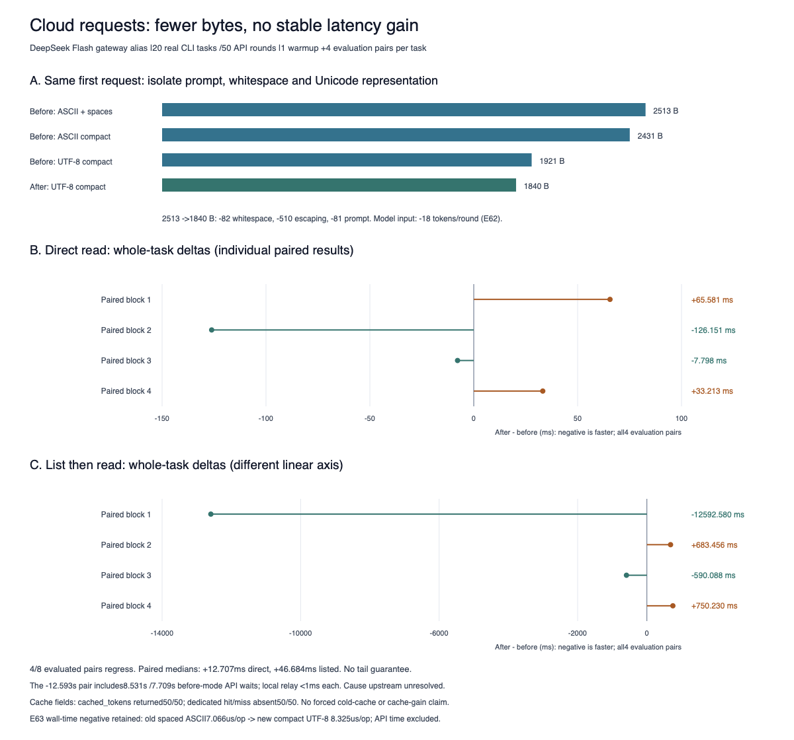

One warmup plus four evaluated pairs per task, reversing order per block. Every matched round reports18 fewer prompt tokens after scoped prompt cleanup. Encoding-only replay parses to exactly the same JSON object and does not establish token savings. All8 evaluation pairs remain:4 are slower after. No stable end-to-end acceleration. The large listed-before block1 includes8.531s and7.709s upstream waits; local relay work stays below1ms for each. Network versus provider queue/compute remains unresolved. Generated outputs and completion token counts vary despite temperature=0.

| Evaluation workload | API wait/task median ms | C tool exec/policy median ms | Relay local/task median ms | C protocol/loopback residual median ms | Prompt/output tokens summed | Reported cached / prompt |
| --- | --- | --- | --- | --- | --- | --- |
| direct/before | 3555.803 | 0.100 / 0.014 | 0.566 | 1.549 | 5792 / 629 | 3584 / 5792 (61.9%) |
| direct/after | 3508.650 | 0.101 / 0.015 | 0.833 | 1.888 | 5648 / 541 | 2048 / 5648 (36.3%) |
| listed/before | 5369.011 | 0.469 / 0.020 | 1.041 | 2.525 | 8964 / 882 | 1536 / 8964 (17.1%) |
| listed/after | 5390.058 | 0.399 / 0.018 | 0.798 | 2.146 | 8748 / 880 | 1792 / 8748 (20.5%) |

All50 rounds return prompt/completion/total tokens and prompt_tokens_details.cached_tokens, without usage inconsistencies. Dedicated prompt_cache_hit_tokens and prompt_cache_miss_tokens are absent in all50 rounds and remain null. Reported cache fractions vary by workload/mode; no cache-hit improvement is established. Remote caches cannot be cleared/forced cold by this runner. Gateway alias does not verify backend weights or cache implementation.

| Prompt | Serializer | First-request body bytes | Serialize us/op median [min,max] |
| --- | --- | --- | --- |
| before | ascii_spaced | 2513 | 7.066 [7.001,7.297] |
| before | ascii_compact | 2431 | 7.604 [7.487,7.675] |
| before | utf8_compact | 1921 | 8.388 [8.245,8.607] |
| after | ascii_spaced | 2357 | 7.156 [7.047,7.415] |
| after | ascii_compact | 2275 | 7.131 [7.084,7.850] |
| after | utf8_compact | 1840 | 8.325 [8.284,8.426] |

E63 isolates60 serialization blocks (1000 operations each, first block warm per cell). Initial request2513→1840B:82B from whitespace,510B from Unicode escaping at the old prompt,81B from the prompt change at UTF-8. UTF-8 serialization wall time is slightly higher in this local replay; preserve it as a negative, not an API latency claim. Request sizes exclude headers/TCP/TLS. Full provider spans overlap relay/API waits and must not be added; their difference is a protocol/local-transfer residual. Tool exec includes internal file policy; outer checks are separate. Task timer excludes relay shutdown. Nonstreaming response-header time is not TTFT. Upstream follows the explicitly selected HTTP profile, without a TLS claim.

[Contract and reproduction](../design/hybrid-v1.md#e62-cloud-reproduction) · [all rounds](data/cloud-rounds.csv) · [tasks](data/cloud-tasks.csv) · [tool events](data/cloud-tools.csv) · [signed pairs](data/cloud-pairs.csv) · [serialization blocks](data/cloud-serialization.csv). Prior62 evidence files and42 figure pairs are unchanged; Native inference and Windows performance were not remeasured. Keys, endpoints, profiles and private traces are excluded.

## E59–E61 — Versioned multiline edits, real cloud tasks and measured safety cost

fs.read now includes an opaque descriptor-metadata version. WRITE-only fs.edit replaces one unique exact multiline block in an existing64KiB-or-smaller text file. Stale/busy/changed versions return conflict; no automatic overwrite or retry. Advisory locks coordinate this tool, while final stat/rename remains a race against noncooperating writers. Pre-commit failures preserve the original and clean private temporary files under stable directory permissions.

34 deterministic state/security/failure cases under ASan/UBSan,4 actual CLI suites, the full default regression,14,357-token Native and8 fork/template cases pass. Test-only fault hooks are absent from production builds. A first CLI fixture response-envelope mistake is retained. File/root/content/network permissions were not widened.

| Overhead per operation, us | 1KiB | 16KiB | 64KiB |
| --- | --- | --- | --- |
| read | -1.484 [-12.672,5.672] | -1.453 [-4.469,4.109] | -2.031 [-3.688,4.375] |
| single | 77.750 [56.875,643.000] | 1335.375 [1249.625,1391.375] | 5697.750 [5484.375,6095.625] |
| multi | 120.000 [102.625,579.250] | 1454.000 [1399.000,1489.625] | 5754.625 [5575.500,6132.125] |
| workflow | 88.125 [-106.000,983.375] | 1337.375 [1250.875,1411.750] | 5611.500 [5424.125,7664.875] |
| same | 31.000 [25.750,63.875] | 711.375 [669.125,751.500] | 2872.750 [2798.000,2994.000] |

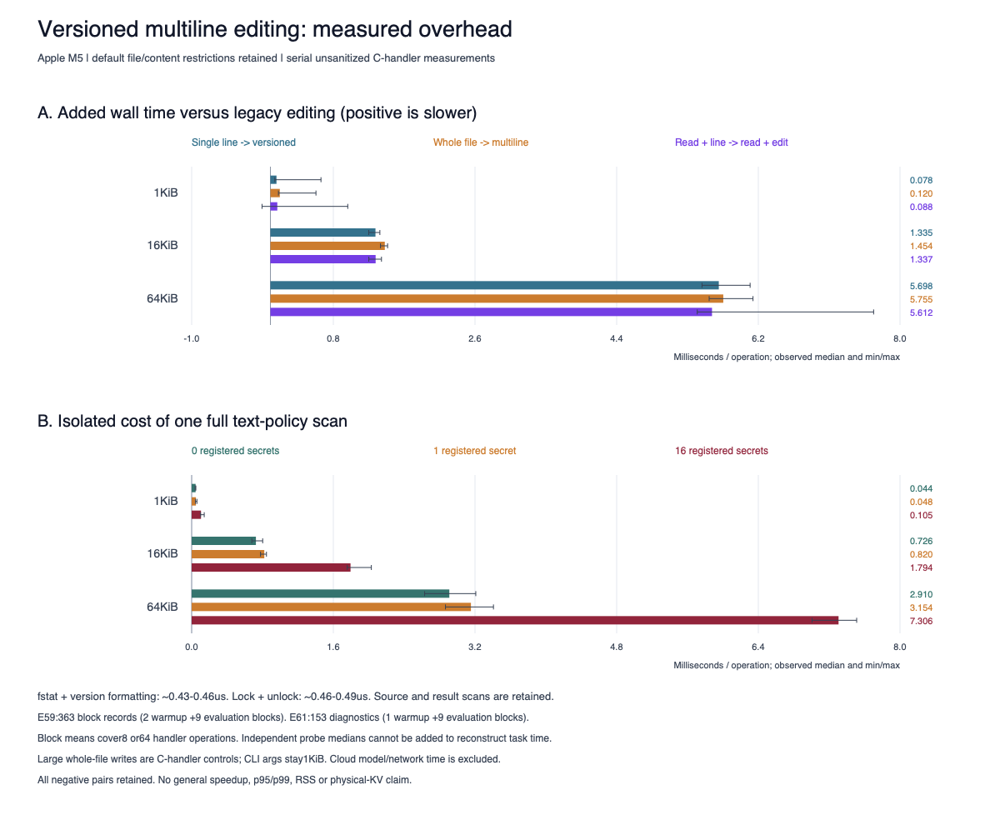

Positive overhead is slower.363 serial unsanitized block records,2 warmup+9 evaluation blocks, alternating variants; each row is a mean of8 operations (64 for reads). Old basic code comes from public commit ad5ac5a; policy and filesystem baseline code are identical. Handler reset/input preparation/oracles are outside the timer; workflow includes actual read and patch framing. Large whole-file controls call the C handler and exceed the CLI1KiB argument limit: these are not usable large-file agent writes. All signs and ranges are retained; n=9 block ranges are not confidence intervals or p95/p99.

The large added cost is consistent with full text admission work. E61 retains153 independent records:64KiB one-scan medians are2.910/3.154/7.306ms for0/1/16 registered synthetic secrets. fstat+version formatting is0.426–0.457us, lock+unlock0.461–0.488us. Same-content returns scan once; successful edits scan original and assembled output. These isolated medians are not additive exact task attribution. Read overhead has mixed signs; no speedup claim. Version metadata adds79–83 receipt bytes in these fixtures, not measured model tokens or RSS.

| Real cloud task | Result | API calls | Observed tools |
| --- | --- | --- | --- |
| normal | PASS | 5 | fs.read → fs.edit → test.run → fs.read |
| concurrent | PASS | 7 | fs.read → fs.edit → fs.read → fs.edit → test.run → fs.read |
| readonly | PASS | 3 | fs.list → fs.read |

E60 uses the explicitly selected deepseek-v4-flash-0731 model profile through a loopback test relay, thinking disabled. All3 synthetic actual-agent tasks passed independent exact-source checks: requested multiline fix, conflict/re-read/retry preserving an external comment, and read-only refusal. Model choices are real; only the external writer is injected. Requested gateway alias does not verify remote weights/hardware. These3 tasks are not general coding accuracy;11.159/13.207/5.601s include cloud/network/relay and are excluded from tool-overhead results. The chosen upstream is HTTP with no TLS claim. No endpoint, credential, private config or raw trace is published.

[Contract](../design/versioned-edit-v1.md), [E59](../evidence/versioned-edit-overhead-20261102.json), [E60](../evidence/versioned-edit-cloud-20261102.json), [E61](../evidence/versioned-edit-cost-probe-20261102.json), [all handler samples](data/versioned-edit-samples.csv), [paired costs](data/versioned-edit-paired.csv), [independent probes](data/versioned-edit-probes.csv), [model outcomes](data/versioned-edit-model-tasks.csv). Prior59 evidence files and41 figure pairs are byte-identical; historical inference data remains tied to its original source.

## E56/E57 — Fixed-target C++: headers, caches and host coordination

E55 had an incomplete equivalence check: bound-off defaulted to macOS26.0 and bound-on to10.4, despite identical compiler/SDK hashes and program results. Its59ms residual is retained as target-confounded history. Cross-compiling the off-preprocessed input inside the sandbox exposed availability errors. New trials explicitly use -mmacosx-version-min=26.0 in every mode and verify both driver triple and deployment macro. No sysctl or other permission is opened to fix target discovery.

| E56 control | Off/on inner median ms | Off/on sys CPU median ms | Paired whole API extra ms [min,max] |
| --- | --- | --- | --- |
| noop | 1.556 / 1.596 | 0.579 / 0.653 | 6.098 [-5.176,20.124] |
| version | 7.671 / 7.478 | 2.941 / 3.372 | 17.685 [7.197,28.656] |
| preprocess | 76.181 / 129.791 | 28.157 / 79.755 | 68.504 [46.339,86.966] |
| syntax | 209.221 / 271.672 | 30.719 / 90.832 | 76.083 [41.317,178.423] |
| object | 224.613 / 282.523 | 30.891 / 84.015 | 68.749 [58.884,98.451] |
| preprocessed | 173.119 / 168.434 | 9.925 / 9.875 | 9.361 [-16.655,17.143] |
| link | 24.111 / 27.030 | 14.331 / 22.443 | 18.983 [9.065,47.483] |
| fresh_run | 284.877 / 278.972 | 1.137 / 1.581 | 10.540 [-65.379,19.423] |
| chain | 553.606 / 602.009 | 56.226 / 116.232 | 79.925 [-91.812,187.563] |

The extra sys CPU follows textual header access. The include trace has1051 entries (not syscall counts), and ordinary object/repeated builds emit no PCM. Compiling already-preprocessed input removes most of the sys difference; it is a diagnostic control whose preparation is not a free production optimization. Compiler startup/version and link stages have smaller differences. Parent setup is roughly1ms, cleanup fractions of a millisecond; EOF/reaping can add a roughly10ms poll. Fresh-executable execution also has variable non-CPU wall time. No per-syscall, code-signing, CPU-cluster or external-scheduler trace can allocate every old or new tail.

| E56 on cache control | Complete API median ms | First/second stage median ms | PCM files | Temp logical file bytes |
| --- | --- | --- | --- | --- |
| object | 313.730 | 282.523 / — | 0 | 4376 |
| reuse | 612.372 | 299.303 / 279.585 | 0 | 8752 |
| modules | 1172.690 | 1079.475 / 57.816 | 26 | 27008980 |
| pch | 430.582 | 342.723 / 53.788 | 0 | 14451812 |
| stat | 2596.566 | 2280.301 / 299.706 | 0 | 14443316 |
| plain3 | 886.911 | 286.456 / 283.965 | 0 | 13128 |
| pch3 | 551.077 | 343.580 / 56.462 | 0 | 14460564 |

270 serial unsanitized rows,2 warmup+7 evaluation blocks. Modules create26 PCM files and speed the second compile but have a high cold cost. Fresh SDK stat-cache generation is also a negative result. Private PCH helps repeated headers only after charging its cold build. Clang documents [module activation](https://clang.llvm.org/docs/Modules.html), [PCH](https://clang.llvm.org/docs/PCHInternals.html) and the [stat-cache design](https://reviews.llvm.org/D136651); measured Apple-Clang behavior, not upstream documentation alone, decides these results.

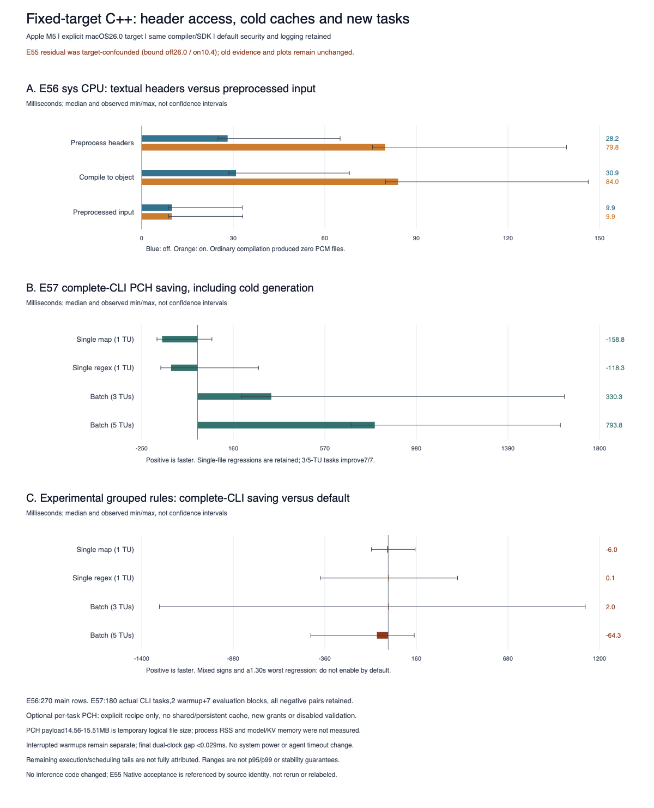

| E57 new task | TUs | Plain on / PCH on median ms | Paired PCH saving ms [min,max] | Faster | PCH on−off ms [min,max] |
| --- | --- | --- | --- | --- | --- |
| single_map | 1 | 665.938 / 813.194 | -158.765 [-181.623,64.525] | 1/7 | 72.068 [-309.370,110.589] |
| single_regex | 1 | 1062.859 / 1153.361 | -118.314 [-164.641,273.152] | 2/7 | 38.365 [-53.943,80.666] |
| batch3 | 3 | 1231.752 / 940.847 | 330.300 [196.238,1643.124] | 7/7 | 54.266 [-151.971,123.342] |
| batch5 | 5 | 1922.122 / 1053.426 | 793.776 [687.974,1624.882] | 7/7 | -6.044 [-525.332,177.296] |

180 actual CLI tasks,4 new cases×5 modes×(2 warmup+7 evaluation blocks), exact program-result checks, identical explicit target/compiler/SDK/C++17/O2, rotating/reversed order. Every PCH is built fresh inside the task and deleted: generation, validation, all TUs, link, program execution, observers and cleanup are charged. Single-file PCH regresses158.765/118.314ms median;3/5 TUs save330.300/793.776ms, each7/7. PCH adds14.56–15.51MB of transient logical file payload; process RSS and physical KV were not measured. Bound/PCH on−off still has large positive and negative pairs; no claim that isolation is free.

| Experimental grouped deny rules | Paired saving ms [min,max] | Faster |
| --- | --- | --- |
| single_map | -5.967 [-95.565,152.800] | 3/7 |
| single_regex | 0.137 [-385.786,393.829] | 4/7 |
| batch3 | 2.013 [-1299.522,1118.946] | 4/7 |
| batch5 | -64.269 [-439.648,147.746] | 2/7 |

The candidate factors72 original patterns into6 bounded equivalent groups (max511 bytes), passes1765-path differential checks and15 OS suites, but fails performance acceptance. The worst batch3 pair adds1299.522ms: object stages add1291.321ms (user+370.221ms, sys+106.348ms), while outside-inner drops3.256ms. This locates the regression inside compiler execution, not parent preparation; it does not prove regex grouping itself caused all the variation. Keep the original default rules and denial logging. Do not add candidate and PCH savings together.

The implemented deliverable is the optional tools/run_cpp_batch.sh plain|pch TARGET HEADER OUTPUT SOURCE... recipe; it adds no runtime cache/grant or automatic compiler-flag change.6 recipe suites pass on normal and ASan/UBSan CLI, including failure cleanup, changed headers, protected config and real local-network refusal with explicit-off controls. Full default561 C/15 OS/12 policy/8 foundation regression passes. Inference/native sources are byte-identical to E55; its Native14K/Stream/output acceptance remains historical for that same runtime, not a new model test.

Two earlier E57 attempts are retained: a parser import mistake and a warmup timeout with divergent clocks (~274s CLI versus0.8s active Python time). The cause of the pause/clock gap is unresolved. Formal timing used only a process-lifetime idle-sleep assertion and dual clocks; max absolute gap was0.029ms, with all pairs retained. No system power setting or agent timeout policy changed. Small-n ranges are not p95/p99 or confidence intervals.

[E56 evidence](../evidence/sandbox-cpp-diagnostic-20261102.json), [E57 evidence](../evidence/sandbox-cpp-tasks-20261102.json), [stage samples](data/sandbox-cpp-diagnostic-samples.csv), [new CLI samples](data/sandbox-cpp-tasks-samples.csv), [all paired summaries](data/sandbox-cpp-tasks-paired-summary.csv), [aborted warmups](data/sandbox-cpp-aborted.csv) and [contract](../design/test-sandbox-v1.md). Prior56 evidence files and40 figure pairs remain byte-identical; this is build-command work, not inference acceleration.

## E54/E55 — Xcode cache diagnosis and explicit same-toolchain binding

Later E56 audit: the implicit deployment target differed (bound-off26.0,bound-on10.4). These historical compiler/SDK-matched measurements did not ensure equal target semantics; use E56/E57 explicit-target comparisons for new claims. The old evidence and plots are unchanged.

The major trigger is a fresh private xcrun lookup cache: the /usr/bin shim invokes xcodebuild for platform/tool discovery. Reusing that lookup cache inside the same sandbox makes the second compile fast; deleting only this task-owned xcrun_db makes it slow again. A fresh off-mode HOME/TMPDIR control is much faster than restricted cold discovery, so this is not merely the cost of an empty cache. Restricted framework initialization and rejected-service fallback also matter. Actual Clang compilation with the same SDK is fast. Apple documents the [system tool shims](https://developer.apple.com/library/archive/technotes/tn2339/_index.html); exact discovery is measured locally, not assumed from documentation.

| E54 API case | Mode | N | Complete ms | First inner ms | Second inner ms |
| --- | --- | --- | --- | --- | --- |
| noop | off | 5 | 6.200 | 1.725 | — |
| noop | on | 5 | 20.265 | 1.426 | — |
| compile | off | 5 | 350.359 | 36.564 | — |
| compile | on | 5 | 2772.430 | 2443.726 | — |
| cold_env | off | 5 | 108.284 | 90.856 | — |
| cold_env | on | 5 | 2419.259 | 2381.527 | — |
| reuse | on | 5 | 2425.482 | 2359.470 | 34.224 |
| invalidate | on | 5 | 4844.728 | 2405.827 | 2393.318 |
| sdk_only | on | 5 | 2425.800 | 2389.924 | — |
| pinned | on | 5 | 361.699 | 37.008 | — |
| platform | off | 5 | 363.920 | 346.718 | — |
| platform | on | 5 | 1121.837 | 1102.669 | — |

126 serial unsanitized main records,2 warmup+5 evaluation blocks. No-log is a negative control: it does not remove the seconds-scale cost and has slower pairs; it is not shipped. SDKROOT alone also fails to avoid discovery. A direct compiler without its SDK fails to link. The attempted stack sample exited successfully but produced no call graph; a direct xcodebuild -find control emitted plugin failures and exceeded retained output. All development controls remain separate from formal timing.

The exact synthetic xcodebuild target produced7305 denial log entries, including2511 directory-service lookups; duplicate summaries are not exact syscall counts. Seventy separate direct-API records (1000 calls each) show quick rejected Mach lookups and accumulated costs in cache-directory/UID queries. These probes do not allocate the full xcodebuild delay to individual functions, and no rejected IPC was granted.

| Direct API,1000 calls | Off median ms | On median ms | On worst single ms |
| --- | --- | --- | --- |
| com.apple.FSEvents | 22.451 | 27.755 | 0.151 |
| com.apple.diagnosticd | 21.499 | 27.591 | 0.073 |
| com.apple.system.opendirectoryd.libinfo | 23.093 | 29.100 | 0.834 |
| darwin_cache_confstr | 2.512 | 292.472 | 0.912 |
| own_uid_lookup | 0.511 | 44.754 | 0.188 |

The implemented option is explicit --test-toolchain BIN_DIR --test-sdk SDK_DIR. It sets a pinned PATH and SDKROOT and grants no directories, IPC or network. Both paths are required and validated; no outside-sandbox workspace execution, shared lookup cache, global xcode-select change or implicit CLT substitution. Absolute /usr/bin/cc and explicit xcrun calls are not rewritten. Zero-config commands retain their original behavior and regression. This is a build-command environment optimization, separate from KV/prefill/inference work.

| E55 new CLI task | Original on / bound on median ms | Paired saving ms [min,max] | Faster | Bound on−off ms [min,max] |
| --- | --- | --- | --- | --- |
| checksum | 2667.464 / 354.235 | 2367.142 [2274.834,2674.528] | 7/7 | 20.951 [-6.772,29.834] |
| archive | 3618.348 / 176.627 | 3447.935 [3345.468,4169.586] | 7/7 | 14.789 [9.392,50.654] |
| templates | 3004.514 / 626.083 | 2378.431 [2208.843,2579.098] | 7/7 | 59.075 [-160.955,100.214] |

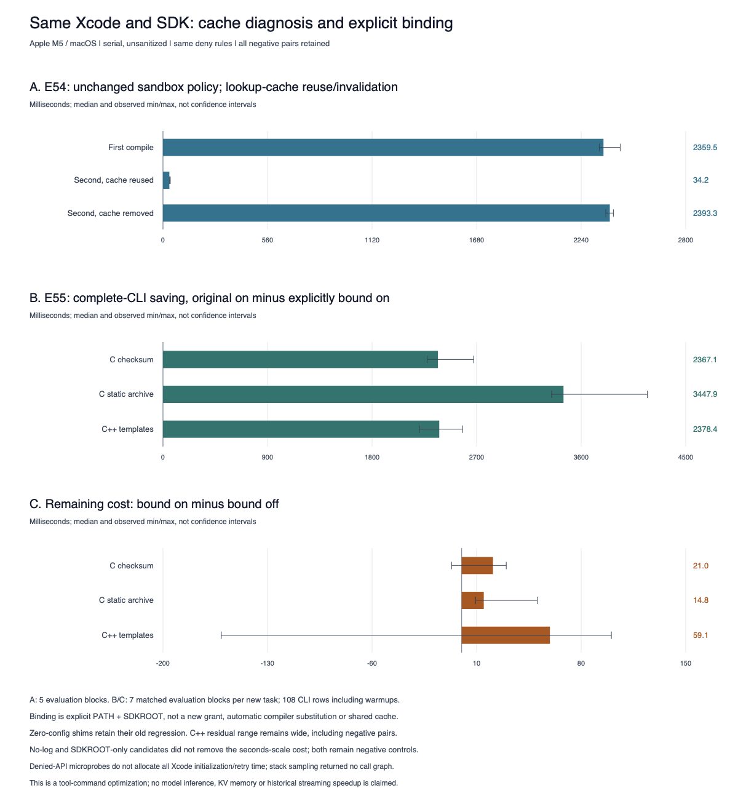

108 actual CLI tasks:3 new workloads×4 modes×(2 warmup+7 evaluation blocks), rotating/reversed order, exact program-result checks and identical selected compiler/SDK hashes. Every task has a fresh private HOME/TMPDIR; off creates/removes its directory inside the timed command, unlike E53 usual warm host cache. CLI time includes initialization, tool execution, cleanup and two scripted HTTP choices, with no model inference. C++ retains wide negative/positive residual pairs. Small-n ranges are not confidence intervals or proof of stable tail latency.

Acceptance:561 C checks,15 OS suites, prior12 policy/8 foundation suites under sanitizers, Native14,357-token/16 Stream/72 output checks, and full default regression. Permission-binding tests cover normal compilation, outside-file refusal, secrets/config, network, parent environment and invalid paths. Two initial test-oracle mistakes are retained. Six existing native compiler warnings and uninstrumented upstream libraries remain.

[E54 evidence](../evidence/sandbox-cc-diagnostic-20261101.json), [E55 evidence](../evidence/sandbox-cc-tasks-20261101.json), [diagnostic samples](data/sandbox-cc-diagnostic-samples.csv), [direct API probes](data/sandbox-cc-ipc.csv), [new CLI samples](data/sandbox-cc-tasks-samples.csv), [all pairs](data/sandbox-cc-tasks-pairs.csv), [paired summaries](data/sandbox-cc-tasks-paired-summary.csv) and [contract](../design/test-sandbox-v1.md). Prior54 evidence files and39 figure pairs remain unchanged. No inference performance or autonomous quality claim.

## E53 — Host-protection baseline and original overhead

Additional review found that both broad and narrowed Seatbelt sysctl rules still exposed an unrestricted parent startup environment. E53 sets a sticky CS_RESTRICT flag on cxf itself, checks the SIP gate, and verifies effective environment omission with a trusted child before enabling restricted commands. CLI does this before configuration/model initialization; direct hosts can initialize early too. No system setting or other application is changed. Only the probe read has a1000ms poll bound; fork/reaping are not a hard deadline. Explicit off in a fresh process is the leaking positive control.

| Complete CLI workload | Off / on median ms | Paired extra ms [min,max] | On slower |
| --- | --- | --- | --- |
| clt_compile_tmp | 367.905 / 374.075 | 3.565 [-9.989,32.725] | 4/7 |
| noop | 30.053 / 43.051 | 15.724 [-3.644,32.934] | 5/7 |
| system_cc_compile_write | 365.070 / 2827.838 | 2467.548 [2441.743,2534.841] | 7/7 |

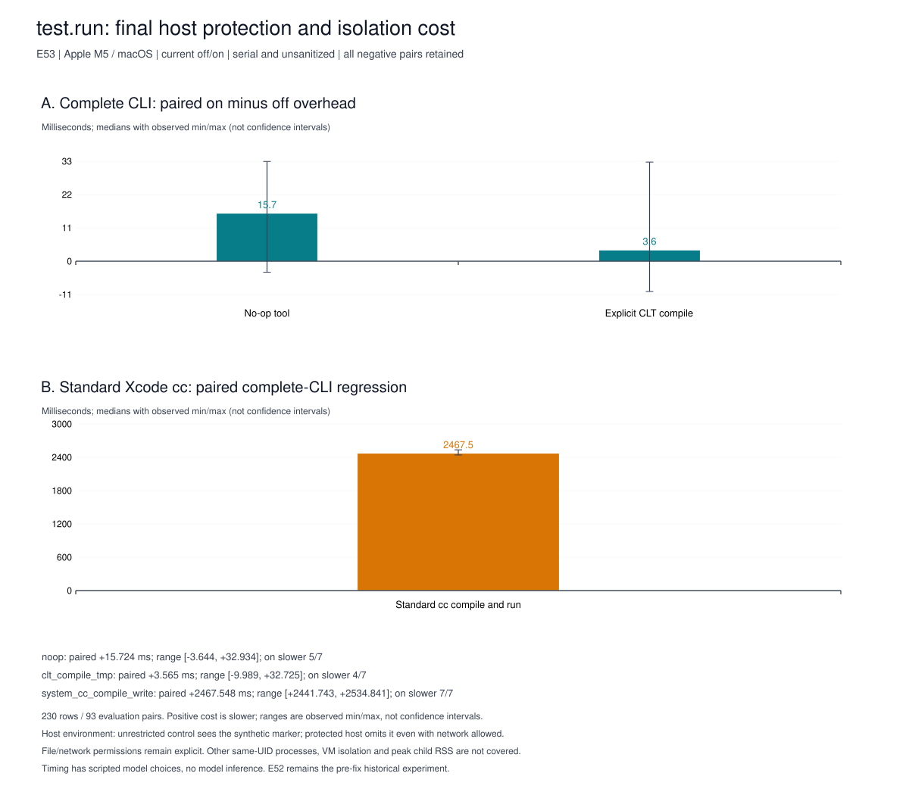

Same workload, new independent experiment:230 rows,44 warmups and93 evaluation pairs. CLI runs in a fresh process and includes host protection; API evaluation is steady state after warmups, where the sticky host flag remains common to later off/on calls. API cold warmup rows are retained. Standard cc regresses2467.548ms paired median,2534.841ms worst; paired inner-command growth median2453.219ms and outside-inner growth median21.003ms are not additive. CLT cost median3.565ms has only4/7 slower pairs, so it is not a guaranteed fixed cost or a proven improvement over E52. Exact cache/IPC effects and cold initialization after a model is already loaded are not isolated.

Final acceptance:542 C checks,12 OS-security suites (including effective parent-environment tests), prior12 policy and8 foundation suites under sanitizers,14,357-token Native,16 Stream and72 output cases. The73,880-byte job capacity remains common to both modes; host verification additionally uses at most256KiB transient heap and a trusted fork once per process, not a measured RSS/KV figure. Other same-UID processes are not protected by this flag, argv remains visible, and this is not a VM or universal DLP. Keys must not be supplied as command-line literals. Linux/Windows remain unsupported with default refusal. Previous53 evidence files and38 figure pairs stay unchanged.

All final [samples](data/test-sandbox-host-samples.csv), [pairs](data/test-sandbox-host-pairs.csv), [summary](data/test-sandbox-host-summary.csv), [contract](../design/test-sandbox-v1.md) and [E53 evidence](../evidence/test-sandbox-host-20261101.json). E52 remains below as pre-fix evidence; do not attribute cross-stage timing differences to the security fix.

## E52 — Pre-fix OS isolation and overhead (superseded by E53)

Default: workspace content read-only, fresh private temporary writes, and network denied for the command and descendants. Explicit read/write directory and full-network grants are independent; protected names/config/trace remain blocked. Existing file descriptors are closed. Unsupported platforms or preflight/setup failures do not fall back to unrestricted execution. Current backend is macOS Seatbelt; Linux/Windows are pending. Explicit isolation off is the unrestricted compatibility control.

| Complete CLI workload | Off / on median ms | Paired extra ms [min,max] | On slower |
| --- | --- | --- | --- |
| clt_compile_tmp | 350.576 / 376.902 | 19.042 [-33.950,48.483] | 5/7 |
| noop | 16.518 / 35.919 | 13.925 [1.176,27.735] | 7/7 |
| system_cc_compile_write | 337.762 / 2928.896 | 2591.134 [2367.727,5524.787] | 7/7 |

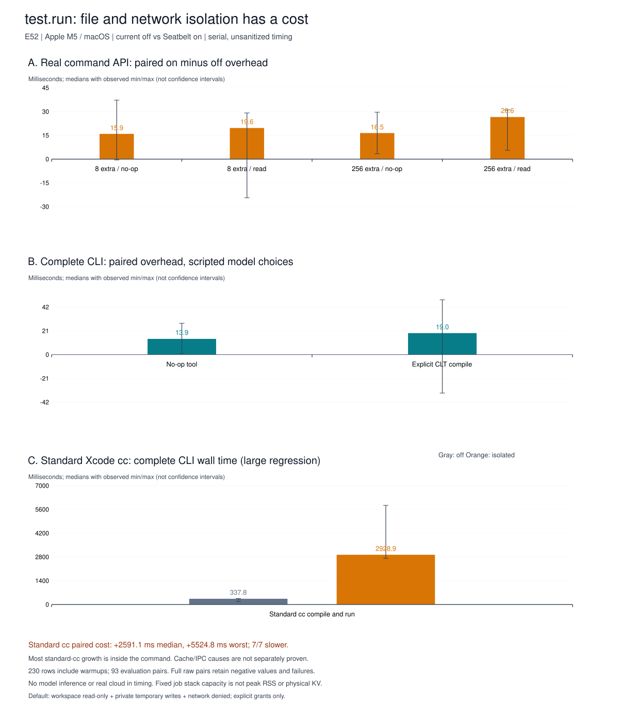

Timing is serial and unsanitized:176 command-API rows (8/256 extra fixture files) and54 actual CLI rows, including44 warmups and93 evaluation pairs. CLI uses two scripted HTTP model responses; no inference or real cloud. Positive overhead means isolation is slower. The standard Xcode cc CLI regresses2591.134ms in paired median and5524.787ms worst; paired inner-command growth median2561.604ms, outside-inner growth median17.541ms. These medians are not additive. Warnings show restricted cache/service behavior, but cache versus IPC causes are not isolated. The separate explicit CLT command is measured as a different workload, not silently substituted in production.

The C job object has a fixed73,880-byte stack capacity in both current off/on paths; this is not added RSS, child peak memory or physical KV. Scanned entries and populated profile bytes are in raw records; files=8/256 counts extra fixtures, not total workspace entries. Time outside the inner command includes setup, sandbox process/application, polling and cleanup; it is not pure Seatbelt compilation time. All API cells and negative pairs are in [samples](data/test-sandbox-samples.csv), [pairs](data/test-sandbox-pairs.csv) and [summary](data/test-sandbox-summary.csv).

Acceptance:542 C checks,11 OS-security suites, prior12 data-policy and8 foundation suites under ASan/UBSan; Native14,357-token,16 Stream and72 output checks. The localhost-only network candidate admitted a non-loopback local interface and was removed: only deny/allow ship. Initial Stream equality failed on timestamped Xcode output; the deterministic fixture explicitly uses CLT while retaining token/fresh-greedy checks. Both failures are retained. Runtime/benchmark code matches the timing archive; the later Stream test-command change is separately identified. Six prior native warnings remain, upstream libraries are not instrumented. This is not a VM or arbitrary-secret DLP; explicit off/inherited secrets/full network grant still require trusted deployment. See [D-EXEC](../design/test-sandbox-v1.md) and [E52 evidence](../evidence/test-sandbox-20261101.json).

## E51 — Protected files and cloud egress: functional acceptance

All eight file tools share protected-name, deployed config/trace, descriptor, symlink and hardlink checks. HTTP providers default to unknown scope and cloud egress is denied before connection. Operators explicitly select local/cloud and task/workspace egress; task mode cannot dispatch tools. Tool arguments/results, HTTP requests/responses and decoded model output reject known credentials and common secret patterns. Trace admission/capacity failures preserve existing files. Native prefill has the same content checks.

445 policy checks and12 real HTTP/files/process suites pass under ASan/UBSan; the prior eight foundation suites, full default regression,14,357-token Native,16 Stream and72 output checks pass. Normal cloud-authorized read/edit/test and expected access/leak refusals are separate from model quality or performance. The initial added Native test used a stale checkpoint in an assertion; its failed log hash is retained and the corrected test passes. Six existing native harness compiler warnings remain; fixed upstream libraries are not instrumented.

This is bounded admission and common-pattern detection, not universal DLP or an OS sandbox. test.run still has launcher file/network rights; unknown secrets and arbitrary encodings can escape detection. No real cloud calls, direct HTTPS, Windows/CUDA or new speed/memory result. Previous51 evidence files and37 figure pairs are byte-for-byte unchanged. See the [single policy contract](../design/data-policy-v1.md) and [E51 evidence](../evidence/agent-data-policy-20261101.json).

## E50 — Agent foundation: functional acceptance

Added an opt-in guarded single-line editor, minimal child-process environment by default in the CLI, and a loopback-only llm.local text helper. Eight scripted two-provider HTTP suites pass under ASan/UBSan, alongside the default regression, edit/process sanitizers,14,357-token Native,16 Stream checks and72 tool-output cases. Helper responses are data, not actions; credentials and task quotas are separate. No new performance or real cloud/model-quality result.

Historical E50 limits (file/egress admission is added in E51): no OS sandbox, universal sensitive-file policy, atomic file CAS, direct HTTPS, automatic routing, cloud SSE or shared Native KV for the HTTP helper. Existing writer paths have not all migrated to descriptor-based traversal. Six pre-existing compiler warnings remain in the native harness; no sanitizer errors were observed. See the [tool contract](../basic-agent.md), [hybrid contract](../design/hybrid-v1.md) and [functional evidence](../evidence/agent-foundation-20261101.json).

## Results at a glance

| Experiment | Matched comparison | Observed result | Scope |
| --- | --- | --- | --- |
| E49 | off → existing growth; paced tools | 104.276 / 67.290 ms paired task savings | Seven pairs per fixture, all faster; scripted model actions, resident KV. |
| E49 | growth → 1536-byte coarse trial | 54.667 / 3.009 ms paired task regressions | Failed optimization; defaults unchanged. Full burst/marker negatives below. |
| E47 | off → thread-only control | 1868.877 ms worst task regression | No tool-window GPU prefill; tool/system variation remains unresolved. |
| E09 | normalized_json → jinja_values | 511.7 → 141.3 KiB temporary heap | 14,504 logical tokens; n=3. About 370 KiB absolute; RSS unchanged. |
| E07–09 | 8 branches × 6,000-token prefix | 48,000 logical → 6,000 stored IDs | Shared token pool; physical KV is a separate metric. |
| E46 | batch capacity 1024 → 640 | 597.50 → 373.44 MiB Metal compute reservation | Default512 is298.75MiB; KV remains896MiB; speed can regress. |

Paired task savings/regressions, worst pairs and allocation measurements are labeled separately above. Detailed tables retain every comparison and observed range. Whiskers are ranges, not confidence intervals. Gains from different experiments must not be added or multiplied.

## Environment and evidence coverage

| Component | Recorded configuration |
| --- | --- |
| Host | Apple M5 · 16 GiB unified memory · macOS arm64 · Metal |
| llama.cpp | `b10938` · `f1e44dcc11d8802d107bd7331a3d3fd3e6f57b93` |
| Model | `Qwen3-0.6B-Q8_0.gguf` · 654,302,880 file bytes |
| Model SHA-256 | `710d7b1aa4e2ae03238a9e65e82f48cfa70edf501becae8979c35acf5830e1ed` |
| Template SHA-256 | `57f1fd00f0013a2be96aa79b857391f27e23df5b5f847072b524c897e24d0361` |
| Execution | 4 CPU threads · batch 512 · FP16 KV · warm runs |
| KV allocation | E01–02: 3328 tokens / 364 MiB; E05–06, E10–11, E13–19: 8192 / 896 MiB; E07–09: 16384 / 1792 MiB |

64 evidence files are indexed below. 56 contain 37290 raw records, including metadata, correctness, file timelines and cost-estimation samples; this is **not 37290 independent latency samples**. Functional, sanitized-summary and reported-only evidence remain separate. Source hashes identify the measured revisions.

| ID | Experiment | Evidence class | Records |
| --- | --- | --- | --- |
| E01 | [Direct libllama: prefix, stream, fork, state](../evidence/llama-context-direct-20261030.json) | raw | 61 |
| E02 | [Direct libllama: slow token arrivals](../evidence/llama-context-slow-stream-20261030.json) | raw_source_unrecorded | 13 |
| E03 | [Native context correctness](../evidence/llama-context-v1-20261030.json) | functional | 0 |
| E04 | [Native chat, tools, CLI and model probes](../evidence/llama-chat-v1-20261030.json) | functional | 0 |
| E05 | [Chat checkpoint compatibility](../evidence/llama-chat-compat-20261030.json) | raw | 20 |
| E06 | [Template preparation cache](../evidence/llama-template-cache-20261030.json) | raw | 40 |
| E07 | [Temporary lifetimes and shared prefix audit](../evidence/context-memory-20261030.json) | raw | 99 |
| E08 | [Borrowed messages versus request JSON](../evidence/direct-messages-20261030.json) | raw | 99 |
| E09 | [Direct Jinja values and bounded tokenizer](../evidence/jinja-values-20261030.json) | raw | 99 |
| E10 | [Asynchronous KV restoration](../evidence/kv-worker-20261030.json) | raw | 92 |
| E11 | [Streaming prefill and complete-file tools](../evidence/stream-pipeline-20261030.json) | raw | 191 |
| E12 | [Historical autonomous repair failures](../evidence/basic-agent-probes-20261030.json) | sanitized_summary | 0 |
| E13 | [Calibrated warm-prefill time estimation](../evidence/cost-estimator-20261030.json) | raw | 161 |
| E14 | [Roofline hardware proxies versus empirical estimates](../evidence/roofline-estimator-20261030.json) | raw | 195 |
| E15 | [Roofline diagnosis, dependent-graph rates and operator correction](../evidence/roofline-diagnosis-20261030.json) | raw | 278 |
| E16 | [Batch/context diagnosis and shape interpolation negative result](../evidence/cost-shapes-20261030.json) | raw | 916 |
| E17 | [Time interpolation on new batch/context shapes](../evidence/cost-shapes-v2-20261030.json) | raw | 916 |
| E18 | [Incomplete frozen-calibration run: cap64 setup rejection](../evidence/frozen-calibration-incomplete-20261030.json) | raw_incomplete | 849 |
| E19 | [Frozen calibration: coverage, objective, residual basis and new batches](../evidence/frozen-calibration-20261030.json) | raw | 1162 |
| E20 | [Optional residual Kalman: fresh timings and prequential C replay](../evidence/kalman-cost-20261031.json) | raw | 1162 |
| E21 | [Actual tool-window EWMA prefill and KV restoration](../evidence/tool-prepare-20261031.json) | raw | 931 |
| E22 | [Restore attribution: process launch, timer, queue and completion](../evidence/restore-timing-20261031.json) | raw | 547 |
| E23 | [Spawn and parent-progress ETA on new real-tool fixtures](../evidence/restore-balance-20261031.json) | raw | 979 |
| E24 | [Complete task audit, callback control and early snapshot release](../evidence/tool-taskcost-20261031.json) | raw | 659 |
| E25 | [Snapshot unlink and last-close resource isolation](../evidence/tool-isolate-20261031.json) | raw | 227 |
| E26 | [First executable launch and incremental-build task validation](../evidence/tool-launch-20261031.json) | raw | 167 |
| E27 | [Normal resident KV six-turn actual-tool Native flow](../evidence/resident-flow-20261031.json) | raw | 199 |
| E28 | [Resident streaming from an actual local process, no sleep gaps](../evidence/resident-stream-20261031.json) | raw | 87 |
| E29 | [Actual agentctl resident tool-output prefill off/on](../evidence/tool-output-cli-20261031.json) | raw | 515 |
| E30 | [Adaptive resident tool-output observation gate](../evidence/tool-output-adaptive-20261031.json) | raw | 515 |
| E31 | [Matched output strategies and thread/token controls](../evidence/tool-output-isolation-20261031.json) | raw | 1283 |
| E32 | [Output-growth gate on new matched tasks](../evidence/tool-output-progress-20261031.json) | raw | 771 |
| E33 | [Producer CPU, EOF reaping and worker attribution](../evidence/tool-output-reap-20261031.json) | raw | 1027 |
| E34 | [Exit-event wait on fresh matched tasks](../evidence/tool-output-event-20261031.json) | raw | 1539 |
| E35 | [Exit-in-progress bounded retry on fresh tasks](../evidence/tool-output-race-20261031.json) | raw | 1283 |
| E36 | [Same-load dormant/thread/token/prefill and CPU isolation](../evidence/tool-output-contention-20261031.json) | raw | 1283 |
| E37 | [Lazy output-consumer launch on fresh tasks](../evidence/tool-output-lazy-20261031.json) | raw | 771 |
| E38 | [Decode/sync spans and runnable scheduler isolation](../evidence/tool-output-decode-20261031.json) | raw | 1123 |
| E39 | [Deferred internal sync on fresh tasks](../evidence/tool-output-drain-20261031.json) | raw | 1123 |
| E40 | [Producer CPU supply with model absent or idle](../evidence/model-idle-20261031.json) | raw | 211 |
| E41 | [CPU supply after streaming model tasks](../evidence/model-idle-stream-20261031.json) | raw | 211 |
| E42 | [Metal command execution, queue overlap and host return](../evidence/tool-output-metal-20261031.json) | raw | 1539 |
| E43 | [Completion marker and observer overhead controls](../evidence/tool-output-notify-20261031.json) | raw | 1539 |
| E44 | [Bounded tail-batch coalescing on new tasks](../evidence/tool-output-coalesce-20261031.json) | raw | 1539 |
| E45 | [Matched sustained tail: GPU, completion and host return](../evidence/tool-output-tailwait-20261031.json) | raw | 1539 |
| E46 | [Rotating capacity512/640/1024 controls on fresh tasks](../evidence/tool-output-capacity-20261031.json) | raw | 4095 |
| E47 | [Same-capacity thread/token/GPU tool isolation](../evidence/tool-output-contention640-20261031.json) | raw | 1539 |
| E48 | [Fixed-shape native CPU versus memory pressure](../evidence/device-isolation-20261031.json) | raw | 387 |
| E49 | [Larger publication quantum on fresh actual tasks](../evidence/tool-output-coarse640-20261031.json) | raw | 1539 |
| E50 | [Guarded editing, clean test environment and local text helper](../evidence/agent-foundation-20261101.json) | functional | 0 |
| E51 | [Unified protected files and default-deny cloud data egress](../evidence/agent-data-policy-20261101.json) | functional | 0 |
| E52 | [OS test.run file/network isolation and matched overhead](../evidence/test-sandbox-20261101.json) | raw | 230 |
| E53 | [Protected host environment, narrowed system information and final overhead](../evidence/test-sandbox-host-20261101.json) | raw | 230 |
| E54 | [Xcode lookup-cache, launch and denied-IPC controls](../evidence/sandbox-cc-diagnostic-20261101.json) | raw | 126 |
| E55 | [Explicit same-Xcode/SDK binding on fresh actual CLI tasks](../evidence/sandbox-cc-tasks-20261101.json) | raw | 108 |
| E56 | [Fixed-target C++ compiler/header/cache and host coordination controls](../evidence/sandbox-cpp-diagnostic-20261102.json) | raw | 270 |
| E57 | [Fresh C++ tasks: cold private PCH and bounded-regex candidate](../evidence/sandbox-cpp-tasks-20261102.json) | raw | 180 |
| E58 | [Read-only same-model fork probe: functional preparation and target-machine handoff](../evidence/self-speculation-20261102.json) | functional | 0 |
| E59 | [Versioned multiline editing: correctness and matched handler overhead](../evidence/versioned-edit-overhead-20261102.json) | raw | 363 |
| E60 | [Real cloud DeepSeek Flash: edit, conflict recovery and read-only tasks](../evidence/versioned-edit-cloud-20261102.json) | model_acceptance | 0 |
| E61 | [Version, advisory-lock and full text-policy cost isolation](../evidence/versioned-edit-cost-probe-20261102.json) | raw | 153 |
| E62 | [Real cloud UTF-8/prompt pairs: usage, cache and separated waiting](../evidence/cloud-request-paired-20261102.json) | raw | 50 |
| E63 | [Offline prompt/Unicode/whitespace serialization isolation](../evidence/cloud-serialization-20261102.json) | raw | 60 |
| L01 | [Earlier service, budget and copy observations](../evidence/legacy-observations-20261020.json) | reported_only | 0 |

## E01–02 · direct API feasibility

E01 starts from the same 2,048-token warm prefix and appends 128 tokens six times. The fair comparison is against existing prefix reuse (`cached_scan`). The cold run deliberately recomputes all history and is an upper-bound control.

| Mode | Frontend ms | Total ms | Tokenized | Evaluated | n |
| --- | --- | --- | --- | --- | --- |
| cold | 6.7 [6.3–9.0] | 3429.6 [3412.8–3478.5] | 14976 | 14976 | 5 |
| cached_scan | 6.4 [5.9–7.7] | 296.7 [288.5–305.9] | 14976 | 768 | 5 |
| explicit_delta | 0.6 [0.5–0.9] | 294.3 [290.3–302.4] | 768 | 768 | 5 |

A standalone scan of 2,688 token IDs took 0.649 µs per scan in a 20,000-iteration microbenchmark. Avoiding retokenization and materialization matters more than removing this scan at this scale. Max logit difference was zero in the recorded prefix/stream/fork/state controls; a changed-token negative control changed logits by 15.410506, and explicit rollback again matched a fresh run.

| ID / gap | Mode | Local compute ms | After-input ms | Total ms | n |
| --- | --- | --- | --- | --- | --- |
| E01 / 0 ms | wait_all | 171.2 [165.1–176.3] | 171.2 [165.1–176.3] | 171.2 [165.1–176.3] | 5 |
| E01 / 0 ms | coalesced_128 | 167.6 [164.5–174.3] | 167.6 [164.5–174.3] | 167.6 [164.5–174.3] | 5 |
| E01 / 0 ms | eager_32 | 383.6 [372.4–389.2] | 383.6 [372.4–389.2] | 383.6 [372.4–389.2] | 5 |
| E01 / 20 ms | wait_all | 163.0 [161.2–178.6] | 168.4 [166.2–183.6] | 488.4 [486.2–503.6] | 5 |
| E01 / 20 ms | coalesced_128 | 188.6 [187.0–192.7] | 51.6 [49.0–55.1] | 371.6 [369.0–375.1] | 5 |
| E01 / 20 ms | eager_32 | 379.2 [376.0–392.5] | 84.2 [78.4–96.7] | 404.2 [398.4–416.7] | 5 |
| E02 / 200 ms | wait_all | 181.6 [169.6–184.3] | 186.6 [170.3–187.4] | 3386.6 [3370.3–3387.4] | 3 |
| E02 / 200 ms | coalesced_128 | 193.9 [180.7–210.8] | 58.6 [48.4–61.6] | 3258.6 [3248.4–3261.6] | 3 |
| E02 / 200 ms | eager_32 | 382.4 [376.7–388.0] | 28.7 [28.4–28.8] | 3228.7 [3228.4–3228.8] | 3 |

These runs replay already-tokenized arrivals: 512 new tokens in 32-token chunks. They do not include cloud transport, chat rendering, or generation. E02 has raw samples but no recorded benchmark source hash/snapshot. With no arrival gap, eager 32-token decoding is 2.24× slower than waiting. A longer source window can hide preparation, but cannot save more absolute work than the remaining critical path.

| Operation | Time ms / bytes | n |
| --- | --- | --- |
| Share 2048-token prefix (`seq_cp`) | 0.058 [0.054–0.093] | 5 |
| Recompute same prefix | 436.0 [431.6–439.8] | 5 |
| Shared prefix + 128-token suffix | 48.1 [44.9–49.2] | 5 |
| Recompute full branch | 482.2 [477.6–484.8] | 5 |
| Export in-memory state | 10.2 [4.7–16.4] | 5 |
| Restore in-memory state | 5.6 [4.5–9.7] | 5 |
| Serialized state size | 234,906,296 bytes (224.024 MiB) | 5 |

Prefix sharing uses llama.cpp’s existing same-pool sequence-copy API. In-memory state restore is a different experiment from E10 file restore. Removing a sequence did not shrink the preallocated 364 MiB KV buffer or measured RSS.

## E05–06 · chat frontend

Each sample totals six tool-result appends. E05 conservatively replays three boundary tokens per round: 606 versus 588 evaluated tokens. Template rendering still sees the full transcript. E06 adds cached parsing/preparation of the verified template; it is a separate same-run comparison, not a cumulative speedup against E01.

| ID | Prefix tokens | Mode | Frontend ms | Total ms | Tokenized / evaluated | n |
| --- | --- | --- | --- | --- | --- | --- |
| E05 | 345 | full_cached | 49.0 [34.0–233.0] | 293.7 [267.9–459.7] | 4044 / 588 | 5 |
| E05 | 345 | native_checkpoint | 40.7 [35.2–103.0] | 286.6 [261.9–323.0] | 606 / 606 | 5 |
| E05 | 1225 | full_cached | 41.0 [37.8–41.8] | 360.7 [355.3–368.6] | 9324 / 588 | 5 |
| E05 | 1225 | native_checkpoint | 34.8 [31.2–36.5] | 357.4 [346.8–362.8] | 606 / 606 | 5 |
| E06 | 345 | full_cached_control_0 | 62.2 [50.9–92.5] | 310.7 [282.8–336.8] | 4044 / 588 | 5 |
| E06 | 345 | full_cached_control_1 | 51.3 [48.4–73.5] | 303.5 [282.1–310.8] | 4044 / 588 | 5 |
| E06 | 345 | native_checkpoint | 55.4 [40.8–122.4] | 313.1 [277.4–363.0] | 606 / 606 | 5 |
| E06 | 345 | native_prepare_cache | 9.1 [7.6–11.2] | 261.0 [240.0–264.6] | 606 / 606 | 5 |
| E06 | 1225 | full_cached_control_0 | 55.6 [39.1–188.5] | 385.6 [313.8–523.7] | 9324 / 588 | 5 |
| E06 | 1225 | full_cached_control_1 | 60.7 [49.2–82.9] | 390.6 [334.4–415.0] | 9324 / 588 | 5 |
| E06 | 1225 | native_checkpoint | 46.5 [33.9–142.6] | 376.8 [307.8–468.9] | 606 / 606 | 5 |
| E06 | 1225 | native_prepare_cache | 9.0 [7.4–23.3] | 347.5 [313.6–365.9] | 606 / 606 | 5 |

E05 does not establish a stable overall speedup. E06’s 1,225-token case reduced frontend median by 80.7%, while total median fell 7.8% (376.843 → 347.468 ms) with overlapping observed ranges. This is warm preparation, not complete generation TTFT.

## E07–09 · context storage and temporary memory

Canonical token history is stored in one cxf block pool; branches reference shared prefixes. Raw source text, token IDs, and KV are distinct required representations. The whole pipeline is not a single physical copy. At 14,504 logical tokens, 14,511 IDs are physically retained (seven boundary-tail IDs), with 59,392 bytes of token capacity and 65,260 bytes of cxf allocations.

| State | Logical token references | Stored IDs | Token capacity bytes | cxf bytes | New decode tokens |
| --- | --- | --- | --- | --- | --- |
| 8 shared branches | 48000 | 6000 | 24576 | 30444 | 0 |
| Each appends 32 tokens | 48256 | 6256 | 31744 | 37612 | 256 |
| All sessions closed | 0 | 0 | 0 | 0 | — |

The 48,000 references fit in a shared 16K pool; this is not a measured comparison against eight independent KV allocations. That 16K FP16 KV pool remains 1,792 MiB (112 KiB per configured token for this model). Token storage is small compared with KV.

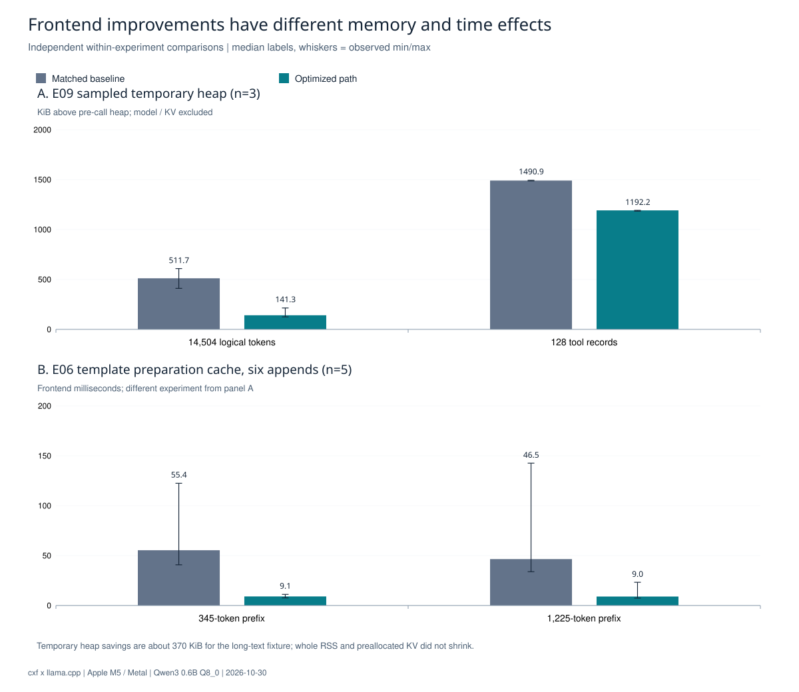

Temporary heap = max(0, sampled process malloc peak − heap before the prepare call). macOS 200 µs sampling plus stage probes can miss short peaks; n=3, warm repeated prepares. It excludes existing model/KV and is neither total request peak nor VRAM. Memory and timing trials are separate.

### E07

Release request/DOM/message temporaries earlier.

| Shape / size | Result | Mode | Extra heap KiB | Prepare wall ms | n |
| --- | --- | --- | --- | --- | --- |
| single_text / 1024 | OK | old_lifetimes | 49.7 [49.6–72.3] | 11.2 [10.7–13.4] | 3 |
| single_text / 1024 | OK | early_release | 74.6 [48.4–75.5] | 12.8 [11.7–13.0] | 3 |
| single_text / 4096 | OK | old_lifetimes | 200.2 [133.5–210.1] | 20.5 [20.0–25.0] | 3 |
| single_text / 4096 | OK | early_release | 172.7 [111.4–180.5] | 20.5 [19.0–99.6] | 3 |
| single_text / 7168 | OK | old_lifetimes | 214.7 [214.6–319.8] | 23.3 [22.6–23.9] | 3 |
| single_text / 7168 | OK | early_release | 205.2 [175.0–328.7] | 24.3 [23.9–25.3] | 3 |
| single_text / 14336 | OK | old_lifetimes | 591.9 [590.4–971.2] | 36.7 [35.1–37.5] | 3 |
| single_text / 14336 | OK | early_release | 324.9 [316.2–801.4] | 37.2 [36.9–38.5] | 3 |
| single_text / 16384 | FULL (expected rejection) | old_lifetimes | 2707.8 [2600.2–2707.8] | not timed | 3 |
| single_text / 16384 | FULL (expected rejection) | early_release | 2466.0 [2306.0–2466.0] | not timed | 3 |
| single_text / 65536 | FULL (expected rejection) | old_lifetimes | 10355.8 [10355.8–10867.8] | 46.3 [45.7–51.4] | 3 |
| single_text / 65536 | FULL (expected rejection) | early_release | 9154.0 [9154.0–9154.0] | 49.1 [46.8–50.1] | 3 |
| tool_turns / 16 | OK | old_lifetimes | 262.6 [262.4–266.2] | not timed | 3 |
| tool_turns / 16 | OK | early_release | 238.8 [233.8–239.7] | not timed | 3 |
| tool_turns / 128 | OK | old_lifetimes | 1786.2 [1785.2–1823.4] | 37.3 [35.9–38.0] | 3 |
| tool_turns / 128 | OK | early_release | 1595.0 [1581.5–1609.7] | 36.7 [36.4–37.1] | 3 |
| tool_turns / 512 | FULL (expected rejection) | old_lifetimes | 6990.2 [6927.7–7313.7] | 113.9 [112.7–114.2] | 3 |
| tool_turns / 512 | FULL (expected rejection) | early_release | 6280.9 [6185.7–6468.3] | 114.3 [108.8–118.8] | 3 |

### E08

Borrowed messages; baseline already has early release.

| Shape / size | Result | Mode | Extra heap KiB | Prepare wall ms | n |
| --- | --- | --- | --- | --- | --- |
| single_text / 1024 | OK | request_json | 46.5 [27.1–51.3] | 11.8 [11.8–13.3] | 3 |
| single_text / 1024 | OK | direct_messages | 51.0 [26.6–57.9] | 12.8 [11.4–14.1] | 3 |
| single_text / 4096 | OK | request_json | 146.1 [132.6–277.4] | 22.7 [19.8–23.3] | 3 |
| single_text / 4096 | OK | direct_messages | 121.2 [47.5–127.3] | 21.6 [21.4–22.6] | 3 |
| single_text / 7168 | OK | request_json | 194.4 [183.8–225.7] | 30.1 [28.3–31.9] | 3 |
| single_text / 7168 | OK | direct_messages | 174.0 [67.8–393.0] | 30.8 [28.7–31.7] | 3 |
| single_text / 14336 | OK | request_json | 304.6 [304.6–330.6] | 36.0 [34.8–44.4] | 3 |
| single_text / 14336 | OK | direct_messages | 321.9 [203.7–681.0] | 41.5 [35.9–47.8] | 3 |
| single_text / 16384 | FULL (expected rejection) | request_json | 2338.0 [2290.0–2370.0] | not timed | 3 |
| single_text / 16384 | FULL (expected rejection) | direct_messages | 2664.7 [2337.7–2664.7] | not timed | 3 |
| single_text / 65536 | FULL (expected rejection) | request_json | 10825.1 [10130.0–10825.1] | 73.8 [49.6–126.6] | 3 |
| single_text / 65536 | FULL (expected rejection) | direct_messages | 10129.7 [10129.7–10129.7] | 77.4 [62.1–79.8] | 3 |
| tool_turns / 16 | OK | request_json | 238.9 [231.7–244.9] | not timed | 3 |
| tool_turns / 16 | OK | direct_messages | 226.8 [219.5–234.6] | not timed | 3 |
| tool_turns / 128 | OK | request_json | 1594.4 [1585.0–1680.9] | 47.4 [42.2–52.3] | 3 |
| tool_turns / 128 | OK | direct_messages | 1493.2 [1486.5–1588.9] | 45.7 [45.7–86.4] | 3 |
| tool_turns / 512 | FULL (expected rejection) | request_json | 6468.8 [6259.8–6581.7] | 126.6 [112.2–144.2] | 3 |
| tool_turns / 512 | FULL (expected rejection) | direct_messages | 5923.0 [5858.1–6261.7] | 114.2 [104.1–117.1] | 3 |

### E09

Combined direct Jinja values, direct output collection, and bounded tokenizer scratch.

| Shape / size | Result | Mode | Extra heap KiB | Prepare wall ms | n |
| --- | --- | --- | --- | --- | --- |
| single_text / 1024 | OK | normalized_json | 59.5 [50.6–62.2] | 11.1 [10.7–11.4] | 3 |
| single_text / 1024 | OK | jinja_values | 58.1 [34.2–60.9] | 10.9 [10.5–11.0] | 3 |
| single_text / 4096 | OK | normalized_json | 122.6 [81.7–237.0] | 17.9 [17.5–18.8] | 3 |
| single_text / 4096 | OK | jinja_values | 56.9 [53.9–73.3] | 18.3 [17.9–19.6] | 3 |
| single_text / 7168 | OK | normalized_json | 67.1 [66.6–417.0] | 22.0 [21.7–22.1] | 3 |
| single_text / 7168 | OK | jinja_values | 84.0 [79.5–171.1] | 22.1 [21.5–23.6] | 3 |
| single_text / 14336 | OK | normalized_json | 511.7 [410.8–608.9] | 34.6 [34.3–34.7] | 3 |
| single_text / 14336 | OK | jinja_values | 141.3 [125.0–214.4] | 35.1 [34.9–36.8] | 3 |
| single_text / 16384 | FULL (expected rejection) | normalized_json | 2280.7 [1896.7–2465.7] | not timed | 3 |
| single_text / 16384 | FULL (expected rejection) | jinja_values | 1960.7 [1960.7–2433.7] | not timed | 3 |
| single_text / 65536 | FULL (expected rejection) | normalized_json | 10129.7 [10129.7–10824.7] | 48.9 [46.2–50.0] | 3 |
| single_text / 65536 | FULL (expected rejection) | jinja_values | 10193.7 [10193.7–10888.7] | 47.3 [45.6–49.7] | 3 |
| tool_turns / 16 | OK | normalized_json | 220.4 [218.5–220.9] | not timed | 3 |
| tool_turns / 16 | OK | jinja_values | 186.2 [180.0–190.0] | not timed | 3 |
| tool_turns / 128 | OK | normalized_json | 1490.9 [1487.7–1493.7] | 35.6 [35.3–35.8] | 3 |
| tool_turns / 128 | OK | jinja_values | 1192.2 [1184.7–1192.8] | 37.1 [35.6–37.6] | 3 |
| tool_turns / 512 | FULL (expected rejection) | normalized_json | 5939.8 [5859.3–6010.6] | 118.6 [102.7–129.7] | 3 |
| tool_turns / 512 | FULL (expected rejection) | jinja_values | 4671.8 [4666.8–4766.6] | 119.3 [103.1–130.1] | 3 |

Sizes for single_text are fixture word counts, not actual model tokens; tool_turns sizes count tool records. FULL rows are rejected inputs, never successful long-context acceptance. E08’s long-text heap worsened (304.6 → 321.9 KiB); E09’s 7.3K-token heap also worsened (67.1 → 84.0 KiB), and its 64K-word rejection uses 64 KiB more scratch. E09’s long-text prepare time was 34.581 → 35.085 ms, with no stable overall speedup. Whole RSS stayed around 2480 MiB: the 72.4% reduction concerns about 370 KiB of temporary heap only.

## E10 · earlier KV restore

Restore the same evicted prefix from a private sequence file either after assembly (`late_hint`) or concurrently with assembly / a controlled wait (`early_hint`). n=7 per mode. Same live engine, session, revision, and canonical token pool; snapshot token_count=0. OS file cache is warm; storage is not a cold-SSD benchmark.

| Words / new tools / history / window | Mode | Assembly ms | Actual overlap ms | After-submit prepare ms | After-submit first token ms | Total first token ms | n |
| --- | --- | --- | --- | --- | --- | --- | --- |
| 4096 / 1 / 0 / 0 ms | late_hint | 0.3 [0.2–0.3] | 0.0 [0.0–0.0] | 41.7 [40.9–57.7] | 80.4 [79.4–98.0] | 80.6 [79.7–98.3] | 7 |
| 4096 / 1 / 0 / 0 ms | early_hint | 0.3 [0.2–0.3] | 0.3 [0.2–0.3] | 42.4 [40.4–47.0] | 81.1 [78.4–86.5] | 81.4 [78.6–86.7] | 7 |
| 1024 / 1 / 128 / 0 ms | late_hint | 12.2 [12.0–13.2] | 0.0 [0.0–0.0] | 71.4 [61.4–98.4] | 123.2 [112.5–161.5] | 135.3 [124.7–173.5] | 7 |
| 1024 / 1 / 128 / 0 ms | early_hint | 12.7 [12.5–44.4] | 12.7 [12.5–44.4] | 51.6 [50.0–134.9] | 113.0 [100.4–242.4] | 125.5 [113.1–286.9] | 7 |
| 1024 / 128 / 0 / 0 ms | late_hint | 12.9 [12.7–16.8] | 0.0 [0.0–0.0] | 12.0 [11.8–14.5] | 2745.0 [2642.0–3111.7] | 2757.8 [2656.5–3124.5] | 7 |
| 1024 / 128 / 0 / 0 ms | early_hint | 13.6 [12.5–15.8] | 11.4 [11.0–13.5] | 0.0 [0.0–0.0] | 2846.1 [2592.2–3232.2] | 2858.6 [2605.0–3246.7] | 7 |
| 4096 / 1 / 0 / 25 ms | late_hint | 0.3 [0.3–0.4] | 0.0 [0.0–0.0] | 48.5 [42.5–66.9] | 100.4 [86.9–126.7] | 129.1 [117.2–157.1] | 7 |
| 4096 / 1 / 0 / 25 ms | early_hint | 0.3 [0.3–0.5] | 28.2 [25.4–30.3] | 26.8 [13.5–44.0] | 72.9 [53.0–84.3] | 98.4 [83.3–113.4] | 7 |
| 4096 / 1 / 0 / 100 ms | late_hint | 0.7 [0.5–0.8] | 0.0 [0.0–0.0] | 62.6 [56.7–87.7] | 107.6 [100.7–131.0] | 213.2 [202.1–236.8] | 7 |
| 4096 / 1 / 0 / 100 ms | early_hint | 0.4 [0.3–0.5] | 51.2 [45.7–58.9] | 0.0 [0.0–0.0] | 43.3 [42.7–46.9] | 147.4 [145.2–148.4] | 7 |
| 4096 / 1 / 0 / 250 ms | late_hint | 0.7 [0.5–3.4] | 0.0 [0.0–0.0] | 81.3 [66.1–103.3] | 127.1 [111.0–148.0] | 380.9 [366.7–402.3] | 7 |
| 4096 / 1 / 0 / 250 ms | early_hint | 0.6 [0.4–0.7] | 60.8 [46.8–73.4] | 0.0 [0.0–0.0] | 45.2 [43.5–48.0] | 298.7 [296.8–301.7] | 7 |

Short plain assembly (~0.26 ms) did not improve total latency (80.635 → 81.361 ms). Existing dense history improved median (135.265 → 125.488 ms), but only 5/7 pairs were faster and early max was 286.886 ms. Heavy new prefill worsened (2757.792 → 2858.619 ms). At the synthetic 100 ms window, actual overlap was 51.206 ms [45.734–58.911]. Total median differences also include variable restore durations; they are not pure overlap savings.

The 4,257-token snapshot is 465.66 MiB; observed saves cost 59.6–157.6 ms, excluded from restore-stage comparisons. No fsync, durable recovery, external snapshot import, physical KV-buffer shrinking, or automatic eviction prediction is claimed. Queue/ticket/snapshot limits and cancellation/stale-revision guards are tested.

## E11 · streaming input, prefill and file tools

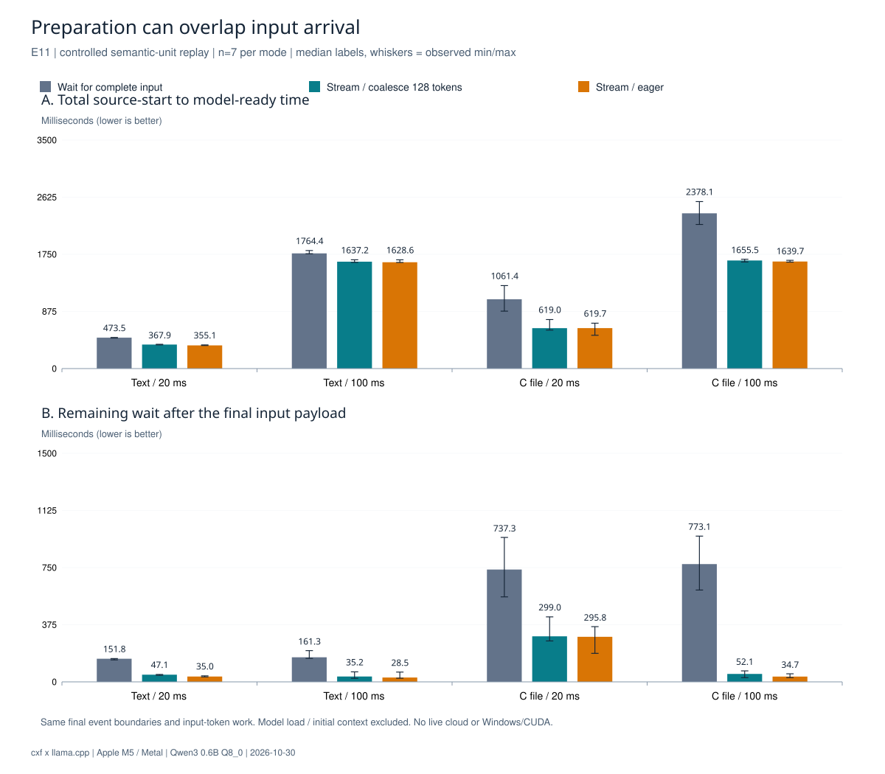

Six controlled cases × three modes × seven repeats = 126 timing samples, plus 63 file timelines and two status records. Source: 16 immutable semantic units + an end control, wire chunks ≤7 bytes. End arrives immediately after the last payload; there is no extra EOF gap. Initial 538-token context/model load are excluded. Each payload is a complete local user-message unit, not an arbitrary append into one message.

`wait_all`: wait for complete source/file callbacks, then prepare. `stream_coalesced`: prepare complete units with a 128-token minimum batch. `stream_eager`: flush smaller updates. All modes hold final event boundaries and input token counts equal. File case: three C-source chunks, file_end at sequence 4, then 12 text units; the deployment-fixed test command compiles and runs the complete file.

| Scenario / gap | Mode | Total ready ms | After-input ready ms | Local prefill ms | Input decode calls | n |
| --- | --- | --- | --- | --- | --- | --- |
| text_prefill / 0 ms | wait_all | 144.0 [139.9–147.3] | 143.9 [139.7–147.2] | 143.0 [138.9–146.2] | 2.0 [2.0–2.0] | 7 |
| text_prefill / 0 ms | stream_coalesced | 145.6 [140.7–159.9] | 145.5 [140.6–159.8] | 144.3 [139.6–158.6] | 2.0 [2.0–3.0] | 7 |
| text_prefill / 0 ms | stream_eager | 148.2 [139.5–159.0] | 148.1 [139.4–158.9] | 147.0 [138.3–157.8] | 3.0 [2.0–3.0] | 7 |
| text_prefill / 20 ms | wait_all | 473.5 [468.1–476.0] | 151.8 [144.2–153.1] | 150.1 [142.4–151.3] | 2.0 [2.0–2.0] | 7 |
| text_prefill / 20 ms | stream_coalesced | 367.9 [363.4–372.2] | 47.1 [43.0–48.7] | 234.0 [211.6–241.2] | 6.0 [6.0–6.0] | 7 |
| text_prefill / 20 ms | stream_eager | 355.1 [353.2–362.6] | 35.0 [32.8–39.5] | 323.4 [318.7–329.6] | 16.0 [16.0–16.0] | 7 |
| text_prefill / 100 ms | wait_all | 1764.4 [1758.5–1807.6] | 161.3 [154.1–205.0] | 159.0 [153.1–201.0] | 2.0 [2.0–2.0] | 7 |
| text_prefill / 100 ms | stream_coalesced | 1637.2 [1625.9–1666.6] | 35.2 [23.3–65.8] | 259.5 [215.2–283.1] | 6.0 [6.0–6.0] | 7 |
| text_prefill / 100 ms | stream_eager | 1628.6 [1625.1–1665.6] | 28.5 [23.9–64.2] | 396.5 [370.0–593.4] | 16.0 [16.0–17.0] | 7 |
| complete_file_test / 0 ms | wait_all | 611.0 [561.6–1262.1] | 610.9 [561.5–1262.0] | 136.5 [127.7–156.4] | 2.0 [2.0–2.0] | 7 |
| complete_file_test / 0 ms | stream_coalesced | 604.8 [468.3–1300.3] | 604.6 [468.1–1300.2] | 154.3 [129.7–194.7] | 2.0 [2.0–3.0] | 7 |
| complete_file_test / 0 ms | stream_eager | 481.6 [438.6–558.9] | 481.5 [438.5–558.9] | 161.8 [142.9–204.8] | 4.0 [3.0–4.0] | 7 |
| complete_file_test / 20 ms | wait_all | 1061.4 [879.5–1271.0] | 737.3 [557.8–948.1] | 135.7 [133.3–143.1] | 2.0 [2.0–2.0] | 7 |
| complete_file_test / 20 ms | stream_coalesced | 619.0 [589.5–751.0] | 299.0 [268.6–426.5] | 164.9 [151.3–176.2] | 3.0 [2.0–3.0] | 7 |
| complete_file_test / 20 ms | stream_eager | 619.7 [509.6–695.1] | 295.8 [187.2–362.4] | 393.0 [297.5–492.4] | 6.0 [6.0–11.0] | 7 |
| complete_file_test / 100 ms | wait_all | 2378.1 [2207.0–2557.7] | 773.1 [602.8–956.7] | 135.9 [134.0–157.3] | 2.0 [2.0–2.0] | 7 |
| complete_file_test / 100 ms | stream_coalesced | 1655.5 [1632.7–1674.0] | 52.1 [27.7–72.1] | 238.2 [216.1–260.1] | 5.0 [4.0–5.0] | 7 |
| complete_file_test / 100 ms | stream_eager | 1639.7 [1631.0–1658.0] | 34.7 [27.7–53.0] | 495.4 [401.6–547.1] | 15.0 [14.0–16.0] | 7 |

With a 100 ms gap, the file tool finished before input end in all seven streaming runs, and in none of the wait-all runs. At 20 ms it did not finish before end, but some execution was hidden. Coalesced mode was faster than wait-all in all seven pairs for text/file cases at 20/100 ms; seven pairs do not establish p95/p99 or operational stability. No-gap text did not improve. No-gap file timing is noisy, including a coalesced maximum of 1,300.267 ms.

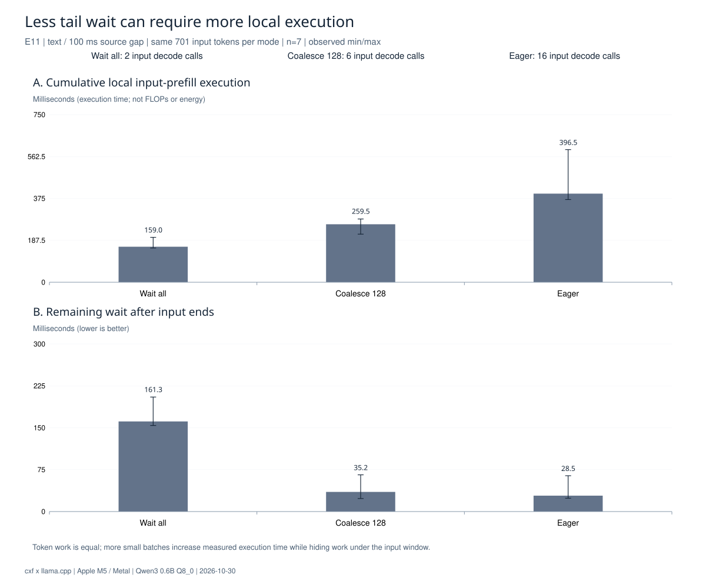

For pure text at 100 ms, all modes evaluate 701 input tokens. Input decode calls rise 2 → 6 → 16; cumulative local prefill execution rises 158.956 → 259.494 → 396.539 ms while post-input wait falls 161.341 → 35.166 → 28.473 ms. The latency gain buys overlap with more small-batch execution; there is no FLOP/energy measurement. Some file/render wall times are large and variable; contention has not been profiled.

“Ready” means full source + valid current-version receipts + assistant header have KV, before the final callback. The callback performs a test-only full-tokenization oracle and at most 16 preview tokens; first-token/output fields include that oracle overhead and are not summary-quality or full-generation benchmarks. All such fields remain available in the raw data and metrics CSV.

## Correctness, capability and untested scope

| Category | Result | Evidence / scope |
| --- | --- | --- |
| Native context/chat | PASS | E03–04, E07–11; full-token and greedy oracles, rollback, budgets, failure recovery |
| Scripted tool executor | PASS | E04; read → compile FAIL → write → compile PASS → read; actions supplied by test |
| KV worker / stream | PASS | E10–11; cancellation, stale versions, bounded queues, cleanup, file feedback before end |
| CLI and default regression | PASS | E11; replay 6 cases, native 5 cases, make test; expected nonzero exits are intentional |
| ASan / UBSan | PASS (partial instrumentation) | cxf/adapters instrumented; prebuilt llama/common/Metal libraries excluded |
| Real model: one file read | PASS, n=1 | E04; two calls, receipt-based answer |
| Real model: instructed C repair | FAIL, n=1 | E04; FORMAT at first action, zero tools dispatched |
| Historical HTTP C repair | FAIL, two individual probes | E12; sanitized summaries; earlier protocol, no independently passing final program |
| Windows/CUDA, live cloud SSE, automatic agentctl integration | NOT VALIDATED | Host/replay interfaces only; second machine acceptance pending |
| Physical KV release, cold SSD, tail stability, general coding/summarization | NOT VALIDATED | Do not extrapolate the latency/temporary-heap results |

See [validation.csv](data/validation.csv) for individual gates. No global “pass percentage” combines model capability, expected rejection tests, and implementation correctness.

## E13 · calibrated service-time estimation

A standalone 3,120-byte C estimator predicts warm-prefill service time using batch-call count, new tokens and attention-pair work proxies. The machine/runtime/model fingerprint chooses a profile; hardware names do not supply measured throughput. No inference or scheduling behavior changes.

63 calibration samples: prefixes 0/2048/6144 × new tokens 32/128/512 × 7. Evaluation uses 84 samples on different shapes: prefixes 0/1024/4096 × 16/64/256/768 × 7. The fixed token/s baseline uses all calibration samples. Frozen uses no evaluation labels; online predicts each row before observing it. Each tested shape is warmed outside timing; model load and prefix setup are excluded.

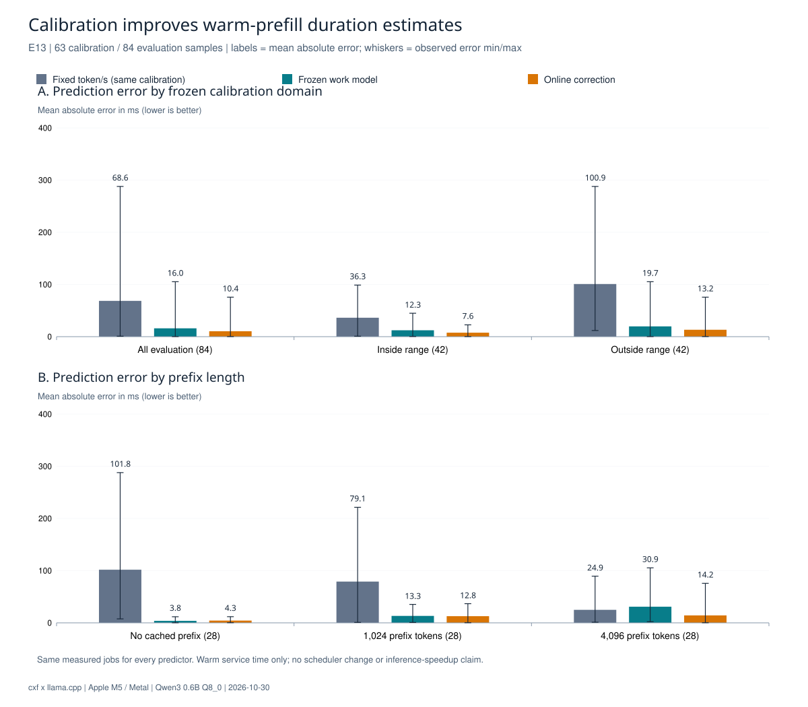

| Mode | Group | n | MAE ms | WAPE % | MAPE % | Max abs error ms | Signed bias ms |
| --- | --- | --- | --- | --- | --- | --- | --- |
| fixed | all | 84 | 68.594 | 65.87 | 82.84 | 287.873 | 46.624 |
| fixed | inside_frozen_domain | 42 | 36.284 | 61.63 | 77.68 | 98.875 | 28.515 |
| fixed | outside_frozen_domain | 42 | 100.904 | 67.55 | 87.99 | 287.873 | 64.734 |
| frozen | all | 84 | 15.991 | 15.36 | 15.77 | 105.359 | 13.649 |
| frozen | inside_frozen_domain | 42 | 12.258 | 20.82 | 20.66 | 44.934 | 11.944 |
| frozen | outside_frozen_domain | 42 | 19.724 | 13.20 | 10.87 | 105.359 | 15.354 |
| online | all | 84 | 10.440 | 10.03 | 14.65 | 75.717 | 4.495 |
| online | inside_frozen_domain | 42 | 7.642 | 12.98 | 17.02 | 22.643 | 6.915 |
| online | outside_frozen_domain | 42 | 13.238 | 8.86 | 12.29 | 75.717 | 2.075 |

MAE is mean absolute error; WAPE = sum absolute errors / sum actual times; MAPE averages per-sample relative errors. Positive signed bias means overestimated duration, which would make a deadline policy start earlier. Online correction is prequential learning, not an entirely untouched holdout. “Inside domain” is only a range check, not proof of accuracy; half the evaluation rows are outside the frozen token-size range.

| Prefix | New tokens | Actual ms median [min–max] | Fixed / frozen / online MAE ms | n |
| --- | --- | --- | --- | --- |
| 0 | 16 | 25.3 [20.6–30.9] | 16.12 / 2.81 / 3.00 | 7 |
| 0 | 64 | 22.7 [19.8–27.3] | 12.15 / 4.85 / 6.27 | 7 |
| 0 | 256 | 44.1 [41.0–46.2] | 96.60 / 1.82 / 1.99 | 7 |
| 0 | 768 | 139.3 [131.6–143.1] | 282.36 / 5.69 / 6.04 | 7 |
| 1024 | 16 | 25.3 [24.3–27.7] | 16.99 / 1.48 / 2.79 | 7 |
| 1024 | 64 | 27.2 [26.3–34.1] | 6.37 / 7.57 / 8.12 | 7 |
| 1024 | 256 | 60.7 [58.5–65.2] | 78.31 / 15.64 / 14.73 | 7 |
| 1024 | 768 | 204.8 [198.1–213.3] | 214.55 / 28.48 / 25.45 | 7 |
| 4096 | 16 | 38.0 [35.2–44.5] | 29.88 / 5.59 / 10.40 | 7 |
| 4096 | 64 | 50.4 [46.7–55.5] | 15.97 / 10.73 / 3.65 | 7 |
| 4096 | 256 | 146.1 [134.2–158.2] | 8.31 / 32.93 / 11.10 | 7 |
| 4096 | 768 | 466.5 [434.0–508.9] | 45.52 / 74.31 / 31.74 | 7 |

Estimator overhead, measured separately (10 batches; timings per call):

| Operation | µs median [min–max] |
| --- | --- |
| predict | 0.0860 [0.0650–0.2848] |
| observe/refit | 3.3650 [2.6050–24.1900] |

The model-structure formula gives 114,688 bytes (112 KiB) of FP16 KV payload per token: 28 layers × 8 KV heads × (128 K + 128 V) × 2 bytes. This is model-specific payload, not whole-process memory. The rolling window holds 64 numeric observations and does no heap allocation. Remaining maximum errors require explicit scheduling margins; lower prediction error is not measured inference speedup. Cold start, restore I/O, queue time, agent ETA, arbitrary-program complexity and Windows/CUDA remain unmeasured.

Independent C unit tests, ASan/UBSan and default regression passed. Real-model checks cover canonical tokens, exact new-token/batch counts and 21 fresh-KV greedy shape comparisons. See [D-COST](../design/cost-estimator-v1.md); raw predictions and failures are preserved in E13.

## E14 · hardware Roofline estimation

The standard GEMM 2MNK count and per-operation max(F/P, B/BW) Roofline are now implemented as an optional C estimator. The Qwen3 GGUF supplies actual matrix dimensions and Q8_0 bytes. New measurements use the same 63/84 calibration/evaluation grids as E13, with five predictions per measured job. E13 remains immutable; comparisons below are within E14 only.

| Same GGML/Metal primitive | Effective rate | Samples |
| --- | --- | --- |
| Q8_0 GEMM K1024 / N3072 / M512 | 1.785 TFLOP/s | 7 |
| F16 GEMM K128 / N4096 / M512 | 0.705 TFLOP/s | 7 |
| 64 MiB copy (read + write) | 37.387 GB/s | 7 |

These are synchronized wall-clock microprobe rates after two warmups, not vendor peak specifications. GEMM FLOPs omit quantization instruction work. F16 GEMM is only an attention-throughput proxy; actual fused attention has different utilization and IO. Traffic assumes one KV pass per chunk; normalization, RoPE and activation work are omitted. This is not a verified physical latency lower bound. Sources: [GEMM](https://docs.nvidia.com/deeplearning/performance/dl-performance-matrix-multiplication/index.html), [Roofline](https://docs.nvidia.com/nsight-compute/ProfilingGuide/index.html#roofline-charts), [FlashAttention IO](https://arxiv.org/abs/2205.14135).

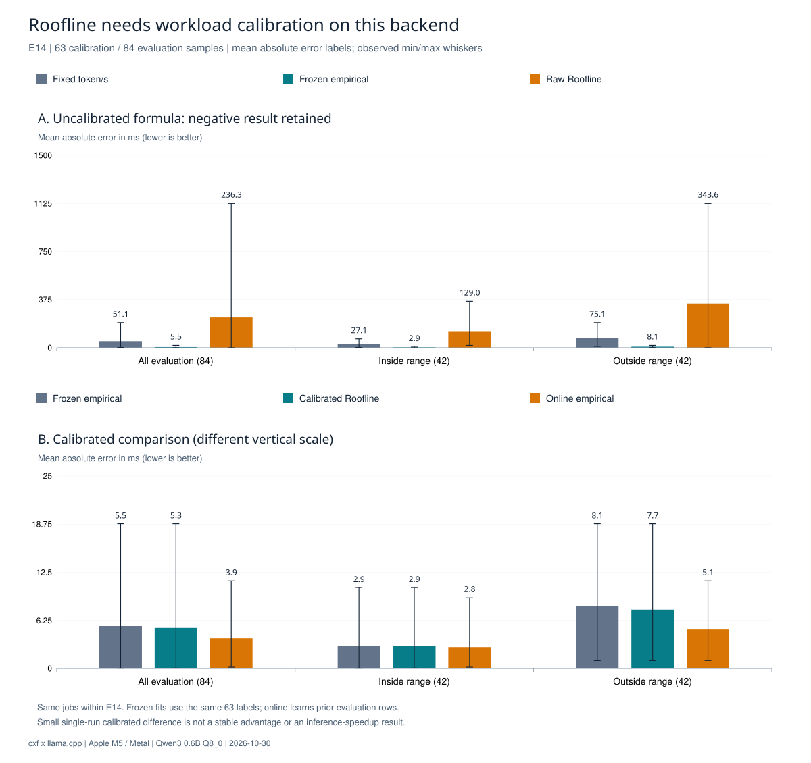

| Mode | Group | n | MAE ms | WAPE % | MAPE % | Max abs error ms | Signed bias ms |
| --- | --- | --- | --- | --- | --- | --- | --- |
| fixed | all | 84 | 51.115 | 58.63 | 72.75 | 195.662 | 24.576 |
| fixed | inside_frozen_domain | 42 | 27.086 | 55.25 | 66.78 | 69.843 | 15.766 |
| fixed | outside_frozen_domain | 42 | 75.144 | 59.95 | 78.71 | 195.662 | 33.385 |
| frozen | all | 84 | 5.526 | 6.34 | 11.08 | 18.811 | 1.194 |
| frozen | inside_frozen_domain | 42 | 2.923 | 5.96 | 4.64 | 10.525 | 2.695 |
| frozen | outside_frozen_domain | 42 | 8.129 | 6.49 | 17.51 | 18.811 | -0.307 |
| online | all | 84 | 3.931 | 4.51 | 9.50 | 11.377 | -0.004 |
| online | inside_frozen_domain | 42 | 2.787 | 5.69 | 5.62 | 9.187 | 2.728 |
| online | outside_frozen_domain | 42 | 5.075 | 4.05 | 13.39 | 11.377 | -2.736 |
| roofline | all | 84 | 236.315 | 271.04 | 194.35 | 1124.549 | 236.299 |
| roofline | inside_frozen_domain | 42 | 129.031 | 263.20 | 229.06 | 361.295 | 129.031 |
| roofline | outside_frozen_domain | 42 | 343.598 | 274.11 | 159.64 | 1124.549 | 343.568 |
| roofline_calibrated | all | 84 | 5.281 | 6.06 | 9.97 | 18.808 | 1.431 |
| roofline_calibrated | inside_frozen_domain | 42 | 2.910 | 5.94 | 4.59 | 10.517 | 2.696 |
| roofline_calibrated | outside_frozen_domain | 42 | 7.651 | 6.10 | 15.35 | 18.808 | 0.167 |

Raw Roofline is substantially worse: the current combination of rate and traffic/operator proxies does not transfer directly to inference; individual error sources have not been isolated. Calibration uses three nonnegative coefficients for linear time, attention time and decode calls, trained only on the same 63 labels as the original frozen three-parameter model. MAE 5.281 vs 5.526 ms is a small single-run difference, not evidence of a stable advantage. Original online prediction remains better at 3.931 ms, but learns prior evaluation labels. The raw negative result is retained; no held-out tuning or replacement run was used.

One-chunk raw estimation overhead: 0.0144 [0.0142–0.0148] µs; 10 batches of 5,000 calls. Calibrated prediction/refit overhead was not separately timed. Calibration state is 3,120 bytes per model; no heap or context copy. All 21 fresh-KV greedy shape checks, canonical tokens, exact token/batch counts, unit tests, ASan/UBSan and default regression passed. Scheduling is unchanged; lower prediction error is not inference speedup.

## E15 · diagnosing and correcting the raw formula

An independent Python recomputation matches all 147 E14 FLOP/byte/time records: no 2MNK arithmetic or unit-conversion defect was found. Source inspection of pinned Qwen3 shows a real work-model omission: the final layer selects requested output rows before its FFN. The new optional last_layer_ffn_tokens field uses 1 for this native path; zero retains legacy behavior and requires callers to recompile. No inference code or scheduling was changed.

Rate diagnosis uses dependent graphs of depths 1 and 16, distinct weight/KV buffers per stage, two warmups and seven retained synchronized wall times. Rate = extra work / extra median duration; overlapping depth ranges reject the probe. Q8/F16 matmuls alternate transposed dimensions. Attention now uses dense ggml_flash_attn_ext with actual head-interleaved strides, F32 Q/accumulation, FP16 KV, Hq16/Hkv8, dk=dv128, prefix2048/new512 and n_kv_max=0. A development probe incorrectly set a sparse hint; it was corrected before the formal run and remains excluded in the inventory.

| Rate (decimal units) | Initial isolated wall rate | Repeated after graph probes | Dependent-graph slope |
| --- | --- | --- | --- |
| Q8 GEMM TFLOP/s | 1.758 | 6.628 | 10.305 |
| F16 GEMM TFLOP/s | 0.685 | 2.011 | 3.217 |
| Copy read+write GB/s | 62.427 | 64.311 | 70.537 |

Dense FlashAttention slope: 2.765 TFLOP/s; logical causal FLOPs per second, not physical peak throughput. Q8 depth1/depth16 medians are 0.514/5.203 ms: the slope implies 0.3126 ms/op and a 0.2014 ms graph intercept. Later repetition of the exact old probe is also much faster. These establish graph-size and order effects, but without GPU clock/temperature telemetry they do not establish throttling or any single frequency cause. The F16 and FlashAttention rates represent different kernels and cannot be interchanged.

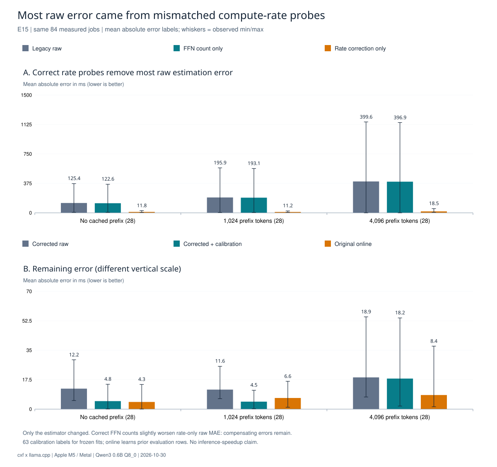

| E15 mode (same 84 jobs) | MAE ms | WAPE % | Max abs error ms | Signed bias ms |
| --- | --- | --- | --- | --- |
| fixed | 54.064 | 60.87 | 214.199 | 30.368 |
| frozen | 10.117 | 11.39 | 55.268 | 3.451 |
| online | 6.434 | 7.24 | 37.448 | 0.246 |
| legacy | 240.283 | 270.53 | 1157.789 | 238.254 |
| math_only | 237.527 | 267.42 | 1149.867 | 235.493 |
| bandwidth_only | 240.035 | 270.25 | 1157.176 | 237.838 |
| linear_only | 129.148 | 145.40 | 838.715 | 126.402 |
| attention_only | 103.888 | 116.96 | 300.015 | 99.014 |
| rate_only | 13.845 | 15.59 | 53.735 | -13.845 |
| corrected | 14.220 | 16.01 | 54.856 | -14.220 |
| corrected_calibrated | 9.133 | 10.28 | 54.200 | 3.654 |

legacy remeasures the E14-style isolated rates; math_only changes final FFN work; bandwidth_only/linear_only/attention_only each replace just that rate; rate_only replaces all rates while retaining old work; corrected combines all changes. All variants share each measured job. The large error is mainly the compute-rate/operator mismatch, not bandwidth. Rate-only MAE is 13.845 ms; adding the semantically correct FFN count slightly worsens it to 14.220 ms, revealing compensating errors. Calibrated corrected uses only 63 calibration labels and the same three coefficients as before: 9.133 ms vs original frozen 10.117 ms, while original prequential online remains better at 6.434 ms. No held-out tuning or run selection; these are single-run differences, not stable speedups.

| Corrected estimator overhead (per call) | µs median [min–max] |
| --- | --- |
| raw estimate | 0.0187 [0.0182–0.0198] |
| calibrated predict | 0.0753 [0.0656–0.0826] |
| calibrated observe/refit | 1.9475 [1.9100–2.0300] |

C units, ASan/UBSan and default regression passed before timing; 21 fresh-KV greedy shape oracles, canonical tokens and exact token/batch checks passed. E15 contains 278 records, including 56 depth probes and 42 isolated probes. Real DRAM traffic, pure GPU timing and frequency are unmeasured; synthetic payloads, a single rate shape, small-batch vec kernels, padding, cache and omitted work remain limitations. Corrected raw max error is still 54.856 ms. E13/E14 are preserved at their measured source revisions; current hashes are E15. Lower prediction error is not faster model inference.

## E16–17 · batch/context residuals and fair online comparison

The earlier frozen Roofline versus online empirical comparison used different information. Post-hoc numeric replay of E15 gives Roofline online MAE 5.641 ms versus frozen 9.133 and empirical online 6.434; this is historical replay, not new inference. E16/E17 now compare empirical, single-shape Roofline and shape-profile predictors under both frozen and identical prequential updates. Every online model gets the same previous labels and 64-slot window; each predicts before observing the current job.

Each run measures batch limits 512 then 128 independently, 63 calibration and 147 evaluation jobs per limit (n=7 per cell), with 60 fresh-KV shape oracles. Batch here means tokens per native decode call, not concurrent requests. E16 evaluates prefixes 0/1024/4096 and new tokens 8/16/19/20/64/256/768. E17 uses new prefixes 512/3072/5120 and 12/18/24/48/192/384/640 after the E16 interpolation diagnosis. Both retain calibration prefixes 0/2048/6144 and sizes 32/128/512; full-job evaluation shapes do not overlap calibration.

Evidence for a kernel boundary: pinned Metal uses the FA vec path below 20 query tokens. E16 independent per-layer FA slopes at prefix2048 drop from 0.4678 ms (19 tokens) to 0.1978 ms (20). Full-model observations show the same discontinuity; a smooth token/pair formula cannot represent it. Route labels are source-inferred, not GPU counters. Q8 kernels also have a small-width path through 8 tokens.

| E16 batch cap | Prefix | 19-token actual ms [min–max] | 20-token actual ms [min–max] |
| --- | --- | --- | --- |
| 512 | 0 | 19.713 [19.160–21.994] | 17.502 [16.485–19.504] |
| 512 | 1024 | 24.097 [23.319–25.372] | 20.540 [20.110–22.577] |
| 512 | 4096 | 39.726 [38.410–45.883] | 27.479 [26.225–31.255] |
| 128 | 0 | 18.854 [17.747–19.086] | 15.899 [15.737–16.903] |
| 128 | 1024 | 22.546 [21.440–23.692] | 19.104 [17.984–19.606] |
| 128 | 4096 | 39.500 [36.959–76.238] | 27.133 [25.230–29.061] |

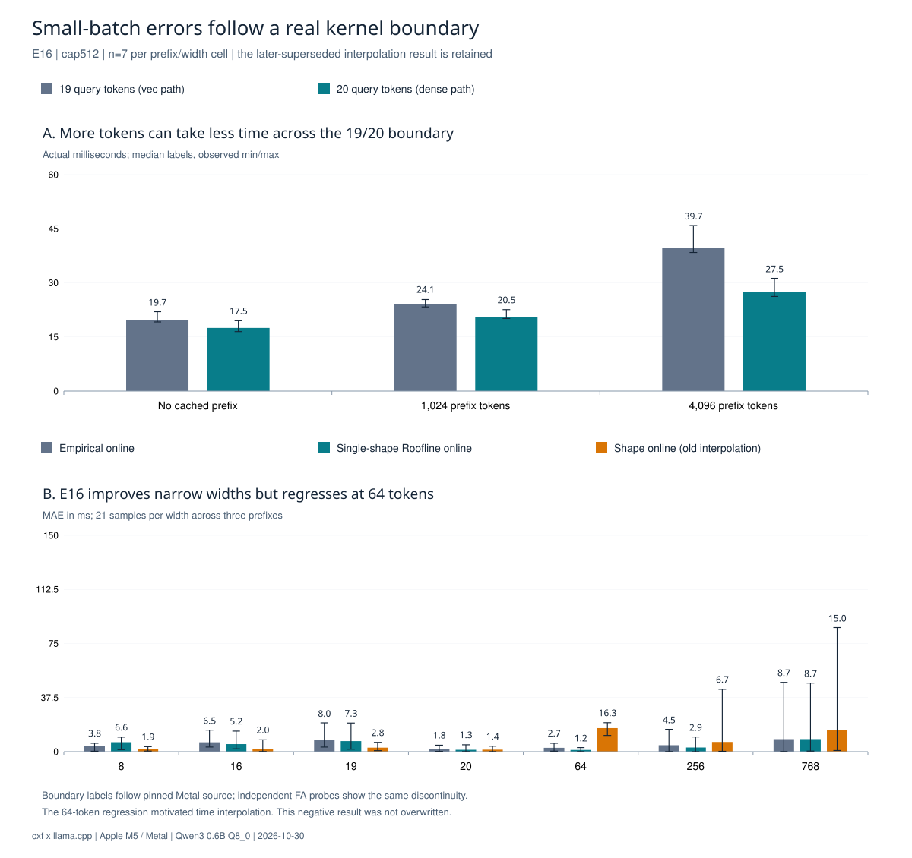

The optional 960-byte table profiles six widths (8/16/19/20/128/512) and three contexts (0/2048/6144) before model labels, with 336 depth probes and 24 rate rows per run. It interpolates within kernel regimes and advances context per chunk. E16 interpolated inverse linear rate, then multiplied by token work: this artificially curves the time between knots. It helped narrow queries but badly overpredicted width64; the negative result is preserved. E17 instead interpolates normalized operator time width/rate, then converts back to rate. FA already interpolated time. New shape tests were fixed before the E17 run.

| Run | Batch cap | Mode | n | MAE ms | WAPE % | Max abs error ms | Signed bias ms |
| --- | --- | --- | --- | --- | --- | --- | --- |
| E16 | 512 | empirical_frozen | 147 | 5.616 | 8.69 | 49.112 | -4.604 |
| E16 | 512 | empirical_online | 147 | 5.127 | 7.94 | 48.041 | -1.559 |
| E16 | 512 | roof_raw | 147 | 16.450 | 25.47 | 84.623 | -16.450 |
| E16 | 512 | roof_frozen | 147 | 4.895 | 7.58 | 50.207 | -3.066 |
| E16 | 512 | roof_online | 147 | 4.748 | 7.35 | 47.540 | -1.351 |
| E16 | 512 | shape_raw | 147 | 7.731 | 11.97 | 73.611 | -4.236 |
| E16 | 512 | shape_frozen | 147 | 5.563 | 8.61 | 56.088 | 1.981 |
| E16 | 512 | shape_online | 147 | 6.589 | 10.20 | 86.048 | 3.552 |
| E16 | 128 | empirical_frozen | 147 | 3.936 | 5.93 | 51.905 | -0.565 |
| E16 | 128 | empirical_online | 147 | 3.893 | 5.86 | 49.666 | -1.088 |
| E16 | 128 | roof_raw | 147 | 16.205 | 24.40 | 89.463 | -16.144 |
| E16 | 128 | roof_frozen | 147 | 4.055 | 6.10 | 51.667 | -0.231 |
| E16 | 128 | roof_online | 147 | 4.094 | 6.16 | 49.749 | -0.877 |
| E16 | 128 | shape_raw | 147 | 4.754 | 7.16 | 37.622 | -0.209 |
| E16 | 128 | shape_frozen | 147 | 5.076 | 7.64 | 32.967 | 3.850 |
| E16 | 128 | shape_online | 147 | 4.508 | 6.79 | 35.762 | 2.549 |
| E17 | 512 | empirical_frozen | 147 | 6.148 | 7.22 | 19.986 | -0.307 |
| E17 | 512 | empirical_online | 147 | 3.753 | 4.41 | 19.509 | -0.686 |
| E17 | 512 | roof_raw | 147 | 13.989 | 16.43 | 48.026 | -13.989 |
| E17 | 512 | roof_frozen | 147 | 4.320 | 5.07 | 17.532 | 0.575 |
| E17 | 512 | roof_online | 147 | 3.059 | 3.59 | 20.272 | -0.527 |
| E17 | 512 | shape_raw | 147 | 4.165 | 4.89 | 19.337 | -2.790 |
| E17 | 512 | shape_frozen | 147 | 5.620 | 6.60 | 12.129 | 5.620 |
| E17 | 512 | shape_online | 147 | 2.793 | 3.28 | 8.869 | 2.105 |
| E17 | 128 | empirical_frozen | 147 | 4.369 | 4.75 | 15.469 | 0.187 |
| E17 | 128 | empirical_online | 147 | 3.335 | 3.62 | 16.050 | -1.255 |
| E17 | 128 | roof_raw | 147 | 17.877 | 19.42 | 57.030 | -17.877 |
| E17 | 128 | roof_frozen | 147 | 3.932 | 4.27 | 14.685 | 0.461 |
| E17 | 128 | roof_online | 147 | 2.892 | 3.14 | 14.753 | -1.016 |
| E17 | 128 | shape_raw | 147 | 3.374 | 3.67 | 12.154 | -2.003 |
| E17 | 128 | shape_frozen | 147 | 4.961 | 5.39 | 15.823 | 4.961 |
| E17 | 128 | shape_online | 147 | 1.926 | 2.09 | 8.484 | 1.736 |

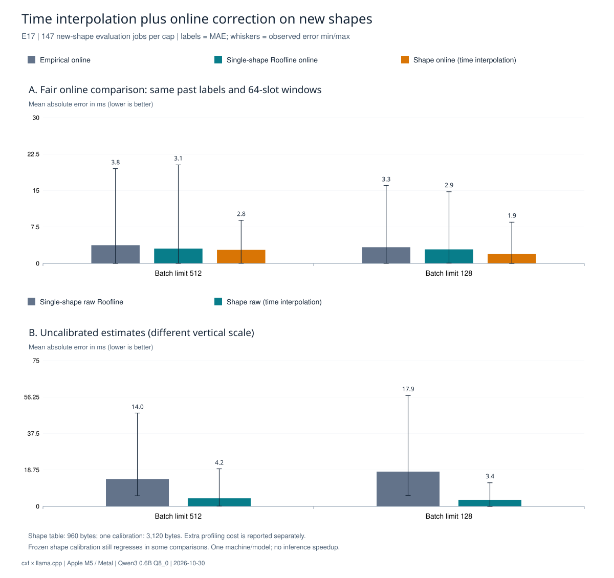

E17 online shape MAE is 25.6% lower than empirical online at cap512 and 42.2% lower at cap128, within the same jobs and observation policy. Single-shape Roofline online also beats empirical online in this run. This is not a universal advantage: E16 shape online regressed, and E17 frozen shape calibration is worse than raw shape and single-shape frozen in both caps. Extra profiling and calibration transfer remain costs; the table alone does not solve runtime drift.

All 42 prefix × new-token × cap cells per run, including signed bias and actual median/min/max/MAD, are in [cost-shape-errors.csv](data/cost-shape-errors.csv). Whiskers/MAD describe variation, not confidence intervals. Context sensitivity, width-dependent kernel changes, chunk-count overhead, and frozen/online information explain different parts of the residual; resource contention is not identified without telemetry. Neither E17 gain nor cross-run differences are inference speedups.

| E17 cost | Recorded value |
| --- | --- |
| Shape-table construction | 4797.034 [4797.034–4797.034] ms; before inference labels |
| Table + one numeric calibration | 960 + 3120 = 4080 bytes; no text/token/KV copy |
| Shape predict µs / cap512 | 0.1131 [0.0952–0.1140] |
| Shape observe/refit µs / cap512 | 1.9200 [1.9200–1.9250] |

Related primary research: [Vidur](https://www.microsoft.com/en-us/research/wp-content/uploads/2024/05/vidur_mlsys24.pdf) separates token-level and context-sensitive operators and uses profiled shape models; [FlashAttention-2](https://arxiv.org/abs/2307.08691) explains how work partitioning and occupancy affect effective throughput; [IBM Roofline + regression](https://research.ibm.com/publications/predicting-llm-inference-latency-a-roofline-driven-ml-method) combines structural estimates with learned runtime overhead. These motivate the method; CUDA/cloud results do not establish Metal accuracy. No random-forest implementation was imported.

Both 916-record runs retain all failures/regressions and passed C units, ASan/UBSan, default regression before timing and 60 shape oracles each. E16 wrapper lacked the re import after native success; metadata was recovered from unchanged raw records without rerunning inference, and measurement/processor hashes are separate. E17 completed directly. Current estimator hashes are E17; E16 source hashes describe its superseded interpolation. Default agent scheduling, Windows/CUDA, real cloud streaming and pure GPU/DRAM/clock/temperature profiling remain unvalidated.

## E18–19 · why frozen calibration regresses

The E17 development audit rules out insufficient optimizer iterations: exhaustive active-set NNLS and the recorded 128-pass fit differ by at most 6.6e-9 in coefficients, with matching training SSE. Before fitting, 512-token jobs account for 92.4% / 94.6% of raw squared residuals at caps512/128. Same-label weighted NNLS helps on E17, and a new three-feature residual basis helps more; these are development observations, not the new validation.

E19 fixes the policies before measuring unseen caps256/64, prefixes1280/3328/5376 and new tokens10/15/21/72/176/352/672. Both sparse and diverse coverage use exactly63 labels per cap and interleave in each prefix. Sparse is the old 3×3 grid; diverse uses nine points covering small/vec/dense paths. The shape table adds context7168 so all calibration chunks are covered. Clipped-control predictions use the same first three knots; evaluation chunks are all within6144, so raw evaluation features are exactly equal and only training coverage differs.

The new optional C residual model keeps the measured raw prior and fits calls, new_tokens/512 and raw_attention_ms/100. It uses signed coefficients, weight1/max(actual_ms,20), weighted-RMS feature normalization, ridge0.01 around zero residual, and clamps final duration to zero. Like the old model it has three parameters and64 numeric observations. The same-basis weighted NNLS controls are computed offline from training labels only, stored separately with raw-record references; they are not extra inference samples.

| E19 batch cap | Mode | n | MAE ms | WAPE % | Max abs error ms | Signed bias ms |
| --- | --- | --- | --- | --- | --- | --- |
| 256 | raw | 147 | 7.439 | 7.54 | 35.477 | -5.576 |
| 256 | legacy_clipped_sparse | 147 | 4.399 | 4.46 | 19.409 | -1.195 |
| 256 | legacy_sparse | 147 | 5.331 | 5.40 | 26.225 | -2.076 |
| 256 | legacy_diverse | 147 | 4.486 | 4.55 | 20.514 | -0.539 |
| 256 | weighted_sparse | 147 | 5.256 | 5.33 | 25.418 | -2.203 |
| 256 | weighted_diverse | 147 | 4.519 | 4.58 | 20.452 | -1.172 |
| 256 | residual_sparse | 147 | 4.809 | 4.87 | 25.501 | -2.662 |
| 256 | residual_diverse | 147 | 3.452 | 3.50 | 18.344 | -1.540 |
| 256 | empirical_online | 147 | 3.529 | 3.58 | 13.132 | -1.585 |
| 256 | shape_online | 147 | 3.930 | 3.98 | 16.546 | 1.169 |
| 64 | raw | 147 | 2.183 | 1.77 | 8.368 | 1.346 |
| 64 | legacy_clipped_sparse | 147 | 4.728 | 3.82 | 23.449 | 4.647 |
| 64 | legacy_sparse | 147 | 2.678 | 2.17 | 9.372 | 2.565 |
| 64 | legacy_diverse | 147 | 2.631 | 2.13 | 9.077 | 2.515 |
| 64 | weighted_sparse | 147 | 2.754 | 2.23 | 10.165 | 2.629 |
| 64 | weighted_diverse | 147 | 2.749 | 2.22 | 10.583 | 2.589 |
| 64 | residual_sparse | 147 | 2.664 | 2.16 | 10.130 | 2.515 |
| 64 | residual_diverse | 147 | 2.645 | 2.14 | 11.406 | 2.421 |
| 64 | empirical_online | 147 | 3.321 | 2.69 | 11.545 | -1.748 |
| 64 | shape_online | 147 | 1.683 | 1.36 | 8.108 | 1.230 |

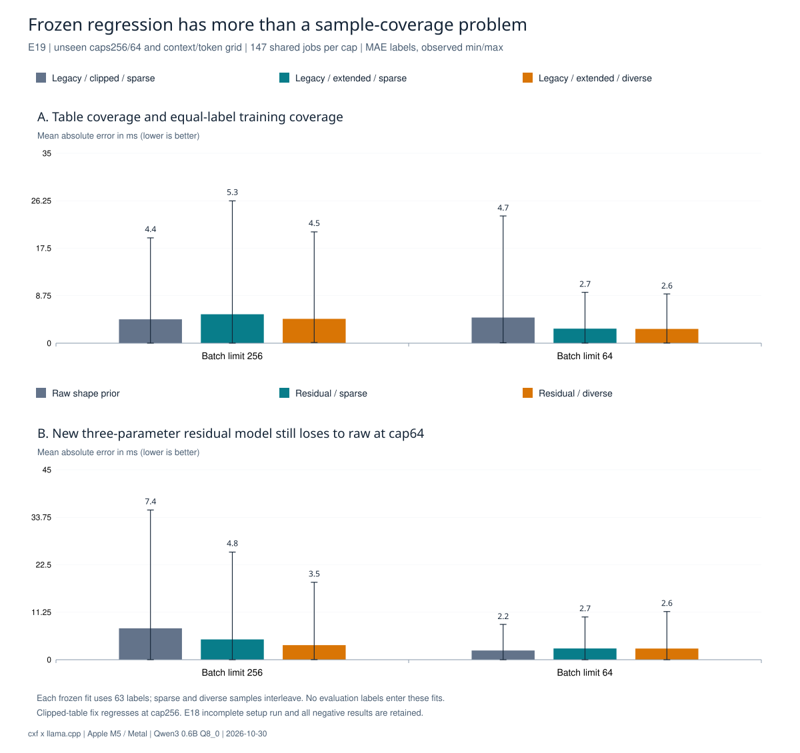

The cause is mixed. At cap256, broader equal-label coverage reduces legacy MAE5.331→4.486 ms; changing to the residual model with that coverage gives3.452 ms. Weighting alone does not consistently help. Table extension helps cap64 (4.728→2.678) but regresses at cap256 (4.399→5.331), revealing compensating errors. At cap64, raw2.183 ms remains better than every frozen calibration, including new residual/diverse2.645 ms. More coverage does not establish that three global correction coefficients generalize.

Training error also separates fitting from generalization: at cap64/sparse, raw training MAE1.792 ms drops to1.045 with residual fitting, yet held-out error grows from raw2.183 to2.664 ms. All training metrics are in [frozen-calibration-training.csv](data/frozen-calibration-training.csv), and all42 validation cells ×10 modes in [frozen-calibration-errors.csv](data/frozen-calibration-errors.csv). Frozen variants never use evaluation labels; online baselines do, after each prediction.

| Cap | Anchor prefix/new | Before calibration ms | After calibration ms | After evaluation ms |
| --- | --- | --- | --- | --- |
| 256 | 0/32 | 15.592 [15.350–16.486] | 16.488 [15.412–16.705] | 16.531 [15.597–16.569] |
| 256 | 2048/17 | 27.253 [27.102–27.918] | 27.331 [27.234–27.387] | 27.248 [27.233–27.514] |
| 256 | 6144/512 | 363.472 [362.888–365.052] | 377.057 [376.397–377.996] | 374.308 [372.548–376.706] |
| 64 | 0/32 | 15.485 [15.327–16.284] | 15.588 [15.477–15.859] | 15.415 [15.368–16.376] |
| 64 | 2048/17 | 27.168 [27.051–28.121] | 27.170 [27.081–27.230] | 27.127 [26.945–27.154] |
| 64 | 6144/512 | 446.056 [444.423–446.357] | 444.944 [443.155–445.124] | 443.846 [441.423–444.356] |

Anchors are three repetitions per stage and excluded from all fitting. At cap256 the long anchor rises363.472→377.057 ms, while the narrow anchor is nearly unchanged; cap64 long-anchor change is smaller. Phase variation therefore exists and is workload-dependent, but without clock/temperature/DRAM/GPU timestamps it cannot identify a hardware cause. Coverage and model effects are not additive, and cross-cap runs are sequential.

| E19 numeric cost | Value |
| --- | --- |
| Residual state + table | 3632 + 960 = 4592 bytes; no heap/context copy |
| Extended-table construction | 8695.356 [8695.356–8695.356] ms |
| Predict including shape lookup / cap256 µs | 0.1629 [0.1028–0.2090] |
| Residual observe/refit / cap256 µs | 0.4525 [0.2700–0.5700] |

Residual ridge uses the standard [L2-regularized least-squares structure](https://scikit-learn.org/stable/modules/generated/sklearn.linear_model.Ridge.html), implemented here in standalone C with a direct3×3 Cholesky solve, without scikit-learn. Analytic collinear/zero-column, signed correction, window/drift and invalid-state tests, ASan/UBSan and default regression passed before GPU measurement;78 fresh-KV workload shapes passed token/greedy/batch checks. Current source hashes are E19. E18 preserves all849 rows of the incomplete first run: cap256 finished, then cap64 was rejected because default prefill minimum128 exceeded batch64. E19 corrects only that test setting to min(128,batch); calibration strategy was not retuned or selected by accuracy. E19 has1162 native records plus294 separately referenced offline controls. No model-inference or default scheduler behavior changed.

## E20 · optional residual Kalman

A new C layer tracks scalar residual bias with 40 bytes and no heap/context. Read-only prediction does not advance Q; only successful nonzero observation updates state, using the original unfiltered base. Profile changes require a separate/reset state. Fixed Q/R from steady-state initialization is mathematically identical to EWMA; both are checked rather than advertised as distinct accuracy gains.

Fresh native measurements use cap256/64, prefixes1792/3840/5504 and new tokens11/18/26/88/208/400/688. The existing sparse/diverse calibration and expanded microtable are retained. Noise parameters come only from nine diverse training groups: constant R is median within-group variance with a .25 ms² floor; scaled R is a nonnegative intercept + squared-duration fit. Q=.01R and the initialization were fixed before evaluation. All layers start with zero bias at evaluation, predict before observing each label, and use the same chronological past jobs within each base. This is numeric C replay of new measurements, not live-agent scheduling or extra independent inference samples.

| Cap | Base | Base MAE ms | EWMA = fixed MAE ms | Scaled R MAE ms | Base RMSE ms | Scaled RMSE ms | Base max ms | Scaled max ms |
| --- | --- | --- | --- | --- | --- | --- | --- | --- |
| 256 | raw | 5.056 | 4.813 | 4.588 | 7.122 | 6.312 | 24.610 | 20.725 |
| 256 | residual_diverse | 2.913 | 2.790 | 2.834 | 3.925 | 3.740 | 12.914 | 11.865 |
| 256 | shape_online | 3.173 | 3.073 | 3.147 | 4.046 | 3.887 | 9.582 | 9.778 |
| 64 | raw | 4.748 | 3.290 | 3.944 | 6.131 | 5.201 | 16.159 | 14.608 |
| 64 | residual_diverse | 4.687 | 3.440 | 4.024 | 6.441 | 5.649 | 16.629 | 15.723 |
| 64 | shape_online | 1.975 | 1.922 | 1.951 | 2.644 | 2.588 | 9.320 | 8.248 |

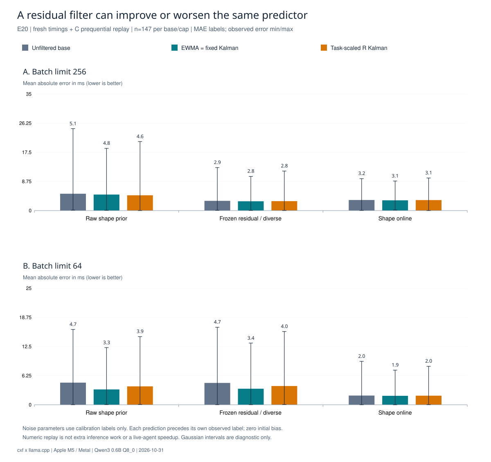

On the current shape-online base, fixed/EWMA MAE improves3.173→3.073 ms at cap256 (3.2%) and1.975→1.922 ms at cap64 (2.7%): a small observed correction, not a broad accuracy breakthrough. Fixed/EWMA beats scaled R in five of six base/cap comparisons. At cap256/shape-online, scaled R slightly worsens maximum error9.582→9.778 ms; even fixed improves aggregate MAE while worsening10 of21 cell means at each cap. The workload order repeats each shape seven times, so these gains do not establish the effect on a real heterogeneous Agent sequence.

All 24 comparisons, signed bias and cold first14 errors are in [kalman-summary.csv](data/kalman-summary.csv); all504 per-cell/mode rows are in [kalman-errors.csv](data/kalman-errors.csv). The882 indexed layer records in [kalman-replay.csv](data/kalman-replay.csv) reference294 original evaluation jobs. They are excluded from the1162 native-record count and from native-record totals. No Q/R was retuned on evaluation and negative results remain.

A Gaussian noise model does not itself guarantee smaller MAE. Standard Kalman optimality relies on the model/noise assumptions and concerns squared error; see [MathWorks estimation documentation](https://www.mathworks.com/help/fusion/ug/introduction-to-estimation-filters.html). The following normalized innovation diagnostics are descriptive. The nominal ±1.96sqrt(Pprior+R) interval is not a validated 95% guarantee; correlated workload residuals and model bias can invalidate it.

| Cap | Base | Filter | Coverage % | z SD | Skew | Excess kurtosis | Lag1 |
| --- | --- | --- | --- | --- | --- | --- | --- |
| 256 | raw | fixed | 15.646 | 11.854 | 0.413 | -0.068 | 0.146 |
| 256 | raw | scaled | 44.218 | 4.402 | 0.747 | 0.320 | 0.189 |
| 256 | residual_diverse | fixed | 25.850 | 6.825 | 0.003 | 0.273 | 0.157 |
| 256 | residual_diverse | scaled | 54.422 | 2.636 | 0.340 | 0.669 | 0.258 |
| 256 | shape_online | fixed | 17.687 | 7.163 | -0.150 | -0.479 | 0.232 |
| 256 | shape_online | scaled | 52.381 | 2.755 | 0.037 | -0.417 | 0.319 |
| 64 | raw | fixed | 27.211 | 8.278 | -0.302 | 0.169 | 0.360 |
| 64 | raw | scaled | 70.068 | 2.714 | 0.438 | 0.778 | -0.005 |
| 64 | residual_diverse | fixed | 29.252 | 9.007 | -0.465 | 0.417 | 0.351 |
| 64 | residual_diverse | scaled | 69.388 | 2.776 | 0.383 | 0.699 | -0.009 |
| 64 | shape_online | fixed | 36.735 | 4.728 | -0.120 | 0.083 | 0.054 |
| 64 | shape_online | scaled | 68.027 | 2.738 | -0.043 | 0.800 | -0.039 |

Observed nominal coverage is only15.65–70.07%. Calibration group jitter omits cross-shape structural error, and normalized innovation SD is2.64–11.85 rather than1. Both constant-R estimates hit the .25ms² floor. The scaled fit is [1.9193,0] at cap256 (it becomes another constant-noise filter) and [0,5.5676] at cap64. This supports underestimated/misspecified covariance; low coverage alone does not prove non-Gaussian shape. Do not use this uncertainty as a readiness guarantee. Keep the layer optional and validate on real sequences before default integration.

| Layer-only cost | Median [min–max] |
| --- | --- |
| C state bytes | 40 |
| Predict µs | 0.0092 [0.0089–0.0098] |
| Observe µs | 0.0136 [0.0132–0.0147] |

Analytic Joseph/gain, EWMA equivalence, step, single-spike propagation and failure-atomicity tests, ASan/UBSan and full default regression passed before timing. All78 fresh-KV native shapes passed canonical token/greedy/batch oracles; C layer predictions/covariance/gain and calibration-only noise are independently replay-checked in Python. Current measured source hashes are E20; prior evidence remains immutable. Only optional estimator behavior changed, with no inference-kernel, default-scheduler or Windows/CUDA speed claim.

## E21 · actual tool-window preparation

Simple EWMA now controls an opt-in native CLI test.run wrapper and the same callable host module. Native borrows the worker-owned engine; every engine operation stays on one owner thread. The tool executes once with its original authorization, args and receipt. A checkpoint retains the verified pre-header canonical prefix. No second model/context or persistent transcript is created. This is a serial tool-window slice, not the full P0–P4 coordinator.

The benchmark runs real fs.read and deployed C compiler/test processes. Each task has three measured calls; compilation tests fail, apply a real full-file correction, then pass twice. The same real receipts drive independent full-template/token and fresh-KV greedy references. Actions are deterministic to isolate scheduling from 0.6B decision quality. Native CLI smoke-probe results are separated from timing.

Resident KV is the ordinary warm baseline. Recompute explicitly evicts KV but retains canonical tokens; restore actually saves a same-live-session private file, then evicts it. Both nonresident states compare after-tool, immediate and EWMA-timed preparation. Timed delay=max(0, tool_hat − prefix_tokens×prepare_ms_per_token_hat −5ms); alpha=.0951249. Initial estimates use the same three real calibration samples per operation/case, then each mode learns only its own past labels. Replicates rotate mode order. No artificial sleeps create performance windows.

| Case / history words | Mode | n tasks | Task ms [min–max] | After-tool wait sum ms | Tool sum ms | Save sum ms | Early-hold sum ms |
| --- | --- | --- | --- | --- | --- | --- | --- |
| read / 128 | resident | 7 | 65.36 [64.89–67.58] | 65.15 [64.68–67.37] | 0.13 [0.11–0.13] | 0.00 [0.00–0.00] | 0.00 [0.00–0.00] |
| read / 128 | prefill_late | 7 | 292.26 [291.12–293.58] | 291.92 [290.81–293.24] | 0.14 [0.12–0.15] | 0.00 [0.00–0.00] | 0.00 [0.00–0.00] |
| read / 128 | prefill_immediate | 7 | 291.63 [290.46–294.93] | 291.25 [290.11–294.53] | 0.16 [0.14–0.17] | 0.00 [0.00–0.00] | 0.00 [0.00–0.00] |
| read / 128 | prefill_timed | 7 | 291.54 [290.07–295.09] | 291.17 [289.69–294.71] | 0.15 [0.13–0.18] | 0.00 [0.00–0.00] | 0.00 [0.00–0.00] |
| read / 128 | restore_late | 7 | 113.25 [93.82–127.00] | 79.51 [77.15–84.64] | 0.14 [0.13–0.35] | 34.01 [16.32–48.36] | 0.00 [0.00–0.00] |
| read / 128 | restore_immediate | 7 | 110.11 [94.95–120.74] | 79.07 [78.43–79.85] | 0.14 [0.14–0.15] | 30.89 [15.73–40.85] | 0.00 [0.00–0.00] |
| read / 128 | restore_timed | 7 | 116.27 [95.41–137.18] | 79.30 [78.34–80.00] | 0.15 [0.12–0.16] | 36.87 [16.65–50.56] | 0.00 [0.00–0.00] |
| read / 2048 | resident | 7 | 102.44 [101.43–103.58] | 102.20 [101.17–103.30] | 0.17 [0.13–0.18] | 0.00 [0.00–0.00] | 0.00 [0.00–0.00] |
| read / 2048 | prefill_late | 7 | 1713.77 [1694.58–1720.01] | 1713.14 [1693.91–1719.35] | 0.19 [0.17–0.20] | 0.00 [0.00–0.00] | 0.00 [0.00–0.00] |
| read / 2048 | prefill_immediate | 7 | 1711.75 [1695.03–1725.63] | 1711.05 [1694.32–1724.91] | 0.19 [0.17–0.20] | 0.00 [0.00–0.00] | 0.00 [0.00–0.00] |
| read / 2048 | prefill_timed | 7 | 1722.68 [1694.49–1783.80] | 1721.89 [1693.77–1783.09] | 0.20 [0.19–0.22] | 0.00 [0.00–0.00] | 0.00 [0.00–0.00] |
| read / 2048 | restore_late | 7 | 494.15 [387.38–542.56] | 177.10 [175.55–200.26] | 0.16 [0.13–0.18] | 293.07 [208.04–365.19] | 0.00 [0.00–0.00] |
| read / 2048 | restore_immediate | 7 | 373.38 [261.29–498.20] | 175.47 [172.80–209.79] | 0.17 [0.15–0.31] | 199.86 [84.22–323.40] | 0.00 [0.00–0.00] |
| read / 2048 | restore_timed | 7 | 397.58 [277.70–539.80] | 174.99 [171.85–219.48] | 0.18 [0.15–0.28] | 121.65 [103.24–323.99] | 0.00 [0.00–0.00] |
| compile_test / 128 | resident | 7 | 1540.40 [1488.31–1567.85] | 72.64 [71.19–73.52] | 1445.67 [1392.64–1472.42] | 0.00 [0.00–0.00] | 0.00 [0.00–0.00] |
| compile_test / 128 | prefill_late | 7 | 1802.17 [1783.75–1890.39] | 335.66 [331.82–337.99] | 1445.54 [1424.62–1529.34] | 0.00 [0.00–0.00] | 0.00 [0.00–0.00] |
| compile_test / 128 | prefill_immediate | 7 | 1555.16 [1525.22–1743.93] | 72.83 [72.23–74.57] | 1460.57 [1427.64–1646.97] | 0.00 [0.00–0.00] | 918.41 [911.41–1055.70] |
| compile_test / 128 | prefill_timed | 7 | 1609.73 [1556.11–1616.44] | 95.28 [75.05–104.04] | 1492.73 [1429.56–1518.61] | 0.00 [0.00–0.00] | 42.25 [0.00–81.97] |
| compile_test / 128 | restore_late | 7 | 1647.49 [1594.33–1680.43] | 90.48 [88.80–92.86] | 1473.43 [1427.32–1515.86] | 61.18 [34.53–88.33] | 0.00 [0.00–0.00] |
| compile_test / 128 | restore_immediate | 7 | 1608.97 [1554.16–1636.18] | 75.01 [74.36–77.06] | 1442.11 [1405.23–1495.39] | 52.74 [43.86–68.16] | 1147.31 [1133.49–1171.49] |
| compile_test / 128 | restore_timed | 7 | 1602.81 [1558.05–1675.59] | 85.88 [73.63–90.57] | 1442.97 [1397.06–1526.72] | 52.25 [43.90–57.45] | 8.77 [0.00–34.67] |
| compile_test / 2048 | resident | 7 | 1582.89 [1516.36–2351.41] | 113.26 [112.05–125.68] | 1435.22 [1371.92–2193.62] | 0.00 [0.00–0.00] | 0.00 [0.00–0.00] |
| compile_test / 2048 | prefill_late | 7 | 3242.60 [3172.55–3715.39] | 1759.90 [1750.80–1776.12] | 1457.60 [1382.26–1905.51] | 0.00 [0.00–0.00] | 0.00 [0.00–0.00] |
| compile_test / 2048 | prefill_immediate | 7 | 2071.08 [2049.25–2256.80] | 631.82 [590.31–679.76] | 1426.57 [1358.65–1633.19] | 0.00 [0.00–0.00] | 0.00 [0.00–0.00] |
| compile_test / 2048 | prefill_timed | 7 | 2091.36 [2022.26–2364.77] | 631.89 [588.66–670.46] | 1460.09 [1357.78–1722.70] | 0.00 [0.00–0.00] | 0.00 [0.00–0.00] |
| compile_test / 2048 | restore_late | 7 | 2058.33 [1959.27–2227.99] | 242.04 [238.73–257.38] | 1560.96 [1456.76–1618.38] | 261.50 [125.86–337.00] | 0.00 [0.00–0.00] |
| compile_test / 2048 | restore_immediate | 7 | 1941.56 [1911.51–2313.66] | 119.85 [118.81–127.69] | 1670.31 [1634.06–1807.41] | 119.43 [87.93–344.31] | 1077.40 [1047.19–1197.76] |
| compile_test / 2048 | restore_timed | 7 | 1878.76 [1827.50–1933.98] | 150.61 [126.49–160.01] | 1573.59 [1537.55–1637.49] | 138.95 [84.09–151.92] | 18.48 [0.00–95.41] |

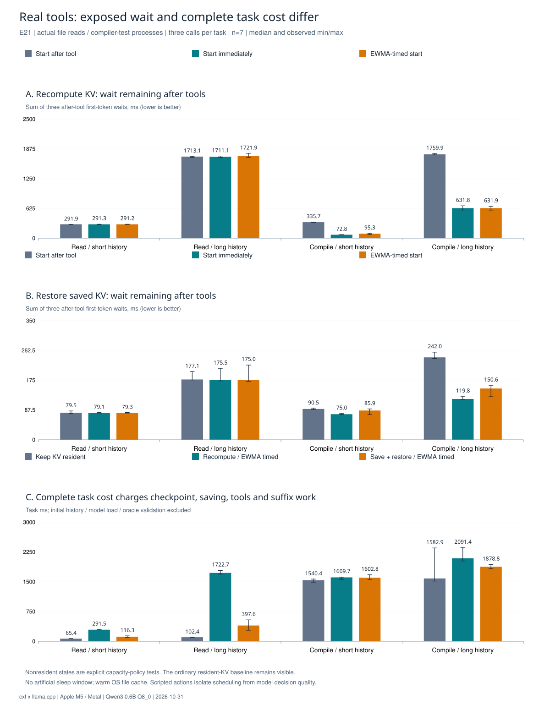

Task time includes checkpoint/save/eviction, real tools, correction write, final rendering/suffix prefill and first greedy. Only model load, initial history preparation, calibration and independent oracle work are excluded; initial-history and oracle costs remain recorded. After-tool wait is summed over three calls; it is not the whole task. Full pairwise differences are in [tool-prepare-pairs.csv](data/tool-prepare-pairs.csv), complete tasks in [tool-prepare-tasks.csv](data/tool-prepare-tasks.csv), and the compact overview in [tool-prepare-summary.csv](data/tool-prepare-summary.csv). All931 native records include144 calibration records and784 evaluation records plus metadata/acceptance/closure; multiple metrics do not multiply tasks.

| Case / words | Compared with | Mode | Task saving median ms | Positive task pairs /7 | Wait-sum saving median ms | Positive wait pairs /7 |
| --- | --- | --- | --- | --- | --- | --- |
| read / 128 | prefill_late | prefill_timed | -0.054 | 3 | -0.008 | 3 |
| read / 128 | resident | prefill_timed | -226.177 | 0 | -225.999 | 0 |
| read / 128 | restore_late | restore_timed | -3.602 | 3 | -0.486 | 3 |
| read / 128 | resident | restore_timed | -50.909 | 0 | -14.097 | 0 |
| read / 2048 | prefill_late | prefill_timed | -3.536 | 2 | -3.436 | 2 |
| read / 2048 | resident | prefill_timed | -1621.227 | 0 | -1620.714 | 0 |
| read / 2048 | restore_late | restore_timed | 75.675 | 6 | 3.469 | 5 |
| read / 2048 | resident | restore_timed | -293.998 | 0 | -72.791 | 0 |
| compile_test / 128 | prefill_late | prefill_timed | 198.165 | 7 | 240.483 | 7 |
| compile_test / 128 | resident | prefill_timed | -73.439 | 0 | -22.643 | 0 |
| compile_test / 128 | restore_late | restore_timed | 17.047 | 5 | 4.939 | 5 |
| compile_test / 128 | resident | restore_timed | -82.900 | 0 | -12.357 | 0 |
| compile_test / 2048 | prefill_late | prefill_timed | 1161.403 | 7 | 1122.637 | 7 |
| compile_test / 2048 | resident | prefill_timed | -453.733 | 1 | -519.806 | 0 |
| compile_test / 2048 | restore_late | restore_timed | 214.356 | 7 | 94.834 | 7 |
| compile_test / 2048 | resident | restore_timed | -295.864 | 1 | -31.757 | 0 |

For long-history compiler tests, three-call after-tool wait medians fall from1759.905 to631.885ms with timed recomputation (64.1%) and242.040 to150.610ms with timed restore (37.8%). Complete task medians are3242.604→2091.362ms and2058.327→1878.756ms respectively; the always-resident baseline remains1582.892ms. Timed long restore has94.834ms median paired wait saving (7/7 positive), with214.356ms median paired task saving (7/7). Paired medians differ from subtracting unpaired medians.

Timing is a latency/holding tradeoff: long-history immediate restore leaves119.848ms wait versus150.610ms timed, while timed cuts ready-prefix early holding from1077.405 to18.483ms across three calls. This measures completed-prefix idle time, not the full KV-cell occupancy integral or physical memory release. The short-history recomputation comparison also worsens complete task1555.155→1609.734ms when using timed instead of immediate. Fast reads have less than1ms total tool time and no material hidden wait; their complete-time differences are not evidence of useful overlap.

| Compiler history words | Restore mode | Total preparation sum ms | Native restore sum ms | Outside-native sum ms |
| --- | --- | --- | --- | --- |
| 128 | restore_late | 17.058 | 16.739 | 0.318 |
| 128 | restore_immediate | 299.373 | 16.825 | 282.175 |
| 128 | restore_timed | 16.565 | 16.253 | 0.316 |
| 2048 | restore_late | 124.683 | 124.116 | 0.579 |
| 2048 | restore_immediate | 600.274 | 299.346 | 293.144 |
| 2048 | restore_timed | 137.465 | 135.365 | 0.716 |

Preparation includes owner queue/verification/finish/host coordination, not just native transfer+sync. Immediate restore has282–293ms outside the native restore call across three tools, versus under1ms for timed. Long-history native restore also grows124.116→299.346ms when immediate. The trial does not separately timestamp queue, fork suspension or wakeup costs, nor measure bandwidth/frequency, so this residual is unattributed coordination delay, not proof of slower disk or bus bandwidth. See [tool-prepare-restore-components.csv](data/tool-prepare-restore-components.csv).

The production0.6B CLI smoke probe exited normally but emitted bare tool JSON as prose: zero registered tool calls/process executions. This negative model result is retained. A separate compile-time deterministic Native-parser action harness traversed the actual CLI parser/registry/AgentStore and executed the authorized compiler command exactly once under ASan/UBSan; it validates routing without claiming autonomous model success.

Fast reads, already resident KV, saving costs, contention and negative paired differences are retained. A timed policy can reduce early holding without improving latency. No claim of smaller physical KV buffers, cold SSD, PCIe speedup, Windows/CUDA, model cold start or general cloud integration follows. Tool results/suffix work remain after completion. Current measured source hashes are E21; historical performance remains tied to its original revision.

Qualification covers borrowed-engine lifetime, timer/in-flight/ready cancellation, exact native tokens/greedy, environment-change rebuild, bounded keys, tool failure/capacity behavior, Native/14K/KV/Stream regression, ASan/UBSan and default tests. The native CLI exposes --tool-prepare late|immediate|timed and --tool-kv resident|recompute|restore with an explicit deployed test command. Unknown estimates start immediately; early tool completion wakes the timer. This opt-in does not replace the default HTTP path.

## E22 · restore timing attribution

E22 adds observation only and keeps the old scheduling algorithm, margin5ms and alpha. Four read/compiler × short/long cases compare resident and restore late/immediate/timed, with the same calibration/past-label discipline. Parent fork start/end, preparer timer, worker admission/queue/verification/restore/finish/return, cleanup and final frontend/prefill now share the same Darwin raw monotonic clock. Tool trace does not call observers from the fork child or repeat commands.

| E22 compiler words | Mode | n calls | Prefix wait mean ms | Post-prefix mean ms | Spawn mean ms | Before native mean ms | Native mean ms | Queue mean ms | Finish return mean ms |
| --- | --- | --- | --- | --- | --- | --- | --- | --- | --- |
| 128 | restore_immediate | 21 | 0.000 | 26.039 | 116.980 | 111.439 | 11.825 | 0.685 | 0.014 |
| 128 | restore_late | 21 | 5.468 | 25.279 | 111.349 | 0.049 | 5.386 | 0.010 | 0.005 |
| 128 | restore_timed | 21 | 4.978 | 25.692 | 102.310 | 0.051 | 6.243 | 0.008 | 0.005 |
| 2048 | restore_immediate | 21 | 0.000 | 46.239 | 162.200 | 147.850 | 84.228 | 0.007 | 0.011 |
| 2048 | restore_late | 21 | 59.384 | 46.360 | 149.809 | 0.404 | 58.940 | 0.010 | 0.005 |
| 2048 | restore_timed | 21 | 5.202 | 43.634 | 133.003 | 0.340 | 51.929 | 0.009 | 0.005 |

The immediate path spends about111/148ms before native restore at the two history sizes, while fork itself averages117/162ms; the intervals overlap. Queue and finish return are much smaller. This localizes the missing time to verification overlapping process creation, not purely disk transfer or finish notification. It does not identify an internal libc lock or prove an OS-wide mechanism. E21 did not record these boundaries, so its historical residual is not retrospectively relabelled.

For timed restore, mean prefix waiting is4.978/5.202ms per call. Old deadline anchoring averages only.006/.007ms off tool start, so a simple origin fix is not the principal mean cause in E22. The signed identity is ready−tool_end = (ETA_hat−actual_tool) + (actual_prepare−prepare_hat) − margin + dispatch_offset + clamp. Positive wait clips this value at zero; early and late errors can cancel in the mean. Moving the deadline earlier alone trades waiting for early holding.

All adjacent preparation stages sum exactly to total preparation. The old E21 audit is retrospective and references immutable original records; no extra inference samples. [restore-estimate-audit.csv](data/restore-estimate-audit.csv), [restore-stages.csv](data/restore-stages.csv) and [restore-stage-summary.csv](data/restore-stage-summary.csv) preserve signed errors, full stage partitions and mean/median/ranges. E22 has547 native records, not a revised E21 run.

## E23 · spawn and parent-progress ETA

Two changes are tested independently on new320/1792-word histories and25,000,000-iteration real compiler/test fixtures. macOS26+ uses posix_spawn with the same deployed shell command, cwd, environment, stdio redirection and process-group timeout. Explicit fork remains a benchmark/deployment control; older macOS/Linux retain fork pending acceptance. The implementation follows the [Apple spawn manual](https://developer.apple.com/library/archive/documentation/System/Conceptual/ManPages_iPhoneOS/man2/posix_spawn.2.html) and [public header](https://github.com/apple-oss-distributions/xnu/blob/main/libsyscall/wrappers/spawn/spawn.h). A failed launch does not retry via another backend.

The new progress policy observes only the parent spawn-return event, bound to the current execute epoch. It estimates end=observed_spawn_return + prior EWMA(after-spawn duration), and dispatches at max(spawn_return, estimated_end−prior_prepare−5ms). This conditions on an event already observed, not a future label. Alpha/margin remain fixed; same three complete calibration labels seed every policy of one backend. Unknown/no progress falls back to preparation after parent progress/tool return. Explicit --tool-prepare progress is available in the same Native CLI tool wrapper.

| E23 case / words | Mode | n tasks | After-tool wait sum ms | Early-hold sum ms | Complete task ms |
| --- | --- | --- | --- | --- | --- |
| compile_test / 320 | resident | 7 | 91.085 | 0.000 | 1601.308 |
| compile_test / 320 | restore_fork_immediate | 7 | 113.510 | 1326.016 | 2876.650 |
| compile_test / 320 | restore_fork_progress | 7 | 108.747 | 92.533 | 2473.639 |
| compile_test / 320 | restore_fork_timed | 7 | 110.135 | 543.251 | 2543.616 |
| compile_test / 320 | restore_spawn_immediate | 7 | 91.373 | 1150.395 | 1387.788 |
| compile_test / 320 | restore_spawn_progress | 7 | 104.568 | 103.890 | 1559.189 |
| compile_test / 320 | restore_spawn_timed | 7 | 101.448 | 294.163 | 1626.625 |
| compile_test / 1792 | resident | 7 | 110.392 | 0.000 | 1287.528 |
| compile_test / 1792 | restore_fork_immediate | 7 | 132.799 | 1100.943 | 2431.330 |
| compile_test / 1792 | restore_fork_progress | 7 | 124.478 | 15.953 | 1720.986 |
| compile_test / 1792 | restore_fork_timed | 7 | 115.342 | 132.911 | 1864.072 |
| compile_test / 1792 | restore_spawn_immediate | 7 | 113.934 | 1033.955 | 1312.979 |
| compile_test / 1792 | restore_spawn_progress | 7 | 146.870 | 23.805 | 1475.407 |
| compile_test / 1792 | restore_spawn_timed | 7 | 155.645 | 9.481 | 1389.308 |
| read / 320 | resident | 7 | 72.790 | 0.000 | 73.085 |
| read / 320 | restore_fork_immediate | 7 | 97.293 | 0.000 | 128.533 |
| read / 320 | restore_fork_progress | 7 | 97.130 | 0.000 | 125.815 |
| read / 320 | restore_fork_timed | 7 | 100.395 | 0.000 | 141.367 |
| read / 320 | restore_spawn_immediate | 7 | 98.038 | 0.000 | 132.403 |
| read / 320 | restore_spawn_progress | 7 | 96.570 | 0.000 | 122.623 |
| read / 320 | restore_spawn_timed | 7 | 94.153 | 0.000 | 122.153 |
| read / 1792 | resident | 7 | 101.419 | 0.000 | 101.706 |
| read / 1792 | restore_fork_immediate | 7 | 251.839 | 0.000 | 389.457 |
| read / 1792 | restore_fork_progress | 7 | 262.025 | 0.000 | 377.317 |
| read / 1792 | restore_fork_timed | 7 | 270.826 | 0.000 | 428.345 |
| read / 1792 | restore_spawn_immediate | 7 | 227.151 | 0.000 | 318.382 |
| read / 1792 | restore_spawn_progress | 7 | 236.176 | 0.000 | 327.029 |
| read / 1792 | restore_spawn_timed | 7 | 245.765 | 0.000 | 461.918 |

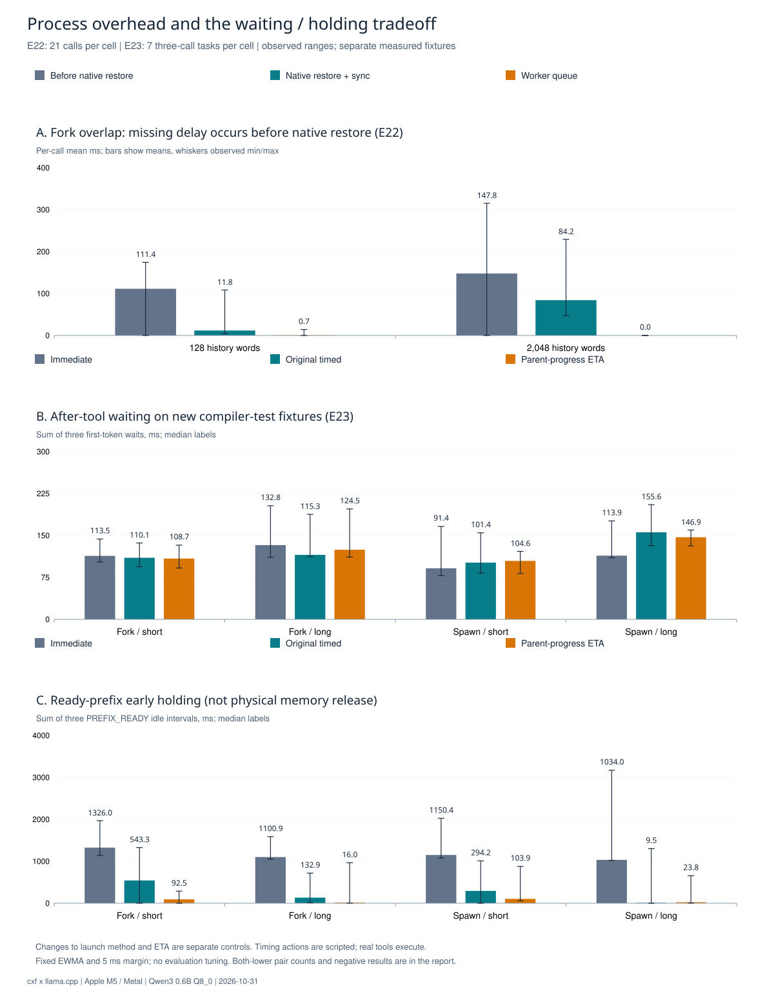

| E23 compiler words | Baseline | Candidate | Wait saving median ms | Hold saving median ms | Both lower pairs /7 | Task saving median ms |
| --- | --- | --- | --- | --- | --- | --- |
| 320 | restore_fork_timed | restore_fork_progress | -2.585 | 489.678 | 3 | -75.445 |
| 320 | restore_spawn_timed | restore_spawn_progress | 3.334 | -2.180 | 2 | 13.274 |
| 320 | restore_fork_timed | restore_spawn_progress | 10.255 | 450.279 | 5 | 1086.248 |
| 320 | restore_spawn_immediate | restore_spawn_progress | -0.448 | 1025.696 | 3 | -70.999 |
| 1792 | restore_fork_timed | restore_fork_progress | -1.506 | 18.673 | 1 | 1.773 |
| 1792 | restore_spawn_timed | restore_spawn_progress | 8.243 | 0.089 | 4 | -15.058 |
| 1792 | restore_fork_timed | restore_spawn_progress | -16.118 | 35.081 | 0 | 388.666 |
| 1792 | restore_spawn_immediate | restore_spawn_progress | -25.510 | 1028.661 | 1 | -14.552 |

The robust improvement is process launch/verification: compiler fork controls average175–388ms per launch across the measured policy/history cells, while spawn restore cells average0.6–0.9ms. In the long immediate comparison, before-native time drops260.299→0.227ms; old fork overlap is removed without changing the KV format or llama kernels. This does not turn every task-time fluctuation into a causal scheduler gain.

Progress ETA is not a stable joint win. Against spawn/timed, short/long history paired median wait savings are3.334/8.243ms over three calls; paired hold savings are−2.180/+0.089ms, and only2/7 and4/7 pairs lower both. Long-history paired task saving is−15.058ms: a regression. Unpaired wait medians there are155.645→146.870ms while hold medians grow9.481→23.805ms. These different medians are all retained; no aggregate is substituted to claim a Pareto improvement. Keep progress opt-in and the original timed default.

Why the residual tradeoff remains: after-spawn tool duration still drifts. Mean final suffix prefill is roughly28–38ms per call in spawn compiler groups, and prefix waiting is clipped/variable; a better phase ETA does not eliminate these costs. Changing only a fixed safety margin would move the waiting/holding tradeoff. No E23 labels were used to retune the frozen5ms/alpha or choose a replacement default.

Every negative pair is retained in [restore-control-pairs.csv](data/restore-control-pairs.csv). [restore-task-summary.csv](data/restore-task-summary.csv) lists complete task ranges; component and final frontend/prefill traces remain separate. Compare within this run only: different histories/workloads and machine drift prevent subtracting E21/E22 from E23 as an algorithm speedup. Neither ready-prefix idle time nor fewer file stalls implies physical KV allocation release or a Gaussian timing guarantee.

Current progress/spawn code passed epoch/duplicate/time-bound/cancel tests, Native/14K/KV/Stream, default tools including process-group timeouts, ASan/UBSan, exact canonical/fresh-greedy oracles and deterministic actual CLI routing. E23 records979 native rows (192 calibration,784 evaluation,3 status); three measured tool calls per task plus a real correction write in compiler tasks. Actions remain scripted for timing, not a new0.6B autonomous capability claim. Historical evidence stays immutable; measured source hashes for this historical run are E23; E24 records the later implementation.

## E24 · complete task accounting and early cleanup

The E23 long-history paired median regression of15.058ms belongs to rep1. Its additive decomposition is tool+8.354, pre-tool+8.207, post-tool−3.517, actual repair+.874 and bookkeeping+1.141ms. Save alone contributes+8.267ms within pre-tool. Components of this same pair add up; medians of separate components do not. All14 compiler pairs, source task/call indices and the immutable E23 hash are in [tool-taskcost-e23-audit.csv](data/tool-taskcost-e23-audit.csv). Both E23 controls already called the same progress API: a15ms direct callback penalty was not established.

Frozen new validation:512/2304 history words, affine arithmetic repair at two inputs,18M rotate/xor iterations, actual compiler/tests and fast-read controls. Five modes rotate by replicate, seven three-call tasks each, identical three-task calibration per state, independent past-only EWMA. Alpha and5ms margin stay fixed. Callback entry/exit and thread creation/function entry are observed separately. Saving remains charged before every restore task call; its variability is not erased by subtracting it from the headline.

| E24 case / words | Mode | n tasks | After-tool sum ms | Ready-prefix hold ms | Complete task ms |
| --- | --- | --- | --- | --- | --- |
| compile_test / 512 | resident | 7 | 84.443 | 0.000 | 1257.895 |
| compile_test / 512 | restore_progress | 7 | 100.187 | 15.305 | 1289.769 |
| compile_test / 512 | restore_progress_early | 7 | 117.519 | 369.356 | 1603.203 |
| compile_test / 512 | restore_timed | 7 | 97.510 | 23.097 | 1274.111 |
| compile_test / 512 | restore_timed_noevent | 7 | 113.965 | 138.027 | 1666.130 |
| compile_test / 2304 | resident | 7 | 121.208 | 0.000 | 1191.032 |
| compile_test / 2304 | restore_progress | 7 | 176.448 | 8.251 | 1427.730 |
| compile_test / 2304 | restore_progress_early | 7 | 157.264 | 1.592 | 1435.031 |
| compile_test / 2304 | restore_timed | 7 | 170.962 | 3.529 | 1501.343 |
| compile_test / 2304 | restore_timed_noevent | 7 | 194.797 | 25.770 | 1547.942 |
| read / 512 | resident | 7 | 73.097 | 0.000 | 73.468 |
| read / 512 | restore_progress | 7 | 99.179 | 0.000 | 130.606 |
| read / 512 | restore_progress_early | 7 | 99.566 | 0.000 | 130.520 |
| read / 512 | restore_timed | 7 | 99.235 | 0.000 | 130.962 |
| read / 512 | restore_timed_noevent | 7 | 100.067 | 0.000 | 131.843 |
| read / 2304 | resident | 7 | 111.807 | 0.000 | 112.228 |
| read / 2304 | restore_progress | 7 | 202.649 | 0.000 | 387.736 |
| read / 2304 | restore_progress_early | 7 | 202.906 | 0.000 | 332.479 |
| read / 2304 | restore_timed | 7 | 200.859 | 0.000 | 469.614 |
| read / 2304 | restore_timed_noevent | 7 | 196.560 | 0.000 | 395.747 |

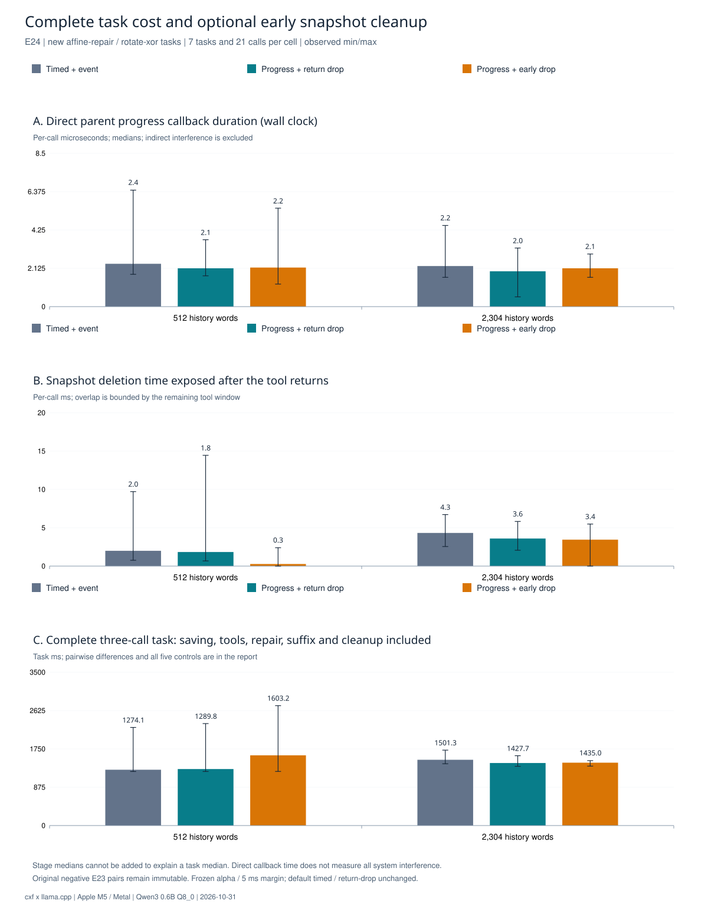

| Compiler words | Baseline | Candidate | Task saving median [min,max] ms | Faster /7 | Wait saving median ms | Both wait/hold lower /7 |
| --- | --- | --- | --- | --- | --- | --- |
| 512 | restore_timed_noevent | restore_timed | 108.807 [-56.630, 575.300] | 5 | -1.459 | 2 |
| 512 | restore_timed | restore_progress | -20.077 [-110.575, 34.548] | 3 | -1.326 | 0 |
| 512 | restore_progress | restore_progress_early | -313.434 [-1017.385, 38.183] | 1 | -14.894 | 0 |
| 512 | restore_timed | restore_progress_early | -369.662 [-996.644, 0.471] | 1 | -11.431 | 0 |
| 512 | resident | restore_progress_early | -421.120 [-915.575, 59.884] | 1 | -34.971 | 0 |
| 2304 | restore_timed_noevent | restore_timed | 21.558 [-144.398, 227.750] | 4 | 12.244 | 4 |
| 2304 | restore_timed | restore_progress | 43.701 [-93.027, 369.400] | 4 | -1.867 | 0 |
| 2304 | restore_progress | restore_progress_early | -4.653 [-55.016, 145.699] | 3 | 20.711 | 3 |
| 2304 | restore_timed | restore_progress_early | 62.188 [-11.315, 364.748] | 6 | 24.917 | 0 |
| 2304 | resident | restore_progress_early | -221.151 [-283.699, -167.650] | 0 | -36.056 | 0 |

| Compiler words | Mode | Callback mean / max ms | Thread creation mean ms | Drop exposed after tool mean ms |
| --- | --- | --- | --- | --- |
| 512 | resident | 0.000387 / 0.000792 | 0.000000 | 0.000 |
| 512 | restore_progress | 0.002468 / 0.003709 | 0.024032 | 2.308 |
| 512 | restore_progress_early | 0.002639 / 0.005459 | 0.023123 | 0.648 |
| 512 | restore_timed | 0.002841 / 0.006458 | 0.025202 | 2.581 |
| 512 | restore_timed_noevent | 0.000000 / 0.000000 | 0.029091 | 2.385 |
| 2304 | resident | 0.000292 / 0.000542 | 0.000000 | 0.000 |
| 2304 | restore_progress | 0.002044 / 0.003250 | 0.021331 | 4.004 |
| 2304 | restore_progress_early | 0.002159 / 0.002917 | 0.021889 | 3.346 |
| 2304 | restore_timed | 0.002347 / 0.004500 | 0.021312 | 4.161 |
| 2304 | restore_timed_noevent | 0.000000 / 0.000000 | 0.021268 | 5.403 |

Direct restore-mode callbacks average2.0–2.8 microseconds, max6.458 microseconds; thread creation averages21–29 microseconds. These observed direct costs cannot explain15ms. Timed event/no-event task differences still span both signs despite identical scheduling, so serial wall-clock differences are not callback CPU cost. Early deletion reduces mean exposed cleanup2.308→.648ms (short) and4.004→3.346ms (long), but complete progress tasks regress by paired median313.434ms (short, faster1/7) and4.653ms (long, faster3/7). Long wait improves20.711ms with5/7 positive pairs; short wait worsens14.894ms. The short task median-regression pair contains350.203ms slower tools, partly offset by42.725ms less pre-tool work. Resource interference versus OS/cache/frequency drift is not fully identified; a2ms cleanup interval cannot establish the cause of a350ms tool change. The optimization is not promoted to default.

The optional early-release path deletes the private snapshot only after ticket finish has drained; prefix-ready remains the device-ready boundary. Cleanup joins before return, preserves cancellation rollback and tool-once semantics, and falls back to return cleanup on failure. It adds no extra thread. Select with --tool-snapshot-release early; default remains return, and default ETA remains timed. Early deletion can overlap the remaining tool, but cannot remove pre-tool saving or all tool-duration variation. The direct callback duration excludes any indirect resource contention; these seven pairs are not a causal decomposition of OS load or a tail guarantee.

All new task additive identities, calibration and evaluation rows are in [tool-taskcost-accounting.csv](data/tool-taskcost-accounting.csv); every indexed task pair, including negatives, is in [tool-taskcost-pairs.csv](data/tool-taskcost-pairs.csv), with aggregate ranges in [restore-control-pairs.csv](data/restore-control-pairs.csv). E24 adds659 native records:72 calibration calls+24 tasks,420 evaluation calls+140 tasks,3 status rows. Twelve independent fresh-KV references check492 call rows. Sanitizers, cancellation before/during/after restore, tool exception, Native/14K/KV/Stream, default regression and actual CLI tool-once passed before timing. Exact current measured sources are archived privately; public evidence carries hashes. No cross-run speedup, autonomous-model or physical-memory-release claim.

## E25 · snapshot deletion and resource isolation

Snapshots are optional capacity-policy state. The normal resident path does no save/evict/restore; recompute can retain only canonical tokens. Current restore snapshots require the same live engine/session/revision and do not implement cold restart or shrinking of the preallocated KV buffer. Saving before every tool in the experimental restore path is charged; it is not universal Agent overhead. Do not evict usable resident KV merely to create a prewarming opportunity.

E25 repeats the short512-word/18M repair workload with a trusted C driver splitting actual compiler and check execution. Five controls use ten complete tasks each in forward/reverse cyclic Latin order: each mode occupies every order position twice. Same calibration labels, independent past-only EWMA, fixed5ms/alpha. The unlink-hold control removes the directory entry but retains an owner-only fd and snapshot slot/budget until tool-end last close. [Apple unlink](https://developer.apple.com/library/archive/documentation/System/Conceptual/ManPages_iPhoneOS/man2/unlink.2.html) defines this separation; it does not predict the size of the resulting performance effect.

| Mode | Task median ms | After-tool sum median ms | Compiler wall / CPU mean ms per call | Run wall / CPU mean ms per call |
| --- | --- | --- | --- | --- |
| resident | 1222.877 | 81.552 | 70.915 / 66.185 | 313.059 / 11.085 |
| restore_late | 1503.624 | 124.675 | 72.200 / 68.141 | 286.704 / 11.032 |
| restore_progress | 1490.805 | 109.246 | 68.679 / 65.697 | 288.187 / 11.035 |
| restore_progress_early | 1481.071 | 103.081 | 74.403 / 65.133 | 284.608 / 10.612 |
| restore_progress_hold | 1479.308 | 97.232 | 71.347 / 66.006 | 284.484 / 10.570 |

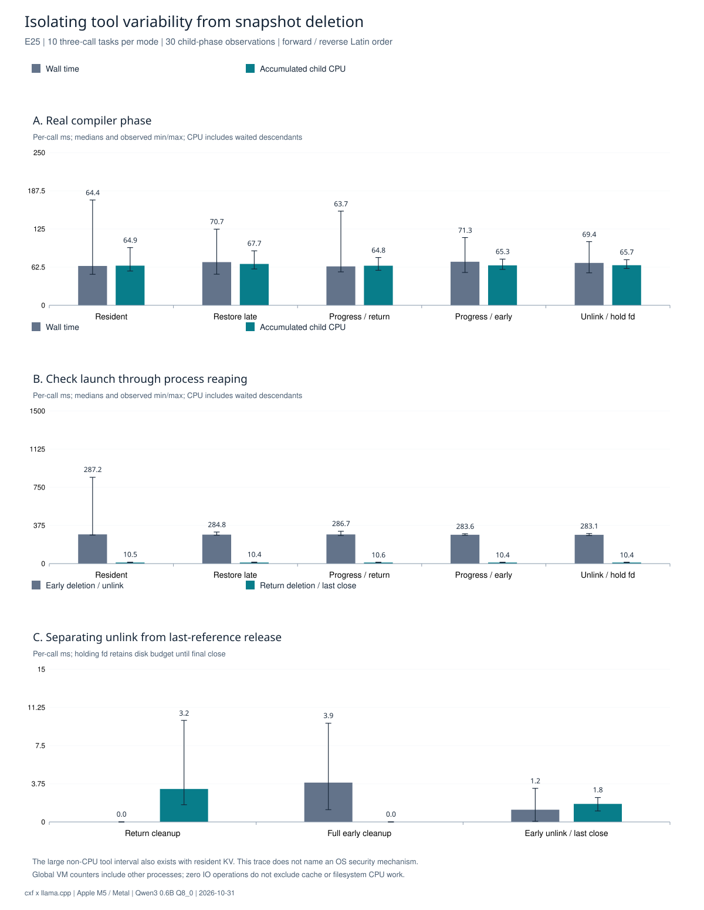

| Baseline | Candidate | Task saving median [min,max] ms | Faster /10 | Compiler wall saving median ms | Run wall saving median ms |
| --- | --- | --- | --- | --- | --- |
| resident | restore_late | -241.392 [-319.091, 192.313] | 1 | -5.196 | 11.588 |
| restore_late | restore_progress | -2.641 [-80.434, 101.558] | 5 | 12.683 | 0.172 |
| restore_progress | restore_progress_early | 14.258 [-130.629, 176.366] | 5 | -11.420 | 3.646 |
| restore_progress_early | restore_progress_hold | 1.146 [-60.771, 148.835] | 5 | -1.367 | -2.509 |
| restore_progress | restore_progress_hold | 25.522 [-67.823, 131.303] | 6 | -18.899 | 14.316 |

E25 does not reproduce a stable313ms early-delete penalty: early versus return has paired median task saving14.258ms, only5/10 faster, range−130.629 to176.366ms. Moving last close out of the tool (early→hold) gives only1.146ms median saving,5/10 faster. Full early deletion averages4.064ms wall and2.166ms parent-interval CPU; unlink while holding fd averages1.253ms wall/.117ms parent CPU, with1.795ms last-close wall after the tool. These are small direct differences, not a demonstrated hundred-ms mechanism. All modes, including resident, show check-launch/reaping wall284–313ms but child CPU10.6–11.1ms. Compression/swapin also occurs in resident; global pressure is not unique evidence against unlink. This motivates the separate main-entry trace in E26.

Detailed resource samples, all negative task pairs and source indices are in [tool-isolate-resources.csv](data/tool-isolate-resources.csv), [tool-isolate-tasks.csv](data/tool-isolate-tasks.csv), [tool-isolate-pairs.csv](data/tool-isolate-pairs.csv) and [tool-isolate-pair-summary.csv](data/tool-isolate-pair-summary.csv). [wait4](https://developer.apple.com/library/archive/documentation/System/Conceptual/ManPages_iPhoneOS/man2/wait4.2.html) includes waited child descendants. CPU may exceed wall for parallel compiler work; wall minus CPU is not IO time. [getrusage](https://developer.apple.com/library/archive/documentation/System/Conceptual/ManPages_iPhoneOS/man2/getrusage.2.html) IO operation counts exclude cache-served activity; zeros cannot exclude filesystem CPU or cache contention. Mach global VM counters include other processes, and footprint gauges can decrease. Resource sampling and the driver are common diagnostic overhead, retained in task time, so no E24→E25 cross-run speedup is claimed.

E25 records227 native rows:18 calibration calls+6 tasks,150 evaluation calls+50 tasks,3 status. Three fresh-KV reference prompts validate168 calls. ASan/UBSan, retained-slot accounting, unlink-in-use/duplicate/stale restore refusal, waiting/inflight/ready cancellation, Native14K/KV/Stream, default regression and real CLI once pass before timing. Default resident capacity policy, timed ETA and return cleanup remain unchanged; hold-fd remains an explicit diagnostic. Exact measured source snapshot is private, hashes public. Old313.434ms result is retained, not replaced by this run.

## E26 · executable first launch and incremental build

E25 locates a large wall interval around check launch/reaping even in the resident control. E26 separately freezes new768-word/12M tasks, changes the repair to calc(x)=3*x−2 at two inputs, and records spawn return plus child main/compute-end. Each real test tool now runs the same binary twice with matching exit status; the repeated run is charged and its stdout suppressed. Initial test binary is removed per task. The incremental deployment recipe rebuilds after the actual repair and reuses only the unchanged third-call artifact; it never skips running tests or caches their result.

| Rebuilt this call | Execution | n calls | Wall median ms | Spawn call median ms | Pre-main median ms | Compute median ms |
| --- | --- | --- | --- | --- | --- | --- |
| True | run | 98 | 287.626 | 0.179 | 278.015 | 7.978 |
| True | rerun | 98 | 10.066 | 0.216 | 1.788 | 6.561 |
| False | run | 7 | 7.903 | 0.125 | 1.149 | 6.311 |
| False | rerun | 7 | 8.318 | 0.170 | 1.345 | 6.247 |

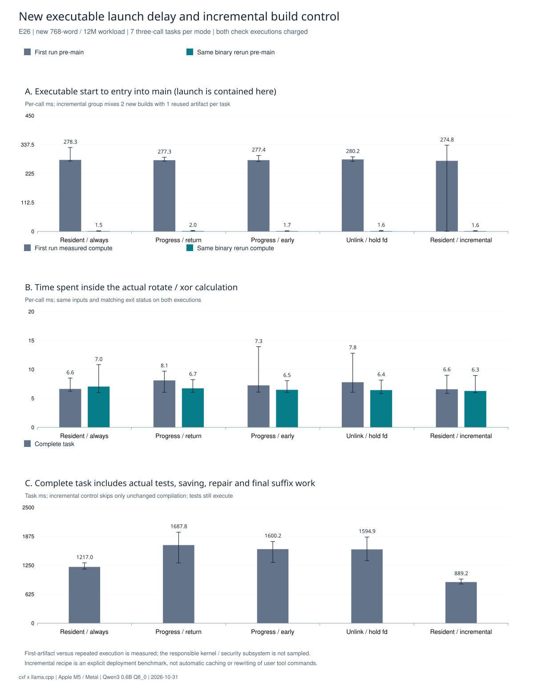

| Mode | Complete task median [min,max] ms | After-tool wait sum median ms |
| --- | --- | --- |
| resident | 1216.956 [1168.982, 1306.134] | 85.939 |
| resident_incremental | 889.234 [848.386, 953.673] | 86.553 |
| restore_progress | 1687.815 [1302.576, 1966.837] | 127.155 |
| restore_progress_early | 1600.152 [1313.317, 1764.993] | 113.817 |
| restore_progress_hold | 1594.890 [1351.155, 1860.827] | 118.072 |

| Baseline | Candidate | Task saving median [min,max] ms | Faster /7 | Compiler wall saving median ms | Run wall saving median ms |
| --- | --- | --- | --- | --- | --- |
| restore_progress | restore_progress_early | 39.677 [-135.317, 366.685] | 5 | -20.914 | 0.952 |
| restore_progress_early | restore_progress_hold | 20.756 [-210.271, 168.660] | 5 | 4.984 | -7.925 |
| resident | resident_incremental | 327.722 [283.323, 395.514] | 7 | 58.769 | 278.636 |
| resident | restore_progress | -381.680 [-756.651, -133.594] | 0 | -18.109 | 4.752 |

New-artifact first-run pre-main median is278.015ms (spawn call.179ms); immediate same-artifact rerun pre-main is1.788ms. First-run wall287.626ms versus rerun10.066ms, with compute7.978/6.561ms. Reused third-call artifacts have pre-main1.149ms. A large common delay is therefore after process creation and before main on first execution, not inside the arithmetic or specific to KV cleanup. The explicit incremental recipe reduces paired complete task median327.722ms, range283.323–395.514ms,7/7 faster; all tests still run. This is a tool-workflow optimization, not llama speedup. Early cleanup still has negative pairs: E26 early versus return ranges−135.317 to366.685ms; hold versus early−210.271 to168.660ms. Keep runtime defaults unchanged.

Pre-main contains process creation and loader/platform work; spawn-call time is a contained observation and must not be added to it. Parent scheduling can resume after child main, so no universal spawn-return-before-main ordering is assumed. The new same-artifact paired trace can locate first-execution delay but does not prove Gatekeeper/AMFI/SSD or any specific kernel cause. E24 had no such child-entry timestamps, so its313ms pair remains unassigned at this finer boundary. Global resource noise observed in E25 is retained, not retrospectively filtered out.

All stages, calibrated and complete tasks, negative task pairs and launch strata remain in [tool-launch-stages.csv](data/tool-launch-stages.csv), [tool-launch-tasks.csv](data/tool-launch-tasks.csv), [tool-launch-pairs.csv](data/tool-launch-pairs.csv), [tool-launch-pair-summary.csv](data/tool-launch-pair-summary.csv) and [tool-launch-executions.csv](data/tool-launch-executions.csv). E26 adds167 native rows:18 calibration calls+6 tasks,105 evaluation calls+35 tasks,3 status. Three fresh-KV references check123 call rows. All246 actual check executions (including calibration) remain charged within their123 tools. Repeated checks add work, so compare controls within E26 only. Runtime capacity/ETA/cleanup defaults remain resident/timed/return; the incremental recipe is a benchmark/deployment choice, not automatic cxf command rewriting.

## E27 · normal resident multi-tool flow

Both controls retain KV throughout the active task. Six real calls read configuration, observe a failed validator, write the correction, pass validation, read back, and validate again. Native prepares the actual receipt and samples first greedy after every call. Compare direct original-tool execution with the existing resident coordinator; no artificial save, eviction, restore or recomputation baseline. Both use the same prebuilt validator and fixed command, with no compilation or incremental-build optimization during timing. Model/initial history and recorded fixture first-execution warmup are excluded. Scripted choices isolate execution from0.6B tool-decision quality.

| History words | Mode | n tasks | Complete six-call task ms | After-tool wait sum ms | New evaluated tokens |
| --- | --- | --- | --- | --- | --- |
| 512 | resident_direct | 7 | 219.249 | 168.173 | 397 |
| 512 | resident_wrapper | 7 | 227.322 | 172.606 | 397 |
| 3072 | resident_direct | 7 | 315.233 | 275.026 | 397 |
| 3072 | resident_wrapper | 7 | 325.307 | 279.857 | 397 |

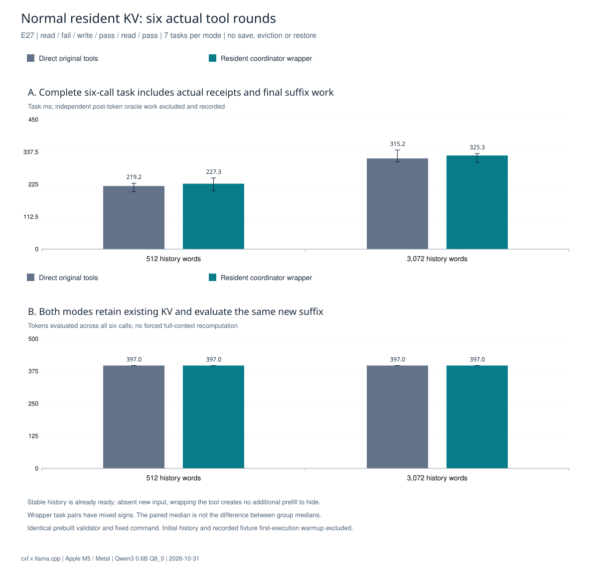

| History words | Wrapper task saving median [min,max] ms | Faster /7 | After-tool saving median ms | Evaluated-token difference |
| --- | --- | --- | --- | --- |
| 512 | -14.293 [-27.304, 13.428] | 2 | 2.146 | 0 |
| 3072 | 5.014 [-28.343, 18.985] | 4 | -8.223 | 0 |

No extra preparation is available while tools run without new input: stable history KV is already ready. Both modes evaluate397 new tokens across six calls and preserve the full canonical/fresh-greedy result. Short/long wrapper task saving is−14.293/+5.014ms, faster2/7 and4/7, with negative pairs in both cases. This is no stable extra latency benefit. Prefix reuse counters quantify shared work avoided, not a measured speedup against deliberately discarded KV. Raw task wall, five excluded post-token oracle intervals, common collector bookkeeping and fixed tool durations remain separate.

Indexed calls/tasks/pairs are in [resident-flow-calls.csv](data/resident-flow-calls.csv), [resident-flow-tasks.csv](data/resident-flow-tasks.csv) and [resident-flow-pairs.csv](data/resident-flow-pairs.csv). E27 adds199 records:168 tool calls,28 complete tasks,3 status. Twelve independent fresh references validate all calls. Save/evict/restore/speculative preparation and private KV files are zero. ASan/UBSan, actual repair, Native14K, existing Stream and default regressions pass; no production API/default or build command changed.

## E28 · resident streaming from a real process

A real prebuilt process reads twelve immutable report units from a file, performs0/40M compute iterations per unit, and immediately flushes each completed NDJSON unit. Payload80/240 words and wait-all/coalesced/eager modes have identical content and CPU work within each case. There are no sleep/network gaps or free idle interval after the last payload. The model retains its1024-word initial history and all accepted-prefix KV. Task starts at producer launch; producer CPU/wall, input timing, first greedy and normal Stream close are charged. Full-token oracle work follows first greedy and is subtracted only from complete-task wall; independent fresh prefill occurs after normal close and is recorded separately.

| Words / unit | CPU iterations / unit | Mode | n | After-input first median ms | Total first median ms | Complete incl. close median ms | Prefill execution median ms | Decode calls median |
| --- | --- | --- | --- | --- | --- | --- | --- | --- |
| 80 | 0 | stream_coalesced | 7 | 354.609 | 356.374 | 356.578 | 352.559 | 3 |
| 80 | 0 | stream_eager | 7 | 351.277 | 353.267 | 353.513 | 349.292 | 3 |
| 80 | 0 | wait_all | 7 | 350.211 | 352.461 | 352.683 | 348.285 | 3 |
| 80 | 40000000 | stream_coalesced | 7 | 186.195 | 456.488 | 456.698 | 408.711 | 5 |
| 80 | 40000000 | stream_eager | 7 | 162.872 | 434.558 | 434.755 | 407.222 | 6 |
| 80 | 40000000 | wait_all | 7 | 338.036 | 600.696 | 600.887 | 336.179 | 3 |
| 240 | 0 | stream_coalesced | 7 | 1227.855 | 1230.318 | 1230.678 | 1223.335 | 7 |
| 240 | 0 | stream_eager | 7 | 1227.648 | 1231.681 | 1232.136 | 1219.742 | 6 |
| 240 | 0 | wait_all | 7 | 1215.648 | 1217.741 | 1218.062 | 1211.936 | 6 |
| 240 | 40000000 | stream_coalesced | 7 | 1055.856 | 1327.256 | 1327.583 | 1298.943 | 7 |
| 240 | 40000000 | stream_eager | 7 | 1033.784 | 1311.888 | 1312.230 | 1282.048 | 7 |
| 240 | 40000000 | wait_all | 7 | 1276.354 | 1561.025 | 1561.352 | 1272.501 | 7 |

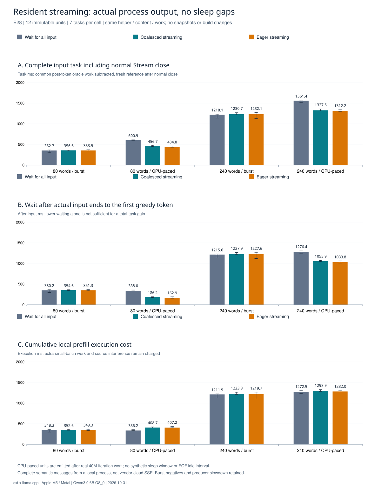

| Words / unit | CPU iterations | Baseline | Candidate | Complete task saving median [min,max] ms | Faster /7 | After-input saving median ms | Prefill execution saving median ms |
| --- | --- | --- | --- | --- | --- | --- | --- |
| 80 | 0 | stream_coalesced | stream_eager | -3.218 [-21.630, 15.808] | 3 | -3.003 | -3.274 |
| 80 | 0 | wait_all | stream_coalesced | -3.167 [-56.809, 9.871] | 3 | -3.573 | -3.297 |
| 80 | 0 | wait_all | stream_eager | -0.975 [-63.885, 25.679] | 2 | -1.123 | -1.027 |
| 80 | 40000000 | stream_coalesced | stream_eager | 14.751 [12.772, 41.898] | 7 | 17.631 | -4.657 |
| 80 | 40000000 | wait_all | stream_coalesced | 136.054 [128.087, 161.338] | 7 | 160.627 | -71.886 |
| 80 | 40000000 | wait_all | stream_eager | 159.388 [146.743, 177.952] | 7 | 179.737 | -70.500 |
| 240 | 0 | stream_coalesced | stream_eager | 4.362 [-55.031, 132.418] | 4 | 4.722 | 4.591 |
| 240 | 0 | wait_all | stream_coalesced | -8.827 [-122.654, 1.535] | 1 | -9.059 | -9.230 |
| 240 | 0 | wait_all | stream_eager | -4.210 [-53.496, 18.330] | 2 | -5.574 | -3.005 |
| 240 | 40000000 | stream_coalesced | stream_eager | 8.736 [-14.278, 57.491] | 5 | 29.585 | 8.716 |
| 240 | 40000000 | wait_all | stream_coalesced | 213.587 [187.491, 248.429] | 7 | 202.249 | -51.719 |
| 240 | 40000000 | wait_all | stream_eager | 234.151 [180.780, 271.078] | 7 | 234.696 | -8.024 |

CPU-paced complete-task paired savings are136.054/159.388ms at80 words for coalesced/eager, and213.587/234.151ms at240 words; all four comparisons are7/7 faster. Burst input has no stable gain: coalesced/eager paired savings are−3.167/−.975ms at80 words and−8.827/−4.210ms at240. At80-word paced input, coalesced prefill execution increases by71.886ms and producer wall by17.769ms in paired medians, yet complete task improves136.054ms: latency is reduced by overlapping paid work, not by cheaper inference. Do not add these separate medians to reconstruct a total. Digest text differs between0/40M source scenarios (1126/1222 input tokens at80 words,3046/3142 at240); only within-scenario mode comparisons are controlled, not cross-scenario subtraction.

Actual producer and arrival times are retained; overlap can slow the producer or increase small-batch execution. Lower after-input wait alone is not a task speedup. See [resident-stream-tasks.csv](data/resident-stream-tasks.csv), [resident-stream-pairs.csv](data/resident-stream-pairs.csv) and indexed [resident-stream-arrivals.csv](data/resident-stream-arrivals.csv), with [resident-summary.csv](data/resident-summary.csv) / [resident-pair-summary.csv](data/resident-pair-summary.csv) for full ranges. E28 has87 native records:84 complete streaming tasks and3 status. Arrival arrays expand only in derived CSV, not into new independent sample counts. All modes keep the same canonical tokens/greedy and evaluate only new input; no snapshot, forced eviction or build change is involved.

This is actual local-process semantic-unit streaming, not vendor cloud SSE, arbitrary token-fragment submission or automatic agentctl routing. Stream tools remain empty and its worker exclusive. A first sanitizer collector failed when its extra simultaneous fresh-reference KV exceeded shared8192 capacity after nine completed tasks. Failure artifacts are retained outside performance aggregates. The final oracle runs after normal stream close without changing workload/capacity; final stream collector ASan and unchanged Native/Stream regressions pass. Lazy GPU setup, machine drift, negative task pairs and additional execution remain visible; no E26 build savings or cross-experiment gains are added.

## E29 · actual agentctl tool-output prefill, resident KV

The output stream now passes through the actual native CLI REPL, capability registry, AgentStore and test.run executor. Both explicit off/on modes use identical body-first receipts with final status footers and identical trailing-LF admission. Default CLI receipts remain unchanged. A fixed Native-parser action sequence selects three real test calls then DONE; four actual Native prepare/first-greedy operations run per task. This measures integration and scheduling, not0.6B autonomous planning or full completion latency.

| Words / line | CPU iterations / line | Mode | Tasks | Whole task ms [min,max] | Post-tool sum ms | Total prefill ms | Adopted KV tokens |
| --- | --- | --- | --- | --- | --- | --- | --- |
| 32 | 0 | off | 7 | 534.981 [524.583,548.710] | 360.011 | 501.392 | 0 |
| 32 | 0 | on | 7 | 574.200 [567.587,591.814] | 406.521 | 549.241 | 1117 |
| 32 | 40000000 | off | 7 | 1284.691 [1262.064,1294.924] | 307.382 | 437.161 | 0 |
| 32 | 40000000 | on | 7 | 1191.172 [1176.677,1202.506] | 199.738 | 504.893 | 1116 |
| 56 | 0 | off | 7 | 755.567 [745.141,772.050] | 576.126 | 716.077 | 0 |
| 56 | 0 | on | 7 | 765.731 [744.560,805.014] | 562.242 | 720.975 | 1603 |
| 56 | 40000000 | off | 7 | 1578.014 [1526.373,1727.419] | 505.563 | 641.840 | 0 |
| 56 | 40000000 | on | 7 | 1373.830 [1320.573,1415.632] | 217.381 | 808.473 | 1692 |

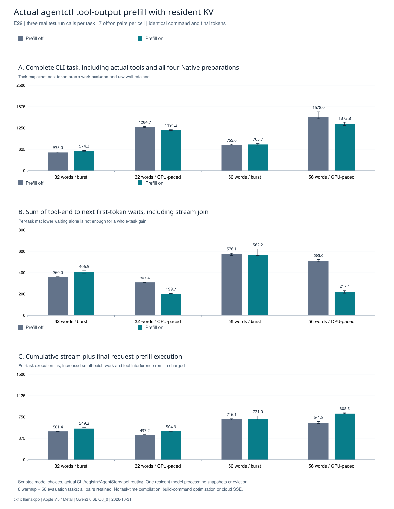

| Words / line | CPU iterations / line | Task saving ms [min,max] | Faster /7 | Post-tool saving ms | Extra prefill ms | Extra tool ms | Extra suffix-tokenization IDs |
| --- | --- | --- | --- | --- | --- | --- | --- |
| 32 | 0 | -43.004 [-47.147,-35.517] | 0 | -44.056 | 46.853 | -1.369 | 1507 |
| 32 | 40000000 | 95.254 [82.185,109.873] | 7 | 107.154 | 67.377 | 21.597 | 2910 |
| 56 | 0 | -20.590 [-49.447,13.288] | 2 | -2.673 | 12.951 | 5.327 | 2279 |
| 56 | 40000000 | 183.960 [152.543,311.787] | 7 | 288.182 | 169.079 | 97.364 | 4350 |

Savings are paired off minus on, not differences between group medians. Raw wall, exact excluded post-token oracle cost, every warmup/evaluation task, phase timings and negative pairs remain archived.515 native rows contain64 tasks (8 warmup/56 evaluation),192 actual tool executions (168 evaluation),256 full-token oracles and3 status rows. Independent13-case sanitizer checks include fresh-KV greedy, Unicode/BPE tails, truncation, timeout, cancellation and execution-once. Native14K, original Stream and default C/HTTP regressions pass. The first CLI qualification failure (tool-only counter assumption and first-user LF invalidation) is retained separately; LF normalization precedes all performance tasks.

There are no snapshots or forced eviction. Provisional output shares the current canonical session; latest-only4KiB queue and4KiB worker copy are bounded suffix scratch, not another full history. Full final template rendering and prefix verification still run. BPE may replay/discard tail tokens; first-token readiness and actual task savings must be assessed together with added small-batch work, join wait and producer contention.8192-token physical KV allocation remains896MiB. See [tasks](data/tool-output-tasks.csv), [pairs](data/tool-output-pairs.csv), [stages](data/tool-output-stages.csv), [summary](data/tool-output-summary.csv) and [paired summary](data/tool-output-pair-summary.csv). The separate production0.6B probe returned Native format error (rc7), executed zero tools and remains a capability failure. No build optimization, cloud SSE, Windows/CUDA or cross-experiment gains are included.

## E30 · adaptive output observation gate

A frozen10ms initial gate skips speculative work when the tool has already finished; queued tail work also stops after completion. New40/48-word,0/30M-iteration tasks;7 pairs each. Same real CLI and canonical/greedy checks as E29. Wrapper minus join includes owner messaging and setup, not pure thread cost. E29 burst frontend was1.632/3.037ms, non-join wrapper0.828/0.935ms, versus extra prefill46.853/12.951ms. These are phase measurements, not a causal small-batch/tokenizer/thread ablation.

| Words | Iterations | Task saving ms [min,max] | Faster /7 | Extra prefill ms | Extra frontend ms |
| --- | --- | --- | --- | --- | --- |
| 40 | 0 | -9.710 [-54.902,15.563] | 2 | 15.157 | 0.291 |
| 40 | 30000000 | 188.140 [36.308,222.913] | 7 | 89.427 | 2.670 |
| 48 | 0 | 11.535 [-22.266,28.884] | 5 | 0.387 | -0.000 |
| 48 | 30000000 | 282.308 [243.066,293.666] | 7 | 32.678 | 2.690 |

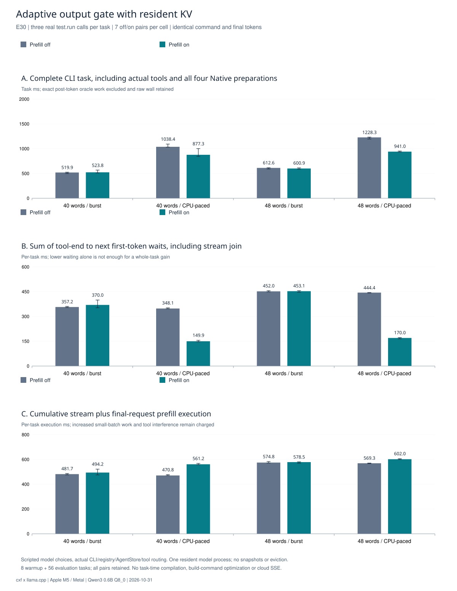

All515 rows and negative pairs retained. The new workload differs from E29; no same-workload old-on comparison or isolated tokenization-only/thread-only control was measured. Do not infer a causal improvement magnitude from cross-experiment differences. See [E30 evidence](../evidence/tool-output-adaptive-20261031.json).

## E31/E32 · matched controls and output-growth gate

E31 rotates off, E29 old, E30 on, thread/owner-only and tokenize-only on identical40/48-word workloads. E32 validates off/on/progress on new36/52-word workloads. Thread includes callbacks/queue/owner round trips; token adds only suffix construction and tokenizer without canonical/KV edits. Group differences include timing interactions; they are not additive pure-component costs.

| Experiment | Words | Iterations | Mode vs off | Task saving ms [min,max] | Faster /7 | Extra prefill ms | Extra frontend ms |
| --- | --- | --- | --- | --- | --- | --- | --- |
| E31 | 40 | 0 | old | -55.116 [-101.481,-28.895] | 0 | 58.527 | 2.564 |
| E31 | 40 | 0 | on | -8.121 [-31.383,77.201] | 2 | 7.638 | -0.000 |
| E31 | 40 | 0 | thread | -4.152 [-31.144,85.682] | 3 | -5.322 | -0.000 |
| E31 | 40 | 0 | token | 15.752 [-25.892,54.223] | 6 | -11.560 | 2.027 |
| E31 | 40 | 30000000 | old | 195.876 [88.622,251.118] | 7 | 86.516 | 3.067 |
| E31 | 40 | 30000000 | on | 205.595 [133.410,255.380] | 7 | 90.299 | 2.353 |
| E31 | 40 | 30000000 | thread | -1.815 [-96.137,26.703] | 2 | -3.367 | -0.000 |
| E31 | 40 | 30000000 | token | 3.837 [-73.955,14.562] | 4 | -2.218 | 3.125 |
| E31 | 48 | 0 | old | -22.264 [-130.256,80.577] | 2 | 15.380 | 2.997 |
| E31 | 48 | 0 | on | -13.745 [-63.908,44.049] | 3 | 1.841 | -0.000 |
| E31 | 48 | 0 | thread | 3.453 [-64.898,58.758] | 4 | 0.268 | -0.000 |
| E31 | 48 | 0 | token | 0.629 [-96.971,39.096] | 4 | 3.713 | 2.707 |
| E31 | 48 | 30000000 | old | 269.546 [-1720.279,305.327] | 6 | 26.697 | 3.843 |
| E31 | 48 | 30000000 | on | 267.400 [-465.572,369.655] | 6 | 47.862 | 2.625 |
| E31 | 48 | 30000000 | thread | -28.078 [-1299.672,-3.317] | 0 | 5.339 | -0.000 |
| E31 | 48 | 30000000 | token | -8.723 [-771.307,16.701] | 2 | 4.290 | 3.635 |
| E32 | 36 | 0 | on | 3.065 [-23.854,10.703] | 4 | 4.038 | -0.000 |
| E32 | 36 | 0 | progress | 1.538 [-24.572,40.460] | 5 | 0.121 | -0.000 |
| E32 | 36 | 25000000 | on | 111.044 [97.078,169.465] | 7 | 76.768 | 5.491 |
| E32 | 36 | 25000000 | progress | 91.036 [37.602,185.376] | 7 | 66.923 | 5.844 |
| E32 | 52 | 0 | on | 5.539 [-11.603,36.464] | 5 | -12.220 | 0.479 |
| E32 | 52 | 0 | progress | 5.337 [-30.462,15.519] | 4 | 4.857 | -0.000 |
| E32 | 52 | 25000000 | on | 173.037 [86.070,324.526] | 7 | 105.267 | 7.816 |
| E32 | 52 | 25000000 | progress | 210.939 [140.327,298.986] | 7 | 105.154 | 8.201 |

| Experiment | Words | Iterations | Baseline | Candidate | Task saving median [min,max] ms | Faster /7 |
| --- | --- | --- | --- | --- | --- | --- |
| E31 | 40 | 0 | off | thread | -4.152 [-31.144,85.682] | 3 |
| E31 | 40 | 0 | thread | token | 19.681 [-31.459,40.878] | 5 |
| E31 | 40 | 0 | token | old | -74.059 [-111.215,-36.263] | 0 |
| E31 | 40 | 0 | old | on | 46.380 [26.042,106.097] | 7 |
| E31 | 40 | 0 | off | on | -8.121 [-31.383,77.201] | 2 |
| E31 | 40 | 30000000 | off | thread | -1.815 [-96.137,26.703] | 2 |
| E31 | 40 | 30000000 | thread | token | 2.164 [-18.011,22.182] | 5 |
| E31 | 40 | 30000000 | token | old | 195.443 [162.577,243.760] | 7 |
| E31 | 40 | 30000000 | old | on | 11.643 [-69.860,87.039] | 5 |
| E31 | 40 | 30000000 | off | on | 205.595 [133.410,255.380] | 7 |
| E31 | 48 | 0 | off | thread | 3.453 [-64.898,58.758] | 4 |
| E31 | 48 | 0 | thread | token | -9.433 [-59.126,67.438] | 2 |
| E31 | 48 | 0 | token | old | 24.436 [-135.769,79.321] | 4 |
| E31 | 48 | 0 | old | on | -4.650 [-36.528,82.519] | 3 |
| E31 | 48 | 0 | off | on | -13.745 [-63.908,44.049] | 3 |
| E31 | 48 | 30000000 | off | thread | -28.078 [-1299.672,-3.317] | 0 |
| E31 | 48 | 30000000 | thread | token | 20.018 [-743.229,924.060] | 5 |
| E31 | 48 | 30000000 | token | old | 278.204 [-1344.666,972.403] | 6 |
| E31 | 48 | 30000000 | old | on | -2.146 [-55.427,1254.707] | 2 |
| E31 | 48 | 30000000 | off | on | 267.400 [-465.572,369.655] | 6 |
| E32 | 36 | 0 | off | on | 3.065 [-23.854,10.703] | 4 |
| E32 | 36 | 0 | off | progress | 1.538 [-24.572,40.460] | 5 |
| E32 | 36 | 0 | on | progress | 7.859 [-35.276,64.314] | 4 |
| E32 | 36 | 25000000 | off | on | 111.044 [97.078,169.465] | 7 |
| E32 | 36 | 25000000 | off | progress | 91.036 [37.602,185.376] | 7 |
| E32 | 36 | 25000000 | on | progress | -32.246 [-78.429,18.784] | 2 |
| E32 | 52 | 0 | off | on | 5.539 [-11.603,36.464] | 5 |
| E32 | 52 | 0 | off | progress | 5.337 [-30.462,15.519] | 4 |
| E32 | 52 | 0 | on | progress | -13.203 [-28.601,6.676] | 3 |
| E32 | 52 | 25000000 | off | on | 173.037 [86.070,324.526] | 7 |
| E32 | 52 | 25000000 | off | progress | 210.939 [140.327,298.986] | 7 |
| E32 | 52 | 25000000 | on | progress | 2.832 [-31.805,124.869] | 4 |

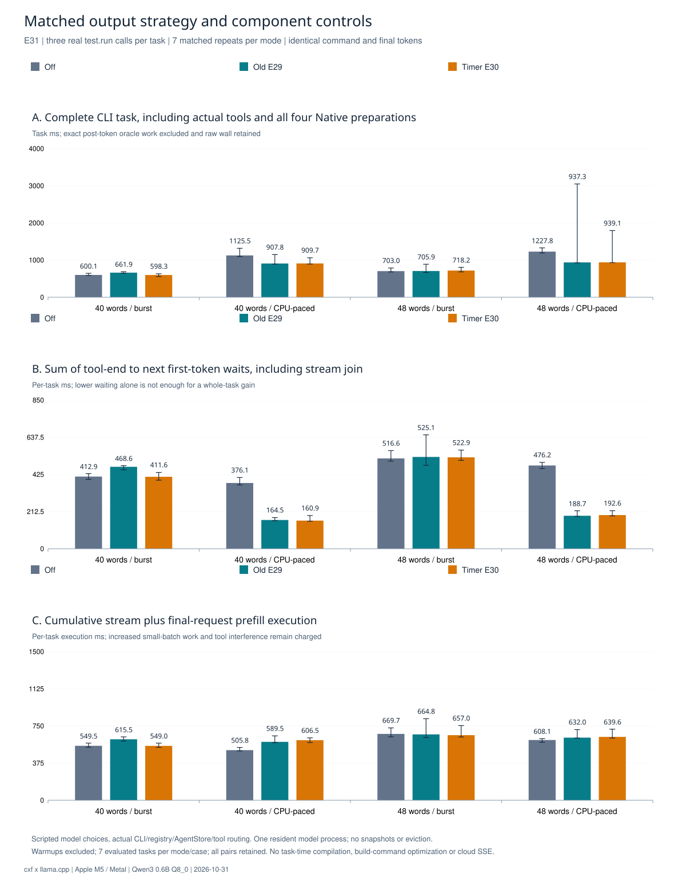

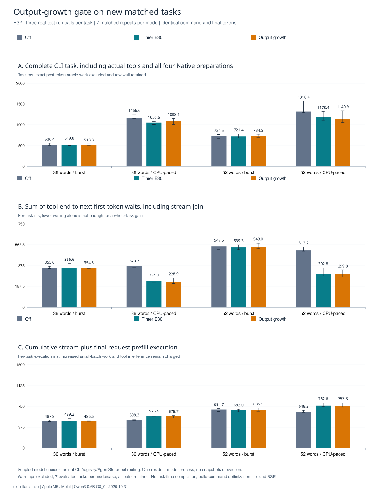

Progress: zero speculative updates in42 evaluated burst calls. Still not universally better than timer:36-word paced tasks regress32.246ms (2/7 faster),52-word burst regresses13.203ms. Worst burst versus off regresses30.462ms:23.740ms extra tool wall,5.691ms post-tool, zero streaming prefill/tokenization,0.391ms wrapper and0.058ms join. OS scheduling versus indirect contention is not separately traced. Keep progress optional; no stable tail-reduction claim.

E30 worst pair:54.902ms slower, tool14.659ms plus post-tool41.046ms; extra prefill37.933ms and stream frontend0.918ms. Two burst tools started decode before their16ms completion, leaving113/132ms join waits. The10ms timer cannot distinguish late process reaping from ongoing output. Progress requires a later growing output observation at least10ms after first output, never timer expiry alone; final output cannot trigger speculation. All negatives, raw walls and oracle exclusions retained.

## E33–E35 · producer, process reaping and worker attribution

E33 repeats36/52-word workloads with off/on/progress/thread controls. E34 freezes an optional macOS exit-event wait and validates new44/50-word workloads with all six original/event modes. EOF events change process waiting only; KV remains resident. Positive values below mean baseline minus candidate; every negative pair remains included.

| Experiment | Words | Iterations | Baseline | Candidate | Task saving ms [min,max] | Faster /7 | Tool saving ms | EOF wait saving ms |
| --- | --- | --- | --- | --- | --- | --- | --- | --- |
| E33 | 36 | 0 | off | on | 8.096 [-5.064,35.516] | 6 | 11.617 | 11.061 |
| E33 | 36 | 0 | off | progress | 19.218 [-30.529,34.963] | 6 | -0.369 | 0.000 |
| E33 | 36 | 0 | off | thread | 9.594 [-33.598,36.078] | 5 | 2.441 | 0.202 |
| E33 | 36 | 0 | on | progress | -3.104 [-25.465,19.748] | 3 | -1.668 | -0.849 |
| E33 | 36 | 25000000 | off | on | 138.632 [4.810,180.307] | 7 | -0.089 | 0.034 |
| E33 | 36 | 25000000 | off | progress | 147.166 [120.581,224.747] | 7 | 4.754 | 0.004 |
| E33 | 36 | 25000000 | off | thread | 6.326 [-10.548,19.100] | 4 | -1.947 | 0.277 |
| E33 | 36 | 25000000 | on | progress | 16.361 [-18.051,132.256] | 5 | 5.686 | -0.030 |
| E33 | 52 | 0 | off | on | -18.003 [-29.868,38.927] | 2 | -1.255 | 0.791 |
| E33 | 52 | 0 | off | progress | -31.694 [-44.648,24.659] | 2 | -9.115 | 0.027 |
| E33 | 52 | 0 | off | thread | 8.675 [-42.903,26.115] | 4 | 11.589 | 12.004 |
| E33 | 52 | 0 | on | progress | -8.207 [-60.929,28.775] | 2 | 2.208 | 0.245 |
| E33 | 52 | 25000000 | off | on | 224.330 [22.098,386.584] | 7 | 8.766 | 21.125 |
| E33 | 52 | 25000000 | off | progress | 271.064 [-281.195,376.576] | 6 | 13.350 | 0.204 |
| E33 | 52 | 25000000 | off | thread | -2.864 [-361.043,169.672] | 3 | 2.787 | -0.440 |
| E33 | 52 | 25000000 | on | progress | -10.009 [-438.678,248.966] | 2 | -24.995 | -11.015 |
| E34 | 44 | 0 | off | off-event | -0.430 [-46.825,152.133] | 3 | 9.767 | 0.000 |
| E34 | 44 | 0 | on | on-event | 5.692 [-132.809,199.076] | 5 | 3.013 | 0.000 |
| E34 | 44 | 0 | progress | progress-event | 3.233 [-2.857,16.751] | 6 | 6.893 | 10.154 |
| E34 | 44 | 0 | off-event | on-event | -0.084 [-93.563,72.774] | 3 | 0.289 | 0.000 |
| E34 | 44 | 0 | off-event | progress-event | -0.269 [-15.659,56.783] | 3 | 0.295 | 0.000 |
| E34 | 44 | 0 | on-event | progress-event | -2.656 [-15.991,98.102] | 2 | 0.628 | 0.000 |
| E34 | 44 | 20000000 | off | off-event | -14.456 [-61.432,334.674] | 3 | 12.859 | 10.779 |
| E34 | 44 | 20000000 | on | on-event | 1.452 [-19.599,346.795] | 5 | 28.401 | 10.610 |
| E34 | 44 | 20000000 | progress | progress-event | -1.788 [-53.050,79.609] | 3 | 19.977 | 11.835 |
| E34 | 44 | 20000000 | off-event | on-event | 177.285 [144.027,238.723] | 7 | -4.753 | 0.001 |
| E34 | 44 | 20000000 | off-event | progress-event | 184.434 [89.888,264.492] | 7 | -1.541 | 0.827 |
| E34 | 44 | 20000000 | on-event | progress-event | 9.479 [-138.247,87.207] | 4 | 8.931 | 0.000 |
| E34 | 50 | 0 | off | off-event | 8.494 [-19.942,76.887] | 5 | 0.019 | 0.000 |
| E34 | 50 | 0 | on | on-event | 13.661 [-18.090,161.093] | 6 | 0.257 | 0.000 |
| E34 | 50 | 0 | progress | progress-event | -14.726 [-82.384,148.184] | 3 | 8.982 | 11.006 |
| E34 | 50 | 0 | off-event | on-event | -0.347 [-11.726,54.966] | 3 | 0.919 | 0.000 |
| E34 | 50 | 0 | off-event | progress-event | 7.187 [-94.278,58.940] | 4 | 1.310 | 0.000 |
| E34 | 50 | 0 | on-event | progress-event | -12.149 [-93.513,25.397] | 2 | -0.808 | 0.000 |
| E34 | 50 | 20000000 | off | off-event | 12.336 [-21.559,179.445] | 5 | 15.491 | 11.814 |
| E34 | 50 | 20000000 | on | on-event | 11.838 [-28.823,21.651] | 5 | 28.688 | 21.069 |
| E34 | 50 | 20000000 | progress | progress-event | 3.689 [-25.966,77.677] | 4 | 13.082 | 11.236 |
| E34 | 50 | 20000000 | off-event | on-event | 212.005 [171.369,250.316] | 7 | -6.598 | 0.000 |
| E34 | 50 | 20000000 | off-event | progress-event | 216.147 [183.692,265.103] | 7 | -17.599 | -10.696 |
| E34 | 50 | 20000000 | on-event | progress-event | 6.043 [-28.312,36.124] | 5 | -11.780 | -1.651 |
| E35 | 46 | 0 | off | off-race | -0.495 [-23.547,34.766] | 3 | 0.532 | 0.000 |
| E35 | 46 | 0 | off-event | off-race | 8.276 [-11.706,44.797] | 4 | -0.164 | 0.000 |
| E35 | 46 | 0 | progress-event | progress-race | -0.445 [-40.428,43.311] | 3 | -0.402 | 0.000 |
| E35 | 46 | 0 | off-race | progress-race | -0.730 [-41.487,35.709] | 3 | -0.200 | 0.000 |
| E35 | 46 | 15000000 | off | off-race | 40.677 [9.010,73.436] | 7 | 33.865 | 34.158 |
| E35 | 46 | 15000000 | off-event | off-race | 4.157 [-13.247,51.610] | 5 | 9.113 | 10.742 |
| E35 | 46 | 15000000 | progress-event | progress-race | -8.112 [-41.242,62.480] | 3 | 7.492 | 8.747 |
| E35 | 46 | 15000000 | off-race | progress-race | 152.085 [111.852,171.441] | 7 | -5.830 | -1.254 |
| E35 | 54 | 0 | off | off-race | -0.189 [-144.433,147.081] | 3 | 8.141 | 0.000 |
| E35 | 54 | 0 | off-event | off-race | -2.324 [-107.588,35.541] | 3 | -0.248 | 0.000 |
| E35 | 54 | 0 | progress-event | progress-race | -0.940 [-20.043,108.869] | 3 | 0.324 | 0.000 |
| E35 | 54 | 0 | off-race | progress-race | 7.770 [-3.154,148.628] | 4 | 0.811 | 0.000 |
| E35 | 54 | 15000000 | off | off-race | 48.196 [19.610,325.272] | 7 | 36.611 | 32.109 |
| E35 | 54 | 15000000 | off-event | off-race | 9.186 [-24.265,169.615] | 4 | 14.414 | 9.872 |
| E35 | 54 | 15000000 | progress-event | progress-race | 6.640 [-110.100,64.107] | 5 | 19.060 | 18.353 |
| E35 | 54 | 15000000 | off-race | progress-race | 138.815 [-8.919,153.671] | 6 | -8.687 | -1.137 |

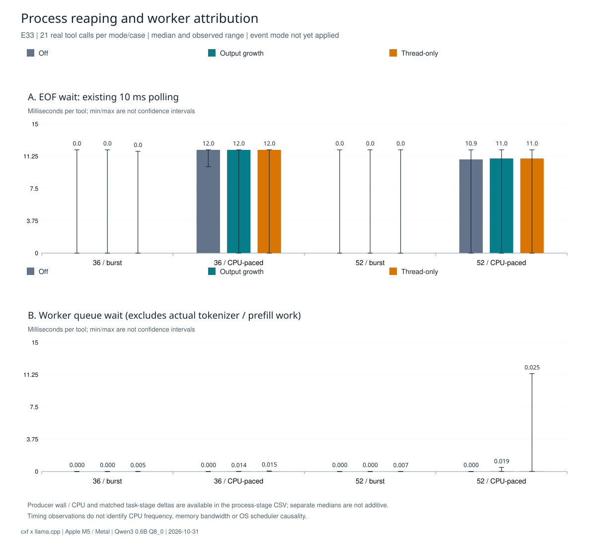

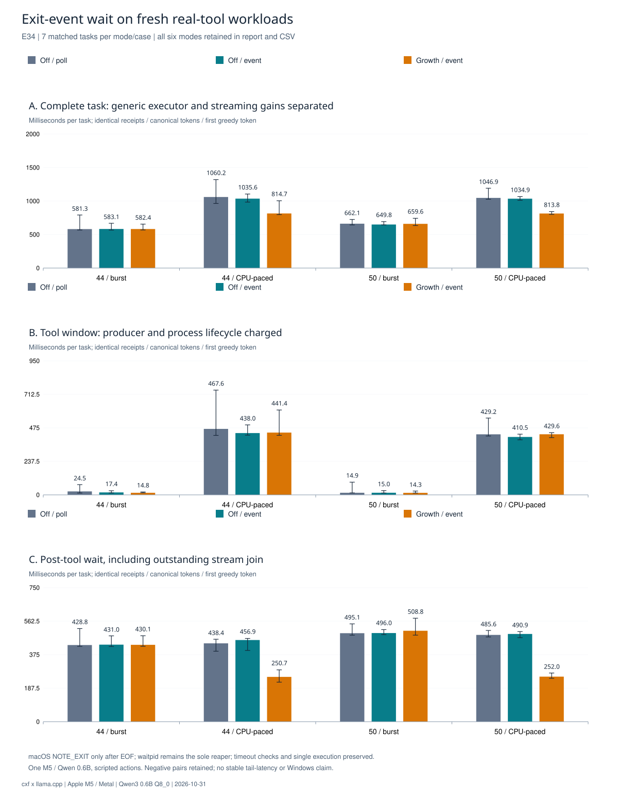

E33 reproduces a30.529ms worst36-word burst regression:11.706ms extra tool wall,12.008ms extra EOF polling,14.309ms extra post-tool wait. The52-word worst44.648ms regression instead has8.741ms extra startup and34.043ms extra post-tool waiting, with essentially no polling difference. Growth performs no speculative updates in these burst cases. Thus polling explains a concrete portion, not every30ms-class regression.

The old36-word paced32.246ms growth regression does not repeat: E33 growth saves16.361ms versus timer. Producer wall saves6.135ms, CPU2.924ms and EOF wait changes only−0.030ms (separate medians are not additive). Worker queue/callback observations are much smaller than tens of milliseconds; they do not prove absence of indirect contention. No frequency/bandwidth/scheduler counters establish which hardware effect caused remaining variation. E32 has no such telemetry, so its exact historical pair cannot be retroactively resolved.

See [process stages](data/tool-output-process-stages.csv) and [all matched contrasts](data/tool-output-process-pairs.csv). Child-end precedes sidecar write/exit; after-producer time includes this overhead. eof_poll_ms retains its historical name but measures event waits in event modes. Native default remains unchanged; select on-event/progress-event explicitly in an idle REPL. off-event is the disabled-prefill executor control, used with prefill off.13 sanitizer unit cases per revision plus32/48 actual CLI tasks pass; process EOF/timeout/once checks and default C/HTTP/CLI regression pass. Native14K/full Stream checks remain historical E29 acceptance. No Windows/CUDA, cloud SSE, physical KV release or tail guarantee.

E35:84 tool calls per mode show maximum EOF waits12.015ms (poll),12.013ms (off-event),12.006ms (growth-event),1.262ms (off-race) and1.263ms (growth-race). Paced executor-only off-race versus off task savings40.677/48.196ms are7/7 positive. Streaming versus the same corrected off-race executor saves152.085/138.815ms (7/7,6/7); burst savings−0.730/+7.770ms are not stable. Growth-race versus growth-event paced medians are−8.112/+6.640ms, not a universal improvement.

E35 worst burst off-race versus off still regresses144.433ms: post-tool115.438ms and cumulative prefill138.381ms extra, with zero EOF wait and zero speculative work. The54-word paced growth-race worst versus growth-event regresses110.100ms: producer wall127.289ms extra (CPU29.921ms, non-CPU97.368ms), owner queue only0.004ms extra, prefill14.954ms less. Those outliers do not support blaming direct worker queueing or the exit wait. Indirect resource contention and environment variation remain unresolved.

E33 per-tool owner queue medians for timer/growth/thread-only are0.013/0.006/0.014ms, maxima2.210/0.486/11.388ms; callback maxima0.063/0.030/0.074ms. The thread-only queue outlier remains visible; small medians are not an assertion of zero contention. All500 separate syscall observations are in [exit probes](data/tool-output-exit-probes.csv), with concurrent-development rows clearly labeled.

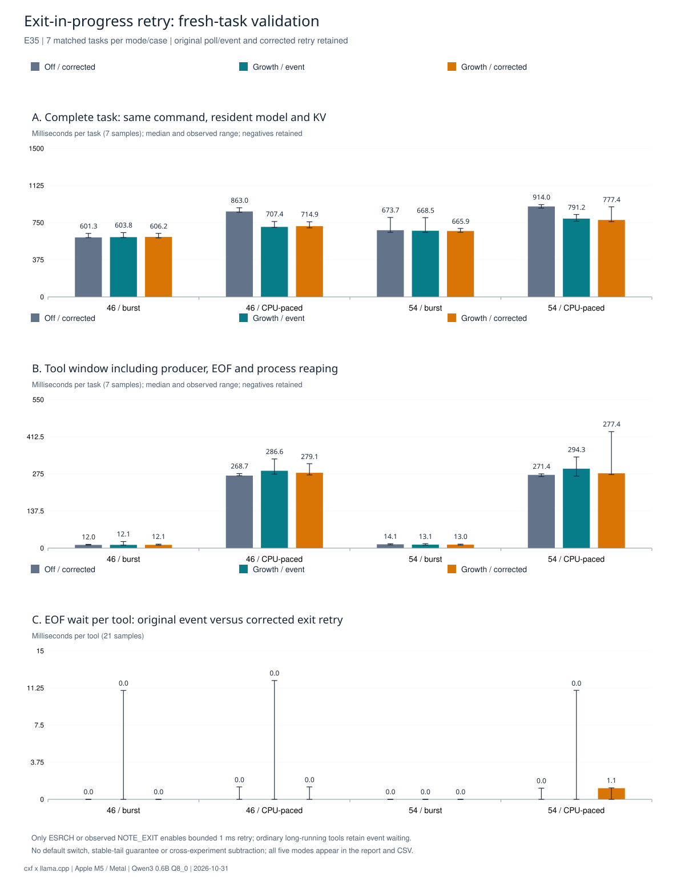

E34 retains large negatives:44-word burst on-event versus on has a132.809ms worst regression with zero speculative updates; startup adds26.051ms and cumulative prefill105.400ms.50-word burst progress-event versus progress has an82.384ms worst regression, including11.317ms EOF wait and73.088ms post-tool wait. No negative was removed or relabeled as a win.

A separate100-exit syscall probe found10 waits over1ms, all after kevent registration returned ESRCH with no exit event. Retrying waitpid once is insufficient in that exit-in-progress window. E35 freezes a1ms bounded retry only after ESRCH or observed NOTE_EXIT, otherwise keeping normal event waiting and timeout checks. It validates46/54-word,0/15M-iteration new workloads, off/off-event/progress-event/off-race/progress-race, one warmup plus seven evaluations each. The isolated final200-exit alternating probe triggered no positive waits in either mode, retained as a non-reproduction rather than evidence of a speedup. Runtime success and timing effects are distinct.

E35 adds13 sanitizer unit cases,40 real CLI tasks and both event/race EOF/status/timeout/once checks. The corrected policy remains opt-in: /tool-output-policy progress-race with prefill on; off-race with prefill off is its executor-only control. The report tables include the exact paired whole-task results and all negatives; old evidence/source archives remain immutable.

## E36/E37 · remaining regressions and lazy consumer launch

E36 repeats46/54-word,0/15M-iteration tasks with off-race, dormant consumer, same-growth-gate owner no-op, tokenizer-only and real prefill controls. Every group retains the exit-race correction and identical final receipts/tokens/greedy. E37 freezes lazy consumer creation and validates new42/55-word,0/18M tasks with off/eager/lazy growth. KV remains resident; no snapshot, eviction or build-command change.

| Experiment | Words | Iterations | Baseline | Candidate | Task saving ms [min,max] | Faster /7 | Producer saving ms | Final prefill saving ms | Final prepare CPU saving ms |
| --- | --- | --- | --- | --- | --- | --- | --- | --- | --- |
| E36 | 46 | 0 | off-race | idle-race | -13.197 [-52.427,72.138] | 3 | 0.091 | 7.798 | 0.342 |
| E36 | 46 | 0 | idle-race | thread-race | 23.513 [-78.044,35.753] | 4 | 0.108 | -12.203 | -2.895 |
| E36 | 46 | 0 | thread-race | token-race | -52.855 [-146.705,99.712] | 1 | -0.107 | -33.462 | -1.068 |
| E36 | 46 | 0 | token-race | progress-race | 11.279 [-43.835,153.509] | 5 | 0.040 | 18.778 | -1.777 |
| E36 | 46 | 0 | off-race | progress-race | -2.758 [-22.565,30.232] | 3 | 0.317 | -8.263 | -1.761 |
| E36 | 46 | 15000000 | off-race | idle-race | -2.165 [-77.978,41.076] | 3 | 3.097 | 0.270 | 0.757 |
| E36 | 46 | 15000000 | idle-race | thread-race | 1.851 [-61.235,98.238] | 4 | 7.516 | 17.905 | 0.215 |
| E36 | 46 | 15000000 | thread-race | token-race | -2.575 [-58.580,26.110] | 2 | -5.536 | -2.911 | -0.127 |
| E36 | 46 | 15000000 | token-race | progress-race | 155.608 [1.723,185.256] | 7 | -15.377 | 296.661 | 6.201 |
| E36 | 46 | 15000000 | off-race | progress-race | 156.071 [-46.110,207.727] | 6 | -8.514 | 307.533 | 6.502 |
| E36 | 54 | 0 | off-race | idle-race | -44.225 [-136.609,164.205] | 2 | 0.775 | -26.147 | -1.018 |
| E36 | 54 | 0 | idle-race | thread-race | 21.741 [-99.502,168.787] | 4 | 0.126 | 16.264 | -0.791 |
| E36 | 54 | 0 | thread-race | token-race | -12.344 [-134.354,133.580] | 3 | 0.011 | 2.374 | 1.252 |
| E36 | 54 | 0 | token-race | progress-race | -10.771 [-46.540,45.675] | 3 | -0.029 | 5.975 | 0.576 |
| E36 | 54 | 0 | off-race | progress-race | -14.805 [-59.287,168.762] | 3 | 0.598 | -23.021 | -1.490 |
| E36 | 54 | 15000000 | off-race | idle-race | 5.334 [-63.165,31.836] | 5 | -0.807 | 2.812 | -0.104 |
| E36 | 54 | 15000000 | idle-race | thread-race | 3.592 [-191.604,52.276] | 5 | -0.116 | 0.695 | 0.245 |
| E36 | 54 | 15000000 | thread-race | token-race | -4.528 [-7.179,157.979] | 2 | -1.107 | -0.160 | 0.007 |
| E36 | 54 | 15000000 | token-race | progress-race | 146.967 [98.576,167.953] | 7 | -1.565 | 284.614 | 5.345 |
| E36 | 54 | 15000000 | off-race | progress-race | 146.824 [96.787,179.974] | 7 | 1.352 | 282.387 | 5.516 |
| E37 | 42 | 0 | off-race | progress-race | 1.690 [-16.161,28.634] | 4 | 0.103 | 5.566 | 1.591 |
| E37 | 42 | 0 | off-race | lazy-race | -1.018 [-51.406,23.540] | 2 | 0.068 | 2.378 | -0.318 |
| E37 | 42 | 0 | progress-race | lazy-race | -2.556 [-38.351,23.960] | 3 | -0.047 | -3.188 | -0.667 |
| E37 | 42 | 18000000 | off-race | progress-race | 139.682 [83.459,197.049] | 7 | -1.642 | 225.513 | 2.364 |
| E37 | 42 | 18000000 | off-race | lazy-race | 141.552 [-16.223,192.553] | 6 | 3.954 | 223.222 | 1.754 |
| E37 | 42 | 18000000 | progress-race | lazy-race | -8.057 [-99.683,41.337] | 2 | -9.593 | -0.246 | -0.396 |
| E37 | 55 | 0 | off-race | progress-race | 2.239 [-19.202,3.072] | 4 | -0.007 | 1.791 | -0.034 |
| E37 | 55 | 0 | off-race | lazy-race | -0.706 [-17.077,2.837] | 3 | 0.004 | -0.562 | 0.254 |
| E37 | 55 | 0 | progress-race | lazy-race | -1.157 [-4.668,8.183] | 3 | 0.008 | -2.173 | 0.105 |
| E37 | 55 | 18000000 | off-race | progress-race | 190.649 [178.216,217.559] | 7 | -3.932 | 297.780 | 5.811 |
| E37 | 55 | 18000000 | off-race | lazy-race | 186.168 [51.977,189.868] | 7 | -4.596 | 305.033 | 5.657 |
| E37 | 55 | 18000000 | progress-race | lazy-race | -1.786 [-165.583,7.952] | 2 | 0.157 | 3.470 | 0.010 |

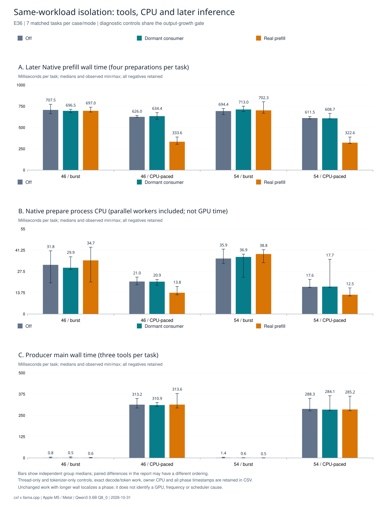

Inference execution varies even with no consumer: burst off-race has identical work, eight decode calls and2407/2599 evaluated tokens at46/54 words, yet cumulative final prefill spans663.212–773.431ms and652.351–723.838ms. The46-word dormant-consumer worst pair regresses52.427ms: final prefill51.812ms extra, process CPU0.342ms less, producer0.292ms less. The46-word tokenizer-control worst regresses176.074ms: final prefill135.522ms extra but only11.641ms extra process CPU, identical work and zero stream evaluation. Later prepares execute after consumer join; direct simultaneous consumer/owner contention cannot explain this phase. Indirect effects and device/system scheduling remain unseparated; CPU time is not GPU time.

Tool slowdown is also real: E36 paced46-word real prefill versus off has one46.110ms negative task pair despite232.001ms less final prefill. Producer wall increases82.061ms, comprising18.017ms CPU and64.044ms non-CPU; owner queue adds0.404ms. Dormant/thread/token controls do not establish a consistent tens-of-milliseconds thread penalty. No hardware counters prove which indirect effect caused producer descheduling. Separate component medians must not be added.

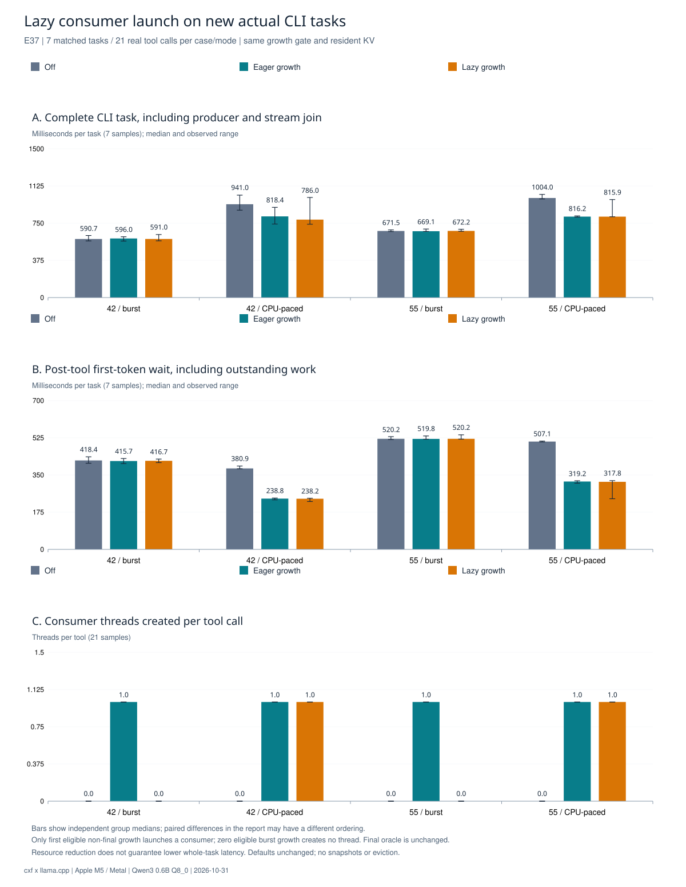

Lazy launch removes provably unused work, not the large regressions:42 evaluated burst tool calls create42 eager consumers versus zero lazy consumers, with zero speculative evaluation in both. Eager launch cost sums to paired medians0.079/0.049ms per three-tool burst task. Lazy whole-task medians versus eager regress2.556/1.157ms on burst and8.057/1.786ms on paced sources; all four comparisons are retained as negative. Sustained lazy streaming versus off still saves141.552/186.168ms (6/7,7/7); burst−1.018/−0.706ms has no stable gain. Resource reduction is verified; a latency improvement over eager is not established. Default remains unchanged.

E37 worst lazy versus eager paced regressions99.683/165.583ms primarily include producer wall+92.094/+244.519ms, non-CPU+69.954/+223.439ms. In the55-word pair final prefill is67.928ms less, owner queue4.553ms more and final decode count unchanged. Moving a0.05ms constructor cannot explain that165ms pair. Negative results and final timings stay visible; no outlier rejection or evaluation tuning.

Detailed [tasks](data/tool-output-contention-tasks.csv), [all contrasts](data/tool-output-contention-pairs.csv) and [indexed phases](data/tool-output-contention-phases.csv) retain CPU, decode, producer and constructor observations. Process CPU may exceed wall due to parallel workers; final decode savings mean work moved earlier, not less total inference.13/22 native sanitizer cases and40/24 real CLI sanitizer tasks pass, plus final default C/HTTP/CLI regression. Lazy cancellation before launch, exit3, timeout, truncation, Unicode/NUL and once-only capacity are tested; thread-constructor OOM is not injected. Native14K/full Stream remain historical E29 checks. No GPU-frequency or Windows/CUDA conclusion.

## E38/E39 · decode, synchronization and runnable scheduling

E38 repeats42/55-word,0/18M-iteration workloads with off/dormant/thread-only/growth controls. E39 validates new43/53-word,0/16M workloads with strict versus deferred internal synchronization, both with and without streaming. Each experiment has1027 CLI records plus96 contemporaneous producer-alone records,1123 total. All commands are prebuilt and identical within case; model/KV stay resident. Standalone stdout is /dev/null rather than the CLI pipe, so only producer computation/scheduling observations are compared, not cross-parent startup or IO cost.

| Experiment | Words | Iterations | Baseline | Candidate | Task saving ms [min,max] | Faster /7 | Final decode saving ms | Final sync saving ms | Final prefill saving ms |
| --- | --- | --- | --- | --- | --- | --- | --- | --- | --- |
| E38 | 42 | 0 | off-race | idle-race | 0.066 [-26.772,9.950] | 4 | -0.079 | 1.457 | 1.611 |
| E38 | 42 | 0 | idle-race | thread-race | 0.548 [-24.885,29.968] | 4 | -0.181 | -2.397 | -0.316 |
| E38 | 42 | 0 | off-race | progress-race | 0.154 [-12.093,10.398] | 4 | 0.040 | 0.937 | -0.913 |
| E38 | 42 | 18000000 | off-race | idle-race | 6.407 [-98.463,45.914] | 4 | -0.500 | 1.589 | 1.371 |
| E38 | 42 | 18000000 | idle-race | thread-race | 13.839 [-95.870,118.962] | 4 | 0.613 | -0.485 | 0.131 |
| E38 | 42 | 18000000 | off-race | progress-race | 163.185 [94.118,238.159] | 7 | 1.761 | 235.373 | 237.271 |
| E38 | 55 | 0 | off-race | idle-race | -0.264 [-11.930,12.324] | 3 | 0.505 | -1.816 | 0.547 |
| E38 | 55 | 0 | idle-race | thread-race | -12.057 [-26.086,8.052] | 3 | -3.413 | 4.154 | -4.442 |
| E38 | 55 | 0 | off-race | progress-race | 2.353 [-13.155,5.124] | 4 | -2.483 | 0.891 | 0.434 |
| E38 | 55 | 18000000 | off-race | idle-race | 9.371 [-32.320,24.224] | 6 | 0.762 | 3.446 | 4.698 |
| E38 | 55 | 18000000 | idle-race | thread-race | 2.043 [-11.401,24.562] | 5 | 0.189 | 0.249 | 0.440 |
| E38 | 55 | 18000000 | off-race | progress-race | 189.609 [175.321,217.267] | 7 | 5.104 | 298.611 | 304.017 |
| E39 | 43 | 0 | off-race | off-drain | 2.332 [-14.574,28.530] | 5 | -72.362 | 75.444 | 3.604 |
| E39 | 43 | 0 | progress-race | progress-drain | 10.408 [-6.216,21.935] | 5 | -71.596 | 77.129 | 5.638 |
| E39 | 43 | 0 | off-drain | progress-drain | 0.083 [-3.687,30.460] | 4 | -0.370 | 0.656 | 0.267 |
| E39 | 43 | 16000000 | off-race | off-drain | 2.616 [-35.150,12.177] | 5 | -73.266 | 70.945 | -2.956 |
| E39 | 43 | 16000000 | progress-race | progress-drain | 8.022 [-22.930,22.845] | 5 | -72.693 | 72.150 | -1.002 |
| E39 | 43 | 16000000 | off-drain | progress-drain | 123.224 [81.289,148.944] | 7 | 1.997 | 229.124 | 231.150 |
| E39 | 53 | 0 | off-race | off-drain | 2.369 [-36.111,8.882] | 5 | -491.394 | 496.522 | 5.262 |
| E39 | 53 | 0 | progress-race | progress-drain | 1.331 [-7.919,10.182] | 4 | -493.776 | 494.552 | 2.016 |
| E39 | 53 | 0 | off-drain | progress-drain | -3.296 [-6.990,29.048] | 2 | 1.774 | -4.078 | -2.259 |
| E39 | 53 | 16000000 | off-race | off-drain | 3.904 [-44.039,66.908] | 4 | -469.545 | 474.810 | 9.399 |
| E39 | 53 | 16000000 | progress-race | progress-drain | 11.822 [-35.597,94.807] | 5 | -73.195 | 79.915 | 7.533 |
| E39 | 53 | 16000000 | off-drain | progress-drain | 169.701 [144.178,208.896] | 7 | 401.758 | -116.966 | 289.752 |

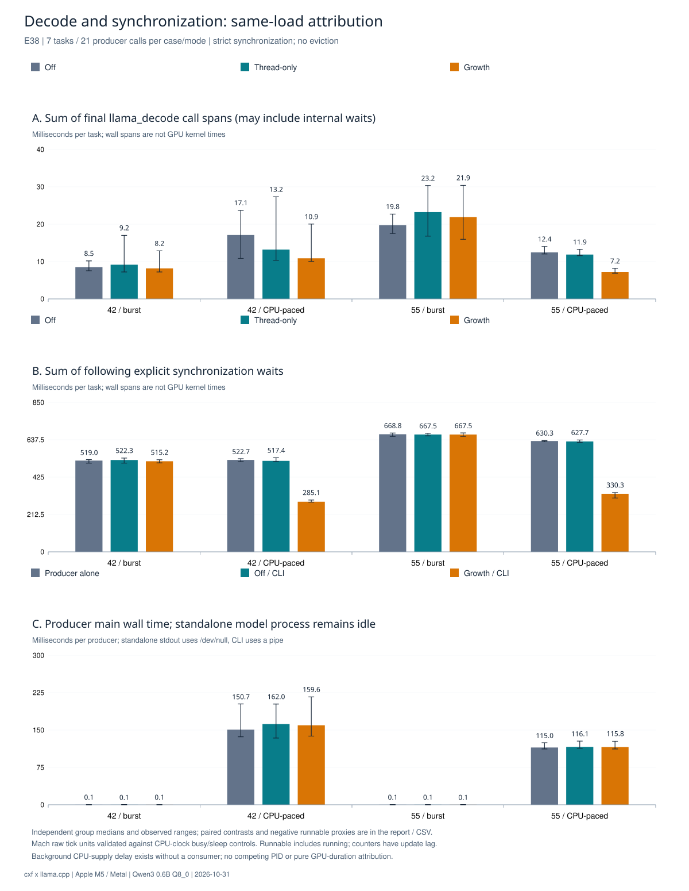

E38 burst off groups: cumulative final decode-call medians8.478/19.754ms, explicit synchronization518.959/668.833ms; sync owner CPU only0.114/0.313ms. The42-word off max-minus-min prefill difference21.640ms comprises20.305ms more sync and1.336ms more decode, with unchanged token/decode work. The55-word difference22.904ms includes17.699ms more sync. Earlier71–110ms ranges do not recur in these controls; historical data remains intact. Waiting is localized, not measured as pure GPU kernel duration: decode may internally wait and synchronization includes outstanding work plus host wakeup/scheduling.

The producer is single-threaded. On M5, raw proc counters require Mach scaling125/3; the100ms CPU calibration reports2,400,083 CPU ticks versus100,000,083ns from CLOCK_THREAD_CPUTIME_ID. E38 paced42-word standalone producer reaches56.318ms ready-wait proxy even while the model process is idle; median wall150.745ms versus CPU142.341ms. Off/idle/thread/growth maximum per-tool ready proxies55.041/75.191/79.983/75.607ms are not a monotonic consumer penalty. Retired-instruction medians stay near873–876M. At55 words, standalone max is1.260ms, growth max11.949ms, with all instruction medians about865M. This establishes background CPU supply delay and possible smaller mode-dependent variation, not an attribution to a particular competing PID or proof of zero indirect contention.

Runnable includes running time, so ready proxy=(runnable−CPU)×timebase; blocked proxy=wall−runnable×timebase. Counter updates lag: negative values, including task-summed medians around−13ms, are retained and are not physical negative waiting. Setup/output medians in the paced42-word groups are roughly0.08–0.13ms per tool; large delays are in compute/runnable spans rather than the measured file/output spans. The independent100ms sleep calibration also exposes counter-update error. Paced42-word standalone involuntary switches have median790 versus37 at55 words. Across105 evaluated producer calls per shape (five modes), ready proxy and involuntary-switch Pearson r are0.700/0.405; correlation supports a scheduling mechanism but does not identify the competing process. No exact decomposition of every non-CPU millisecond is claimed.

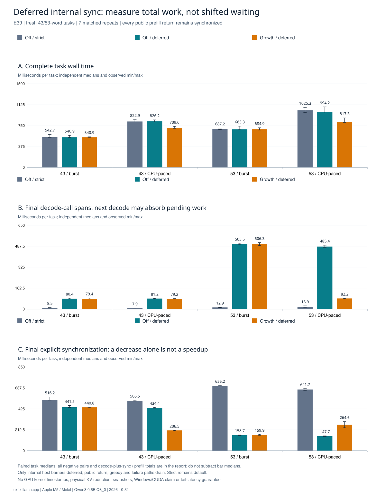

E39 removes explicit host barriers only inside a single prefill. Every public return drains pending work; greedy replay and failure still synchronize.43-word tasks save one final explicit sync call;53-word burst saves four. Most apparent sync savings move into decode:53-word burst off-drain versus off-race saves496.522ms explicit sync but adds491.394ms in decode; final prefill saves5.262ms and whole task2.369ms. That is not a497ms speedup. On43-word paced off-drain final prefill actually regresses2.956ms despite a2.616ms task median saving; all negatives remain.

Matched off-drain task medians versus strict improve2.332/2.616/2.369/3.904ms across four cases; growth-drain improves10.408/8.022/1.331/11.822ms. Only4–5 of7 pairs improve, and worst regressions reach44.039ms (off) and35.597ms (growth). Streaming over the same deferred baseline still saves123.224/169.701ms on paced sources,7/7 each; burst+0.083/−3.296ms has no stable gain. Keep deferred synchronization explicit, defaults unchanged. No evaluation tuning, no outlier deletion, no cross-run subtraction.

E39 worst off-drain53-word paced pair regresses44.039ms: producer wall23.529ms extra, CPU19.195ms extra and ready proxy only3.137ms extra; final prefill18.720ms extra, owner queue zero. Producer retired instructions increase0.186%, cycles0.316%, CPU time5.871%. Even without overlapping inference, execution rate varies; these counters are consistent with CPU-rate/supply effects but do not measure frequency or core residency. The arithmetic producer does not represent memory-bandwidth-heavy tools.

Detailed [tasks](data/decode-schedule-tasks.csv), [matched pairs](data/decode-schedule-pairs.csv), [all producers](data/decode-schedule-producers.csv) and [indexed decode phases](data/decode-schedule-phases.csv) retain raw counters and negative proxies. E38/E39 have22/30 native sanitizer cases and32/32 real CLI sanitizer tasks plus24/24 producer controls; final E39 source passes14,357-token deferred Native, full strict Stream and default C/HTTP/CLI regression. Long/Stream checks are E39 acceptance, not a relabeling of E38 source. No injected decode failure or thread-constructor OOM; no Windows/CUDA or GPU hardware timestamps.

Interpretation is checked against the pinned [Metal synchronization code](https://github.com/ggml-org/llama.cpp/blob/f1e44dcc11d8802d107bd7331a3d3fd3e6f57b93/ggml/src/ggml-metal/ggml-metal-context.m), [XNU runnable timer lifecycle](https://github.com/apple-oss-distributions/xnu/blob/main/osfmk/kern/sched_prim.c) and [task timer aggregation](https://github.com/apple-oss-distributions/xnu/blob/main/osfmk/kern/task.c). The causal limits above are inferences from code plus measured controls, not hardware trace attribution.

## E40/E41 · model CPU source isolation

E38 producer-alone still kept the model alive. E40/E41 therefore bracket resident observations with model-absent-before and model-absent-after controls. Every rep opens a fresh model, passes a real four-Native/three-tool fixture, observes immediately after completion and again after100ms idle, then exits the model normally. E40 initializes with prefill off; E41 with growth streaming enabled. Both use43/53-word,16M producers, three per state, one warmup plus seven evaluations:192 producer controls,16 fixture records and3 status records=211 each. Fixed order and time drift remain; model CPU is sampled across the whole producer subprocess, a slightly wider interval than producer main.

| Experiment | Words | State | Calls | Producer wall median [min,max] ms | Producer CPU median ms | Ready proxy max ms | Model CPU median / max ms |
| --- | --- | --- | --- | --- | --- | --- | --- |
| E40 | 43 | absent-after | 21 | 91.177 [89.193,92.904] | 90.953 | 1.110 | 0.0000 / 0.0000 |
| E40 | 43 | absent-before | 21 | 90.929 [88.400,99.693] | 90.555 | 4.061 | 0.0000 / 0.0000 |
| E40 | 43 | resident-immediate | 21 | 91.456 [89.636,92.735] | 91.299 | 1.317 | 0.0686 / 0.1003 |
| E40 | 43 | resident-settled | 21 | 91.495 [89.983,99.496] | 91.414 | 0.138 | 0.0564 / 0.0722 |
| E40 | 53 | absent-after | 21 | 91.398 [90.059,93.046] | 91.272 | -0.416 | 0.0000 / 0.0000 |
| E40 | 53 | absent-before | 21 | 91.461 [90.105,93.163] | 91.404 | 0.884 | 0.0000 / 0.0000 |
| E40 | 53 | resident-immediate | 21 | 91.042 [90.357,95.056] | 91.004 | 1.020 | 0.0608 / 0.0882 |
| E40 | 53 | resident-settled | 21 | 91.799 [90.374,99.365] | 91.714 | 1.419 | 0.0628 / 0.1324 |
| E41 | 43 | absent-after | 21 | 90.070 [87.447,109.511] | 90.018 | 4.039 | 0.0000 / 0.0000 |
| E41 | 43 | absent-before | 21 | 89.469 [86.782,125.423] | 89.434 | 27.228 | 0.0000 / 0.0000 |
| E41 | 43 | resident-immediate | 21 | 90.876 [87.814,118.667] | 90.857 | 13.887 | 0.0694 / 0.3072 |
| E41 | 43 | resident-settled | 21 | 90.713 [88.412,98.962] | 90.697 | 2.857 | 0.0627 / 0.2460 |
| E41 | 53 | absent-after | 21 | 99.381 [91.300,131.132] | 98.830 | 20.284 | 0.0000 / 0.0000 |
| E41 | 53 | absent-before | 21 | 98.110 [91.484,115.858] | 97.666 | 8.115 | 0.0000 / 0.0000 |
| E41 | 53 | resident-immediate | 21 | 101.805 [91.904,133.124] | 98.826 | 24.881 | 0.1969 / 0.3701 |
| E41 | 53 | resident-settled | 21 | 103.676 [91.324,184.853] | 100.679 | 70.635 | 0.2272 / 0.4471 |

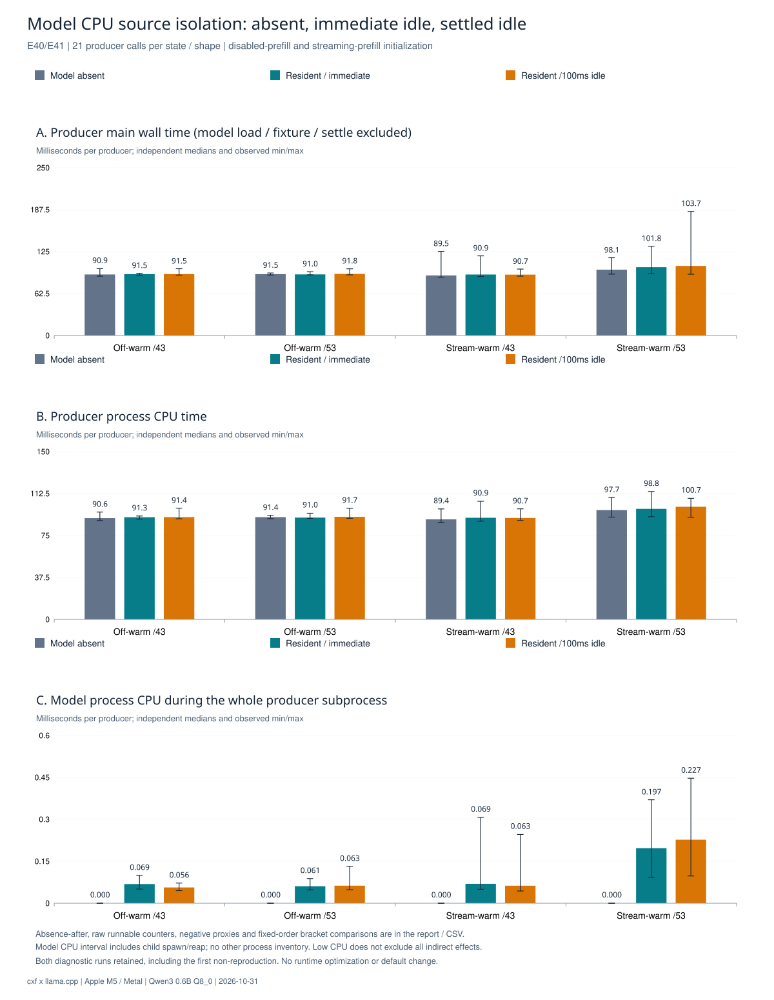

The off-warm probe E40 does not reproduce a large wait; resident model CPU maxima are0.1324ms or less. The streaming-warm E41 does:53-word settled-idle producer ready proxy70.635ms, main wall184.853ms, own CPU108.246ms, compute184.680ms, output0.096ms and312 involuntary switches. During its whole subprocess the model uses0.4223ms CPU and the collector1.015ms. A model-absent-before43-word call also has27.228ms ready proxy, wall125.423ms versus CPU98.741ms. Thus substantial runnable delay exists without an active consumer, with negligible model CPU and even with the model absent. Residual model-thread CPU spinning is not supported as the explanation for these samples.

This distinguishes runnable CPU supply from own model-process CPU occupancy, not the identity of all competing work. No other PID inventory was collected. GPU/driver, cache, thermal and CPU/core-rate history are not fully profiled; no assertion excludes all indirect effects. Negative ready proxies remain. The absent-before/after bracket averages in CSV are descriptive, not a drift-corrected causal estimator. Both complete diagnostic runs are retained, including the initial non-reproduction. They add no runtime optimization or default change.

See [all controls](data/model-idle-controls.csv), [summaries](data/model-idle-summary.csv), [bracket comparisons](data/model-idle-pairs.csv).32 model fixtures pass canonical/token/greedy and96 actual tool invocations;32 owned model processes close normally. These are CPU-source diagnostics using the E39 qualified binary, not192 extra autonomous model tasks per experiment or a general tool benchmark.

## E42–E44 · GPU execution, notification and bounded batch coalescing

Three independent experiments,1539 main CLI records each. E42/E43 repeat43/53-word,0/16M-iteration workloads with device tracing, observer-off and completion-marker controls. E44 uses fresh45/51-word,0/14M workloads for bounded batch coalescing. KV stays resident; no snapshot, eviction or build optimization. All actions are scripted Native-parser choices with real CLI/tools and exact token/greedy checks.

The old E39 worst44.039ms pair contains23.529ms extra producer wall and18.720ms extra final prefill. It has no Metal trace: new experiments cannot retrospectively assign its exact milliseconds. New waits can now be localized. GPU command-buffer intervals are unioned, not summed, and are execution spans rather than pure shader busy counters.

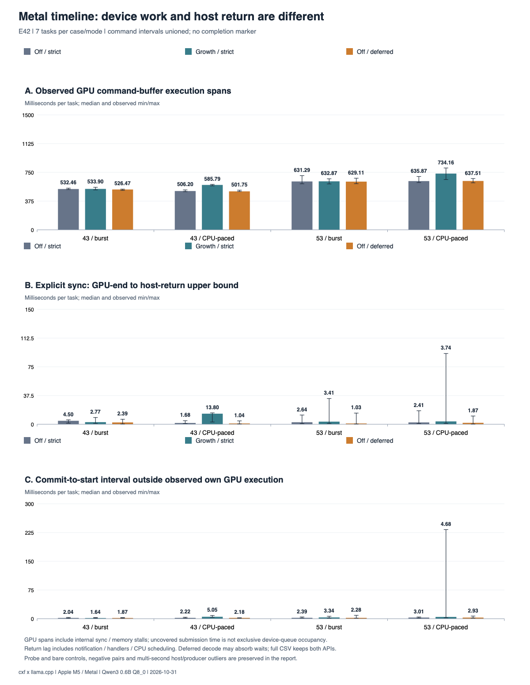

| E42 strict off | Iterations | GPU union ms | Sync GPU overlap ms | Pre-GPU gap ms | Post-GPU return upper lag ms | Uncovered commit-to-start ms |
| --- | --- | --- | --- | --- | --- | --- |
| 43 | 0 | 532.458 [526.210,543.293] | 529.760 [521.158,541.446] | 0.092 [0.072,0.840] | 4.500 [1.430,5.764] | 2.043 [1.202,3.346] |
| 43 | 16000000 | 506.200 [497.436,520.844] | 503.323 [493.944,513.211] | 0.086 [0.063,1.428] | 1.677 [0.951,4.649] | 2.224 [1.441,3.867] |
| 53 | 0 | 631.287 [600.919,706.969] | 627.030 [598.391,693.767] | 0.059 [0.007,0.402] | 2.640 [0.842,12.053] | 2.388 [1.728,4.561] |
| 53 | 16000000 | 635.865 [617.496,695.809] | 634.280 [614.559,689.009] | 0.040 [0.006,0.141] | 2.412 [0.981,17.615] | 3.008 [1.573,4.517] |

The strict-off synchronization is predominantly observed GPU execution. Uncovered submission delay and host return tails remain separate. E42 strict-off has a14.006ms single-wait return tail; all traced modes reach57.657ms. Large commit-to-start totals mostly overlap earlier own GPU work; uncovered time still mixes CPU driver, unobserved work, device queues and system scheduling. These APIs cannot attribute exact external-GPU queue occupancy or kernel-level CPU wakeup.

Apple documents [GPUStartTime](https://developer.apple.com/documentation/metal/mtlcommandbuffer/gpustarttime?language=objc) as device execution timing, [kernelStartTime](https://developer.apple.com/documentation/metal/mtlcommandbuffer/kernelstarttime?language=objc) as CPU driver scheduling, and [waitUntilCompleted](https://developer.apple.com/documentation/metal/mtlcommandbuffer/waituntilcompleted%28%29?language=objc) as waiting for GPU completion and completion-handler return. E43 adds a separately controlled timestamp-only handler; neither delivery nor post-handler return is pure CPU wakeup.

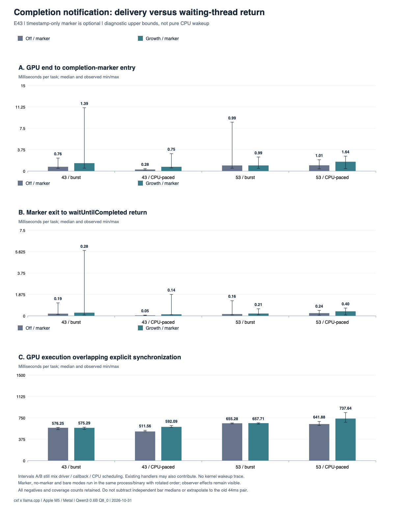

| E43 off / marker | Iterations | GPUend to marker delivery ms | Marker end to wait return ms | Covered waits / missing |
| --- | --- | --- | --- | --- |
| 43 | 0 | 0.758 [0.488,2.286] | 0.194 [0.121,1.141] | 35 / 0 |
| 43 | 16000000 | 0.278 [0.200,0.455] | 0.045 [0.023,0.069] | 35 / 0 |
| 53 | 0 | 0.988 [0.506,8.584] | 0.158 [0.083,1.329] | 56 / 0 |
| 53 | 16000000 | 1.014 [0.393,1.986] | 0.240 [0.061,0.479] | 56 / 0 |

53-word burst marker tasks reach8.584ms cumulative notification-delivery delay and1.329ms cumulative post-marker return, while median GPU overlap is655.283ms. Another E43 43-word growth burst wait has a16.376ms tail:10.728ms delivery and5.648ms after-marker return. This supports separating device work from host notification/scheduling, not relabeling hundreds of milliseconds as CPU wakeup. Bare-versus-observer and marker controls have both positive and negative task differences. E42 also contains multi-second producer/host outliers, including a3,637.772ms deferred-progress regression; none were removed. The cleaner E43 repeats do not erase E42.

| Experiment | Words | Iterations | Baseline | Candidate | Task saving median [min,max] ms | Faster /7 |
| --- | --- | --- | --- | --- | --- | --- |
| E42 | 43 | 0 | off-race | off-drain | 14.815 [-55.777,141.576] | 5 |
| E42 | 43 | 0 | progress-race | progress-drain | 5.128 [-60.674,81.820] | 4 |
| E42 | 43 | 16000000 | off-race | off-drain | -19.059 [-1297.225,70.713] | 3 |
| E42 | 43 | 16000000 | progress-race | progress-drain | -13.846 [-122.074,266.230] | 3 |
| E42 | 53 | 0 | off-race | off-drain | -36.661 [-129.691,62.148] | 3 |
| E42 | 53 | 0 | progress-race | progress-drain | -36.098 [-3637.772,28.856] | 1 |
| E42 | 53 | 16000000 | off-race | off-drain | -51.631 [-471.452,986.880] | 3 |
| E42 | 53 | 16000000 | progress-race | progress-drain | -25.486 [-1656.688,1802.983] | 2 |
| E43 | 43 | 0 | off-race | off-race-notify | 13.342 [-22.083,21.411] | 5 |
| E43 | 43 | 0 | progress-race | progress-race-notify | -0.609 [-27.317,18.707] | 3 |
| E43 | 43 | 0 | off-race-bare | off-race | -0.790 [-29.492,29.768] | 3 |
| E43 | 43 | 0 | progress-race-bare | progress-race | -15.407 [-31.386,6.931] | 2 |
| E43 | 43 | 0 | off-race-bare | progress-race-bare | 4.994 [-9.620,40.218] | 5 |
| E43 | 43 | 16000000 | off-race | off-race-notify | -12.600 [-79.333,22.466] | 1 |
| E43 | 43 | 16000000 | progress-race | progress-race-notify | -3.943 [-161.352,41.403] | 3 |
| E43 | 43 | 16000000 | off-race-bare | off-race | -0.299 [-24.263,46.584] | 3 |
| E43 | 43 | 16000000 | progress-race-bare | progress-race | -15.197 [-36.838,9.299] | 1 |
| E43 | 43 | 16000000 | off-race-bare | progress-race-bare | 135.424 [116.654,160.094] | 7 |
| E43 | 53 | 0 | off-race | off-race-notify | 3.217 [-46.320,35.154] | 4 |
| E43 | 53 | 0 | progress-race | progress-race-notify | 3.151 [-18.437,33.533] | 4 |
| E43 | 53 | 0 | off-race-bare | off-race | -6.831 [-21.005,37.335] | 3 |
| E43 | 53 | 0 | progress-race-bare | progress-race | -16.263 [-39.884,28.565] | 2 |
| E43 | 53 | 0 | off-race-bare | progress-race-bare | -1.708 [-27.866,42.617] | 3 |
| E43 | 53 | 16000000 | off-race | off-race-notify | 8.000 [-51.775,32.567] | 5 |
| E43 | 53 | 16000000 | progress-race | progress-race-notify | 7.275 [-213.002,35.031] | 4 |
| E43 | 53 | 16000000 | off-race-bare | off-race | -12.839 [-79.424,18.551] | 1 |
| E43 | 53 | 16000000 | progress-race-bare | progress-race | -16.157 [-91.320,0.294] | 1 |
| E43 | 53 | 16000000 | off-race-bare | progress-race-bare | 192.264 [161.421,253.295] | 7 |

E42 identifies genuine tail-batch work:588 tokens split512+76, with three76-token tail buffers taking28.665/33.070/36.619ms in one53-word burst task. E44 keeps an allocated1024 capacity in every control, caps normal chunks at512, and optionally fuses a remaining513–1024-token tail only if the whole tail fits the current budget. Streaming budget512 cannot be exceeded. Both controls use strict synchronization; the default CLI batch512 and default strategy remain unchanged.

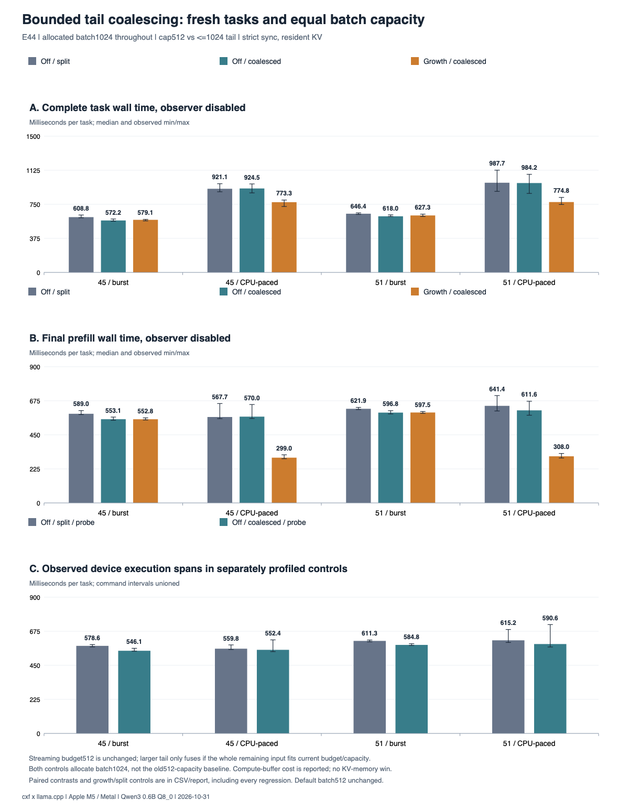

| E44 words | Iterations | Baseline | Candidate | Task saving median [min,max] ms | Faster /7 | Final prefill saving median ms |
| --- | --- | --- | --- | --- | --- | --- |
| 45 | 0 | off-split-bare | off-coalesce-bare | 36.407 [31.282,49.671] | 7 | 36.770 |
| 45 | 0 | progress-split-bare | progress-coalesce-bare | 42.533 [21.956,86.165] | 7 | 42.711 |
| 45 | 0 | off-split-bare | progress-split-bare | -4.988 [-48.980,-2.573] | 0 | -3.597 |
| 45 | 0 | off-coalesce-bare | progress-coalesce-bare | 1.718 [-20.275,5.903] | 4 | 3.193 |
| 45 | 0 | off-split | off-coalesce | 32.909 [17.940,46.281] | 7 | 35.166 |
| 45 | 14000000 | off-split-bare | off-coalesce-bare | -3.341 [-86.283,100.857] | 3 | 3.840 |
| 45 | 14000000 | progress-split-bare | progress-coalesce-bare | 9.051 [-20.868,69.030] | 4 | 3.620 |
| 45 | 14000000 | off-split-bare | progress-split-bare | 138.052 [96.641,241.691] | 7 | 265.104 |
| 45 | 14000000 | off-coalesce-bare | progress-coalesce-bare | 152.803 [125.405,198.626] | 7 | 271.686 |
| 45 | 14000000 | off-split | off-coalesce | 17.231 [-30.842,42.251] | 5 | 14.385 |
| 51 | 0 | off-split-bare | off-coalesce-bare | 28.445 [11.714,30.869] | 7 | 28.485 |
| 51 | 0 | progress-split-bare | progress-coalesce-bare | 29.019 [0.537,38.365] | 7 | 26.087 |
| 51 | 0 | off-split-bare | progress-split-bare | -9.303 [-12.949,3.241] | 2 | -4.095 |
| 51 | 0 | off-coalesce-bare | progress-coalesce-bare | -2.125 [-14.450,3.544] | 2 | -0.173 |
| 51 | 0 | off-split | off-coalesce | 29.150 [18.783,41.552] | 7 | 27.391 |
| 51 | 14000000 | off-split-bare | off-coalesce-bare | 22.623 [-14.723,115.141] | 6 | 30.201 |
| 51 | 14000000 | progress-split-bare | progress-coalesce-bare | 35.338 [-56.910,107.938] | 6 | 2.227 |
| 51 | 14000000 | off-split-bare | progress-split-bare | 158.348 [94.399,330.466] | 7 | 331.925 |
| 51 | 14000000 | off-coalesce-bare | progress-coalesce-bare | 181.509 [118.886,276.180] | 7 | 302.293 |
| 51 | 14000000 | off-split | off-coalesce | -11.240 [-173.572,103.248] | 3 | 18.263 |

Bare coalescing saves36.407/28.445ms on45/51-word burst tasks,7/7 faster each. The45-word paced off group regresses3.341ms median and86.283ms worst: that pair has93.325ms more final prefill (84.062ms in sync), despite20.539ms less tool wall. Bare has no device timestamps, so this particular tail cannot be assigned to GPU versus host wakeup. Profiled51-word paced coalescing saves23.360ms device span and18.263ms final prefill but loses11.240ms whole-task median, with32.426ms extra tool wall. Device improvement therefore does not imply a universal task speedup. Coalesced growth versus off retains152.803/181.509ms paced task savings,7/7 each, but burst differences are+1.718/-2.125ms.

| E44 profiled off | Iterations | GPU span saving median ms | Final prefill saving median ms | Tool wall saving median ms | Whole task saving median ms |
| --- | --- | --- | --- | --- | --- |
| 45 | 0 | 32.051 | 35.166 | -0.708 | 32.909 |
| 45 | 14000000 | 6.094 | 14.385 | -0.387 | 17.231 |
| 51 | 0 | 23.996 | 27.391 | 3.016 | 29.150 |
| 51 | 14000000 | 23.360 | 18.263 | -32.426 | -11.240 |

The bare groups measure end-to-end behavior without Metal collection. Profiled split/coalesced controls isolate command-buffer spans; do not add gains across experiments. Allocating batch1024 can increase compute-buffer capacity, so this is not a memory reduction or an exact old512-capacity baseline. Metal compute reservation grows298.75→597.50MiB and CPU compute12.01→24.03MiB versus E42 batch512; both reserve896MiB KV. These are init reservations, not peak RSS. Actual allocation is recorded in E44 method metadata. All negative pairs remain; seven repeats do not establish tail guarantees.

See [tasks](data/metal-tasks.csv), [all paired metrics](data/metal-pairs.csv), [command timestamps](data/metal-commands.csv), [joined wait partitions](data/metal-waits.csv) and [scope partitions](data/metal-scopes.csv). Each run has48 actual CLI sanitizer tasks; E42/E43 have30 native unit cases, E44 has47 including budget/minimum/invalid/reset checks. Final E44 source also passes14,357-token coalesced Native, strict Stream and default C/HTTP/CLI regression. No injected decode failure, Windows/CUDA, exact external-device scheduler trace or autonomous0.6B capability claim.

9575 auxiliary Metal records are stored separately from main CLI rows (7179 command,2393 wait,3 metadata). All raw traces are indexed; main counts never imply independent tasks.

## E45/E46 · sustained-tail diagnosis and smaller compute reservation

E45 repeats the E44-shaped workload with split/coalesced × bare/no-marker/marker controls,1539 main records. The old86.283ms bare pair still lacks GPU timestamps. Its93.325ms extra final prefill is spread across all four preparations,22.717/11.694/32.119/26.795ms; owner CPU decreases in each. Thus it was not one measured CPU wakeup or extra CPU token processing. Device progress versus host notification remains unknown for that exact historical pair.

| Historical E44 step | Tokens | Extra prefill ms | Extra decode ms | Extra sync ms | Extra owner CPU ms |
| --- | --- | --- | --- | --- | --- |
| 0 | 811 | 22.717 | -1.192 | 23.910 | -1.238 |
| 1 | 514 | 11.694 | -1.614 | 13.311 | -1.687 |
| 2 | 514 | 32.119 | -1.427 | 33.545 | -1.228 |
| 3 | 514 | 26.795 | 13.339 | 13.296 | -0.822 |

The86ms regression does not reproduce in E45: paced bare worst1.908ms (tool+3.871ms, prefill−2.058ms); no-marker trace worst11.248ms (tool+14.212ms, prefill−3.054ms). Marker worst1.157ms has tool+2.069ms, GPU union+1.991ms, decode−3.797ms, and notification/return−0.180/−0.043ms. These new tails are explained by their measured stages, not evidence that the old tail was eliminated. The45-word paced device-span saving is only2.486ms median with marker, versus36.747ms burst; batch merging is workload-dependent.

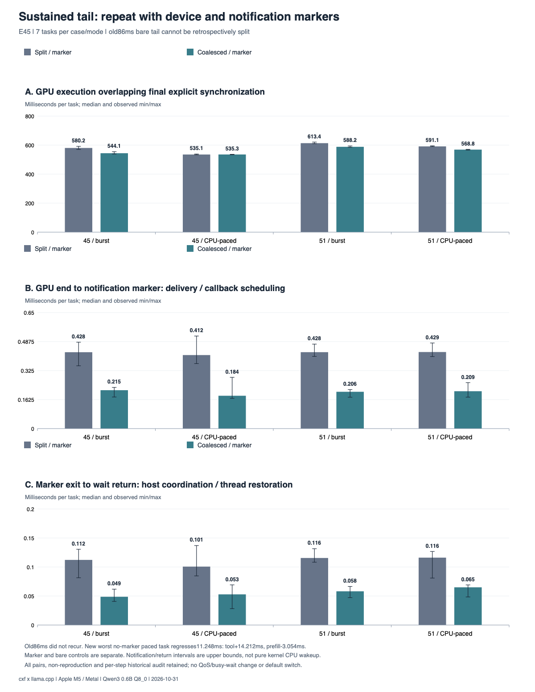

| E45 paced words | Candidate | Worst extra task ms | Extra tool ms | Extra prefill ms | Extra GPU span ms | Extra notify delivery ms | Extra post-marker return ms |
| --- | --- | --- | --- | --- | --- | --- | --- |
| 45 | off-coalesce-bare | 1.908 | 3.871 | -2.058 | — | — | — |
| 51 | off-coalesce-bare | -24.172 | 4.285 | -28.489 | — | — | — |
| 45 | off-coalesce | 11.248 | 14.212 | -3.054 | -0.123 | — | — |
| 51 | off-coalesce | -23.345 | 2.999 | -26.256 | -23.544 | — | — |
| 45 | off-coalesce-notify | 1.157 | 2.069 | -0.858 | 1.991 | -0.180 | -0.043 |
| 51 | off-coalesce-notify | -24.569 | 0.377 | -24.964 | -22.138 | -0.203 | -0.055 |

Notification columns apply only to marker mode; zero in no-marker traces means unobserved, not measured zero. GPU spans include internal memory/sync and possible device preemption. Notification and post-marker return still include driver/handler/scheduler coordination. No GPU frequency/temperature counter, external queue timeline, or kernel CPU-wakeup trace was collected. All negative pairs and non-reproduction remain in evidence.

The allocation cause is direct: cxf couples n_batch/n_ubatch to the startup batch parameter; pinned [llama.cpp sched_reserve](https://github.com/ggml-org/llama.cpp/blob/f1e44dcc11d8802d107bd7331a3d3fd3e6f57b93/src/llama-context.cpp#L596) reserves the maximum graph using n_ubatch. E46 reuses the existing parameter at640; no inference source or runtime binary change, extra context, dynamic reallocation, snapshot or eviction. Larger initial input still chunks; approximately600-token tool increments can fit in one batch.

| Capacity | Loads | Metal compute MiB | CPU compute MiB | Physical KV MiB |
| --- | --- | --- | --- | --- |
| 512 | 7 | 298.75 | 12.01 | 896.00 |
| 640 | 7 | 373.44 | 15.02 | 896.00 |
| 1024 | 7 | 597.50 | 24.03 | 896.00 |

640 reserves373.44MiB Metal compute versus597.50MiB at1024:224.06MiB less (37.5%), leaving only74.69MiB above default512. CPU compute falls24.03→15.02MiB; KV remains896MiB. These are init reservations, not measured peak RSS or KV savings. The default remains512;640 is an explicit configuration, not an online capacity switch.

Fresh47/54-word,0/12M workloads run in seven outer blocks, rotating512/split,640/coalesced,1024/coalesced load order and mode order. Each capacity/load has off-bare, growth-bare and off-marker modes, one warmup and one evaluation per case.21 models,252 evaluation plus252 warm tasks,4095 main rows. Load/warm/helper first execution excluded; all warm rows retained, KV resident within each task/load. Cross-capacity block contrasts reduce but do not remove temporal drift.

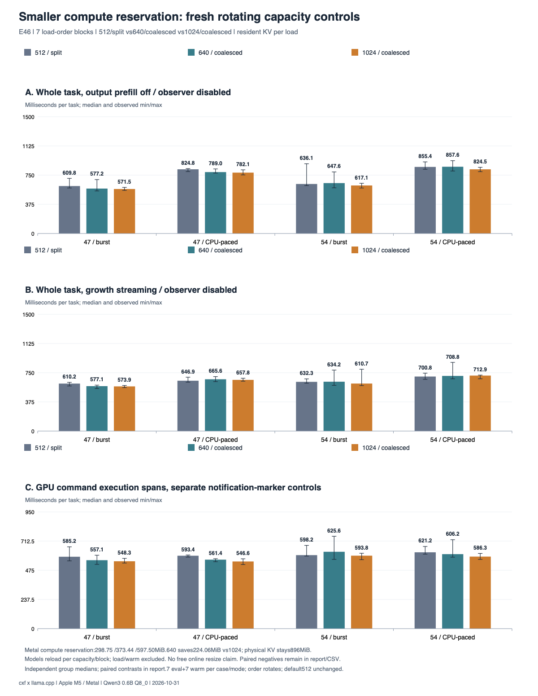

| E46 words | Iterations | Baseline | Candidate | Task saving median [min,max] ms | Faster /7 | Final prefill saving ms |
| --- | --- | --- | --- | --- | --- | --- |
| 47 | 0 | off-512-bare | off-640-bare | 15.664 [-9.195,62.865] | 6 | 13.139 |
| 47 | 0 | off-1024-bare | off-640-bare | -6.090 [-121.219,26.477] | 3 | -4.318 |
| 47 | 0 | growth-512-bare | growth-640-bare | 27.527 [-2.404,63.543] | 5 | 26.962 |
| 47 | 0 | growth-1024-bare | growth-640-bare | -7.742 [-27.953,24.530] | 3 | -8.002 |
| 47 | 0 | off-640-bare | growth-640-bare | 0.291 [-21.893,115.680] | 4 | 0.654 |
| 47 | 12000000 | off-512-bare | off-640-bare | 35.721 [-12.543,55.136] | 6 | 32.622 |
| 47 | 12000000 | off-1024-bare | off-640-bare | -8.158 [-56.075,30.536] | 3 | -10.082 |
| 47 | 12000000 | growth-512-bare | growth-640-bare | -24.934 [-48.957,56.550] | 1 | 30.349 |
| 47 | 12000000 | growth-1024-bare | growth-640-bare | -3.756 [-39.236,9.139] | 1 | -4.434 |
| 47 | 12000000 | off-640-bare | growth-640-bare | 125.864 [106.958,146.195] | 7 | 214.053 |
| 54 | 0 | off-512-bare | off-640-bare | 2.217 [-176.227,160.265] | 4 | 3.519 |
| 54 | 0 | off-1024-bare | off-640-bare | -45.389 [-156.310,21.067] | 2 | -44.088 |
| 54 | 0 | growth-512-bare | growth-640-bare | -1.849 [-168.364,36.389] | 3 | -1.898 |
| 54 | 0 | growth-1024-bare | growth-640-bare | -30.481 [-170.735,76.826] | 3 | -30.451 |
| 54 | 0 | off-640-bare | growth-640-bare | 8.312 [-3.591,18.587] | 5 | 6.911 |
| 54 | 12000000 | off-512-bare | off-640-bare | -2.180 [-62.071,68.400] | 3 | 0.979 |
| 54 | 12000000 | off-1024-bare | off-640-bare | -17.900 [-111.176,22.451] | 2 | -14.806 |
| 54 | 12000000 | growth-512-bare | growth-640-bare | -12.957 [-217.550,39.666] | 2 | -0.040 |
| 54 | 12000000 | growth-1024-bare | growth-640-bare | -1.556 [-186.498,14.546] | 3 | 4.473 |
| 54 | 12000000 | off-640-bare | growth-640-bare | 143.980 [4.822,214.982] | 7 | 193.442 |

| E46 profiled words | Iterations | Baseline | Candidate | GPU span saving median ms | Delivery saving median ms | Post-marker return saving median ms | Task saving median ms |
| --- | --- | --- | --- | --- | --- | --- | --- |
| 47 | 0 | off-512-notify | off-640-notify | 28.176 | 0.309 | 0.035 | 29.647 |
| 47 | 0 | off-1024-notify | off-640-notify | -14.785 | -0.047 | -0.006 | -20.284 |
| 47 | 12000000 | off-512-notify | off-640-notify | 34.058 | 0.180 | 0.031 | 39.548 |
| 47 | 12000000 | off-1024-notify | off-640-notify | -17.235 | -0.066 | -0.016 | -31.829 |
| 54 | 0 | off-512-notify | off-640-notify | -16.562 | 0.268 | 0.031 | -15.022 |
| 54 | 0 | off-1024-notify | off-640-notify | -44.017 | -0.057 | -0.019 | -45.126 |
| 54 | 12000000 | off-512-notify | off-640-notify | 24.498 | 0.185 | 0.037 | 22.451 |
| 54 | 12000000 | off-1024-notify | off-640-notify | -18.800 | -0.061 | -0.006 | -18.078 |

Smaller reservation is a memory/latency tradeoff, not a universal speed optimization. Against default512,640 growth paced task medians regress24.934/12.957ms. The worst growth pair regresses217.550ms: tool+190.983ms, producer wall+150.844ms versus own CPU+12.507ms, runnable-ready proxy+153.688ms, final prefill+30.848ms. The proxy has accounting lag and does not identify a competitor. The worst off-bare burst pair regresses176.227ms with162.131ms extra final prefill and no device trace.

The worst matched marker pair640 versus512 regresses136.408ms: final prefill+107.952ms, observed GPU union+106.174ms, sync GPU overlap+105.772ms, delivery−0.320ms, post-marker return−0.073ms, uncovered commit delay+0.148ms, tool+24.597ms. Thus this new prefill tail lies in device execution spans, not completion delivery/CPU return or submission queue. Evaluated token counts are equal, with fewer decode calls; spans can grow due to kernel efficiency, stalls, GPU scheduling or clock/state variation, none individually identified. Against1024 the same640 task is179.725ms slower, with144.977ms extra GPU union. Do not retrospectively assign these measurements to the old86ms pair.

| E46 worst pair | Words / iterations / block | Extra task ms | Extra tool ms | Extra final prefill ms | Extra GPU span ms | Extra delivery ms | Extra post-marker return ms |
| --- | --- | --- | --- | --- | --- | --- | --- |
| off-512-notify → off-640-notify | 54 / 12000000 / 2 | 136.408 | 24.597 | 107.952 | 106.174 | -0.320 | -0.073 |
| off-1024-notify → off-640-notify | 54 / 12000000 / 2 | 179.725 | 26.665 | 149.285 | 144.977 | 0.063 | -0.008 |
| growth-512-bare → growth-640-bare | 54 / 12000000 / 2 | 217.550 | 190.983 | 30.848 | — | — | — |
| off-512-bare → off-640-bare | 54 / 0 / 5 | 176.227 | 11.548 | 162.131 | — | — | — |

Acceptance: E45 has47 native sanitizer cases and48 actual CLI sanitizer tasks. E46 has72 actual CLI sanitizer tasks across all capacities,640-capacity14,357-token Native, strict Stream and default C/HTTP/CLI regression. Runtime and core sources match E44/E45; orchestration and the test-only long-context capacity selector are newly archived. All negative results remain; no claimed p95/p99, Windows/CUDA acceptance or autonomous-quality result.

See [old86 step audit](data/tailwait-old86.csv), [new worst-pair attribution](data/tailwait-worst.csv), [all model allocations](data/capacity-runs.csv), [capacity worst pairs](data/capacity-worst.csv), [tasks/pairs](data/metal-pairs.csv) and [joined wait partitions](data/metal-waits.csv). All new device auxiliary rows are counted separately in the catalog/integrity file.

## E47–E49 · matched tool, graph-shape and memory-pressure isolation

The historical217.550ms pair combines a third producer main stall68.2→217.4ms and1→2 streaming updates; correlation does not establish that the extra update caused the whole stall. E47 fixes capacity640 and final chunk policy throughout off/thread-only/token-only/growth controls;47/54 words,0/12M iterations, six modes including off/growth marker controls,1539 records. The same commands, canonical transcript and greedy tokens are required.

| E47 words | Iterations | Baseline | Candidate | Task saving median [min,max] ms | Producer wall saving median ms | Ready proxy saving median ms |
| --- | --- | --- | --- | --- | --- | --- |
| 47 | 0 | off-coalesce-bare | thread-coalesce-bare | -3.831 [-8.817,24.170] | -0.002 | -1.176 |
| 47 | 0 | thread-coalesce-bare | token-coalesce-bare | 4.585 [-8.741,17.060] | 0.051 | 0.129 |
| 47 | 0 | token-coalesce-bare | progress-coalesce-bare | 5.685 [-12.248,10.387] | -0.038 | 0.462 |
| 47 | 0 | off-coalesce-bare | progress-coalesce-bare | 4.012 [-0.963,16.475] | -0.035 | -1.007 |
| 47 | 0 | off-coalesce-notify | progress-coalesce-notify | -1.875 [-11.203,12.721] | 0.032 | 0.450 |
| 47 | 12000000 | off-coalesce-bare | thread-coalesce-bare | 3.447 [-17.014,19.454] | 1.467 | -1.784 |
| 47 | 12000000 | thread-coalesce-bare | token-coalesce-bare | 0.882 [-14.963,8.511] | 0.734 | -0.551 |
| 47 | 12000000 | token-coalesce-bare | progress-coalesce-bare | 127.680 [105.473,136.411] | -1.963 | -0.936 |
| 47 | 12000000 | off-coalesce-bare | progress-coalesce-bare | 124.993 [96.970,148.725] | 3.738 | -3.574 |
| 47 | 12000000 | off-coalesce-notify | progress-coalesce-notify | 119.583 [92.019,131.854] | 0.868 | -2.302 |
| 54 | 0 | off-coalesce-bare | thread-coalesce-bare | 2.171 [-12.289,18.405] | -0.305 | -1.116 |
| 54 | 0 | thread-coalesce-bare | token-coalesce-bare | 0.935 [-17.873,15.016] | 0.258 | 0.909 |
| 54 | 0 | token-coalesce-bare | progress-coalesce-bare | -3.979 [-91.374,2.616] | -0.066 | -0.303 |
| 54 | 0 | off-coalesce-bare | progress-coalesce-bare | -6.876 [-88.034,35.461] | -0.262 | -0.392 |
| 54 | 0 | off-coalesce-notify | progress-coalesce-notify | 19.766 [-13.626,229.054] | 1.290 | 0.932 |
| 54 | 12000000 | off-coalesce-bare | thread-coalesce-bare | -3.227 [-1868.877,38.201] | 1.841 | -10.246 |
| 54 | 12000000 | thread-coalesce-bare | token-coalesce-bare | -9.089 [-110.297,2117.906] | -0.360 | 3.734 |
| 54 | 12000000 | token-coalesce-bare | progress-coalesce-bare | 68.168 [-61.444,165.604] | -34.133 | -19.203 |
| 54 | 12000000 | off-coalesce-bare | progress-coalesce-bare | 129.042 [-392.829,294.072] | -30.109 | -10.271 |
| 54 | 12000000 | off-coalesce-notify | progress-coalesce-notify | 180.020 [61.421,477.201] | 19.888 | 6.514 |

Large tool tails occur without overlapping GPU work:54-word paced thread-only versus off worst task+1868.877ms, tool+1817.950ms, producer wall+1761.856ms, own CPU−22.205ms, runnable-ready proxy+1784.891ms. Growth worst+392.829ms has tool+522.869ms and final prefill−334.860ms. This rules out concurrent inference as a necessary condition for these tool stalls; it does not identify a competing PID or exclude every indirect effect. Negative counter proxies, all outliers and marker/bare controls remain.

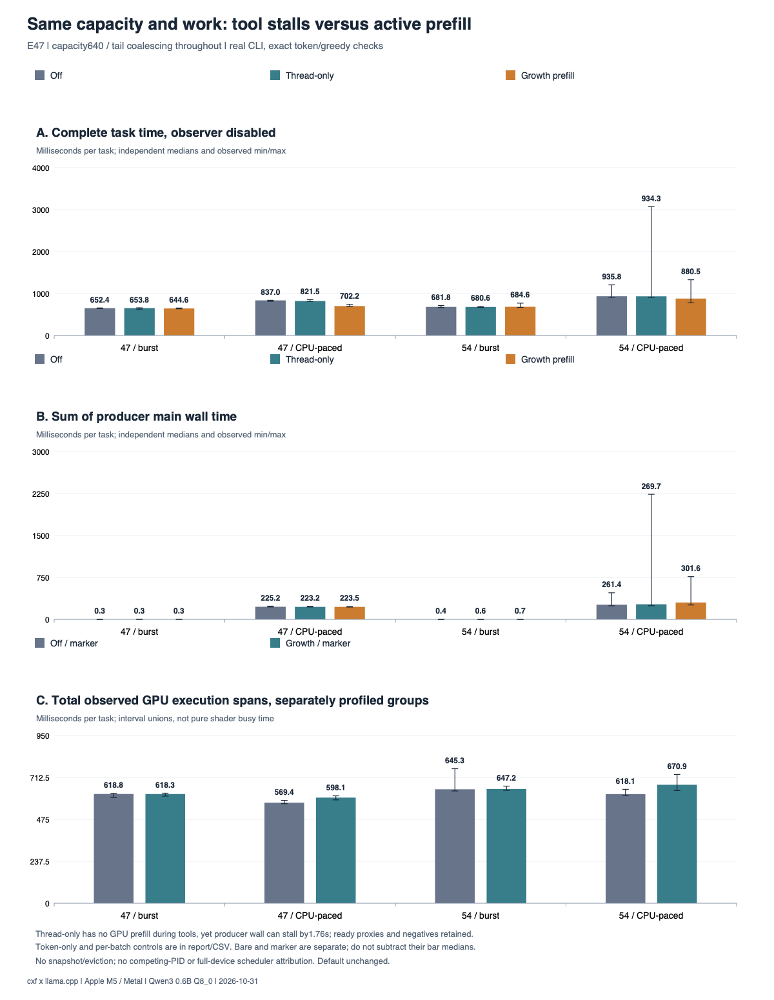

E48 directly isolates device-span sensitivity. A640-capacity engine keeps a2048-token read-only root; forked logical prefixes768/2048, increments128/224/512/582, split512 or coalesced640. Idle, arithmetic and64MiB cache-line read/write workers run with identical model input per shape; one warmup+seven evaluations gives384 samples plus3 status records. Root cells remain physically resident even for logical768, so cross-prefix differences are not a production context-scaling curve. Worker setup/join and independent fresh-KV/canonical oracles are excluded from the prefill timer.

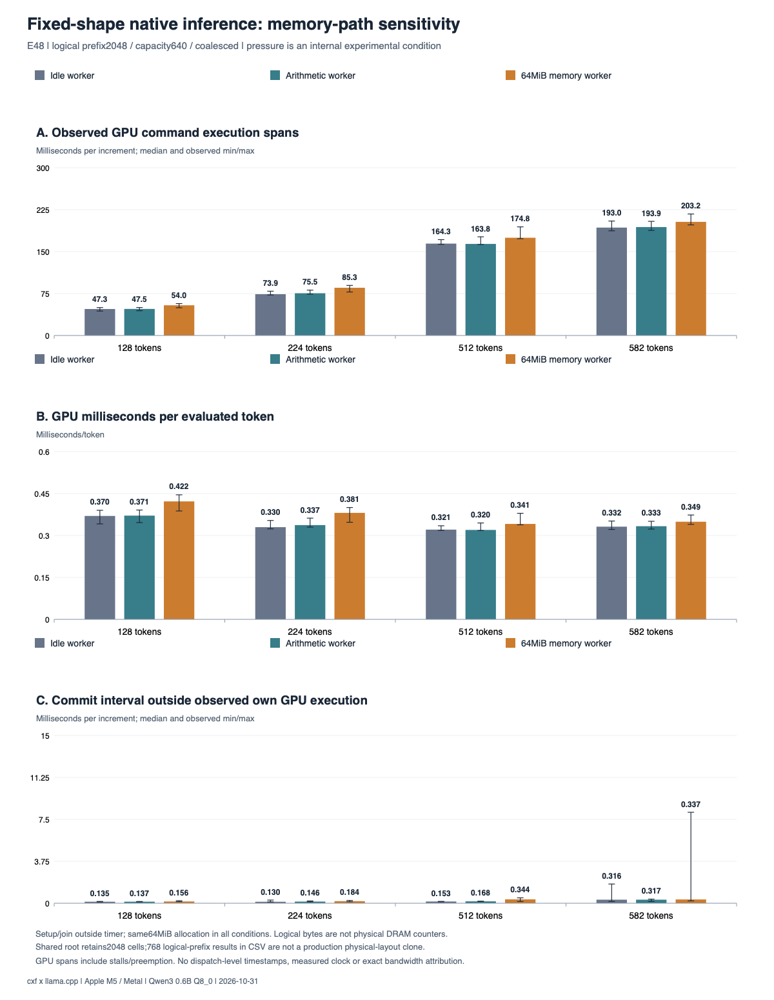

| Prefix | New tokens | Baseline | Candidate | Extra wall median [min,max] ms | Extra GPU median ms | Extra uncovered submit median ms |
| --- | --- | --- | --- | --- | --- | --- |
| 768 | 128 | idle/split | idle/coalesce | -0.094 [-4.989,10.165] | -0.100 | -0.006 |
| 768 | 128 | idle/split | arithmetic/split | -0.113 [-3.620,22.098] | -0.190 | 0.009 |
| 768 | 128 | idle/coalesce | arithmetic/coalesce | 0.008 [-10.601,1.469] | 0.151 | -0.007 |
| 768 | 128 | arithmetic/split | memory/split | 5.272 [-20.713,6.117] | 5.194 | 0.011 |
| 768 | 128 | arithmetic/coalesce | memory/coalesce | 5.470 [3.661,12.323] | 5.233 | 0.042 |
| 768 | 224 | idle/split | idle/coalesce | -0.527 [-1.079,0.731] | -0.457 | -0.005 |
| 768 | 224 | idle/split | arithmetic/split | -1.392 [-6.217,0.197] | -1.347 | -0.018 |
| 768 | 224 | idle/coalesce | arithmetic/coalesce | -2.215 [-4.957,-1.815] | -2.242 | -0.018 |
| 768 | 224 | arithmetic/split | memory/split | 7.951 [7.250,9.463] | 7.737 | 0.015 |
| 768 | 224 | arithmetic/coalesce | memory/coalesce | 8.880 [5.643,9.987] | 8.365 | 0.034 |
| 768 | 512 | idle/split | idle/coalesce | -1.118 [-5.054,1.609] | -1.236 | 0.003 |
| 768 | 512 | idle/split | arithmetic/split | -1.175 [-5.654,1.101] | -1.217 | 0.007 |
| 768 | 512 | idle/coalesce | arithmetic/coalesce | -2.149 [-5.225,1.893] | -2.021 | 0.010 |
| 768 | 512 | arithmetic/split | memory/split | 12.075 [9.491,23.634] | 11.855 | 0.010 |
| 768 | 512 | arithmetic/coalesce | memory/coalesce | 13.213 [9.744,16.834] | 13.041 | 0.007 |
| 768 | 582 | idle/split | idle/coalesce | -8.759 [-12.648,1.476] | -7.869 | -0.125 |
| 768 | 582 | idle/split | arithmetic/split | 2.051 [-5.310,14.672] | 2.759 | -0.003 |
| 768 | 582 | idle/coalesce | arithmetic/coalesce | -0.405 [-10.917,6.590] | -0.314 | -0.006 |
| 768 | 582 | arithmetic/split | memory/split | 15.393 [3.165,21.544] | 14.494 | 0.105 |
| 768 | 582 | arithmetic/coalesce | memory/coalesce | 10.316 [9.435,17.682] | 10.182 | 0.187 |
| 2048 | 128 | idle/split | idle/coalesce | -0.795 [-3.806,6.314] | -0.909 | 0.003 |
| 2048 | 128 | idle/split | arithmetic/split | -0.634 [-3.429,2.930] | -0.607 | 0.006 |
| 2048 | 128 | idle/coalesce | arithmetic/coalesce | 0.767 [-1.236,1.828] | 0.720 | 0.009 |
| 2048 | 128 | arithmetic/split | memory/split | 5.758 [2.547,10.911] | 5.657 | 0.056 |
| 2048 | 128 | arithmetic/coalesce | memory/coalesce | 5.653 [2.693,8.509] | 5.473 | 0.027 |
| 2048 | 224 | idle/split | idle/coalesce | -1.296 [-4.016,1.805] | -1.178 | -0.018 |
| 2048 | 224 | idle/split | arithmetic/split | -0.341 [-3.085,4.044] | -0.292 | -0.004 |
| 2048 | 224 | idle/coalesce | arithmetic/coalesce | 1.641 [-4.516,8.502] | 1.341 | 0.007 |
| 2048 | 224 | arithmetic/split | memory/split | 5.507 [2.257,11.052] | 5.415 | 0.026 |
| 2048 | 224 | arithmetic/coalesce | memory/coalesce | 7.324 [2.433,15.034] | 7.062 | 0.037 |
| 2048 | 512 | idle/split | idle/coalesce | -1.951 [-5.114,0.214] | -1.887 | -0.015 |
| 2048 | 512 | idle/split | arithmetic/split | -1.477 [-13.854,4.548] | -1.509 | 0.011 |
| 2048 | 512 | idle/coalesce | arithmetic/coalesce | -0.597 [-8.363,13.636] | -0.761 | 0.014 |
| 2048 | 512 | arithmetic/split | memory/split | 11.573 [8.052,22.383] | 12.214 | 0.033 |
| 2048 | 512 | arithmetic/coalesce | memory/coalesce | 10.934 [-2.900,31.833] | 11.044 | 0.180 |
| 2048 | 582 | idle/split | idle/coalesce | -14.238 [-24.153,2.203] | -13.458 | -0.201 |
| 2048 | 582 | idle/split | arithmetic/split | -1.947 [-15.947,23.665] | -1.568 | 0.064 |
| 2048 | 582 | idle/coalesce | arithmetic/coalesce | 2.323 [-7.767,10.115] | 2.273 | -0.023 |
| 2048 | 582 | arithmetic/split | memory/split | 14.776 [-5.482,33.790] | 14.702 | 0.021 |
| 2048 | 582 | arithmetic/coalesce | memory/coalesce | 9.308 [3.391,22.845] | 6.541 | 0.020 |

Idle582-token coalescing reduces GPU spans7.869/13.458ms at logical prefixes768/2048, with negative pairs retained.128/224/512 are same-batch controls rather than a new fusion. Memory versus arithmetic pressure adds about6.5–10.2ms median GPU span for224/582 coalesced increments, generally0.02–0.19ms extra uncovered submission interval. Arithmetic alone is sometimes faster than idle; pressure changes scheduling/power as well as traffic. Memory-path contention can lengthen device execution, but these synthetic results cannot explain the entire old217ms or106ms device tail. No direct DRAM bandwidth or pure kernel/preemption counter was collected.

M5 reports dispatch sampling=false, stage sampling=true and only timestamp/GPUTimestamp. [Apple counter sampling](https://developer.apple.com/documentation/metal/sampling-gpu-data-into-counter-sample-buffers) requires supported boundaries. Per-batch metadata labels cxf decode position/amount and associated buffers; a batch can contain multiple buffers/kernels. Intrinsic shape effects, memory sensitivity, submission residuals and host notification are distinct measurements, not a complete hardware utilization diagnosis.

E49 freezes an explicit larger publication quantum512→1536 bytes before fresh49/55-word,0/10M evaluation. Capacity640,10ms growth gate,512-token budget,min128, BPE/final canonical guard and resident KV are unchanged. Later start may lose overlap; all task/producer/device negatives remain and defaults are unchanged.

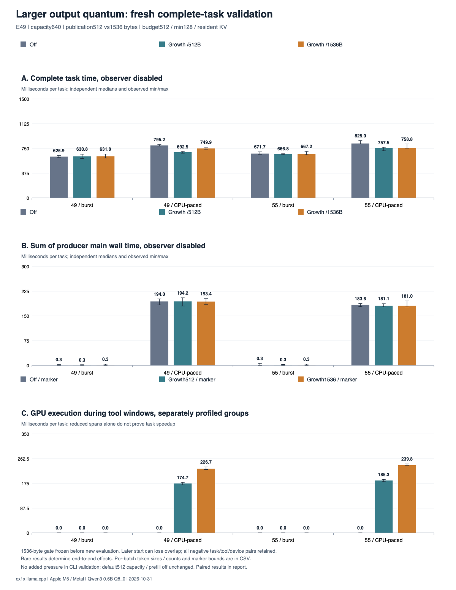

| E49 words | Iterations | Baseline | Candidate | Task saving median [min,max] ms | Faster /7 | Tool wall saving median ms | Final prefill saving median ms |
| --- | --- | --- | --- | --- | --- | --- | --- |
| 49 | 0 | off-coalesce-bare | progress-coalesce-bare | -3.047 [-41.983,32.632] | 3 | -0.161 | -0.367 |
| 49 | 0 | progress-coalesce-bare | progress-coarse-bare | -3.567 [-34.783,32.510] | 2 | -1.525 | -0.978 |
| 49 | 0 | off-coalesce-bare | progress-coarse-bare | -2.502 [-43.967,30.967] | 2 | -1.534 | -1.345 |
| 49 | 0 | progress-coalesce-notify | progress-coarse-notify | 2.025 [-34.457,31.250] | 4 | 1.073 | 1.735 |
| 49 | 0 | off-coalesce-notify | progress-coarse-notify | -4.749 [-37.609,47.497] | 2 | 0.606 | -4.581 |
| 49 | 10000000 | off-coalesce-bare | progress-coalesce-bare | 104.276 [92.344,125.506] | 7 | -3.276 | 160.061 |
| 49 | 10000000 | progress-coalesce-bare | progress-coarse-bare | -54.667 [-75.754,-45.683] | 0 | -2.559 | 25.716 |
| 49 | 10000000 | off-coalesce-bare | progress-coarse-bare | 45.908 [26.977,71.985] | 7 | -3.727 | 186.750 |
| 49 | 10000000 | progress-coalesce-notify | progress-coarse-notify | -33.554 [-53.440,-23.421] | 0 | -4.997 | 44.237 |
| 49 | 10000000 | off-coalesce-notify | progress-coarse-notify | 84.509 [81.134,101.791] | 7 | -9.639 | 227.948 |
| 55 | 0 | off-coalesce-bare | progress-coalesce-bare | 6.187 [-4.611,28.209] | 6 | 0.174 | 6.728 |
| 55 | 0 | progress-coalesce-bare | progress-coarse-bare | -5.492 [-47.290,15.938] | 3 | 0.015 | -1.708 |
| 55 | 0 | off-coalesce-bare | progress-coarse-bare | 2.768 [-39.095,44.147] | 4 | 0.189 | -4.664 |
| 55 | 0 | progress-coalesce-notify | progress-coarse-notify | 11.645 [-21.419,35.654] | 5 | 1.262 | 9.334 |
| 55 | 0 | off-coalesce-notify | progress-coarse-notify | 8.714 [-43.288,61.951] | 4 | -0.306 | 2.624 |
| 55 | 10000000 | off-coalesce-bare | progress-coalesce-bare | 67.290 [56.796,154.939] | 7 | 2.469 | 153.298 |
| 55 | 10000000 | progress-coalesce-bare | progress-coarse-bare | -3.009 [-59.735,10.336] | 1 | 1.175 | 63.708 |
| 55 | 10000000 | off-coalesce-bare | progress-coarse-bare | 65.197 [6.830,113.896] | 7 | -2.574 | 218.048 |
| 55 | 10000000 | progress-coalesce-notify | progress-coarse-notify | -41.392 [-54.548,-20.422] | 0 | 0.597 | 37.404 |
| 55 | 10000000 | off-coalesce-notify | progress-coarse-notify | 52.634 [36.727,83.787] | 7 | -1.580 | 206.291 |

The larger-quantum attempt fails the fresh validation. Bare paced tasks regress54.667/3.009ms versus old growth (0/7 and1/7 faster); burst medians also regress3.567/5.492ms. Marker-paced runs have42 batches in both policies: evaluated stream tokens9240→11970 and cumulative GPU spans2518.927→3274.296ms. Three-call paired median join cost grows82.889/73.485ms while final prefill saves25.716/63.708ms. Group medians are not additive; actual matched tasks determine the result. Later start and more work per batch cost more than the saved final prefill. Default keeps the old gate;1536 remains an explicit experimental option, not an improvement claim.

Functional acceptance: E47 has63 sanitizer cases/48 actual CLI tasks; E48 has96 sanitizer samples and8 fresh shapes; E49 has72 cases/48 CLI tasks plus final640-capacity14K Native, strict Stream and default C/HTTP/CLI regression. Operator-grade frequency/occupancy/bandwidth/preemption attribution and Windows/CUDA remain unvalidated. New code does not relabel old performance revisions.

Detailed [decode batches](data/metal-batches.csv), [fixed-shape samples](data/device-isolation-samples.csv), [pressure/shape contrasts](data/device-isolation-pairs.csv), [all CLI pairs](data/metal-pairs.csv) and [wait partitions](data/metal-waits.csv) retain warmup, raw labels, interval bounds and all negatives. Main records and command/wait/batch auxiliary rows are counted separately.

## L01 · historical observations (reported only)

The earlier external-service concurrency, context-budget marker fixture, and memcpy timings are retained in [L01](../evidence/legacy-observations-20261020.json). Their original CSV/raw timing samples are unavailable, so they do not support the headline optimization claims. Concurrency p50/p95 values are historical reported figures, not recalculated tail estimates. The marker fixture measures retrieval coverage and budget, not answer accuracy. The concurrency-snapshot document was a design only and was never run.

| Concurrency | OK / requests | Wall s | Reported p50 / p95 s | Reported req/s |
| --- | --- | --- | --- | --- |
| 1 | 2 / 2 | 3.05 | 1.34 / 1.7 | 0.657 |
| 2 | 4 / 4 | 3 | 1.44 / 1.56 | 1.332 |
| 4 | 16 / 16 | 6.98 | 1.43 / 2.39 | 2.292 |
| 8 | 16 / 16 | 4.22 | 1.45 / 1.69 | 3.793 |
| 16 | 32 / 32 | 4.59 | 1.62 / 2.49 | 6.97 |
| 32 | 64 / 64 | 4.85 | 1.88 / 2.72 | 13.191 |

| Budget fixture (12 files, 10136 bytes) | Markers found / 8 | Worst budget bytes | Noise |
| --- | --- | --- | --- |
| ls | 0 / 8 | no finite budget | — |
| read_all | 8 / 8 | 8192 | 7 |
| grep_hits | 8 / 8 | 96 | 0 |

| Copy microbenchmark bytes | Reported approximate ns/op |
| --- | --- |
| 16 | 1.5 |
| 64 | 1.1 |
| 512 | 4.6 |
| 4096 | 35 |

## Reproduce and publish

No model or network is needed to recompute this report from the archived evidence:

```sh
python3 tools/build_benchmark_report.py --check
python3 tools/build_benchmark_report.py
# Optional: ReportLab + macOS sips for SVG/PNG charts
python3 tools/render_benchmark_figures.py
```

See [METHODOLOGY.md](METHODOLOGY.md) for model rerun commands and exclusions, [PUBLISHING.md](PUBLISHING.md) for release/privacy, [catalog.json](data/catalog.json) for hashes, and [run-inventory.json](data/run-inventory.json) for official/superseded runs. Follow the [maintenance workflow](MAINTENANCE.md) and [change record](CHANGELOG.md). Report generation is offline; E13–E49 were measured separately. No GitHub push.
