# cxf × llama.cpp — 测试成果汇总

[English](README.md) · [当前适配](../adaptation-status.md) · [测试方法](METHODOLOGY.md) · [全部指标](data/metrics.csv) · [原始记录](data/raw-records.jsonl) · [验收矩阵](data/validation.csv)

归档日期：2026-10-31。这是一组单机兼容性与调度实验，Qwen3 0.6B 用作验证载体。

已经观测到的收益集中在减少前端重复工作、共享规范前缀，以及把本地工作与输入到达重叠执行。收益依赖场景；尚未证明整体进程内存、自主编程能力或 Windows/CUDA 性能改善。

## 关键结果

| 实验 | 同组对照 | 观测结果 | 范围 |
| --- | --- | --- | --- |
| E49 | off → existing growth; paced tools | 104.276 / 67.290 ms paired task savings | 两负载各7对且全快；脚本选动作，KV常驻。 |
| E49 | growth → 1536-byte coarse trial | 54.667 / 3.009 ms paired task regressions | 失败优化，默认不变；下文保留突发和marker负结果。 |
| E47 | off → thread-only control | 1868.877 ms worst task regression | 工具窗没有GPU预填充，工具／系统波动仍未解决。 |
| E09 | normalized_json → jinja_values | 511.7 → 141.3 KiB temporary heap | 14504 个逻辑 token，n=3；绝对量约370 KiB，RSS未下降。 |
| E07–09 | 8 branches × 6,000-token prefix | 48,000 logical → 6,000 stored IDs | 共享token块池，物理KV另计。 |
| E46 | batch capacity 1024 → 640 | 597.50 → 373.44 MiB Metal compute reservation | 默认512为298.75MiB；KV仍896MiB，速度可能回退。 |

上表分别标明任务配对收益／回退、最差负对与分配测量；下文保留全部对照和观测范围。图中须线是范围，不是置信区间；不同阶段收益不能相加或连乘。

## 环境与证据范围

| 组件 | 已记录配置 |
| --- | --- |
| Host | Apple M5 · 16 GiB unified memory · macOS arm64 · Metal |
| llama.cpp | `b10938` · `f1e44dcc11d8802d107bd7331a3d3fd3e6f57b93` |
| Model | `Qwen3-0.6B-Q8_0.gguf` · 654,302,880 file bytes |
| Model SHA-256 | `710d7b1aa4e2ae03238a9e65e82f48cfa70edf501becae8979c35acf5830e1ed` |
| Template SHA-256 | `57f1fd00f0013a2be96aa79b857391f27e23df5b5f847072b524c897e24d0361` |
| Execution | 4 CPU threads · batch 512 · FP16 KV · warm runs |
| KV allocation | E01–02: 3328 tokens / 364 MiB; E05–06, E10–11, E13–19: 8192 / 896 MiB; E07–09: 16384 / 1792 MiB |

下表索引 50 份证据。其中 46 份共含 35520 条原始记录，包含元数据、正确性、文件时间线和耗时估算样本，**不等于 35520 个独立延迟样本**。功能验收、脱敏摘要与仅文档读数分开。源码哈希对应各自实测版本。

| ID | 实验 | 证据等级 | 记录数 |
| --- | --- | --- | --- |
| E01 | [Direct libllama: prefix, stream, fork, state](../evidence/llama-context-direct-20261030.json) | raw | 61 |
| E02 | [Direct libllama: slow token arrivals](../evidence/llama-context-slow-stream-20261030.json) | raw_source_unrecorded | 13 |
| E03 | [Native context correctness](../evidence/llama-context-v1-20261030.json) | functional | 0 |
| E04 | [Native chat, tools, CLI and model probes](../evidence/llama-chat-v1-20261030.json) | functional | 0 |
| E05 | [Chat checkpoint compatibility](../evidence/llama-chat-compat-20261030.json) | raw | 20 |
| E06 | [Template preparation cache](../evidence/llama-template-cache-20261030.json) | raw | 40 |
| E07 | [Temporary lifetimes and shared prefix audit](../evidence/context-memory-20261030.json) | raw | 99 |
| E08 | [Borrowed messages versus request JSON](../evidence/direct-messages-20261030.json) | raw | 99 |
| E09 | [Direct Jinja values and bounded tokenizer](../evidence/jinja-values-20261030.json) | raw | 99 |
| E10 | [Asynchronous KV restoration](../evidence/kv-worker-20261030.json) | raw | 92 |
| E11 | [Streaming prefill and complete-file tools](../evidence/stream-pipeline-20261030.json) | raw | 191 |
| E12 | [Historical autonomous repair failures](../evidence/basic-agent-probes-20261030.json) | sanitized_summary | 0 |
| E13 | [Calibrated warm-prefill time estimation](../evidence/cost-estimator-20261030.json) | raw | 161 |
| E14 | [Roofline hardware proxies versus empirical estimates](../evidence/roofline-estimator-20261030.json) | raw | 195 |
| E15 | [Roofline diagnosis, dependent-graph rates and operator correction](../evidence/roofline-diagnosis-20261030.json) | raw | 278 |
| E16 | [Batch/context diagnosis and shape interpolation negative result](../evidence/cost-shapes-20261030.json) | raw | 916 |
| E17 | [Time interpolation on new batch/context shapes](../evidence/cost-shapes-v2-20261030.json) | raw | 916 |
| E18 | [Incomplete frozen-calibration run: cap64 setup rejection](../evidence/frozen-calibration-incomplete-20261030.json) | raw_incomplete | 849 |
| E19 | [Frozen calibration: coverage, objective, residual basis and new batches](../evidence/frozen-calibration-20261030.json) | raw | 1162 |
| E20 | [Optional residual Kalman: fresh timings and prequential C replay](../evidence/kalman-cost-20261031.json) | raw | 1162 |
| E21 | [Actual tool-window EWMA prefill and KV restoration](../evidence/tool-prepare-20261031.json) | raw | 931 |
| E22 | [Restore attribution: process launch, timer, queue and completion](../evidence/restore-timing-20261031.json) | raw | 547 |
| E23 | [Spawn and parent-progress ETA on new real-tool fixtures](../evidence/restore-balance-20261031.json) | raw | 979 |
| E24 | [Complete task audit, callback control and early snapshot release](../evidence/tool-taskcost-20261031.json) | raw | 659 |
| E25 | [Snapshot unlink and last-close resource isolation](../evidence/tool-isolate-20261031.json) | raw | 227 |
| E26 | [First executable launch and incremental-build task validation](../evidence/tool-launch-20261031.json) | raw | 167 |
| E27 | [Normal resident KV six-turn actual-tool Native flow](../evidence/resident-flow-20261031.json) | raw | 199 |
| E28 | [Resident streaming from an actual local process, no sleep gaps](../evidence/resident-stream-20261031.json) | raw | 87 |
| E29 | [Actual agentctl resident tool-output prefill off/on](../evidence/tool-output-cli-20261031.json) | raw | 515 |
| E30 | [Adaptive resident tool-output observation gate](../evidence/tool-output-adaptive-20261031.json) | raw | 515 |
| E31 | [Matched output strategies and thread/token controls](../evidence/tool-output-isolation-20261031.json) | raw | 1283 |
| E32 | [Output-growth gate on new matched tasks](../evidence/tool-output-progress-20261031.json) | raw | 771 |
| E33 | [Producer CPU, EOF reaping and worker attribution](../evidence/tool-output-reap-20261031.json) | raw | 1027 |
| E34 | [Exit-event wait on fresh matched tasks](../evidence/tool-output-event-20261031.json) | raw | 1539 |
| E35 | [Exit-in-progress bounded retry on fresh tasks](../evidence/tool-output-race-20261031.json) | raw | 1283 |
| E36 | [Same-load dormant/thread/token/prefill and CPU isolation](../evidence/tool-output-contention-20261031.json) | raw | 1283 |
| E37 | [Lazy output-consumer launch on fresh tasks](../evidence/tool-output-lazy-20261031.json) | raw | 771 |
| E38 | [Decode/sync spans and runnable scheduler isolation](../evidence/tool-output-decode-20261031.json) | raw | 1123 |
| E39 | [Deferred internal sync on fresh tasks](../evidence/tool-output-drain-20261031.json) | raw | 1123 |
| E40 | [Producer CPU supply with model absent or idle](../evidence/model-idle-20261031.json) | raw | 211 |
| E41 | [CPU supply after streaming model tasks](../evidence/model-idle-stream-20261031.json) | raw | 211 |
| E42 | [Metal command execution, queue overlap and host return](../evidence/tool-output-metal-20261031.json) | raw | 1539 |
| E43 | [Completion marker and observer overhead controls](../evidence/tool-output-notify-20261031.json) | raw | 1539 |
| E44 | [Bounded tail-batch coalescing on new tasks](../evidence/tool-output-coalesce-20261031.json) | raw | 1539 |
| E45 | [Matched sustained tail: GPU, completion and host return](../evidence/tool-output-tailwait-20261031.json) | raw | 1539 |
| E46 | [Rotating capacity512/640/1024 controls on fresh tasks](../evidence/tool-output-capacity-20261031.json) | raw | 4095 |
| E47 | [Same-capacity thread/token/GPU tool isolation](../evidence/tool-output-contention640-20261031.json) | raw | 1539 |
| E48 | [Fixed-shape native CPU versus memory pressure](../evidence/device-isolation-20261031.json) | raw | 387 |
| E49 | [Larger publication quantum on fresh actual tasks](../evidence/tool-output-coarse640-20261031.json) | raw | 1539 |
| L01 | [Earlier service, budget and copy observations](../evidence/legacy-observations-20261020.json) | reported_only | 0 |

## E01–02 · 直接 API 可行性

E01 从相同的 2048-token 暖前缀出发，六次各追加 128 token。主要基线是已有前缀复用的 `cached_scan`。`cold` 故意重复计算全部历史，只是上界对照。

| Mode | Frontend ms | Total ms | Tokenized | Evaluated | n |
| --- | --- | --- | --- | --- | --- |
| cold | 6.7 [6.3–9.0] | 3429.6 [3412.8–3478.5] | 14976 | 14976 | 5 |
| cached_scan | 6.4 [5.9–7.7] | 296.7 [288.5–305.9] | 14976 | 768 | 5 |
| explicit_delta | 0.6 [0.5–0.9] | 294.3 [290.3–302.4] | 768 | 768 | 5 |

独立微测中扫描 2688 个 token ID，20000 次循环的每次耗时为 0.649 µs。在这个尺度，避免重复分词与物化比省去扫描更重要。前缀／流式／分支／状态对照的最大 logit 差为 0；修改 token 的负对照产生 15.410506 差值，显式回退后重新匹配全新计算。

| ID / gap | Mode | Local compute ms | After-input ms | Total ms | n |
| --- | --- | --- | --- | --- | --- |
| E01 / 0 ms | wait_all | 171.2 [165.1–176.3] | 171.2 [165.1–176.3] | 171.2 [165.1–176.3] | 5 |
| E01 / 0 ms | coalesced_128 | 167.6 [164.5–174.3] | 167.6 [164.5–174.3] | 167.6 [164.5–174.3] | 5 |
| E01 / 0 ms | eager_32 | 383.6 [372.4–389.2] | 383.6 [372.4–389.2] | 383.6 [372.4–389.2] | 5 |
| E01 / 20 ms | wait_all | 163.0 [161.2–178.6] | 168.4 [166.2–183.6] | 488.4 [486.2–503.6] | 5 |
| E01 / 20 ms | coalesced_128 | 188.6 [187.0–192.7] | 51.6 [49.0–55.1] | 371.6 [369.0–375.1] | 5 |
| E01 / 20 ms | eager_32 | 379.2 [376.0–392.5] | 84.2 [78.4–96.7] | 404.2 [398.4–416.7] | 5 |
| E02 / 200 ms | wait_all | 181.6 [169.6–184.3] | 186.6 [170.3–187.4] | 3386.6 [3370.3–3387.4] | 3 |
| E02 / 200 ms | coalesced_128 | 193.9 [180.7–210.8] | 58.6 [48.4–61.6] | 3258.6 [3248.4–3261.6] | 3 |
| E02 / 200 ms | eager_32 | 382.4 [376.7–388.0] | 28.7 [28.4–28.8] | 3228.7 [3228.4–3228.8] | 3 |

这里回放的是已经分词的输入：512 个新 token，每段 32 个。不含云端传输、聊天模板或生成。E02 保留原始样本，但没有当时的源码哈希／快照。无输入间隔时，32-token 急切解码比等待慢 2.24 倍。较长输入窗口有利于隐藏准备工作，但绝对节省量仍受关键路径限制。

| Operation | Time ms / bytes | n |
| --- | --- | --- |
| Share 2048-token prefix (`seq_cp`) | 0.058 [0.054–0.093] | 5 |
| Recompute same prefix | 436.0 [431.6–439.8] | 5 |
| Shared prefix + 128-token suffix | 48.1 [44.9–49.2] | 5 |
| Recompute full branch | 482.2 [477.6–484.8] | 5 |
| Export in-memory state | 10.2 [4.7–16.4] | 5 |
| Restore in-memory state | 5.6 [4.5–9.7] | 5 |
| Serialized state size | 234,906,296 bytes (224.024 MiB) | 5 |

前缀共享使用 llama.cpp 已有的同池序列复制 API。内存状态恢复与 E10 文件恢复是不同实验。删除序列没有缩小预分配的 364 MiB KV buffer，实测 RSS 也未下降。

## E05–06 · 聊天前端

每个样本统计六轮工具结果追加。E05 每轮保守重算 3 个边界 token，所以 evaluated 为 606 对 588；模板仍完整渲染历史。E06 进一步缓存已验收模板的解析准备，它是独立的同组对照，不能和 E01 叠加计算。

| ID | Prefix tokens | Mode | Frontend ms | Total ms | Tokenized / evaluated | n |
| --- | --- | --- | --- | --- | --- | --- |
| E05 | 345 | full_cached | 49.0 [34.0–233.0] | 293.7 [267.9–459.7] | 4044 / 588 | 5 |
| E05 | 345 | native_checkpoint | 40.7 [35.2–103.0] | 286.6 [261.9–323.0] | 606 / 606 | 5 |
| E05 | 1225 | full_cached | 41.0 [37.8–41.8] | 360.7 [355.3–368.6] | 9324 / 588 | 5 |
| E05 | 1225 | native_checkpoint | 34.8 [31.2–36.5] | 357.4 [346.8–362.8] | 606 / 606 | 5 |
| E06 | 345 | full_cached_control_0 | 62.2 [50.9–92.5] | 310.7 [282.8–336.8] | 4044 / 588 | 5 |
| E06 | 345 | full_cached_control_1 | 51.3 [48.4–73.5] | 303.5 [282.1–310.8] | 4044 / 588 | 5 |
| E06 | 345 | native_checkpoint | 55.4 [40.8–122.4] | 313.1 [277.4–363.0] | 606 / 606 | 5 |
| E06 | 345 | native_prepare_cache | 9.1 [7.6–11.2] | 261.0 [240.0–264.6] | 606 / 606 | 5 |
| E06 | 1225 | full_cached_control_0 | 55.6 [39.1–188.5] | 385.6 [313.8–523.7] | 9324 / 588 | 5 |
| E06 | 1225 | full_cached_control_1 | 60.7 [49.2–82.9] | 390.6 [334.4–415.0] | 9324 / 588 | 5 |
| E06 | 1225 | native_checkpoint | 46.5 [33.9–142.6] | 376.8 [307.8–468.9] | 606 / 606 | 5 |
| E06 | 1225 | native_prepare_cache | 9.0 [7.4–23.3] | 347.5 [313.6–365.9] | 606 / 606 | 5 |

E05 尚不能证明稳定的整体提速。E06 的 1225-token 档前端中位数下降 80.7%，总耗时中位数下降 7.8%（376.843→347.468 ms），观测范围仍重叠。这是暖态准备耗时，不是完整生成 TTFT。

## E07–09 · 上下文存储与临时内存

规范 token 历史存于一个 cxf 块池，分支引用共享前缀。原始文本、token ID 与 KV 是不同的必要表示，不能宣称整条链路只有一份物理数据。14504 个逻辑 token 对应实际保存 14511 个 ID（含 7 个边界尾部 ID）、59392 字节 token 容量与 65260 字节 cxf 分配。

| State | Logical token references | Stored IDs | Token capacity bytes | cxf bytes | New decode tokens |
| --- | --- | --- | --- | --- | --- |
| 8 shared branches | 48000 | 6000 | 24576 | 30444 | 0 |
| Each appends 32 tokens | 48256 | 6256 | 31744 | 37612 | 256 |
| All sessions closed | 0 | 0 | 0 | 0 | — |

48000 个引用可放在共享的 16K 池中；没有实测八套独立 KV 分配作为对照。16K FP16 KV 池仍为 1792 MiB（该模型每个配置 token 为 112 KiB）。token 存储远小于 KV。

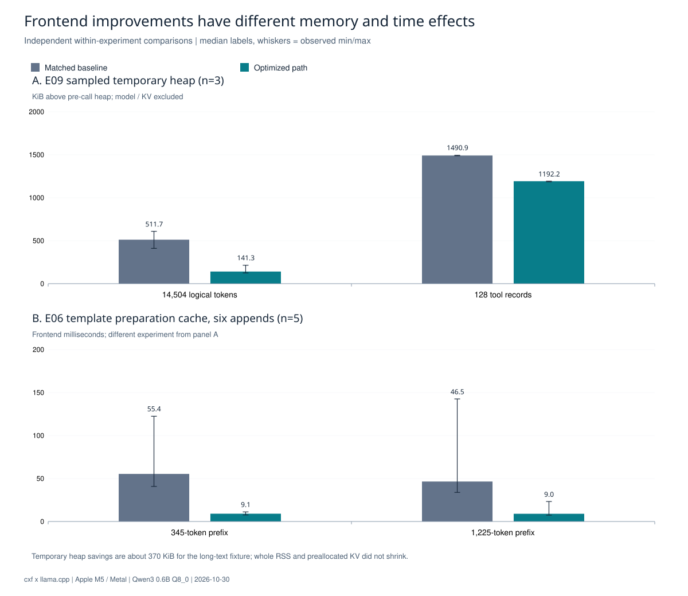

临时堆 = max(0，prepare 调用中的采样进程 malloc 峰值 − 调用前堆)。macOS 以 200 µs 采样并插入阶段探针，可能漏掉短峰值；n=3、暖态重复准备。不含已存在的模型／KV，不是完整请求峰值或显存。内存与计时分开采样。

### E07

提前释放请求／DOM／消息临时对象。

| Shape / size | Result | Mode | Extra heap KiB | Prepare wall ms | n |
| --- | --- | --- | --- | --- | --- |
| single_text / 1024 | OK | old_lifetimes | 49.7 [49.6–72.3] | 11.2 [10.7–13.4] | 3 |
| single_text / 1024 | OK | early_release | 74.6 [48.4–75.5] | 12.8 [11.7–13.0] | 3 |
| single_text / 4096 | OK | old_lifetimes | 200.2 [133.5–210.1] | 20.5 [20.0–25.0] | 3 |
| single_text / 4096 | OK | early_release | 172.7 [111.4–180.5] | 20.5 [19.0–99.6] | 3 |
| single_text / 7168 | OK | old_lifetimes | 214.7 [214.6–319.8] | 23.3 [22.6–23.9] | 3 |
| single_text / 7168 | OK | early_release | 205.2 [175.0–328.7] | 24.3 [23.9–25.3] | 3 |
| single_text / 14336 | OK | old_lifetimes | 591.9 [590.4–971.2] | 36.7 [35.1–37.5] | 3 |
| single_text / 14336 | OK | early_release | 324.9 [316.2–801.4] | 37.2 [36.9–38.5] | 3 |
| single_text / 16384 | FULL (expected rejection) | old_lifetimes | 2707.8 [2600.2–2707.8] | not timed | 3 |
| single_text / 16384 | FULL (expected rejection) | early_release | 2466.0 [2306.0–2466.0] | not timed | 3 |
| single_text / 65536 | FULL (expected rejection) | old_lifetimes | 10355.8 [10355.8–10867.8] | 46.3 [45.7–51.4] | 3 |
| single_text / 65536 | FULL (expected rejection) | early_release | 9154.0 [9154.0–9154.0] | 49.1 [46.8–50.1] | 3 |
| tool_turns / 16 | OK | old_lifetimes | 262.6 [262.4–266.2] | not timed | 3 |
| tool_turns / 16 | OK | early_release | 238.8 [233.8–239.7] | not timed | 3 |
| tool_turns / 128 | OK | old_lifetimes | 1786.2 [1785.2–1823.4] | 37.3 [35.9–38.0] | 3 |
| tool_turns / 128 | OK | early_release | 1595.0 [1581.5–1609.7] | 36.7 [36.4–37.1] | 3 |
| tool_turns / 512 | FULL (expected rejection) | old_lifetimes | 6990.2 [6927.7–7313.7] | 113.9 [112.7–114.2] | 3 |
| tool_turns / 512 | FULL (expected rejection) | early_release | 6280.9 [6185.7–6468.3] | 114.3 [108.8–118.8] | 3 |

### E08

借用消息；基线已经提前释放临时对象。

| Shape / size | Result | Mode | Extra heap KiB | Prepare wall ms | n |
| --- | --- | --- | --- | --- | --- |
| single_text / 1024 | OK | request_json | 46.5 [27.1–51.3] | 11.8 [11.8–13.3] | 3 |
| single_text / 1024 | OK | direct_messages | 51.0 [26.6–57.9] | 12.8 [11.4–14.1] | 3 |
| single_text / 4096 | OK | request_json | 146.1 [132.6–277.4] | 22.7 [19.8–23.3] | 3 |
| single_text / 4096 | OK | direct_messages | 121.2 [47.5–127.3] | 21.6 [21.4–22.6] | 3 |
| single_text / 7168 | OK | request_json | 194.4 [183.8–225.7] | 30.1 [28.3–31.9] | 3 |
| single_text / 7168 | OK | direct_messages | 174.0 [67.8–393.0] | 30.8 [28.7–31.7] | 3 |
| single_text / 14336 | OK | request_json | 304.6 [304.6–330.6] | 36.0 [34.8–44.4] | 3 |
| single_text / 14336 | OK | direct_messages | 321.9 [203.7–681.0] | 41.5 [35.9–47.8] | 3 |
| single_text / 16384 | FULL (expected rejection) | request_json | 2338.0 [2290.0–2370.0] | not timed | 3 |
| single_text / 16384 | FULL (expected rejection) | direct_messages | 2664.7 [2337.7–2664.7] | not timed | 3 |
| single_text / 65536 | FULL (expected rejection) | request_json | 10825.1 [10130.0–10825.1] | 73.8 [49.6–126.6] | 3 |
| single_text / 65536 | FULL (expected rejection) | direct_messages | 10129.7 [10129.7–10129.7] | 77.4 [62.1–79.8] | 3 |
| tool_turns / 16 | OK | request_json | 238.9 [231.7–244.9] | not timed | 3 |
| tool_turns / 16 | OK | direct_messages | 226.8 [219.5–234.6] | not timed | 3 |
| tool_turns / 128 | OK | request_json | 1594.4 [1585.0–1680.9] | 47.4 [42.2–52.3] | 3 |
| tool_turns / 128 | OK | direct_messages | 1493.2 [1486.5–1588.9] | 45.7 [45.7–86.4] | 3 |
| tool_turns / 512 | FULL (expected rejection) | request_json | 6468.8 [6259.8–6581.7] | 126.6 [112.2–144.2] | 3 |
| tool_turns / 512 | FULL (expected rejection) | direct_messages | 5923.0 [5858.1–6261.7] | 114.2 [104.1–117.1] | 3 |

### E09

直接 Jinja 值、直接输出收集、有界分词缓冲的组合改动。

| Shape / size | Result | Mode | Extra heap KiB | Prepare wall ms | n |
| --- | --- | --- | --- | --- | --- |
| single_text / 1024 | OK | normalized_json | 59.5 [50.6–62.2] | 11.1 [10.7–11.4] | 3 |
| single_text / 1024 | OK | jinja_values | 58.1 [34.2–60.9] | 10.9 [10.5–11.0] | 3 |
| single_text / 4096 | OK | normalized_json | 122.6 [81.7–237.0] | 17.9 [17.5–18.8] | 3 |
| single_text / 4096 | OK | jinja_values | 56.9 [53.9–73.3] | 18.3 [17.9–19.6] | 3 |
| single_text / 7168 | OK | normalized_json | 67.1 [66.6–417.0] | 22.0 [21.7–22.1] | 3 |
| single_text / 7168 | OK | jinja_values | 84.0 [79.5–171.1] | 22.1 [21.5–23.6] | 3 |
| single_text / 14336 | OK | normalized_json | 511.7 [410.8–608.9] | 34.6 [34.3–34.7] | 3 |
| single_text / 14336 | OK | jinja_values | 141.3 [125.0–214.4] | 35.1 [34.9–36.8] | 3 |
| single_text / 16384 | FULL (expected rejection) | normalized_json | 2280.7 [1896.7–2465.7] | not timed | 3 |
| single_text / 16384 | FULL (expected rejection) | jinja_values | 1960.7 [1960.7–2433.7] | not timed | 3 |
| single_text / 65536 | FULL (expected rejection) | normalized_json | 10129.7 [10129.7–10824.7] | 48.9 [46.2–50.0] | 3 |
| single_text / 65536 | FULL (expected rejection) | jinja_values | 10193.7 [10193.7–10888.7] | 47.3 [45.6–49.7] | 3 |
| tool_turns / 16 | OK | normalized_json | 220.4 [218.5–220.9] | not timed | 3 |
| tool_turns / 16 | OK | jinja_values | 186.2 [180.0–190.0] | not timed | 3 |
| tool_turns / 128 | OK | normalized_json | 1490.9 [1487.7–1493.7] | 35.6 [35.3–35.8] | 3 |
| tool_turns / 128 | OK | jinja_values | 1192.2 [1184.7–1192.8] | 37.1 [35.6–37.6] | 3 |
| tool_turns / 512 | FULL (expected rejection) | normalized_json | 5939.8 [5859.3–6010.6] | 118.6 [102.7–129.7] | 3 |
| tool_turns / 512 | FULL (expected rejection) | jinja_values | 4671.8 [4666.8–4766.6] | 119.3 [103.1–130.1] | 3 |

single_text 的 size 是夹具单词数，不是实际模型 token 数；tool_turns 是工具记录条数。FULL 行是被拒绝输入，不能算成功长上下文验收。E08 长文本临时堆反而增加（304.6→321.9 KiB）；E09 的 7.3K-token 档也增加（67.1→84.0 KiB），64K-word 拒绝档多占 64 KiB 缓冲。E09 长文本准备耗时 34.581→35.085 ms，没有稳定的整体提速。整体 RSS 约 2480 MiB，72.4% 降幅仅涉及约 370 KiB 的临时堆。

## E10 · 提前恢复 KV

同一前缀被逻辑逐出后，从私有序列文件恢复。`late_hint` 在上下文装配后恢复；`early_hint` 与装配／受控等待重叠。每种模式 n=7；同一存活引擎、会话、修订号与 token 池，快照 token_count=0。OS 文件缓存暖态，不是冷 SSD 基准。

| Words / new tools / history / window | Mode | Assembly ms | Actual overlap ms | After-submit prepare ms | After-submit first token ms | Total first token ms | n |
| --- | --- | --- | --- | --- | --- | --- | --- |
| 4096 / 1 / 0 / 0 ms | late_hint | 0.3 [0.2–0.3] | 0.0 [0.0–0.0] | 41.7 [40.9–57.7] | 80.4 [79.4–98.0] | 80.6 [79.7–98.3] | 7 |
| 4096 / 1 / 0 / 0 ms | early_hint | 0.3 [0.2–0.3] | 0.3 [0.2–0.3] | 42.4 [40.4–47.0] | 81.1 [78.4–86.5] | 81.4 [78.6–86.7] | 7 |
| 1024 / 1 / 128 / 0 ms | late_hint | 12.2 [12.0–13.2] | 0.0 [0.0–0.0] | 71.4 [61.4–98.4] | 123.2 [112.5–161.5] | 135.3 [124.7–173.5] | 7 |
| 1024 / 1 / 128 / 0 ms | early_hint | 12.7 [12.5–44.4] | 12.7 [12.5–44.4] | 51.6 [50.0–134.9] | 113.0 [100.4–242.4] | 125.5 [113.1–286.9] | 7 |
| 1024 / 128 / 0 / 0 ms | late_hint | 12.9 [12.7–16.8] | 0.0 [0.0–0.0] | 12.0 [11.8–14.5] | 2745.0 [2642.0–3111.7] | 2757.8 [2656.5–3124.5] | 7 |
| 1024 / 128 / 0 / 0 ms | early_hint | 13.6 [12.5–15.8] | 11.4 [11.0–13.5] | 0.0 [0.0–0.0] | 2846.1 [2592.2–3232.2] | 2858.6 [2605.0–3246.7] | 7 |
| 4096 / 1 / 0 / 25 ms | late_hint | 0.3 [0.3–0.4] | 0.0 [0.0–0.0] | 48.5 [42.5–66.9] | 100.4 [86.9–126.7] | 129.1 [117.2–157.1] | 7 |
| 4096 / 1 / 0 / 25 ms | early_hint | 0.3 [0.3–0.5] | 28.2 [25.4–30.3] | 26.8 [13.5–44.0] | 72.9 [53.0–84.3] | 98.4 [83.3–113.4] | 7 |
| 4096 / 1 / 0 / 100 ms | late_hint | 0.7 [0.5–0.8] | 0.0 [0.0–0.0] | 62.6 [56.7–87.7] | 107.6 [100.7–131.0] | 213.2 [202.1–236.8] | 7 |
| 4096 / 1 / 0 / 100 ms | early_hint | 0.4 [0.3–0.5] | 51.2 [45.7–58.9] | 0.0 [0.0–0.0] | 43.3 [42.7–46.9] | 147.4 [145.2–148.4] | 7 |
| 4096 / 1 / 0 / 250 ms | late_hint | 0.7 [0.5–3.4] | 0.0 [0.0–0.0] | 81.3 [66.1–103.3] | 127.1 [111.0–148.0] | 380.9 [366.7–402.3] | 7 |
| 4096 / 1 / 0 / 250 ms | early_hint | 0.6 [0.4–0.7] | 60.8 [46.8–73.4] | 0.0 [0.0–0.0] | 45.2 [43.5–48.0] | 298.7 [296.8–301.7] | 7 |

普通装配约 0.26 ms，总延迟未改善（80.635→81.361 ms）。已有密集历史的中位数改善（135.265→125.488 ms），但只有 5/7 对更快，提前组最大值达 286.886 ms。大量新 prefill 的一组反而变慢（2757.792→2858.619 ms）。100 ms 人工窗口中，实际重叠为 51.206 ms [45.734–58.911]。两组恢复耗时本身有波动，总中位数差不能全部归因于重叠。

4257-token 快照为 465.66 MiB，观测保存成本为 59.6–157.6 ms，恢复阶段对照不含这部分。不宣称 fsync 持久化、崩溃恢复、外部快照导入、物理 KV buffer 缩容或自动逐出预测。队列／票据／快照上限和取消／过期修订保护已测试。

## E11 · 流式输入、预填充与文件工具

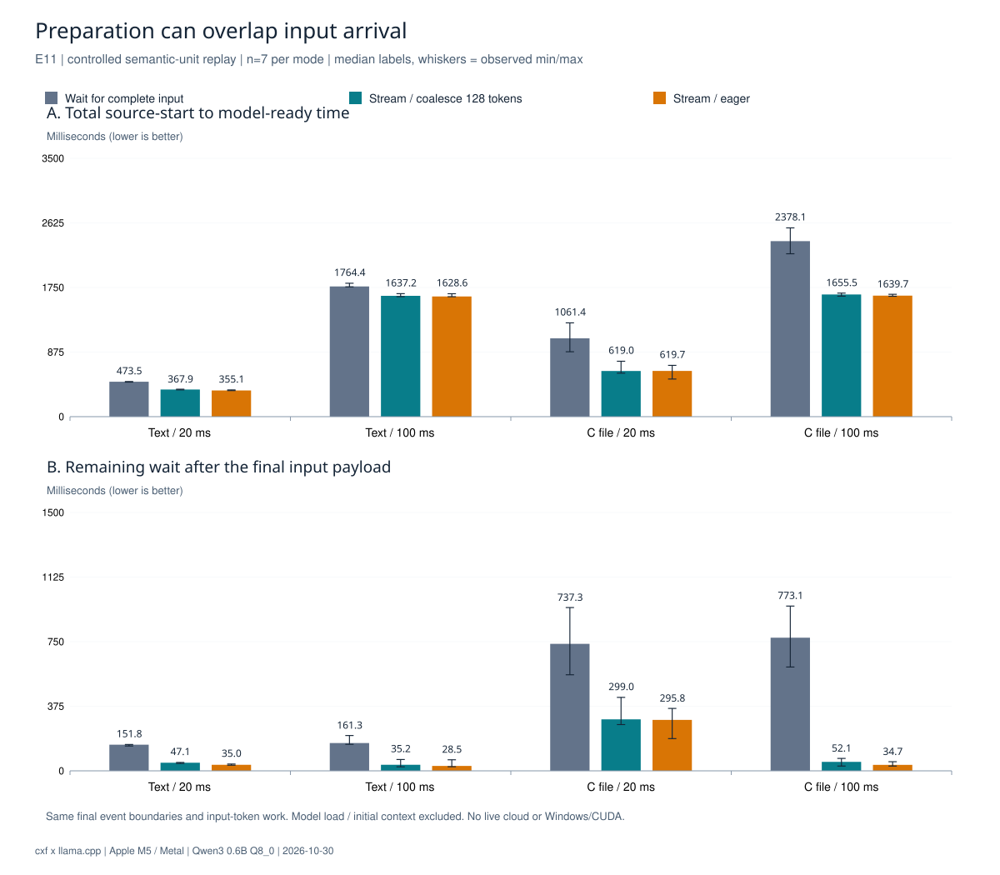

6 个受控场景 × 3 种模式 × 7 次重复 = 126 个计时样本，另有 63 条文件时间线与 2 条状态记录。输入为 16 个不可变语义单元加结束帧，线缆分块不超过 7 字节。结束帧紧跟最后一段，无额外 EOF 间隔。模型加载与初始 538-token 上下文不计入。每段是独立、完整的本地 user-message 单元，不是随意追加进同一消息。

`wait_all`：等完整输入／文件处理后再准备。`stream_coalesced`：完整单元按最小 128-token 批量预填充。`stream_eager`：更小更新即刷新。三种模式的最终事件边界与输入 token 数相同。文件场景先传三段 C 源码、序号 4 的 file_end，再传 12 段文本；部署时固定的测试命令编译并运行完整文件。

| Scenario / gap | Mode | Total ready ms | After-input ready ms | Local prefill ms | Input decode calls | n |
| --- | --- | --- | --- | --- | --- | --- |
| text_prefill / 0 ms | wait_all | 144.0 [139.9–147.3] | 143.9 [139.7–147.2] | 143.0 [138.9–146.2] | 2.0 [2.0–2.0] | 7 |
| text_prefill / 0 ms | stream_coalesced | 145.6 [140.7–159.9] | 145.5 [140.6–159.8] | 144.3 [139.6–158.6] | 2.0 [2.0–3.0] | 7 |
| text_prefill / 0 ms | stream_eager | 148.2 [139.5–159.0] | 148.1 [139.4–158.9] | 147.0 [138.3–157.8] | 3.0 [2.0–3.0] | 7 |
| text_prefill / 20 ms | wait_all | 473.5 [468.1–476.0] | 151.8 [144.2–153.1] | 150.1 [142.4–151.3] | 2.0 [2.0–2.0] | 7 |
| text_prefill / 20 ms | stream_coalesced | 367.9 [363.4–372.2] | 47.1 [43.0–48.7] | 234.0 [211.6–241.2] | 6.0 [6.0–6.0] | 7 |
| text_prefill / 20 ms | stream_eager | 355.1 [353.2–362.6] | 35.0 [32.8–39.5] | 323.4 [318.7–329.6] | 16.0 [16.0–16.0] | 7 |
| text_prefill / 100 ms | wait_all | 1764.4 [1758.5–1807.6] | 161.3 [154.1–205.0] | 159.0 [153.1–201.0] | 2.0 [2.0–2.0] | 7 |
| text_prefill / 100 ms | stream_coalesced | 1637.2 [1625.9–1666.6] | 35.2 [23.3–65.8] | 259.5 [215.2–283.1] | 6.0 [6.0–6.0] | 7 |
| text_prefill / 100 ms | stream_eager | 1628.6 [1625.1–1665.6] | 28.5 [23.9–64.2] | 396.5 [370.0–593.4] | 16.0 [16.0–17.0] | 7 |
| complete_file_test / 0 ms | wait_all | 611.0 [561.6–1262.1] | 610.9 [561.5–1262.0] | 136.5 [127.7–156.4] | 2.0 [2.0–2.0] | 7 |
| complete_file_test / 0 ms | stream_coalesced | 604.8 [468.3–1300.3] | 604.6 [468.1–1300.2] | 154.3 [129.7–194.7] | 2.0 [2.0–3.0] | 7 |
| complete_file_test / 0 ms | stream_eager | 481.6 [438.6–558.9] | 481.5 [438.5–558.9] | 161.8 [142.9–204.8] | 4.0 [3.0–4.0] | 7 |
| complete_file_test / 20 ms | wait_all | 1061.4 [879.5–1271.0] | 737.3 [557.8–948.1] | 135.7 [133.3–143.1] | 2.0 [2.0–2.0] | 7 |
| complete_file_test / 20 ms | stream_coalesced | 619.0 [589.5–751.0] | 299.0 [268.6–426.5] | 164.9 [151.3–176.2] | 3.0 [2.0–3.0] | 7 |
| complete_file_test / 20 ms | stream_eager | 619.7 [509.6–695.1] | 295.8 [187.2–362.4] | 393.0 [297.5–492.4] | 6.0 [6.0–11.0] | 7 |
| complete_file_test / 100 ms | wait_all | 2378.1 [2207.0–2557.7] | 773.1 [602.8–956.7] | 135.9 [134.0–157.3] | 2.0 [2.0–2.0] | 7 |
| complete_file_test / 100 ms | stream_coalesced | 1655.5 [1632.7–1674.0] | 52.1 [27.7–72.1] | 238.2 [216.1–260.1] | 5.0 [4.0–5.0] | 7 |
| complete_file_test / 100 ms | stream_eager | 1639.7 [1631.0–1658.0] | 34.7 [27.7–53.0] | 495.4 [401.6–547.1] | 15.0 [14.0–16.0] | 7 |

100 ms 间隔时，两种流式模式的七次文件工具均在输入结束前完成，wait_all 均未提前完成。20 ms 时工具尚未提前完成，但执行已部分重叠。文本／文件在 20／100 ms 档，合批模式均为 7/7 对更快；七对不能证明 p95/p99 或运行稳定性。无间隔纯文本未改善；无间隔文件波动很大，合批组最大值达 1300.267 ms。

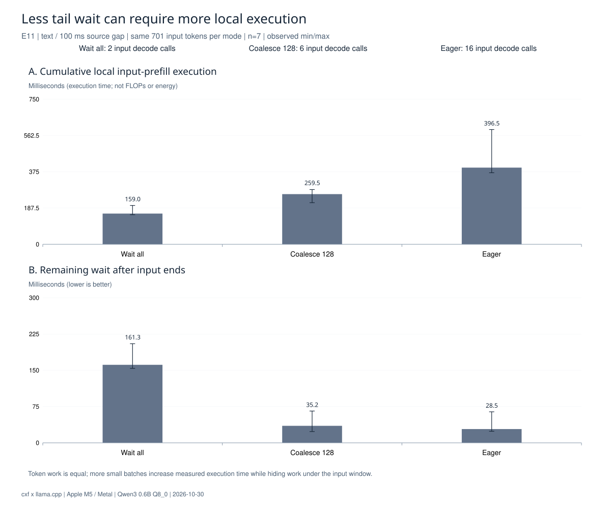

纯文本 100 ms 档三种模式均计算 701 个输入 token。输入 decode 调用由 2→6→16，累计本地 prefill 执行由 158.956→259.494→396.539 ms，同时输入后等待降为 161.341→35.166→28.473 ms。延迟改善伴随更多小批次执行；未测 FLOP／能耗。部分文件／渲染墙钟时间很大且波动，尚未剖析争用原因。

“Ready” 指完整输入、当前有效版本收据和 assistant header 都已形成 KV，尚未进入最终回调。回调包含测试用全量分词 oracle 和最多 16-token 预览；first-token／output 字段含 oracle 开销，不是总结质量或完整生成基准。所有字段仍保留在原始数据与指标 CSV 中。

## 正确性、能力与未验证项

| Category | Result | Evidence / scope |
| --- | --- | --- |
| Native context/chat | PASS | E03–04, E07–11; full-token and greedy oracles, rollback, budgets, failure recovery |
| Scripted tool executor | PASS | E04; read → compile FAIL → write → compile PASS → read; actions supplied by test |
| KV worker / stream | PASS | E10–11; cancellation, stale versions, bounded queues, cleanup, file feedback before end |
| CLI and default regression | PASS | E11; replay 6 cases, native 5 cases, make test; expected nonzero exits are intentional |
| ASan / UBSan | PASS (partial instrumentation) | cxf/adapters instrumented; prebuilt llama/common/Metal libraries excluded |
| Real model: one file read | PASS, n=1 | E04; two calls, receipt-based answer |
| Real model: instructed C repair | FAIL, n=1 | E04; FORMAT at first action, zero tools dispatched |
| Historical HTTP C repair | FAIL, two individual probes | E12; sanitized summaries; earlier protocol, no independently passing final program |
| Windows/CUDA, live cloud SSE, automatic agentctl integration | NOT VALIDATED | Host/replay interfaces only; second machine acceptance pending |
| Physical KV release, cold SSD, tail stability, general coding/summarization | NOT VALIDATED | Do not extrapolate the latency/temporary-heap results |

逐项结果见 [validation.csv](data/validation.csv)。不把模型能力、预期拒绝测试和实现正确性合成一个“总通过率”。

## E13 · 本机耗时测算

独立 C 估算器固定占 3120 字节，用批次调用数、新 token 和 attention-pair 工作量特征估计暖态 prefill。机型／运行时／模型指纹用于隔离 profile，不凭机型填写吞吐；未改变推理或调度行为。

63 条标定：前缀 0/2048/6144 × 新 token 32/128/512 × 7。84 条评价使用不同形状：前缀 0/1024/4096 × 16/64/256/768 × 7。固定 token/s 基线也使用全部标定数据；冻结模型不用评价标签；在线每条先预测再观察。各形状预热、模型加载和前缀建立不计入服务时间。

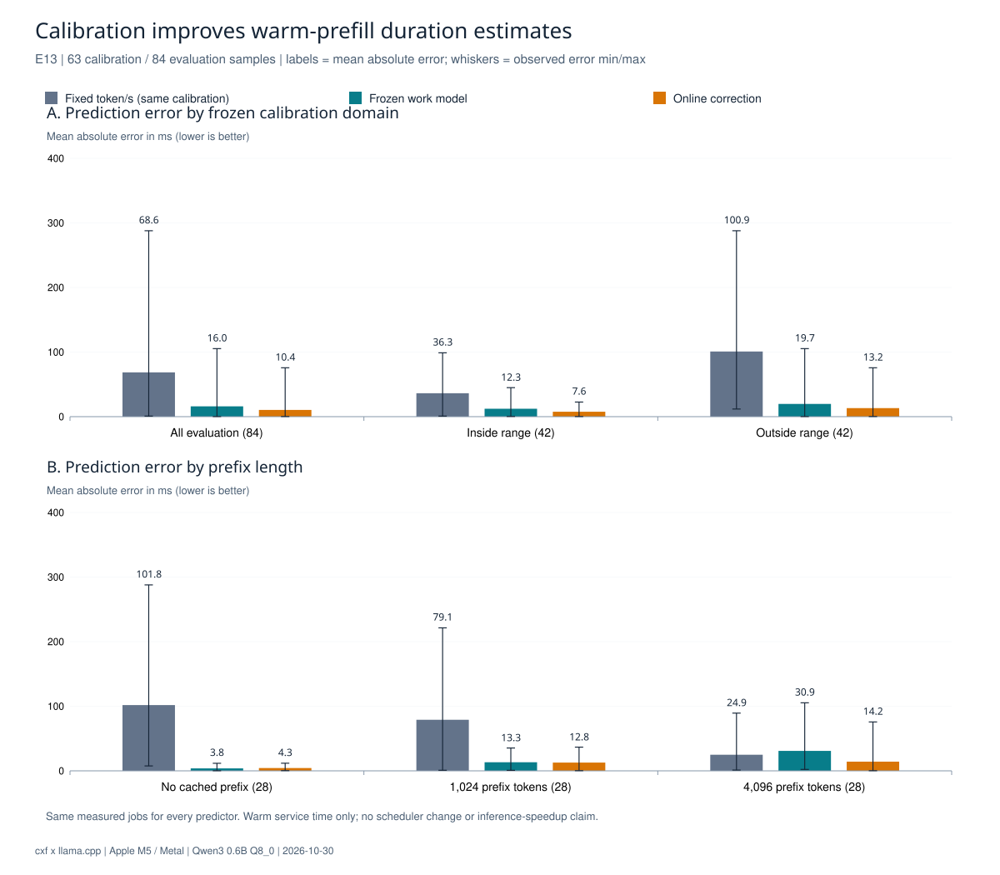

| Mode | Group | n | MAE ms | WAPE % | MAPE % | Max abs error ms | Signed bias ms |
| --- | --- | --- | --- | --- | --- | --- | --- |
| fixed | all | 84 | 68.594 | 65.87 | 82.84 | 287.873 | 46.624 |
| fixed | inside_frozen_domain | 42 | 36.284 | 61.63 | 77.68 | 98.875 | 28.515 |
| fixed | outside_frozen_domain | 42 | 100.904 | 67.55 | 87.99 | 287.873 | 64.734 |
| frozen | all | 84 | 15.991 | 15.36 | 15.77 | 105.359 | 13.649 |
| frozen | inside_frozen_domain | 42 | 12.258 | 20.82 | 20.66 | 44.934 | 11.944 |
| frozen | outside_frozen_domain | 42 | 19.724 | 13.20 | 10.87 | 105.359 | 15.354 |
| online | all | 84 | 10.440 | 10.03 | 14.65 | 75.717 | 4.495 |
| online | inside_frozen_domain | 42 | 7.642 | 12.98 | 17.02 | 22.643 | 6.915 |
| online | outside_frozen_domain | 42 | 13.238 | 8.86 | 12.29 | 75.717 | 2.075 |

MAE 为平均绝对误差；WAPE=绝对误差总和/实际耗时总和；MAPE 为逐样本相对误差的平均。正 bias 表示耗时高估，用于提前量会更早启动。在线纠正会学习先前评价样本，属于先预测后学习；不是全程不接触评价数据。域内只按范围判断，不保证准确；评价中一半超出冻结模型的新 token 范围。

| Prefix | New tokens | Actual ms median [min–max] | Fixed / frozen / online MAE ms | n |
| --- | --- | --- | --- | --- |
| 0 | 16 | 25.3 [20.6–30.9] | 16.12 / 2.81 / 3.00 | 7 |
| 0 | 64 | 22.7 [19.8–27.3] | 12.15 / 4.85 / 6.27 | 7 |
| 0 | 256 | 44.1 [41.0–46.2] | 96.60 / 1.82 / 1.99 | 7 |
| 0 | 768 | 139.3 [131.6–143.1] | 282.36 / 5.69 / 6.04 | 7 |
| 1024 | 16 | 25.3 [24.3–27.7] | 16.99 / 1.48 / 2.79 | 7 |
| 1024 | 64 | 27.2 [26.3–34.1] | 6.37 / 7.57 / 8.12 | 7 |
| 1024 | 256 | 60.7 [58.5–65.2] | 78.31 / 15.64 / 14.73 | 7 |
| 1024 | 768 | 204.8 [198.1–213.3] | 214.55 / 28.48 / 25.45 | 7 |
| 4096 | 16 | 38.0 [35.2–44.5] | 29.88 / 5.59 / 10.40 | 7 |
| 4096 | 64 | 50.4 [46.7–55.5] | 15.97 / 10.73 / 3.65 | 7 |
| 4096 | 256 | 146.1 [134.2–158.2] | 8.31 / 32.93 / 11.10 | 7 |
| 4096 | 768 | 466.5 [434.0–508.9] | 45.52 / 74.31 / 31.74 | 7 |

估算器开销单独测量（10 组，折算每次调用）：

| Operation | µs median [min–max] |
| --- | --- |
| predict | 0.0860 [0.0650–0.2848] |
| observe/refit | 3.3650 [2.6050–24.1900] |

模型结构公式给出每 token 114688 字节（112 KiB）的 FP16 KV payload：28 层×8 KV heads×(128 K+128 V)×2 字节。这是该模型的 payload，不是进程内存。窗口最多 64 条数值观测，无堆分配。仍有较大的最大误差，后续调度必须留余量；误差降低不等于已实测推理加速。冷启动、恢复 I/O、排队、Agent ETA、一般程序复杂度和 Windows/CUDA 均未测算。

独立 C 单测、ASan/UBSan 与默认回归通过；真实模型核对 canonical token、准确新增 token／batch 数，以及 21 种形状的从头 KV greedy 结果。见 [D-COST](../design/cost-estimator-v1.md)，逐条预测与反例保留在 E13。

## E14 · 硬件 Roofline 公式对照

新增可选纯 C 估算器，采用标准 GEMM 的 2MNK 和逐算子 max(F/P, B/BW) Roofline；Qwen3 GGUF 提供实际矩阵尺寸及 Q8_0 字节。新测量沿用 E13 的 63/84 标定／评价网格，每个实测任务同时比较五种预测。E13 保持原样；下面只在 E14 内作比较。

| Same GGML/Metal primitive | Effective rate | Samples |
| --- | --- | --- |
| Q8_0 GEMM K1024 / N3072 / M512 | 1.785 TFLOP/s | 7 |
| F16 GEMM K128 / N4096 / M512 | 0.705 TFLOP/s | 7 |
| 64 MiB copy (read + write) | 37.387 GB/s | 7 |

有效速率来自两轮预热后的同步墙钟微测，不是厂商峰值。GEMM FLOPs 未计量化指令；F16 GEMM 仅代理 attention 吞吐，实际融合 kernel 的利用率和 IO 不同。访存假设每 chunk 一次 KV 读取，省略 norm、RoPE 和激活，因此不是已验证的物理耗时下界。来源：[GEMM](https://docs.nvidia.com/deeplearning/performance/dl-performance-matrix-multiplication/index.html)、[Roofline](https://docs.nvidia.com/nsight-compute/ProfilingGuide/index.html#roofline-charts)、[FlashAttention IO](https://arxiv.org/abs/2205.14135)。

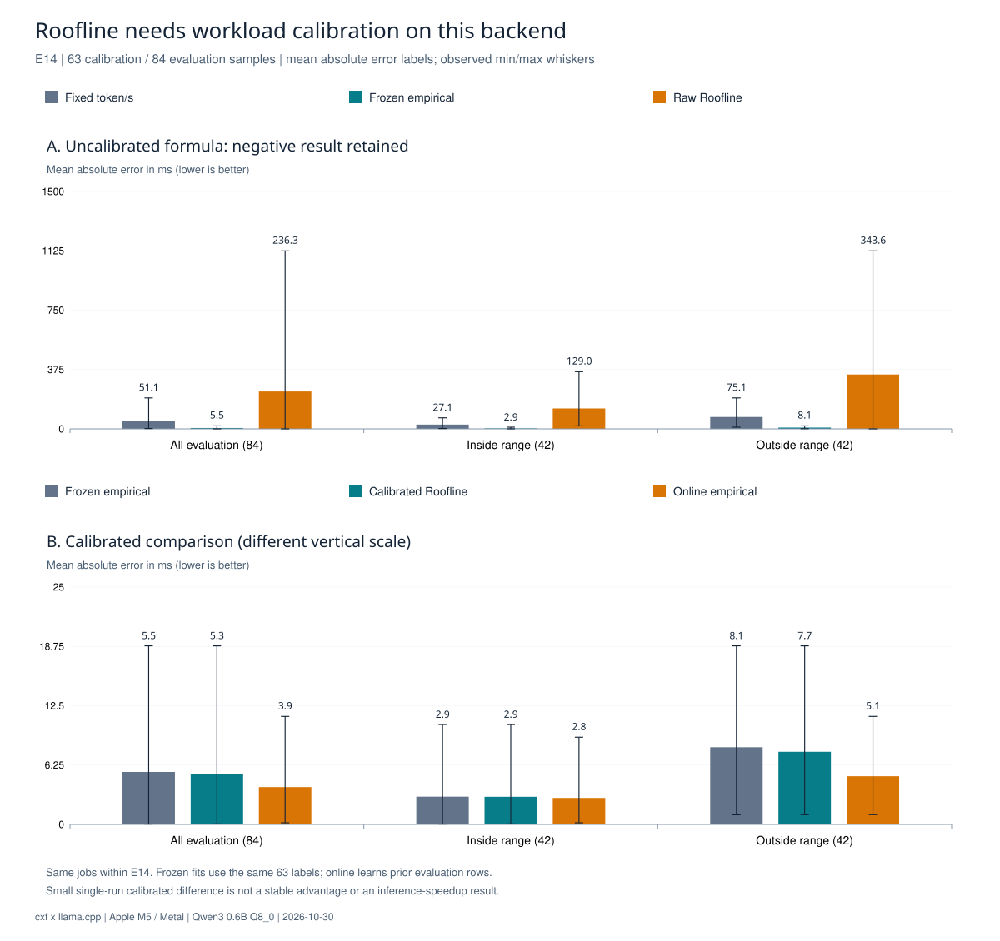

| Mode | Group | n | MAE ms | WAPE % | MAPE % | Max abs error ms | Signed bias ms |
| --- | --- | --- | --- | --- | --- | --- | --- |
| fixed | all | 84 | 51.115 | 58.63 | 72.75 | 195.662 | 24.576 |
| fixed | inside_frozen_domain | 42 | 27.086 | 55.25 | 66.78 | 69.843 | 15.766 |
| fixed | outside_frozen_domain | 42 | 75.144 | 59.95 | 78.71 | 195.662 | 33.385 |
| frozen | all | 84 | 5.526 | 6.34 | 11.08 | 18.811 | 1.194 |
| frozen | inside_frozen_domain | 42 | 2.923 | 5.96 | 4.64 | 10.525 | 2.695 |
| frozen | outside_frozen_domain | 42 | 8.129 | 6.49 | 17.51 | 18.811 | -0.307 |
| online | all | 84 | 3.931 | 4.51 | 9.50 | 11.377 | -0.004 |
| online | inside_frozen_domain | 42 | 2.787 | 5.69 | 5.62 | 9.187 | 2.728 |
| online | outside_frozen_domain | 42 | 5.075 | 4.05 | 13.39 | 11.377 | -2.736 |
| roofline | all | 84 | 236.315 | 271.04 | 194.35 | 1124.549 | 236.299 |
| roofline | inside_frozen_domain | 42 | 129.031 | 263.20 | 229.06 | 361.295 | 129.031 |
| roofline | outside_frozen_domain | 42 | 343.598 | 274.11 | 159.64 | 1124.549 | 343.568 |
| roofline_calibrated | all | 84 | 5.281 | 6.06 | 9.97 | 18.808 | 1.431 |
| roofline_calibrated | inside_frozen_domain | 42 | 2.910 | 5.94 | 4.59 | 10.517 | 2.696 |
| roofline_calibrated | outside_frozen_domain | 42 | 7.651 | 6.10 | 15.35 | 18.808 | 0.167 |

原始 Roofline 明显更差，表明当前速率与流量／算子近似组合不能直接预测，尚未拆分各误差来源。校准用 linear 耗时、attention 耗时、decode 调用数三个非负系数，只使用与原三参数冻结模型相同的 63 条标签。MAE 5.281 对 5.526 ms 只是单次运行的小差异，不能说明有稳定优势。原在线预测仍更好，为 3.931 ms，但会学习先前评价标签。保留原公式的负结果，没有按评价数据调参或换轮次挑成绩。

单 chunk 原公式估算开销：0.0144 [0.0142–0.0148] µs; 10 组，每组 5000 次。校准预测／refit 的开销本轮未单独计时；每份校准状态 3120 字节，无堆分配或上下文副本。21 形状从头 KV greedy、规范 token、准确 token／batch 计数、单测、ASan/UBSan 和默认回归通过。未改变调度；预测误差降低不等于推理提速。

## E15 · 原公式偏差排查与修正

独立 Python 复算与 E14 的147条 FLOP／字节／时间记录一致，未发现 2MNK 算术或单位换算错误。固定版本 Qwen3 源码确认实际算量描述有缺口：最后一层在 FFN 前选择输出行。新增可选 last_layer_ffn_tokens，当前原生路径显式传1；零值保留旧口径，调用者需重编译。没有修改推理执行或调度。

速率诊断采用深度1／16的依赖图，每级独立 weight／KV buffer，预热2次后保留7次同步墙钟时间。速率=增加工作量/中位耗时差，深度观测范围相交则拒绝探针。Q8／F16 矩阵乘法交替转置尺寸；attention 改用实际 head-interleaved stride、F32 Q／累积、FP16 KV、Hq16／Hkv8、dk=dv128、prefix2048／new512、n_kv_max=0 的 dense ggml_flash_attn_ext。首个开发探针误设 sparse 提示，正式运行前已修正，开发记录保留并排除。

| Rate (decimal units) | Initial isolated wall rate | Repeated after graph probes | Dependent-graph slope |
| --- | --- | --- | --- |
| Q8 GEMM TFLOP/s | 1.758 | 6.628 | 10.305 |
| F16 GEMM TFLOP/s | 0.685 | 2.011 | 3.217 |
| Copy read+write GB/s | 62.427 | 64.311 | 70.537 |

Dense FlashAttention 斜率：2.765 TFLOP/s; 按逻辑 causal FLOPs 归一化，不是物理峰值。Q8深度1／16中位0.514／5.203ms，斜率给出0.3126ms/算子、截距0.2014ms/图；稍后重复完全相同的旧探针也明显更快。这证明图规模与测量顺序有影响，但没有GPU频率／温度遥测，不能指认为降频或某个单一频率原因。F16与FlashAttention是不同kernel，速率不可互换。

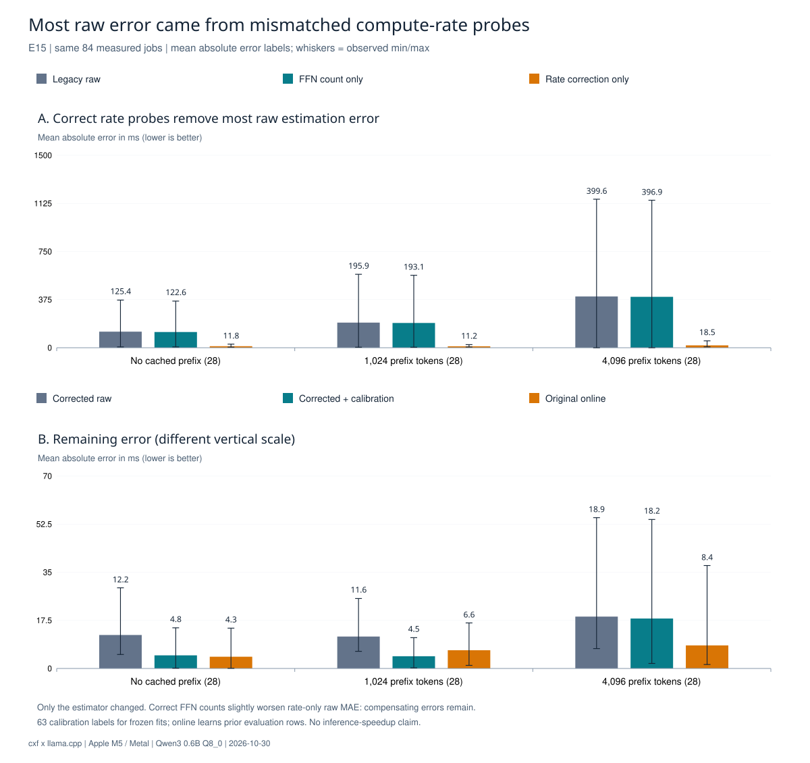

| E15 mode (same 84 jobs) | MAE ms | WAPE % | Max abs error ms | Signed bias ms |
| --- | --- | --- | --- | --- |
| fixed | 54.064 | 60.87 | 214.199 | 30.368 |
| frozen | 10.117 | 11.39 | 55.268 | 3.451 |
| online | 6.434 | 7.24 | 37.448 | 0.246 |
| legacy | 240.283 | 270.53 | 1157.789 | 238.254 |
| math_only | 237.527 | 267.42 | 1149.867 | 235.493 |
| bandwidth_only | 240.035 | 270.25 | 1157.176 | 237.838 |
| linear_only | 129.148 | 145.40 | 838.715 | 126.402 |
| attention_only | 103.888 | 116.96 | 300.015 | 99.014 |
| rate_only | 13.845 | 15.59 | 53.735 | -13.845 |
| corrected | 14.220 | 16.01 | 54.856 | -14.220 |
| corrected_calibrated | 9.133 | 10.28 | 54.200 | 3.654 |

legacy在本轮重测E14式孤立速率；math_only只修最后FFN算量；bandwidth_only／linear_only／attention_only各只替换一项速率；rate_only换全部速率但保留旧算量；corrected组合修正。全部共享每个实测任务。大偏差主要来自算力速率／算子错配，带宽不是主因。仅速率修正MAE13.845ms，加入语义正确的FFN算量后略变差至14.220ms，表明存在误差补偿。校准修正版仅用63条标定及原有三个系数，MAE9.133ms，原frozen为10.117ms，原先预测后学习online仍更好，为6.434ms。没有按评价集调参或挑运行；单轮差异不是稳定提速证明。

| Corrected estimator overhead (per call) | µs median [min–max] |
| --- | --- |
| raw estimate | 0.0187 [0.0182–0.0198] |
| calibrated predict | 0.0753 [0.0656–0.0826] |
| calibrated observe/refit | 1.9475 [1.9100–2.0300] |

C单测、ASan/UBSan和默认回归在计时前通过；21形状从头KV greedy、规范token和精确token／batch核对通过。E15共278条，含56条深度探针、42条孤立探针。真实DRAM流量、纯GPU时间和频率仍未测；合成数据、单一速率形状、小batch vec kernel、padding、缓存和省略算子仍是限制。修正原公式最大误差仍54.856ms。E13／E14保持当时版本，当前源码哈希看E15；预测误差降低不是模型推理提速。

## E16–17 · batch／上下文拆分与公平在线对照

先纠正训练信息口径：此前冻结Roofline与原online使用的信息不同。E15事后数值回放中，Roofline online MAE为5.641ms，冻结为9.133、原online为6.434；这是历史回放，不是新推理。E16／E17现将经验、单形状Roofline和形状表均分冻结／公平在线版本；所有在线模型使用相同先前标签与64槽窗口，每条先预测再观察。

每轮独立测batch上限512后128，各63条标定、147条评价，每格7次，共60个从头KV形状oracle。这里batch指一次原生decode的token宽度，不是并发请求数。E16评价prefix0/1024/4096、新token8/16/19/20/64/256/768；E17在E16诊断后换用prefix512/3072/5120、新token12/18/24/48/192/384/640。两轮均保留标定prefix0/2048/6144及新token32/128/512，完整评价工作形状与标定不重叠。

kernel边界有两组证据：固定Metal在query少于20时走FA vec路径；E16独立单层FA探针在prefix2048由19-token的0.4678ms降到20-token的0.1978ms。完整模型也出现同方向突变，平滑token／pair公式无法描述。路由标记来自源码推定，不是GPU计数器；Q8在宽度不超过8时也有小batch路径。

| E16 batch cap | Prefix | 19-token actual ms [min–max] | 20-token actual ms [min–max] |
| --- | --- | --- | --- |
| 512 | 0 | 19.713 [19.160–21.994] | 17.502 [16.485–19.504] |
| 512 | 1024 | 24.097 [23.319–25.372] | 20.540 [20.110–22.577] |
| 512 | 4096 | 39.726 [38.410–45.883] | 27.479 [26.225–31.255] |
| 128 | 0 | 18.854 [17.747–19.086] | 15.899 [15.737–16.903] |
| 128 | 1024 | 22.546 [21.440–23.692] | 19.104 [17.984–19.606] |
| 128 | 4096 | 39.500 [36.959–76.238] | 27.133 [25.230–29.061] |

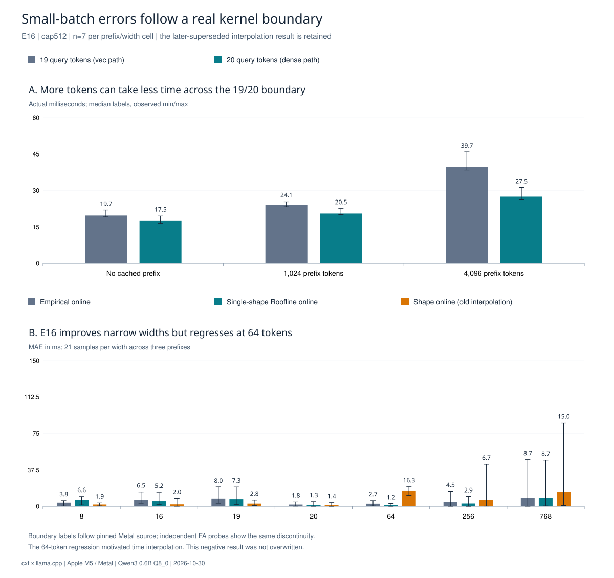

可选表固定960字节，模型标签到来前测6个宽度（8/16/19/20/128/512）和3个context（0/2048/6144），每轮336条深度探针、24条速率记录；按kernel区间插值并逐chunk推进context。E16先插值linear倒速率，再乘token工作量，会人为弯曲节点间时间；小宽度改善，但width64明显高估，负结果保留。E17改为先插值归一化算子时间width/rate，再换回速率；FA原本就插值时间。新评价形状在E17运行前冻结。

| Run | Batch cap | Mode | n | MAE ms | WAPE % | Max abs error ms | Signed bias ms |
| --- | --- | --- | --- | --- | --- | --- | --- |
| E16 | 512 | empirical_frozen | 147 | 5.616 | 8.69 | 49.112 | -4.604 |
| E16 | 512 | empirical_online | 147 | 5.127 | 7.94 | 48.041 | -1.559 |
| E16 | 512 | roof_raw | 147 | 16.450 | 25.47 | 84.623 | -16.450 |
| E16 | 512 | roof_frozen | 147 | 4.895 | 7.58 | 50.207 | -3.066 |
| E16 | 512 | roof_online | 147 | 4.748 | 7.35 | 47.540 | -1.351 |
| E16 | 512 | shape_raw | 147 | 7.731 | 11.97 | 73.611 | -4.236 |
| E16 | 512 | shape_frozen | 147 | 5.563 | 8.61 | 56.088 | 1.981 |
| E16 | 512 | shape_online | 147 | 6.589 | 10.20 | 86.048 | 3.552 |
| E16 | 128 | empirical_frozen | 147 | 3.936 | 5.93 | 51.905 | -0.565 |
| E16 | 128 | empirical_online | 147 | 3.893 | 5.86 | 49.666 | -1.088 |
| E16 | 128 | roof_raw | 147 | 16.205 | 24.40 | 89.463 | -16.144 |
| E16 | 128 | roof_frozen | 147 | 4.055 | 6.10 | 51.667 | -0.231 |
| E16 | 128 | roof_online | 147 | 4.094 | 6.16 | 49.749 | -0.877 |
| E16 | 128 | shape_raw | 147 | 4.754 | 7.16 | 37.622 | -0.209 |
| E16 | 128 | shape_frozen | 147 | 5.076 | 7.64 | 32.967 | 3.850 |
| E16 | 128 | shape_online | 147 | 4.508 | 6.79 | 35.762 | 2.549 |
| E17 | 512 | empirical_frozen | 147 | 6.148 | 7.22 | 19.986 | -0.307 |
| E17 | 512 | empirical_online | 147 | 3.753 | 4.41 | 19.509 | -0.686 |
| E17 | 512 | roof_raw | 147 | 13.989 | 16.43 | 48.026 | -13.989 |
| E17 | 512 | roof_frozen | 147 | 4.320 | 5.07 | 17.532 | 0.575 |
| E17 | 512 | roof_online | 147 | 3.059 | 3.59 | 20.272 | -0.527 |
| E17 | 512 | shape_raw | 147 | 4.165 | 4.89 | 19.337 | -2.790 |
| E17 | 512 | shape_frozen | 147 | 5.620 | 6.60 | 12.129 | 5.620 |
| E17 | 512 | shape_online | 147 | 2.793 | 3.28 | 8.869 | 2.105 |
| E17 | 128 | empirical_frozen | 147 | 4.369 | 4.75 | 15.469 | 0.187 |
| E17 | 128 | empirical_online | 147 | 3.335 | 3.62 | 16.050 | -1.255 |
| E17 | 128 | roof_raw | 147 | 17.877 | 19.42 | 57.030 | -17.877 |
| E17 | 128 | roof_frozen | 147 | 3.932 | 4.27 | 14.685 | 0.461 |
| E17 | 128 | roof_online | 147 | 2.892 | 3.14 | 14.753 | -1.016 |
| E17 | 128 | shape_raw | 147 | 3.374 | 3.67 | 12.154 | -2.003 |
| E17 | 128 | shape_frozen | 147 | 4.961 | 5.39 | 15.823 | 4.961 |
| E17 | 128 | shape_online | 147 | 1.926 | 2.09 | 8.484 | 1.736 |

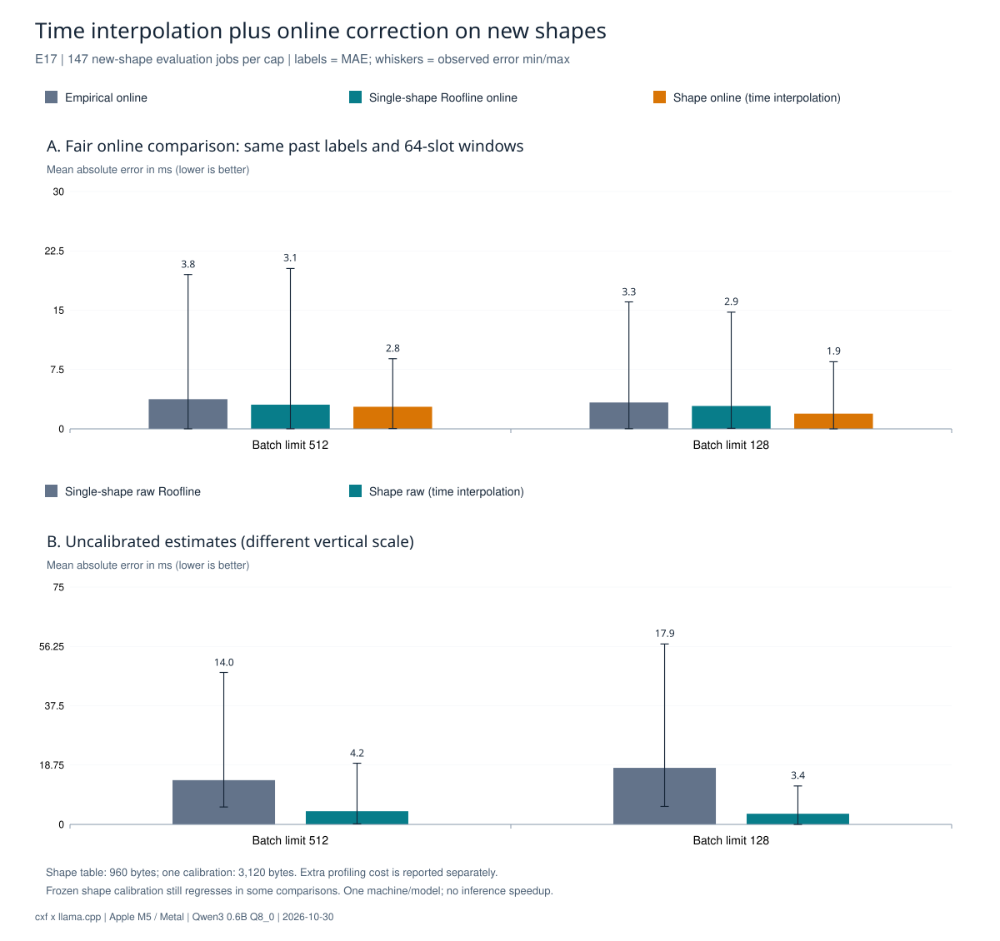

E17在相同任务及观察口径下，形状online的MAE相对原online在cap512降低25.6%、cap128降低42.2%；本轮单形状Roofline online也优于原online。这不是普遍优势：E16形状online回退；E17冻结形状校准在两个cap都差于形状raw及单形状冻结。额外探测和校准迁移仍有成本，表本身不能解决运行漂移。

每轮全部42个prefix×new-token×cap单元的方向误差及实际中位／最小／最大／MAD见 [cost-shape-errors.csv](data/cost-shape-errors.csv)。须线／MAD描述波动，不是置信区间。上下文敏感性、宽度kernel切换、chunk次数开销及冻结／在线信息差异分别影响残差；缺少遥测仍不能指认争用。E17改善或跨轮差异均不是推理提速。

| E17 cost | Recorded value |
| --- | --- |
| Shape-table construction | 4797.034 [4797.034–4797.034] ms; 在推理标签之前 |
| Table + one numeric calibration | 960 + 3120 = 4080 bytes; 不复制原文／token／KV |
| Shape predict µs / cap512 | 0.1131 [0.0952–0.1140] |
| Shape observe/refit µs / cap512 | 1.9200 [1.9200–1.9250] |

相关一手研究：[Vidur](https://www.microsoft.com/en-us/research/wp-content/uploads/2024/05/vidur_mlsys24.pdf)分开token算子与上下文敏感算子并使用形状实测模型；[FlashAttention-2](https://arxiv.org/abs/2307.08691)解释工作划分／并行度如何影响有效吞吐；[IBM Roofline＋回归](https://research.ibm.com/publications/predicting-llm-inference-latency-a-roofline-driven-ml-method)组合结构估算与运行开销校准。这些支持方法选择，CUDA／云端结果不能证明Metal准确率；未引入随机森林实现。

两轮各916条，保留失败／回退；C单测、ASan/UBSan、默认回归先于性能通过，各60形状oracle通过。E16 wrapper在native成功后缺re导入，从未改的raw恢复元数据，没有重跑推理，测量／processor哈希分列；E17直接完成。当前估算器哈希看E17，E16哈希对应已被修正的插值。默认Agent调度、Windows/CUDA、真实云流以及纯GPU／DRAM／频率／温度分析仍未验收。

## E18–19 · 冻结校准回退排查

E17开发审计先排除优化器迭代不足：穷举active-set NNLS与原128轮拟合的系数最大差不超过6.6e-9，训练SSE一致。拟合前raw残差的平方量中，512-token任务在cap512／128分别占92.4%／94.6%。E17同标签加权NNLS有所改善，新的三特征残差basis改善更多；这些只作开发分析，不能代替本轮新验证。

E19在策略冻结后测试未测过的cap256／64、prefix1280/3328/5376、新token10/15/21/72/176/352/672。sparse／diverse各用63条标签，在每个prefix内交错采样；sparse保留旧3×3网格，diverse九个点覆盖small／vec／dense路径。形状表新增context7168，覆盖所有标定chunk；旧端点对照保留前三个节点。评价chunk均在6144以内，两种表的评价raw特征完全相同，差异仅来自标定表覆盖。

新增可选C残差模型保留raw先验，拟合calls、new_tokens/512、raw_attention_ms/100；使用有符号系数、权重1/max(actual_ms,20)、加权RMS归一化、围绕零残差的ridge0.01，最终耗时截0。与旧模型同为3参数、64条数值观测。同basis的加权NNLS对照仅从标定标签离线计算，单列原始记录引用，不增加推理样本。

| E19 batch cap | Mode | n | MAE ms | WAPE % | Max abs error ms | Signed bias ms |
| --- | --- | --- | --- | --- | --- | --- |
| 256 | raw | 147 | 7.439 | 7.54 | 35.477 | -5.576 |
| 256 | legacy_clipped_sparse | 147 | 4.399 | 4.46 | 19.409 | -1.195 |
| 256 | legacy_sparse | 147 | 5.331 | 5.40 | 26.225 | -2.076 |
| 256 | legacy_diverse | 147 | 4.486 | 4.55 | 20.514 | -0.539 |
| 256 | weighted_sparse | 147 | 5.256 | 5.33 | 25.418 | -2.203 |
| 256 | weighted_diverse | 147 | 4.519 | 4.58 | 20.452 | -1.172 |
| 256 | residual_sparse | 147 | 4.809 | 4.87 | 25.501 | -2.662 |
| 256 | residual_diverse | 147 | 3.452 | 3.50 | 18.344 | -1.540 |
| 256 | empirical_online | 147 | 3.529 | 3.58 | 13.132 | -1.585 |
| 256 | shape_online | 147 | 3.930 | 3.98 | 16.546 | 1.169 |
| 64 | raw | 147 | 2.183 | 1.77 | 8.368 | 1.346 |
| 64 | legacy_clipped_sparse | 147 | 4.728 | 3.82 | 23.449 | 4.647 |
| 64 | legacy_sparse | 147 | 2.678 | 2.17 | 9.372 | 2.565 |
| 64 | legacy_diverse | 147 | 2.631 | 2.13 | 9.077 | 2.515 |
| 64 | weighted_sparse | 147 | 2.754 | 2.23 | 10.165 | 2.629 |
| 64 | weighted_diverse | 147 | 2.749 | 2.22 | 10.583 | 2.589 |
| 64 | residual_sparse | 147 | 2.664 | 2.16 | 10.130 | 2.515 |
| 64 | residual_diverse | 147 | 2.645 | 2.14 | 11.406 | 2.421 |
| 64 | empirical_online | 147 | 3.321 | 2.69 | 11.545 | -1.748 |
| 64 | shape_online | 147 | 1.683 | 1.36 | 8.108 | 1.230 |

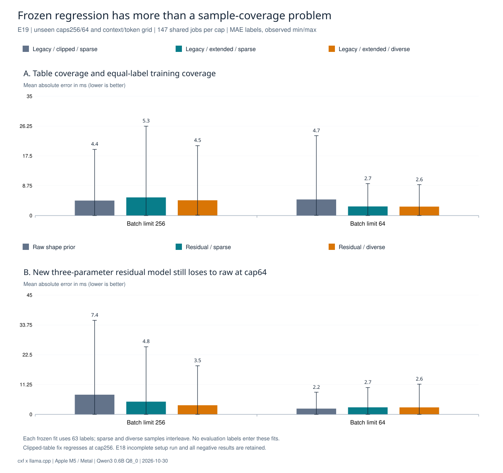

原因是混合的。cap256下，等量扩覆盖使旧模型MAE5.331→4.486ms，在该覆盖上换残差模型为3.452ms；仅改权重没有一致收益。补表覆盖在cap64改善4.728→2.678，但cap256反而4.399→5.331，说明存在误差补偿。cap64的raw2.183ms仍优于全部冻结校准，包括新residual/diverse的2.645ms；补覆盖并不能保证三个全局修正系数泛化。

训练误差进一步区分了拟合与泛化：cap64／sparse的raw训练MAE1.792ms，残差拟合降到1.045；但新形状误差从raw2.183升到2.664ms。全部训练指标见 [frozen-calibration-training.csv](data/frozen-calibration-training.csv)，42个验证单元×10种方案见 [frozen-calibration-errors.csv](data/frozen-calibration-errors.csv)。冻结方案不使用评价标签；online基线仅在每次预测之后学习。

| Cap | Anchor prefix/new | Before calibration ms | After calibration ms | After evaluation ms |
| --- | --- | --- | --- | --- |
| 256 | 0/32 | 15.592 [15.350–16.486] | 16.488 [15.412–16.705] | 16.531 [15.597–16.569] |
| 256 | 2048/17 | 27.253 [27.102–27.918] | 27.331 [27.234–27.387] | 27.248 [27.233–27.514] |
| 256 | 6144/512 | 363.472 [362.888–365.052] | 377.057 [376.397–377.996] | 374.308 [372.548–376.706] |
| 64 | 0/32 | 15.485 [15.327–16.284] | 15.588 [15.477–15.859] | 15.415 [15.368–16.376] |
| 64 | 2048/17 | 27.168 [27.051–28.121] | 27.170 [27.081–27.230] | 27.127 [26.945–27.154] |
| 64 | 6144/512 | 446.056 [444.423–446.357] | 444.944 [443.155–445.124] | 443.846 [441.423–444.356] |

锚点每阶段3次，全部排除在拟合外。cap256长锚点363.472→377.057ms，而窄锚点基本不变；cap64长锚点变化较小。阶段波动确实存在且依赖工作量，但没有频率／温度／DRAM／GPU时间遥测，不能指认硬件原因。覆盖与模型效果不可相加，两种cap也是顺序运行。

| E19 numeric cost | Value |
| --- | --- |
| Residual state + table | 3632 + 960 = 4592 bytes; no heap/context copy |
| Extended-table construction | 8695.356 [8695.356–8695.356] ms |
| Predict including shape lookup / cap256 µs | 0.1629 [0.1028–0.2090] |
| Residual observe/refit / cap256 µs | 0.4525 [0.2700–0.5700] |

残差ridge采用标准 [L2正则最小二乘结构](https://scikit-learn.org/stable/modules/generated/sklearn.linear_model.Ridge.html)，以独立C的3×3 Cholesky直接求解，未引入scikit-learn。共线／零列手算、有符号修正、窗口／漂移与失败原子性单测、ASan/UBSan、默认回归在GPU前通过；78种fresh-KV工作形状的token／greedy／batch核对通过。当前源码哈希看E19。E18保留首次未完成运行的全部849条：cap256完成后，cap64因默认prefill阈值128超过batch64被拒绝；E19仅修测试设置为min(128,batch)，没有重调校准策略或按准确率选运行。E19为1162条native记录＋294条独立引用的离线对照；未改变模型推理或默认调度。

## E20 · 可选残差 Kalman

新C层以40B状态跟踪标量残差偏移，不存heap／上下文。predict只读，不推进Q；仅成功非零任务的observe更新，且必须使用原始未过滤base。profile变化必须独立／重置状态。固定Q/R、稳态初始化的Kalman与EWMA数学等价，本轮验证等价，不把它们宣传为两种独立增益。

新测量用cap256/64、prefix1792/3840/5504及new11/18/26/88/208/400/688，沿用sparse/diverse标定和扩展微表。噪声参数仅由diverse九组标定估计：constant R为组内方差中位数、下限.25ms²；scaled R对截距＋耗时平方做非负拟合。Q=.01R和初值先于评价固定。各层从评价bias0开始，严格先预测后观测，在同一base内使用相同过去任务。这里是新实测的数值C回放，未接真实Agent调度，也不增加独立推理样本。

| Cap | Base | Base MAE ms | EWMA = fixed MAE ms | Scaled R MAE ms | Base RMSE ms | Scaled RMSE ms | Base max ms | Scaled max ms |
| --- | --- | --- | --- | --- | --- | --- | --- | --- |
| 256 | raw | 5.056 | 4.813 | 4.588 | 7.122 | 6.312 | 24.610 | 20.725 |
| 256 | residual_diverse | 2.913 | 2.790 | 2.834 | 3.925 | 3.740 | 12.914 | 11.865 |
| 256 | shape_online | 3.173 | 3.073 | 3.147 | 4.046 | 3.887 | 9.582 | 9.778 |
| 64 | raw | 4.748 | 3.290 | 3.944 | 6.131 | 5.201 | 16.159 | 14.608 |
| 64 | residual_diverse | 4.687 | 3.440 | 4.024 | 6.441 | 5.649 | 16.629 | 15.723 |
| 64 | shape_online | 1.975 | 1.922 | 1.951 | 2.644 | 2.588 | 9.320 | 8.248 |

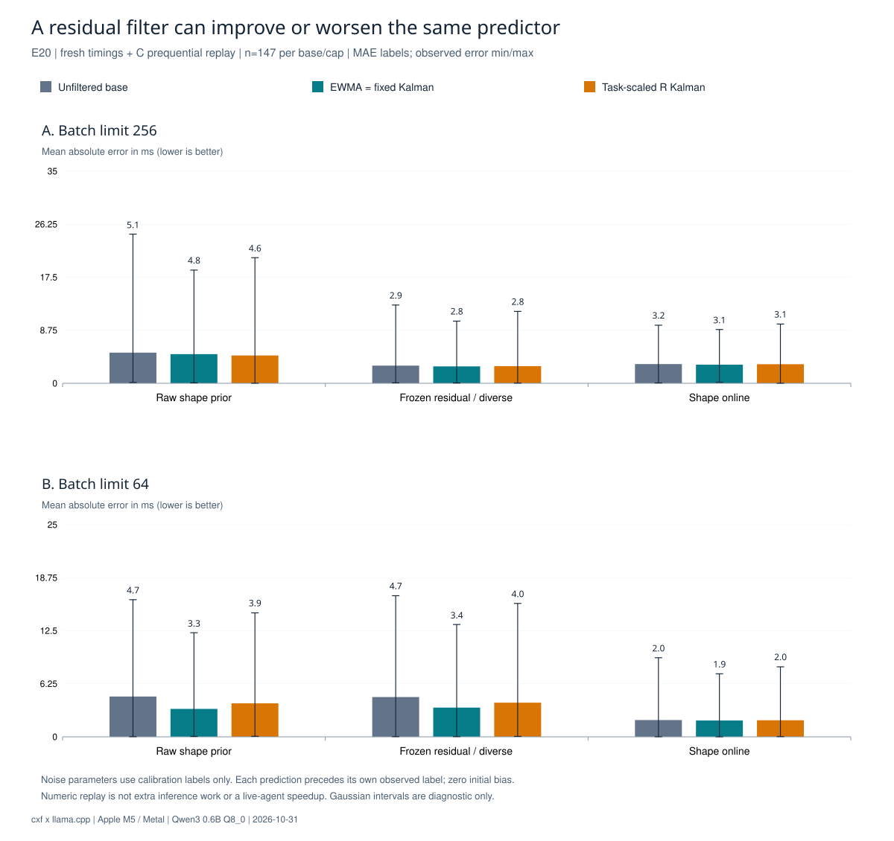

在当前shape-online基线上，fixed／EWMA的MAE为cap256的3.173→3.073ms（3.2%）和cap64的1.975→1.922ms（2.7%），属于本轮小幅修正。fixed／EWMA在六组base/cap中的五组优于scaled R。cap256/shape-online的scaled R最大误差略恶化9.582→9.778ms；即便fixed平均改善，每个cap仍有10/21格的平均误差变差。测试按形状各连续重复七次，不能据此保证真实异构Agent任务序列同样收益。

全部24项对照、方向偏差和冷状态首14项误差见 [kalman-summary.csv](data/kalman-summary.csv)，504项逐格／方案误差见 [kalman-errors.csv](data/kalman-errors.csv)。[kalman-replay.csv](data/kalman-replay.csv) 的882条层记录索引引用294个原评价任务，不算进1162条native或原始记录总数。未用评价重调Q/R，负结果保留。

引入Gaussian噪声模型本身不保证MAE降低。Kalman最优性依赖模型／噪声假设，针对平方误差，参见 [MathWorks估计文档](https://www.mathworks.com/help/fusion/ug/introduction-to-estimation-filters.html)。以下标准化innovation为描述性诊断；名义±1.96sqrt(Pprior+R)区间不代表已验证的95%保证，工作量残差相关和模型偏差都会破坏它。

| Cap | Base | Filter | Coverage % | z SD | Skew | Excess kurtosis | Lag1 |
| --- | --- | --- | --- | --- | --- | --- | --- |
| 256 | raw | fixed | 15.646 | 11.854 | 0.413 | -0.068 | 0.146 |
| 256 | raw | scaled | 44.218 | 4.402 | 0.747 | 0.320 | 0.189 |
| 256 | residual_diverse | fixed | 25.850 | 6.825 | 0.003 | 0.273 | 0.157 |
| 256 | residual_diverse | scaled | 54.422 | 2.636 | 0.340 | 0.669 | 0.258 |
| 256 | shape_online | fixed | 17.687 | 7.163 | -0.150 | -0.479 | 0.232 |
| 256 | shape_online | scaled | 52.381 | 2.755 | 0.037 | -0.417 | 0.319 |
| 64 | raw | fixed | 27.211 | 8.278 | -0.302 | 0.169 | 0.360 |
| 64 | raw | scaled | 70.068 | 2.714 | 0.438 | 0.778 | -0.005 |
| 64 | residual_diverse | fixed | 29.252 | 9.007 | -0.465 | 0.417 | 0.351 |
| 64 | residual_diverse | scaled | 69.388 | 2.776 | 0.383 | 0.699 | -0.009 |
| 64 | shape_online | fixed | 36.735 | 4.728 | -0.120 | 0.083 | 0.054 |
| 64 | shape_online | scaled | 68.027 | 2.738 | -0.043 | 0.800 | -0.039 |

名义区间实测覆盖仅15.65–70.07%。标定组内抖动未覆盖跨形状的结构误差，标准化innovation SD为2.64–11.85而非1。两组constant R都触及.25ms²下限；scaled拟合cap256为[1.9193,0]，实际退化成另一固定噪声滤波，cap64为[0,5.5676]。这支持协方差低估／模型失配，覆盖率低本身不能证明分布形状非正态。不能把当前不确定度用于就绪保证；保持可选，默认接入前先验收真实任务序列。

| Layer-only cost | Median [min–max] |
| --- | --- |
| C state bytes | 40 |
| Predict µs | 0.0092 [0.0089–0.0098] |
| Observe µs | 0.0136 [0.0132–0.0147] |

手算Joseph/gain、EWMA等价、step、单尖峰传播及失败原子性测试、ASan/UBSan和完整默认回归先于计时通过。78种fresh-KV形状的规范token／greedy／batch oracle通过；C层预测／协方差／gain及仅标定噪声由Python独立回放核对。当前实测源码哈希看E20；旧证据保持不变。本轮只增加可选估算层，没有推理内核、默认调度或Windows/CUDA提速结论。

## E21 · 真实工具窗口准备

简单EWMA已接到可选原生CLI的test.run包装和同一可调用宿主模块。Native借用worker拥有的engine，所有引擎操作仍在同一owner线程。工具按原权限／参数执行一次，使用真实收据；checkpoint保留已证明的generation-header之前规范前缀。不新建第二个模型／context或持久对话副本。这是串行工具窗口切片，不是完整P0–P4协调器。

性能组实际执行fs.read和部署的C编译／测试进程。每任务三次计时调用；编译测试先失败，实际写入完整修正后再通过两次。同一真实收据通过独立完整模板／token和fresh-KV greedy参考核对。动作确定性选择，用于隔离调度与0.6B决策能力；Native CLI的单次模型探测与计时分列。

resident保留KV，是普通暖态基线；recompute显式逐出KV、保留规范token；restore实际保存同一存活会话的私有文件再逐出。两种非驻留状态分别比较工具后、立即、EWMA定时准备。定时延迟=max(0,工具预计耗时−prefix_tokens×准备ms/token估计−5ms)，alpha=.0951249。初值使用相同的三次真实标定样本，之后各方案只学习自己的过去标签；重复轮转方案顺序。性能窗口没有用sleep填充。

| Case / history words | Mode | n tasks | Task ms [min–max] | After-tool wait sum ms | Tool sum ms | Save sum ms | Early-hold sum ms |
| --- | --- | --- | --- | --- | --- | --- | --- |
| read / 128 | resident | 7 | 65.36 [64.89–67.58] | 65.15 [64.68–67.37] | 0.13 [0.11–0.13] | 0.00 [0.00–0.00] | 0.00 [0.00–0.00] |
| read / 128 | prefill_late | 7 | 292.26 [291.12–293.58] | 291.92 [290.81–293.24] | 0.14 [0.12–0.15] | 0.00 [0.00–0.00] | 0.00 [0.00–0.00] |
| read / 128 | prefill_immediate | 7 | 291.63 [290.46–294.93] | 291.25 [290.11–294.53] | 0.16 [0.14–0.17] | 0.00 [0.00–0.00] | 0.00 [0.00–0.00] |
| read / 128 | prefill_timed | 7 | 291.54 [290.07–295.09] | 291.17 [289.69–294.71] | 0.15 [0.13–0.18] | 0.00 [0.00–0.00] | 0.00 [0.00–0.00] |
| read / 128 | restore_late | 7 | 113.25 [93.82–127.00] | 79.51 [77.15–84.64] | 0.14 [0.13–0.35] | 34.01 [16.32–48.36] | 0.00 [0.00–0.00] |
| read / 128 | restore_immediate | 7 | 110.11 [94.95–120.74] | 79.07 [78.43–79.85] | 0.14 [0.14–0.15] | 30.89 [15.73–40.85] | 0.00 [0.00–0.00] |
| read / 128 | restore_timed | 7 | 116.27 [95.41–137.18] | 79.30 [78.34–80.00] | 0.15 [0.12–0.16] | 36.87 [16.65–50.56] | 0.00 [0.00–0.00] |
| read / 2048 | resident | 7 | 102.44 [101.43–103.58] | 102.20 [101.17–103.30] | 0.17 [0.13–0.18] | 0.00 [0.00–0.00] | 0.00 [0.00–0.00] |
| read / 2048 | prefill_late | 7 | 1713.77 [1694.58–1720.01] | 1713.14 [1693.91–1719.35] | 0.19 [0.17–0.20] | 0.00 [0.00–0.00] | 0.00 [0.00–0.00] |
| read / 2048 | prefill_immediate | 7 | 1711.75 [1695.03–1725.63] | 1711.05 [1694.32–1724.91] | 0.19 [0.17–0.20] | 0.00 [0.00–0.00] | 0.00 [0.00–0.00] |
| read / 2048 | prefill_timed | 7 | 1722.68 [1694.49–1783.80] | 1721.89 [1693.77–1783.09] | 0.20 [0.19–0.22] | 0.00 [0.00–0.00] | 0.00 [0.00–0.00] |
| read / 2048 | restore_late | 7 | 494.15 [387.38–542.56] | 177.10 [175.55–200.26] | 0.16 [0.13–0.18] | 293.07 [208.04–365.19] | 0.00 [0.00–0.00] |
| read / 2048 | restore_immediate | 7 | 373.38 [261.29–498.20] | 175.47 [172.80–209.79] | 0.17 [0.15–0.31] | 199.86 [84.22–323.40] | 0.00 [0.00–0.00] |
| read / 2048 | restore_timed | 7 | 397.58 [277.70–539.80] | 174.99 [171.85–219.48] | 0.18 [0.15–0.28] | 121.65 [103.24–323.99] | 0.00 [0.00–0.00] |
| compile_test / 128 | resident | 7 | 1540.40 [1488.31–1567.85] | 72.64 [71.19–73.52] | 1445.67 [1392.64–1472.42] | 0.00 [0.00–0.00] | 0.00 [0.00–0.00] |
| compile_test / 128 | prefill_late | 7 | 1802.17 [1783.75–1890.39] | 335.66 [331.82–337.99] | 1445.54 [1424.62–1529.34] | 0.00 [0.00–0.00] | 0.00 [0.00–0.00] |
| compile_test / 128 | prefill_immediate | 7 | 1555.16 [1525.22–1743.93] | 72.83 [72.23–74.57] | 1460.57 [1427.64–1646.97] | 0.00 [0.00–0.00] | 918.41 [911.41–1055.70] |
| compile_test / 128 | prefill_timed | 7 | 1609.73 [1556.11–1616.44] | 95.28 [75.05–104.04] | 1492.73 [1429.56–1518.61] | 0.00 [0.00–0.00] | 42.25 [0.00–81.97] |
| compile_test / 128 | restore_late | 7 | 1647.49 [1594.33–1680.43] | 90.48 [88.80–92.86] | 1473.43 [1427.32–1515.86] | 61.18 [34.53–88.33] | 0.00 [0.00–0.00] |
| compile_test / 128 | restore_immediate | 7 | 1608.97 [1554.16–1636.18] | 75.01 [74.36–77.06] | 1442.11 [1405.23–1495.39] | 52.74 [43.86–68.16] | 1147.31 [1133.49–1171.49] |
| compile_test / 128 | restore_timed | 7 | 1602.81 [1558.05–1675.59] | 85.88 [73.63–90.57] | 1442.97 [1397.06–1526.72] | 52.25 [43.90–57.45] | 8.77 [0.00–34.67] |
| compile_test / 2048 | resident | 7 | 1582.89 [1516.36–2351.41] | 113.26 [112.05–125.68] | 1435.22 [1371.92–2193.62] | 0.00 [0.00–0.00] | 0.00 [0.00–0.00] |
| compile_test / 2048 | prefill_late | 7 | 3242.60 [3172.55–3715.39] | 1759.90 [1750.80–1776.12] | 1457.60 [1382.26–1905.51] | 0.00 [0.00–0.00] | 0.00 [0.00–0.00] |
| compile_test / 2048 | prefill_immediate | 7 | 2071.08 [2049.25–2256.80] | 631.82 [590.31–679.76] | 1426.57 [1358.65–1633.19] | 0.00 [0.00–0.00] | 0.00 [0.00–0.00] |
| compile_test / 2048 | prefill_timed | 7 | 2091.36 [2022.26–2364.77] | 631.89 [588.66–670.46] | 1460.09 [1357.78–1722.70] | 0.00 [0.00–0.00] | 0.00 [0.00–0.00] |
| compile_test / 2048 | restore_late | 7 | 2058.33 [1959.27–2227.99] | 242.04 [238.73–257.38] | 1560.96 [1456.76–1618.38] | 261.50 [125.86–337.00] | 0.00 [0.00–0.00] |
| compile_test / 2048 | restore_immediate | 7 | 1941.56 [1911.51–2313.66] | 119.85 [118.81–127.69] | 1670.31 [1634.06–1807.41] | 119.43 [87.93–344.31] | 1077.40 [1047.19–1197.76] |
| compile_test / 2048 | restore_timed | 7 | 1878.76 [1827.50–1933.98] | 150.61 [126.49–160.01] | 1573.59 [1537.55–1637.49] | 138.95 [84.09–151.92] | 18.48 [0.00–95.41] |

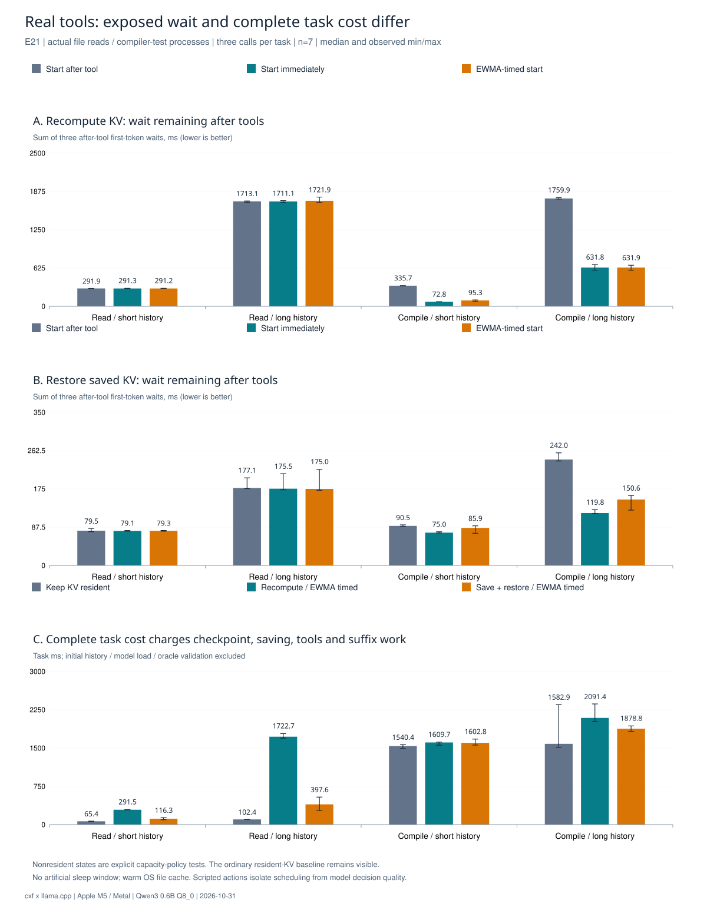

任务耗时包含checkpoint／保存／逐出、真实工具、修正写入、最终渲染／后缀预填充及首greedy；仅排除模型加载、初始历史准备、标定及独立oracle工作，后两类成本仍记录。工具后等待为三次调用之和，不是完整任务耗时。全部逐对差异见 [tool-prepare-pairs.csv](data/tool-prepare-pairs.csv)，完整任务见 [tool-prepare-tasks.csv](data/tool-prepare-tasks.csv)，概览见 [tool-prepare-summary.csv](data/tool-prepare-summary.csv)。931条native含144条标定、784条评价及元数据／验收／关闭；多项指标不是额外独立任务。

| Case / words | Compared with | Mode | Task saving median ms | Positive task pairs /7 | Wait-sum saving median ms | Positive wait pairs /7 |
| --- | --- | --- | --- | --- | --- | --- |
| read / 128 | prefill_late | prefill_timed | -0.054 | 3 | -0.008 | 3 |
| read / 128 | resident | prefill_timed | -226.177 | 0 | -225.999 | 0 |
| read / 128 | restore_late | restore_timed | -3.602 | 3 | -0.486 | 3 |
| read / 128 | resident | restore_timed | -50.909 | 0 | -14.097 | 0 |
| read / 2048 | prefill_late | prefill_timed | -3.536 | 2 | -3.436 | 2 |
| read / 2048 | resident | prefill_timed | -1621.227 | 0 | -1620.714 | 0 |
| read / 2048 | restore_late | restore_timed | 75.675 | 6 | 3.469 | 5 |
| read / 2048 | resident | restore_timed | -293.998 | 0 | -72.791 | 0 |
| compile_test / 128 | prefill_late | prefill_timed | 198.165 | 7 | 240.483 | 7 |
| compile_test / 128 | resident | prefill_timed | -73.439 | 0 | -22.643 | 0 |
| compile_test / 128 | restore_late | restore_timed | 17.047 | 5 | 4.939 | 5 |
| compile_test / 128 | resident | restore_timed | -82.900 | 0 | -12.357 | 0 |
| compile_test / 2048 | prefill_late | prefill_timed | 1161.403 | 7 | 1122.637 | 7 |
| compile_test / 2048 | resident | prefill_timed | -453.733 | 1 | -519.806 | 0 |
| compile_test / 2048 | restore_late | restore_timed | 214.356 | 7 | 94.834 | 7 |
| compile_test / 2048 | resident | restore_timed | -295.864 | 1 | -31.757 | 0 |

长历史编译测试中，三次调用的工具后等待中位合计：定时重算1759.905→631.885ms（64.1%），定时恢复242.040→150.610ms（37.8%）。完整任务分别3242.604→2091.362ms与2058.327→1878.756ms；一直驻留基线仍为1582.892ms。长历史定时恢复的逐对等待节省中位94.834ms（7/7为正）、任务节省214.356ms（7/7为正）；逐对中位数不等于两个独立中位数相减。

定时存在等待／占位权衡：长历史立即恢复的剩余等待119.848ms，定时为150.610ms；但定时把三次PREFIX_READY后的提前空等从1077.405降至18.483ms。这只是完成前缀的空等时间，不是完整KV占用积分或物理内存释放。短历史重算从立即改定时还使完整任务1555.155→1609.734ms变慢。快速读取的工具总时不足1ms，没有实质隐藏窗口，其任务总时波动不能当作重叠收益。

| Compiler history words | Restore mode | Total preparation sum ms | Native restore sum ms | Outside-native sum ms |
| --- | --- | --- | --- | --- |
| 128 | restore_late | 17.058 | 16.739 | 0.318 |
| 128 | restore_immediate | 299.373 | 16.825 | 282.175 |
| 128 | restore_timed | 16.565 | 16.253 | 0.316 |
| 2048 | restore_late | 124.683 | 124.116 | 0.579 |
| 2048 | restore_immediate | 600.274 | 299.346 | 293.144 |
| 2048 | restore_timed | 137.465 | 135.365 | 0.716 |

prepare包含owner排队／校验／finish／宿主协调，不只是native恢复和设备同步。立即恢复在native恢复调用之外的三轮合计约282–293ms，定时不足1ms；长历史native恢复本身也由124.116增至299.346ms。该轮未独立记录队列、fork暂停或唤醒成本，未测带宽／频率，因此这部分只能记为未归因协调等待，不能据此声称磁盘或总线带宽下降。详见 [tool-prepare-restore-components.csv](data/tool-prepare-restore-components.csv)。

实际0.6B CLI探测虽正常退出，却把工具裸JSON当正文输出，注册工具与真实进程执行均为0；该负结果保留。另一编译期确定性Native动作测试经过实际CLI参数／注册表／AgentStore，在ASan/UBSan下使授权编译命令恰好执行一次，用于验证接线，不当作模型自主成功。

快速读取、已驻留KV、保存成本、争用及逐对回退均保留。定时可能减少提前占位而不改善延迟；不据此宣称物理KV缩容、冷SSD／PCIe、Windows/CUDA、模型冷启动或通用云端接入。真实工具结果与后缀仍需在返回后处理。当前实测源码哈希看E21，旧性能仍对应各自历史版本。

验收覆盖借用engine生命周期、等待／运行中／就绪后取消、精确Native token／greedy、环境变化重建、key上限、工具失败／容量行为、Native／14K／KV／Stream回归、ASan/UBSan和默认测试。Native CLI通过--tool-prepare late|immediate|timed与--tool-kv resident|recompute|restore显式启用，并要求部署test command；未知估计立即启动，工具提前结束唤醒定时。此选项不替换默认HTTP路径。

## E22 · 定时恢复等待归因

E22只增加观测，保留旧算法、5ms余量及alpha；read／compile×两档历史比较resident及restore late／立即／定时，标定与过去标签规则不变。父进程fork起止、准备线程timer、worker入队／校验／恢复／finish／返回、清理和最终前端／预填充统一到Darwin raw单调时钟。工具trace不在fork子进程回调，也不重跑命令。

| E22 compiler words | Mode | n calls | Prefix wait mean ms | Post-prefix mean ms | Spawn mean ms | Before native mean ms | Native mean ms | Queue mean ms | Finish return mean ms |
| --- | --- | --- | --- | --- | --- | --- | --- | --- | --- |
| 128 | restore_immediate | 21 | 0.000 | 26.039 | 116.980 | 111.439 | 11.825 | 0.685 | 0.014 |
| 128 | restore_late | 21 | 5.468 | 25.279 | 111.349 | 0.049 | 5.386 | 0.010 | 0.005 |
| 128 | restore_timed | 21 | 4.978 | 25.692 | 102.310 | 0.051 | 6.243 | 0.008 | 0.005 |
| 2048 | restore_immediate | 21 | 0.000 | 46.239 | 162.200 | 147.850 | 84.228 | 0.007 | 0.011 |
| 2048 | restore_late | 21 | 59.384 | 46.360 | 149.809 | 0.404 | 58.940 | 0.010 | 0.005 |
| 2048 | restore_timed | 21 | 5.202 | 43.634 | 133.003 | 0.340 | 51.929 | 0.009 | 0.005 |

两档历史的立即恢复在native之前平均耗时约111／148ms，fork自身约117／162ms，区间重叠；queue和finish返回很小。缺失成本被定位到与进程创建重叠的校验阶段，不是纯读盘传输或完成通知。该观测没有直接识别libc内部锁或OS机制；E21未记录这些边界，不能事后把旧残差逐条改名归因。

定时恢复的正prefix等待均值为每调用4.978／5.202ms；旧deadline锚点相对工具开始平均仅偏.006／.007ms，简单修正时间原点不是E22中的主要均值原因。逐条恒等式为ready−tool_end=(ETA估计−真实工具时长)+(真实准备−准备估计)−余量+派发偏移+clamp。正等待对这个值取max(0)，早／晚误差会在均值中互相抵消；仅整体提前会用更多提前占位交换等待。

所有相邻准备阶段之和与总prepare逐条相等。旧E21审计为事后数值复算，引用不可变原记录，不增加推理样本。[restore-estimate-audit.csv](data/restore-estimate-audit.csv)、[restore-stages.csv](data/restore-stages.csv)及[restore-stage-summary.csv](data/restore-stage-summary.csv)保留signed误差、阶段分解和均值／中位／范围。E22是新547条native记录，不是重写E21。

## E23 · 进程启动与进度条件ETA

两项改动在新320／1792-word历史与25000000次循环的真实编译／测试上独立对照。macOS26+使用posix_spawn，保持部署shell命令、cwd、环境、标准IO重定向和进程组超时规则；显式fork保留作部署／测试对照，更旧macOS／Linux暂保留fork待验收。实现参考[Apple spawn手册](https://developer.apple.com/library/archive/documentation/System/Conceptual/ManPages_iPhoneOS/man2/posix_spawn.2.html)及[公开头](https://github.com/apple-oss-distributions/xnu/blob/main/libsyscall/wrappers/spawn/spawn.h)。启动失败不切backend重跑。

新progress策略只使用父进程spawn返回事件，绑定当前execute epoch；预计结束=已观测spawn_return＋过去EWMA后段耗时，派发=max(spawn_return,预计结束−过去准备估计−5ms)。特征是已经发生的事件，不是未来标签；alpha／余量不变，同backend各策略共享相同三次完整标定标签。未知／无进度回退到收到父进度／工具返回后准备。原Native工具包装可显式--tool-prepare progress。

| E23 case / words | Mode | n tasks | After-tool wait sum ms | Early-hold sum ms | Complete task ms |
| --- | --- | --- | --- | --- | --- |
| compile_test / 320 | resident | 7 | 91.085 | 0.000 | 1601.308 |
| compile_test / 320 | restore_fork_immediate | 7 | 113.510 | 1326.016 | 2876.650 |
| compile_test / 320 | restore_fork_progress | 7 | 108.747 | 92.533 | 2473.639 |
| compile_test / 320 | restore_fork_timed | 7 | 110.135 | 543.251 | 2543.616 |
| compile_test / 320 | restore_spawn_immediate | 7 | 91.373 | 1150.395 | 1387.788 |
| compile_test / 320 | restore_spawn_progress | 7 | 104.568 | 103.890 | 1559.189 |
| compile_test / 320 | restore_spawn_timed | 7 | 101.448 | 294.163 | 1626.625 |
| compile_test / 1792 | resident | 7 | 110.392 | 0.000 | 1287.528 |
| compile_test / 1792 | restore_fork_immediate | 7 | 132.799 | 1100.943 | 2431.330 |
| compile_test / 1792 | restore_fork_progress | 7 | 124.478 | 15.953 | 1720.986 |
| compile_test / 1792 | restore_fork_timed | 7 | 115.342 | 132.911 | 1864.072 |
| compile_test / 1792 | restore_spawn_immediate | 7 | 113.934 | 1033.955 | 1312.979 |
| compile_test / 1792 | restore_spawn_progress | 7 | 146.870 | 23.805 | 1475.407 |
| compile_test / 1792 | restore_spawn_timed | 7 | 155.645 | 9.481 | 1389.308 |
| read / 320 | resident | 7 | 72.790 | 0.000 | 73.085 |
| read / 320 | restore_fork_immediate | 7 | 97.293 | 0.000 | 128.533 |
| read / 320 | restore_fork_progress | 7 | 97.130 | 0.000 | 125.815 |
| read / 320 | restore_fork_timed | 7 | 100.395 | 0.000 | 141.367 |
| read / 320 | restore_spawn_immediate | 7 | 98.038 | 0.000 | 132.403 |
| read / 320 | restore_spawn_progress | 7 | 96.570 | 0.000 | 122.623 |
| read / 320 | restore_spawn_timed | 7 | 94.153 | 0.000 | 122.153 |
| read / 1792 | resident | 7 | 101.419 | 0.000 | 101.706 |
| read / 1792 | restore_fork_immediate | 7 | 251.839 | 0.000 | 389.457 |
| read / 1792 | restore_fork_progress | 7 | 262.025 | 0.000 | 377.317 |
| read / 1792 | restore_fork_timed | 7 | 270.826 | 0.000 | 428.345 |
| read / 1792 | restore_spawn_immediate | 7 | 227.151 | 0.000 | 318.382 |
| read / 1792 | restore_spawn_progress | 7 | 236.176 | 0.000 | 327.029 |
| read / 1792 | restore_spawn_timed | 7 | 245.765 | 0.000 | 461.918 |

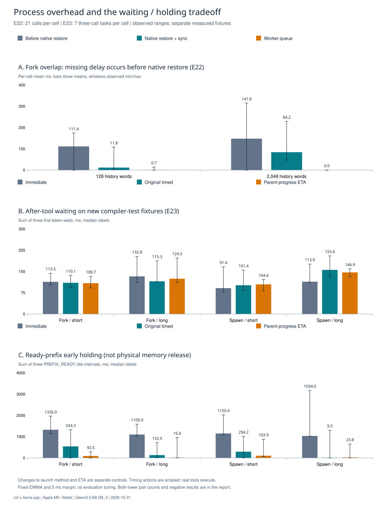

| E23 compiler words | Baseline | Candidate | Wait saving median ms | Hold saving median ms | Both lower pairs /7 | Task saving median ms |
| --- | --- | --- | --- | --- | --- | --- |
| 320 | restore_fork_timed | restore_fork_progress | -2.585 | 489.678 | 3 | -75.445 |
| 320 | restore_spawn_timed | restore_spawn_progress | 3.334 | -2.180 | 2 | 13.274 |
| 320 | restore_fork_timed | restore_spawn_progress | 10.255 | 450.279 | 5 | 1086.248 |
| 320 | restore_spawn_immediate | restore_spawn_progress | -0.448 | 1025.696 | 3 | -70.999 |
| 1792 | restore_fork_timed | restore_fork_progress | -1.506 | 18.673 | 1 | 1.773 |
| 1792 | restore_spawn_timed | restore_spawn_progress | 8.243 | 0.089 | 4 | -15.058 |
| 1792 | restore_fork_timed | restore_spawn_progress | -16.118 | 35.081 | 0 | 388.666 |
| 1792 | restore_spawn_immediate | restore_spawn_progress | -25.510 | 1028.661 | 1 | -14.552 |

明确改善在进程启动／校验干扰：编译工具各策略／历史单元的fork平均启动175–388ms，spawn恢复单元约0.6–0.9ms。长历史立即恢复对照的before-native由260.299降到0.227ms；在不改KV格式或llama内核的情况下消除了这类fork重叠停顿。不能因此把完整任务的所有波动都算作调度收益。

progress ETA尚未稳定双赢：相对spawn/timed，短／长历史三轮等待的逐对节省中位3.334／8.243ms，提前空等逐对节省−2.180／+0.089ms，仅2/7与4/7对同时下降。长历史完整任务逐对节省−15.058ms，反而变慢；该组独立等待中位155.645→146.870ms，但空等中位9.481→23.805ms。不同统计口径全部保留，不替换成有利的聚合去宣称Pareto改进。progress保持显式可选，原timed默认保留。

剩余权衡来自spawn之后工具时长仍会漂移。spawn编译组的最终后缀prefill均值约28–38ms/调用，prefix等待又是截断且有波动的量，阶段ETA变好无法消除这些成本。只改固定余量会移动等待／占位权衡；本轮没有用E23标签重调冻结5ms／alpha或挑一个新默认策略。

全部负的逐对差异保留在[restore-control-pairs.csv](data/restore-control-pairs.csv)，[restore-task-summary.csv](data/restore-task-summary.csv)列完整任务范围，阶段及最终前端／预填充单列。只比较同轮对照：不同历史／工作量和机上漂移使E21／E22→E23跨轮差值不能称算法提速。就绪前缀空等变少或文件校验停顿减少，都不等于物理KV缩容或Gaussian准时保证。

当前progress／spawn代码通过epoch／重复／越界／取消、Native／14K／KV／Stream、含进程组超时的默认工具、ASan/UBSan、精确canonical／fresh-greedy和实际CLI确定性路由验收。E23为979条native（192标定、784评价、3状态），每任务三次计时工具调用，编译任务另有计入总时的真实修正写入。计时动作仍为脚本选择，不是新的0.6B自主能力结论；旧证据不变，本阶段实测源码哈希看E23，后续实现看E24。

## E24 · 完整任务归因与提前清理

E23长历史逐对中位退化15.058ms对应rep1。可加拆分：工具+8.354、工具前+8.207、工具后−3.517、真实修正+.874、记账+1.141ms；其中保存+8.267ms属于工具前。必须在同一对上加总，不能加各项独立中位数。全部14对编译任务、原task/call索引与不变E23哈希见[tool-taskcost-e23-audit.csv](data/tool-taskcost-e23-audit.csv)。E23两组本来都调用同一progress API，尚无证据支持“回调直接花15ms”。

冻结新验证：512/2304历史词、两个输入的乘法修复、1800万rotate/xor循环、实际编译测试及快速读控制。五策略按rep轮转，每组七个三次调用任务，同状态共用三任务标定、独立仅过去标签的EWMA；alpha／5ms不调。单列回调起止和线程创建／tool函数入口。每次恢复前的保存仍计完整成本，其波动不能从成绩中扣掉。

| E24 case / words | Mode | n tasks | After-tool sum ms | Ready-prefix hold ms | Complete task ms |
| --- | --- | --- | --- | --- | --- |
| compile_test / 512 | resident | 7 | 84.443 | 0.000 | 1257.895 |
| compile_test / 512 | restore_progress | 7 | 100.187 | 15.305 | 1289.769 |
| compile_test / 512 | restore_progress_early | 7 | 117.519 | 369.356 | 1603.203 |
| compile_test / 512 | restore_timed | 7 | 97.510 | 23.097 | 1274.111 |
| compile_test / 512 | restore_timed_noevent | 7 | 113.965 | 138.027 | 1666.130 |
| compile_test / 2304 | resident | 7 | 121.208 | 0.000 | 1191.032 |
| compile_test / 2304 | restore_progress | 7 | 176.448 | 8.251 | 1427.730 |
| compile_test / 2304 | restore_progress_early | 7 | 157.264 | 1.592 | 1435.031 |
| compile_test / 2304 | restore_timed | 7 | 170.962 | 3.529 | 1501.343 |
| compile_test / 2304 | restore_timed_noevent | 7 | 194.797 | 25.770 | 1547.942 |
| read / 512 | resident | 7 | 73.097 | 0.000 | 73.468 |
| read / 512 | restore_progress | 7 | 99.179 | 0.000 | 130.606 |
| read / 512 | restore_progress_early | 7 | 99.566 | 0.000 | 130.520 |
| read / 512 | restore_timed | 7 | 99.235 | 0.000 | 130.962 |
| read / 512 | restore_timed_noevent | 7 | 100.067 | 0.000 | 131.843 |
| read / 2304 | resident | 7 | 111.807 | 0.000 | 112.228 |
| read / 2304 | restore_progress | 7 | 202.649 | 0.000 | 387.736 |
| read / 2304 | restore_progress_early | 7 | 202.906 | 0.000 | 332.479 |
| read / 2304 | restore_timed | 7 | 200.859 | 0.000 | 469.614 |
| read / 2304 | restore_timed_noevent | 7 | 196.560 | 0.000 | 395.747 |

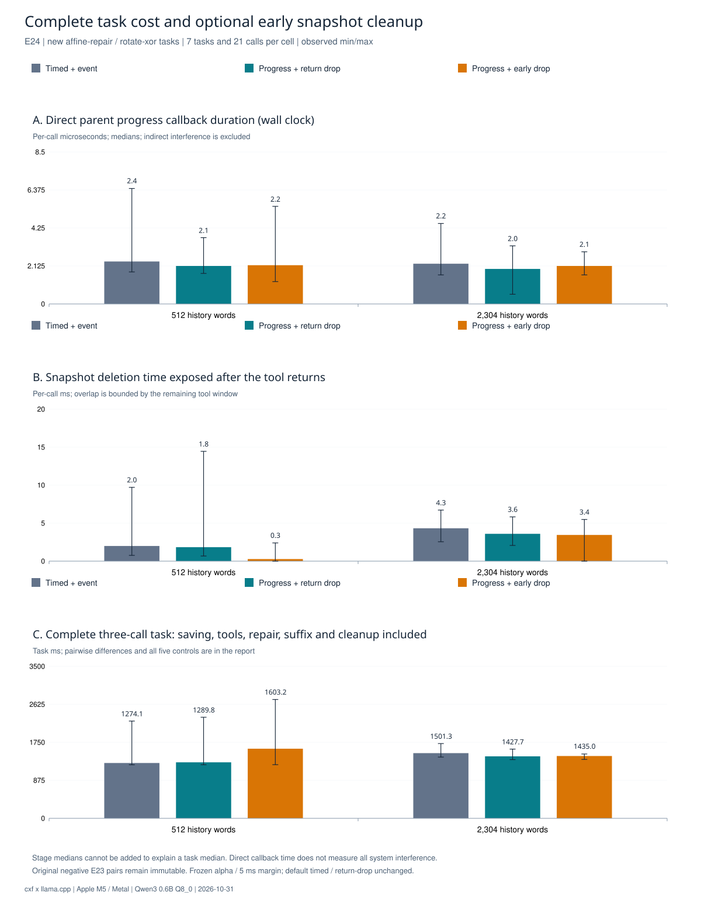

| Compiler words | Baseline | Candidate | Task saving median [min,max] ms | Faster /7 | Wait saving median ms | Both wait/hold lower /7 |
| --- | --- | --- | --- | --- | --- | --- |
| 512 | restore_timed_noevent | restore_timed | 108.807 [-56.630, 575.300] | 5 | -1.459 | 2 |
| 512 | restore_timed | restore_progress | -20.077 [-110.575, 34.548] | 3 | -1.326 | 0 |
| 512 | restore_progress | restore_progress_early | -313.434 [-1017.385, 38.183] | 1 | -14.894 | 0 |
| 512 | restore_timed | restore_progress_early | -369.662 [-996.644, 0.471] | 1 | -11.431 | 0 |
| 512 | resident | restore_progress_early | -421.120 [-915.575, 59.884] | 1 | -34.971 | 0 |
| 2304 | restore_timed_noevent | restore_timed | 21.558 [-144.398, 227.750] | 4 | 12.244 | 4 |
| 2304 | restore_timed | restore_progress | 43.701 [-93.027, 369.400] | 4 | -1.867 | 0 |
| 2304 | restore_progress | restore_progress_early | -4.653 [-55.016, 145.699] | 3 | 20.711 | 3 |
| 2304 | restore_timed | restore_progress_early | 62.188 [-11.315, 364.748] | 6 | 24.917 | 0 |
| 2304 | resident | restore_progress_early | -221.151 [-283.699, -167.650] | 0 | -36.056 | 0 |

| Compiler words | Mode | Callback mean / max ms | Thread creation mean ms | Drop exposed after tool mean ms |
| --- | --- | --- | --- | --- |
| 512 | resident | 0.000387 / 0.000792 | 0.000000 | 0.000 |
| 512 | restore_progress | 0.002468 / 0.003709 | 0.024032 | 2.308 |
| 512 | restore_progress_early | 0.002639 / 0.005459 | 0.023123 | 0.648 |
| 512 | restore_timed | 0.002841 / 0.006458 | 0.025202 | 2.581 |
| 512 | restore_timed_noevent | 0.000000 / 0.000000 | 0.029091 | 2.385 |
| 2304 | resident | 0.000292 / 0.000542 | 0.000000 | 0.000 |
| 2304 | restore_progress | 0.002044 / 0.003250 | 0.021331 | 4.004 |
| 2304 | restore_progress_early | 0.002159 / 0.002917 | 0.021889 | 3.346 |
| 2304 | restore_timed | 0.002347 / 0.004500 | 0.021312 | 4.161 |
| 2304 | restore_timed_noevent | 0.000000 / 0.000000 | 0.021268 | 5.403 |

恢复组直接回调均值2.0–2.8微秒、最大6.458微秒；线程创建均值21–29微秒，解释不了15ms。相同调度的timed有／无事件任务差值仍有正有负，串行墙钟差不是回调CPU成本。提前删除使暴露清理均值短2.308→.648ms、长4.004→3.346ms，但相对原progress完整任务逐对中位分别回退313.434ms（仅1/7更快）和4.653ms（3/7更快）；长等待改善20.711ms、5/7为正，短等待恶化14.894ms。短任务中位回退那一对包含工具慢350.203ms、工具前少42.725ms的部分抵消；间接争用与OS／缓存／频率漂移尚未完全分开，不能从2ms清理区间断言350ms工具变化的原因。优化不升为默认。

可选提前释放只在ticket finish排空后删除私有快照，prefix_ready仍表示设备就绪。返回前join清理，保留取消回滚、工具仅执行一次及失败时返回清理兜底，不新增线程。用--tool-snapshot-release early选择，默认仍return／timed。删除可与剩余工具重叠，但消除不了工具前保存或工具时长波动；直接回调耗时也不包含间接争用。七对不构成OS负载的完整因果拆分或尾部保证。

全部新任务恒等式、标定及评价见[tool-taskcost-accounting.csv](data/tool-taskcost-accounting.csv)，包括负结果的每对任务及源索引见[tool-taskcost-pairs.csv](data/tool-taskcost-pairs.csv)，汇总范围在[restore-control-pairs.csv](data/restore-control-pairs.csv)。E24新增659条native：72标定调用＋24任务、420评价调用＋140任务、3状态；12个独立fresh-KV参考核对492调用。计时前通过sanitizer、恢复前／中／后取消、工具异常、Native/14K/KV/Stream、默认回归及实际CLI工具一次执行。当前实测源码私有归档，公开仅哈希；不跨轮相减、不宣称模型能力或物理显存释放。

## E25 · 快照删除与资源隔离

快照属于可选容量策略。正常resident不做save/evict/restore；也可只保留canonical token后重算。当前恢复文件绑定同一live engine/session/revision，不支持冷重启，不缩小预分配KV buffer。实验restore每次工具前保存的成本全部收费，不是普通Agent的必需开销；不应主动逐出可用KV来制造预热机会。

E25用可信C驱动器将短512词／1800万修复任务拆成真实编译与实际check运行。五控制各10完整任务，正反Latin轮换，每策略每个位置恰好2次；同标定、独立仅过去标签的EWMA，5ms／alpha不改。unlink-hold移除目录项但保留owner私有fd及原槽位／预算，工具结束才最后close。[Apple unlink](https://developer.apple.com/library/archive/documentation/System/Conceptual/ManPages_iPhoneOS/man2/unlink.2.html)定义该隔离语义，不预先保证收益大小。

| Mode | Task median ms | After-tool sum median ms | Compiler wall / CPU mean ms per call | Run wall / CPU mean ms per call |
| --- | --- | --- | --- | --- |
| resident | 1222.877 | 81.552 | 70.915 / 66.185 | 313.059 / 11.085 |
| restore_late | 1503.624 | 124.675 | 72.200 / 68.141 | 286.704 / 11.032 |
| restore_progress | 1490.805 | 109.246 | 68.679 / 65.697 | 288.187 / 11.035 |
| restore_progress_early | 1481.071 | 103.081 | 74.403 / 65.133 | 284.608 / 10.612 |
| restore_progress_hold | 1479.308 | 97.232 | 71.347 / 66.006 | 284.484 / 10.570 |

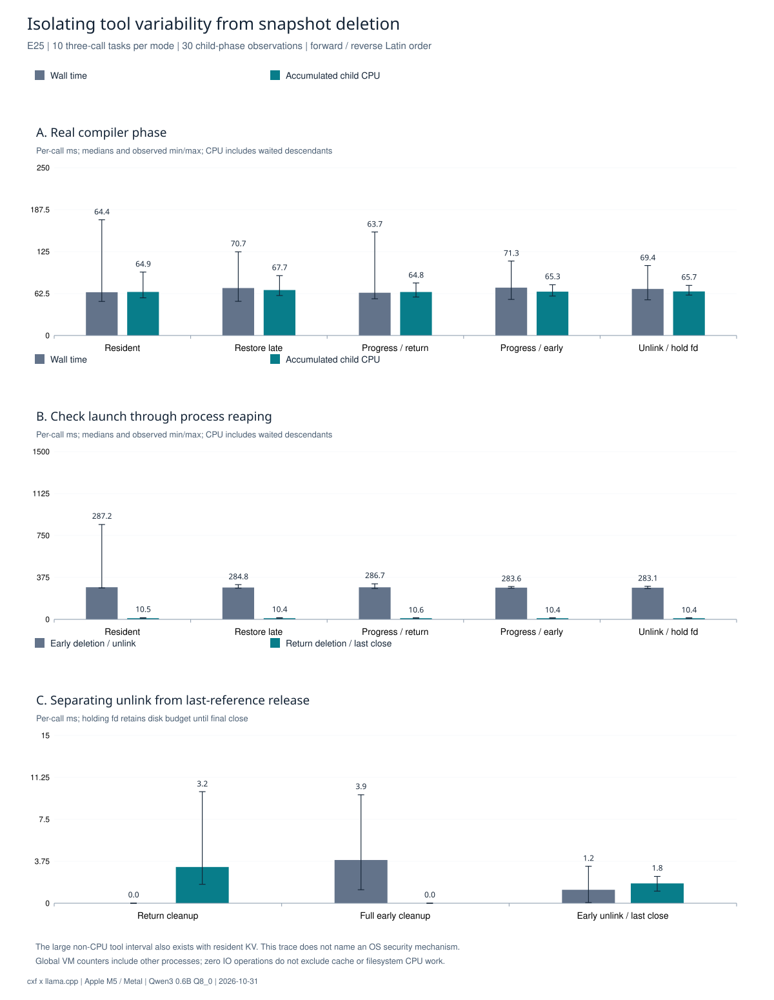

| Baseline | Candidate | Task saving median [min,max] ms | Faster /10 | Compiler wall saving median ms | Run wall saving median ms |
| --- | --- | --- | --- | --- | --- |
| resident | restore_late | -241.392 [-319.091, 192.313] | 1 | -5.196 | 11.588 |
| restore_late | restore_progress | -2.641 [-80.434, 101.558] | 5 | 12.683 | 0.172 |
| restore_progress | restore_progress_early | 14.258 [-130.629, 176.366] | 5 | -11.420 | 3.646 |
| restore_progress_early | restore_progress_hold | 1.146 [-60.771, 148.835] | 5 | -1.367 | -2.509 |
| restore_progress | restore_progress_hold | 25.522 [-67.823, 131.303] | 6 | -18.899 | 14.316 |

E25未复现稳定313ms提前删除惩罚：early相对return任务逐对中位节省14.258ms、仅5/10更快，范围−130.629至176.366ms；将最后close移出工具（early→hold）仅中位节省1.146ms、5/10更快。完整提前删除均值4.064ms墙钟、父进程区间CPU2.166ms；保留fd的unlink为1.253ms／.117ms，工具后最后close墙钟1.795ms。直接差异较小，未证实数百ms机制。所有模式含resident均有check启动／回收墙钟284–313ms、child CPU10.6–11.1ms；驻留也出现全机压缩／swapin，不能专归因unlink，因此另做E26 main入口时间线。

资源样本、全部负任务对及源索引见[tool-isolate-resources.csv](data/tool-isolate-resources.csv)、[tool-isolate-tasks.csv](data/tool-isolate-tasks.csv)、[tool-isolate-pairs.csv](data/tool-isolate-pairs.csv)及[tool-isolate-pair-summary.csv](data/tool-isolate-pair-summary.csv)。[wait4](https://developer.apple.com/library/archive/documentation/System/Conceptual/ManPages_iPhoneOS/man2/wait4.2.html)包含已等待后代的资源；并发编译CPU可超过墙钟，墙钟减CPU不能当IO时间。[getrusage](https://developer.apple.com/library/archive/documentation/System/Conceptual/ManPages_iPhoneOS/man2/getrusage.2.html)的IO操作数不包含缓存命中，0不能排除文件系统CPU／缓存争用。Mach全机VM计数含其他进程，footprint可下降。资源采样及驱动器属于各组共用诊断成本，计入任务，不宣称E24→E25跨轮提速。

E25为227条native：18标定调用＋6任务、150评价调用＋50任务、3状态；3个fresh-KV参考核对168调用。计时前通过ASan/UBSan、保留槽位记账、占用／重复unlink／失效恢复拒绝、等待／运行／ready取消、Native14K/KV/Stream、默认回归及实际CLI一次验收。默认resident容量策略、timed ETA及返回清理不变，hold-fd保持显式诊断；精确实测源码私有归档、公开哈希。原313.434ms负结果保留，不被本轮替换。

## E26 · 程序首次启动与增量构建

E25在驻留控制也定位到check启动／回收的大段墙钟区间。E26另冻新768词／1200万任务，修复改为两个输入的calc(x)=3*x−2，记录spawn返回及child main／compute-end。每次真实工具都将同binary运行两次并验证退出一致，第二次stdout丢弃、成本照收；每任务开头删除旧binary。显式增量部署命令在实际修正后重建，只在第三次源未变化时复用artifact，从不跳过测试或缓存测试结果。

| Rebuilt this call | Execution | n calls | Wall median ms | Spawn call median ms | Pre-main median ms | Compute median ms |
| --- | --- | --- | --- | --- | --- | --- |
| True | run | 98 | 287.626 | 0.179 | 278.015 | 7.978 |
| True | rerun | 98 | 10.066 | 0.216 | 1.788 | 6.561 |
| False | run | 7 | 7.903 | 0.125 | 1.149 | 6.311 |
| False | rerun | 7 | 8.318 | 0.170 | 1.345 | 6.247 |

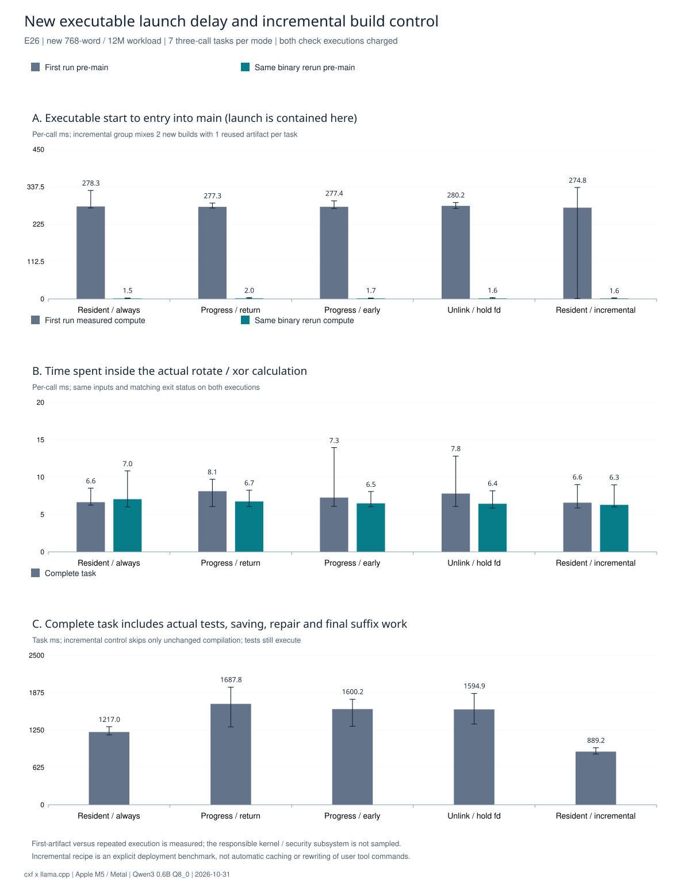

| Mode | Complete task median [min,max] ms | After-tool wait sum median ms |
| --- | --- | --- |
| resident | 1216.956 [1168.982, 1306.134] | 85.939 |
| resident_incremental | 889.234 [848.386, 953.673] | 86.553 |
| restore_progress | 1687.815 [1302.576, 1966.837] | 127.155 |
| restore_progress_early | 1600.152 [1313.317, 1764.993] | 113.817 |
| restore_progress_hold | 1594.890 [1351.155, 1860.827] | 118.072 |

| Baseline | Candidate | Task saving median [min,max] ms | Faster /7 | Compiler wall saving median ms | Run wall saving median ms |
| --- | --- | --- | --- | --- | --- |
| restore_progress | restore_progress_early | 39.677 [-135.317, 366.685] | 5 | -20.914 | 0.952 |
| restore_progress_early | restore_progress_hold | 20.756 [-210.271, 168.660] | 5 | 4.984 | -7.925 |
| resident | resident_incremental | 327.722 [283.323, 395.514] | 7 | 58.769 | 278.636 |
| resident | restore_progress | -381.680 [-756.651, -133.594] | 0 | -18.109 | 4.752 |

新artifact首次运行pre-main中位278.015ms（spawn调用.179ms），同artifact立即再运行pre-main为1.788ms；总运行墙钟287.626→10.066ms，计算7.978／6.561ms。复用的第三轮artifact pre-main为1.149ms。大段共同延迟因此定位在首次执行的进程创建后、main前，不在算术中，也不专属于KV清理。显式增量命令使完整任务逐对中位减少327.722ms，范围283.323–395.514ms、7/7更快，测试照常执行；这是工具流程优化，不是llama提速。清理仍有负对：E26 early相对return范围−135.317至366.685ms，hold相对early−210.271至168.660ms，默认策略保持不变。

pre-main包含进程创建及loader／平台工作；spawn调用是其中的观测，不可再相加。父进程可能在child已进main后恢复调度，不假设所有样本spawn返回都早于main。同artifact配对可定位首次执行延迟，不能据此指定Gatekeeper／AMFI／SSD或某个内核原因。旧E24没有child入口时间戳，其313ms那对在这个更细边界仍无法追溯确定，全局资源噪声也不事后过滤。

完整阶段、标定／任务、负逐对及首次执行分层见[tool-launch-stages.csv](data/tool-launch-stages.csv)、[tool-launch-tasks.csv](data/tool-launch-tasks.csv)、[tool-launch-pairs.csv](data/tool-launch-pairs.csv)、[tool-launch-pair-summary.csv](data/tool-launch-pair-summary.csv)及[tool-launch-executions.csv](data/tool-launch-executions.csv)。E26新增167条native：18标定调用＋6任务、105评价调用＋35任务、3状态；3个fresh-KV参考核对123调用。含标定共246次实际check执行，全部计入123个工具成本。重复测试增加工作，只比较E26同轮对照。运行时默认仍resident／timed／return，增量命令是基准／部署选择，不是cxf自动改写命令。

## E27 · 正常常驻多轮工具流程

两个控制都在任务内持续保留KV。六次真实调用依次读配置、观察验证失败、写修正、验证通过、回读、再次验证；每轮真实收据经Native准备后取首greedy。原工具直接执行与现有resident协调包装比较，不造save／逐出／恢复或重算基线。两组使用同一预构建验证程序及固定命令，计时内无编译或增量构建优化。模型／初始历史及已记录的程序首次执行暖机单列排除，动作固定以隔离执行成本，不是0.6B自主能力评分。

| History words | Mode | n tasks | Complete six-call task ms | After-tool wait sum ms | New evaluated tokens |
| --- | --- | --- | --- | --- | --- |
| 512 | resident_direct | 7 | 219.249 | 168.173 | 397 |
| 512 | resident_wrapper | 7 | 227.322 | 172.606 | 397 |
| 3072 | resident_direct | 7 | 315.233 | 275.026 | 397 |
| 3072 | resident_wrapper | 7 | 325.307 | 279.857 | 397 |

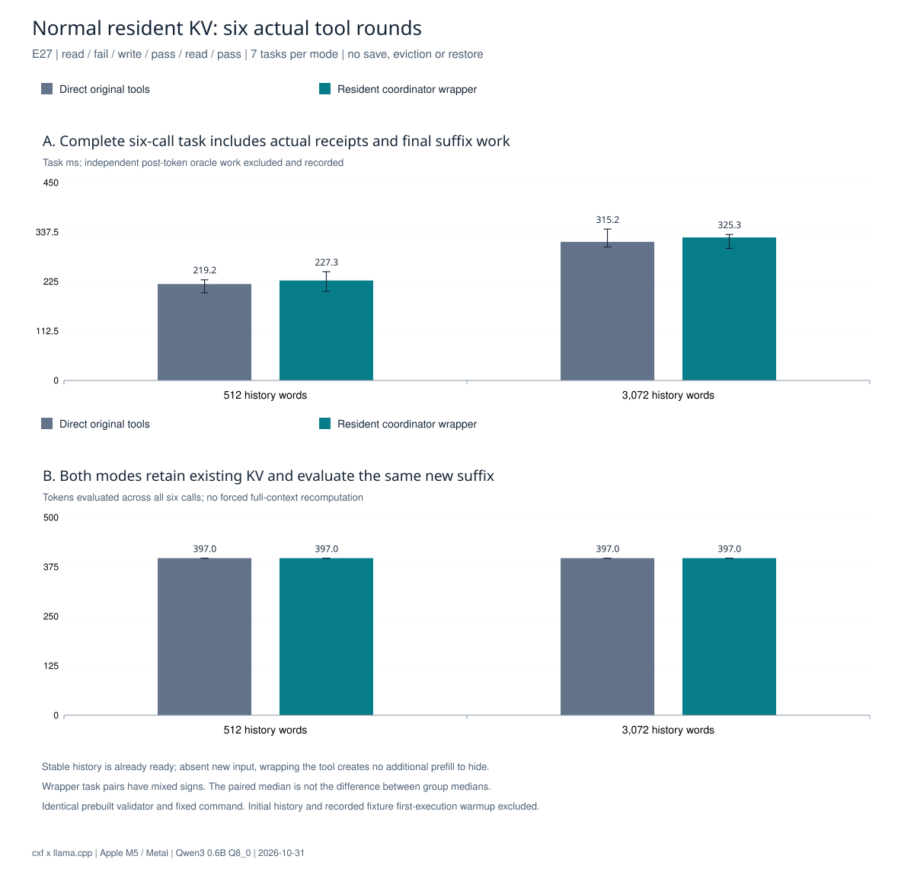

| History words | Wrapper task saving median [min,max] ms | Faster /7 | After-tool saving median ms | Evaluated-token difference |
| --- | --- | --- | --- | --- |
| 512 | -14.293 [-27.304, 13.428] | 2 | 2.146 | 0 |
| 3072 | 5.014 [-28.343, 18.985] | 4 | -8.223 | 0 |

工具执行期间若没有新输入，就没有额外准备可隐藏：稳定历史KV已经就绪。两模式六轮均只新增评估397 token，完整canonical／fresh-greedy一致。短／长包装任务逐对中位节省−14.293／+5.014ms，仅2/7／4/7更快，两档都有负对，不能证明稳定额外收益。前缀复用计数表示免做的工作量，不是对主动丢KV基线的实测提速；原任务墙钟、前五段首token后oracle排除值、共同collector记账及固定工具耗时分列。

逐条调用／任务／对照见[resident-flow-calls.csv](data/resident-flow-calls.csv)、[resident-flow-tasks.csv](data/resident-flow-tasks.csv)及[resident-flow-pairs.csv](data/resident-flow-pairs.csv)。E27新增199记录：168次工具调用、28完整任务、3状态；12个独立fresh参考核对全部调用。save／逐出／恢复／推测准备和私有KV文件均为0。ASan/UBSan、实际修正、Native14K、既有Stream及默认回归通过，未改生产API／默认值或构建命令。

## E28 · 真实进程源的常驻流式预填充

真实预构建进程从文件读12个不可变报告单元，每块实际执行0／4000万循环，完成后立即flush NDJSON；两档80／240词和wait_all／合批／急切三模式，在同场景内容及CPU工作完全相同。无sleep／人为网络gap，最后payload后无免费尾部空等。模型保留1024词初始历史和已接收前缀KV。从producer启动计完整任务，计入源CPU／墙钟、输入、首greedy及Stream正常关闭；完整分词oracle在首greedy后执行，仅从完成墙钟扣除，独立fresh预填充在正常close后单列记录。

| Words / unit | CPU iterations / unit | Mode | n | After-input first median ms | Total first median ms | Complete incl. close median ms | Prefill execution median ms | Decode calls median |
| --- | --- | --- | --- | --- | --- | --- | --- | --- |
| 80 | 0 | stream_coalesced | 7 | 354.609 | 356.374 | 356.578 | 352.559 | 3 |
| 80 | 0 | stream_eager | 7 | 351.277 | 353.267 | 353.513 | 349.292 | 3 |
| 80 | 0 | wait_all | 7 | 350.211 | 352.461 | 352.683 | 348.285 | 3 |
| 80 | 40000000 | stream_coalesced | 7 | 186.195 | 456.488 | 456.698 | 408.711 | 5 |
| 80 | 40000000 | stream_eager | 7 | 162.872 | 434.558 | 434.755 | 407.222 | 6 |
| 80 | 40000000 | wait_all | 7 | 338.036 | 600.696 | 600.887 | 336.179 | 3 |
| 240 | 0 | stream_coalesced | 7 | 1227.855 | 1230.318 | 1230.678 | 1223.335 | 7 |
| 240 | 0 | stream_eager | 7 | 1227.648 | 1231.681 | 1232.136 | 1219.742 | 6 |
| 240 | 0 | wait_all | 7 | 1215.648 | 1217.741 | 1218.062 | 1211.936 | 6 |
| 240 | 40000000 | stream_coalesced | 7 | 1055.856 | 1327.256 | 1327.583 | 1298.943 | 7 |
| 240 | 40000000 | stream_eager | 7 | 1033.784 | 1311.888 | 1312.230 | 1282.048 | 7 |
| 240 | 40000000 | wait_all | 7 | 1276.354 | 1561.025 | 1561.352 | 1272.501 | 7 |

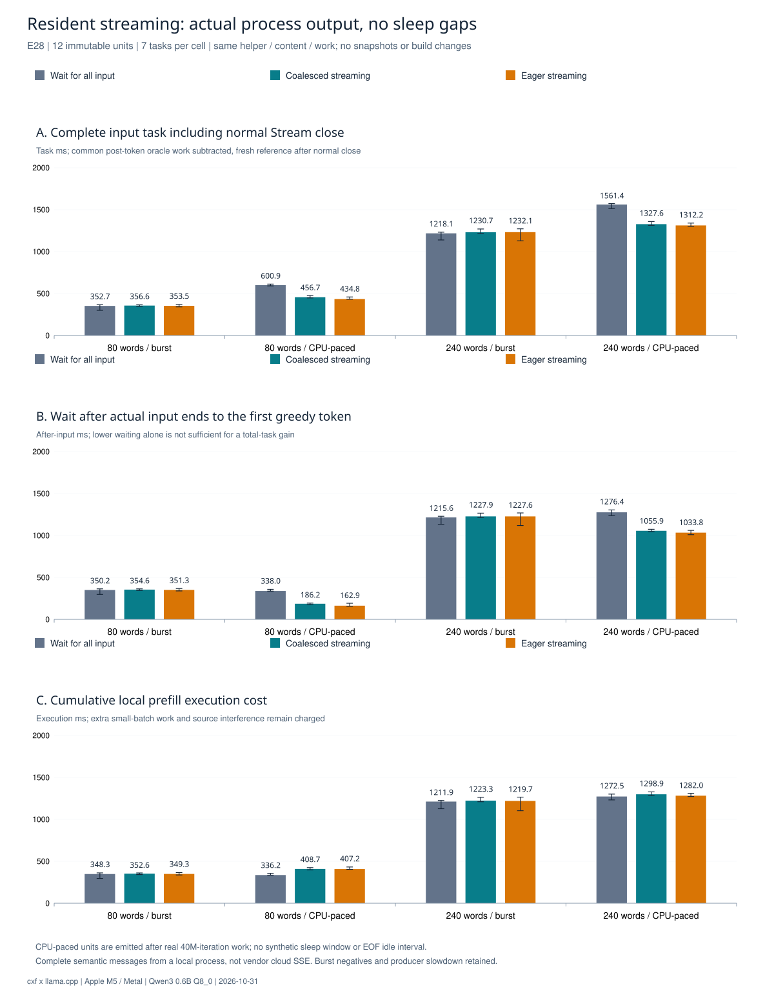

| Words / unit | CPU iterations | Baseline | Candidate | Complete task saving median [min,max] ms | Faster /7 | After-input saving median ms | Prefill execution saving median ms |
| --- | --- | --- | --- | --- | --- | --- | --- |
| 80 | 0 | stream_coalesced | stream_eager | -3.218 [-21.630, 15.808] | 3 | -3.003 | -3.274 |
| 80 | 0 | wait_all | stream_coalesced | -3.167 [-56.809, 9.871] | 3 | -3.573 | -3.297 |
| 80 | 0 | wait_all | stream_eager | -0.975 [-63.885, 25.679] | 2 | -1.123 | -1.027 |
| 80 | 40000000 | stream_coalesced | stream_eager | 14.751 [12.772, 41.898] | 7 | 17.631 | -4.657 |
| 80 | 40000000 | wait_all | stream_coalesced | 136.054 [128.087, 161.338] | 7 | 160.627 | -71.886 |
| 80 | 40000000 | wait_all | stream_eager | 159.388 [146.743, 177.952] | 7 | 179.737 | -70.500 |
| 240 | 0 | stream_coalesced | stream_eager | 4.362 [-55.031, 132.418] | 4 | 4.722 | 4.591 |
| 240 | 0 | wait_all | stream_coalesced | -8.827 [-122.654, 1.535] | 1 | -9.059 | -9.230 |
| 240 | 0 | wait_all | stream_eager | -4.210 [-53.496, 18.330] | 2 | -5.574 | -3.005 |
| 240 | 40000000 | stream_coalesced | stream_eager | 8.736 [-14.278, 57.491] | 5 | 29.585 | 8.716 |
| 240 | 40000000 | wait_all | stream_coalesced | 213.587 [187.491, 248.429] | 7 | 202.249 | -51.719 |
| 240 | 40000000 | wait_all | stream_eager | 234.151 [180.780, 271.078] | 7 | 234.696 | -8.024 |

CPU持续产出场景的完整任务逐对节省：80词合批／急切136.054／159.388ms，240词213.587／234.151ms，四个对照均7/7更快。突发输入没有稳定收益：80词合批／急切节省−3.167／−.975ms，240词−8.827／−4.210ms。80词持续产出时，合批的预填充执行逐对中位增加71.886ms、producer墙钟增加17.769ms，完整任务仍快136.054ms；收益来自已计费工作的重叠，不是推理计算变便宜，且不能相加这些独立中位数反推总时。0／4000万源场景的digest正文不同（80词新增1126／1222 token、240词3046／3142），只做同场景模式对照，不跨场景相减。

保留真实producer与到达时间；重叠可能拖慢producer或增加小批次执行，输入后等待下降不能单独当任务提速。详见[resident-stream-tasks.csv](data/resident-stream-tasks.csv)、[resident-stream-pairs.csv](data/resident-stream-pairs.csv)及带索引的[resident-stream-arrivals.csv](data/resident-stream-arrivals.csv)，全范围在[resident-summary.csv](data/resident-summary.csv)／[resident-pair-summary.csv](data/resident-pair-summary.csv)。E28为87条native：84个完整流式任务＋3状态；arrival数组只在派生CSV展开，不虚增独立样本。各模式canonical／greedy相同，只评估新输入，不涉及snapshot、主动逐出或构建变更。

这里是真实本地进程的完整语义块流水线，不是厂商云SSE、任意token片段提交或agentctl自动接线；Stream tools仍空、worker独占。首次sanitizer collector在9个完成任务后，因额外同时保留的fresh参考KV超过共享8192容量而失败，原失败保留且不进性能汇总。最终oracle移到正常stream close后，不改工作量／容量；最终collector ASan及未变Native/Stream回归通过。GPU惰性初始化、机器漂移、负任务对及额外执行都保留，不累加E26构建收益或跨实验收益。

## E29 · agentctl真实工具输出预填充，KV常驻

输出流已经过实际Native CLI REPL、能力注册、AgentStore和test.run执行器。显式off/on使用完全相同的正文优先／最终状态尾收据及入站尾LF；默认CLI收据不变。固定Native-parser动作选择三次真实test.run再DONE，每任务执行四次实际Native准备／首greedy。这是接线和调度验收，不是0.6B自主规划或完整生成速度。

| Words / line | CPU iterations / line | Mode | Tasks | Whole task ms [min,max] | Post-tool sum ms | Total prefill ms | Adopted KV tokens |
| --- | --- | --- | --- | --- | --- | --- | --- |
| 32 | 0 | off | 7 | 534.981 [524.583,548.710] | 360.011 | 501.392 | 0 |
| 32 | 0 | on | 7 | 574.200 [567.587,591.814] | 406.521 | 549.241 | 1117 |
| 32 | 40000000 | off | 7 | 1284.691 [1262.064,1294.924] | 307.382 | 437.161 | 0 |
| 32 | 40000000 | on | 7 | 1191.172 [1176.677,1202.506] | 199.738 | 504.893 | 1116 |
| 56 | 0 | off | 7 | 755.567 [745.141,772.050] | 576.126 | 716.077 | 0 |
| 56 | 0 | on | 7 | 765.731 [744.560,805.014] | 562.242 | 720.975 | 1603 |
| 56 | 40000000 | off | 7 | 1578.014 [1526.373,1727.419] | 505.563 | 641.840 | 0 |
| 56 | 40000000 | on | 7 | 1373.830 [1320.573,1415.632] | 217.381 | 808.473 | 1692 |

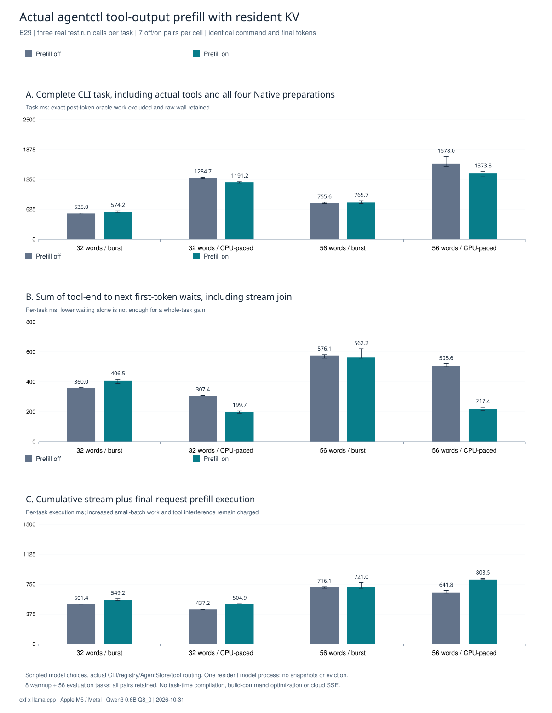

| Words / line | CPU iterations / line | Task saving ms [min,max] | Faster /7 | Post-tool saving ms | Extra prefill ms | Extra tool ms | Extra suffix-tokenization IDs |
| --- | --- | --- | --- | --- | --- | --- | --- |
| 32 | 0 | -43.004 [-47.147,-35.517] | 0 | -44.056 | 46.853 | -1.369 | 1507 |
| 32 | 40000000 | 95.254 [82.185,109.873] | 7 | 107.154 | 67.377 | 21.597 | 2910 |
| 56 | 0 | -20.590 [-49.447,13.288] | 2 | -2.673 | 12.951 | 5.327 | 2279 |
| 56 | 40000000 | 183.960 [152.543,311.787] | 7 | 288.182 | 169.079 | 97.364 | 4350 |

节省为逐对off减on，不是两组中位数相减。保留原始wall、逐次排除的首token后oracle成本、全部预热／评价任务、阶段时序和负对。515条native包含64任务（8预热／56评价）、192次真实工具执行（168评价）、256次全文token oracle和3状态。独立13项sanitizer检查包含fresh-KV greedy、Unicode/BPE尾、截断、超时、取消及仅执行一次；Native14K、原Stream和默认C/HTTP回归通过。首次CLI验收失败（工具独占计数假设与首轮用户LF失效）单独保留；LF归一化早于全部性能任务。

没有快照或主动逐出。临时输出共享当前canonical session；latest-only4KiB队列和4KiB工作副本是有界后缀scratch，不是另一份完整历史。最终完整模板渲染／前缀检查仍执行；BPE可能重算／丢弃尾token。要把首token准备与实际任务收益、额外小批计算、join等待、producer争用一起看；8192 token物理KV仍896MiB。详见[任务](data/tool-output-tasks.csv)、[逐对](data/tool-output-pairs.csv)、[阶段](data/tool-output-stages.csv)、[汇总](data/tool-output-summary.csv)与[逐对汇总](data/tool-output-pair-summary.csv)。单独真实0.6B生产探测返回Native格式错误rc7、零工具执行，能力失败保留。不包含构建优化、云SSE、Windows/CUDA或跨实验叠加收益。

## E30 · 输出观察窗与结束后停止预填充

固定10ms首次观察窗：工具已结束则跳过推测，后续也不消费已结束工具的积压尾。新40/48词、0/3000万循环任务，各7对；真实CLI及canonical/greedy校验与E29一致。wrapper减join包含owner通信与准备，不是纯线程成本。E29突发前端1.632/3.037ms、非join包装0.828/0.935ms，额外prefill46.853/12.951ms；这是阶段测量，尚不是小批次／分词／线程的因果消融。

| Words | Iterations | Task saving ms [min,max] | Faster /7 | Extra prefill ms | Extra frontend ms |
| --- | --- | --- | --- | --- | --- |
| 40 | 0 | -9.710 [-54.902,15.563] | 2 | 15.157 | 0.291 |
| 40 | 30000000 | 188.140 [36.308,222.913] | 7 | 89.427 | 2.670 |
| 48 | 0 | 11.535 [-22.266,28.884] | 5 | 0.387 | -0.000 |
| 48 | 30000000 | 282.308 [243.066,293.666] | 7 | 32.678 | 2.690 |

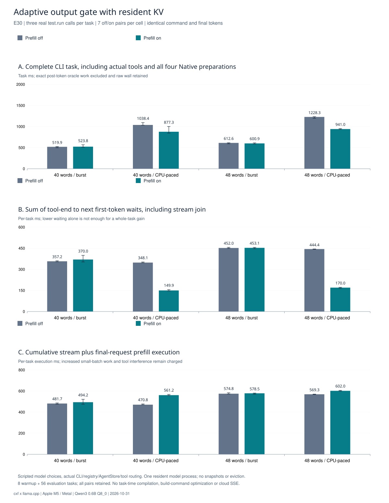

全部515记录和负对保留。负载不同于E29，本轮没有同负载旧on或仅分词／仅线程隔离控制，不能用跨实验差值宣称因果改善幅度。见[E30证据](../evidence/tool-output-adaptive-20261031.json)。

## E31/E32 · 同负载隔离与输出增长门槛

E31同40/48词负载轮换off、E29 old、E30 on、仅线程/owner和仅分词；E32换36/52词负载验证off/on/progress。thread含回调、队列和owner往返；token只增加局部后缀构造／分词，不改canonical/KV。组间差包含调度互动，不能相加为纯部件成本。

| Experiment | Words | Iterations | Mode vs off | Task saving ms [min,max] | Faster /7 | Extra prefill ms | Extra frontend ms |
| --- | --- | --- | --- | --- | --- | --- | --- |
| E31 | 40 | 0 | old | -55.116 [-101.481,-28.895] | 0 | 58.527 | 2.564 |
| E31 | 40 | 0 | on | -8.121 [-31.383,77.201] | 2 | 7.638 | -0.000 |
| E31 | 40 | 0 | thread | -4.152 [-31.144,85.682] | 3 | -5.322 | -0.000 |
| E31 | 40 | 0 | token | 15.752 [-25.892,54.223] | 6 | -11.560 | 2.027 |
| E31 | 40 | 30000000 | old | 195.876 [88.622,251.118] | 7 | 86.516 | 3.067 |
| E31 | 40 | 30000000 | on | 205.595 [133.410,255.380] | 7 | 90.299 | 2.353 |
| E31 | 40 | 30000000 | thread | -1.815 [-96.137,26.703] | 2 | -3.367 | -0.000 |
| E31 | 40 | 30000000 | token | 3.837 [-73.955,14.562] | 4 | -2.218 | 3.125 |
| E31 | 48 | 0 | old | -22.264 [-130.256,80.577] | 2 | 15.380 | 2.997 |
| E31 | 48 | 0 | on | -13.745 [-63.908,44.049] | 3 | 1.841 | -0.000 |
| E31 | 48 | 0 | thread | 3.453 [-64.898,58.758] | 4 | 0.268 | -0.000 |
| E31 | 48 | 0 | token | 0.629 [-96.971,39.096] | 4 | 3.713 | 2.707 |
| E31 | 48 | 30000000 | old | 269.546 [-1720.279,305.327] | 6 | 26.697 | 3.843 |
| E31 | 48 | 30000000 | on | 267.400 [-465.572,369.655] | 6 | 47.862 | 2.625 |
| E31 | 48 | 30000000 | thread | -28.078 [-1299.672,-3.317] | 0 | 5.339 | -0.000 |
| E31 | 48 | 30000000 | token | -8.723 [-771.307,16.701] | 2 | 4.290 | 3.635 |
| E32 | 36 | 0 | on | 3.065 [-23.854,10.703] | 4 | 4.038 | -0.000 |
| E32 | 36 | 0 | progress | 1.538 [-24.572,40.460] | 5 | 0.121 | -0.000 |
| E32 | 36 | 25000000 | on | 111.044 [97.078,169.465] | 7 | 76.768 | 5.491 |
| E32 | 36 | 25000000 | progress | 91.036 [37.602,185.376] | 7 | 66.923 | 5.844 |
| E32 | 52 | 0 | on | 5.539 [-11.603,36.464] | 5 | -12.220 | 0.479 |
| E32 | 52 | 0 | progress | 5.337 [-30.462,15.519] | 4 | 4.857 | -0.000 |
| E32 | 52 | 25000000 | on | 173.037 [86.070,324.526] | 7 | 105.267 | 7.816 |
| E32 | 52 | 25000000 | progress | 210.939 [140.327,298.986] | 7 | 105.154 | 8.201 |

| Experiment | Words | Iterations | Baseline | Candidate | Task saving median [min,max] ms | Faster /7 |
| --- | --- | --- | --- | --- | --- | --- |
| E31 | 40 | 0 | off | thread | -4.152 [-31.144,85.682] | 3 |
| E31 | 40 | 0 | thread | token | 19.681 [-31.459,40.878] | 5 |
| E31 | 40 | 0 | token | old | -74.059 [-111.215,-36.263] | 0 |
| E31 | 40 | 0 | old | on | 46.380 [26.042,106.097] | 7 |
| E31 | 40 | 0 | off | on | -8.121 [-31.383,77.201] | 2 |
| E31 | 40 | 30000000 | off | thread | -1.815 [-96.137,26.703] | 2 |
| E31 | 40 | 30000000 | thread | token | 2.164 [-18.011,22.182] | 5 |
| E31 | 40 | 30000000 | token | old | 195.443 [162.577,243.760] | 7 |
| E31 | 40 | 30000000 | old | on | 11.643 [-69.860,87.039] | 5 |
| E31 | 40 | 30000000 | off | on | 205.595 [133.410,255.380] | 7 |
| E31 | 48 | 0 | off | thread | 3.453 [-64.898,58.758] | 4 |
| E31 | 48 | 0 | thread | token | -9.433 [-59.126,67.438] | 2 |
| E31 | 48 | 0 | token | old | 24.436 [-135.769,79.321] | 4 |
| E31 | 48 | 0 | old | on | -4.650 [-36.528,82.519] | 3 |
| E31 | 48 | 0 | off | on | -13.745 [-63.908,44.049] | 3 |
| E31 | 48 | 30000000 | off | thread | -28.078 [-1299.672,-3.317] | 0 |
| E31 | 48 | 30000000 | thread | token | 20.018 [-743.229,924.060] | 5 |
| E31 | 48 | 30000000 | token | old | 278.204 [-1344.666,972.403] | 6 |
| E31 | 48 | 30000000 | old | on | -2.146 [-55.427,1254.707] | 2 |
| E31 | 48 | 30000000 | off | on | 267.400 [-465.572,369.655] | 6 |
| E32 | 36 | 0 | off | on | 3.065 [-23.854,10.703] | 4 |
| E32 | 36 | 0 | off | progress | 1.538 [-24.572,40.460] | 5 |
| E32 | 36 | 0 | on | progress | 7.859 [-35.276,64.314] | 4 |
| E32 | 36 | 25000000 | off | on | 111.044 [97.078,169.465] | 7 |
| E32 | 36 | 25000000 | off | progress | 91.036 [37.602,185.376] | 7 |
| E32 | 36 | 25000000 | on | progress | -32.246 [-78.429,18.784] | 2 |
| E32 | 52 | 0 | off | on | 5.539 [-11.603,36.464] | 5 |
| E32 | 52 | 0 | off | progress | 5.337 [-30.462,15.519] | 4 |
| E32 | 52 | 0 | on | progress | -13.203 [-28.601,6.676] | 3 |
| E32 | 52 | 25000000 | off | on | 173.037 [86.070,324.526] | 7 |
| E32 | 52 | 25000000 | off | progress | 210.939 [140.327,298.986] | 7 |
| E32 | 52 | 25000000 | on | progress | 2.832 [-31.805,124.869] | 4 |

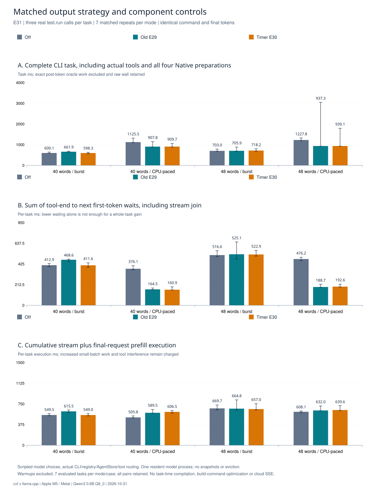

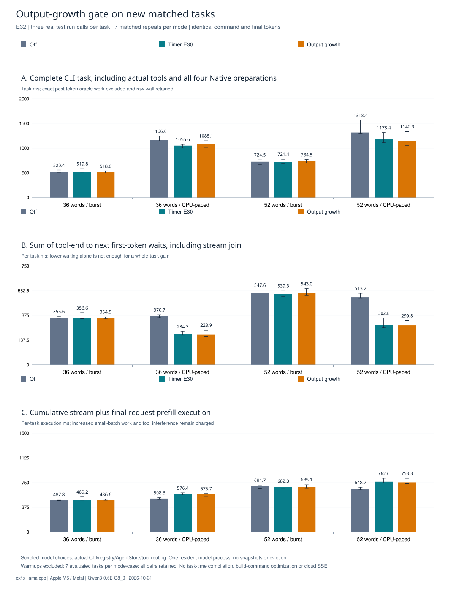

增长策略在42次评价突发调用中推测更新为零，但没有全面优于计时策略：36词持续组反慢32.246ms（2/7更快），52词突发反慢13.203ms。相对关闭最差突发仍慢30.462ms，其中工具墙钟增加23.740ms、工具后增加5.691ms，流式预填充与分词均为零，包装增加0.391ms、join增加0.058ms。未进一步分开系统调度与间接争用；策略保持显式可选，不宣称稳定尾延迟改善。

E30最差对慢54.902ms，其中工具多14.659ms、工具后多41.046ms；额外prefill37.933ms、stream前端0.918ms。两次突发在约16ms完成前启动decode，留下113/132ms join等待。10ms计时器无法区分晚回收与持续输出。progress要求首输出后至少10ms再次观测到正文增长，单独超时和最终回调均不触发推测。负对、原始wall和oracle排除均保留。

## E33–E35 · 工具、进程回收与线程归因

E33在36/52词同负载补off/on/progress/thread对照；E34冻结可选macOS退出事件等待，换44/50词新负载验证六组原版／事件版。事件模式只改进程等待，KV保持常驻。下表正值为baseline−candidate，所有负对保留。

| Experiment | Words | Iterations | Baseline | Candidate | Task saving ms [min,max] | Faster /7 | Tool saving ms | EOF wait saving ms |
| --- | --- | --- | --- | --- | --- | --- | --- | --- |
| E33 | 36 | 0 | off | on | 8.096 [-5.064,35.516] | 6 | 11.617 | 11.061 |
| E33 | 36 | 0 | off | progress | 19.218 [-30.529,34.963] | 6 | -0.369 | 0.000 |
| E33 | 36 | 0 | off | thread | 9.594 [-33.598,36.078] | 5 | 2.441 | 0.202 |
| E33 | 36 | 0 | on | progress | -3.104 [-25.465,19.748] | 3 | -1.668 | -0.849 |
| E33 | 36 | 25000000 | off | on | 138.632 [4.810,180.307] | 7 | -0.089 | 0.034 |
| E33 | 36 | 25000000 | off | progress | 147.166 [120.581,224.747] | 7 | 4.754 | 0.004 |
| E33 | 36 | 25000000 | off | thread | 6.326 [-10.548,19.100] | 4 | -1.947 | 0.277 |
| E33 | 36 | 25000000 | on | progress | 16.361 [-18.051,132.256] | 5 | 5.686 | -0.030 |
| E33 | 52 | 0 | off | on | -18.003 [-29.868,38.927] | 2 | -1.255 | 0.791 |
| E33 | 52 | 0 | off | progress | -31.694 [-44.648,24.659] | 2 | -9.115 | 0.027 |
| E33 | 52 | 0 | off | thread | 8.675 [-42.903,26.115] | 4 | 11.589 | 12.004 |
| E33 | 52 | 0 | on | progress | -8.207 [-60.929,28.775] | 2 | 2.208 | 0.245 |
| E33 | 52 | 25000000 | off | on | 224.330 [22.098,386.584] | 7 | 8.766 | 21.125 |
| E33 | 52 | 25000000 | off | progress | 271.064 [-281.195,376.576] | 6 | 13.350 | 0.204 |
| E33 | 52 | 25000000 | off | thread | -2.864 [-361.043,169.672] | 3 | 2.787 | -0.440 |
| E33 | 52 | 25000000 | on | progress | -10.009 [-438.678,248.966] | 2 | -24.995 | -11.015 |
| E34 | 44 | 0 | off | off-event | -0.430 [-46.825,152.133] | 3 | 9.767 | 0.000 |
| E34 | 44 | 0 | on | on-event | 5.692 [-132.809,199.076] | 5 | 3.013 | 0.000 |
| E34 | 44 | 0 | progress | progress-event | 3.233 [-2.857,16.751] | 6 | 6.893 | 10.154 |
| E34 | 44 | 0 | off-event | on-event | -0.084 [-93.563,72.774] | 3 | 0.289 | 0.000 |
| E34 | 44 | 0 | off-event | progress-event | -0.269 [-15.659,56.783] | 3 | 0.295 | 0.000 |
| E34 | 44 | 0 | on-event | progress-event | -2.656 [-15.991,98.102] | 2 | 0.628 | 0.000 |
| E34 | 44 | 20000000 | off | off-event | -14.456 [-61.432,334.674] | 3 | 12.859 | 10.779 |
| E34 | 44 | 20000000 | on | on-event | 1.452 [-19.599,346.795] | 5 | 28.401 | 10.610 |
| E34 | 44 | 20000000 | progress | progress-event | -1.788 [-53.050,79.609] | 3 | 19.977 | 11.835 |
| E34 | 44 | 20000000 | off-event | on-event | 177.285 [144.027,238.723] | 7 | -4.753 | 0.001 |
| E34 | 44 | 20000000 | off-event | progress-event | 184.434 [89.888,264.492] | 7 | -1.541 | 0.827 |
| E34 | 44 | 20000000 | on-event | progress-event | 9.479 [-138.247,87.207] | 4 | 8.931 | 0.000 |
| E34 | 50 | 0 | off | off-event | 8.494 [-19.942,76.887] | 5 | 0.019 | 0.000 |
| E34 | 50 | 0 | on | on-event | 13.661 [-18.090,161.093] | 6 | 0.257 | 0.000 |
| E34 | 50 | 0 | progress | progress-event | -14.726 [-82.384,148.184] | 3 | 8.982 | 11.006 |
| E34 | 50 | 0 | off-event | on-event | -0.347 [-11.726,54.966] | 3 | 0.919 | 0.000 |
| E34 | 50 | 0 | off-event | progress-event | 7.187 [-94.278,58.940] | 4 | 1.310 | 0.000 |
| E34 | 50 | 0 | on-event | progress-event | -12.149 [-93.513,25.397] | 2 | -0.808 | 0.000 |
| E34 | 50 | 20000000 | off | off-event | 12.336 [-21.559,179.445] | 5 | 15.491 | 11.814 |
| E34 | 50 | 20000000 | on | on-event | 11.838 [-28.823,21.651] | 5 | 28.688 | 21.069 |
| E34 | 50 | 20000000 | progress | progress-event | 3.689 [-25.966,77.677] | 4 | 13.082 | 11.236 |
| E34 | 50 | 20000000 | off-event | on-event | 212.005 [171.369,250.316] | 7 | -6.598 | 0.000 |
| E34 | 50 | 20000000 | off-event | progress-event | 216.147 [183.692,265.103] | 7 | -17.599 | -10.696 |
| E34 | 50 | 20000000 | on-event | progress-event | 6.043 [-28.312,36.124] | 5 | -11.780 | -1.651 |
| E35 | 46 | 0 | off | off-race | -0.495 [-23.547,34.766] | 3 | 0.532 | 0.000 |
| E35 | 46 | 0 | off-event | off-race | 8.276 [-11.706,44.797] | 4 | -0.164 | 0.000 |
| E35 | 46 | 0 | progress-event | progress-race | -0.445 [-40.428,43.311] | 3 | -0.402 | 0.000 |
| E35 | 46 | 0 | off-race | progress-race | -0.730 [-41.487,35.709] | 3 | -0.200 | 0.000 |
| E35 | 46 | 15000000 | off | off-race | 40.677 [9.010,73.436] | 7 | 33.865 | 34.158 |
| E35 | 46 | 15000000 | off-event | off-race | 4.157 [-13.247,51.610] | 5 | 9.113 | 10.742 |
| E35 | 46 | 15000000 | progress-event | progress-race | -8.112 [-41.242,62.480] | 3 | 7.492 | 8.747 |
| E35 | 46 | 15000000 | off-race | progress-race | 152.085 [111.852,171.441] | 7 | -5.830 | -1.254 |
| E35 | 54 | 0 | off | off-race | -0.189 [-144.433,147.081] | 3 | 8.141 | 0.000 |
| E35 | 54 | 0 | off-event | off-race | -2.324 [-107.588,35.541] | 3 | -0.248 | 0.000 |
| E35 | 54 | 0 | progress-event | progress-race | -0.940 [-20.043,108.869] | 3 | 0.324 | 0.000 |
| E35 | 54 | 0 | off-race | progress-race | 7.770 [-3.154,148.628] | 4 | 0.811 | 0.000 |
| E35 | 54 | 15000000 | off | off-race | 48.196 [19.610,325.272] | 7 | 36.611 | 32.109 |
| E35 | 54 | 15000000 | off-event | off-race | 9.186 [-24.265,169.615] | 4 | 14.414 | 9.872 |
| E35 | 54 | 15000000 | progress-event | progress-race | 6.640 [-110.100,64.107] | 5 | 19.060 | 18.353 |
| E35 | 54 | 15000000 | off-race | progress-race | 138.815 [-8.919,153.671] | 6 | -8.687 | -1.137 |

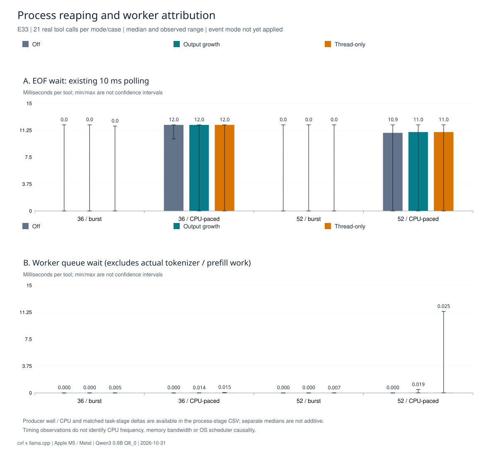

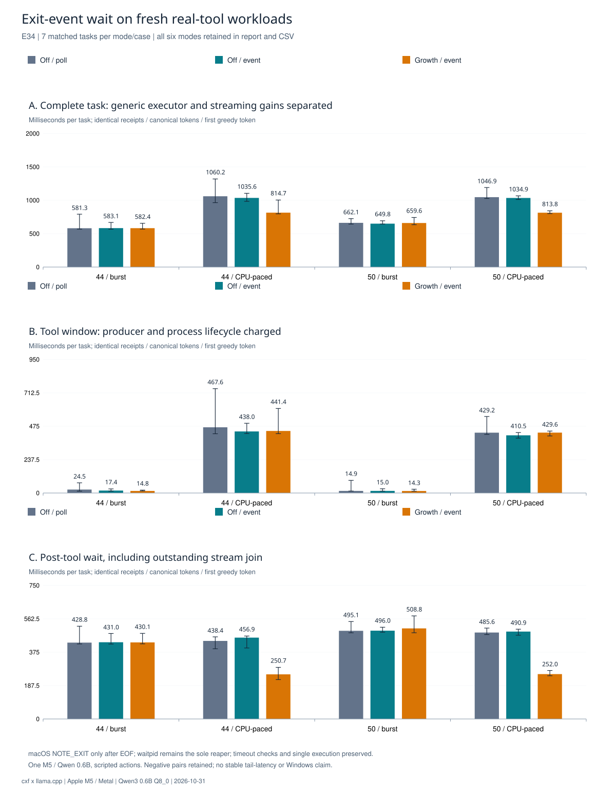

E33复现36词突发最差慢30.529ms：工具多11.706ms、EOF轮询多12.008ms、工具后多14.309ms。52词最差慢44.648ms却是启动多8.741ms、工具后多34.043ms，轮询差几乎为零。这些突发growth没有推测更新。轮询解释了具体一部分，不能解释所有30ms级回退。

旧36词持续组增长策略慢32.246ms未复现：E33相对定时快16.361ms，producer墙钟少6.135ms、CPU少2.924ms，EOF等待只多0.030ms（独立中位数不可相加）。观测到的worker排队／回调远小于几十毫秒，但不能据此排除间接争用。未采频率、带宽和OS调度计数器，不能进一步硬指认硬件原因。E32缺少该观测，旧单对无法追溯定论。

明细见[进程阶段](data/tool-output-process-stages.csv)和[全部配对](data/tool-output-process-pairs.csv)。child-end在sidecar写入／退出前，后段包含观测IO；eof_poll_ms历史名称保留，在事件组表示实际事件等待。默认策略不变，空闲REPL显式选择on-event/progress-event；off-event须配合prefill off作为关闭推测的执行器控制。两版各13个sanitizer单元场景及32／48个真实CLI任务通过；EOF／超时／执行一次检查和默认C/HTTP/CLI回归通过。Native14K／完整Stream仍引用E29历史验收。不宣称Windows/CUDA、云SSE、物理KV释放或尾延迟保证。

E35每模式84次工具调用，EOF等待最大值分别为poll12.015ms、off-event12.013ms、growth-event12.006ms、off-race1.262ms、growth-race1.263ms。持续任务单独修正执行器off-race相对off快40.677／48.196ms，均7/7；流式相对相同修正的关闭组快152.085／138.815ms（7/7、6/7），突发−0.730／+7.770ms并不稳定。growth-race相对growth-event持续组为−8.112／+6.640ms，不是全面改善。

E35最差突发off-race相对off仍慢144.433ms：工具后多115.438ms、累计prefill多138.381ms，EOF等待和推测工作均为零。54词持续growth-race相对growth-event最差慢110.100ms，producer墙钟多127.289ms（CPU29.921ms、非CPU97.368ms），owner排队仅多0.004ms，prefill反少14.954ms。这些负对不支持直接归咎于worker排队或退出等待；间接资源争用与环境波动仍未细分。

E33逐工具owner排队中位数：timer/growth/thread-only为0.013／0.006／0.014ms，最大2.210／0.486／11.388ms；回调最大0.063／0.030／0.074ms。线程控制的排队异常值仍展示，小中位数不等于没有争用。另500条系统调用观测见[退出探针](data/tool-output-exit-probes.csv)，并发开发期记录单独标注。

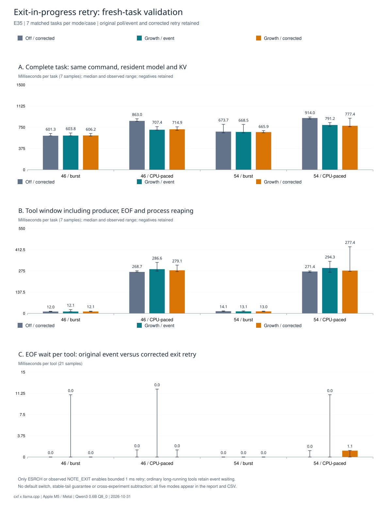

E34保留大幅负对：44词突发on-event相对on最差慢132.809ms，推测更新仍为零，启动多26.051ms、累计prefill多105.400ms；50词突发progress-event相对progress最差慢82.384ms，含11.317ms EOF等待和73.088ms工具后等待。没有删负样本或把负结果改称收益。

独立100次退出系统调用探针中，10次超过1ms的等待全部发生在kevent注册返回ESRCH且未收到退出事件之后；只再试一次waitpid不足以避开该退出窗口。E35冻结仅在ESRCH或已收到NOTE_EXIT后用1ms有界重试，其他情况仍正常等事件并检查超时。换46/54词、0/1500万循环的新负载，off/off-event/progress-event/off-race/progress-race各1预热＋7评价。最终独占200次交替探针两组均未触发正等待，保留为未复现，不能拿它当提速证据。功能正确与性能效果分开。

E35增加13个sanitizer单元场景、40个真实CLI任务和event/race两路径的EOF／状态／超时／执行一次检查。修正版仍显式可选：/tool-output-policy progress-race配合prefill on；off-race配合prefill off是执行器控制。上表保留逐对完整任务成绩和全部负对；历史证据与实测源码归档不变。

## E36/E37 · 剩余回退隔离与按需启动消费者

E36同46/54词、0/1500万循环负载，比较off-race、休眠消费者、同增长门槛owner空操作、仅分词和真实预填充；退出竞态修正及最终收据／token／greedy保持一致。E37冻结按需创建消费者，再换42/55词、0/1800万循环验证off／原增长／按需增长。KV常驻，无快照、逐出或构建命令优化。

| Experiment | Words | Iterations | Baseline | Candidate | Task saving ms [min,max] | Faster /7 | Producer saving ms | Final prefill saving ms | Final prepare CPU saving ms |
| --- | --- | --- | --- | --- | --- | --- | --- | --- | --- |
| E36 | 46 | 0 | off-race | idle-race | -13.197 [-52.427,72.138] | 3 | 0.091 | 7.798 | 0.342 |
| E36 | 46 | 0 | idle-race | thread-race | 23.513 [-78.044,35.753] | 4 | 0.108 | -12.203 | -2.895 |
| E36 | 46 | 0 | thread-race | token-race | -52.855 [-146.705,99.712] | 1 | -0.107 | -33.462 | -1.068 |
| E36 | 46 | 0 | token-race | progress-race | 11.279 [-43.835,153.509] | 5 | 0.040 | 18.778 | -1.777 |
| E36 | 46 | 0 | off-race | progress-race | -2.758 [-22.565,30.232] | 3 | 0.317 | -8.263 | -1.761 |
| E36 | 46 | 15000000 | off-race | idle-race | -2.165 [-77.978,41.076] | 3 | 3.097 | 0.270 | 0.757 |
| E36 | 46 | 15000000 | idle-race | thread-race | 1.851 [-61.235,98.238] | 4 | 7.516 | 17.905 | 0.215 |
| E36 | 46 | 15000000 | thread-race | token-race | -2.575 [-58.580,26.110] | 2 | -5.536 | -2.911 | -0.127 |
| E36 | 46 | 15000000 | token-race | progress-race | 155.608 [1.723,185.256] | 7 | -15.377 | 296.661 | 6.201 |
| E36 | 46 | 15000000 | off-race | progress-race | 156.071 [-46.110,207.727] | 6 | -8.514 | 307.533 | 6.502 |
| E36 | 54 | 0 | off-race | idle-race | -44.225 [-136.609,164.205] | 2 | 0.775 | -26.147 | -1.018 |
| E36 | 54 | 0 | idle-race | thread-race | 21.741 [-99.502,168.787] | 4 | 0.126 | 16.264 | -0.791 |
| E36 | 54 | 0 | thread-race | token-race | -12.344 [-134.354,133.580] | 3 | 0.011 | 2.374 | 1.252 |
| E36 | 54 | 0 | token-race | progress-race | -10.771 [-46.540,45.675] | 3 | -0.029 | 5.975 | 0.576 |
| E36 | 54 | 0 | off-race | progress-race | -14.805 [-59.287,168.762] | 3 | 0.598 | -23.021 | -1.490 |
| E36 | 54 | 15000000 | off-race | idle-race | 5.334 [-63.165,31.836] | 5 | -0.807 | 2.812 | -0.104 |
| E36 | 54 | 15000000 | idle-race | thread-race | 3.592 [-191.604,52.276] | 5 | -0.116 | 0.695 | 0.245 |
| E36 | 54 | 15000000 | thread-race | token-race | -4.528 [-7.179,157.979] | 2 | -1.107 | -0.160 | 0.007 |
| E36 | 54 | 15000000 | token-race | progress-race | 146.967 [98.576,167.953] | 7 | -1.565 | 284.614 | 5.345 |
| E36 | 54 | 15000000 | off-race | progress-race | 146.824 [96.787,179.974] | 7 | 1.352 | 282.387 | 5.516 |
| E37 | 42 | 0 | off-race | progress-race | 1.690 [-16.161,28.634] | 4 | 0.103 | 5.566 | 1.591 |
| E37 | 42 | 0 | off-race | lazy-race | -1.018 [-51.406,23.540] | 2 | 0.068 | 2.378 | -0.318 |
| E37 | 42 | 0 | progress-race | lazy-race | -2.556 [-38.351,23.960] | 3 | -0.047 | -3.188 | -0.667 |
| E37 | 42 | 18000000 | off-race | progress-race | 139.682 [83.459,197.049] | 7 | -1.642 | 225.513 | 2.364 |
| E37 | 42 | 18000000 | off-race | lazy-race | 141.552 [-16.223,192.553] | 6 | 3.954 | 223.222 | 1.754 |
| E37 | 42 | 18000000 | progress-race | lazy-race | -8.057 [-99.683,41.337] | 2 | -9.593 | -0.246 | -0.396 |
| E37 | 55 | 0 | off-race | progress-race | 2.239 [-19.202,3.072] | 4 | -0.007 | 1.791 | -0.034 |
| E37 | 55 | 0 | off-race | lazy-race | -0.706 [-17.077,2.837] | 3 | 0.004 | -0.562 | 0.254 |
| E37 | 55 | 0 | progress-race | lazy-race | -1.157 [-4.668,8.183] | 3 | 0.008 | -2.173 | 0.105 |
| E37 | 55 | 18000000 | off-race | progress-race | 190.649 [178.216,217.559] | 7 | -3.932 | 297.780 | 5.811 |
| E37 | 55 | 18000000 | off-race | lazy-race | 186.168 [51.977,189.868] | 7 | -4.596 | 305.033 | 5.657 |
| E37 | 55 | 18000000 | progress-race | lazy-race | -1.786 [-165.583,7.952] | 2 | 0.157 | 3.470 | 0.010 |

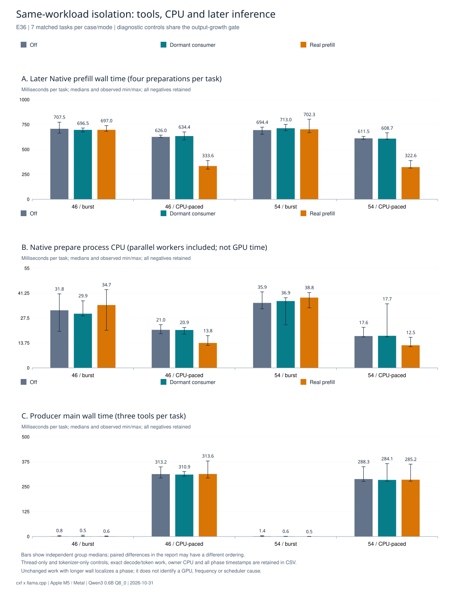

没有消费者时推理执行也会波动：突发off-race的计算量固定为8次decode、46／54词分别2407／2599个evaluated token，累计最终prefill仍为663.212–773.431ms／652.351–723.838ms。46词休眠线程最差对慢52.427ms，prefill多51.812ms，processCPU反少0.342ms，producer少0.292ms。46词仅分词控制最差慢176.074ms，prefill多135.522ms、processCPU仅多11.641ms，计算量相同且推测求值为零。后续prepare在消费者join之后运行，不能用消费者同时抢owner解释该阶段；间接历史效应与设备／系统调度仍未分开，CPU时间不代表GPU时间。

工具阶段也确有回退：E36持续46词真实预填充相对关闭有一对任务慢46.110ms，尽管最终prefill少232.001ms。producer墙钟多82.061ms，其中CPU多18.017ms、非CPU多64.044ms，owner排队仅多0.404ms。休眠／线程／分词控制未建立稳定的几十毫秒线程惩罚；没有硬件计数器进一步证明哪种间接影响导致producer非CPU时间增加。独立分量中位数不可相加。

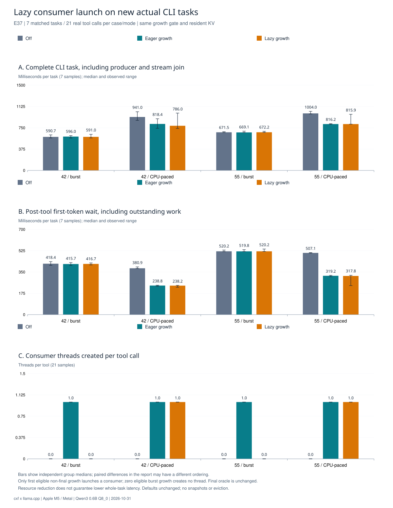

按需启动只消除确定无用的工作，没有消掉大回退：42次评价突发工具调用，原增长策略创建42个消费者、按需版为零，两组推测求值均为零。原线程构造在每个三工具突发任务的逐对中位合计0.079／0.049ms。按需版相对原版完整任务，突发反慢2.556／1.157ms，持续反慢8.057／1.786ms，四项负结果全部保留。按需持续流式相对关闭仍快141.552／186.168ms（6/7、7/7）；突发−1.018／−0.706ms无稳定收益。已证明减少资源操作，未证明比原增长策略更快。默认不切换。

E37按需相对原版持续最差慢99.683／165.583ms，producer墙钟分别多92.094／244.519ms、非CPU多69.954／223.439ms；55词该对最终prefill反少67.928ms，owner排队多4.553ms、最终decode数相同。移动约0.05ms的构造不能解释165ms整任务负对。全部负结果保留，不剔除异常值、不据评价调参。

明细见[任务](data/tool-output-contention-tasks.csv)、[全部配对](data/tool-output-contention-pairs.csv)、[索引阶段](data/tool-output-contention-phases.csv)，保留CPU、decode、producer和线程构造观测。并行worker可使processCPU超过wall；最终decode减少表示工作提前，不表示总推理工作减少。13／22个原生sanitizer场景、40／24个真实CLI sanitizer任务及最终默认C/HTTP/CLI回归通过。覆盖按需启动前取消、exit3、超时、截断、Unicode/NUL和容量拒绝不重执行；未注入线程构造OOM。Native14K／完整Stream仍为E29历史检查。不作GPU频率或Windows/CUDA结论。

## E38/E39 · decode、同步与可运行调度

E38在42/55词、0/1800万循环同负载比较关闭／休眠／仅线程／增长；E39换43/53词、0/1600万循环比较逐块／合并内部同步，并保留流式开关。每实验1027条CLI记录＋96条同期producer-alone记录，共1123条。命令预构建，模型／KV常驻。独立producer的stdout为/dev/null，CLI为管道，因此只比较计算／调度观测，不把不同父进程启动或IO差计为收益。

| Experiment | Words | Iterations | Baseline | Candidate | Task saving ms [min,max] | Faster /7 | Final decode saving ms | Final sync saving ms | Final prefill saving ms |
| --- | --- | --- | --- | --- | --- | --- | --- | --- | --- |
| E38 | 42 | 0 | off-race | idle-race | 0.066 [-26.772,9.950] | 4 | -0.079 | 1.457 | 1.611 |
| E38 | 42 | 0 | idle-race | thread-race | 0.548 [-24.885,29.968] | 4 | -0.181 | -2.397 | -0.316 |
| E38 | 42 | 0 | off-race | progress-race | 0.154 [-12.093,10.398] | 4 | 0.040 | 0.937 | -0.913 |
| E38 | 42 | 18000000 | off-race | idle-race | 6.407 [-98.463,45.914] | 4 | -0.500 | 1.589 | 1.371 |
| E38 | 42 | 18000000 | idle-race | thread-race | 13.839 [-95.870,118.962] | 4 | 0.613 | -0.485 | 0.131 |
| E38 | 42 | 18000000 | off-race | progress-race | 163.185 [94.118,238.159] | 7 | 1.761 | 235.373 | 237.271 |
| E38 | 55 | 0 | off-race | idle-race | -0.264 [-11.930,12.324] | 3 | 0.505 | -1.816 | 0.547 |
| E38 | 55 | 0 | idle-race | thread-race | -12.057 [-26.086,8.052] | 3 | -3.413 | 4.154 | -4.442 |
| E38 | 55 | 0 | off-race | progress-race | 2.353 [-13.155,5.124] | 4 | -2.483 | 0.891 | 0.434 |
| E38 | 55 | 18000000 | off-race | idle-race | 9.371 [-32.320,24.224] | 6 | 0.762 | 3.446 | 4.698 |
| E38 | 55 | 18000000 | idle-race | thread-race | 2.043 [-11.401,24.562] | 5 | 0.189 | 0.249 | 0.440 |
| E38 | 55 | 18000000 | off-race | progress-race | 189.609 [175.321,217.267] | 7 | 5.104 | 298.611 | 304.017 |
| E39 | 43 | 0 | off-race | off-drain | 2.332 [-14.574,28.530] | 5 | -72.362 | 75.444 | 3.604 |
| E39 | 43 | 0 | progress-race | progress-drain | 10.408 [-6.216,21.935] | 5 | -71.596 | 77.129 | 5.638 |
| E39 | 43 | 0 | off-drain | progress-drain | 0.083 [-3.687,30.460] | 4 | -0.370 | 0.656 | 0.267 |
| E39 | 43 | 16000000 | off-race | off-drain | 2.616 [-35.150,12.177] | 5 | -73.266 | 70.945 | -2.956 |
| E39 | 43 | 16000000 | progress-race | progress-drain | 8.022 [-22.930,22.845] | 5 | -72.693 | 72.150 | -1.002 |
| E39 | 43 | 16000000 | off-drain | progress-drain | 123.224 [81.289,148.944] | 7 | 1.997 | 229.124 | 231.150 |
| E39 | 53 | 0 | off-race | off-drain | 2.369 [-36.111,8.882] | 5 | -491.394 | 496.522 | 5.262 |
| E39 | 53 | 0 | progress-race | progress-drain | 1.331 [-7.919,10.182] | 4 | -493.776 | 494.552 | 2.016 |
| E39 | 53 | 0 | off-drain | progress-drain | -3.296 [-6.990,29.048] | 2 | 1.774 | -4.078 | -2.259 |
| E39 | 53 | 16000000 | off-race | off-drain | 3.904 [-44.039,66.908] | 4 | -469.545 | 474.810 | 9.399 |
| E39 | 53 | 16000000 | progress-race | progress-drain | 11.822 [-35.597,94.807] | 5 | -73.195 | 79.915 | 7.533 |
| E39 | 53 | 16000000 | off-drain | progress-drain | 169.701 [144.178,208.896] | 7 | 401.758 | -116.966 | 289.752 |

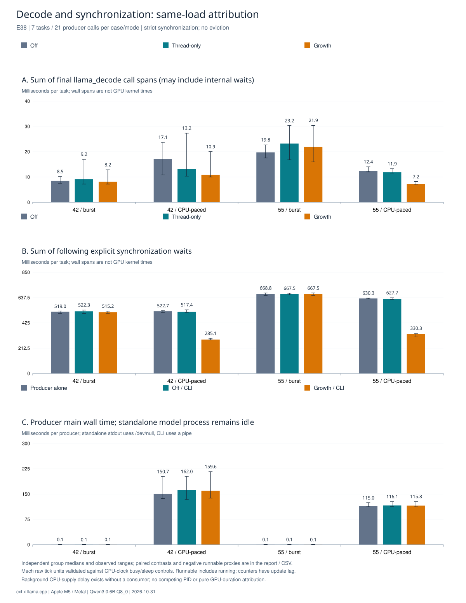

E38突发关闭组，累计最终decode调用中位8.478／19.754ms，显式同步518.959／668.833ms，sync ownerCPU仅0.114／0.313ms。42词关闭组prefill最大减最小21.640ms，其中sync多20.305ms、decode多1.336ms，token／decode计算量相同；55词差22.904ms，其中sync多17.699ms。旧71–110ms范围本轮未复现，历史数据仍保留。已定位等待阶段，不能当作GPU核函数时长：decode可内部等待，同步还包含未完成工作及host唤醒／调度。

producer是单线程。本M5的proc原始计数须乘125/3：100ms CPU校验得到2,400,083个CPU ticks，对照CLOCK_THREAD_CPUTIME_ID为100,000,083ns。E38持续42词，即使模型进程空闲，独立producer的ready等待代理仍达56.318ms，中位墙钟150.745ms、CPU142.341ms；关闭／休眠／仅线程／增长的逐工具最大ready代理55.041／75.191／79.983／75.607ms，不是随消费者工作递增的惩罚。退休指令中位约873–876M。55词独立最大1.260ms、增长最大11.949ms，各模式指令中位约865M。这证明存在背景CPU供给延迟，也保留较小的模式相关变化；没有定位竞争PID，不能声称间接争用为零。

runnable包含正在运行，故ready代理=(runnable−CPU)×timebase，blocked代理=wall−runnable×timebase。计数更新有滞后，任务合计中位约−13ms等负值保留，不代表物理负等待。持续42词的setup／output逐工具中位约0.08–0.13ms，较大延迟落在compute／runnable跨度，未落在已测文件／输出跨度；独立100ms sleep校验也暴露更新误差。持续42词独立producer的非自愿切换中位790次，55词37次。每shape五模式共105次评价调用，ready代理与非自愿切换的Pearson r为0.700／0.405；相关支持调度机制，但没有定位竞争进程，不宣称精确分解每一毫秒非CPU时间。

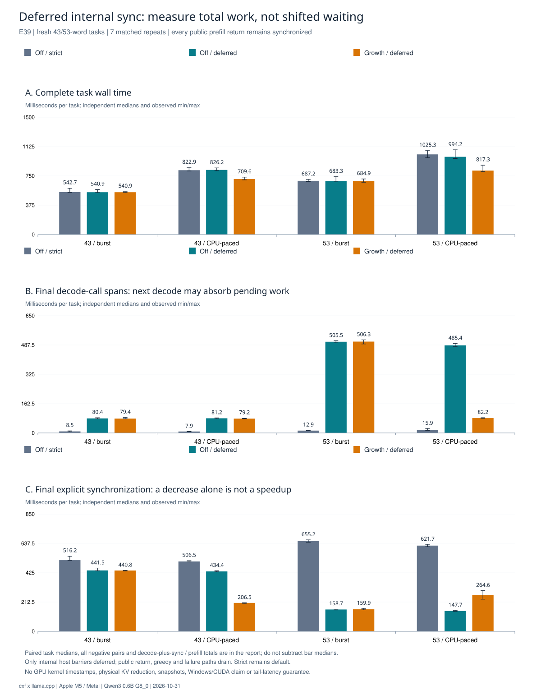

E39只在同一次prefill内部减少显式host屏障，公开返回前排空，greedy重放／失败仍同步。43词任务少一次最终显式同步，53词突发少四次。大部分同步下降移入decode：53词突发off-drain相对off-race，sync少496.522ms，decode多491.394ms，最终prefill只少5.262ms、整任务快2.369ms，不能宣传为497ms提速。43词持续off-drain的最终prefill反慢2.956ms，虽整任务中位快2.616ms；负结果均保留。

四个case中off-drain相对strict整任务中位快2.332／2.616／2.369／3.904ms；growth-drain快10.408／8.022／1.331／11.822ms，但每项仅4–5/7获益，最差仍慢44.039ms（关闭）和35.597ms（增长）。相同合并同步基线上，流式持续任务仍快123.224／169.701ms，均7/7；突发+0.083／−3.296ms无稳定收益。合并同步保持显式选择，默认不变；未据评价调参、未删负样本、不跨轮相减。

E39最差off-drain持续53词对慢44.039ms：producer墙钟多23.529ms、CPU多19.195ms、ready代理仅多3.137ms；最终prefill多18.720ms、owner排队为零。producer退休指令多0.186%、cycles多0.316%、CPU时间多5.871%。没有重叠推理时运行速率也会变化；计数与CPU运行速率／供给变化相容，但没有直接测频率或核心驻留。算术producer也不能代表内存带宽密集工具。

明细见[任务](data/decode-schedule-tasks.csv)、[配对](data/decode-schedule-pairs.csv)、[全部producer](data/decode-schedule-producers.csv)和[decode阶段](data/decode-schedule-phases.csv)，保留原始计数与负代理值。E38/E39通过22／30个原生sanitizer场景、32／32个真实CLI sanitizer任务及24／24个producer控制；E39当前源码通过14,357-token合并同步Native、完整strict Stream与默认C/HTTP/CLI回归。长上下文／Stream是E39验收，不将其标为E38源码重跑。未注入decode失败或线程构造OOM；未验收Windows/CUDA或GPU硬件时间戳。

口径对照固定版本[Metal同步实现](https://github.com/ggml-org/llama.cpp/blob/f1e44dcc11d8802d107bd7331a3d3fd3e6f57b93/ggml/src/ggml-metal/ggml-metal-context.m)、[XNU runnable计时生命周期](https://github.com/apple-oss-distributions/xnu/blob/main/osfmk/kern/sched_prim.c)和[task计数汇总](https://github.com/apple-oss-distributions/xnu/blob/main/osfmk/kern/task.c)。上述因果边界是代码与对照观测的推断，不是硬件trace归因。

## E40/E41 · 模型进程CPU竞争源隔离

E38的producer-alone仍让模型存活。E40/E41因此用加载前／退出后两侧absent控制夹住resident观测：每rep重开模型，通过真实四次Native／三工具fixture，完成后立即测、静置100ms后再测，然后正常退出模型。E40以prefill关闭任务初始化，E41开启增长流式。均43/53词、1600万循环，每状态3次producer，1预热＋7评价：192条producer、16条fixture、3条状态，共211条／实验。顺序固定、时间漂移仍存在；模型CPU采样覆盖整个producer子进程，比producer main窗口略宽。

| Experiment | Words | State | Calls | Producer wall median [min,max] ms | Producer CPU median ms | Ready proxy max ms | Model CPU median / max ms |
| --- | --- | --- | --- | --- | --- | --- | --- |
| E40 | 43 | absent-after | 21 | 91.177 [89.193,92.904] | 90.953 | 1.110 | 0.0000 / 0.0000 |
| E40 | 43 | absent-before | 21 | 90.929 [88.400,99.693] | 90.555 | 4.061 | 0.0000 / 0.0000 |
| E40 | 43 | resident-immediate | 21 | 91.456 [89.636,92.735] | 91.299 | 1.317 | 0.0686 / 0.1003 |
| E40 | 43 | resident-settled | 21 | 91.495 [89.983,99.496] | 91.414 | 0.138 | 0.0564 / 0.0722 |
| E40 | 53 | absent-after | 21 | 91.398 [90.059,93.046] | 91.272 | -0.416 | 0.0000 / 0.0000 |
| E40 | 53 | absent-before | 21 | 91.461 [90.105,93.163] | 91.404 | 0.884 | 0.0000 / 0.0000 |
| E40 | 53 | resident-immediate | 21 | 91.042 [90.357,95.056] | 91.004 | 1.020 | 0.0608 / 0.0882 |
| E40 | 53 | resident-settled | 21 | 91.799 [90.374,99.365] | 91.714 | 1.419 | 0.0628 / 0.1324 |
| E41 | 43 | absent-after | 21 | 90.070 [87.447,109.511] | 90.018 | 4.039 | 0.0000 / 0.0000 |
| E41 | 43 | absent-before | 21 | 89.469 [86.782,125.423] | 89.434 | 27.228 | 0.0000 / 0.0000 |
| E41 | 43 | resident-immediate | 21 | 90.876 [87.814,118.667] | 90.857 | 13.887 | 0.0694 / 0.3072 |
| E41 | 43 | resident-settled | 21 | 90.713 [88.412,98.962] | 90.697 | 2.857 | 0.0627 / 0.2460 |
| E41 | 53 | absent-after | 21 | 99.381 [91.300,131.132] | 98.830 | 20.284 | 0.0000 / 0.0000 |
| E41 | 53 | absent-before | 21 | 98.110 [91.484,115.858] | 97.666 | 8.115 | 0.0000 / 0.0000 |
| E41 | 53 | resident-immediate | 21 | 101.805 [91.904,133.124] | 98.826 | 24.881 | 0.1969 / 0.3701 |
| E41 | 53 | resident-settled | 21 | 103.676 [91.324,184.853] | 100.679 | 70.635 | 0.2272 / 0.4471 |

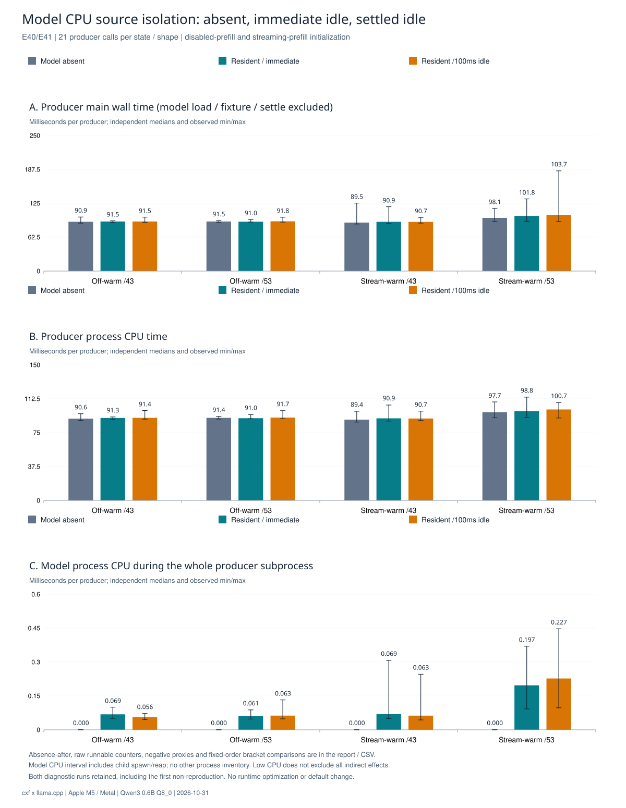

E40关闭预热组没有复现大等待，resident模型CPU最高不超过0.1324ms。E41流式预热组复现了：53词静置后producer ready代理70.635ms，main墙钟184.853ms、自身CPU108.246ms、compute184.680ms、output0.096ms、非自愿切换312次；覆盖整个子进程的窗口里模型CPU仅0.4223ms、采集器1.015ms。另43词加载模型前也有27.228ms ready代理，墙钟125.423ms、CPU98.741ms。因此无活动消费者、模型CPU很少甚至模型进程不存在时，也会出现显著可运行延迟；这些样本不支持以模型残留线程忙转解释。

这区分了可运行CPU供给延迟与自有模型进程CPU占用，没有定位所有竞争工作；没有采其他PID名单。GPU／驱动、缓存、热状态、CPU／核心运行速率的历史效应未全面profile，不声称排除全部间接影响。负ready代理保留。CSV的前后absent平均只作描述，不能当作已校正时间漂移的因果估计。两次完整诊断均保留，包括第一轮未复现；未据此再加运行时优化或改变默认。

见[全部控制](data/model-idle-controls.csv)、[统计](data/model-idle-summary.csv)、[前后括号对照](data/model-idle-pairs.csv)。32个模型fixture通过canonical／token／greedy和96次实际工具调用，32个自有模型进程正常关闭。这是使用E39已验收二进制的CPU竞争源诊断，不是每轮192个额外自主模型任务或通用工具能力成绩。

## E42–E44 · GPU执行、通知与有限尾批合并

三个独立实验各1539条主CLI记录。E42/E43在43/53词、0/1600万循环同负载测设备时序、关闭observer与完成marker；E44换45/51词、0/1400万循环验证有限尾批合并。KV常驻，无快照／逐出／构建优化；动作选择脚本控制，CLI／工具执行和token／greedy校验均真实。

旧E39最差44.039ms对包含producer墙钟多23.529ms、最终prefill多18.720ms，没有Metal trace，不能用新实验追溯精确分配旧44ms。新样本可以直接定位等待。多buffer的GPU区间取并集，不相加；表示命令执行跨度，不是纯shader忙时。

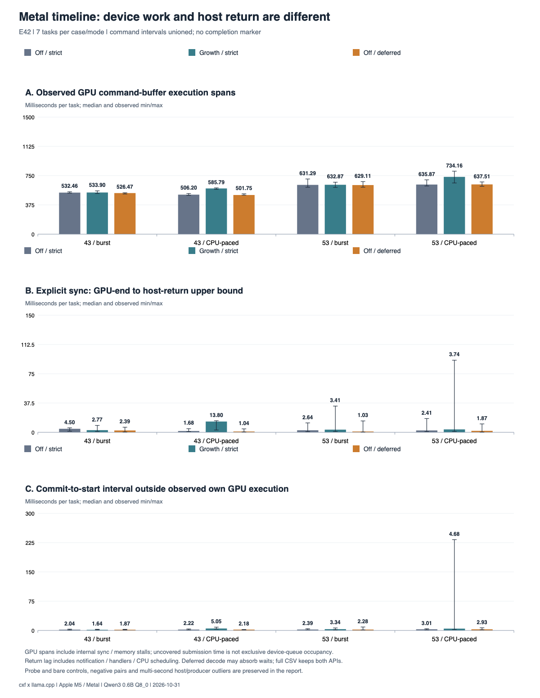

| E42 strict off | Iterations | GPU union ms | Sync GPU overlap ms | Pre-GPU gap ms | Post-GPU return upper lag ms | Uncovered commit-to-start ms |
| --- | --- | --- | --- | --- | --- | --- |
| 43 | 0 | 532.458 [526.210,543.293] | 529.760 [521.158,541.446] | 0.092 [0.072,0.840] | 4.500 [1.430,5.764] | 2.043 [1.202,3.346] |
| 43 | 16000000 | 506.200 [497.436,520.844] | 503.323 [493.944,513.211] | 0.086 [0.063,1.428] | 1.677 [0.951,4.649] | 2.224 [1.441,3.867] |
| 53 | 0 | 631.287 [600.919,706.969] | 627.030 [598.391,693.767] | 0.059 [0.007,0.402] | 2.640 [0.842,12.053] | 2.388 [1.728,4.561] |
| 53 | 16000000 | 635.865 [617.496,695.809] | 634.280 [614.559,689.009] | 0.040 [0.006,0.141] | 2.412 [0.981,17.615] | 3.008 [1.573,4.517] |

strict关闭组同步时间主要与实际GPU执行重叠；未解释提交延迟和host返回尾部分开。E42 strict关闭组单次wait返回尾部最高14.006ms，全部带trace模式最高57.657ms。大的commit→start累计主要与自己前序GPU工作重叠；排除后的剩余仍混合CPU driver、未捕获工作、设备排队及系统调度。这些API不能精确归属其他应用的GPU队列占用或内核级CPU唤醒。

Apple将[GPUStartTime](https://developer.apple.com/documentation/metal/mtlcommandbuffer/gpustarttime?language=objc)定义为设备执行时间，[kernelStartTime](https://developer.apple.com/documentation/metal/mtlcommandbuffer/kernelstarttime?language=objc)为CPU驱动调度；[waitUntilCompleted](https://developer.apple.com/documentation/metal/mtlcommandbuffer/waituntilcompleted%28%29?language=objc)还等待完成handler返回。E43另设可关闭的只记时间handler；通知交付和handler后的返回都不能称纯CPU唤醒。

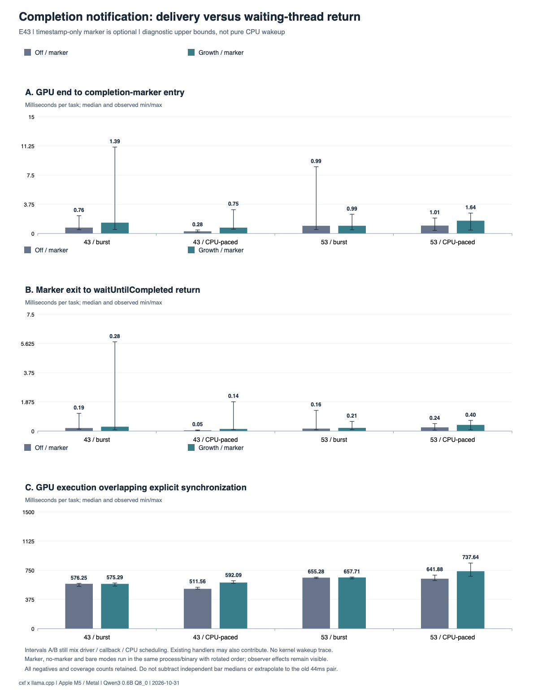

| E43 off / marker | Iterations | GPUend to marker delivery ms | Marker end to wait return ms | Covered waits / missing |
| --- | --- | --- | --- | --- |
| 43 | 0 | 0.758 [0.488,2.286] | 0.194 [0.121,1.141] | 35 / 0 |
| 43 | 16000000 | 0.278 [0.200,0.455] | 0.045 [0.023,0.069] | 35 / 0 |
| 53 | 0 | 0.988 [0.506,8.584] | 0.158 [0.083,1.329] | 56 / 0 |
| 53 | 16000000 | 1.014 [0.393,1.986] | 0.240 [0.061,0.479] | 56 / 0 |

53词突发marker任务累计通知交付最高8.584ms、marker后返回最高1.329ms，GPU重叠中位655.283ms。另一个E43 43词增长突发wait的16.376ms尾部可分为10.728ms通知交付与5.648ms marker后返回。因此应分开设备工作与host通知／调度，不能把数百毫秒叫CPU唤醒。bare／observer及marker对照均有正负任务差；E42另有数秒级producer／host异常，包含deferred-progress反慢3637.772ms，全部保留，E43较平稳的复测不抹掉E42。

| Experiment | Words | Iterations | Baseline | Candidate | Task saving median [min,max] ms | Faster /7 |
| --- | --- | --- | --- | --- | --- | --- |
| E42 | 43 | 0 | off-race | off-drain | 14.815 [-55.777,141.576] | 5 |
| E42 | 43 | 0 | progress-race | progress-drain | 5.128 [-60.674,81.820] | 4 |
| E42 | 43 | 16000000 | off-race | off-drain | -19.059 [-1297.225,70.713] | 3 |
| E42 | 43 | 16000000 | progress-race | progress-drain | -13.846 [-122.074,266.230] | 3 |
| E42 | 53 | 0 | off-race | off-drain | -36.661 [-129.691,62.148] | 3 |
| E42 | 53 | 0 | progress-race | progress-drain | -36.098 [-3637.772,28.856] | 1 |
| E42 | 53 | 16000000 | off-race | off-drain | -51.631 [-471.452,986.880] | 3 |
| E42 | 53 | 16000000 | progress-race | progress-drain | -25.486 [-1656.688,1802.983] | 2 |
| E43 | 43 | 0 | off-race | off-race-notify | 13.342 [-22.083,21.411] | 5 |
| E43 | 43 | 0 | progress-race | progress-race-notify | -0.609 [-27.317,18.707] | 3 |
| E43 | 43 | 0 | off-race-bare | off-race | -0.790 [-29.492,29.768] | 3 |
| E43 | 43 | 0 | progress-race-bare | progress-race | -15.407 [-31.386,6.931] | 2 |
| E43 | 43 | 0 | off-race-bare | progress-race-bare | 4.994 [-9.620,40.218] | 5 |
| E43 | 43 | 16000000 | off-race | off-race-notify | -12.600 [-79.333,22.466] | 1 |
| E43 | 43 | 16000000 | progress-race | progress-race-notify | -3.943 [-161.352,41.403] | 3 |
| E43 | 43 | 16000000 | off-race-bare | off-race | -0.299 [-24.263,46.584] | 3 |
| E43 | 43 | 16000000 | progress-race-bare | progress-race | -15.197 [-36.838,9.299] | 1 |
| E43 | 43 | 16000000 | off-race-bare | progress-race-bare | 135.424 [116.654,160.094] | 7 |
| E43 | 53 | 0 | off-race | off-race-notify | 3.217 [-46.320,35.154] | 4 |
| E43 | 53 | 0 | progress-race | progress-race-notify | 3.151 [-18.437,33.533] | 4 |
| E43 | 53 | 0 | off-race-bare | off-race | -6.831 [-21.005,37.335] | 3 |
| E43 | 53 | 0 | progress-race-bare | progress-race | -16.263 [-39.884,28.565] | 2 |
| E43 | 53 | 0 | off-race-bare | progress-race-bare | -1.708 [-27.866,42.617] | 3 |
| E43 | 53 | 16000000 | off-race | off-race-notify | 8.000 [-51.775,32.567] | 5 |
| E43 | 53 | 16000000 | progress-race | progress-race-notify | 7.275 [-213.002,35.031] | 4 |
| E43 | 53 | 16000000 | off-race-bare | off-race | -12.839 [-79.424,18.551] | 1 |
| E43 | 53 | 16000000 | progress-race-bare | progress-race | -16.157 [-91.320,0.294] | 1 |
| E43 | 53 | 16000000 | off-race-bare | progress-race-bare | 192.264 [161.421,253.295] | 7 |

E42发现真实尾批成本：588 token拆为512＋76，某53词突发任务三个76-token尾批分别占28.665／33.070／36.619ms。E44所有对照均分配1024 batch容量，普通chunk cap512，仅当剩余513–1024 token完整落在本次预算内才合并；不能超出工具流式预算512。两组均strict同步，CLI默认batch512和默认策略保持原样。

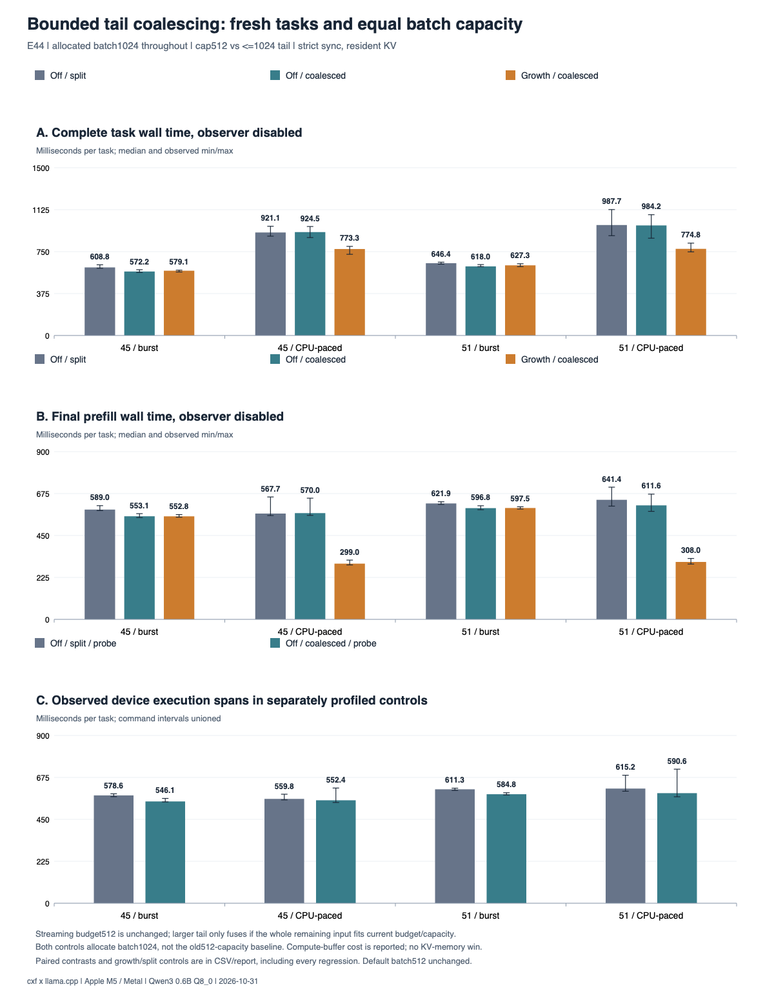

| E44 words | Iterations | Baseline | Candidate | Task saving median [min,max] ms | Faster /7 | Final prefill saving median ms |
| --- | --- | --- | --- | --- | --- | --- |
| 45 | 0 | off-split-bare | off-coalesce-bare | 36.407 [31.282,49.671] | 7 | 36.770 |
| 45 | 0 | progress-split-bare | progress-coalesce-bare | 42.533 [21.956,86.165] | 7 | 42.711 |
| 45 | 0 | off-split-bare | progress-split-bare | -4.988 [-48.980,-2.573] | 0 | -3.597 |
| 45 | 0 | off-coalesce-bare | progress-coalesce-bare | 1.718 [-20.275,5.903] | 4 | 3.193 |
| 45 | 0 | off-split | off-coalesce | 32.909 [17.940,46.281] | 7 | 35.166 |
| 45 | 14000000 | off-split-bare | off-coalesce-bare | -3.341 [-86.283,100.857] | 3 | 3.840 |
| 45 | 14000000 | progress-split-bare | progress-coalesce-bare | 9.051 [-20.868,69.030] | 4 | 3.620 |
| 45 | 14000000 | off-split-bare | progress-split-bare | 138.052 [96.641,241.691] | 7 | 265.104 |
| 45 | 14000000 | off-coalesce-bare | progress-coalesce-bare | 152.803 [125.405,198.626] | 7 | 271.686 |
| 45 | 14000000 | off-split | off-coalesce | 17.231 [-30.842,42.251] | 5 | 14.385 |
| 51 | 0 | off-split-bare | off-coalesce-bare | 28.445 [11.714,30.869] | 7 | 28.485 |
| 51 | 0 | progress-split-bare | progress-coalesce-bare | 29.019 [0.537,38.365] | 7 | 26.087 |
| 51 | 0 | off-split-bare | progress-split-bare | -9.303 [-12.949,3.241] | 2 | -4.095 |
| 51 | 0 | off-coalesce-bare | progress-coalesce-bare | -2.125 [-14.450,3.544] | 2 | -0.173 |
| 51 | 0 | off-split | off-coalesce | 29.150 [18.783,41.552] | 7 | 27.391 |
| 51 | 14000000 | off-split-bare | off-coalesce-bare | 22.623 [-14.723,115.141] | 6 | 30.201 |
| 51 | 14000000 | progress-split-bare | progress-coalesce-bare | 35.338 [-56.910,107.938] | 6 | 2.227 |
| 51 | 14000000 | off-split-bare | progress-split-bare | 158.348 [94.399,330.466] | 7 | 331.925 |
| 51 | 14000000 | off-coalesce-bare | progress-coalesce-bare | 181.509 [118.886,276.180] | 7 | 302.293 |
| 51 | 14000000 | off-split | off-coalesce | -11.240 [-173.572,103.248] | 3 | 18.263 |

bare合并在45/51词突发任务快36.407／28.445ms，均7/7。45词持续关闭组中位反慢3.341ms、最差86.283ms：该对最终prefill多93.325ms（其中sync多84.062ms），工具墙钟反而少20.539ms；bare没有设备时间戳，不能把这个尾部精确归为GPU还是host唤醒。带probe的51词持续组GPU跨度少23.360ms、最终prefill少18.263ms，但整任务中位反慢11.240ms，工具墙钟多32.426ms。因此设备改进不保证每组整任务提速。合并后的增长流式相对关闭仍在持续任务快152.803／181.509ms，均7/7；突发仅+1.718／-2.125ms。

| E44 profiled off | Iterations | GPU span saving median ms | Final prefill saving median ms | Tool wall saving median ms | Whole task saving median ms |
| --- | --- | --- | --- | --- | --- |
| 45 | 0 | 32.051 | 35.166 | -0.708 | 32.909 |
| 45 | 14000000 | 6.094 | 14.385 | -0.387 | 17.231 |
| 51 | 0 | 23.996 | 27.391 | 3.016 | 29.150 |
| 51 | 14000000 | 23.360 | 18.263 | -32.426 | -11.240 |

bare组衡量不采集Metal trace时的端到端行为，带observer的split／coalesce对照衡量设备跨度，不跨实验累加收益。batch1024会增加计算缓冲区容量，这不是内存优化，也不是旧512容量的精确基线；对比E42 batch512，Metal计算预留298.75→597.50MiB、CPU计算12.01→24.03MiB，KV均896MiB。这是初始化预留而非峰值RSS，实际分配见E44 method元数据。保留全部负对，7次不能保证尾延迟。

见[任务](data/metal-tasks.csv)、[全部配对指标](data/metal-pairs.csv)、[command时间戳](data/metal-commands.csv)、[关联wait分解](data/metal-waits.csv)、[scope分解](data/metal-scopes.csv)。每轮48个真实CLI sanitizer任务；E42/E43各30原生场景，E44为47，含预算／最小批量／非法原子设置／重置。最终E44源码还通过14,357-token合并Native、strict Stream与默认C/HTTP/CLI回归。没有注入decode失败，未验收Windows/CUDA、其他设备调度精确trace或0.6B自主能力。

9575条Metal附加记录与主CLI记录分列（7179 command、2393 wait、3 metadata），原始trace可追溯；主记录数不表示独立任务数。

## E45/E46 · 持续尾延迟与更小计算预留

E45按E44负载重测split／coalesce×bare／无marker／marker，1539主记录。旧86.283ms bare仍没有GPU时间戳；最终prefill多93.325ms分散在四次prepare，分别22.717／11.694／32.119／26.795ms，每次owner CPU反而减少。因此它不是一次已被测到的CPU唤醒，也不是额外CPU分词处理；旧样本设备进展与host通知仍无法精确区分。

| Historical E44 step | Tokens | Extra prefill ms | Extra decode ms | Extra sync ms | Extra owner CPU ms |
| --- | --- | --- | --- | --- | --- |
| 0 | 811 | 22.717 | -1.192 | 23.910 | -1.238 |
| 1 | 514 | 11.694 | -1.614 | 13.311 | -1.687 |
| 2 | 514 | 32.119 | -1.427 | 33.545 | -1.228 |
| 3 | 514 | 26.795 | 13.339 | 13.296 | -0.822 |

E45没有重现86ms：持续bare最差慢1.908ms（工具＋3.871ms、prefill－2.058ms）；无marker trace最差慢11.248ms（工具＋14.212ms、prefill－3.054ms）。marker最差慢1.157ms，工具＋2.069ms、GPU并集＋1.991ms、decode－3.797ms，通知／返回反而少0.180／0.043ms。这些新负对有对应阶段证据，不能据此宣称旧尾延迟已消除。45词持续marker的GPU跨度中位只少2.486ms，突发少36.747ms；合批收益与工作节奏有关。

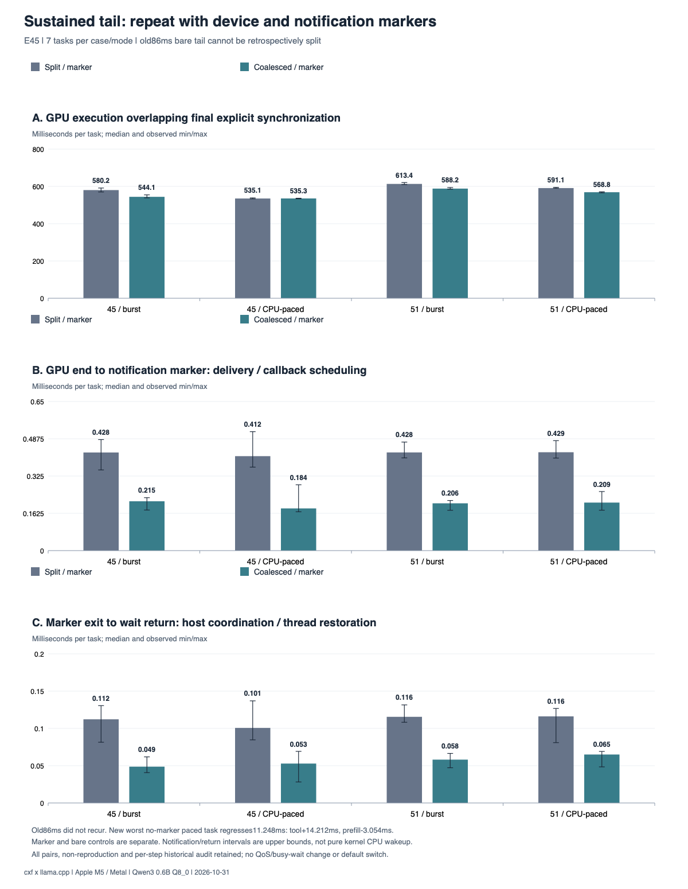

| E45 paced words | Candidate | Worst extra task ms | Extra tool ms | Extra prefill ms | Extra GPU span ms | Extra notify delivery ms | Extra post-marker return ms |
| --- | --- | --- | --- | --- | --- | --- | --- |
| 45 | off-coalesce-bare | 1.908 | 3.871 | -2.058 | — | — | — |
| 51 | off-coalesce-bare | -24.172 | 4.285 | -28.489 | — | — | — |
| 45 | off-coalesce | 11.248 | 14.212 | -3.054 | -0.123 | — | — |
| 51 | off-coalesce | -23.345 | 2.999 | -26.256 | -23.544 | — | — |
| 45 | off-coalesce-notify | 1.157 | 2.069 | -0.858 | 1.991 | -0.180 | -0.043 |
| 51 | off-coalesce-notify | -24.569 | 0.377 | -24.964 | -22.138 | -0.203 | -0.055 |

通知列只对marker模式有观测；无marker trace的0表示未观测，不是测得零延迟。GPU跨度含内部访存／同步及可能的设备抢占；通知与marker后返回仍含driver／handler／调度协调。没有采GPU频率／温度、其他队列时间线或内核CPU唤醒trace；全部负对及未复现保留。

计算预留原因直接可查：cxf启动参数同时设置n_batch／n_ubatch，固定[llama.cpp sched_reserve](https://github.com/ggml-org/llama.cpp/blob/f1e44dcc11d8802d107bd7331a3d3fd3e6f57b93/src/llama-context.cpp#L596)按n_ubatch预留最大图。E46复用已有参数设640，不改推理源码或运行时二进制，不新增context／动态重分配／快照／逐出。较大初始输入继续分块，约600-token工具增量可一次处理。

| Capacity | Loads | Metal compute MiB | CPU compute MiB | Physical KV MiB |
| --- | --- | --- | --- | --- |
| 512 | 7 | 298.75 | 12.01 | 896.00 |
| 640 | 7 | 373.44 | 15.02 | 896.00 |
| 1024 | 7 | 597.50 | 24.03 | 896.00 |

640的Metal计算预留373.44MiB，相对1024的597.50MiB少224.06MiB（37.5%），相对默认512仅多74.69MiB；CPU计算24.03→15.02MiB，KV仍896MiB。这是初始化预留，不是峰值RSS或KV节省。默认仍512，640是显式配置，不是在任务中免费切容量。

新47/54词、0/1200万循环，7个外层block旋转512/split、640/coalesce、1024/coalesce加载与模式顺序；每容量有关闭bare、增长bare、关闭marker，每负载1warm＋1eval。21模型、252评价＋252warm任务，4095主记录。加载／warm／helper首次执行不计评价，warm原样保留，每任务／加载内KV常驻；block配对减少但不消除时间漂移。

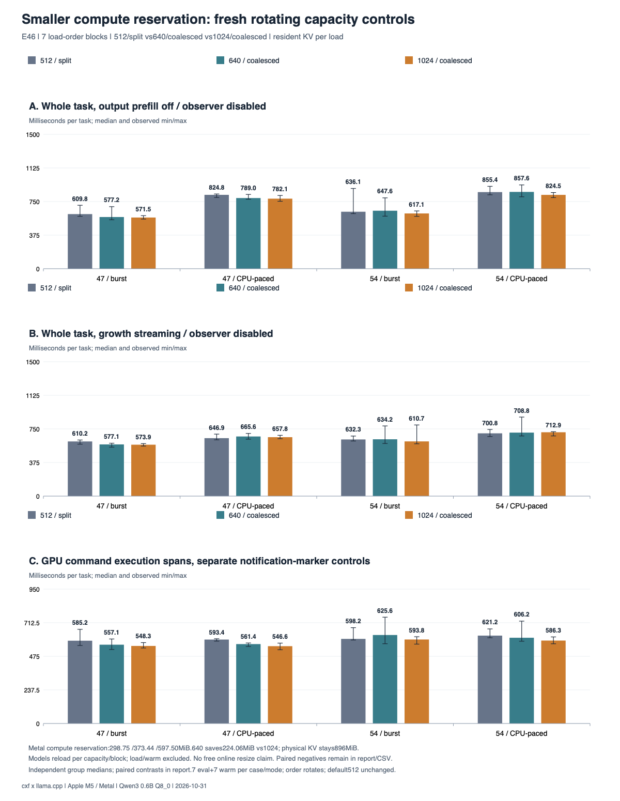

| E46 words | Iterations | Baseline | Candidate | Task saving median [min,max] ms | Faster /7 | Final prefill saving ms |
| --- | --- | --- | --- | --- | --- | --- |
| 47 | 0 | off-512-bare | off-640-bare | 15.664 [-9.195,62.865] | 6 | 13.139 |
| 47 | 0 | off-1024-bare | off-640-bare | -6.090 [-121.219,26.477] | 3 | -4.318 |
| 47 | 0 | growth-512-bare | growth-640-bare | 27.527 [-2.404,63.543] | 5 | 26.962 |
| 47 | 0 | growth-1024-bare | growth-640-bare | -7.742 [-27.953,24.530] | 3 | -8.002 |
| 47 | 0 | off-640-bare | growth-640-bare | 0.291 [-21.893,115.680] | 4 | 0.654 |
| 47 | 12000000 | off-512-bare | off-640-bare | 35.721 [-12.543,55.136] | 6 | 32.622 |
| 47 | 12000000 | off-1024-bare | off-640-bare | -8.158 [-56.075,30.536] | 3 | -10.082 |
| 47 | 12000000 | growth-512-bare | growth-640-bare | -24.934 [-48.957,56.550] | 1 | 30.349 |
| 47 | 12000000 | growth-1024-bare | growth-640-bare | -3.756 [-39.236,9.139] | 1 | -4.434 |
| 47 | 12000000 | off-640-bare | growth-640-bare | 125.864 [106.958,146.195] | 7 | 214.053 |
| 54 | 0 | off-512-bare | off-640-bare | 2.217 [-176.227,160.265] | 4 | 3.519 |
| 54 | 0 | off-1024-bare | off-640-bare | -45.389 [-156.310,21.067] | 2 | -44.088 |
| 54 | 0 | growth-512-bare | growth-640-bare | -1.849 [-168.364,36.389] | 3 | -1.898 |
| 54 | 0 | growth-1024-bare | growth-640-bare | -30.481 [-170.735,76.826] | 3 | -30.451 |
| 54 | 0 | off-640-bare | growth-640-bare | 8.312 [-3.591,18.587] | 5 | 6.911 |
| 54 | 12000000 | off-512-bare | off-640-bare | -2.180 [-62.071,68.400] | 3 | 0.979 |
| 54 | 12000000 | off-1024-bare | off-640-bare | -17.900 [-111.176,22.451] | 2 | -14.806 |
| 54 | 12000000 | growth-512-bare | growth-640-bare | -12.957 [-217.550,39.666] | 2 | -0.040 |
| 54 | 12000000 | growth-1024-bare | growth-640-bare | -1.556 [-186.498,14.546] | 3 | 4.473 |
| 54 | 12000000 | off-640-bare | growth-640-bare | 143.980 [4.822,214.982] | 7 | 193.442 |

| E46 profiled words | Iterations | Baseline | Candidate | GPU span saving median ms | Delivery saving median ms | Post-marker return saving median ms | Task saving median ms |
| --- | --- | --- | --- | --- | --- | --- | --- |
| 47 | 0 | off-512-notify | off-640-notify | 28.176 | 0.309 | 0.035 | 29.647 |
| 47 | 0 | off-1024-notify | off-640-notify | -14.785 | -0.047 | -0.006 | -20.284 |
| 47 | 12000000 | off-512-notify | off-640-notify | 34.058 | 0.180 | 0.031 | 39.548 |
| 47 | 12000000 | off-1024-notify | off-640-notify | -17.235 | -0.066 | -0.016 | -31.829 |
| 54 | 0 | off-512-notify | off-640-notify | -16.562 | 0.268 | 0.031 | -15.022 |
| 54 | 0 | off-1024-notify | off-640-notify | -44.017 | -0.057 | -0.019 | -45.126 |
| 54 | 12000000 | off-512-notify | off-640-notify | 24.498 | 0.185 | 0.037 | 22.451 |
| 54 | 12000000 | off-1024-notify | off-640-notify | -18.800 | -0.061 | -0.006 | -18.078 |

缩容是内存／速度取舍，未获得通用加速。640增长持续组相对默认512中位反慢24.934／12.957ms；最差反慢217.550ms，其中工具＋190.983ms、producer墙钟＋150.844ms、自身CPU＋12.507ms、ready代理＋153.688ms、最终prefill＋30.848ms。代理有计量滞后，不能定位竞争者。关闭bare突发最差慢176.227ms，最终prefill多162.131ms且没有设备trace。

新marker最差640对512反慢136.408ms：最终prefill＋107.952ms、GPU并集＋106.174ms、sync与GPU重叠＋105.772ms、通知交付－0.320ms、marker后返回－0.073ms、未解释提交延迟仅＋0.148ms、工具＋24.597ms。因此这次prefill尾部落在设备执行跨度，通知／CPU返回或提交排队没有相应增长。evaluated token数量相同且decode次数更少；跨度可因kernel效率、访存停顿、GPU调度或频率／状态变化增大，尚未逐一识别。同一640任务对1024慢179.725ms，GPU并集多144.977ms；不能倒推成旧86ms的原因。

| E46 worst pair | Words / iterations / block | Extra task ms | Extra tool ms | Extra final prefill ms | Extra GPU span ms | Extra delivery ms | Extra post-marker return ms |
| --- | --- | --- | --- | --- | --- | --- | --- |
| off-512-notify → off-640-notify | 54 / 12000000 / 2 | 136.408 | 24.597 | 107.952 | 106.174 | -0.320 | -0.073 |
| off-1024-notify → off-640-notify | 54 / 12000000 / 2 | 179.725 | 26.665 | 149.285 | 144.977 | 0.063 | -0.008 |
| growth-512-bare → growth-640-bare | 54 / 12000000 / 2 | 217.550 | 190.983 | 30.848 | — | — | — |
| off-512-bare → off-640-bare | 54 / 0 / 5 | 176.227 | 11.548 | 162.131 | — | — | — |

验收：E45有47原生sanitizer场景和48实际CLI sanitizer任务；E46有三容量72实际CLI sanitizer任务、640容量14,357-token Native、strict Stream及默认C/HTTP/CLI回归。runtime与核心源码沿用E44/E45，新归档实验编排和仅测试使用的长上下文容量选择。负结果全保留，不声称p95/p99、Windows/CUDA验收或自主能力成绩。

见[旧86ms逐步审计](data/tailwait-old86.csv)、[新最差负对归因](data/tailwait-worst.csv)、[每次模型分配](data/capacity-runs.csv)、[容量最差配对](data/capacity-worst.csv)、[全部任务配对](data/metal-pairs.csv)、[关联wait分解](data/metal-waits.csv)。新增设备附加记录在catalog／integrity中单独计数。

## E47–E49 · 同负载工具、图形状与内存压力隔离

旧217.550ms负对第三个producer main由68.2→217.4ms，流式update由1→2；相关性不能证明额外update造成全部延迟。E47固定640容量和相同最终分块，关闭／仅线程／仅分词／真实growth加关闭和growth marker共六组，47/54词、0/1200万循环，1539记录；要求同命令、canonical transcript与greedy。

| E47 words | Iterations | Baseline | Candidate | Task saving median [min,max] ms | Producer wall saving median ms | Ready proxy saving median ms |
| --- | --- | --- | --- | --- | --- | --- |
| 47 | 0 | off-coalesce-bare | thread-coalesce-bare | -3.831 [-8.817,24.170] | -0.002 | -1.176 |
| 47 | 0 | thread-coalesce-bare | token-coalesce-bare | 4.585 [-8.741,17.060] | 0.051 | 0.129 |
| 47 | 0 | token-coalesce-bare | progress-coalesce-bare | 5.685 [-12.248,10.387] | -0.038 | 0.462 |
| 47 | 0 | off-coalesce-bare | progress-coalesce-bare | 4.012 [-0.963,16.475] | -0.035 | -1.007 |
| 47 | 0 | off-coalesce-notify | progress-coalesce-notify | -1.875 [-11.203,12.721] | 0.032 | 0.450 |
| 47 | 12000000 | off-coalesce-bare | thread-coalesce-bare | 3.447 [-17.014,19.454] | 1.467 | -1.784 |
| 47 | 12000000 | thread-coalesce-bare | token-coalesce-bare | 0.882 [-14.963,8.511] | 0.734 | -0.551 |
| 47 | 12000000 | token-coalesce-bare | progress-coalesce-bare | 127.680 [105.473,136.411] | -1.963 | -0.936 |
| 47 | 12000000 | off-coalesce-bare | progress-coalesce-bare | 124.993 [96.970,148.725] | 3.738 | -3.574 |
| 47 | 12000000 | off-coalesce-notify | progress-coalesce-notify | 119.583 [92.019,131.854] | 0.868 | -2.302 |
| 54 | 0 | off-coalesce-bare | thread-coalesce-bare | 2.171 [-12.289,18.405] | -0.305 | -1.116 |
| 54 | 0 | thread-coalesce-bare | token-coalesce-bare | 0.935 [-17.873,15.016] | 0.258 | 0.909 |
| 54 | 0 | token-coalesce-bare | progress-coalesce-bare | -3.979 [-91.374,2.616] | -0.066 | -0.303 |
| 54 | 0 | off-coalesce-bare | progress-coalesce-bare | -6.876 [-88.034,35.461] | -0.262 | -0.392 |
| 54 | 0 | off-coalesce-notify | progress-coalesce-notify | 19.766 [-13.626,229.054] | 1.290 | 0.932 |
| 54 | 12000000 | off-coalesce-bare | thread-coalesce-bare | -3.227 [-1868.877,38.201] | 1.841 | -10.246 |
| 54 | 12000000 | thread-coalesce-bare | token-coalesce-bare | -9.089 [-110.297,2117.906] | -0.360 | 3.734 |
| 54 | 12000000 | token-coalesce-bare | progress-coalesce-bare | 68.168 [-61.444,165.604] | -34.133 | -19.203 |
| 54 | 12000000 | off-coalesce-bare | progress-coalesce-bare | 129.042 [-392.829,294.072] | -30.109 | -10.271 |
| 54 | 12000000 | off-coalesce-notify | progress-coalesce-notify | 180.020 [61.421,477.201] | 19.888 | 6.514 |

没有工具期间GPU预填充也出现大尾部：54词持续仅线程对关闭最差整任务多1868.877ms、工具多1817.950ms、producer墙钟多1761.856ms、自身CPU少22.205ms、ready代理多1784.891ms。growth最差多392.829ms，工具多522.869ms、最终prefill反少334.860ms。这说明并发推理不是这些工具停顿的必要条件；仍未定位竞争PID或排除所有间接影响。负代理值、全部异常和marker/bare对照保留。

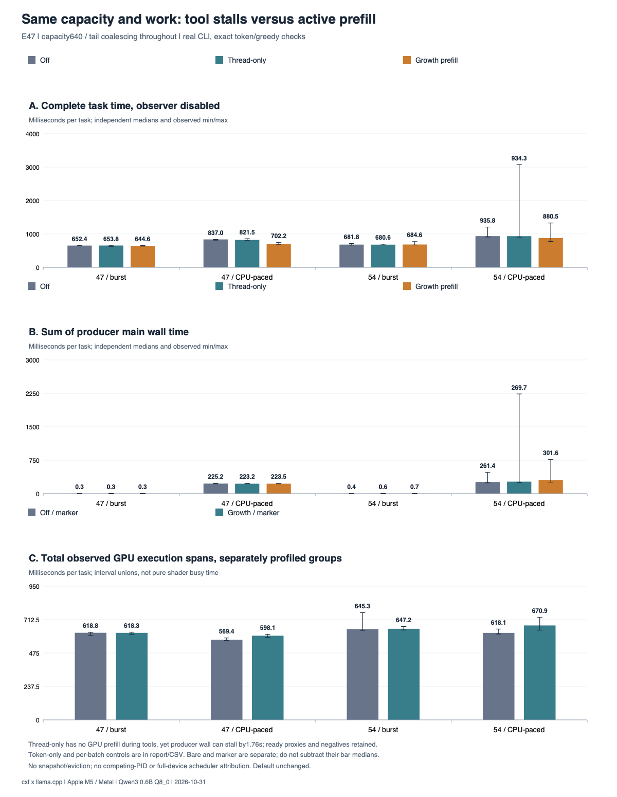

E48直接隔离设备跨度敏感性：640容量引擎保留2048-token只读root，逻辑fork prefix768/2048，新增128/224/512/582，split512或coalesce640。每shape同输入，空闲／算术／64MiB缓存行读写线程，1warm＋7eval共384样本＋3状态。逻辑768仍保留2048 root物理cells，不能把跨prefix差当生产上下文缩放曲线。worker创建／join及fresh-KV／canonical oracle均不计prefill时间。

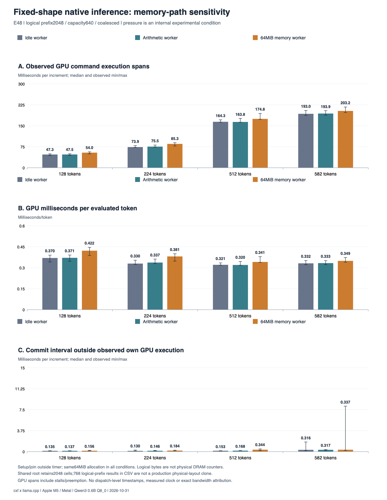

| Prefix | New tokens | Baseline | Candidate | Extra wall median [min,max] ms | Extra GPU median ms | Extra uncovered submit median ms |
| --- | --- | --- | --- | --- | --- | --- |
| 768 | 128 | idle/split | idle/coalesce | -0.094 [-4.989,10.165] | -0.100 | -0.006 |
| 768 | 128 | idle/split | arithmetic/split | -0.113 [-3.620,22.098] | -0.190 | 0.009 |
| 768 | 128 | idle/coalesce | arithmetic/coalesce | 0.008 [-10.601,1.469] | 0.151 | -0.007 |
| 768 | 128 | arithmetic/split | memory/split | 5.272 [-20.713,6.117] | 5.194 | 0.011 |
| 768 | 128 | arithmetic/coalesce | memory/coalesce | 5.470 [3.661,12.323] | 5.233 | 0.042 |
| 768 | 224 | idle/split | idle/coalesce | -0.527 [-1.079,0.731] | -0.457 | -0.005 |
| 768 | 224 | idle/split | arithmetic/split | -1.392 [-6.217,0.197] | -1.347 | -0.018 |
| 768 | 224 | idle/coalesce | arithmetic/coalesce | -2.215 [-4.957,-1.815] | -2.242 | -0.018 |
| 768 | 224 | arithmetic/split | memory/split | 7.951 [7.250,9.463] | 7.737 | 0.015 |
| 768 | 224 | arithmetic/coalesce | memory/coalesce | 8.880 [5.643,9.987] | 8.365 | 0.034 |
| 768 | 512 | idle/split | idle/coalesce | -1.118 [-5.054,1.609] | -1.236 | 0.003 |
| 768 | 512 | idle/split | arithmetic/split | -1.175 [-5.654,1.101] | -1.217 | 0.007 |
| 768 | 512 | idle/coalesce | arithmetic/coalesce | -2.149 [-5.225,1.893] | -2.021 | 0.010 |
| 768 | 512 | arithmetic/split | memory/split | 12.075 [9.491,23.634] | 11.855 | 0.010 |
| 768 | 512 | arithmetic/coalesce | memory/coalesce | 13.213 [9.744,16.834] | 13.041 | 0.007 |
| 768 | 582 | idle/split | idle/coalesce | -8.759 [-12.648,1.476] | -7.869 | -0.125 |
| 768 | 582 | idle/split | arithmetic/split | 2.051 [-5.310,14.672] | 2.759 | -0.003 |
| 768 | 582 | idle/coalesce | arithmetic/coalesce | -0.405 [-10.917,6.590] | -0.314 | -0.006 |
| 768 | 582 | arithmetic/split | memory/split | 15.393 [3.165,21.544] | 14.494 | 0.105 |
| 768 | 582 | arithmetic/coalesce | memory/coalesce | 10.316 [9.435,17.682] | 10.182 | 0.187 |
| 2048 | 128 | idle/split | idle/coalesce | -0.795 [-3.806,6.314] | -0.909 | 0.003 |
| 2048 | 128 | idle/split | arithmetic/split | -0.634 [-3.429,2.930] | -0.607 | 0.006 |
| 2048 | 128 | idle/coalesce | arithmetic/coalesce | 0.767 [-1.236,1.828] | 0.720 | 0.009 |
| 2048 | 128 | arithmetic/split | memory/split | 5.758 [2.547,10.911] | 5.657 | 0.056 |
| 2048 | 128 | arithmetic/coalesce | memory/coalesce | 5.653 [2.693,8.509] | 5.473 | 0.027 |
| 2048 | 224 | idle/split | idle/coalesce | -1.296 [-4.016,1.805] | -1.178 | -0.018 |
| 2048 | 224 | idle/split | arithmetic/split | -0.341 [-3.085,4.044] | -0.292 | -0.004 |
| 2048 | 224 | idle/coalesce | arithmetic/coalesce | 1.641 [-4.516,8.502] | 1.341 | 0.007 |
| 2048 | 224 | arithmetic/split | memory/split | 5.507 [2.257,11.052] | 5.415 | 0.026 |
| 2048 | 224 | arithmetic/coalesce | memory/coalesce | 7.324 [2.433,15.034] | 7.062 | 0.037 |
| 2048 | 512 | idle/split | idle/coalesce | -1.951 [-5.114,0.214] | -1.887 | -0.015 |
| 2048 | 512 | idle/split | arithmetic/split | -1.477 [-13.854,4.548] | -1.509 | 0.011 |
| 2048 | 512 | idle/coalesce | arithmetic/coalesce | -0.597 [-8.363,13.636] | -0.761 | 0.014 |
| 2048 | 512 | arithmetic/split | memory/split | 11.573 [8.052,22.383] | 12.214 | 0.033 |
| 2048 | 512 | arithmetic/coalesce | memory/coalesce | 10.934 [-2.900,31.833] | 11.044 | 0.180 |
| 2048 | 582 | idle/split | idle/coalesce | -14.238 [-24.153,2.203] | -13.458 | -0.201 |
| 2048 | 582 | idle/split | arithmetic/split | -1.947 [-15.947,23.665] | -1.568 | 0.064 |
| 2048 | 582 | idle/coalesce | arithmetic/coalesce | 2.323 [-7.767,10.115] | 2.273 | -0.023 |
| 2048 | 582 | arithmetic/split | memory/split | 14.776 [-5.482,33.790] | 14.702 | 0.021 |
| 2048 | 582 | arithmetic/coalesce | memory/coalesce | 9.308 [3.391,22.845] | 6.541 | 0.020 |

空闲582-token合并在逻辑prefix768/2048减少GPU跨度7.869/13.458ms，负对保留；128/224/512只是相同单批控制。内存对算术压力使224/582合并增量的GPU跨度中位多约6.5–10.2ms，未解释提交区间一般仅多0.02–0.19ms。算术压力有时反比空闲快，压力也改变调度／功耗状态。可确认内存路径争用能拉长设备执行，但不能解释旧217ms或106ms设备尾部的全部来源。没有直接DRAM带宽、纯kernel／preemption计数。

M5实测dispatch sampling=false、stage=true，仅timestamp/GPUTimestamp；[Apple counter sampling](https://developer.apple.com/documentation/metal/sampling-gpu-data-into-counter-sample-buffers)要求相应采样边界受支持。逐批标签关联cxf decode位置／数量与buffer，一个batch可含多个buffer／kernel。图形状效果、内存敏感性、提交残差和host通知分开测量，不冒充完整硬件利用率诊断。

E49在新49/55词、0/1000万循环评价前冻结发布量子512→1536字节。640容量、10ms growth窗、512 token预算、min128、BPE／最终canonical复核及KV常驻保持；较晚启动可能损失重叠，完整任务／producer／设备负对均保留，默认不切换。

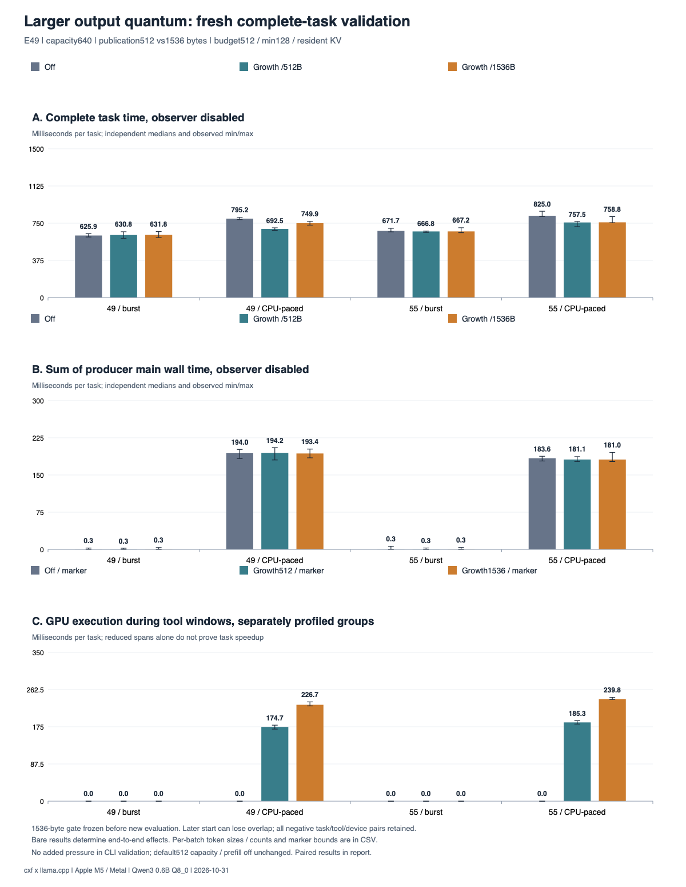

| E49 words | Iterations | Baseline | Candidate | Task saving median [min,max] ms | Faster /7 | Tool wall saving median ms | Final prefill saving median ms |
| --- | --- | --- | --- | --- | --- | --- | --- |
| 49 | 0 | off-coalesce-bare | progress-coalesce-bare | -3.047 [-41.983,32.632] | 3 | -0.161 | -0.367 |
| 49 | 0 | progress-coalesce-bare | progress-coarse-bare | -3.567 [-34.783,32.510] | 2 | -1.525 | -0.978 |
| 49 | 0 | off-coalesce-bare | progress-coarse-bare | -2.502 [-43.967,30.967] | 2 | -1.534 | -1.345 |
| 49 | 0 | progress-coalesce-notify | progress-coarse-notify | 2.025 [-34.457,31.250] | 4 | 1.073 | 1.735 |
| 49 | 0 | off-coalesce-notify | progress-coarse-notify | -4.749 [-37.609,47.497] | 2 | 0.606 | -4.581 |
| 49 | 10000000 | off-coalesce-bare | progress-coalesce-bare | 104.276 [92.344,125.506] | 7 | -3.276 | 160.061 |
| 49 | 10000000 | progress-coalesce-bare | progress-coarse-bare | -54.667 [-75.754,-45.683] | 0 | -2.559 | 25.716 |
| 49 | 10000000 | off-coalesce-bare | progress-coarse-bare | 45.908 [26.977,71.985] | 7 | -3.727 | 186.750 |
| 49 | 10000000 | progress-coalesce-notify | progress-coarse-notify | -33.554 [-53.440,-23.421] | 0 | -4.997 | 44.237 |
| 49 | 10000000 | off-coalesce-notify | progress-coarse-notify | 84.509 [81.134,101.791] | 7 | -9.639 | 227.948 |
| 55 | 0 | off-coalesce-bare | progress-coalesce-bare | 6.187 [-4.611,28.209] | 6 | 0.174 | 6.728 |
| 55 | 0 | progress-coalesce-bare | progress-coarse-bare | -5.492 [-47.290,15.938] | 3 | 0.015 | -1.708 |
| 55 | 0 | off-coalesce-bare | progress-coarse-bare | 2.768 [-39.095,44.147] | 4 | 0.189 | -4.664 |
| 55 | 0 | progress-coalesce-notify | progress-coarse-notify | 11.645 [-21.419,35.654] | 5 | 1.262 | 9.334 |
| 55 | 0 | off-coalesce-notify | progress-coarse-notify | 8.714 [-43.288,61.951] | 4 | -0.306 | 2.624 |
| 55 | 10000000 | off-coalesce-bare | progress-coalesce-bare | 67.290 [56.796,154.939] | 7 | 2.469 | 153.298 |
| 55 | 10000000 | progress-coalesce-bare | progress-coarse-bare | -3.009 [-59.735,10.336] | 1 | 1.175 | 63.708 |
| 55 | 10000000 | off-coalesce-bare | progress-coarse-bare | 65.197 [6.830,113.896] | 7 | -2.574 | 218.048 |
| 55 | 10000000 | progress-coalesce-notify | progress-coarse-notify | -41.392 [-54.548,-20.422] | 0 | 0.597 | 37.404 |
| 55 | 10000000 | off-coalesce-notify | progress-coarse-notify | 52.634 [36.727,83.787] | 7 | -1.580 | 206.291 |

更大量子在新验证中失败：bare持续任务对旧growth反慢54.667/3.009ms，只有0/7和1/7更快；突发中位也反慢3.567/5.492ms。带marker持续样本两策略均42批，流式evaluated token由9240→11970、GPU累计2518.927→3274.296ms。每三工具任务逐对中位join多82.889/73.485ms，最终prefill虽少25.716/63.708ms，未能抵消。不同指标中位不能直接相加，以实际配对任务为准。较晚启动和每批更多工作代价超过末尾节省；默认保留旧门槛，1536仅实验选项，不称优化成功。

功能验收：E47为63个SAN场景／48实际CLI任务，E48为96个SAN样本和8个fresh shape，E49为72场景／48 CLI任务及最终640容量14K Native、strict Stream、默认C/HTTP/CLI回归。硬件频率／占用／带宽／preemption完整归因与Windows/CUDA仍未验收，不把新源码标成旧版本性能重跑。

明细见[decode批次](data/metal-batches.csv)、[固定shape样本](data/device-isolation-samples.csv)、[压力／形状配对](data/device-isolation-pairs.csv)、[CLI全部配对](data/metal-pairs.csv)、[wait分解](data/metal-waits.csv)，保留warm、原标签、区间边界和全部负结果。主记录与command／wait／batch附加记录分列。

## L01 · 早期观测（仅文档读数）

早期外部服务并发、上下文预算标记夹具与 memcpy 读数保存在 [L01](../evidence/legacy-observations-20261020.json)。原始 CSV／计时样本缺失，因此不支撑首页优化结论。并发 p50/p95 为历史文档读数，不是重新计算的尾部统计。标记夹具只测检索覆盖与预算，不代表回答准确率。并发快照方案文档只是设计，从未运行。

| Concurrency | OK / requests | Wall s | Reported p50 / p95 s | Reported req/s |
| --- | --- | --- | --- | --- |
| 1 | 2 / 2 | 3.05 | 1.34 / 1.7 | 0.657 |
| 2 | 4 / 4 | 3 | 1.44 / 1.56 | 1.332 |
| 4 | 16 / 16 | 6.98 | 1.43 / 2.39 | 2.292 |
| 8 | 16 / 16 | 4.22 | 1.45 / 1.69 | 3.793 |
| 16 | 32 / 32 | 4.59 | 1.62 / 2.49 | 6.97 |
| 32 | 64 / 64 | 4.85 | 1.88 / 2.72 | 13.191 |

| Budget fixture (12 files, 10136 bytes) | Markers found / 8 | Worst budget bytes | Noise |
| --- | --- | --- | --- |
| ls | 0 / 8 | no finite budget | — |
| read_all | 8 / 8 | 8192 | 7 |
| grep_hits | 8 / 8 | 96 | 0 |

| Copy microbenchmark bytes | Reported approximate ns/op |
| --- | --- |
| 16 | 1.5 |
| 64 | 1.1 |
| 512 | 4.6 |
| 4096 | 35 |

## 复核与发布

从归档证据重新生成／复核报告，不需要模型与网络：

```sh
python3 tools/build_benchmark_report.py --check
python3 tools/build_benchmark_report.py
# Optional: ReportLab + macOS sips for SVG/PNG charts
python3 tools/render_benchmark_figures.py
```

模型重跑与排除项见 [METHODOLOGY.md](METHODOLOGY.md)，发布与隐私见 [PUBLISHING.md](PUBLISHING.md)，哈希见 [catalog.json](data/catalog.json)，正式／被替代运行见 [run-inventory.json](data/run-inventory.json)。后续遵循 [维护流程](MAINTENANCE.md) 和 [变更记录](CHANGELOG.md)。报告生成本身离线，E13–E49 为独立实测；未推送 GitHub。
