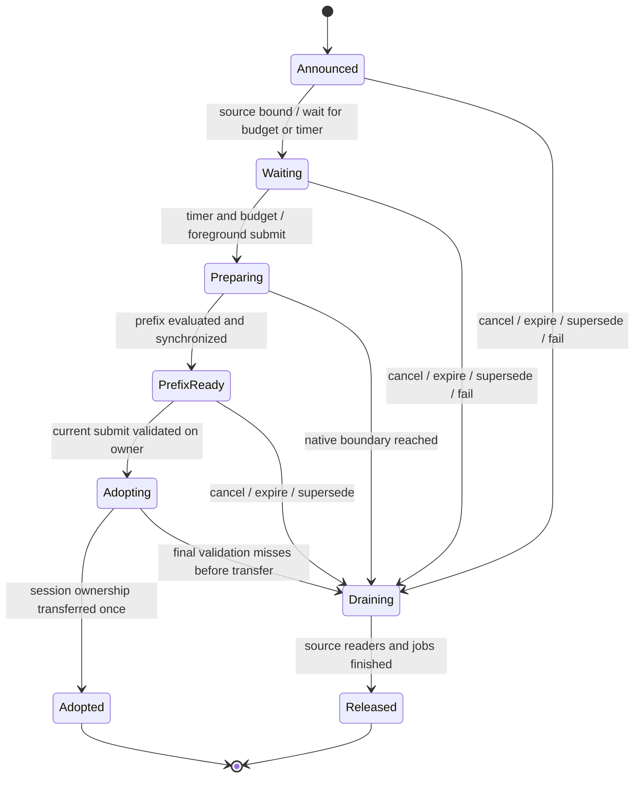

# 提前意图与按需预热 v1

| 项目 | 说明 |
| --- | --- |
| 契约 ID / 日期 | D-PREP / 更新2026-10-31 |
| 状态 | **部分实现**：E21工具窗口、E22阶段归因、E23父进度ETA／spawn已验收；E29–E39常驻工具输出、增长预填充与可选退出竞态修正见§25–30（最新结果在§30末）；通用意图／候选交接／容量与异步冷启动仍为设计，见§13–17 |
| 范围 | cxf 可选宿主层；固定 llama.cpp / Qwen3 首先验收；保留默认 HTTP 行为 |
| 依赖 | D-CTX、D-CHAT、[D-KV](kv-worker-v1.md)、[D-STREAM](stream-v1.md)；登记见 [入口](README.md) |
| 取代 | `docs/llama-context-v1.md` 末尾的预热提纲和适配清单中的详细方案；它们保留摘要／跳转 |

## 1. 目标与首版边界

宿主已知道 system/tools 变化、即将恢复哪个历史会话或任务大约何时继续，就先传准备意图；模型所需的稳定前缀可以在正文装配／输入期间准备。较重的工作按预计提交时刻启动，兼顾提交后等待、过早占用、作废工作和其他任务延迟。

首版是一个有界协调器，复用现有 owner 线程、canonical token 池和模板路径。不建立通用规划框架、第二套聊天历史或跨引擎 KV 格式；不修改 llama.cpp 内核。用户开始输入只是宿主软信号，不增加系统键盘监听。正文默认等最终提交；只在显式 opt-in 时提前处理已有 D-STREAM 契约的完整不可变单元。

“等待恰好为零”是目标，不是保证。模型常驻、文件页缓存暖、设备图暖、前缀 KV 暖分别记载；预热不会使预分配 KV buffer 随请求自动缩小。

## 2. 现有基线与必须先接的边界

| 已有实现 | 可复用部分 | 缺少什么 |
| --- | --- | --- |
| `AgentNative` | 已验收模板／解析器、检查点、工具执行链 | 已有独立／借用engine两模式；E21用worker owner；完整prepare中才发现tools变化 |
| `AgentKvWorker` | 一个 owner、有界 ticket、精确版本快照恢复 | FIFO；open 等待模型加载；没有环境意图、定时或前台优先策略 |
| `AgentStream` | 完整单元、稳定前缀验证、版本收据、初始预填 | 独占借用 worker；open 同步预填；tools 为空、system 固定 |
| `cxf_llama` | 单份 token、fork、replace、预算 prefill | 单线程，由上层提供正确 token 边界；model/context 一起创建 |

不能同时让 Native、Stream 和新协调器各自管理同一个 engine，也不能开第二个 engine 后声称复用了原 KV。首个原型先独占借用一个已就绪 worker；E21已增加Native借用engine模式，仅接串行工具窗口；通用候选交接和Stream迁移仍待实现。现有独立入口继续作基线。

## 3. 准备层次与 ready 定义

| 层 / 状态 | 条件 | 不代表什么 |
| --- | --- | --- |
| `ENV_READY` | 模板／工具定义已验证，输出解析元数据可用；与环境身份一致 | 未必加载模型，也没有凭 hash 计算 KV |
| `ENGINE_READY` | 模型、context、设备初始化及本轮要求的图预热已完成 | 不表示真实 system/tools 的 KV 已存在；不同 batch 形状仍可能有首次开销 |
| `PREFIX_READY` | 已验证的稳定前缀已提交并 evaluated，设备状态可用 | 不包含未定正文或最终 assistant header，不可直接开始最终回答 |
| `REQUEST_READY` | 最终正文、有效收据与 generation header 都已进入当前 session，token/版本校验通过 | 尚未保证首 token／完整输出已产生 |

层之间是依赖关系，不是所有场景都必须按固定编号执行。模板内容已知时 CPU 准备可与 engine 初始化重叠；前缀计算要等相应准备全部可用。已有 KV worker 的 poll `ready` 是“ticket 已完成”，可能完成于错误；已有 Stream 的 `model_ready` 对应 `REQUEST_READY`，两者不得合并成一个布尔语义。

固定版本上游 common 的空运行 warmup 随后清空 memory。图预热只允许发生在新建、尚未交给活跃会话的 context 上，并先于真实前缀；已有 engine 上不能为一个新 hint 清空全 context。首次版本用已有模型/context 生命周期做异步包装，模型句柄与多个 context 的拆分留待后续测量。

## 4. 所有权与单份存储

| 资源 | 唯一负责方 | 借用／回收规则 |
| --- | --- | --- |
| 原始 system/tools／历史事件 | 应用的不可变源视图 | 源拥有者保留到协调器发出 `SOURCE_RELEASED`；取消请求不等于可以释放 |
| 意图表、环境准备对象、时机估计 | 协调器 | 只缓存有界元数据／解析对象，不持久保存完整 messages 或渲染全文 |
| engine / token 池 / KV | 现有 worker 的 owner 线程 | 所有调用，包括 tokenize、fork、close，都在同一 owner 上串行执行 |
| 候选 session | 协调器经 owner 创建 | 同引擎 fork 共享已证明相同的前缀；新后缀进入同一个 canonical 池 |
| 交接后的活跃 session | 接管该请求的 Native／执行宿主 | `ADOPT` 后负责在 owner 上关闭；协调器不得再按“过期预热”清理它 |
| 私有 snapshot | KV worker | 延续精确 session/revision 验证与磁盘预算，不放宽为模糊前缀匹配 |

`bind_source` 借用不可变源视图，其字节地址和内容在 `SOURCE_RELEASED` 前必须稳定。应用可继续拼接其他数据，不能原地修改被借用区域。若现有 blob 会 realloc，宿主先固定其视图生命周期；协调器不得偷偷复制全部历史来规避。只有同步校验／单次渲染可使用有界 scratch。

每份源视图只有一个所有者。新模块用显式借用／归还，不增加通用引用计数或对象图回收。协调器内部多个工作阶段共享同一份借用登记，最后一个读取阶段退出后只归还一次；尚有活跃阶段时不能回收。

借用 worker 的原型：调用者拥有 worker，协调器在存活期独占它；先停止前台请求、关闭协调器并排空源借用，再关闭 worker。后续托管冷启动模式：协调器创建并拥有 worker，关闭时按同样顺序释放。两种模式必须显式选择，不能运行中改变所有权。当前 Stream 的独占契约在迁移完成前继续有效。

## 5. 身份、版本与稳定前缀

| 字段 | 作用 | 更新规则 |
| --- | --- | --- |
| `consumer_id` / 引擎身份 / session 世代 | 隔离任务、引擎和槽位复用 | 不把裸 slot index 当身份；禁止跨模型／跨 engine KV 接用 |
| `env_epoch` | system/tools/模板／推理配置的语义版本 | 相关定义变化即递增，包含 tools 顺序；hash 不代替 epoch |
| `intent_epoch` | 同一消费者的最新准备意图 | 换目标、取消后重新请求时递增；旧完成不能覆盖新意图 |
| `source_id` / `source_revision` | 不可变原文／历史视图 | 绑定时固定，后续正文通过新视图或最终提交交入 |
| `core_revision` / `prefix_end` | 某一候选 session 的规范 token 状态 | 每次调用仍按核心 API 校验；不把 env_epoch 传作 core revision |
| deadline 估计及置信类别 | 只影响调度 | 仅改 ETA 不改变内容版本，不需要重建有效 KV |

复用键至少覆盖模型权重／量化与 adapter 身份、tokenizer、模板、位置／RoPE 等相关配置、环境内容和顺序、会话隔离域及确切前缀。工具实际权限仍由既有执行器检查；早期声明的 tools 不授权执行。

hash 用于筛选与变更检测。`PREFIX_READY` 必须有来自已验收模板路径的前缀证明：确切 token 末端、该候选 core revision，以及模板／环境身份。最终提交仍验证它确实是最终输入的前缀；首版允许完整渲染＋哈希验证，不宣称已消除 O(n) 前端成本。

### 5.1 system/tools 改变时

前面任何 token 改变，后面的旧 KV 即使对应相同正文也不能原样接到新前缀。tools 的存在／顺序和模板条件分支可能影响 system 部分；不预设“system 是一个独立 KV 段、tools 是另一个独立 KV 段”。

首版按固定 Qwen3 模板构造已闭合的环境前缀，停在最终正文／generation header 之前的验收边界。只有该边界在后续正文、工具收据和空／非空 tools 的 oracle 中都成立才启用。未知模板返回不支持，继续普通准备；不能通过自写近似 ChatML 改变输出语义。

候选使用私有 session 分支，不编辑正在服务的活跃会话。环境变化最多保留当前候选与一个正在排空的旧版本；关闭旧候选只删除它的序列归属，不能删除仍被其他 session 使用的共享前缀。

### 5.2 正文、输入开始与已有历史

默认 `body_policy=DEFER`：开始输入仅通知“可能即将使用”，预热已确定环境／历史，不逐按键更新 KV。输入法组合、回删、流中残缺 JSON 均不提交。

可选 `IMMUTABLE_UNITS` 后续复用 D-STREAM：完整单元按序追加，收到最终 end 和有效收据后再加 header。多轮会话的历史与新工具 schema 组合必须重新验证渲染前缀；已有 snapshot 只有在其原 session 和 revision 精确有效时可恢复，不能把修改父会话后的快照改称有效。

## 6. 控制接口草案与状态变化

以下是逻辑操作名，尚不是已存在的 C API，也不冻结 ABI 布局。实现时统一进入一个 `AgentPrepareCoordinator`，首版只增加这一层宿主控制。

宿主 API 串行调用；announce、bind_source、revise_deadline、poll、cancel 和 submit 只做有界登记／检查，重解析和引擎工作在协调／owner 线程执行。submit 返回接受／拒绝及可查询的请求状态，不阻塞等待生成；旧 CLI 可在外层等待。drain/close 才允许同步等待，因此提交后仍可由同一宿主事件循环处理取消。所有时间使用同一进程单调时钟；epoch／ticket ID 溢出拒绝，不回绕复用。

模型路径、后端路径、工具权限与可用 session 由部署和调用宿主管理；hint 只引用合法对象，不授权下载、加载任意路径或执行工具命令。

| 操作 | 输入 / 返回 | 契约 |
| --- | --- | --- |
| `announce` | 消费者、epoch、环境指纹、ETA／到期时间、准备策略 → ticket | 元数据快速登记；未知内容可先登记，旧意图标作废；本操作不启动正文推理 |
| `bind_source` | ticket、不可变 system/tools／历史视图、源版本 | 校验当前 epoch、容量与借用条件；有实际内容后才允许解析／KV 工作 |
| `revise_deadline` | ticket、新 ETA／到期时间 | 只改调度元数据；同一 ticket 的已完成 KV 可继续使用 |
| `poll` | ticket → 状态、完成层级、结果码、资源与时间报告 | 非阻塞；完成、成功、设备可用三个概念分别给出 |
| `submit` | request_id、可选 ticket、最终输入视图／版本 → 受理状态 | 显式激活前台请求，校验、接管或 MISS 后正常准备；不可因预测失败使用旧上下文 |
| `cancel` / `drain` | ticket → 取消确认／最终回收确认 | cancel 阻止未来交接；drain 才确认运行中读者结束与源可释放 |
| `close` | 协调器 | 拒绝新意图，取消并排空未交接工作；要求活跃请求先结束；不与宿主 API 并发 |

announce 若接受失败则不改变旧意图；成功接受新的 intent_epoch 后，旧准备即作废。后续 bind_source 失败使新意图继续等待有效源，不能偷偷恢复旧意图；旧源仍按借用生命周期排空。最新 epoch 的元数据可合并。提交可以在任何准备阶段到达；显式不带 hint 的新 request_id 可走普通 Native 路径，成本也计量。未知／已消费的非零 ticket 不能静默变成一次新执行。

同一消费者的相同 intent_epoch 重复 announce，若内容身份相同则返回现有 ticket；同 epoch 改内容／较旧 epoch 拒绝。消费后的旧 epoch 不重新启动；消费者的 epoch 与 request_id 高水位记录在最多 16 个登记槽中，首版保留到协调器关闭，新任务使用既有消费者的递增编号。重复 submit 返回原请求或已消费状态，不再运行一次生成／工具执行；相同 request_id 改最终源则拒绝。MISS 的普通准备也纳入同一请求身份，不能通过重试重复执行。新预热 epoch 不撤销已经 ADOPTED 的活跃请求。

bind_source 对同一 ticket 只接受同一个不可变 source_id/revision；相同源重复绑定不重复借用／归还，换源需要新意图。最终正文使用 submit 的独立源视图；成功异步受理后也遵循 SOURCE_RELEASED / 交接生命周期，不能返回宿主就失去字节有效性。



`ENV_READY` / `ENGINE_READY` 为依赖状态位，不另复制意图状态机。准备失败记录原因后排空；最终请求可以重新正常准备。`Adopted` 的源借用只要该源的最后读取者尚未退出也不能提前释放；转交给活跃请求的借用必须明确随 session 一起交接，不得两边各释放一次。

提前到达的 submit 只把匹配工作升级为前台，跳过推测定时；候选仍需先达到 PREFIX_READY 才能 ADOPT。没有可用候选时走普通准备。被 poll 或 drain 确认归还的每个 source_id 才可由宿主释放；不在内部持锁时执行应用释放回调。

## 7. 原子交接、取消和失败

`submit` 先验证源／环境身份，再由 owner 执行最后一次候选检查。检查与把候选标记为 `ADOPTED` 属于同一个串行提交点；宿主 epoch 更新／cancel 与这个点有明确先后，不能在“检查成功”和“标记接管”之间插入失效。

取消先于提交点：候选不得接管，原生活跃请求不被改写。提交点先于取消：预热 ticket 已转移，后续取消走活跃请求的取消入口；协调器不再删除其 KV。即使旧 hint 最后完成，仍只能处理旧 candidate。调用原生函数期间不做强制抢占，取消到真正释放的延迟单独记录。

| 情况 | 处理 |
| --- | --- |
| 只有 hash、尚无源 | 停留登记／等待，允许元数据准备；不计算真实 KV |
| system/tools 或源前缀不匹配 | 标 MISS，保留实际最终输入，普通准备；清理未交接候选 |
| 预算不足／ticket 表满 | 准备请求显式拒绝／延后；前台请求按既有容量规则执行，不自动扩容或逐出其 session |
| 解析／未知模板／模型不兼容 | 准备失败；正常路径只在本来支持该输入时继续；不静默改模板／模型 |
| decode 或恢复失败 | 沿用核心失效规则；保留 canonical 历史；按实际资源条件显式重试 |
| 冷启动失败 | 发布启动错误并排空资源；没有可用 engine 就不能声称“降级成功” |
| close 时尚有活跃借用请求 | 宿主先结束该请求，再执行 close；不得先关底层 engine |

预热 MISS 的重试最多退到一次正常准备；不会因外层输出扩容重复模型推理，也不自动切 HTTP／云端。记录 HIT / MISS / EXPIRED / SUPERSEDED / CANCELLED / RESOURCE_LIMIT / ENGINE_ERROR / UNSUPPORTED 等控制面原因；它们尚未映射为新的 `cxf_result` 数值。

## 8. 时机、预算和公平性

设 `D_hat` 为预计最终提交时刻，`Q_hat` 为 owner 排队，`W_hat` 为剩余准备关键路径，`m` 为误差余量。首版使用简单测量估计：

```text
enqueue_at = max(now, D_hat - Q_hat - W_hat - m)
exposed_wait = max(0, actual_request_ready - actual_submit)
prefix_wait  = max(0, actual_prefix_ready - actual_submit)
early_hold   = max(0, actual_submit - actual_prefix_ready)
```

enqueue 是入 owner 队列的时刻，实际 ready 必须由设备可用回执确认。`early_hold` 只描述前缀完成后的空等；计算过程中已经保留的 KV 另用占用积分覆盖。没有可靠 ETA 时先做预算允许的轻量 ENV 准备，KV 用保守延后策略；`input_started` 不自动等于立即填满历史。

派发公式首先对齐前缀准备；DEFER 模式下正文分词／prefill 仍在提交后进行，所以 prefix_wait=0 不等于完整 exposed_wait=0。未提交而取消的样本没有 submit 延迟，记为不适用并单列浪费／回收，不填零冒充快速完成。

`W_hat` 按模型／后端、冷暖、已驻留前缀、长度与 batch 分组，用已完成试验的滑动估计和误差修正。恢复与 CPU 准备可并行时取关键路径，恢复后的后缀计算另加，避免把可并行阶段机械相加。首次样本不足时使用保守配置区间并标低置信，不从七样本拟合 p99 或宣布时机准确。

晚到越贵则余量可增，容量压力／取消率升高则余量和准备范围收缩；首版不训练复杂预测模型。启动后不能为了 ETA 更新撤销已经完成且仍有效的 KV。若预测已晚则立即派发，实际提交仍可优先接管；允许提交时尚未准备好。

后续可用一个经验成本目标比较策略，但系数必须按部署需求与量纲设定，不预填通用最优值：

```text
KV_time = integral(marginal_unique_speculative_KV_bytes(t), dt)
J = a * E[exposed_wait] + b * E[KV_time]
  + c * E[waste_cost] + d * E[added_wait_for_other_tasks]
```

KV_time 只计算因推测保留而额外占用的唯一单元，活跃请求已经需要的共享前缀不重复收费；计算中逐渐增加的单元和取消后尚未回收的单元也计入。waste_cost 从废弃 native/CPU 工作和 I/O 换算，实际被新意图继承的工作不按“旧 ticket 取消”直接全算浪费。引擎权重／固定 KV 分配的驻留另列，不能用逻辑 byte·ms 冒充物理内存归还。

首个原型必须显式给出资源参数。以下是**待验证的试验配置起点**，不是当前运行时默认值或性能承诺：

| 参数 | 原型起点 / 行为 |
| --- | --- |
| 元数据意图 | 每 engine 最多 16；每消费者仅最新一个有效意图 |
| 推测候选 | 每 engine 最多 1 个物化候选；允许另 1 个旧工作排空；无空间则等排空 |
| 异步源视图 | 最多 2 个未归还视图；新绑定超限明确 FULL，不留无界旧源 |
| 环境源 | system/tools 合计最多 64 KiB；工具 JSON 深度 16、节点 4096、工具数 32 的试验上限在可能递归解析前生效；缓存对象峰值另测 |
| 一次推测 prefill | 最多一个 engine batch，且服从核心最小批量与预算；不为试探强制大量小 batch |
| 可用 KV | `spare = max(0, pool_cells - live_foreground_cells - foreground_reserve)`，候选新增唯一单元不得超过 spare 和显式 speculative_cap |
| 到期与保留 | 每个意图必须有 `expires_at` 和最大推测保留时长；截止后停止续热并回收未交接候选 |
| 快照 | 沿用 8 份上限／显式磁盘预算；默认不为短输入停顿创建新 snapshot |

上述源视图／候选上限针对推测工作；交接到活跃请求后的资源按前台预算计量。历史引用既有不可变视图／session，不额外复制，仍受核心 context 容量及现有 Native 的 1 MiB 渲染上限约束；环境源的 64 KiB 不能被理解为整个历史限制。旧／新环境解析对象最多各一份。超过推测上限可以拒绝预热，最终 Native 输入仍按其既有契约判断。

共享前缀只计唯一物理单元；若当前接口不能可靠观察唯一空闲 KV，首版只在隔离试验中按保守额度运行，不能把 logical token 总数当可用容量检测。并发生产策略以补足该可观测性为前置条件。

现有 worker 是 FIFO，新协调器不直接宣称已有优先队列：先在协调器保留定时推测任务，仅向 owner 派发一个推测 batch，边界后重新检查前台队列。前台提交／取消和资源清理优先于下一次推测 batch；全局最多一个推测 owner 请求等待／执行，避免排队占满 16 项。单次 restore 和模型加载仍可能较长、不可中断，要计入前台被阻塞时间；压力高时禁止启动这类新推测操作。

## 9. 冷启动和保留策略

第一切片只接已就绪 worker。之后的冷启动包装在固定一个协调线程中调用现有 worker open，宿主 API 立即返回 STARTING；engine 仍由 worker owner 打开。加载期间可以收到新 epoch、ETA 和取消，不能对半创建 engine 调用 API。加载完成后再次检查是否还有有效需求；若没有，按 engine 保留预算继续短暂驻留或完整关闭，不把全局加载结果误报成某个会话的 PREFIX_READY。

引擎空跑使用新 context、独立计数，结束清空后再计算真实前缀。不为每个输入 hint 重新加载权重或重建 KV 池。活跃任务／借用 session 存在时不能因一个意图超时关闭 engine。保留策略记录模型驻留与 context 分配成本，不能只报告前缀几百 token 的字节数。

本版不拆分多 context 的共享 model 池、不自动磁盘保存所有过期候选。已有文件可以恢复时单列恢复成本；新文件保存只有在复用预期与预算允许时显式触发。不能把 token_count=0 说成多个快照文件之间也不重复前缀。

## 10. 测量与验收

性能实验新建独立 ID／证据，不混入 E10/E11。比较三种策略：提交后准备、立即预热、按预计提交派发；固定内容、模型、缓存权限、池容量、后缀与最终 token，使用同一取消／ETA 事件序列。校准数据与评价数据分开；理想 oracle 时机只作参考上界。

| 分组 | 需覆盖的情形 |
| --- | --- |
| 冷暖 | model 未驻留但 OS 缓存状态说明、context/图首次运行、模板冷、KV 未驻留／已驻留／文件恢复 |
| 变化 | system/tools 定稿早、tools 增删／重排、正文改变、前缀无变化、已有历史后切换 tools |
| ETA | 早／准／晚提交、无 ETA、输入长停顿、快速提交、多次修改截止 |
| 取消与压力 | 旧 epoch 在排队／执行／PREFIX_READY 时取消，候选与活跃任务共享前缀，槽位复用，容量耗尽，多消费者争用 |

必须记录源绑定／释放、环境／engine ready、入队／启动、prefix ready、submit／adopt、request ready、首 token、回收时间。报告暴露等待、early_hold、唯一推测 KV 单元的 byte·ms、废弃 decode token／I/O 字节、CPU／native 执行、保存／恢复、RSS／分配量和其他任务延迟。byte·ms 从首次保留到交接或实际回收，包含取消后的排空时间；物理缓冲不变时说明它是逻辑容量压力指标。

正确性门槛：

1. 稳定环境前缀＋正文与独立一次完整渲染／分词完全一致；首个 greedy 与从头计算一致，不能只比 hash。
2. system/tools 任意变化、特殊字符、空 tools、模板分支、任务重置和已存在历史均覆盖；未支持边界拒绝并正确回到普通路径。
3. 失效、cancel、ADOPT、slot 复用竞态覆盖；旧完成零次发布到新请求，活跃 session 不被候选清理破坏。
4. 每个源借用／candidate/ticket/snapshot 至多释放一次；取消后排空、错误、正常关闭资源归零；ASan/UBSan 与失败注入通过。
5. 首台机验证同 owner，无并发 libllama 调用；Native 独立／借用模式输出一致；原有 Stream 独占行为迁移前继续正确。
6. 小样本只报告中位数／范围、逐对差异和失败；保留无间隔、预测错误、高取消率和有争用的反例，不预设必须提速。

## 11. 实施切片与完成标准

2026-10-30 用户调整实施顺序：先独立完成 [D-COST 时间测算](cost-estimator-v1.md) 及误差／开销对照，再逐项做下面切片。估算器完成不代表 P0–P4 的调度／生命周期已完成。

| 切片 | 交付 | 阶段完成标准 |
| --- | --- | --- |
| P0 环境意图 | 有界版本登记、源借用／释放、独立模板/tools 准备、取消 | 不触碰 KV 的正确性／生命周期回归与内存计数 |
| P1 稳定前缀 | 已就绪 worker 上的候选 session、前缀 oracle、原子 ADOPT；Native 借用模式 | 不改变 token／工具语义，所有权与竞态通过；只在显式原型入口启用 |
| P2 时机与容量 | 三策略、简单估计、过期回收、前台优先的 batch 派发、实际 KV 空闲可观测性 | 完整成本与反例数据；没有可靠容量数据时继续限隔离实验 |
| P3 冷启动 | 托管异步 open、图预热、取消后 engine 保留／关闭 | 初始化全生命周期与冷暖分组数据；不要求拆 model/context |
| P4 实际宿主 | 先接 Native 任务，再迁移 Stream；输入开始由宿主显式通知 | 同一 owner 的集成链验收，既有工具、CLI、14K 与默认回归保持通过 |

先完成每个切片的正确性与成本记录再扩大范围。完整P0–P4未整体完成；E21只交付下节定义的Native串行工具窗口／EWMA子集，通用P0、候选ADOPT、容量／公平性、P3及Stream接线仍待实现。Windows/CUDA、真实云端 SSE、多模型设备竞争、跨进程快照、任意 KV 分页和事件级增量模板不因本文而成为首版依赖。

## 12. 文档与来源

本文件是 D-PREP 的唯一详细契约；现状清单只保留状态与入口。实施改变契约时按 [维护规则](../benchmarks/MAINTENANCE.md) 更新本文件、适配清单、CHANGELOG 和新证据。测量后再决定余量／保留时长／容量默认值，先不填写虚构结果。

代码核对：`include/cxf/llama.h`、`src/llama.c`、`tests/agent_native.cpp`、`tests/agent_kv_worker.cpp`、`tests/agent_stream.cpp`；上游固定版本 [批次／序列接口](https://github.com/ggml-org/llama.cpp/blob/f1e44dcc11d8802d107bd7331a3d3fd3e6f57b93/include/llama.h)、[空运行初始化](https://github.com/ggml-org/llama.cpp/blob/f1e44dcc11d8802d107bd7331a3d3fd3e6f57b93/common/common.cpp)。已有测量的适用范围以 E10/E11 为准，不能替代本轮验收。

## 13. E21 工具执行窗口切片（实施前冻结，2026-10-31）

本轮仅实施P1/P2/P4的有界子集：已就绪单worker、Native借用、同一串行工具调用窗口、EWMA定时。P0通用意图／多消费者／异步冷启动／唯一KV空闲监控仍未实现，不能把整份P0–P4标成完成。默认HTTP与原生独立入口保持兼容，原生CLI显式启用本切片。

- `AgentNative`增加借用已就绪engine模式，engine仍仅worker owner访问。借用对象只关闭自己的session；worker最后关闭。已有open拥有engine的语义保留。没有活跃生成时，checkpoint在本切片独占Native session上就地截到已验收的generation-header之前规范token边界；不是通用私有candidate/fork/ADOPT。最终prepare仍完整模板渲染／前缀校验，失配重建，不能拼接不相容KV。
- 新`AgentToolPrepare`宿主独占拥有一个worker和借用Native。包装部署已授权的工具exec，工具参数、权限、命令、输出容量沿用原执行器；一次exec仅执行工具一次。工具返回不因预热失败重跑。全部非cancel API串行，至多一个工具与一个准备线程；cfg／工具源在调用期间不变，不复制第二份历史。取消只取消推测准备，不能把工具执行状态冒充取消；close等调用排空后执行。
- 状态三类：resident（常见基线，不逐出）、recompute（保留canonical token，显式丢弃KV）、restore（checkpoint实际保存私有文件后逐出）。后两者为显式容量策略试验，不是所有Agent天然缺KV。保存／逐出在工具前执行并计入完整耗时；快照每调用释放，不建立通用自动冷热策略。物理KV buffer不缩小，OS文件缓存暖，不宣称冷SSD或PCIe收益。
- 非resident各比较late（工具完成后启动）、immediate（工具刚开始启动）、timed（简单EWMA算延迟）。固定alpha=(sqrt(.01²+4*.01)−.01)/2，沿E20等价平滑；按部署tool key保留最多32项数值状态，工具耗时与准备ms/token分别EWMA更新。预计延迟=max(0,tool_ms_hat−prepare_ms_per_token_hat*prefix_tokens−5ms)。未知样本立即准备；工具提前完成即唤醒，不为预计时刻继续空等。报告预测、实际启动、early_hold、剩余等待及准备与工具重叠；没有Gaussian置信保证。
- 推测线程不直接调用engine：仅经worker同步owner调用prefill或已有KV prepare/finish；定时等待可由工具完成／cancel唤醒。正在执行native函数无法强制中断；取消接受截止点与最终取消读取在同一锁内；已完成native但工具仍在执行时的取消也要回滚。取消后排空并逐出本切片独占session的推测KV，不影响其他session。取消后不收准备样本。最终请求使用当前真实工具收据，经正常Native prepare；失效不接管旧准备。准备失败回退正常prepare，失败／取消／浪费单列。
- 原生CLI新增显式工具准备选项，并只包装已注册的test.run；实际工具链仍原执行器。提供相同宿主API供真实fs.read／test.run工具流程验收；确定性动作选择不当作模型自主能力。
- E21正式策略在测量前固定：resident一组；recompute／restore各late/immediate/timed，三次真实工具调用（read流程或编译测试fail→写修正→pass→pass），两档历史长度，每组7个完整任务。单独3次标定只用于EWMA初值，不入评价；各策略使用相同标定初值，评价仅过去观测更新。按rep轮转策略顺序降低固定先后效应，不挑最好运行。
- 指标：工具返回至模型ready／首greedy、tool-exec时间、调用／完整任务总时、checkpoint／保存／逐出、真实restore／prefill、排队、初始预测／更新数、提前持有时间、浪费／取消、实际评估token、搬运字节、规范token／fresh-KV greedy oracle。模型load、初始历史prefill、标定和oracle单列排除；保存成本不排除。每轮真实收据入模板；原始日志不发布，只发布数值和内容哈希。正常resident及快速工具的无收益／回退保留。
- 验收先于性能：Native独立／借用一致、worker存活与关闭、取消定时等待和native边界后排空、工具错误／容量拒绝不重跑、工具key容量／非有限参数、前缀失配回退、规范token及greedy、原有Native工具／14K／KV/Stream回归、ASan/UBSan与默认测试。新ID E21追加证据；旧21份不可覆盖。

## 14. E21 实现状态与正式结果（2026-10-31）

§13策略冻结后一次正式运行完成，追加[E21证据](../evidence/tool-prepare-20261031.json)；[完整报告](../benchmarks/README.zh-CN.md#e21--真实工具窗口准备)列全部范围、逐对差异与负结果。代码入口`tests/agent_tool_prepare.h/.cpp`、`tests/agent_native.h/.cpp`、`tests/agentctl.c`；runner `tools/bench_tool_prepare.py`。这是模型常驻时的稳定历史预填充／私有KV恢复，不是异步冷加载或完整协调器。

| 长历史编译测试，三次工具调用合计 | 工具后首greedy等待中位 ms | 完整任务中位 ms（含保存） |
| --- | --- | --- |
| KV驻留 | 113.258 | 1582.892 |
| 重算，工具完成后 | 1759.905 | 3242.604 |
| 重算，立即提前 | 631.824 | 2071.084 |
| 重算，EWMA定时 | 631.885 | 2091.362 |
| 恢复，工具完成后 | 242.040 | 2058.327 |
| 恢复，立即提前 | 119.848 | 1941.562 |
| 恢复，EWMA定时 | 150.610 | 1878.756 |

按表中中位数，定时重算等待减少64.1%，定时恢复37.8%；恢复完整任务减少约8.7%，但比保持驻留仍慢。逐对统计另算：长恢复定时相对late，等待节省中位94.834ms、任务214.356ms，均7/7为正；不是两个独立中位数相减。快速读三次工具总时不足1ms，没有实质隐藏窗口；其完整任务波动含保存／逐出等成本差异，不能归功于提前重叠。

EWMA并非纯延迟最优：长恢复立即的剩余等待更少，但PREFIX_READY后提前空等三次合计1077.405ms，定时18.483ms；该指标不含计算中的逐步占位，不是完整KV_time积分或物理显存释放。短重算立即1555.155ms、定时1609.734ms，定时反而慢。实际准备预计／观测仅按key做时长／每token EWMA，复杂D-COST结构模型仍未接自动调度。

立即恢复时，总准备在native恢复调用之外多出三次合计约282–293ms，定时不足1ms。长历史native恢复自身124.116→299.346ms也变大。`prepare_ms`含owner队列／verify／finish／宿主返回，而`restore_ms`仅native文件加载＋设备同步；不能把两者混称搬运时间。本轮虽宿主API保留AgentKvReport的时间字段，归档collector未独立发布队列／fork暂停／线程唤醒，未测硬件带宽和频率，故差值只列未归因协调耗时，后续诊断需新证据，不能事后改写成本来源。

生产路径只持有既有canonical tokens和有界数值状态；完整渲染与hash验证仍在最终prepare，真实工具收据／后缀必须等工具完成。容量策略显式选择：resident不保存／逐出；非resident快照每次工具创建并删除，保存未摊销。模型load、初始历史prefill和独立oracle不进任务成绩，后两项成本记录；工具前保存／逐出、真实修复、模板／后缀及首greedy均进入。

原生CLI显式选项经过确定性Native-parser动作、实际注册表／AgentStore／工具包装，在ASan/UBSan下真实test command恰好执行1次。实际0.6B生成探测把裸JSON当正文，退出正常却实际执行0次，作为模型负结果保留；不放宽解析器把任意JSON猜成工具。Native独立／借用、14K、KV、Stream、默认回归通过；取消等待／运行中／已就绪边界、环境重建、key上限和工具错误／容量验收通过。正式计时696行使用12个独立fresh-KV参考核对token／greedy，931总记录含标定／任务汇总，不虚增独立任务数。

仍未完成：通用P0环境意图／源视图控制、私有候选fork与ADOPT、多消费者抢占／唯一KV空闲额度、完整占用积分、异步冷启动、Stream迁移、云SSE及Windows/CUDA。本切片仅在独占单Native会话的工具窗口操作，不把一次工具包装升级为全局调度器。

## 15. E22 定时恢复等待归因（实施前冻结，2026-10-31）

本轮先测原因，再另冻E23优化，不用同组评价挑参数。E21的931条和此前全部22份证据保持原样。旧数据只做逐条引用的离线审计：prefix_wait=max(0,prefix_ready−tool_end)，post_prefix=after_tool_first−prefix_wait；同时复算工具ETA误差、准备耗时误差及实际派发相对计划的偏移，不把均值误差当尾部保证。

E22只新增观测，保留旧late／immediate／timed行为和5ms余量、alpha。四类read／compile×128／2048历史，各resident和restore三策略；同三次标定、七次任务重复、三次计时调用、轮转策略次序。每个实际进程工具记录fork调用起止、首次输出、进程回收；不改命令、进程权限／超时或执行次数。增加可选trace入口，原test_run_exec继续相同执行语义。

准备报告追加：线程进入、timer deadline／wake、KV prepare调用前后、worker queued／started／restore_start/end／ready、finish调用／owner开始／owner结束／返回、主线程join与drop起止、最终assembly／render/tokenize/commit/prefill和greedy。所有时间同一单调时钟。阶段可能互相包含，按相邻边界拆段；不能把重叠的prepare和restore相加。报告ETA偏差与调度偏移的精确恒等式，分开正等待与提前空等；fork区间重叠只能定位时间，不能单独证明OS内部原因。

新增字段不改变ticket、版本或取消规则；观测器在父进程运行，不在fork子进程调用C++／用户回调。源借用仍截至同步工具返回；worker报告仅追加可选数值字段，不引入历史／第二引擎。工具错误和超时也保留trace，禁止为取trace重跑命令。

先运行trace／阶段恒等式、工具一次执行／容量拒绝、取消和原KV／工具回归、ASan/UBSan，再做独立无插桩性能。E22数据用于选择优化方向；E23必须另写策略、使用新历史长度／工作量、保存旧对照和负结果。目标同时报告after-tool等待、PREFIX_READY提前空等和完整任务，不承诺在随机工具时长下始终双赢。

## 16. E23 进程启动与进度条件ETA（实施前冻结，2026-10-31）

E22追加547条、旧策略仅加观测。正式数据定位：compile/立即恢复的before-native平均约111／148ms，进程spawn平均117／162ms，worker queue与finish返回均远小于1ms。额外时间位于校验区间并与fork重叠，不能称纯KV搬运；具体libc锁／内核暂停未直接采样。旧timed的dispatch anchor平均偏差仅约.006／.007ms，非主要均值原因；剩余prefix等待均值约4.98／5.20ms且早／晚误差混合，固定平移余量不保证同时减少等待和占位。

E23冻结两项可分开对照的改动，不依据E23评价调参：

1. macOS26+的默认test.run使用posix_spawn，设置与旧fork相同的/bin/sh -c、固定cwd、stdin=/dev/null、stdout/stderr合并、独立进程组和超时回收；模型不能指定backend或command。旧fork保留为部署级显式对照。更旧macOS／Linux暂保留fork，不把未测平台自动切换。新增可选backend/trace入口；失败启动返回原receipt类别、不能在已经可能执行后自动重跑。子进程创建失败不触发fork回退。标准接口核对本机SDK，参考[Apple posix_spawn手册](https://developer.apple.com/library/archive/documentation/System/Conceptual/ManPages_iPhoneOS/man2/posix_spawn.2.html)和[Apple公开头](https://github.com/apple-oss-distributions/xnu/blob/main/libsyscall/wrappers/spawn/spawn.h)。本机26使用标准addchdir，不添加已弃用_np作为首选。
2. 新progress策略仅在已授权工具的父进程spawn返回后更新ETA：estimated_end=observed_spawn_end+EWMA(后续工具时长)，dispatch=max(observed_spawn_end, estimated_end−estimated_prepare−5ms)。所有deadline为单调绝对时刻；5ms／alpha仍冻结。完成的工具才更新后段估计，当前回调只带已经发生的时间戳，不读未来完成标签。无进度时等工具完成立即准备；未知后段估计在收到进度后立即准备。源不提供进度时可继续旧timed策略，不强制迁移通用工具。

进度API以当前execute epoch绑定，拒绝旧epoch、重复／越界时间，cancel与最后提交边界同锁；不在fork子进程回调，不直接调engine、不复制历史。串行宿主／单准备线程／同owner约束不变；早到progress在timer进入前可登记，不丢通知。生产Native CLI的test.run选progress时使用这个父进程事件；其余流程兼容。

冻结验证网格：read／真实compile_test，历史320／1792 words，计算循环25000000（E22是128／2048及30000000）。七个对照：spawn resident、fork immediate/timed/progress、spawn immediate/timed/progress。两backend各resident／restore-late三次标定，所有策略同backend初始标签一致；新后段特征仍来自相同三次完整标签，不增加模型调用。评价各7任务、3次计时调用，轮转顺序；所有源／阶段／次数／ETA从过去标签和当前已发生事件独立复算。

分别报告：spawn成本、校验阻塞、native restore、正prefix等待、post-prefix、完整任务、PREFIX_READY提前空等。只比较同轮同条件，不把E21→E23差值当算法收益。性能在正确性、默认工具／超时／process-group、取消／进度版本、Native/KV/Stream与ASan验收后运行。旧策略变慢、progress过早／过晚、无进度和快速读取的无收益均保留；若等待与占位仍有冲突，如实记录，不宣称Pareto改进。

## 17. E22／E23 当前结论与选择（2026-10-31）

两份正式数据：[E22](../evidence/restore-timing-20261031.json) 547条、[E23](../evidence/restore-balance-20261031.json) 979条。先归因再优化；E23换新历史／工作量，所有七策略同轮对照。原E21及以前22份证据保持原样，不能跨轮相减宣称收益。

E22将额外延迟定位到与fork区间重叠的快照校验：before-native平均111／148ms，fork117／162ms，queue／finish-return很小。没有采libc内部锁，故机制只归因到这个执行区间。原timed的时间原点平均偏差约.006／.007ms，不是主要均值原因；工具／服务时长误差有早有晚，max(0,ready−tool_end)使抵消后的均值不能代表等待风险。

E23保留旧fork控制并验证spawn：非驻留编译单元每次spawn均值约.6–.9ms，fork约175–388ms。长历史立即恢复before-native260.299→0.227ms，实际取消了这类进程启动重叠干扰；没有改llama内核或KV格式。macOS26+默认工具后端用spawn；更旧macOS／Linux仍fork，Windows/CUDA另验收。命令、权限、cwd/env、stdio、进程组、超时及一次执行语义保持；失败启动返回失败receipt，不自动换backend再跑。

progress只使用已发生的父spawn事件与过去后段EWMA，epoch／重复／越界保护，当前工具结束立即唤醒。不带进度的工具回退工具结束准备，快速读取仍无实质重叠。复杂D-COST形状表／硬件模型仍独立；本轮未加Gaussian置信保证。

| 相对同backend spawn/timed，三轮任务的逐对中位数 | 短历史320 | 长历史1792 |
| --- | --- | --- |
| 等待节省 ms | 3.334 | 8.243 |
| PREFIX_READY空等节省 ms | -2.180（变差） | 0.089 |
| 两者严格同时下降／7 | 2／7 | 4／7 |
| 完整任务节省 ms | 13.274 | -15.058（变差） |

不是稳定双赢。长历史独立等待中位155.645→146.870ms，但空等中位9.481→23.805ms；逐对中位与两个独立中位相减不是同一统计量，必须并列保留。spawn后工具本体仍漂移，最终后缀prefill组均值约28–38ms/调用，较好的阶段ETA不能消除这部分。固定5ms／alpha未在E23评价后重调，不加大余量挑一组好成绩；progress保留显式可选，默认timed不替换。

正确性、进度／取消、工具容量／进程组超时、Native／14K／KV／Stream、ASan/UBSan、CLI实际工具恰好执行一次均通过。每轮12个独立fresh-KV参考，分别核对408／732计时行；有真实修正写入的编译任务只有三次计时wrapper调用，修正和中间prepare计入完整任务。当前实测源码哈希及私有source snapshot看E23。全部signed误差、阶段、逐对负值／both-lower计数见[报告](../benchmarks/README.zh-CN.md#e23--进程启动与进度条件eta)及派生CSV。

下一步若改余量、基于任务阶段的剩余估计或样本选择，先在标定内验证、再换新序列；不能继续用E23评价当冻结验收。仍未实现完整KV占用积分／物理缩容、多消费者抢占、冷引擎、云SSE或跨平台spawn保证。

## 18. E24 完整任务归因与提前释放（实施前冻结，2026-10-31）

先离线审计E23的每个同rep任务，保留源行号／哈希，不改旧证据。完整任务恒等式为：三次工具前准备＋三次工具执行＋三次工具后首token等待＋真实修正写入及中间prepare＋剩余记账。逐对差值逐项可加；各项独立中位数不可相加解释总中位数。长历史退化15.058ms的中位对应rep1：工具+8.354、工具前+8.207（保存+8.267）、工具后−3.517、修正+.874、剩余+1.141ms。保存发生在回调之前，不能归为该调用的progress开销；工具区间仍可能受重叠资源竞争影响，不能仅凭墙钟断言纯随机噪声。旧E23的timed和progress实际都调用父进度API，直接回调不是两组独有差异。

本轮冻结alpha／5ms及ETA算法，只增加观测与一个可分离优化：

- report追加准备线程创建起止与实际tool函数入口；基准父回调记录开始／结束，直接测API／锁／notify耗时。旧tool_start口径不改，另列fn入口分离progress在创建线程前记时的口径差。timed有／无事件两个控制使用同算法，区分事件通知和估计更新的成本；不把一次回调计时当全局干扰的因果证明。
- options追加`release_snapshot_early`（缺省false，兼容现行）。true时，准备线程在restore ticket finish排空后释放不再需要的私有快照；不移到无界后台，不额外建线程。prefix_ready仍为原有设备就绪边界，drop另计且可与剩余工具重叠；工具结束仍join全部清理。取消前／运行中／ready后均照旧回滚session；删除失败在返回前再清理并报告，不重跑工具。thread创建失败、无prepare、异常、late路径由原返回清理兜底；禁止仍被ticket引用时删除。默认CLI保持原路径，显式`--tool-snapshot-release early|return`供选择。不能消除工具前save开销，不能宣称消除完整15ms。
- E24使用未测过的512／2304 words；新的calc乘法修复和rotate/xor计算程序（18000000循环），仍真实cc编译、FAIL→实际write修正→PASS→PASS，以及快速真实read控制。不用sleep制造性能窗口。五组：spawn resident、timed/no-event、timed/event、progress/return-drop、progress/early-drop；同resident／restore各3个完整任务标定，7个评价任务、每任务3次wrapper，按rep轮转。所有策略保持独立key、同状态标定初值，EWMA只用过去标签；held-out评价不调参、不筛最好重复。预计659条native记录，离线E23审计另列且不重复算新原始样本。
- 先通过提前释放的取消／异常／快照预算复用、工具一次执行、Native/token/fresh-greedy、CLI、ASan/UBSan及默认回归，再做无sanitizer正式性能。同时报告完整任务原始／排oracle值、各项恒等式、工具本身分布、回调成本、drop关键路径暴露、等待与提前空等；全部逐对负结果保留。若完整任务仍回退，不用单阶段改善替代总结果，也不自动替换默认策略。

## 19. E24 当前结果与保留边界（2026-10-31）

§18冻结后一次正式轮次完成：[E24证据](../evidence/tool-taskcost-20261031.json)，659条native（96标定、560评价、3状态），492调用由12个独立fresh-KV参考核对；旧24份证据与上一发布包逐字节相同。完整任务恒等式、14个E23编译逐对引用、新140个评价逐对控制及源索引分别进入CSV。旧15.058ms负例不删除，也不把独立中位数差86.099ms混成同一统计量。

直接成本已单独测到：非驻留编译回调均值2.0–2.8μs、最大6.458μs；线程创建均值21–29μs。progress原tool_start在创建线程前，实际tool函数入口另记，不静默改旧口径。E23两组都调用同一回调；上述观测不足以支持15ms是直接回调／线程成本。旧中位退化那对主要是工具与工具前保存墙钟增加；但工具本身包含资源争用，尚不能进一步保证全部属于随机抖动。新timed有／无事件的任务差值同样有正有负且远大于微秒直接开销，不把它当纯API CPU成本。

可选early实现复用准备线程，在finish排空后drop快照；prefix_ready仍为设备就绪。相对原progress/return的结果如下，均同rep逐对，保存仍计入总任务：

| 新编译任务 | 短512词 | 长2304词 |
| --- | --- | --- |
| 工具后暴露删除时间均值，ms/调用 | 2.308→0.648 | 4.004→3.346 |
| 三次工具后等待逐对中位节省，ms | −14.894（变慢） | +20.711 |
| 等待改善／7 | 1/7 | 5/7 |
| 完整任务逐对中位节省，ms | −313.434（变慢） | −4.653（变慢） |
| 完整任务更快／7 | 1/7 | 3/7 |

短组中位退化对应rep1：工具+350.203、工具前−42.725、等待+7.121、修正−1.022、记账−.143ms，合计约+313.434ms。短early的工具函数范围345.332–1031.603ms，原progress333.855–850.878ms；不能把这个整体差直接归因于几毫秒删除，也不能排除删除／恢复的间接资源干扰。本轮没有采样OS频率／文件回收内部机制，因此因果边界保留。长组改善的等待还包含prefix_wait均值15.712→11.533ms及后缀波动，不全是删除位置收益。

提前删除有阶段收益但尚无稳定任务收益：保留显式`--tool-snapshot-release early`，默认return／timed不变，不用E24评价调余量或筛任务。快速读无重叠窗口，restore仍付保存／重建代价；保持驻留仍是应展示的正常基线。该优化不减少预分配物理KV、也不解决工具前save。模型仍为兼容性载体，不提升自主能力主张。

正确性与性能分离：提前释放在等待／native运行／ready后取消及工具抛异常时排空并清理；重复任务复用快照额度，close后私有KV文件为0。ASan/UBSan（不含上游预编译库）、Native/14K/KV/Stream、默认回归、真实CLI早释放工具恰好执行一次均在计时前通过。删除失败保留句柄供返回兜底并报告rc；没有注入OS删除故障，不能把该分支写成真实文件系统故障验收。源码快照私有留存，公开证据含实测与验收哈希；后续若继续排间接争用需新增资源观测与新任务，不能改写E24负结果。

## 20. E25 删除／回收隔离诊断（实施前冻结，2026-10-31）

本轮不预判313.434ms全是噪声或全是删除导致。E24短组同rep1退化以工具+350.203ms为主，但未分编译／运行／CPU／阻塞，也没有控制unlink和最后文件引用释放。先做E25诊断，再根据证据冻结优化及新任务验证；E24及旧25份证据不可改写。

快照不是正常工具调用的必需品。默认resident不save／evict／restore；canonical token也不需要另存一份文本。当前restore实验为显式容量策略：把同一session的已算KV写私有文件，逻辑逐出后再加载，快照因此必要；也可以选择recompute保留token重算。当前文件只供同一live engine/session/revision，不是跨进程断点恢复，逻辑逐出不缩小已预分配物理KV buffer。工具前每次保存是实验收费项，不是给所有Agent新增成本；不应为了“提前恢复”主动制造逐出。

冻结隔离控制：短512词、E24相同18M rotate/xor真实乘法修复，三次调用FAIL→write→PASS→PASS。五组为resident、restore/late（工具期间无恢复或删除）、progress/return、progress/early、progress/unlink-hold。最后一组在finish排空后open+unlink快照，但保留只读fd直到工具完成，区分移除目录项与最后引用释放；不把“unlink耗时小”误作没有延后回收。每状态3个完整标定任务，10个评价任务，五策略用正反Latin轮换，每个位置恰好2次，不用E25评价调参数。共227条native、168调用／56任务、3状态，3个fresh-KV参考核对全部调用。该诊断有资源观测开销，与旧E24不跨轮相减。

可信小型C子进程驱动器执行原cc和实际check，分别记录compile/run墙钟、wait4 user/system CPU、minor/major faults、in/out操作和context switches；原stdout和收据不混入统计，指标只存私有数值文件，读取在工具后且计入任务。CPU与墙钟不强制相减为“IO”，因为编译可并发；计数单位保留operations，不能当字节／带宽。父进程在工具前后和删除／最后close前后可选采样自身rusage、Mach footprint／resident及全机VM pagein/out、compression/decompression、swapin/out；全机差值不能独占归因本进程，暖缓存0 IO计数也不能排除文件系统CPU／统一内存争用。不宣称测到SSD带宽或频率。

新增有界worker unlink-hold入口：只能无ticket引用的当前私有快照，O_NOFOLLOW打开并验证文件身份后unlink，fd不交给宿主；原snapshot槽位／磁盘额度保留至正常drop执行最后close，不提前记账释放。后续恢复拒绝已unlink的快照（异步prepare可给ticket，finish返回拒绝）。close排空后关闭所有retained fd；取消回滚仍针对session，不依赖已删除文件。Tool options可选hold_snapshot_file，仅在restore+early下有效；默认false，无新后台线程，CLI默认不变。观测通过可选report/resource字段，不复制历史或KV。

先验收retain引用时的预算／槽位、drop-in-use、重复unlink／prepare拒绝、最后close及worker关闭清理，叠加等待／运行／ready取消、工具异常、Native/KV/Stream、ASan/UBSan和默认回归，再运行无sanitizer E25。报告全任务逐对分解、compile/run CPU和墙钟、IO／fault／VM变化、retained文件字节／时长和负结果。若旧313ms未复现只写未复现，不能给出虚假的内核机制结论；进一步优化要以另冻的新任务验证为准。

## 21. E25 诊断结果与E26首次执行／增量构建验证（冻结，2026-10-31）

E25一次正式227条完成。progress/early相对return的完整任务逐对中位节省14.258ms、仅5/10更快，范围−130.629至176.366ms；旧313.434ms系统性退化未复现，不能反向删除旧负例。early→unlink-hold仅中位节省1.146ms、5/10更快，尚不支持“最后close导致数百ms”的解释。提前完整删除均值4.064ms（父进程区间CPU2.166ms）；保留fd的unlink均值1.253ms（CPU.117ms），工具后最后close1.795ms。操作位置有小成本区别，不能当全任务收益。

所有控制的run墙钟均值约284–313ms，而child累计CPU仅10.6–11.1ms；驻留组同样存在，因此该大段等待不是KV删除特有。compile墙钟约69–74ms、CPU65–68ms。全机压缩／swapin在没有快照的resident也发生；这些全局计数不能专属归因unlink，IO操作数全0也不能排除缓存／文件系统CPU。E25已定位到真实check的启动／回收区间，尚未区分进程创建、loader、main计算或回收，更未证明某个内核／安全服务。

E26冻结新768词／12000000循环任务，五控制：resident/always-build、progress-return/always、progress-early/always、progress-hold/always、resident/incremental-build。各7完整任务，同resident／restore3任务标定，轮转顺序。资源Mach采样关闭；driver保留低频child phase计数并记录spawn返回、child main进入／compute结束。每个工具调用在首次run后再次运行同一binary（第二次stdout丢到/dev/null，退出状态必须与第一次一致），两次都计入完整工具时间；对首次／再次启动进行同调用配对，不能把额外run当免费优化。全任务仍FAIL→实际write→PASS→PASS。

incremental只在源文件没有更新且二进制可用时跳过编译，测试始终真实执行两次；每trial开始删除check，保证step0冷构建、step1真实修正后重建、仅step2未变化复用。编译源／二进制状态由固定fixture维护，不扩展模型权限、不自动改用户test-command，不是可跳过测试的Agent缓存。该对照验证“无变化的重复编译／新artifact首次启动”成本是否比KV清理更大。预计167条native＝两状态标定24＋5策略×7×4评价140＋3状态；123调用／41任务，3fresh参考。E26不是默认运行时的自动构建缓存功能。

worker/host的hold诊断仍可选，默认resident／timed／return不变。先做main边界与双次结果一致、增量源变更及真实修正、取消／资源清理和ASan/UBSan验收，再做无sanitizer新任务。记录首次／再次spawn、pre-main、compute、exit-tail及child CPU；差值支持进程首次执行区间归因，不凭该时间线指定Gatekeeper／AMFI机制。所有负结果和额外第二次run成本保留。

## 22. E25／E26 最终结论与使用范围（2026-10-31）

两轮正式证据：[E25](../evidence/tool-isolate-20261031.json) 227条、[E26](../evidence/tool-launch-20261031.json) 167条。旧25份与原包字节不变，E25也不可改写。测量源码各有私有快照；E26只改变基准驱动／工作量，生产worker／Native／工具宿主与E25完整回归版本哈希一致。

E25隔离unlink／最后close后，没有稳定复现313.434ms：early对return中位任务节省14.258ms、5/10更快，范围−130.629至176.366ms；hold对early仅1.146ms、5/10更快。unlink-hold将提前操作的父进程区间CPU降至.117ms，而完整提前删除区间为2.166ms；最后close移到工具后。直接删除开销与最终回收位置可分，但尚无证据支持它稳定产生313ms任务惩罚。旧负例继续保留；不是证明所有机器都无资源争用。

E26新任务将主干延迟定位得更细：

| 评价调用分层，中位 ms | 新artifact首次run（98调用） | 同artifact紧接rerun（98调用） | 增量第三轮复用run（7调用） |
| --- | --- | --- | --- |
| spawn调用 | .179 | .216 | .125 |
| start→main | 278.015 | 1.788 | 1.149 |
| main计算 | 7.978 | 6.561 | 6.311 |
| 整个run墙钟 | 287.626 | 10.066 | 7.903 |

98个新artifact调用的“spawn返回→main”逐条中位277.827ms、范围272.097–335.395ms，绝非相减两个独立中位数。该大段等待位于进程创建返回后、main前，并且驻留、return、early、hold均有。它不是llama算KV，也不在rotate/xor计算内。没有采OS安全服务／loader内部，不能将其指定为Gatekeeper／AMFI；E24也无入口trace，不能追溯认定旧313ms某一对完全由这个机制产生。全机压缩／swapin在E25驻留亦发生，不以相关性抹去I/O／内存干扰的可能性。

针对已证实的“无变化仍重复编译、每次生成新artifact首次运行”工作流，E26显式增量命令在第三轮复用二进制：完整任务逐对中位节省327.722ms，范围283.323–395.514ms、7/7更快；工具总时节省324.553ms。compile墙钟节省中位58.769ms、首run节省278.636ms分别计算，不相加解释总中位数。每次工具仍运行两遍真实check，含标定246次check均计入123个工具；源修正后实际重建，未缓存／跳过测试结果。这是基准／部署命令优化，不是cxf默认自动改写用户命令或llama内核加速。

KV清理默认不改。E26 early对return虽任务中位快39.677ms、5/7更快，仍有−135.317ms负对；hold对early中位快20.756ms、5/7，负尾到−210.271ms。不能凭小样本个别正中位数把它升成默认或宣称消除争用。模型常驻、单会话有足够KV容量时采用resident：不保存、不逐出，也不需要restore快照。E26强制restore/return相对resident完整任务逐对慢381.680ms、7/7更慢，主要含工具前保存，展示为容量策略代价；当前没有其他消费者利用腾出的逻辑slot，不宣称获得物理显存释放收益。

E25通过ASan/UBSan、保留slot／used记账、占用／重复unlink、已unlink恢复拒绝、等待／运行／ready取消、Native14K/KV/Stream、默认回归及实际CLI一次。E26新增边界／双次退出一致／源更新与增量行为通过ASan，生产源码未变，复用E25全套运行时回归；不是声称E26重复跑了所有套件。未注入OS close/unlink错误，没有逐页或安全服务追踪，不推到Windows/CUDA／冷SSD。完整逐对负值、资源计数、任务恒等式、首次执行分层及来源索引同步报告、CSV及15张图。

## 23. E27／E28 正常常驻流程验证（实施前冻结，2026-10-31）

按用户要求回到正常resident路径。本轮不调用save/evict/restore，不为测试主动制造缺KV；每个工具调用前后检查既有前缀仍evaluated，协调报告保存／逐出／恢复／推测准备均为0，scratch无.kv文件。独立任务之间正常关闭／重置session，任务内持续复用KV；不把独立任务重置当容量收益。生产接口与默认配置不改，仅新增冻结验收／collector。

E27多轮工具：两个历史长度512/3072词；每任务六次真实工具：read配置→test FAIL→write修正→test PASS→read验证→test PASS，每次收据经同一Native prepare并取首greedy后进入下一轮。两个控制均保持KV常驻：直接调用原工具；经现有AgentToolPrepare的resident/timed包装。两者同owner／模板缓存、同工具schema／收据／动作，源无新数据时不虚构预热收益。记录每轮前缀保留／实际评估token、工具／模板／tokenize／prefill／首token、六轮任务总时及包装开销。每组7任务，按rep轮转两模式；预计199条native（168调用、28任务、3状态），12个fresh-KV参考核对168调用。动作固定以隔离宿主成本，不是0.6B自主决策验收。

E27工具执行固定预构建的本地verify程序，修复的是配置，不在任务中编译或更改构建命令。二进制构建／首次执行暖机、模型load、初始历史预填充分别记录并排除，不能把E26增量构建收益算进本轮。每个实际工具及写入、最终收据prefill均收费；首token之后的测试oracle逐段计时，前五段从六轮原始任务墙钟排除，最后一段在任务终点后。同时保留原始墙钟与排除值。

E28常驻流式：复用现有AgentStream的独占worker契约，不能叠Native调度器在同一worker上。固定1024词初始历史，输入为真实本地进程从文件读取并计算后输出12个不可变完整语义单元＋end；没有sleep或人为网络gap。两档每块80/240词×两档实际CPU工作0/40000000循环，三控制wait_all／stream_coalesced／stream_eager，默认batch512/min128。各7完整输入任务，rep轮转；预计87条native（84 timing＋3状态），4个fresh-KV参考核对全部84任务的canonical／greedy。arrival及producer时间数组放在原始timing记录中，不虚增独立样本数。

所有E28模式执行同一个预构建producer、同内容／语义边界／计算量。记录生成时间与宿主收帧时间、producer CPU／墙钟、实际输入结束／模型ready／首greedy、累计prefill／decode、分词与额外小批次工作、背压／失败和总成本。end紧跟最后payload，无免费尾部间隔；首greedy先取、oracle后做，不让oracle污染TTFT。stream打开时的初始历史预填充、producer二进制首次执行暖机记录并排除；完整任务计时从启动真实producer到首greedy，含所有源生产和重叠争用。输入后等待减少但总任务变慢必须作为负结果，不把等待转移当提速。

这是本地工具完整结果块→本地模型的真实进程流水线，不是厂商云SSE、任意token片段安全提交或已接agentctl自动调度；Stream tools仍固定为空。四种场景含突发无间隔控制，不能只展示天然慢producer的正例。E27与E28分别同轮比较，不能相减或与E26构建优化累加。先通过固定工具／真实修正、前缀KV保持、token/fresh-greedy、无快照文件、producer退出／背压及已有Native/Stream的ASan/UBSan／默认回归，再进行无sanitizer正式计时。负结果全留，后续调参另冻新任务。

## 24. E27／E28 常驻结果与当前选择（2026-10-31）

两轮正式证据：[E27](../evidence/resident-flow-20261031.json) 199条、[E28](../evidence/resident-stream-20261031.json) 87条；旧27份不变。均未主动save/evict/restore，任务期间KV持续复用，私有KV文件为0。当前生产API／默认配置未改，本轮是现有常驻路径及Stream宿主的实测，和E26构建命令优化分开。

E27六轮实际配置修复（read→FAIL→write→PASS→read→PASS），两模式都只新增评估397 token；六次完整提示的token计数合计为短6293、长21653，直接与包装都复用已有前缀，不能把这个工作量对比伪装成对主动清空KV的速度基线。相对直接工具的resident包装，短／长完整任务逐对中位节省−14.293／+5.014ms，仅2/7／4/7更快，范围分别−27.304至13.428／−28.343至18.985ms。无新输入时旧历史已经就绪，包装没有额外prefill可隐藏，不宣称稳定加速。工具自身波动、后缀prefill和记账全部保留。

E28真实进程源结果，以下均为同rep逐对中位“wait_all−候选”，正值表示更快，完整任务含正常Stream关闭并排除明确计时的首token后oracle：

| 每块词数／源工作 | 合批完整任务节省 ms | 更快／7 | 急切完整任务节省 ms | 更快／7 |
| --- | --- | --- | --- | --- |
| 80／突发0循环 | −3.167 | 3/7 | −.975 | 2/7 |
| 80／每块4000万循环 | +136.054 | 7/7 | +159.388 | 7/7 |
| 240／突发0循环 | −8.827 | 1/7 | −4.210 | 2/7 |
| 240／每块4000万循环 | +213.587 | 7/7 | +234.151 | 7/7 |

慢源的到达窗口来自真实CPU工作，没有sleep。80词合批组独立任务中位600.887→456.698ms、240词1561.352→1327.583ms；这些独立中位数差与上表逐对中位不混用。急切模式在本轮慢源略快，但突发负例及有限场景不支持改全局默认。

收益不是减少计算：80词慢源合批预填充执行逐对中位反多71.886ms，producer墙钟反多17.769ms，实际decode中位3→5；急切3→6。真实重叠仍使任务更快，但不推为能耗／FLOPs收益。240词慢源合批预填充逐对增加51.719ms，producer差值有正有负；完整任务每对均更快。0／4000万场景的digest正文不同，token数分别1126/1222及3046/3142；只比较同场景三模式，不把两档CPU工作当等token纯时序消融。完整token／greedy在每场景跨模式相同。

适用边界：这是本地真实进程逐块产出不可变完整语义单元→本地模型的流水线，已证明在这些数据下无需逐出即可隐藏部分新输入计算；不是任意云token片段直接提交、厂商SSE或agentctl自动串接。Stream tools仍为空、worker独占，未与Native动态tool schema共用会话；通用整合另做契约。一次性输入没有实质重叠窗口，应保留wait_all控制；有新输入时才讨论提前算KV，已经就绪的历史不需再“预热”。

验收：E27的12个fresh参考核对168工具调用；E28的4个fresh参考核对84完整输入任务，首greedy先于oracle，额外参考在Stream正常关闭后重建，8192容量不扩张。首次ASan诊断因同时保留两份大KV触发slot不足，9个完成的验收任务和日志保留、不进正式性能；最终collector、Native14K／既有Stream／默认回归通过。E28同时记录原始完成墙钟、oracle排除、正常close、fresh-reference时长及实际arrival数组，未把收尾成本转移为收益。源代码／运行时哈希和私有精确源码归档齐全；统计只有各组7任务，无p95／云端／Windows/CUDA或自主能力推断。

## 25. E29 agentctl真实工具输出接线（实施前冻结，2026-10-31）

本轮把流式预填充接入Native agentctl已注册test.run的stdout/stderr合并输出，不另开AgentStream接收session，不复制历史，不save/evict/restore。CLI显式`--tool-output-prefill off|on`建立共同的可流式收据通道；不指定该参数时保持原收据／默认行为。显式off/on均返回“保留正文＋换行＋最终#test状态”的同一布局：原先状态头的exit/signal/总字节数在运行时未知，不能放在流式正文之前。二者最终原始收据／最终完整prompt／canonical token／工具执行次数必须相同，差别只有提前算KV。开关要求Native及resident，拒绝与recompute/restore组合；REPL仅idle时可切换已启用通道的off/on。默认HTTP和原header-first执行器不改，状态和权限信息不丢。

C执行器增加可选输出观察入口：同步借用已保留、NUL规范化且裁掉尾部不完整UTF8的正文前缀，至多4096字节；不是未保留的任意长stdout。读取／超时／进程组／输出容量拒绝／仅执行一次语义沿原实现，观察失败不能重跑工具。最终状态只在进程回收后追加，超时／截断仍显式记录。格式变化是共同通道前提，必须与prefill开关收益分开表述，不能拿不同prompt对比。

Native在已验收Qwen3模板上渲染固定test.run空参数的局部assistant-call＋未闭合tool正文前缀；从既有pre-header checkpoint追加到同一canonical session，旧历史KV常驻。原历史byte/hash检查点不推进到不稳定的正文BPE边界。每次只分词有界当前工具后缀，和canonical池中这段tail比较最长共同token前缀后replace；BPE变化只回滚当前工具尾，不扫描／复制历史token上下文。普通最终prepare仍完整渲染和旧前缀guard，然后对当前tool tail复核LCP，保留真正已算的相同KV，再提交最终状态／closing/header。最终不一致、预算丢结果或环境改变按正常校验回退，不能偷偷接管错误KV。

宿主复用AgentToolPrepare的唯一worker／借用Native，增加resident输出执行入口：一个至多4096字节的latest-only staging、一条准备线程，512新增字节阈值合批；Native调用只经owner，prefill仍batch512/min128、非final不强制flush。观察回调不调用engine；工具返回前join所有准备，取消只停止并排空推测尾部，不撤销工具事实；accepted cancel后把该工具新tail退回旧checkpoint，旧历史KV保留。没有私有候选fork／快照／第二个engine。失败准备只记诊断，真实收据照交，工具不得因准备失败重跑。最终生成／动作解析必须等真实收据与最终完整prepare，partial输出不能发布动作。

验收先覆盖 arbitrary分块／UTF8/NUL／BPE边界、空输出／截断／非零exit／timeout、容量拒绝不执行、取消及reset、连续调用、工具／环境变化guard、完整分词及fresh-greedy、原Native14K/Stream/默认工具回归、ASan/UBSan。保留标准生产模型调用路径；0.6B能力探测单列。正式E29通过实际agentctl REPL/parser/registry/AgentStore/test.run/Native工具链，用定长Native-parser动作选三次test.run再DONE，避免模型决策差异伪造调度收益，不声称自主能力。

冻结性能：同一预构建producer／固定command，8段普通文本，每段32/56词×0/40000000实际循环，无sleep；每任务三次真实test.run、四次Native准备＋首greedy。单REPL常驻模型，按rep交替off/on；每case每mode先一完整warmup，后7评价任务（64任务共含8warmup/56评价）。预计515条记录＝64×(4模型step＋3工具＋1任务)＋3状态；168评价工具执行，不在任务中编译，不计E26构建收益。原CLI tick-loop wall包含工具、装配、Native准备／采样／动作解析及协调／日志开销，首token后独立oracle逐段记录并排除；raw wall和排除值均保留。模型load、程序首次执行暖机和单独warmup记录，不混入评价。记录等待、全部prefill／tokenize／BPE重算、实际KV接纳、producer与join／排队成本、内存上界、正文／canonical hash、执行次数及负对。先测，不用E29评价调阈值或改默认。

§25验收补充（2026-10-31，实现前修订）：真实REPL会去掉入站LF，AgentStore在首个收据前补LF，原Native首轮用户消息因此改变并触发正确的全量回退。显式output通道在`ctl_run`提交前统一补一个缺失的尾LF（off/on相同，默认通道不变），缓冲限额内有界复制；此行为使首轮与后续记录的消息分隔符一致。验收失败保留在output-qualified运行目录，不作性能样本。CLI的executed计数包含4次step和3次tool，实际工具次数由工具日志及独立producer副作用计数共同验证。

### §25当前实现与E29验收结果

以上通道已实现并通过验收；冻结策略未用E29评价结果调整。单模型REPL常驻，64任务（8预热／56评价），192真实test.run（168评价）、256全文模板／token oracle，515记录。各场景off/on收据全文、canonical token和首greedy完全相同；13项独立ASan正确性包含fresh-KV greedy，16任务CLI ASan、Native14357-token／原Stream／默认C/HTTP回归通过。首次验收的Metal沙箱失败、计数断言和LF失效诊断保留，不并入性能。单独真实0.6B生产探测rc7格式失败、零工具调用，能力与接线通过分列。

| 每段词数 | 每段真实循环 | 完整三轮任务逐对节省ms [min,max] | 更快／7 | 工具后等待总节省ms | 额外prefill执行ms | 额外工具墙钟ms |
| --- | --- | --- | --- | --- | --- | --- |
| 32 | 0（突发） | −43.004 [−47.147,−35.517] | 0 | −44.056 | 46.853 | −1.369 |
| 56 | 0（突发） | −20.590 [−49.447,13.288] | 2 | −2.673 | 12.951 | 5.327 |
| 32 | 40000000 | 95.254 [82.185,109.873] | 7 | 107.154 | 67.377 | 21.597 |
| 56 | 40000000 | 183.960 [152.543,311.787] | 7 | 288.182 | 169.079 | 97.364 |

这些是独立逐对中位数，不可相加复原完整任务。开启时接纳已算tool KV中位1116／1692 token（持续产出）、1117／1603（突发），新增长期上下文副本为零；仍有至多4KiB队列、4KiB消费者副本、C读缓冲与有界分词／局部模板scratch，以及原有完整最终render。物理KV分配仍896MiB，不报告未测RSS改善。突发时实际join中位317／446ms主要是预填充尚未完成，不能当成空线程协调成本；持续产出约129／132ms，剩余最终收据／header计算仍要等工具退出。BPE尾调整多评估中位1–3token／任务；窗口合批带来的额外执行比token重算本身更明显，但没有GPU算子／频率归因，不能把全部差值归给某个内核。

结论：真实工具持续产出可以把同会话KV计算与工具计算重叠，完整任务受益；突发输出无可靠收益且本轮多数回退，显式开关保留，不默认开启。尚未实现预测式启停、任意工具参数、通用多消费者、云SSE、物理KV缩容或Windows/CUDA。E29完整数据、原始墙钟／oracle排除、等待／计算／join和负对见统一成果报告与tool-output系列CSV。测量版本源码／运行时哈希、精确源码ZIP保留，旧29证据与上一发布ZIP逐字节相同；不累加E26构建或E28不同负载收益。

## 26. E30突发输出抑制（2026-10-31，实施前冻结）

E29突发32词组额外prefill46.853ms、stream前端1.632ms，完整任务反慢43.004ms；56词额外prefill12.951ms、前端3.037ms。join包含实际GPU计算，不可作为纯线程开销相加。本轮采用固定10ms首次观察窗：收到第一个可合批输出后，等待10ms或工具完成；完成则不再提交推测预填充，最终正常prepare统一处理。已经启动的decode不抢占；以后每次领取队列前检查finished，工具结束后不消费积压尾。保留512字节阈值、latest-only队列、原最终guard；不改变收据／命令／工具执行次数／KV常驻。该策略不预测工具总时长，也不能保证覆盖所有突发形态。

验收先ASan输出／真实CLI，再用未测的40/48词、每段0/3000万实际循环任务，off/on各7对及每组一次预热，预计515记录。比较实际完整任务、累计prefill、stream前端、join及wrapper-minus-join残余；残余含begin与owner消息，不命名为纯线程成本。参数预先冻结，不用评价结果重新调参。新证据E30与E29独立保留，不能用跨负载差值证明同负载改进；自适应仅依据是否已结束，默认未启用通道不变。

E30新任务实测（逐对off减on，ms）：

|词/段|循环/段|任务节省中位[min,max]|更快/7|额外prefill|
|---|---|---|---|---|
|40|0|-9.710 [-54.902,15.563]|2|15.157|
|40|30000000|188.140 [36.308,222.913]|7|89.427|
|48|0|11.535 [-22.266,28.884]|5|0.387|
|48|30000000|282.308 [243.066,293.666]|7|32.678|

13项ASan、16任务真实CLI验收通过；515正式记录、负对和源码ZIP保留。旧30证据与上一发布ZIP逐字节一致。突发组工具墙钟波动会贡献任务差异，不能将正中位全归给策略；同负载旧on及仅分词／仅线程消融尚未测。新数据支持继续保留显式策略，不保证所有短任务更快。

## 27. E31同负载归因（实施前冻结）

同一进程／命令／任务40/48词、0/3000万循环，轮换off、old（E29）、on（E30）、thread（旧队列／owner空操作）、token（旧队列／只做局部后缀分词，不改canonical/KV）。各组1预热＋7评价，最终token／收据／greedy必须相同。thread相对off包含观察／队列／线程／owner往返，不能解释为单次线程创建成本；token相对thread隔离分词及后缀构造，old相对token包含canonical更新与decode。记录真实执行和各段成本，保留非线性争用，不强求各组中位可加。先完成归因，再冻结改进，另用新负载验证。所有策略显式实验宿主入口，默认策略不随诊断模式改变，KV常驻。

### §27优化冻结（诊断后，E32）

E30最差54.902ms对：工具多14.659ms、工具后多41.046ms，额外prefill37.933ms、stream前端0.918ms。第三次工具observed=2（一次完整2720字节＋最终回调），仍启动452-token decode，证明纯定时可在无后续输入时启动。执行器EOF后用10ms轮询等待进程回收；工具约16ms返回，计时窗可能先到。E31首个完整40词突发控制组中，old相对token任务多74.059ms、prefill多70.183ms；thread/token整任务噪声可大于前端约2ms，因此不把噪声计为负分词成本。

冻结progress策略：保留E29 old与E30 on供同负载比较；新策略首次提交必须在首个非空输出之后至少10ms再次收到正文增长，最终回调永不触发提交；读取队列时若工具完成直接停止。没有定时器到期触发。阈值仍512字节，min128/budget512；只依据当前工具的真实到达，不用后验任务时间。短工具零增长可正常完全走最终prepare；已经启动的decode仍排空，不能承诺无负对。E32另用36/52词、0/2500万循环，对比off/on/progress各1预热＋7评价，预计771记录；评价后不调参。常驻KV、最终收据／token／greedy与权限／执行一次保持不变。

## E31/E32 results (2026-10-31)

当前结论：同负载隔离支持将40词突发的主要回退定位到额外预填充；分词前端约2ms，线程控制的整任务差异含显著波动。增长策略在新任务42次突发调用中完全避免推测计算，持续组相对关闭均7/7更快，但并非全面优于10ms策略，故只提供显式选择。剩余最差30.462ms主要落在工具窗口，不能继续归因于流式分词或预填充。

Matched off/old/on/thread/token controls completed: E31 1283 records. Frozen output-growth gate tested on new tasks: E32 771 records. Forty-word burst old versus token costs74.059ms more task time and70.183ms more prefill.48-word controls do not reproduce the same ordering; all negatives retained. Token-only frontend medians2.027/2.707ms; whole-task noise is larger, so negative token-control task differences are not free tokenization.

|Words|Iterations|Baseline|Candidate|Task saving median [min,max] ms|Faster /7|
|---|---|---|---|---|---|
|36|0|off|on|3.065 [-23.854,10.703]|4|
|36|0|off|progress|1.538 [-24.572,40.460]|5|
|36|0|on|progress|7.859 [-35.276,64.314]|4|
|36|25000000|off|on|111.044 [97.078,169.465]|7|
|36|25000000|off|progress|91.036 [37.602,185.376]|7|
|36|25000000|on|progress|-32.246 [-78.429,18.784]|2|
|52|0|off|on|5.539 [-11.603,36.464]|5|
|52|0|off|progress|5.337 [-30.462,15.519]|4|
|52|0|on|progress|-13.203 [-28.601,6.676]|3|
|52|25000000|off|on|173.037 [86.070,324.526]|7|
|52|25000000|off|progress|210.939 [140.327,298.986]|7|
|52|25000000|on|progress|2.832 [-31.805,124.869]|4|

Progress performs zero speculative updates/evaluations across42 evaluated burst calls. It is not universally better than timer:36-word paced tasks regress32.246ms (2/7 faster),52-word burst regresses13.203ms. Worst burst versus off still regresses30.462ms:23.740ms extra tool wall,5.691ms post-tool, zero streaming prefill/tokenization,0.391ms wrapper and0.058ms join. No OS scheduler/child-CPU trace distinguishes external variation from indirect contention. Keep progress optional; do not replace E30 default or claim stable tail reduction.

Idle Native REPL: `/tool-output-policy progress`, then `/tool-output-prefill on`; old/on retain controls, thread/token are diagnostics. Resident KV, identical receipts/canonical/greedy, once-only tools. ASan13 unit cases each and40/24 real CLI tasks pass; final default C/HTTP/CLI regression passes. Native14K/Stream regressions remain historical E29 runs. Previous31 evidence files byte-identical; now33 evidence/13233 raw records/21 figures. Source archives verified; no Git push.

## 28. E33工具回收与线程争用归因（实施前冻结）

E32的36词持续组progress相对on任务慢32.246ms，但工具窗口中位多49.663ms、累计prefill少1.789ms，不能归因于增加decode。E33保持同负载36/52词、0/2500万循环，对比off/on/progress/thread各1预热＋7评价，预计1027记录。增加父进程EOF、回收轮询次数／实际等待、回调耗时、worker排队／执行界限；预构建producer把主函数墙钟／CPU与首次末次输出时刻写私有数值sidecar，stdout正文不变。所有组使用同一有观测开销的producer；最后sidecar写入至退出间隔仍含在父进程时序，不能冒称精确内核退出时间。先测，再冻结优化及新负载。

### §28诊断后优化冻结：E34

E33完成1027记录。36词突发最差progress回退30.529ms，工具多11.706ms，其中EOF轮询多12.008ms；52词最差回退44.648ms却主要来自启动8.741ms和工具后34.043ms，不能一概归咎于轮询。36词持续progress相对on改为快16.361ms，旧32ms回退不稳定复现。

冻结仅优化明确的EOF等待：macOS显式event模式在EOF且子进程未回收时惰性创建kqueue，以EVFILT_PROC/NOTE_EXIT等待退出；保持waitpid唯一回收者、10ms超时检查上限、进程组超时终止和单次执行语义。注册失败/不支持平台回退原10ms poll。描述符CLOEXEC并在全部退出路径关闭。不改变增长门槛或默认策略，避免根据不稳定排名调参。

新负载44/50词、0/2000万循环；off/on/progress与off-event/on-event/progress-event六组各1预热＋7评价，预计1539记录。关闭组也优化回收，区分通用执行器收益与流式收益；同任务轮换，评价后不调参。先正确性与sanitizer，后独占性能；所有负对保留。Windows/Linux事件等待未验收，回退不能冒称已优化。

### §28第二次冻结：E35退出竞态

E34事件版仍有11.317ms EOF等待。独立100次`printf x`退出探针记录kevent注册与返回码：10次>1ms等待全部为注册ESRCH（errno3）、没有收到事件，随后退回10ms poll。退出过程中NOTE_EXIT注册不可见与waitpid尚未可回收可同时发生；首版只重试一次waitpid仍不够。探针不计入LLM端到端性能，原日志／源码哈希保留在E35诊断附件；不能宣称已追溯证实E34每条等待的系统调用返回值。

冻结race模式：仅在注册ESRCH或已收到NOTE_EXIT后，后续回收重试改为1ms poll；正常已关闭输出但继续工作的进程仍使用有10ms上限的事件等待，其他注册失败保留10ms回退。waitpid、deadline与进程组语义不变。不忙等，不让长时间无输出的正常进程每毫秒唤醒。保留E34的event模式作同负载控制。

E35新46/54词、0/1500万循环，off/off-event/progress-event/off-race/progress-race五组各1预热＋7评价，预计1283记录。默认不切换。先sanitizer再性能；保持全部负对，不能因事件机制修复而保证整任务无回退。

## E33–E35：本轮结论（2026-10-31）

已完成同负载归因、两版退出等待优化及两组新任务验证，新增1027＋1539＋1283条主记录；历史33份证据保持原样。当前合计36份证据／17082条主记录／24张图。另外500条退出探针诊断分为首次、开发期与最终独占三组，不混作LLM任务性能样本。

- **剩余30ms不是单一原因。** E33的36词最差回退30.529ms中，EOF轮询多12.008ms；52词最差44.648ms主要是启动与工具后推理波动，轮询差近零。旧36词持续增长策略慢32.246ms没有稳定复现：E33反快16.361ms。worker排队／回调远小于这些差异，但无法排除间接争用或硬件调度因素。
- **发现并修正退出竞态。** 首版事件等待仍有约11ms回退；独立探针发现kevent注册ESRCH与waitpid暂不可回收的窗口。仅在ESRCH或收到NOTE_EXIT后使用1ms有界重试。E35每组84次工具调用中，原poll／event最大等待12.015／12.013ms，off-race／progress-race最大1.262／1.263ms。这是本机观测最大值，不是尾延迟保证。
- **执行器收益与流式收益分开。** E35持续任务off-race相对原off中位快40.677／48.196ms，均7/7；在同样修正的执行器上，progress-race相对off-race快152.085／138.815ms，分别7/7、6/7。突发同对照为−0.730／+7.770ms，没有稳定收益。
- **负结果仍明显。** progress-race相对首版progress-event，持续组分别慢8.112ms／快6.640ms；不能说修正让所有任务更快。E35最差突发off-race相对off仍慢144.433ms：工具后多115.438ms、累计prefill多138.381ms，EOF等待和推测更新均为零。54词持续的最差progress-race相对progress-event慢110.100ms，producer墙钟多127.289ms（CPU多29.921ms、非CPU多97.368ms），owner排队仅多0.004ms，prefill反而少14.954ms；说明完整任务仍受工具与运行环境波动影响，不能硬归为直接线程排队。

默认不切换。显式Native输出profile下，空闲REPL使用`/tool-output-policy progress-race`＋`/tool-output-prefill on`；关闭控制为`off-race`＋prefill off。原on/progress/event/thread/token控制保留，KV一直常驻，不新增快照或逐出。仅macOS本机验收，Windows/CUDA与云SSE仍未完成。

两轮优化及观测版各13个sanitizer单元场景，真实CLI sanitizer任务32／48／40全部通过；event/race的EOF先到、退出码、超时进程组、执行一次与容量拒绝测试通过，最终默认C/HTTP/CLI回归通过。Native14K与完整Stream仍是E29历史验收，未冒称本轮重跑。初次Darwin时钟声明编译失败、开发探针与全部负对保留，测量源码按实验独立归档。

E33逐工具owner排队中位数timer/growth/thread-only为0.013／0.006／0.014ms，最大2.210／0.486／11.388ms；回调最大0.063／0.030／0.074ms。小中位数不代表无争用，线程控制的11.388ms异常排队保留在图表与CSV。E35另500条退出探针在独立CSV中按首次／并发开发／最终独占标记。

## 29. E36剩余回退同负载隔离（实施前冻结）

保持E35的46/54词、0/1500万循环、resident KV和退出竞态修正，轮换off-race、idle-race（创建消费者但不收输出）、thread-race（同增长门槛、队列、owner空操作）、token-race（同门槛只分词）、progress-race（实际预填充）。各1预热＋7评价，预计1283主记录。新增策略只作诊断，老控制不变。所有组完整收据／canonical token／首greedy必须一致；不能把整任务差简单相减当作纯部件成本。

逐次Native prepare增加本进程累计CPU差、owner线程CPU差和decode调用数；前者含并行CPU worker，可能大于墙钟，不能称作GPU时间或从wall相减为阻塞时间。保留render/tokenize/prefill、工具CPU/墙钟、EOF及owner队列观测；工具本身波动用off/idle/thread/token实际对照，后续prefill突增先核对相同token/decode次数，再看CPU/墙钟，不假定每次增加计算。先诊断再冻结优化及新负载；不根据评价负对剔除样本或调门槛。默认不切换，不主动快照／逐出，Windows/CUDA和硬件计数器仍未验收。

### §29诊断后优化冻结：E37按需启动消费者

E36完成1283记录。突发关闭组相同token／8次decode，46词累计prefill范围663.212–773.431ms，54词652.351–723.838ms；无消费者仍有明显执行时长变化。46词idle最差比off慢52.427ms，prefill多51.812ms、processCPU少0.342ms、工具少0.292ms；54词progress最差慢59.287ms，prefill多49.468ms、processCPU只多2.830ms、token/decode不变、队列0。后续prepare在消费者join之后运行，不能解释为消费者同时占用owner；间接历史效应与设备／系统调度尚未分开，不凭这些观测认定GPU根因。

只优化已经确定的无效工作：现有progress-race在没有合格增长、不会提交任何预填充的突发工具上仍创建并join一个消费者。新增lazy-race：沿用10ms真实增长门槛与512字节阈值，首次有合格非最终输出时才创建消费者；此前只保留有界队列。取消、构造失败、工具完成与正在执行decode仍遵循原串行owner／排空语义。观测consumer_threads和构造耗时，零合格输出应为零消费者；不承诺去掉100ms级运行环境波动。默认不切换，老策略保持原样。

冻结新42/55词、0/1800万循环，off-race/progress-race/lazy-race各1预热＋7评价，771主记录。仅此按需启动差异，KV常驻，无快照／逐出；评价后不调门槛。先sanitizer与取消／失败／最终oracle，再独占性能；保留负对并同步报告。

## E36/E37 归档结果（2026-10-31）

完成同负载off／休眠线程／owner空操作／仅分词／真实预填充隔离，新增逐次prepare进程CPU、owner CPU与decode次数。相同token／8次decode、无消费者时，累计prefill仍有71–110ms范围波动；后续prepare发生在消费者join后，不能把这些负对全归为直接抢owner。工具本身的CPU／非CPU时间也会突增；间接争用与设备／系统调度仍未完全细分。

新增显式`lazy-race`，首次合格输出增长才创建消费者。新42/55词任务，42次评价突发调用的消费者由42个降到0个，但每三工具任务原构造仅约0.049–0.079ms；按需版相对原增长策略，突发反慢2.556／1.157ms、持续反慢8.057／1.786ms，全部保留为负结果。按需持续输出相对关闭仍快141.552／186.168ms（6/7、7/7），没有证明比原增长策略更快。默认不切换，lazy仅可选资源实验，不将其包装为已解决大回退。

E36/E37各1283／771主记录；13／22个原生sanitizer场景和40／24个真实CLI sanitizer任务、最终默认回归通过。旧36份证据保持原样，当前38证据／19136主记录／26图，另有此前500条诊断探针。细节见本节契约及[完整报告](../benchmarks/README.zh-CN.md)；本轮仍未验收Windows/CUDA、GPU硬件计数器、云SSE或自主模型任务能力，未推送GitHub。

## 30. E38 decode／同步与调度归因（实施前冻结）

保持E37的42/55词、0/1800万循环，对比off-race、idle-race、thread-race、progress-race各1预热＋7评价。核心private诊断开关默认关闭，启用时分别累计llama_decode调用墙钟／owner CPU、紧随其后的llama_synchronize墙钟／owner CPU与调用次数；不改同步语义。decode可能内部执行／等待，不能当作纯GPU提交，sync也不是纯GPU核函数时间。工具输出流和最终prepare分别记录。

producer增加分段setup/compute/output墙钟、rusage上下文切换、macOS proc_pid_rusage的runnable／CPU原始Mach计数与timebase。runnable包含运行态，runnable−CPU只作ready等待代理，计数更新粒度可能产生小负值，原样保留。wall−CPU不直接称为调度时间；分段与可运行计数用来区分计算循环、文件／输出等待和CPU供给。另每case/rep先执行3次producer-alone，模型进程等待REPL、不做Native工作，作为同期系统背景对照；不比较不同父进程的启动成本。

预计主1027＋同期producer-alone96＝1123记录，真实CLI128任务（16预热／112评价）及96次独立producer。全部相同预构建命令和正文，KV常驻、无快照／逐出。先sanitizer，后独占性能；诊断后再冻结优化及新任务，负结果不剔除。proc计数本机已用100ms CPU忙循环校验：原始约240万ticks，须乘Mach timebase，不能误当纳秒。硬件计数器和runnable更新粒度的边界单列。

### §30诊断后优化冻结：E39减少内部host屏障

E38共1123记录。突发off组42/55词最终decode调用中位8.478/19.754ms、紧随显式sync为518.959/668.833ms，sync ownerCPU仅0.114/0.313ms。这定位到等待已提交工作的阶段，不等于测得GPU纯执行时间。producer-alone在42词持续组出现56.318ms最大ready代理，说明系统背景也会使无消费者的工具等CPU；55词的负ready代理显示计数更新滞后，不能把它强行当零或精确分类所有非CPU时间。

冻结可选deferred drain：仅在一次cxf_llama_prefill的分块循环内部延迟显式host同步，循环结束／预算耗尽／不足min而停止／失败返回之前必须drain。每次公开prefill返回仍表示KV完成，greedy重放仍立即同步，失败先排空再失效KV；不允许跨工具或跨公开调用携带未完成工作。核心默认strict不变。上游decode可能内部等待，少调用同步可能只是把等待移入decode，验收以完整任务和decode+sync总和为准，不宣称消除模型计算。

新增off-drain／progress-drain显式策略。E39另用43/53词、0/1600万循环，off-race/progress-race/off-drain/progress-drain和同期producer-alone各1预热＋7评价，1123记录。先原生输出sanitizer、跨多块14K与Stream回归，再独占性能；默认不切换，负结果及等待转移原样保留。

## E38/E39 归档结果（2026-10-31）

已把llama_decode调用和显式同步的wall／owner CPU拆开，加入producer compute/setup/output、Mach runnable／CPU计数、非自愿切换和同期独立producer对照。E38突发关闭组的最终同步中位519／669ms，ownerCPU不足0.4ms；本轮prefill最大减最小约22ms，主要随同步等待增加，旧71–110ms范围未复现。计时定位到等待已提交工作的阶段，尚未测Metal核函数起止，不能把全部等待称为GPU计算。

部分工具延迟已证实与系统背景CPU供给有关：模型空闲时，42词持续独立producer仍有56ms ready代理、非自愿切换中位790次。ready代理与非自愿切换相关，但runnable含运行态、计数有滞后，负代理值保留。55词独立背景较低，仍有较小模式相关变化；没有定位竞争PID，也未排除全部间接争用。M5原始proc计数须乘125/3，100ms忙／睡校验已单列。

新增显式off-drain／progress-drain，仅合并同次prefill内部屏障，公开返回前仍排空。E39新43/53词中位整任务收益：关闭2.3–3.9ms、增长1.3–11.8ms，每项4–5/7获益，最差仍慢44ms。53词突发sync虽少497ms，decode却多491ms，主要是等待转移。默认仍逐块同步；不将几百毫秒的计时搬移宣传为提速。

E38/E39各1123主记录，包含每实验96条producer-alone；旧38份证据不改，现40证据／21382主记录／28图，另保留此前500退出探针与2条忙／睡计量探针。22／30个sanitizer场景、32／32个真实CLI sanitizer任务及24／24个独立producer控制通过；E39源码的14,357-token合并同步Native、完整strict Stream和默认C/HTTP/CLI回归通过。本节契约、[完整数据与负结果](../benchmarks/README.zh-CN.md)。未推送GitHub。

### §30 E40竞争源补充隔离（实施前冻结）

E38的producer-alone证明没有活动消费者时也有CPU供给延迟，但模型进程仍存活，不能仅凭“REPL空闲”排除引擎后台线程。E40用E39相同43/53词、1600万循环，比较模型加载前、完成一次真实三工具任务后立即、静置100ms后、模型退出后四种状态；每状态3次producer，1预热＋7评价。每rep重开／正常关闭独立模型进程，记录resident状态每次producer期间模型PID的proc CPU增量，公开证据不保存PID。每rep实际Native任务的oracle与3次工具执行必须通过。

预计192条producer控制＋16条fixture验收＋3条状态＝211记录；producer stdout均/dev/null，任务仅用于初始化后台状态，不算正式端到端性能。加载／100ms settle／退出均不计producer窗口；四状态顺序固定，前后absent夹住resident，仍受时间漂移影响，不能无视此边界。只检查自有子进程，不采其他进程名单；全部负结果与计数误差保留，无新运行时优化。

### §30 E41流式后台状态覆盖（实施前冻结）

E40四状态未复现大ready等待，resident模型在单个producer子进程窗口内CPU最高0.1324ms。但E40只以off-race任务初始化引擎，不涵盖刚完成流式预填充的后台状态。E41保持所有43/53词、1600万循环、四状态、1＋7次与3个producer相同，只把初始化任务改为progress-race＋prefill on；仍211条诊断记录，无新运行时优化。模型CPU计数很小只排查残留CPU执行，不能排除GPU／缓存／热状态历史效应。固定顺序和跨轮背景变化继续列为限制，不将未复现当成旧负对不存在。

## E40/E41 竞争源补充结果（2026-10-31）

增加模型加载前、任务完成后立即、100ms静置后、模型退出后的四状态控制；E40以关闭预填充任务初始化，E41以增长流式任务初始化。每轮192个producer控制、16个真实模型fixture和3条状态，共211条记录。32个fixture的canonical／greedy、96次实际工具调用及32个模型进程正常关闭均通过；不是额外自主模型能力成绩。

E40未复现大等待，模型CPU最高0.1324ms；E41复现：53词静置后producer ready代理70.635ms、墙钟184.853ms、自身CPU108.246ms、compute184.680ms、非自愿切换312次，同子进程窗口内模型CPU仅0.4223ms、采集器1.015ms。模型加载前也出现27.228ms ready代理。因此明显延迟可在模型不存在或几乎不消耗CPU时发生，系统侧CPU供给因素有交叉证据；这些样本不支持“模型后台线程忙转抢CPU”解释。没有定位其他竞争PID，GPU／驱动、缓存、热状态及CPU运行速率的历史影响仍未全面排除；固定顺序和跨轮背景漂移的限制保留。

该阶段42份证据／21804条主记录／29图；另有此前500退出探针及两条忙／睡计量探针。E38/E39的合并同步只有小幅端到端收益，绝大部分等待转移进decode，默认仍strict。完整报告与CSV保留所有负结果、第一轮未复现及raw负ready代理；未推送GitHub。

## 31. E42 Metal设备时序（实施前冻结）

E39最差44.039ms对含producer墙钟＋23.529ms（CPU＋19.195ms）和最终prefill＋18.720ms，因此不能把整段44ms全归GPU。E42保持43/53词、0/1600万循环，用进程内诊断observer截获本机Metal公开commit／waitUntilCompleted消息，只在真实Native准备／工具窗口读取CPU commit／wait时间、kernelStart/EndTime、GPUStart/EndTime。固定b10938 SDK／runtime不改，不注入其他进程；observer仅编入专用测试harness，生产路径默认空hook。

命令缓冲区GPU区间只代表该buffer执行跨度，含内部同步／访存／GPU调度，不能当作所有shader执行之和。commit→GPUStart含同队列前序工作、CPU驱动与设备排队，先按kernel调度及可见前序buffer拆分，剩余只能叫未解释提交至执行延迟；不能宣称精确独占的设备队列等待。对真正跨GPU结束的阻塞wait记录GPU结束→host返回，包含驱动通知／已有handler／CPU唤醒与返回开销；已完成buffer的晚检查不当作唤醒延迟。多buffer区间取并集，不相加制造双计数。

不用新增完成handler，以免改变wait语义；scope内短期retain buffer，结束后读取并释放，逐buffer／逐wait数字写私有JSONL。记录安装class、有效时间戳率、跨时钟一致性、buffer数量与observer负担。ObjC runtime截获依赖本机具体实现，只作诊断，不宣称稳定Metal公共adapter。

E42同负载六组：off-race/off-drain/progress-race/progress-drain及off-race-bare/progress-race-bare。bare为相同二进制、同原策略但关闭observer（wrapper只转调），不能误映射为旧10ms回收策略。各1预热＋7评价，1539主记录，旁列逐buffer trace。先SAN／真实oracle和时间戳校验，后独占性能；诊断后再冻结针对性优化和新负载。保留负结果和旧42份证据，默认不切换。

### §31 E43通知路径诊断（实施前冻结）

E42已完成1539记录及逐buffer／wait trace。部分host返回尾部达单次14ms，不能仅用GPUend→wait返回称作纯CPU唤醒。保留E42无新增handler版本，E43另加可关闭的最小completion marker：每buffer只写回调进入／离开Mach时间，不做IO或改变wait顺序；独立共享小record保证scope结束后迟到callback不访问已释放对象。记录wait入口status，GPU已结束但通知未交付的wait单列。

GPUend→callback进入表示完成交付＋callback调度上界；callback退出→wait返回仍含Metal协调与等待线程恢复，不冒充纯内核wakeup测量。新增marker可能改变通知路径，必须和无handler及bare同负载比较，不能从E42无handler数据追溯分解callback。E43同43/53词、0/1600万循环，off-race/progress-race、off-race-notify/progress-race-notify、off-race-bare/progress-race-bare，1＋7重复，1539主记录。所有负对保留，默认和生产不启用marker。

### §31 E44尾批合并（实施前冻结）

E42的53词突发关闭组出现每个588-token增量被拆为512＋76，两次decode的GPU区间均有真实执行（rep0的三个76-token尾批分别约28.7／33.1／36.6ms）。这是实际推理批次成本，与通知／CPU恢复延迟分开。下一步只试有限尾批合并，不据此修改系统QoS或忙等，也不宣称能消除背景调度。

增加私有owner-only分块设置：默认cap为引擎已分配batch，coalesce关闭；实验cap512，只有剩余token同时不超过已分配batch与本次budget时，才允许合并513–1024-token尾批。预算512的工具流式更新不能借此超预算；最低批量／flush规则、公开返回排空、canonical revision与greedy重放不变。设置非法时原值不变，切换工具策略时显式恢复默认。CLI新增可选`--llama-batch`，默认仍512，复用已有C参数。

E44各组都以1024容量创建同一个resident引擎：off-split／progress-split与off-coalesce／progress-coalesce，仅分块策略不同，均strict同步。四组bare作为实际端到端对照，另off-split／off-coalesce开启Metal观察以对照真实GPU跨度；不把1024容量的控制组冒称旧512容量基线。新负载45／51词、0／1400万循环，各1预热＋7评价，1539主记录。并列计算缓冲区容量代价；物理KV与模型常驻，无快照／逐出。

先通过SAN、真实CLI canonical／独立tokenizer／greedy、跨预算边界与14K长上下文／原严格Stream验收，再独占性能。不会使用评价样本调整阈值，所有回退保留；若新负载不获益也不启用默认。通知marker和尾批合并各有独立证据，不跨实验相加收益。

### §31 归档结果（2026-10-31）

专用测试harness补Metal逐command／wait时间线，固定b10938运行时不改。同步等待主要与GPU命令执行重叠，commit→GPUStart的大部分区间与自己前序GPU执行重叠，不能全叫设备排队；CPU driver调度、GPU执行跨度、通知交付和host返回分列。E42 strict关闭组单wait GPU结束→返回最高14.006ms，全部带trace模式最高57.657ms；E43另加可关闭completion marker，53词突发累计GPU重叠中位655.283ms、通知交付最高8.584ms、marker退出→wait返回最高1.329ms。E43另一个43词增长突发单wait的16.376ms尾部可分为通知交付10.728ms和marker后返回5.648ms。后两段仍含驱动／handler／系统调度，不称纯CPU唤醒；未定位其他GPU队列或竞争PID，不能追溯精确分解旧44.039ms负对。

按实际设备工作优化有限尾批：E42看到588 token拆512＋76，76-token尾批仍占约29–37ms。E44在新45／51词、0／1400万循环任务比较同一1024容量下split512与可选合并<=1024尾批，不超预算、strict同步、单canonical／resident KV。关闭流式的整任务合并收益（突发45／51、持续45／51）为36.407ms（7/7，最差31.282ms）／28.445ms（7/7，最差11.714ms）／-3.341ms（3/7，最差-86.283ms）／22.623ms（6/7，最差-14.723ms）；已开启增长流式时为42.533ms（7/7，最差21.956ms）／29.019ms（7/7，最差0.537ms）／9.051ms（4/7，最差-20.868ms）／35.338ms（6/7，最差-56.910ms），负值即回退。合并后增长流式相对关闭，持续为152.803ms（7/7，最差125.405ms）／181.509ms（7/7，最差118.886ms），突发为1.718ms（4/7，最差-20.275ms）／-2.125ms（2/7，最差-14.450ms），全部配对保留。

`--llama-batch`默认512；尾批合并仍显式诊断策略。容量1024的Metal计算缓冲区597.50MiB，对比旧512容量298.75MiB，CPU计算缓冲区24.03对12.01MiB；物理KV均896MiB。当前对照两组都用1024，隔离分块效果，不证明扩容本身划算，也不是KV内存减少。observer／marker只在测试harness，bare性能组关闭采集；observer开销及E42数秒级producer／host异常全部保留。

三轮各1539主记录，该阶段45份证据／26421主记录／32图；另有9575条Metal附加记录（7179 command、2393 wait和3条metadata），以及此前500退出探针与2条忙／睡计量探针。E42/E43各30原生sanitizer场景、E44为47，每轮48实际CLI sanitizer任务；最终E44源码通过14,357-token合并Native、strict Stream与默认C/HTTP/CLI回归。当前实现／历史源码哈希分别归档，旧42份证据逐字节未变。[统一数据和负结果](../benchmarks/README.zh-CN.md)。未推送GitHub。


E44剩余负对补充：45词持续关闭组最差反慢86.283ms，最终prefill多93.325ms（sync多84.062ms），工具墙钟反少20.539ms。该bare对没有设备trace，不能精确分配GPU／host原因。带probe的51词持续合并组GPU跨度少23.360ms、最终prefill少18.263ms，整任务却中位反慢11.240ms，工具墙钟多32.426ms；证明设备优化与工具／系统波动可以并存，不能宣布剩余回退已解决。

## 32. E45–E46持续尾延迟与计算容量（实施前冻结）

旧E44最差86.283ms是bare记录，没有GPU／marker时间戳，只能确定最终prefill多93.325ms（sync多84.062ms），不能追溯分配旧样本。E45保持45／51词、0／1400万循环、容量1024及split512／coalesce策略，以无marker、最小marker、bare各两组重测；六组各1预热＋7评价，1539主记录。逐prepare、逐wait和整任务分别定位GPU区间、提交未解释延迟、通知交付与marker后返回；保留decode内部等待、sync其他host、render／tokenize和工具阶段，避免漏项。marker会改变通知路径，不能把有marker与bare差直接称生产开销；不调QoS或忙等掩盖系统背景波动。

本机b10938的`llama_context::sched_reserve()`按`min(n_ctx,n_ubatch)`构建最大图，当前cxf把n_batch与n_ubatch都设为batch_tokens。E44的1024容量因此不是合并588-token增量的最低要求。先复用已有CLI参数，将候选容量限为640：能容纳约600-token工具增量，但初始约811-token上下文仍分块；不新建context、不做动态扩容、运行时二进制不修改，容量不足时使用现有分块回退。只减少计算图预留，不改变物理KV或canonical所有权。

E46新47／54词、0／1200万循环，比较默认512＋split、640＋coalesce、旧1024＋coalesce，各有关闭bare、增长bare、关闭notify三模式。7个外层block旋转三种容量的顺序；每容量／block独立打开模型，四种负载每模式先1次warm再1次evaluation，加载／首exec／warm均不计评价。共21个独立模型进程、504个实际CLI任务、4095条主记录（含每进程3条状态），所有warm和负结果保留。容量变化需要重开引擎，跨容量对照同block同负载；不能把模型重开成本省略后宣称实际每任务换容量有收益。每进程内仍KV常驻、跨工具多轮复用。

先SAN实际CLI验收三个容量，再做独占无SAN性能；640的14K长上下文、严格Stream和默认回归按影响范围复验。所有容量逐步canonical、transcript与首greedy必须相同；记录每个模型的GPU／CPU计算缓冲区初始化预留、物理KV、runtime／实测源码哈希。既比较640对1024的容量减幅／速度代价，也比较640对实际默认512的净效果；评价样本不再用于选新容量。不会声称纯kernel busy、精确外部GPU排队或内核CPU唤醒已测得；系统级追踪缺口继续列出。

### §32 归档结果（2026-10-31）

旧E44的86.283ms bare负对无法追溯GPU／通知起止；多93.325ms prefill分散在四次prepare（22.717／11.694／32.119／26.795ms），每次owner CPU反而下降。E45同负载split／coalesce×bare／无marker／marker重测，没有复现86ms。持续bare最差慢1.908ms（工具＋3.871ms、prefill－2.058ms）；无marker trace最差慢11.248ms（工具＋14.212ms、prefill－3.054ms）；marker最差慢1.157ms，通知交付／marker后返回反少0.180／0.043ms。新负对可定位到对应阶段，但旧尾延迟仍未精确归因，不宣称已消除系统回退。45词持续的GPU跨度收益只有约2.5ms，合批不是各节奏都稳定获益。

计算缓冲区膨胀来自既有n_batch／n_ubatch耦合，llama.cpp按微批容量预留最大图。E46复用现有`--llama-batch 640`，较大初始输入继续分块、约600-token工具增量可合并，不改推理核心／固定runtime、不新增context／动态扩容。Metal计算预留373.44MiB，对比1024容量597.50MiB减少224.06MiB（37.5%）；只比默认512多74.69MiB，消除了原额外预留的75%。CPU计算24.03→15.02MiB，物理KV仍896MiB。这是初始化预留，不能称峰值RSS或KV下降。

E46新47／54词、0／1200万循环，7个block旋转三容量与模式、奇数block倒转词数顺序；21次模型加载、252评价＋252warm实际CLI任务。640关闭流式对默认512的任务收益：突发15.664ms（6/7；最差-9.195ms）／2.217ms（4/7；最差-176.227ms）；持续35.721ms（6/7；最差-12.543ms）／-2.180ms（3/7；最差-62.071ms）。640增长流式对默认512增长策略：突发27.527ms（5/7；最差-2.404ms）／-1.849ms（3/7；最差-168.364ms）；持续-24.934ms（1/7；最差-48.957ms）／-12.957ms（2/7；最差-217.550ms）。640关闭流式对旧1024：突发-6.090ms（3/7；最差-121.219ms）／-45.389ms（2/7；最差-156.310ms）；持续-8.158ms（3/7；最差-56.075ms）／-17.900ms（2/7；最差-111.176ms）。正值为640更快，负值为回退，全部保留；不能把重开模型的加载成本当在线换容量免费，容量不是只影响分块的单变量。

默认容量仍512、预填充仍off，640为显式可选配置。E45有47原生sanitizer场景／48实际CLI sanitizer任务，E46三容量72实际CLI sanitizer任务、640容量14,357-token Native、strict Stream和默认C/HTTP/CLI回归通过；性能无SAN且顺序独占。该阶段47份证据／32055主记录／34图，Metal附加记录共16477条；主记录含warm／状态，不能当独立延迟样本。旧45份证据保持原样，负结果和未复现均保留。[完整数据](../benchmarks/README.zh-CN.md)。未推送GitHub。


E46新负结果进一步区分：640增长持续组对默认512中位反慢24.934／12.957ms，最差217.550ms中工具多190.983ms、producer墙钟多150.844ms、自身CPU多12.507ms、ready代理多153.688ms，最终prefill多30.848ms。marker最差640对512慢136.408ms：最终prefill多107.952ms，GPU并集多106.174ms，通知交付／marker后返回反少0.320／0.073ms，未解释提交延迟仅多0.148ms。可将这次新prefill尾部定位到设备执行跨度；GPU核效率、内部停顿、设备调度或频率状态尚未进一步识别，不能倒推旧86ms。640只作为显式内存／速度取舍，不升为推荐默认。

## 33. E47–E49同容量争用隔离（实施前冻结）

旧217.550ms负对中，第三个producer main约68.2→217.4ms，而前两工具基本相同；第三次流式update由1→2、evaluated224→288。这是反馈相关性，不能认定额外update造成全部原始延迟。E47固定容量640和普通cap512／尾批合并，旧47／54词、0／1200万循环，以关闭bare、仅owner线程bare、仅分词bare、真实growth bare、关闭notify、真实growth notify六组同负载控制，1warm＋7eval，1539主记录。仅线程／仅分词也保持完全相同最终分块，避免旧容量／chunk混杂；正常KV常驻，无快照／逐出。

私有trace新增可关闭batch observer，记录每次decode的position／tokens及Metal buffer关联batch ID；生产默认空hook，不改稳定C API、budget、revision、失败排空或公开同步。严格串行owner且公开返回排空保证关联；不把buffer跨度称单kernel忙时。M5能力探针：dispatch sampling=false、stage=true，仅timestamp counter，无公开带宽／占用计数；不为本轮重编译llama。Instruments清单首次在sandbox缓存权限失败，提升权限后只读取模板清单，不混入性能。

E48独立libllama/cxf实验只测固定increment，不执行Agent工具：prefix768／2048 × increment128／224／512／582 × split512／coalesce640 × 空闲线程／纯算术线程／64MiB缓存行读写线程，各1warm＋7eval，共384样本＋3状态=387主记录。一个640容量引擎、共享只读prefix fork，正确性oracle独立fresh KV且不计时。压力线程分配／初始化／创建和启动握手在计时外，decode同步后停止；记录其CPU／wall／逻辑读写量，不冒称实际DRAM带宽。每rep旋转条件，模型与KV常驻。

同shape空闲split／合并差只支持图／kernel形状效率解释；同shape算术／内存压力差检查CPU竞争和内存路径敏感性，不能把压力试验当旧217ms确切原因。commit→GPUStart扣除自己前序工作后的残差单列，不能当纯设备调度；GPU区间仍含内部停顿／抢占／频率变化。GPU频率、全设备队列、纯kernel忙时不可测部分继续列明。

先SAN实际CLI及E48 fresh-greedy验收，再顺序无SAN性能，期间不并发构建或其他自有负载。E49的策略在E47/E48定位后另行冻结，换未测过任务，保留负结果；不根据评价结果调阈值后再称原数据验证。默认仍512／预填充off。

### §33 E49较大输出量子（实施前冻结）

E47同容量控制仍见线程／工具背景尾部，不能把旧217ms当全部kernel开销。E48同shape内存压力相对算术压力使224／582-token coalesce的GPU跨度中位多约6.5–10.2ms，提交排队残差通常仅约0.02–0.19ms；仅支持设备执行阶段的内存路径敏感性，不是旧样本归因。128／224的小批每token耗时高于512，幅度有限，不能预期数量级收益。

E49新增显式`progress-coarse`策略：growth初始10ms观察窗、cap512／coalesce640、单owner、预算512、min128、BPE复核及最终prepare不变；只把非final输出发布量子从512字节加到1536字节。4KiB保留输出下至多两次达量发布，减少零碎投递／小批机会；不是一般长输出最佳策略，也不是KV回收。较晚开始预填充可能缩短可重叠窗口，因此所有回退必须保留；默认不切换。

先SAN正常／错误／截断／超时／取消与真实CLI canonical／greedy，再用新49／55词、0／1000万循环，640容量，off／旧growth／coarse各bare与notify共六组，1warm＋7eval，1539主记录。冻结1536，不按评价调门槛。最终源码复验640容量14K、strict Stream、默认C/HTTP/CLI；E48压力仅实验内部，正式CLI验证不额外施压。

### §33 归档结果（2026-10-31）

E47固定640容量、相同最终cap512／尾批合并，对关闭／仅线程／仅分词／真实growth做同负载控制（47/54词、0/1200万循环）。工具等待与GPU工作分开：仅线程没有工具期间GPU预填充，仍出现整任务多1868.877ms，其中工具多1817.950ms、producer墙钟多1761.856ms、自身CPU反少22.205ms、ready代理多1784.891ms；growth最差多392.829ms，工具多522.869ms、最终prefill反少334.860ms。这证明并发推理不是这些停顿的必要条件，不将其全归kernel效率或某个竞争PID。旧217ms bare仍不能追溯精确设备／通知归因。

私有逐批callback已接专用Metal harness，关联decode position／tokens与buffer，生产默认空hook，稳定C API和预算／同步语义不变。M5实测只支持stage timestamp、不支持dispatch sampling，也无公开带宽／占用counter；未采GPU频率或外部全设备调度。GPU区间仍含访存、内部停顿与抢占，不能称纯kernel忙时。

E48固定prefix768／2048、increment128／224／512／582，同shape比较空闲／算术／64MiB内存线程。582-token空闲合并GPU中位快7.869／13.458ms，负对保留；内存对算术压力使224／582-token合并的GPU跨度中位多约6.5–10.2ms，提交残差一般仅多0.02–0.19ms。说明内存路径竞争可体现在设备执行阶段，不是纯提交排队；不足以证明旧217ms全由内存或解释全部106ms设备尾部。root物理保留2048 cells，即使逻辑prefix768，不能从这组数据外推单会话上下文曲线；逻辑读写量不等于DRAM带宽。

E49先冻结更大输出发布量子1536字节（旧512），再测新49/55词、0/1000万循环。该优化尝试失败：新coarse相对旧growth，突发-3.567ms（2/7；最差-34.783ms）／-5.492ms（3/7；最差-47.290ms），持续-54.667ms（0/7；最差-75.754ms）／-3.009ms（1/7；最差-59.735ms）。带marker持续样本旧／新均42批，token从9240增至11970，GPU累计2518.927→3274.296ms，没有减少批次。较晚启动使每三工具任务join逐对中位多82.889／73.485ms，最终prefill虽少25.716／63.708ms，仍未抵消。默认保留旧门槛，coarse仅实验选项，不按这批评价继续调参。

旧growth对关闭在持续新任务仍快104.276ms（7/7；最差92.344ms）／67.290ms（7/7；最差56.796ms）；coarse对关闭仍快45.908ms（7/7；最差26.977ms）／65.197ms（7/7；最差6.830ms），这不能包装为对旧growth的改进。容量640的373.44MiB计算预留、896MiB物理KV保持，E49不额外施压、不做快照／逐出；默认容量仍512、预填充off。

E47为63个原生SAN场景／48真实CLI任务，E48为96个SAN样本／8个fresh shape，E49为72场景／48 CLI任务及最终640容量14,357-token Native、strict Stream、默认C/HTTP/CLI回归。三轮主记录1539／387／1539，现50份证据／35520主记录／37图，Metal附加记录共23465条（command／wait／batch分列）；主记录含warm／状态。旧47份证据保持原样，失败试验、负对与不能归因部分全部保留。[完整数据](../benchmarks/README.zh-CN.md)。未推送GitHub。

