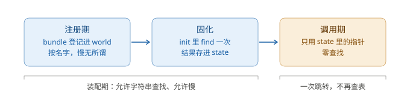
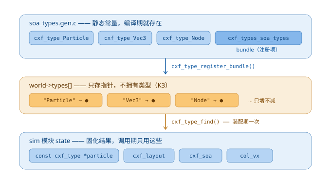
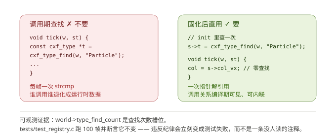
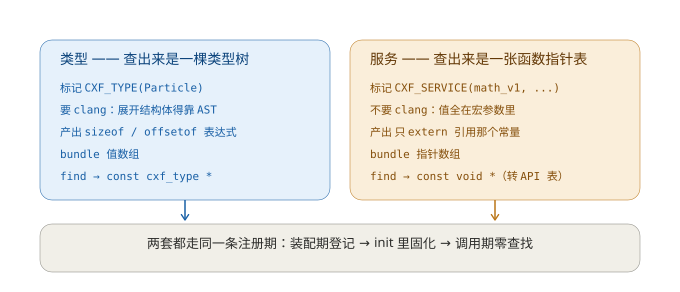

# 注册期

把编译期常量接到运行时查找上的那一米距离。

## 1. 它解决什么问题

类型描述符是编译期就存在的静态常量：

```c
const cxf_type cxf_type_Particle = { "Particle", (uint32_t)sizeof(Particle), ... };
```

但"给我 `Particle` 的描述符"这句话**在编译期没法表达**。唯一能表达它的方式是
到处写 `extern const cxf_type cxf_type_Particle;` —— 那等于把类型名字写死在调用方，
模块之间从此互相看得见，热插拔就没了。

注册期解决的就是这一米的距离：装配期把常量登记进 `world`，模块用字符串问一次，
拿到指针存进 state，从此调用期再没有查找。

## 2. 三阶段



| 阶段 | 允许什么 | 不允许什么 |
|---|---|---|
| 注册期 | 字符串查找、去重校验、整组登记 | —— |
| 固化 | 模块在 init 里 `find` 一次，结果存进 state | 每帧查 |
| 调用期 | 直接用 state 里的指针 | 任何形式的查找 |

慢不慢不是重点。重点是：**一旦调用期出现查找，"谁调用谁"就从编译期事实退化成
运行时数据** —— grep 失效、内联失效、编译器无法跨函数优化。那是白盒性的根本损失，
不是性能问题。

## 3. 接线：生成物 → world → state



三条所有权边界：

1. **描述符是静态常量**，在只读段，生命周期长于 world
2. **world 只存指针**，不拥有类型（K3），`release` 不 free 它们
3. **state 里的指针是固化结果**，调用期只用这些

### 为什么 bundle 必须由生成器产出

```c
const cxf_type_bundle cxf_types_soa_types = { cxf_entries_soa_types, 4, "soa_types.h" };
```

一个头文件里有几百个类型时，手写注册代码必然与描述符脱节 —— 新增一个类型忘了注册，
编译照样过，运行到某一帧才炸。注册项和描述符同源生成，这个错误就不存在了。

这是和"生成器不算数值"一致的决定：**凡是能从结构体定义推出来的，都不要手写。**

## 4. 为什么类型不卸载

这是类型注册表与模块表的关键差别。

模块能卸载，是因为它的 state 是运行时从 `arena_state` 分配的，卸掉就回收，
被依赖方由 refcount 保护（M3）。

类型的存储**压根不在 world 里**。"卸载一个类型"等于让一个结构体定义消失，
那没有意义 —— 运行时加载带来的是新类型，不是旧类型的消失。

所以：

- 类型表只增不减（K3），没有 unregister
- 模块卸载后类型照常可查（有测试覆盖：`test_type_outlives_module`）
- 类型缺失在 `start` 时就报错，不会拖到某一帧才炸（`test_missing_type_fails_start`）

## 5. 反模式：在 tick 里查找



### 这条纪律是可观测的，不是靠自觉

`world->type_find_count` 是查找次数槽位（与 `phase_ns[]` 同性质：内核只写槽位，
不做聚合与上报）。测试跑 100 帧并断言它不变：

```c
after_init = w.type_find_count;   /* 装配期只查了一次 */
for (uint32_t i = 0; i < 100; i++) cxf_world_tick(&w);
CHECK(w.type_find_count == after_init);
```

违反纪律会立刻变成测试失败，而不是一条没人读的注释。

## 6. API

```c
cxf_result     cxf_type_register(cxf_world *w, const char *name, const cxf_type *t);
cxf_result     cxf_type_register_bundle(cxf_world *w, const cxf_type_bundle *b);
const cxf_type *cxf_type_find(const cxf_world *w, const char *name);
```

`find` 是线性 `strcmp`。这是刻意的 —— 它只在装配期被调用，
给热路径加哈希索引是在错误的地方做优化。

`register_bundle` 先整体校验再提交：条目只增不减（K3），
失败时留下半张表会让调用方无从判断哪些注册了。

## 7. 不变式

| 编号 | 内容 | 谁在验证 |
|---|---|---|
| K1 | 同名不注册两次 —— 即使指针相同也报错 | `register` 返回 `CXF_ERR_RANGE`；`cxf_world_check` 校验名字唯一（W5） |
| K2 | `find` 只按名字精确匹配，不做前缀、模糊、版本协商 | 代码即契约 |
| K3 | 注册后指针在 world 生命周期内稳定；条目只增不减 | `test_type_outlives_module`、`test_bundle_atomic` |
| W5 | `types` 中每个条目 name / type 非空且名字唯一 | `cxf_world_check` |

K1 为什么连"指针相同"也报错：两个 bundle 导出同名类型是链接期就该发现的错误，
静默接受会掩盖它。

## 8. 服务注册：同一套基建的另一半



服务和类型走的是同一条注册期，差别只有查出来的是什么。

### 标记为什么自带定义

```c
#define CXF_SERVICE(SYM, NAME, VER, API) \
    const cxf_service_def cxf_svc_##SYM = { (NAME), (VER), (API) }
```

和 `CXF_TYPE` 一样，标记展开的是一个**真常量**，不是空宏。两个后果：

- **API 表本身可以保持 `static`。** 对外可见的只有这一层薄薄的注册项，
  调用方拿不到也不该拿到 API 结构体的符号。换成"生成器把 `&api` 写进 bundle"
  的做法，就要求 API 表外部可见。
- **标记只能写在实现文件里。** 它定义符号，写在被多个 TU 包含的头文件里
  会重复定义。这是代价，但换来的是上面那条封装性。

### 服务不需要 clang

类型的全部难点在于"结构体内部怎么展开"，那只能靠 AST。服务的 name / version / api
全在宏参数里，宏自己会展开成常量 —— 生成器连值都不必知道，只扫符号名即可。
知道反而更糟：那会让生成物与宏参数脱节。

所以生成器在纯服务文件上不跑 clang。

### 两条链路共用的纪律

| | 类型 | 服务 |
|---|---|---|
| 重名 | `CXF_ERR_RANGE`（K1） | 同名**同版本**才冲突（S1），同名不同版本允许 |
| 整组注册 | 先整体校验再提交（K3） | 同样（S3） |
| 卸载 | 不卸载 | 不卸载 |
| 查找计数槽位 | `type_find_count` | `service_find_count` |

版本是唯一的实质差别：S2 要求**精确**相等，不做向上兼容。ABI 兼容由注册方
显式注册多个版本来提供（`services.c` 里同一张表注册了 v1 与 v0）。

## 9. 验证

`make test` 覆盖（含本页提到的全部纪律）：

`build/test_soa` — 类型描述符与编译器一致、展平、筛选、gather 往返、自引用终止、超限拒绝
`build/test_registry` — 注册与查找、K1 重名、bundle 原子性、类型缺失时 `start` 失败、
固化后 100 帧 `type_find_count` 不变、模块卸载后类型仍在
`build/test_service` — 注册与查找、S2 版本精确匹配、同名多版本、S1 重名重版本、
bundle 原子性、服务缺失时 `start` 失败、固化后 100 帧 `service_find_count` 不变

生成产物进版本库，`make gen` 手动触发（`gen_registry.py` 需要 clang 与 python，
构建本身不该依赖它们）。

四重构建全绿：`-O2` / `-O0 -Wconversion -Wshadow` / `NDEBUG` / `ASan+UBSan`。
